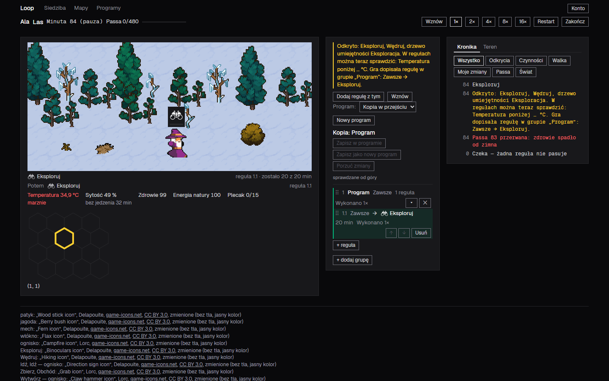
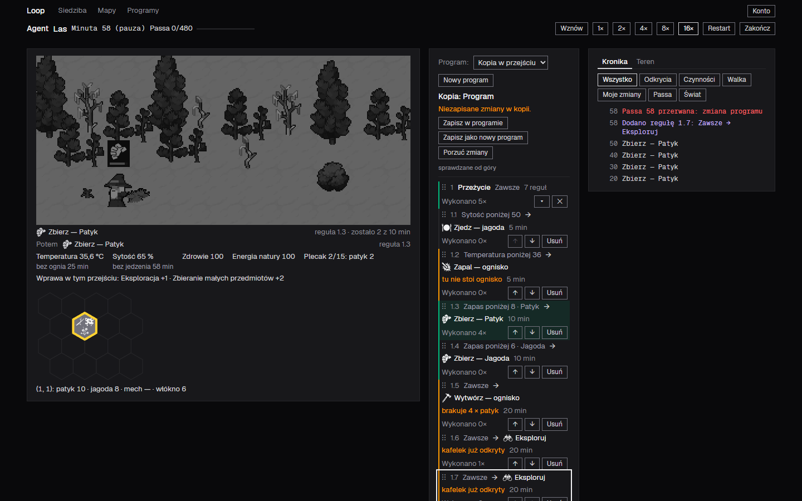
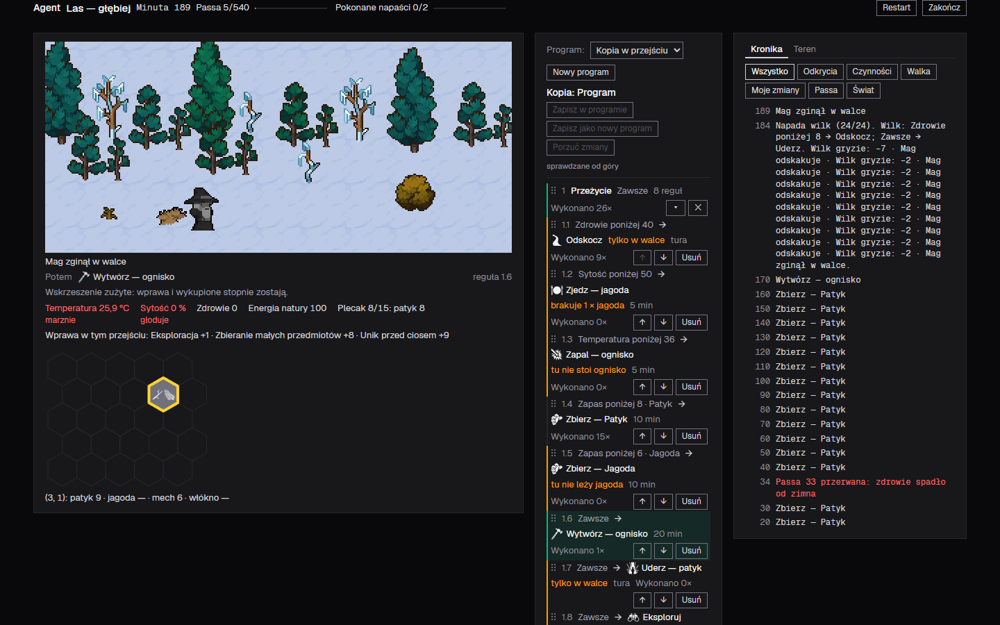
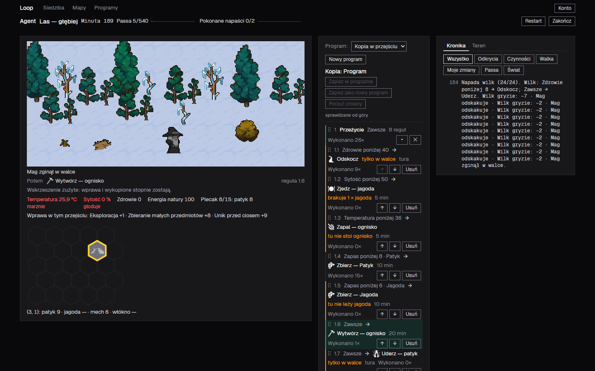

**State: ready** — the change is finished, reviewed and tested; four things below wait for your yes.

## What you will see

On the screen of a manual map run, the right area now holds a chronicle: a list of what happened in the run, each entry with the game minute it happened in, which you can filter by kind.

- **Two tabs at the top of the right area**, „Kronika" and „Teren". „Kronika" is the one picked when the character is sent. „Teren" is the table of revealed tiles that stood there before. While a rule is open for editing, it still takes the whole right area, and „✕" brings back the tab you had picked.
- **A row of seven filters** under the tabs, in the look of the pace buttons, one picked at a time: „Wszystko", „Odkrycia", „Czynności", „Walka", „Moje zmiany", „Passa", „Świat". „Wszystko" is picked when the character is sent.
- **The list**, newest entry on top, the game minute alone in a column on the left and the text next to it, all in the monospaced font on the dark panel. An empty list, or a filter with nothing in it, says „Nic tu jeszcze nie ma.".
- **What gets an entry.** A discovery gives one entry per minute with the whole text of the band that stood above the program, the rule the game wrote included (in the discovery colour). Each action the character starts gives an entry in the words of the program rule, such as „Zbierz — Patyk", and a wait gives one entry when it starts, „Czeka — żadna reguła nie pasuje". An attack gives one paragraph, the last attack's, which grows when its turns are resolved. Each change you make to the copy of the program gives an entry in your colour: „Dodano regułę 2.3: Zawsze → Wędruj", „Usunięto regułę …", „Zmieniono regułę …", „Przesunięto regułę …", the same for groups, „Zmieniono plan wyprawy", „Porzucono zmiany kopii", and the saves and the switch of the program; they go on being written after the run has ended, until „Restart" or „Zakończ". A loss of the streak gives an entry in red, only when a streak above zero falls to zero, with the number it fell from and the cause: „Passa 58 przerwana: zmiana programu", „… zdrowie spadło od zimna", „… od głodu", „… od zimna i głodu", „… przełączenie na inny program". The new kind „Świat" holds „Ognisko wygasło", the death of the character in the words „Teraz" uses („Mag zamarzł") and the solved map in green („Las rozwiązany").
- **How long it lasts.** The chronicle is empty when you send the character and again at „Restart", and it goes at „Zakończ". It stays when you leave the screen for Siedziba and come back. It lives in the page, not in the save: after you reload the page or sign in again, the chronicle of the run that goes on starts with the paragraph of the last attack alone. The tab and the filter you pick stay picked through the run, „Restart" included. The paragraph of the last attack has left the area of the world on the left.
- **A long run** shows the newest 60 entries and shows more as you scroll to the end of the list.

The agents checked the chronicle in a real browser at 1× and at 16×; the 21 screenshots stand in the committed record (see *Checks*), and the four above are the ones that show the most.

### Underneath

The simulation now reports two things it did not: a streak above zero falling to zero, with its cause, and a campfire going out. The view keeps the chronicle in the memory of the page and describes a change you make to the copy of the program by comparing the copy before and after it, so the save keeps its shape and its version.

## For you to decide

1. Two things were not seen the way you will meet them. The wolf attacks only on the second map, which the agents' mage did not reach by playing, so the paragraph of an attack was seen in the real browser only in a state composed by hand, and the fight in it ended in the mage's death; no screenshot shows an attack the mage survives. And, as the task says, the check by playing, which the product leaves to you, is yours after the merge. Merge without them? (Checks, 3 and 5)
2. Eight choices the cycle made, which you will see on the screen. (a) The filter you pick stays picked through „Restart" and through leaving the screen, and goes back to „Wszystko" only when the character is sent; the task says only that „Wszystko" stands at the start. (b) An edit of the saved program the copy came from gives no entry, as an edit of any other saved program gives none, since it changes no run. (c) A changed rule reads as the whole old sentence, an arrow and the whole new sentence, so a rule changed from „Zawsze → Eksploruj" to „Zawsze → Wędruj" reads „Zmieniono regułę 2.1: Zawsze → Eksploruj → Zawsze → Wędruj", as the task's words give it; it reads clumsily. (d) An entry about a group names the group only, with no number and no condition. (e) „Ognisko wygasło" is written for each campfire that goes out, where a map holds several. (f) The empty sentence is in the faint text colour, and the filter buttons keep the font of the shared buttons, not the monospaced font of the list. (g) The list shows the newest 60 entries and grows by 60 near its end, inside a box at most 70% of the window's height. (h) The paragraph of the last attack stands at the minute of the attack and gets its turns when the fight is resolved, which the simulation does at once, not turn by turn as time passes. Accept them? (Course of the cycle, Choices)
3. Entries of the foundation you have not seen in the task. A new decision says how the chronicle learns things: what happens inside a game minute from what the simulation reports, and what you change in the copy from the copy before and after, with the editor's hint of which rule moved never reaching the simulation. A new fact says that the tool the agents use to operate the browser can list the browser's console messages, which the decision about how an agent learns what went wrong rests on. That decision was written with both sentences the task quotes and without one sentence of its reasons, „Today an exception stops the game without a word", which is no longer true. Three older decisions were corrected where this change made them untrue: where the line of what a completed run deposited stands, an example of text on a solid background under the scene, and an example of the link between a tile and its row of the table, which holds only under „Teren". Accept them? (Foundation entries)
4. Two findings that no fix took in, which you will feel. After a reload in the middle of a run, the right area shows „Kronika" and „Wszystko" again even if you had picked „Teren" or another filter; the task, its answers and the decisions do not say whether the pick should survive a reload, and writing that down would add a meaning nobody settled. Should the pick survive a reload? And, outside the task: the table under „Teren" is cut at its right edge, because the campfire cell is wider than the column; it was so before this change. Fix the table in this request, or make a task of it? (Minor findings, 1; Findings outside the task's scope, 1)

## Cost

About 2 h 45 min of working time over the stages in the [table of stages](https://github.com/mariusznazar/loop2/blob/RECORD_SHA/docs/task-cycles/kronika-z-filtrami/stages.md): 15 subagent turns of work — the spec's designer and its reviewer, the planner, the foundation entries, the seven slices, the review of the whole change, its fix, the return step and its review — and the resumed turns after a review. About 218 million tokens counted, nearly all of them cached input (Opus 5.5: 104.0 million, Sonnet 5.5: 103.0 million, Haiku 5.5: 10.8 million). Three review rounds failed or found something: the review of the spec failed once on one minor finding and passed after one revision; the review of the whole change passed with five minor findings, which one fix took in, three of them in whole or in part, and its review passed; the review of the return step failed once on one blocking finding, and passed after one fix.

## How to merge

Merge with „Create a merge commit": the link to the record of the cycle survives only if the commits are kept. The foundation has waited for a review through 63 merges since the start of the history (no review tag yet; the limit is 30); the review is the skill `the-way-review-foundation`, started in a session in this repository. Nothing in this request waits for it.

W języku zadania (po polsku)

**Stan: gotowe** — zmiana jest kompletna, przejrzana i przetestowana; cztery rzeczy poniżej czekają na Twoje „tak".

## Co zobaczysz

Na ekranie przejścia ręcznego prawy obszar trzyma teraz kronikę: listę tego, co stało się w przejściu, każdy wpis z minutą gry, którą można filtrować według rodzaju.

- **Dwie zakładki u góry prawego obszaru**, „Kronika" i „Teren". Po wysłaniu postaci wybrana jest „Kronika". „Teren" to tabela odsłoniętych kafelków, która stała tu dotąd. Otwarta reguła do edycji nadal zajmuje cały prawy obszar, a „✕" przywraca zakładkę, którą wybrałeś.
- **Rząd siedmiu filtrów** pod zakładkami, w wyglądzie przycisków tempa, jeden wybrany naraz: „Wszystko", „Odkrycia", „Czynności", „Walka", „Moje zmiany", „Passa", „Świat". Po wysłaniu postaci wybrane jest „Wszystko".
- **Lista**: najnowszy wpis u góry, minuta gry sama w kolumnie po lewej, obok tekst, całość krojem o stałej szerokości na ciemnym panelu. Pusta lista albo filtr bez wpisów mówi „Nic tu jeszcze nie ma.".
- **Co dostaje wpis.** Odkrycie daje jeden wpis na minutę z całym tekstem pasa, który stał nad programem, razem z regułą dopisaną przez grę (w kolorze odkrycia). Każda czynność, którą postać zaczyna, daje wpis słowami reguły programu, np. „Zbierz — Patyk", a czekanie daje jeden wpis na początku, „Czeka — żadna reguła nie pasuje". Napaść daje jeden akapit, ostatniej napaści, który rośnie, gdy rozstrzygają się jej tury. Każda zmiana kopii programu daje wpis w Twoim kolorze: „Dodano regułę 2.3: Zawsze → Wędruj", „Usunięto regułę …", „Zmieniono regułę …", „Przesunięto regułę …", to samo dla grup, „Zmieniono plan wyprawy", „Porzucono zmiany kopii" oraz zapisy i przełączenie programu; wpisy powstają także po końcu przejścia, do „Restart" albo „Zakończ". Utrata passy daje wpis na czerwono, tylko gdy passa większa od zera spada do zera, z liczbą, od której spadła, i przyczyną: „Passa 58 przerwana: zmiana programu", „… zdrowie spadło od zimna", „… od głodu", „… od zimna i głodu", „… przełączenie na inny program". Nowy rodzaj „Świat" trzyma „Ognisko wygasło", śmierć postaci słowami „Teraz" („Mag zamarzł") i rozwiązaną mapę na zielono („Las rozwiązany").
- **Jak długo trwa.** Kronika jest pusta po wysłaniu postaci i znów po „Restart", a znika przy „Zakończ". Zostaje, gdy wyjdziesz do Siedziby i wrócisz. Żyje w pamięci strony, nie w zapisie: po odświeżeniu strony albo ponownym zalogowaniu kronika trwającego przejścia zaczyna się od samego akapitu ostatniej napaści. Wybrana zakładka i filtr trzymają się przez całe przejście, także po „Restart". Akapit ostatniej napaści zszedł z obszaru świata po lewej.
- **Długie przejście** pokazuje 60 najnowszych wpisów i dokłada kolejne, gdy przewiniesz do końca listy.

Zrzuty ekranu stoją wyżej w części angielskiej; agenci sprawdzili kronikę w prawdziwej przeglądarce przy 1× i 16×, a 21 zrzutów jest w zatwierdzonym zapisie cyklu (zob. *Checks*).

**Pod spodem.** Symulacja zgłasza teraz dwie rzeczy, których dotąd nie zgłaszała: spadek passy większej od zera do zera z przyczyną i wygaśnięcie ogniska. Widok trzyma kronikę w pamięci strony, a zmianę, którą robisz w kopii programu, opisuje, porównując kopię przed i po niej, więc zapis gry zachowuje kształt i wersję.

## Do Twojej decyzji

1. Dwóch rzeczy nie widziano tak, jak je spotkasz. Wilk napada tylko na drugiej mapie, do której mag agentów nie doszedł grając, więc akapit napaści widziano w prawdziwej przeglądarce tylko w stanie złożonym ręcznie, a walka w nim skończyła się śmiercią maga; żaden zrzut nie pokazuje napaści, którą mag przeżył. A sprawdzenie graniem, które produkt zostawia Tobie, jest — jak mówi zadanie — Twoje po scaleniu. Scalić bez nich? (Checks, 3 i 5)
2. Osiem wyborów cyklu, które zobaczysz na ekranie. (a) Wybrany filtr trzyma się przez „Restart" i wyjście z ekranu, a wraca do „Wszystko" dopiero po wysłaniu postaci; zadanie mówi tylko, że „Wszystko" stoi na starcie. (b) Edycja zapisanego programu, od którego jest kopia, nie daje wpisu, tak jak edycja każdego innego zapisanego programu, bo nie zmienia przejścia. (c) Zmieniona reguła brzmi jako całe stare zdanie, strzałka i całe nowe zdanie, więc reguła zmieniona z „Zawsze → Eksploruj" na „Zawsze → Wędruj" brzmi „Zmieniono regułę 2.1: Zawsze → Eksploruj → Zawsze → Wędruj", jak daje to brzmienie zadania; czyta się to niezgrabnie. (d) Wpis o grupie podaje tylko jej nazwę, bez numeru i warunku. (e) „Ognisko wygasło" pisze się dla każdego ogniska, które gaśnie, gdy mapa ma ich kilka. (f) Zdanie pustej listy jest bladym kolorem tekstu, a przyciski filtra mają krój wspólnych przycisków, nie krój o stałej szerokości listy. (g) Lista pokazuje 60 najnowszych wpisów i dokłada po 60 przy końcu, w polu wysokim najwyżej na 70% okna. (h) Akapit ostatniej napaści stoi w minucie napaści i dostaje tury, gdy walka się rozstrzyga, co symulacja robi od razu, a nie tura po turze w miarę upływu czasu. Przyjmujesz? (Course of the cycle, Choices)
3. Wpisy fundamentu, których nie widziałeś w zadaniu. Nowa decyzja mówi, skąd kronika się dowiaduje: to, co dzieje się w minucie gry, ze zgłoszeń symulacji, a to, co zmieniasz w kopii, z kopii przed i po, przy czym podpowiedź edytora, którą regułę przesunięto, nigdy nie trafia do symulacji. Nowy fakt mówi, że narzędzie, którym agenci obsługują przeglądarkę, potrafi wypisać komunikaty jej konsoli, na czym opiera się decyzja o tym, jak agent dowiaduje się, co poszło nie tak. Tę decyzję zapisano z oboma zdaniami, które cytuje zadanie, i bez jednego zdania uzasadnienia, „Today an exception stops the game without a word", które nie jest już prawdą. Trzy starsze decyzje poprawiono tam, gdzie ta zmiana uczyniła je nieprawdziwymi: gdzie stoi linia tego, co przejście odłożyło do skrzynki, przykład tekstu na pełnym tle pod sceną i przykład połączenia kafelka z jego wierszem tabeli, który obowiązuje tylko pod „Teren". Przyjmujesz? (Foundation entries)
4. Dwa znaleziska, których żadna poprawka nie wzięła, a które poczujesz. Po odświeżeniu w środku przejścia prawy obszar znów pokazuje „Kronika" i „Wszystko", nawet gdy wybrałeś „Teren" albo inny filtr; zadanie, jego odpowiedzi i decyzje nie mówią, czy wybór ma przetrwać odświeżenie, a zapisanie tego dodałoby znaczenie, którego nikt nie rozstrzygnął. Czy wybór ma przetrwać odświeżenie? I, poza zadaniem: tabela pod „Teren" jest ucięta z prawej strony, bo komórka z ogniskiem jest szersza niż kolumna; tak było przed tą zmianą. Poprawić tabelę w tej prośbie, czy zrobić z tego zadanie? (Minor findings, 1; Findings outside the task's scope, 1)

## Koszt

Około 2 h 45 min pracy na etapach z [tabeli etapów](https://github.com/mariusznazar/loop2/blob/RECORD_SHA/docs/task-cycles/kronika-z-filtrami/stages.md): 15 tur pracy subagentów — projektant specu i jego recenzent, planista, wpisy fundamentu, siedem kawałków, przegląd całej zmiany, jego poprawka, krok powrotny i jego przegląd — oraz wznowione tury po przeglądach. Około 218 mln tokenów, prawie wszystkie z pamięci podręcznej (Opus 5.5: 104,0 mln, Sonnet 5.5: 103,0 mln, Haiku 5.5: 10,8 mln). Trzy rundy przeglądu nie przeszły gładko albo coś znalazły: przegląd specu nie przeszedł raz z jedną drobną uwagą i przeszedł po jednej rewizji; przegląd całej zmiany przeszedł z pięcioma drobnymi uwagami, z których jedna poprawka wzięła w całości lub w części trzy, a jej przegląd przeszedł; przegląd kroku powrotnego nie przeszedł raz z jednym znaleziskiem blokującym i przeszedł po jednej poprawce.

## Jak scalić

„Create a merge commit": link do zapisu cyklu przetrwa tylko wtedy, gdy commity zostaną. Fundament czeka na przegląd od 63 scaleń od początku historii (bez znacznika przeglądu; próg to 30); przegląd to skill `the-way-review-foundation`, uruchamiany w sesji w tym repozytorium. Nic w tej prośbie na niego nie czeka.

## Technical changes

Each item says what it concerns first; commits are named, and the places in the code follow.

- **The foundation, written before any code (8 commits, `0bb4be9` to `3ea46e8`).** It gives the chronicle its words in the log of decisions: the glossary term `chronicle`, D-338 to D-347 and the corrections of D-04, D-122, D-147, D-311, D-185, D-272 and D-19 (`foundations/decisions.md`, `foundations/glossary.md`).
- **The simulation reports the loss of a streak (`734b2dd`).** A new kind of event, `streakLost`, with the minute, the streak before the loss and the cause, emitted by the body's step of a minute, also in the minute of a death of cold or hunger and before the death, and by an edit of the copy, a discard and a switch of program (`src/browser/sim/run.ts`, `body.ts`, `programs.ts`, `game.ts`; `tests/sim/streak.test.mjs`, `copy-actions.test.mjs`, `body.test.mjs`, `discovery.test.mjs`).
- **The simulation reports a campfire going out (`6392714`).** A new kind of event, `campfireExtinguished`, with the minute and the tile, emitted in a living minute and in a minute of an encounter, none in the minute of a death (`src/browser/sim/run.ts`; `tests/sim/campfire.test.mjs`).
- **The chronicle memory and the composing of its entries (`416c10d`).** A module of the view with no React and no DOM that records every result, clears and keeps as „Restart", „Zakończ" and the send ask, and hands out a bounded window of entries; a pure module that turns an event or an act on the copy into an entry, with the comparison of the copy before and after an edit; and the discovery band's text taken out into a function both the band and the chronicle use (`src/browser/view/chronicle.ts`, `chronicle-entries.ts`, `discovery-band-text.ts`, `discovery-band.tsx`, `now-lines.ts`).
- **The game view records every result and the editor names the rule it moved (`5ed6c6b`).** The recording stands in one function that both the store and the player's acts call; the three places where the editor moves a rule or a group hand the moved one on, and it never reaches the simulation (`src/browser/view/game-view.ts`, `program-panel.tsx`, `rule-list.tsx`).
- **The right area with its tabs, filters and list (`2b74988`).** A new screen part, the removal of the paragraph from the area of the world, the styles, and the browser check at 1× and 16× (`src/browser/view/right-area.tsx`, `run-screen.tsx`, `world-area.tsx`, `src/browser/styles.css`; `tests/view/right-area.test.mjs`, `chronicle-game.test.mjs`, `run-screen.test.mjs`, `world-area.test.mjs`, `scene.test.mjs`, `chronicle.test.mjs`).
- **The guidelines (`2ca73e1`, `1880393`).** The styleguide says how the chronicle uses roles, the monospaced font and the shared controls, and the right area's tabs are named as a second place of a tab; the table of files of the view's coding guidelines gets four rows with the status `copy` (`guidelines/styleguide-browser-view.md`, `guidelines/coding-browser-module.md`).
- **The fix for the Minor findings of the whole-change review (`d47e21f`, `1f4424a`, `621d144`).** The decision about how an agent learns what went wrong holds both sentences again; the styleguide loses a line that does not belong and its new rule is wrapped; the window of the list starts anew at a send and at „Restart" through a number of the map run kept by the chronicle, and a test pins that the paragraph is composed once per encounter (`foundations/decisions.md`, `guidelines/styleguide-browser-view.md`, `src/browser/view/chronicle.ts`, `right-area.tsx`; `tests/view/right-area.test.mjs`, `chronicle.test.mjs`).
- **The return step and its fix (`f71a388`, `638e89e`, `d3a2559`).** An environment fact and the decision about how the chronicle learns, and one correction of that decision after its review failed (`foundations/environment_facts.md`, `foundations/decisions.md`).

## Checks

1. **The gate:** `npm test` with no file, from the worktree root, exit code 0 on the head `d3a2559` (1994 Node tests passed and 0 failed, `412 tests in 4 directories; every directory passed`, `0 errors` of the foundation check; the base had 1908 Node tests passed). Three tests were skipped for want of a Docker daemon (the container isolation, the container's sprites and its one serving process), on the base as on the head; they stay unchecked here. Nothing else failed or did not run. Before the change the same command passed on the base, `6f36c7a`, with the same three skipped.
2. **Own-work checks.** Slice 1: the order of the loss and the death in one minute, seen through two death cases and a broken `&&`. Slice 2: the branch where an activity goes on past the campfire's last minute, a broken return caught by a new case. Slice 3: a run through the real simulation to a death of cold, whose chronicle was read (death at minute 243, no loss at a streak already at zero). Slice 4: the recording through the game view, seen once with a temporary hook and no permanent test (the game-view test is slice 5's). Slice 5: the window and the paragraph composed once per change; it showed that no test sees a row drawn again. Slices 6 and 7: the roles and files of the guidelines against the code. Fix: the window's key, with a test seen failing first.
3. **Checks failing or not run, by name:** the real browser check of an attack the mage survives did not run (see *For you to decide*, 1), and the console of the browser was read after the last reload, not after each of the earlier ones; the manual check by playing, which D-75 and D-88 leave to a person, waits for you after the merge. The test that a row is not drawn again when entries arrive above it (`memo` of the row) does not exist, for no test can see a render without product code written for it (Minor findings, 2).
4. **The check by the reviewer of the whole change, beyond the cycle's runs:** StrykerJS on the changed simulation lines, 82 mutants, 81 killed, one survivor on a line of the base (Findings outside the task's scope, 3).
5. **User-interface states, real browser** (`npm run local`, Playwright CLI 0.1.22, 1440×900, a made account, the maps „Las" and „Las — głębiej"; for the long runs and the attack the agents composed saved states and sent them through the ordinary save request): 21 screenshots in the committed record under `docs/task-cycles/kronika-z-filtrami/screenshots/`: 1× at the first minutes with „Kronika"/„Wszystko" and a wait (01); at the first discovery with the action, the discovery entry and the loss of the streak (02), „Passa" (03), an empty „Walka" (04), „Teren" (05); 16× to a death of cold (06), actions (07), the rule panel open (08), a change and the loss it caused in one minute (09), „Moje zmiany" (10), a long run to minute 440 (11, 12, 13), a completed run (14), „Teren" before and after Siedziba and back (15, 16, 17), an attack with its paragraph and death in the fight (18), after a reload (19), an empty „Passa" (20), after „Restart" (21). The console held only the two usual lines at the first load (a 401 before sign-in and a missing icon). The screenshots were looked at by the cycle (02, 09, 18, 19) and by the reviewer of the whole change (the same four).
6. **The form check of this description:** FORM_CHECK_LINE
7. **The check of private paths:** PRIVATE_LINE
8. **The process remarks check:** run 1 on the original, `python -B .the-way/task-cycle/remarks_check.py docs/task-cycles/kronika-z-filtrami`, exit 1, 51 items listed; run 2, exit 0, 0 not in the process remarks; REMARKS_COPY_LINE
9. **The count of merges since the last review of the foundation:** `python -B .the-way/task-cycle/review_reminder.py origin/main`: tag none, merges 63, threshold 30, `reminder: yes`.

## Foundation entries

- `chronicle` (glossary) — `projected`: the record a manual map run keeps for the player to read, each entry with its game minute.
- D-338 — `projected`: a manual map run keeps a chronicle of discoveries, actions, combat, the player's changes and each loss of the streak with its cause, which the player filters in the right area.
- D-339 — `row 1`: the chronicle lives in the memory of the page, not in the save, survives leaving the screen, and after a load starts from the paragraph of the last encounter alone.
- D-340 — `row 2`: the start of each action gives an entry in the words of „Teraz", a wait one entry when it starts.
- D-341 — `row 3`: a loss of the streak gives an entry only when a streak above zero falls to zero, with five causes, in `danger`.
- D-342 — `row 4`: each change of the copy gives an entry in `player-change`, also after the end until „Restart" or „Zakończ"; an edit of a saved program gives none.
- D-343 — `row 7`, `row 8`: seven filters in the look of the pace buttons, newest entry on top, the minute in a column in `text-label`, `panel`, colours by kind, „Nic tu jeszcze nie ma.".
- D-344 — `row 9`: the kind „Świat" with „Ognisko wygasło", death and completion in the words of „Teraz".
- D-345 — `row 10`: the discoveries of one minute give one entry with the whole text of the band.
- D-346 — `row 14`: the pick of „Kronika" or „Teren" holds through the map run, „Restart" and leaving the screen included.
- D-04 — `projected`: the view draws the chronicle, as the scene, also from its previous reading of the game state and the events the simulation returned.
- D-122, D-147, D-311 — `projected`: what the band named enters the chronicle; the paragraph of the last encounter stands as an entry of the chronicle in the minute of the attack, through a load too; the right area holds the chronicle or the table under the tabs, and the world holds no paragraph.
- D-347 — `projected` (the part this task makes true, both sentences the task quotes, tied to D-323 and D-253 which state the second more exactly); its *Based on* is `the cycle's`.
- D-348 — `the cycle's`: the chronicle takes what happens in a game minute from the simulation's events and describes an act of the player on the copy from what the act was and, for an edit, from the copy before and after it, with the editor's hint never entering the simulation.
- `playwright-cli-console-messages` (environment fact) — `the cycle's`: Playwright CLI has a command that lists console messages.
- D-185, D-272, D-19 — `the cycle's`: corrections of the sentences or examples this change made untrue (the line of what a completion deposited without the paragraph, the solid background under the scene with „Teraz" and „Potem", the link between a tile and its row only under „Teren").
- Invariant tests altered: none. Surfaces altered: none. *Violated* marks set or cleared: none.

## Minor findings

1. **The pick after a load (whole-change review, finding 2; contested, left unfixed).** Reviewer: „D-346 states „through the whole map run" with no word about a load, while the code starts every load at „Kronika"" (`foundations/decisions.md`, D-346; `src/browser/view/chronicle.ts:118`, the initial tab). Row 14 is silent on a load and the reviewed spec reads a load as starting at „Kronika" and „Wszystko"; a qualification would add a meaning the task did not settle, so it waits for your answer (For you to decide, 4).
2. **No test of „a row already drawn is not drawn again" (whole-change review, finding 4; fixed in part).** Reviewer: removing `memo` of the row (`src/browser/view/right-area.tsx:77`) passes every test. The fix pinned the paragraph's `useMemo` (a scratch removal failed the new case); the `memo` of the row cannot be tested without product code written for the test, which the product's rules for tests do not allow; the window bounds what is drawn, so the effect of losing it is slower drawing, not a wrong screen.
3. **D-348 and D-04 (return-step review, M1).** Reviewer: D-348 makes the editor's hint a source of the chronicle and says `derives from D-04`, while D-04's sentence lists what the view draws „only from" (`foundations/decisions.md`, D-348 and D-04). Left Minor; were D-04's „only" read strictly, D-348 would need `narrows D-04`.
4. **D-348, *Rejected* (return-step review, M2).** Reviewer: it drops the condition under which a reading of the state alone loses the cause of a loss, „where the body recovered within the span" (`foundations/decisions.md`, D-348, *Rejected*). Prose that binds nothing.
5. **D-348, *Origin* (return-step review, M3).** Reviewer: it names where the question stands, not where the reasoning lives (`foundations/decisions.md`, D-348, *Origin*); the log's convention for cycle-written decisions points to the task document the same way.
6. **A lost antecedent and a long line in D-348 (review of the fix of the return step, N1).** Reviewer: „such a change" at the end of the second sentence lost its antecedent after the fix, „no event of the simulation describes such an act" would be exact; and the *Rationale* line was not rewrapped, 136 characters (`foundations/decisions.md`, D-348).

## Findings outside the task's scope

1. **The table under „Teren" is cut at the right edge.** Reviewer: the table of revealed tiles is cut at the right edge of the right area, where `.screen-area.run-right` has `overflow-x: auto` and a column width that predate this change (`src/browser/styles.css:303`), seen in two screenshots; present at the base (For you to decide, 4).
2. **A file of the view without a row in the coding guidelines.** Reviewer: the end-of-run question's screen part has no row in the table of files of the view's coding guidelines, since it predates this change (`src/browser/view/end-question.tsx`; `guidelines/coding-browser-module.md`); under the rule for existing files it waits for the next refresh of that table.
3. **A survivor of the mutation run on a line of the base.** Reviewer: a mutant of `picks: false` to `true` in the death branch of the minute step survives (`src/browser/sim/run.ts:549`); the line is unchanged, and the flag is not read after a death because the end of a run returns at once.
- No check whose file belongs to a part outside the task's parts failed in a cycle run.

## Course of the cycle

- **Task and sources:** the chronicle with filters on the screen of a manual map run, item 15 of the plan of the MVP2 project, which depends on tasks 7, 8 and 14, all merged; the base is the `main` at `6f36c7a`, after the merge of task 14; the definition's approval and its fingerprint stand as the task cites them.
- **Process pin:** `294af7f`, the gitlink at the base; the cycle did not move it. The session's local `main` stood behind the remote one and was brought up before the cycle began.
- **Spec:** written, because the task left four open choices of design that bind each other (where the facts come from, how the game learns that a campfire went out, where the chronicle lives, how the list stays fluid); it failed its review once on one minor finding, was revised once and passed; link: `docs/task-cycles/kronika-z-filtrami/spec.md` in the record.
- **Route:** planned slices, because the change crosses the simulation and the view, writes about twenty entries of the foundation and two guideline changes, and ends with a check in a real browser; the orchestrator raised the models of slices 1 and 4 from the plan's `cheaper` to `same`, since its own model is not the strongest (see the process remarks).
- **Plan:** `docs/task-cycles/kronika-z-filtrami/plan.md` in the record: 19 foundation entries and 7 slices, all of them fit by the size script; no slice had a review of its own, for no slice touches a trust boundary or holds an operation that cannot be undone.
- **Choices:** 12 choices beyond the task's content, in the questions table: the 8 listed in *For you to decide*, which the reviewed spec settled where the task's words read two ways, and 4 of the plan's review; table: `docs/task-cycles/kronika-z-filtrami/cycle.md`, *Questions and autonomous choices*.
- **Blocking findings left:** none. One blocking finding stood after the review of the return step and was fixed once; its review passed.
- **Record:** RECORD_LINK
