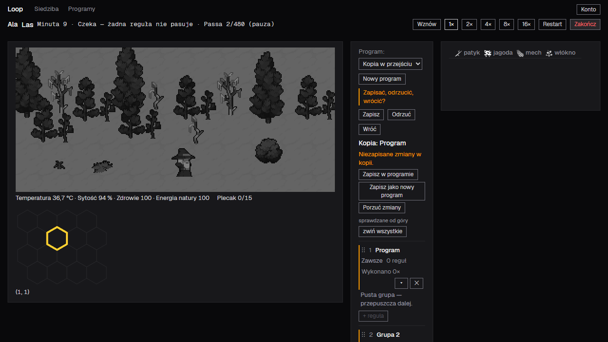
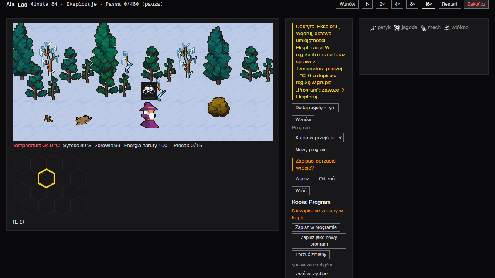

**State: ready** — the change is complete and reviewed; four items below wait for your yes.

## What you will see

When you press „Zakończ” on a hand-run map and the program copy has unsaved changes, the game no longer ends the run at once. It stops the run and asks „Zapisać, odrzucić, wrócić?” with three buttons, in this order:

- „Zapisz” saves the copy into its program and ends the run. If you deleted that program during the run, it saves the copy as a new program under the first free name, with no name field to fill in, and ends the run. If the program changed since the copy was taken, a line under the question says that the save replaces those changes.
- „Odrzuć” ends the run without saving; the program stays as it was. It is a red-on-hover button, like „Zakończ”, because it throws work away.
- „Wróć” closes the question and the run goes on exactly as before: a running run runs, a paused one stays paused.

All three end the run on the character's screen, where the program editor shows the program the copy belongs to. Without unsaved changes „Zakończ” works as it did: it ends the run at once.

The question stands in the program column, directly above the heading „Kopia: …” and under the discovery band when one stands. It works at every moment of a run: running, paused, paused at a discovery, after the character died and after the map was solved. While it stands the run is paused. The rest of the screen keeps working: the question goes away by itself when the copy has no unsaved changes any more (after saving in the copy's panel, discarding changes, or switching the character to another program), and „Wznów” or „Restart” close it as „Wróć” does. Leaving the screen closes it, and a reload does not bring it back.

### Underneath

The question is a state of the screen only; it is not part of the saved game, so a save, a reload or an older save is untouched. The request also moves the process this repository works under (the-way) to a newer version, in its own first commit.

## For you to decide

1. Two things in the real browser were not looked at: the colour of „Odrzuć” under the pointer or at keyboard focus (it is the same kind of button as „Zakończ”, which showed red, and a test checks the kind), and windows narrower than the 1280 pixels used. At 1280 pixels the question wraps onto three rows in the narrow program column. Merge without them? (Checks)
2. The task did not fix three things, and the cycle chose them: the question is drawn like the discovery band, with a coloured bar at its left edge and the same spacing; the first answer „Zapisz” takes keyboard focus when the question opens (the safe answer), and „Wróć” returns focus to the screen; after the game stopped itself on an error nothing handled, „Zakończ” with unsaved changes does nothing instead of opening the character screen. Accept?
3. Two foundation entries are ones you did not see in the task. The task named one existing decision for the question; the cycle wrote what happens to the run and the screen while the question stands (pause, „Wróć”, leaving the screen, what closes the question) as a second, new decision, because it answers a different question. And the last step of the cycle corrected two entries to match the final code: the question stays where the heading of the copy would stand while another program is shown, and the question goes away only when the copy has no unsaved changes measured as the copy's panel measures it. Accept? (Foundation entries)
4. The project plan in your notes lists the entries this task writes and does not name the new decision. This request cannot change your notes. Fix it in your notes, or make a task of it? (Findings outside the task's scope, 1)

## Cost

The cycle took about 52 minutes of working time and 68.4 million tokens, all on one model (Sonnet 5.5): one author, three reviews and the return step. There were three review rounds: the review of the whole change failed once (the question stood too far from the heading of the copy), the author fixed it, the same reviewer passed the fix, and a fresh reviewer passed the return step. The table of stages is in the committed record: [stages](https://github.com/mariusznazar/loop2/blob/RECORD_SHA/docs/task-cycles/pytanie-przy-zakoncz/stages.md).

## How to merge

Merge with a merge commit, which keeps the commits; the link to the record of the cycle survives only then, and the repository's earlier requests were merged this way.

The foundation has waited for a review through 60 merges since the start of the history (no review has been tagged yet). The review is the skill `the-way-review-foundation`, started in a session in this repository. Nothing in this request waits for it.

In your language (Polski)

**Stan: gotowe** — zmiana jest kompletna i sprawdzona; cztery punkty poniżej czekają na Twoje „tak”.

## Co zobaczysz

Gdy naciśniesz „Zakończ” na ręcznie prowadzonej mapie, a kopia programu ma niezapisane zmiany, gra nie kończy już przejścia od razu. Zatrzymuje je i pyta „Zapisać, odrzucić, wrócić?” trzema przyciskami, w tej kolejności:

- „Zapisz” zapisuje kopię w jej programie i kończy przejście. Jeśli ten program usunięto w trakcie przejścia, zapisuje kopię jako nowy program pod pierwszą wolną nazwą, bez pola nazwy, i kończy przejście. Gdy program zmienił się od chwili wzięcia kopii, linia pod pytaniem mówi, że zapis te zmiany zastąpi.
- „Odrzuć” kończy przejście bez zapisu; program zostaje taki, jaki był. To przycisk niszczący (czerwony pod kursorem), jak „Zakończ”, bo wyrzuca pracę.
- „Wróć” zamyka pytanie, a przejście trwa dalej tak, jak przedtem: biegnące biegnie, wstrzymane zostaje wstrzymane.

Każda z trzech odpowiedzi kończy przejście na ekranie postaci, gdzie edytor programu pokazuje program, do którego należy kopia. Bez niezapisanych zmian „Zakończ” działa jak dotąd: kończy przejście od razu.

Pytanie stoi w kolumnie programu, tuż nad nagłówkiem „Kopia: …”, a pod pasem odkrycia, gdy ten stoi. Działa w każdej chwili przejścia: gdy biegnie, w pauzie, w pauzie przy odkryciu, po śmierci postaci i po rozwiązaniu mapy. Póki stoi, przejście jest wstrzymane. Reszta ekranu działa: pytanie znika samo, gdy kopia przestaje mieć niezapisane zmiany (po zapisie w panelu kopii, po odrzuceniu zmian albo po przełączeniu postaci na inny program), a „Wznów” i „Restart” zamykają je jak „Wróć”. Wyjście z ekranu zamyka pytanie, a przeładowanie strony go nie przywraca.

### Pod spodem

Pytanie jest stanem samego ekranu; nie wchodzi do zapisanej gry, więc zapis, przeładowanie i starszy zapis zostają nietknięte. Prośba przesuwa też proces, według którego pracuje to repozytorium (the-way), na nowszą wersję, w osobnym pierwszym commicie.

## Do rozstrzygnięcia

1. Dwóch rzeczy nie obejrzano w prawdziwej przeglądarce: koloru „Odrzuć” pod kursorem albo przy fokusie z klawiatury (to ten sam rodzaj przycisku co „Zakończ”, który pokazał czerwień, a test sprawdza rodzaj) oraz okien węższych niż użyte 1280 pikseli. Przy 1280 pikselach pytanie łamie się na trzy wiersze w wąskiej kolumnie programu. Scalić bez tego? (Checks)
2. Zadanie nie rozstrzygało trzech rzeczy, a cykl je wybrał: pytanie wygląda jak pas odkrycia, z kolorowym paskiem przy lewej krawędzi i tymi samymi odstępami; pierwsza odpowiedź „Zapisz” dostaje fokus z klawiatury po otwarciu pytania (to bezpieczna odpowiedź), a „Wróć” oddaje fokus ekranowi; po tym, jak gra sama się zatrzymała na błędzie, którego nic nie obsłużyło, „Zakończ” przy niezapisanych zmianach nic nie robi, zamiast otwierać ekran postaci. Przyjąć?
3. Dwa wpisy fundamentu to takie, których nie widziałeś w zadaniu. Zadanie wskazywało jedną istniejącą decyzję dla pytania; cykl zapisał to, co dzieje się z przejściem i ekranem, póki pytanie stoi (pauza, „Wróć”, wyjście z ekranu, co zamyka pytanie), jako drugą, nową decyzję, bo odpowiada na inne pytanie. A ostatni krok cyklu poprawił dwa wpisy do końcowego kodu: pytanie stoi tam, gdzie stałby nagłówek kopii, gdy ekran pokazuje inny program, a pytanie znika tylko wtedy, gdy kopia nie ma niezapisanych zmian liczonych tak, jak liczy je panel kopii. Przyjąć? (Foundation entries)
4. Plan projektu w Twoich notatkach wymienia wpisy, które zapisuje to zadanie, i nie zna nowej decyzji. Ta prośba nie może zmienić Twoich notatek. Poprawić w notatkach, czy zrobić z tego zadanie? (Findings outside the task's scope, 1)

## Koszt

Cykl zajął około 52 minut czasu pracy i 68,4 mln tokenów, wszystko na jednym modelu (Sonnet 5.5): jeden autor, trzy recenzje i krok zwrotny. Były trzy rundy recenzji: recenzja całej zmiany nie przeszła raz (pytanie stało za daleko od nagłówka kopii), autor to poprawił, ten sam recenzent przepuścił poprawkę, a świeży recenzent przepuścił krok zwrotny. Tabela etapów leży w zatwierdzonym zapisie: [stages](https://github.com/mariusznazar/loop2/blob/RECORD_SHA/docs/task-cycles/pytanie-przy-zakoncz/stages.md).

## Jak scalić

Scal commitem scalającym, który zachowuje commity; link do zapisu cyklu przetrwa tylko tak, a wcześniejsze prośby tego repozytorium scalano w ten sposób.

Fundament czeka na przegląd przez 60 scaleń od początku historii (żaden przegląd nie ma jeszcze tagu). Przegląd to skill `the-way-review-foundation`, uruchamiany w sesji w tym repozytorium. Nic w tej prośbie na niego nie czeka.

## Technical changes

The change makes „Zakończ” ask before it throws a copy away; it moves nothing for a copy without unsaved changes. By commit, in order:

- `06c69ad` — the process pin moves from `61c72fb` to `52889bc`: the gitlink, the `the-way-*` entry points in `.claude/skills/` and `.agents/skills/` (40 rewritten, `the-way-review-foundation` added in both) and the block between the markers of `AGENTS.md`. Nothing else.
- `c5befaf` — the question: `src/browser/view/end-question.tsx` (new band), `src/browser/view/game-view.ts` (asking at „Zakończ”, pause and its memory, the three answers, closing rules, nothing changes after `halt()`), `src/browser/view/run-screen.tsx`, `src/browser/view/program-panel.tsx`, `src/browser/styles.css` (tokens only), tests in `tests/view/end-question.test.mjs` (new) and `tests/view/run-screen.test.mjs`, and one case in `tests/view/account-screen.test.mjs` that now answers the question with „Odrzuć” (the copy of a deleted program holds unsaved changes). `src/browser/sim/` is untouched.
- `eb1f864` — foundation entries D-173, D-324 and D-44 and the styleguide line for „Odrzuć” (`guidelines/styleguide-browser-view.md`).
- `15dfb9f` and `cb9d5e7` — the fix for the one blocking finding: the band moved from above the whole program panel to just above the heading of the copy (`end-question.tsx`, `program-panel.tsx`, `run-screen.tsx`, two placement tests), D-173 says so and says that „Zapisz” replaces the program's changes the copy lacks; the screenshot of Programy after „Zapisz” was retaken. No fix was run for a Minor finding that stayed unfixed; none needed one.
- `6a02418` — the return step: D-173 and D-324 corrected to the final code, one assertion added to a test whose title claimed more than it checked.

Whole change outside the pin move: 10 files, +1225 −31 (`git diff --stat 06c69ad HEAD`).

## Checks

- Gate: `npm test` on the final tree `6a02418` — exit 0; Python stages 13, 115, 244 and 40 tests passed (412), Node tests including `tests/view/end-question.test.mjs` (17) passed, `python -B .the-way/elements/common/foundation_check.py` 0 errors. Nothing failed or did not run. The same command passed on the base `73751e8` (once after the pinned quality tools were installed in the fresh worktree — the first run failed in `tests/quality` for want of them) and on `06c69ad` (exit 0), so the move of the pin carries no work to the task.
- Own-work checks: the author named the placement of the band as the requirement most likely not met; the review found it missed and the fix corrected it (order tests and screenshots). The second named point, a state change after `halt()`, is checked by a test comparing the kept document whole before and after. The fix's own-work check names the same requirement and the question vanishing when another program is picked; a new case covers it. The author wrote code before tests and checked the tests by hand mutation (12 mutants, each failing a case; the fix moved the band above the list and below the copy section, each failing cases).
- User-interface states, real browser (`npm run local`, Playwright CLI, 1280×720): the question while a run goes, paused at a discovery under the discovery band, after „Wróć”, after a reload, „Zapisz”, „Odrzuć”, Programy after „Zapisz” (`fix1-programy-after-save.png`); the placement in the final layout is in the two screenshots above. Not checked: the pointer or focus colour of „Odrzuć”, windows narrower than 1280 pixels (For you to decide, 1); the kitchen-sink page was not extended because the band is not a shared control.
- Form check of this description: last run `python -B .the-way/task-cycle/request_check.py .runs/task-cycles/pytanie-przy-zakoncz/request.md --task .runs/task-cycles/pytanie-przy-zakoncz/task.md`, exit 0 (the runs of the check are counted in the record).
- Remarks check: last run `python -B .the-way/task-cycle/remarks_check.py .runs/task-cycles/pytanie-przy-zakoncz` — exit 0, 19 items entered, 0 not in the process remarks; two runs (the first listed 19).

## Foundation entries

- D-173 (rows 1, 2, 3, 4, 8; corrected by the return step, the cycle's): „Zakończ” with unsaved changes asks „Zapisać, odrzucić, wrócić?” in a band of the program panel just above the heading of the copy, or where it would stand while another program is shown, under the discovery band; „Zapisz” saves into the program replacing its changes, or as a new program under the first free name where it was deleted, „Odrzuć” ends with no save, „Wróć” closes; the end opens the character's screen and the editor shows the copy's program.
- D-324 (rows 5, 6, 7; new, the cycle's; corrected by the return step): while the question stands the run is paused as „Pauza” does and „Wróć” restores the state before „Zakończ”; the rest of the screen works; the question goes away when the copy has no unsaved changes as D-171 measures them; „Wznów” and „Restart” close it as „Wróć”; leaving the screen closes it; it lives only in the page's memory.
- D-44 (question 5 of the task; projected, written in part): „Odrzuć” of the question is a destructive button; its *Verification* example of a violation and one *Rejected* line were added.
- Kept rows tied to an entry already stated: none. Invariant tests altered: none. Surfaces altered: none. *Violated* marks set or cleared: none. The styleguide's list of destructive buttons also names „Odrzuć”.

## Minor findings

1. (Minor, new in the fix, found by the review of the fix.) "Header comments of `src/browser/view/end-question.tsx` and `src/browser/view/run-screen.tsx` have uneven line lengths after the edit (a very long line in the middle of each block, run-screen's first block carries `task ekran-przejscia, To do 1 to 8; D-173, task pytanie-przy-zakoncz, To do 1): one header — the character's name, the map's name and the` on one line). Prettier does not reformat comments, so the gate passes; the text is correct. Style only." Place: the header comment blocks at the top of `src/browser/view/end-question.tsx` and `src/browser/view/run-screen.tsx`.

## Findings outside the task's scope

1. (Minor) "The vault plan `plan_mvp2_loop2.md`, section *Projected entries*, lists only D-173 and D-44 for this task, not D-324; the return step of the cycle should record D-324 there. Not a defect of the repository." Place: the plan note in your vault, outside the repository.
2. (Minor) "After `halt()` (D-323), „Zakończ” of a copy with no unsaved changes still navigates to Postać (`endRun` calls `show`, unchanged by this task), while „Zakończ” with unsaved changes now does nothing. D-323 says the game state changes no more and the buttons change nothing; navigation is not game state, and the first path is as it was before the task. Unchanged behaviour of the old path; mention only." Place: `endRun` in `src/browser/view/game-view.ts`.
3. (Minor) "`guidelines/coding-browser-module.md`, table *Files of this kind*, has no row for the new `src/browser/view/end-question.tsx`; the guideline itself says that a file added after the last audit has none and is no exemplar. `foundation_check.py` reports no error. A kind-audit task owns it." Place: that table.

No check whose file belongs to a part outside the task's parts failed in a cycle run.

## Course of the cycle

- **Task and sources:** plan item 12 of the project plan (depends on 6, delivered by the merged request #58): „Zakończ” with unsaved copy changes asks „Zapisać, odrzucić, wrócić?” and does what the player picks, and ends at once without them. Task document accepted by you on 2026-11-07, vault commit `1af7bcb0`; foundation read at `main` `73751e8`; one source changed since the task was accepted (a new decision about a stopped game, taken into account).
- **Process pin:** moved by you at the start of the cycle from `61c72fb` to `52889bc` by the first commit `06c69ad`; the gate on that commit passed (exit 0) and carried no failing check to the task.
- **Spec:** none — the task's answers left no open design choice.
- **Route:** one author without a plan, class `same`: the change crosses the browser view, writes foundation entries and a styleguide line, and needed design judgment across the screens of a run's end.
- **Plan:** none.
- **Choices:** 5 rows in the cycle's questions table and 9 choices of how to make the change named in the author's report; see the record.
- **Blocking findings left:** none.
- **Record:** [the record of the cycle](https://github.com/mariusznazar/loop2/tree/RECORD_SHA/docs/task-cycles/pytanie-przy-zakoncz).

https://claude.ai/code/session_01GQhooYPtvX6D9fFqcP4YfG
