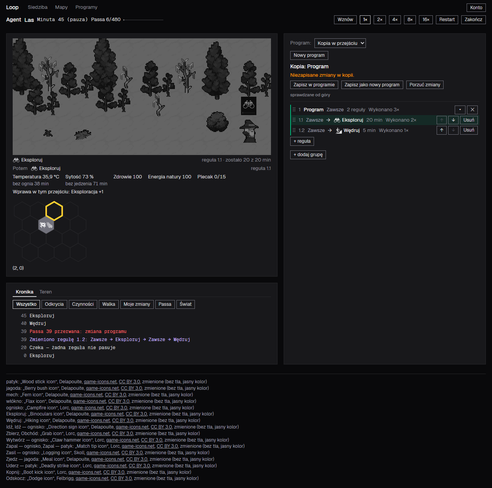

# Decision log

## Architecture and technology

What the game, the account server and their build are made of and how the work splits between the browser and the server.

### D-01 — What runs the account and save server?

The account and save server is written in TypeScript and runs on Node.js 24 LTS. Its TypeScript
types are checked before deployment.

- **Scope:** account-server, build-tools
- **Based on:** node-24-support-schedule · Node.js 24.21.0 TypeScript documentation, "no type checking is performed" (https://nodejs.org/download/release/v24.21.0/docs/api/typescript.html § Type stripping — "Node.js will replace TypeScript syntax with whitespace, and no type checking is performed."; read 2026-11-10) · State of JS 2025 runtime survey, Node.js at the top of the chart of runtimes (https://2025.stateofjs.com/en-US/other-tools/#runtimes § JavaScript Runtimes, All Respondents chart, the first three rows by rank — "1" · "Node.js" · "10,062" · "2" · "Browser" · "9,682" · "3" · "Bun" · "2,321"; the page's text gives no label to these figures; read 2026-11-10) · Bun 1.4.2 documentation, built-in `bun:sqlite` (https://github.com/oven-sh/bun/blob/bun-v1.4.2/docs/runtime/sqlite.mdx § front matter, description — "Bun natively implements a high-performance SQLite3 driver."; read 2026-11-10) · Deno release documentation, 2.9 LTS to 2027-01-31 (https://docs.deno.com/runtime/fundamentals/stability_and_releases/ § Long Term Support (LTS) — "The LTS channel is active on the Deno 2.9 line, starting with v2.9.3, and is maintained until January 31st, 2027."; read 2026-11-10) · Go SQL driver list (https://go.dev/wiki/SQLDrivers § Drivers — "Drivers for Go’s sql package include:" · "SQLite (uses cgo): https://github.com/mattn/go-sqlite3 [*]" · "SQLite: (pure go): https://modernc.org/sqlite"; read 2026-11-10)
- **Relations:** derives from D-07
- **Verification:** invariants: account-server-runtime · account-server-typecheck
- **Origin:** none

*Rationale:* the server can use the same language as the browser game while running on a widely used runtime with a published support period. The server's small responsibility gives no demonstrated reason to trade that support period for another runtime. Node's direct execution of TypeScript does not check its types.
*Rejected:* Bun — its built-in SQLite driver does not outweigh Node's published support period for this server; Deno — its current LTS line has a shorter published support period and the LTS container build was not established; Go — it adds a second application language and, for SQLite, a separately selected driver; plain JavaScript on Node — it lacks explicit types in the server code.

### D-02 — How does the account and save server handle HTTP requests?

The account and save server uses Express 5 on Node.js 24 to route and handle HTTP requests and
responses.

- **Scope:** account-server, build-tools
- **Based on:** Express 5 API, routing and JSON request parsing (https://expressjs.com/en/5x/api/express/ § express.json() — "This is a built-in middleware function in Express. It parses incoming requests with JSON payloads and is based on body-parser." · § express.Router() — "You can add middleware and HTTP method routes (such as get, put, post, and so on) to router just like an application."; read 2026-11-10) · Express 5 static file serving (https://expressjs.com/en/5x/starter/static-files/ § Serving static files in Express — "To serve static files such as images, CSS files, and JavaScript files, use the express.static built-in middleware function in Express."; read 2026-11-10) · Express 5 error handling (https://expressjs.com/en/5x/guide/error-handling/ § The default error handler — "Express comes with a built-in error handler that takes care of any errors that might be encountered in the app."; read 2026-11-10) · Node.js 24.21.0 low-level HTTP API (https://nodejs.org/download/release/v24.21.0/docs/api/http.html § HTTP, introduction — "The HTTP interfaces in Node.js are designed to support many features of the protocol which have been traditionally difficult to use. In particular, large, possibly chunk-encoded, messages. The interface is careful to never buffer entire requests or responses, so the user is able to stream data."; read 2026-11-10) · Fastify 5.12 validation and serialization (https://fastify.dev/docs/v5.12.x/Reference/Validation-and-Serialization/ § Validation and Serialization — "Fastify uses a schema-based approach. We recommend using JSON Schema to validate routes and serialize outputs."; read 2026-11-10)
- **Relations:** derives from D-01
- **Verification:** invariants: account-server-express-http. tests: the server on Node.js 24, by the
  engines its package and lockfile admit and by the Node.js image every deployment file names.
- **Origin:** none

*Rationale:* Express supplies routing and JSON request parsing for the small account and save API
without writing those HTTP mechanics in the project. It can also serve the built game if the
serving-process choice keeps one Node process. Express and its separate TypeScript types add
packages to update; the saved-state size limit and input checks still need to be designed with the
API, and no default request-size limit is assumed to fit.
*Rejected:* built-in `node:http` — avoids a framework package but leaves routing, body reading,
size limits and error responses to the project; Fastify 5 — offers schema-based validation, but
the project would write and maintain schemas and would need an additional package to serve static
files in one process; Hono 4 — its current documentation does not mark a version, so it does not
pass this project's documentation filter.

### D-03 — How is the browser view built?

The browser view is built in TypeScript with React, its screens written as `.tsx` components that draw from the game state, except a screen D-265 leaves in the browser's DOM APIs until a task moves it, and no other UI framework stands in its code or its runtime dependencies.

- **Scope:** browser-view, build-tools
- **Based on:** Stack Overflow Developer Survey 2025, Technology, Web frameworks and technologies, All Respondents, "React 44.7%" (https://survey.stackoverflow.co/2025/technology, read 2026-11-02) · React documentation, React Versions, "When a new major is released, we archive the docs for the previous version as `x.react.dev`." (https://raw.githubusercontent.com/reactjs/react.dev/0821e7d9428a6c58c922765b891bbffba9ed6249/src/content/versions.md, read 2026-11-02) · React documentation, Versioning policy, Breaking changes, "Breaking changes are inconvenient for everyone, so we try to minimize the number of major releases" (https://raw.githubusercontent.com/reactjs/react.dev/0821e7d9428a6c58c922765b891bbffba9ed6249/src/content/community/versioning-policy.md, read 2026-11-02) · React documentation, Using TypeScript, "you can get full React Web support by adding `@types/react` and `@types/react-dom` to your project" (https://raw.githubusercontent.com/reactjs/react.dev/0821e7d9428a6c58c922765b891bbffba9ed6249/src/content/learn/typescript.md, read 2026-11-02) · React 19 Upgrade Guide, UMD builds removed, "Starting with React 19, React will no longer produce UMD builds" (https://raw.githubusercontent.com/reactjs/react.dev/0821e7d9428a6c58c922765b891bbffba9ed6249/src/content/blog/2024/04/25/react-19-upgrade-guide.md, read 2026-11-02)
- **Relations:** derives from D-04
- **Verification:** invariants: browser-view-framework. tests: the browser view's source held in TypeScript files alone, with no file of another code or template language. An agent compares a change with the part no invariant and no test holds:
  - complies: a new screen of the browser view written as a React component in a `.tsx` file, drawing what it shows from the game state it is given
  - violates: a new screen of the browser view written as a `.ts` module that builds its elements with `document.createElement`; a screen component that draws from a copy of the game state it keeps and changes by itself
- **Origin:** none

*Rationale:* the screen of a map run changes up to five times a second beside fields in which the player types, so keeping focus and rows takes a mechanism rather than an author's discipline, and the program editor is the screen on which the game stands or falls, since writing a program there has to go without grimacing. The program editor written in the browser's DOM loses the focus of a rule field when the offer of actions changes, because its rows are then built anew and the rebuild does not say where the focus returns (a reading of the code, not a run). A trial of the heaviest screen — 60 program rules and 500 chronicle entries, five updates a second beside a text field and a number field, run in a headless Chrome 156 with its processor throttled sixfold, and again at an extreme state of 200 rules and 2000 entries — fitted in every option but one: in all 48 runs no field lost focus, value or text cursor, and all 144 drags of a rule ended with the drop line on the right row. The exception, idiomorph on the DOM, took 98.5% of the browser's time at the extreme state and left a key press waiting up to 368 ms, while every other option had at most five keyboard events over 100 ms there. The trial screen was written for the trial and the throttling is no model of a weaker laptop, so the trial says nothing of the real editor's focus, and the faults of the libraries named below come from their documentation, a different kind of evidence. So cost and upkeep decided: React has the widest use (743 million npm downloads a month in the reading of 2026-11-01, an upper measure since installs as a dependency count) and the most documentation of the options, versioned with an archive of every major version; its major versions come rarely, announced by warnings, and nothing in it asks for a way of loading code of the product's own. Preact, the lighter option, which loads without a bundler through an import map, was passed over for React although React adds the bundler: the choice was not to tinker with a less-trodden way of loading. Its game-state fit is direct: an external store with immutable readings. It has traps of its own on focus: a component defined inside a component, or a changed `key`, erases state and nodes, and a controlled field needs a synchronous update or the cursor jumps. Lacks of the option chosen: its types stand in a separate package; it comes to three packages, 33 with the build tools, and two packages and the types are lifted together; it adds a bundler to the build, since its packages hold only the older CommonJS format that a browser does not load and, from version 19, no ready file for a script tag; it adds about 218 KB to the page, which the server does not compress; the rule that bars every other framework and its check have to be written anew; the check that guards against values written in place of tokens read, when this was chosen, only the file types it listed, so it had to be widened to the file type of the new screens, or a colour written in a component would pass unseen; the shared controls, which return ready elements and change them in place, become the library's components or stay as wrapped elements, and the page that shows the controls follows them; the guideline for the browser's code and its exemplar are written anew; and the tests on the hand-made document model of the screens that move to it lose that model, because a library draws no row on it, so such a case needs jsdom or happy-dom, a new package of tooling (jsdom has 20 dependencies), while the cases on pure functions stay in every option, and the tests of the screens that are rewritten anyway, the editor and the layout of the screens, change in every option. A test on an imitation of the document proves focus and dragging in no option; only a browser does. Every new package passes the check for known vulnerabilities (D-33). A library need not cover the whole view, since in the trial each drew into a given element, but the view would then have two ways of building and the rule would have to say which holds where. Moving later from React to Preact costs little: the trial source built on both, differing by two files of seven lines and a JSX setting. Risks taken, each a hypothesis: a rebuilt node may restart a CSS animation and make the figure shake; a rule dragged between groups may leave the drop line on the screen; a number field whose value the game clips may lose its cursor.
*Rejected:* the browser's DOM with no library — no package and no updates, since the interfaces it uses have been in the main browsers for years, it bears none of the costs every library brings (the rule against frameworks and its check, the checks of tokens and identifiers, the shared controls, the guideline and its exemplar all stay as they were), and the tests on the document model stay, though the tests of the screens rewritten anyway change in every option, but every screen is written by hand (keyed lists, the drop line, the draft of a field), focus is kept by discipline, and no outside conventions exist, so the product guards its own, and in the trial the source came to 10.4 KB against 4.9 to 7.2 KB in the other options, roughly, as the formatting differed, while the page weighed 12 KB against React's 231 KB; moving to a library later costs more with each screen written by hand, an assessment and no number; Preact — one package (28 with a bundler, one without it, checked with an import map) built from the same source as React, but it saves weight (a page of 28 to 29 KB in the trial against React's 231 KB) at the price of a way of loading it that nobody else uses and of a version changing fast: version 11 is fresh and the end of support of version 10 is not stated; without its compatibility layer a field takes `onInput`, not `onChange`; its signals could skip a redraw but need the state spread into signals and one more package; lit-html — two packages and no new build tool (checked with an import map), the files stay `.ts`, one function draws from the state, one package is lifted, last released on 14 May 2026, Lit 3 came with almost no breaking changes, and the page weighed 21 KB in the trial, but moving away from it later means rewriting the screens, and its templates are text in a `.ts` file, which types do not check; rows must be bound with `repeat` and fields with `live` where a value changes outside the library; its testing documentation advises a browser over an imitation, though jsdom worked in the trial; and an import map would change the invariant on bare package names in the built page; Solid — four packages, 99 with Vite and a plugin, its own JSX compilation not matching TypeScript's, tests by Vitest, a component that runs once and is written differently from React's; its documentation carries no version number and no choice of one, and the registry already holds a 2.0 release candidate with breaking changes, so once the site moves to 2.0 its description stops matching the pinned 1.9 with nothing to show it, and the move rewrites part of the screens; Svelte — 19 packages, 71 with Vite and `svelte-check`, a `.svelte` format, which works only here, and a compiler of their own, types checked by a separate tool, Vitest with jsdom, a compiler, a plugin and a checking tool to lift together, the support of `.svelte` in the formatter unchecked, a documentation page with no version number; Vue — 23 packages, 75 with Vite and `vue-tsc`, `.vue` files (a build step can be skipped, but then with no `.vue` files and no `<script setup>`, a mode not measured), Vitest with happy-dom, a 3.6 beta in the registry, intermediate versions every 3 to 6 months with no fixed cycle and no long-term support, documentation with no release number; Angular — five packages, 360 with the tools, a compiler and the `ng` tool of their own, Vitest, and a TypeScript range of `>=6.0.0 <6.1.0` while the game compiles with 7.0.2, so building the page would go down to 6.0 (the repository holds 6.0.2 for its tools, and the trial built so); it covers the layout of the project, the build and the tests, so a change away from it touches all of them; a major version every 12 months with 24 months of support in all, so lifting it sets a date; Mithril — types outside the package, one package and 29 with esbuild and the types, a bundler in its examples, 90.8 thousand downloads a month, the last stable release in November 2025 and `3.0.0-next.102` in the registry on 2026-11-01; VanJS — not measured, lists need a separate package, the smallest use, documentation with no version; Inferno — not measured, one package with three dependencies, its way of compiling JSX not read; Alpine — not measured, screens written in HTML attributes outside the compiler and no types in the package, so a wrong name of a state field would show only in the game; idiomorph — one package and no tool, but screens written as HTML text, so every name from a player needs escaping by hand or opens a way to inject code into the page; its version is below 1.0 and its documentation is a README; the DOM stays underneath, but the text templates would have to be rewritten on a move; it is the one option that did not hold the extreme state. Left out of the comparison: uhtml, with no release since August 2025 and a README that says version 5 has unfinished reactivity, taken as unmaintained, an assessment; and htm, last released in April 2022. Not compared because they do not meet the need: htmx, whose server returns the HTML while the game state is in the browser (D-04); graphics engines and canvas, since the player's fields must be ordinary fields; and morphdom, the same technique as idiomorph with a README silent on focus.

### D-04 — What is the game built with?

The game is written in TypeScript and runs in the browser. Its simulation is a set of pure
functions, of which those that pass game time take a game state and a span of game minutes and
return the next game state together with the events it produced, and real time enters the
simulation only as an argument.

The browser view draws the game only from the game state, the
game's content data, the moment of the browser's clock, which it reads and passes to the
simulation, the address of the page for the screen it shows (D-281), the system's setting for
reduced motion for the scene (D-317), the saver's sentence for the row of saving (D-208, D-407),
and, for the scene and the chronicle, its previous reading of the game state and the events the
simulation returned, for the chronicle also the player's acts on the copy with the copy before each
act and after it (D-348), and for the scene the place the browser gives for the mage while it walks,
and, for the mark beside the list „Program:” and the number of a creature's record, the judgings and the record the browser remembers in its lasting
storage for the signed-in account and the game (D-441), and from the memories of the page, none of them in the game state or the save: the folding of rule
groups (D-294), the chronicle with the tab and the filter the player picks over it (D-339, D-346,
D-383), the question „Zapisać, odrzucić, wrócić?” (D-324), whether the end-of-run window is open
(D-371), the pull of the previous save and the reset control of Programy, which draw their buttons from the previous-save privilege the page keeps from the account's answer (D-400, D-401, D-402) and, for
what one screen alone shows, the state of that screen's own component (D-407); it changes
the game state only through functions of the simulation, to which it passes
the player's choices, the passing of real time and a saved game state the browser downloaded from
the server or the unsaved game state it kept in the page's memory after a save found no session (D-211).

The game state stores the moment of the browser's clock at which the page made the game, which the
page passes to the function that makes a new game, every save and load keeps, and which tells one
game of an account from another (D-441).

- **Scope:** browser-view, build-tools, simulation
- **Based on:** none
- **Relations:** none
- **Verification:** invariants: simulation-isolation · simulation-inputs · minute-span-split. tests: the browser's
  source, the simulation's included, held in TypeScript files alone; a new game holding the moment
  it is made with; each path of the page that makes a new game — an account with no saved game
  state, a load refused as another version, as an archetype the data lack or as shape, a conflict
  reload that finds no save and the reset of „Zacznij od zera” — giving it the clock's reading, and
  a loaded game keeping its own moment through the save and the load; the screen Mapy drawing the
  mark beside „Program:” from the judging the browser keeps in its lasting storage, under the
  account's identifier and the moment the game state names its game by, again after a reload and
  none under another account or another game's moment. For whether the game runs in
  the browser, for the shape of the simulation's functions that pass game time and for how the
  browser view uses the game state, an agent compares the change with the part no invariant and no
  test holds:
  - complies: a game screen that the build compiles into the page the browser loads;
    the simulation's function that passes real time to a map run taking the real time elapsed as an
    argument, which the browser view measures and passes in; the program editor of the
    browser view passing the edited program to a function of the simulation; the page building the
    game from the game state that a function of the simulation returns for the saved game state the
    browser downloaded, or from the refusal it returns; after a sign-in to the same account, the
    page building the game from what that function returns for the state it kept; the headquarters
    line drawn from a stored moment of the next return and the clock's reading; a game state storing
    the moment of an event, such as the moment the next spent use of a resurrection returns or the
    moment of a save; the
    scene comparing the game state it is given with its previous reading to find the place where the
    mage stands, or to find the start of a map run; the chronicle writing the entry of a change of
    the copy from the copy before the player's act and the copy after it, and the entry of a loss of
    the streak from an event the simulation returned; the scene starting the turn of a mage that is
    walking from the place the browser gives for it; the game view keeping whether the end-of-run
    window is open as a memory of the page
  - violates: a screen of the game written as a Godot scene; a screen of the browser view that
    replaces the game state with a value no function of the simulation returned; a screen of the
    browser view that writes a program rule straight into the game state; the clock's current
    reading written into the game state on each reading; a field added to the game state, and with
    it to the save, for what the scene's motion or the chronicle needs
- **Origin:** none

*Rationale:* text code and tests give the most leverage in work with AI agents. The simulation does
not know the world as a picture: it computes state and events, with no physics and no scene in it.
A simulation of pure functions makes progress while away plain arithmetic and the save a JSON
document, and runs on a phone as well; real time passed in as an argument keeps the earning loop,
the catch-up and the renewal of a resurrection on one footing. The earning loop knows the moment it
started and goes one to one with real time, so it knows the real moment of each death; the catch-up
passes the moment of the save; the function that passes a game minute and the sweep over many
seeds know no clock. The browser's clock gives those moments — the one clock the open page goes by, as in
the old loop game, and the one that dates a save — so a device whose clock is wrong shortens or
lengthens the renewal of a resurrection, and a player can cheat by changing the clock, which the
split of the game's work between server and browser (D-07) accepts for the player's own progress.
The player changes the game state from the browser view —
the program editor, sending a character, a map run restart — and the passing of real time changes it
too; each goes through the simulation, so the game state changes in one place. A saved game state
downloaded from the server is data from outside the game, and a function of the simulation turns it
into a game state or refuses it, so loading also changes the game state in that one place; the
state the page keeps after a save found no session goes back into the game the same way, so its
map run comes back as a loaded one does. Such a function, like the one that starts a new game,
passes no game time. It turns data from outside into a game state or refuses it — for another
version of the game, a character archetype outside the game's data or a wrong shape — and reaches
nothing outside the simulation, so the simulation takes on a function that reads untrusted data,
accepted as the cost. The browser view also reads the
game's content data, which stands apart from the game state, to name and picture what the game
state holds. The moment of the browser's clock stands apart from it too: the game state stores a
moment of an event, written once at the event, and the view compares it with its latest reading, so
real time passing at the headquarters makes no new game state to save. The scene's motion needs
what one reading of the game state does not say, such as the place where the mage stood, and its
previous reading and the events give it, so no state of a drawing enters the save; the place the
mage has reached on a walk the browser gives, since the browser draws the walk (D-319), and whether
the end-of-run window is open stays a memory of the page (D-371). The chronicle
records what happened between two readings, such as a loss of the streak in a game minute the
reading passed over or a change the player made to the copy, which one reading does not say either,
and its previous reading and the events give it, the player's acts on the copy with the copy before
and after them giving the changes (D-348), so the chronicle does not enter the save (D-339).
A remembered judging can be made again at any moment at no cost to the character, so the browser
keeps it beside the game state, in its lasting storage, and never in the save, whose limit costs
the player's progress (D-441); the game it belongs to is named by the moment the game was made, a
moment of an event stored once, at the making, as the other moments of events are.
Putting the whole chronicle into the save would raise the version of the save, so a save in use
would be lost with the programs in it (D-206), and would add the size of the chronicle to a save
that is not sent above 64 KiB (D-207). That size was measured with the chronicle's own code fed with
readings every 200 ms at pace 16, on 30 seeds for each variant, one character, in a game that
already knew everything, so that no discovery was made in it: a map run of Las with a program of 17
rules went on to game minute 1670 as a median (341 to 1816) and gave a median of 227.5 entries and
16 990 bytes of raw JSON, at most 255 entries and 18 892 bytes, about 75 bytes an entry, and a map run of
„Las — głębiej” with a fighting program and supplies from the chest a median of 118 entries and
8 822 bytes, at most 186 entries and 13 853 bytes. The measurement leaves out the player's changes
to the copy of the program, discoveries and the paragraph of the last encounter, which the screen
composes from the game state, and every map run in it ended in a death, none in a completion. Kept
in the page's memory, the chronicle costs one more path in the code and its test: after a load it
starts from the paragraph of the last encounter, built from the facts the saved state already holds
(the creature, the minute of the attack, the result), and the entries before the load are gone. That
choice rests on one thing nobody measured, how rarely a page is refreshed in the middle of a map
run, and it is a hypothesis.
*Rejected:* Godot — slower to work on with AI agents; it would become sensible if movement and
collisions became the heart of the game's fun, and rebuilding the proof of concept on another
engine later is easier and makes more sense; a browser view that draws from the game state
and changes nothing in it — the player changes the game state from the browser view; loading
counted as a choice of the player, signing in, with this decision left as it stood — a strained
reading, by which the next reader may take loading for a breach of this decision; the browser view
replacing the game state with the loaded saved game state itself, with an exception written into
this decision — the game state would change in two places, against this decision's example of a
breach; the clock's current reading stored in the game state on each reading, which keeps the
browser view drawing from the game state alone — each reading makes a new game state, so the
30-second rhythm of saving sends a save at an idle headquarters and after a load, against D-207, and
a stale moment enters the saved document; a function of the simulation that takes the moment and
returns the text to draw — the view would still draw from the moment, with content in the
simulation; new fields in the game state for what an effect needs — state of a drawing would enter
the save; the chronicle in page memory with an empty chronicle after a load — after a refresh the
player could not return to why the streak dropped, and the paragraph of the last encounter would
no longer stand after a load, so the sentence of D-147 that it stands until another attack
replaces it or „Restart” or „Zakończ” removes its map run would stop being true for a loaded map
run; the whole chronicle in the save — the version of the save rises and the chronicle adds the size
measured above to a save that is not sent above 64 KiB (D-207); the whole chronicle in the save
capped at a number of entries, the oldest dropped — the sentence of D-338 that a manual map run keeps a chronicle of what happened in it would stop being
true; raising the server's limit of 64 KiB for it — changes D-104 and D-207 and is work in the
account server; the server's clock for the renewal of a resurrection — a new version of the
account database with a step by a human on the server, a change of two decisions, and the open page
goes by the browser's clock anyway, so the game would hold two clocks; D-348 and D-371 as narrowing
this decision, with the scene counting the place of the mage from the moment its walk starts and the
clock itself — a change of the scene's code and tests, and a risk that the counted place and the
drawn place part, so that the mage turns from a place where it is not seen.

### D-05 — What serves the built game and account requests in the container?

One Node.js process running Express 5 serves both the built game's static files and the `/api/`
account and save routes in the loop2 container. An unmatched `/api/` request receives an API error,
not the game's HTML page.

- **Scope:** account-server, build-tools, deployment
- **Based on:** Express 5 static file serving (https://expressjs.com/en/5x/starter/static-files/ § Serving static files in Express — "To serve static files such as images, CSS files, and JavaScript files, use the express.static built-in middleware function in Express."; read 2026-11-10) · Express 5 request routing and response API (https://expressjs.com/en/5x/api/express/ § express.Router() — "Creates a new router object." · "You can add middleware and HTTP method routes (such as get, put, post, and so on) to router just like an application."; read 2026-11-10) · Caddy 2 route, file_server and reverse_proxy (https://caddyserver.com/docs/caddyfile/directives/route § Examples — "Proxy requests to /api as-is, and rewrite all other requests based on whether they match a file on disk, otherwise /index.html. Then that file is served."; read 2026-11-10) · Docker multiple processes in one container (https://docs.docker.com/engine/containers/multi-service_container/ § introduction — "It's best practice to separate areas of concern by using one service per container."; read 2026-11-10)
- **Relations:** derives from D-02 · derives from D-08
- **Verification:** invariants: loop2-one-serving-process · loop2-api-error-route
- **Origin:** none

*Rationale:* Express already handles the API and can serve the built files in the same process, so
this choice adds no second server process or proxy configuration to the container. The application
must set static-file and fallback rules carefully, including cache policy and a distinct error
response for unmatched `/api/` requests. A later proxy can retain the public paths. The one serving
process is the one in the loop2 container, and the `/api/` paths it serves are the account and save
routes. The choice stands while serving the built files through Express stays
easy to operate and the account API needs no process of its own.
*Rejected:* Caddy in front of Express within the same container — provides a separate file server
and proxy routing but adds another process to start, monitor and update, plus its configuration.

### D-06 — How are the browser and server built together?

The browser and server share one npm package and lockfile, and have separate TypeScript
compilation configurations and output directories. Building the application type-checks the
simulation's files under a third configuration of their own that emits nothing, compiles the browser
and server configurations and bundles the browser's code, React included, into the files the server
hands out.

- **Scope:** build-tools, browser-view, simulation, account-server
- **Based on:** react-entry-format
- **Relations:** none
- **Verification:** invariants: application-package-layout · application-build-layout ·
  application-build-output. tests: building the application type-checking the simulation's files
  under a configuration of their own, which takes every file of the simulation and writes nothing
  beside them; React joined into the one script of the files the server hands out. An agent
  compares a change with the part no invariant and no test holds:
  - complies: `tsconfig.sim.json` keeping `noEmit`, the simulation compiled for the page by the
    browser's configuration alone
  - violates: the simulation's configuration given an output directory of its own, so that
    building the application writes a compiled copy of the simulation there
- **Origin:** none

*Rationale:* a shared installation keeps the local starting point small, while separate compiler
environments keep browser and server types apart. The simulation is browser code, compiled by the
browser's configuration and held in the shared package; its types are also checked under the
configuration of its own that D-393 gives, which emits nothing. The browser cannot load React's
packages by itself, so the build takes one more build step, which also runs at each deployment. The compiler
alone does not do it: a `.tsx` file passes strict mode with TypeScript 7.0.2, but the compiler leaves
the package names in `import`, and a browser cannot resolve such a name, so a tool that bundles the
files, such as esbuild or Vite, or a map of imports is needed. Without a library the build is only
the compiler and a copy of files. The build tools run only at build time, also in the container's
build; where the game runs stays the player's browser, with files from the same server, and no new
process, service or fee comes with them.
*Rejected:* separate packages — add installation coordination; a map of imports with no bundler —
React's packages hold a format the browser does not load: checked in Chrome, the page fails with
"does not provide an export named 'jsx'", and from version 19 React has no ready file for a script
tag, its documentation sending to a server that is not the product's (lit-html and Preact do load
that way).

### D-07 — How is the work of the game split between the server and the browser?

The server holds the players' accounts and each player's saved game state, and computes nothing of
the game. The browser computes the whole game — the map runs, the earning loops and the catch-up —
and sends the saved game state to the server.

- **Scope:** account-server, browser-view, simulation
- **Based on:** none
- **Relations:** none
- **Verification:** tests: the server keeping each account's own saved game state and returning
  the game it was sent unchanged, whatever that game holds; the browser sending the saved game
  state to the server, and computing the catch-up of a loaded game itself before it sends the
  result. For the server computing nothing of the game and the browser computing all of it, an
  agent compares a change with the part no test holds:
  - complies: a rule of how a map run, an earning loop or the catch-up passes written in the
    simulation the browser runs, with nothing of it on the server
  - violates: a server endpoint that advances a map run, or computes the catch-up; a server module
    that computes the outcome of a character's actions or of the time the game was closed
- **Origin:** none

*Rationale:* computing the game in the browser keeps it computed as loop computes it, so the server
adds only accounts and a save that follows the player from browser to browser. The whole game is a
saved game state in JSON, and on return the game counts how many minutes passed and plays them, so
the browser does the catch-up and the game needs no server for it. The saved game state carries the
version number of its shape, which the server compares. The catch-up
recomputes the map runs that would have happened, so a server running the game would buy little
at many times the cost. Players can replace their own saved game states and forge their own
progress. The game accepts that cost while the saved progress affects only its owner's game, and
neither other players, nor rankings, nor a shared exchange, nor rewards outside a player's own game;
account isolation prevents changing another player's saved state.
*Rejected:* the server computing the game and running the earning loops itself — a second home for
the simulation and many times the work, for little gain while the catch-up recomputes the same map
runs, and with nothing for a server to compute while no one's browser is open; no accounts, with
the save kept in the browser — drops the logging in the game is to have; a saved game state without
a version number — a state loaded silently from before a change of the game's shape means errors
that cannot be diagnosed.

### D-18 — Where does the game's content live?

The game's content — game maps, items, creatures, character skills and their numbers — stands in
data files. A game map, an item or a creature of a kind the simulation already handles is added by a
change of data alone.

- **Scope:** simulation, browser-view
- **Based on:** none
- **Relations:** none
- **Verification:** invariants: content-identifiers. tests: the simulation and the view taking a
  game map's step, ambient temperature, solving requirements, entry and exit caps, resources'
  densities and times to renew and an attacker's chance from the row of the map's data they are
  given. For the numbers of items, creatures and character skills and for what a change of data
  alone adds, an agent compares a change with the part no invariant and no test holds:
  - complies: a new creature added as a row of the creatures' data, which the simulation reads
  - violates: a wolf's damage written as a number in the combat code
- **Origin:** none

*Rationale:* content in data makes a new item, game map or creature cheap, lets the content grow
by rules rather than by code, and keeps names and look swappable, which a world of one's own needs:
systems, objects, recipes and lore texts stand in data files, not in code, so swapping the skin or
the names is cheap, which matters for the author's own intellectual property. A game map is a row of
data, and a further map differs from the map that opens it by its numbers alone, or asks for
something new, as D-448 gives.
*Rejected:* none considered

### D-229 — How does the account and save server access SQLite?

The account and save server accesses its SQLite database through Node.js 24's built-in `node:sqlite`
module, without an external SQLite driver. A Node.js release is deployed only after the server's
database read, write and backup operations have been checked on that release.

- **Scope:** account-server, build-tools, deployment
- **Based on:** node-sqlite-database · Node.js 24.21.0 SQLite documentation, `DatabaseSync`, prepared statements, backup and release-candidate status (https://raw.githubusercontent.com/nodejs/node/v24.21.0/doc/api/sqlite.md, read 2026-10-04) · Node.js 24.21.0 stability index, release candidates anticipate no further breaking changes but may still have them (https://nodejs.org/download/release/v24.21.0/docs/api/documentation.html#stability-index, read 2026-10-04) · better-sqlite3 13.0.3 API, database, transactions and backup (https://github.com/WiseLibs/better-sqlite3/blob/v13.0.3/docs/api.md, read 2026-10-04) · better-sqlite3 13 release, Node-API native addon (https://github.com/WiseLibs/better-sqlite3/releases/tag/v13.0.0, read 2026-10-04)
- **Relations:** derives from D-01 · derives from D-205
- **Verification:** invariants: account-save-sqlite-access · account-save-sqlite-upgrade.
- **Origin:** none

*Rationale:* the built-in module avoids another native runtime package and its installation in the
deployment image. Node marks the API as a release candidate, so compatibility with a later Node
release is checked before deployment. Broad public use of this specific API is not established; the
choice accepts that evidence gap for this small account and save server, and is to be looked at
again when a planned Node.js update changes `node:sqlite` incompatibly or the check of the
database's read, write and backup operations fails.
*Rejected:* better-sqlite3 — its established API adds a native package, separate TypeScript types
and independent updates for the work this server needs; legacy sqlite3 — its original package is
deprecated and unmaintained; the maintained fork — its documentation and breadth of use were not
established well enough to displace the built-in module.

### D-237 — How is a Node.js release checked before it is deployed?

A build step of the server image's final stage, run as the server's own user on the image's own
Node.js release, makes a temporary database through the server's database code, writes and reads back
an account and a saved game state, makes a backup by the method of D-236 and in its one backup step,
opens that backup, reads the same values and prints the release it checked, and any difference or
error fails the image's build. The Node.js image stays unpinned.

- **Scope:** account-server, deployment
- **Based on:** node-sqlite-database · docker-build-cache-invalidation · loop2-deploy-stage-exit-lines
- **Relations:** derives from D-229 · derives from D-236
- **Verification:** tests: the check run in the final stage of the image, after the server's user is set, as a step of its own whose failure stops the build; the check working through the server's database code on a temporary database of which it leaves no file, backing it up through `backup()` of `node:sqlite`, and printing the release it checked; an empty backup, another password hash or saved game state in the backup, a backup in two steps and an error each failing the check with no release claimed. An agent compares a change with the part no test holds:
  - complies: the final stage built on a Node.js image named by its major version alone, such as `node:24-slim`, so that each build takes the release the host pulls; a release check that reads back what it wrote before it makes the backup, and works on no database but the temporary one it makes
  - violates: a base image pinned by version and digest while this entry stands; a release check that reads the server's database, or that compares only the backup and no longer reads back the database it wrote
- **Origin:** none

*Rationale:* no server image exists without having passed on its own release, whatever release the
host's Docker store holds, and on a new host after a disaster the build step simply runs on the
release that host gets. A failure ends the build, so the deployment stops with the running containers
in service. Docker reruns the build step when the base image or the built code changes, and with
each new commit through the build argument `LOOP2_COMMIT`, not through a change of code. So a step
taken from the cache means the same release, the same code and the same commit passed before, and
the release shows in the deployment's log at the first build of a commit. In the 8000 lines of the
deploy log read on 2026-11-14, no deployment ended at the build stage with exit 7, so no release
has failed the check there. Unpinned, the image of the
restore trial may stand on another Node.js 24 release than the server's, and the launcher reports
the release it ran on. If a new release fails, deployments stop until a human pins the last good release, which takes
one change of this decision.
*Rejected:* a pin of the Node.js image alone, by version and digest — a pin checks nothing: someone
has to run a release check by hand at each move of it, and fixes of the base image stop until someone
moves it; a release check in the deploy script before the containers are replaced — one more
container on a host without swap, a new allowed `docker run` that the reading of loop2-host-sharing
forbids, and a reinstall of the script at every change of it; both a pin and a release check —
reproducible builds, which D-229 does not need, at the price of a pin to maintain.

### D-263 — Which tool bundles the browser's code?

esbuild bundles the browser's code when the application is built.

- **Scope:** build-tools · browser-view
- **Based on:** none
- **Relations:** derives from D-06
- **Verification:** an agent compares a change with the decision:
  - complies: the build calling esbuild as a development dependency, its version pinned in the
    lockfile
  - violates: a second bundler for a part of the browser's code
- **Origin:** none

*Rationale:* the browser cannot load React's packages by itself (D-06), so one tool has to join the
browser's code. Accepted with it: esbuild counts as one package for each system, so a lockfile
written on one system has to carry the package of the system the image is built on; when this was
settled, the lockfile was written on Windows and the image built on Linux.
*Rejected:* another tool, Vite being the other bundler named beside esbuild — a trial of Vite, which
nobody has made, would have to come before the work.

### D-266 — Where does the output of the browser's compilation stand?

The per-module output of the browser's compilation stands in `dist/browser/`, where tests import it
and from where the bundle is made, and `dist/public/` holds only what the server hands out: that
bundle, the page and the static files. A build that writes them first removes both directories.

- **Scope:** build-tools · browser-view · simulation · account-server
- **Based on:** none
- **Relations:** derives from D-06
- **Verification:** tests: the build compiling every TypeScript file of the browser's source into a
  module at the same path below `dist/browser/`, and leaving in `dist/public/` no JavaScript file
  but the one bundle the page loads; a build removing a module an earlier build left in
  `dist/public/` or in `dist/browser/`. An agent compares a change with the part no test holds:
  - complies: a test importing one module from `dist/browser/`; the bundler taking its entry from
    `dist/browser/`
  - violates: a test importing the bundle; a bundler reading the sources; a file other than the
    bundle, the page and the static files, such as a copy of a TypeScript source, written into
    `dist/public/`
- **Origin:** none

*Rationale:* what the server hands out is what a player can reach, so that directory holds nothing
else. Before the bundle, the compiler's per-module output stood among the files the server hands
out: the tests imported those modules one file at a time from there, and the browser loaded them the
same way, one module after another. Once D-06 bundles the browser's code into the files the server
hands out, the per-module output is what the tests import and no longer what a player loads.
Bundling the compiler's output leaves one compiler reading the sources and the code tests import
the code that is bundled. A module left from an earlier build would be served or imported
silently, so a build starts from neither directory. Accepted with it: every path of a test that
imports a module names the new directory.
*Rejected:* keeping the compiler's output in `dist/public/` with the bundle beside it under another
name — the server hands out modules no browser loads, each with an import it cannot resolve, and
the check that the built page loads only its own code needs a hole for them; moving what the server
serves, so that `dist/public/` keeps the modules — the name then lies, and the server and its rules
move for it; the bundler reading the sources — a second compiler of the same files, and tests would
not import what is bundled; tests importing the bundle — they import single modules.

## Code rules, exemplars and static checks

The coding guidelines loop2 adopts, the exemplar files of each kind of code, the linters and the checks that keep the code and its references in bounds.

### D-28 — Which coding-guideline discipline does loop2 adopt?

Loop2 adopts the coding-guideline templates of its pinned the-way, while deferring separate exemplars for building, deployment, entry points, HTML and CSS; the session, saved-game and mail exemplars were selected with their first implementations (D-115, D-213, D-162), and any deferred existing kind is compared before its exemplar is selected. For the adopted linters, full-compliance source invariants apply without a transitional per-file no-regression invariant. The general coding quality checks cover all code, tests included, while testing rules and exemplars by level stand in `guidelines/testing.md`, together with the explicit-time example from `tests/sim/time.test.mjs`, which is no additional exemplar.

- **Scope:** browser-view, simulation, account-server, build-tools, balance-tools, deployment, agent-workflow, test-helpers
- **Based on:** none
- **Relations:** none
- **Verification:** tests: that ESLint, Ruff and ShellCheck fail the gate on any report in any file they check, with no allowance for a file that broke a rule before; that ESLint and Prettier reach the test files of the parts in their scope as they reach the other files. An agent compares a change with the part no test holds:
  - complies: general and kind guidelines follow the pinned templates, retain the stated deferrals and direct test authors to the testing guidelines, with no transitional per-file no-regression invariant beside the full-compliance source invariants
  - violates: a stylesheet exemplar or guidelines of their own for stylesheets, a transition-debt check or another departure from the templates, introduced without a new decision
- **Origin:** none

*Rationale:* The selected discipline gives code common checks and a small set of useful exemplars; broader coding-exemplar maintenance adds work without an established benefit. The rules of the browser view's stylesheets that a cheap test keeps already stand in its styleguide, so a kind of their own would add no rule; a second stylesheet then has no designated model.
*Rejected:* A complete exemplar audit — more maintenance; transitional lint debt — an extra mechanism where full-compliance source invariants already apply; CSS as a kind of its own with an exemplar and kind guidelines — its only rules a test keeps stand in the styleguide.

### D-29 — Which rules check TypeScript and JavaScript?

Every application, script and test TypeScript and JavaScript file of browser-view, simulation, account-server, build-tools, balance-tools and deployment, and every JavaScript file of agent-workflow under `.claude/hooks/`, `.claude/skills/loop2-play/` and `.agents/skills/loop2-play/`, passes local pinned ESLint 10.12.0 run with `--max-warnings 0` on `eslint.config.mjs`, which applies @eslint/js 10.0.1 `recommended` and, for TypeScript, typescript-eslint 8.71.2 flat `recommendedTypeChecked` unchanged, with globals 17.13.0 and TypeScript API 6.0.2 for the parser while application compilation stays on TypeScript 7, all within the one shared npm package and lockfile. That configuration sets `linterOptions.noInlineConfig`, so an inline configuration comment fails the check, and ignores only dependencies, generated files, the submodule and temporary work results, while the check runs with an empty bulk-suppressions file of its own, so an `eslint-suppressions.json` in the repository hides no report; a test keeps its file patterns to that scope, asking ESLint which rules each file of the scope receives and comparing them with the sets of @eslint/js and typescript-eslint themselves, and review keeps its rules to those sets. Changing the rule set takes a human-accepted change of this decision.

- **Scope:** browser-view, simulation, account-server, build-tools, balance-tools, deployment, agent-workflow
- **Based on:** eslint-recommended-rules · typescript-eslint-typechecked-rules
- **Relations:** derives from D-06
- **Verification:** invariants: eslint-source-rules. An agent compares a change with the part no invariant holds:
  - complies: a version of ESLint, @eslint/js, typescript-eslint or globals changed in the root `package.json` and `package-lock.json` together with a human-accepted change of this decision;
  - violates: a rule from outside the sets of @eslint/js and typescript-eslint added to `eslint.config.mjs`, or a newer typescript-eslint or globals installed, without a human-accepted change of this decision; the parser moved off the TypeScript API 6.0.2, or ESLint installed in an npm package of its own.
- **Origin:** none

*Rationale:* The selected recommendations find defects in typed and untyped code with one tool; a separate supported parser API preserves the chosen application compiler at the cost of an extra development dependency. With inline configuration turned off, a suppressing comment is itself a failure, with the check's own empty suppressions file a bulk-suppressions file silences nothing, and a change that turns a rule off stands in the configuration, where review sees it. Review alone does not keep a list of file patterns complete: a file in a directory no pattern names passes the gate with no report, so a test asks the tool which files receive the sets, and the sets it compares them with are the tool's own, never a list kept in the product. The hook that runs at the start of a session runs on the machine of everyone who starts a session in the repository, and the scripts of the play skill are run by agents, so a defect in them, such as an unused binding or an undefined name, reaches people and agents with no signal while the files receive no rule. The rules reach them by their directories, so a further hook or play script placed beside them is checked with no change of the configuration, while a script elsewhere in agent-workflow is not.
*Rejected:* A compiler downgrade — gives up the existing compiler choice; an unsupported parser API — risks unreliable type-aware reports; extra style sets — add obligations beyond the accepted set; product-written checks comparing the effective configuration with a frozen rule list and parsing inline directives — far more code to keep than the tool's own setting and a reviewed configuration; the scope of the four code parts alone — a test helper of the deployment part stays outside it, and a new TypeScript or JavaScript file of that part passes the gate with no check; the whole repository, or the whole of agent-workflow — the scripts of the scene-art skill come with it, in two copies, and every other file of the part, with reports nobody has weighed and fixes in both copies, for files that neither run at the start of every session nor play the game; the hook and the play scripts named file by file — a further hook placed beside the first passes the gate with no check; the formatter widened to the same directories with the linter — one of the play scripts, a function expression handed to the browser tool as a file, would change its shape and need a check of the skill in a real browser; the file patterns kept by review alone — a new file outside them passes the gate with no signal.

### D-30 — Which Python rules block a change?

Every `.py` and `.pyi` file Ruff finds in browser-view, simulation, account-server, build-tools, deployment, agent-workflow and test-helpers passes local pinned Ruff 0.17.1 run with `--config ruff.toml --ignore-noqa`, where `ruff.toml` requires that version, turns preview off, excludes the submodule and temporary work results and selects the complete default nonpreview set minus `PLW1510`, `I001`, `ISC004`, `UP031`, `RUF059`, `PIE808`, `RUF007`, `RUF012`, `PLR0402`, `FURB167`, `RUF100`, `SIM117`, `FURB192`, `SIM102`: the remaining 393 rules block and these fourteen rules remain examples. The explicit configuration file holds for every file whatever other Ruff configuration stands in the repository, and no suppression comment takes effect. Changing that set takes a human-accepted change of this decision.

- **Scope:** browser-view, simulation, account-server, build-tools, deployment, agent-workflow, test-helpers
- **Based on:** ruff-default-rules
- **Relations:** none
- **Verification:** invariants: ruff-source-rules. An agent compares a change with the part no invariant holds:
  - complies: a rule moved between the blocking set and the fourteen examples of `ruff.toml`, or another version of Ruff required there, together with a human-accepted change of this decision
  - violates: a rule removed from `select` in `ruff.toml`, preview turned on or `required-version` dropped, with no change of this decision; a directory of code added to the excludes of `ruff.toml`
- **Origin:** none

*Rationale:* The selected subset retains useful defect reports while leaving reports that offer no worthwhile code change as examples; one explicit configuration keeps other configuration from quietly changing that boundary, and a suppression comment the tool ignores does no harm.
*Rejected:* The entire default set as blocking — forces unhelpful rewrites; no Python linter — leaves useful defect reports unchecked; product-written checks passing the list file by file and failing on the mere presence of a suppression comment — far more code to keep than a configuration file and the tool's own flag.

### D-31 — Which Bash rules block a change?

Every standalone Bash script in the code parts, extensionless scripts included, passes local pinned ShellCheck 0.11.0 run on it by name with `--norc --shell=bash --extended-analysis=true` at its default `style` severity: its default nonoptional Bash checks and every diagnostic severity, with no example-only rules. Embedded commands in YAML or test literals are outside this standalone-script scope, and review keeps a new script from going unnamed and a `# shellcheck` directive that disables a check or changes the set out of the scripts. Changing that set takes a human-accepted change of this decision.

- **Scope:** browser-view, simulation, account-server, build-tools, deployment, agent-workflow
- **Based on:** shellcheck-default-bash-checks
- **Relations:** none
- **Verification:** invariants: shellcheck-source-rules. An agent compares a change with the decision:
  - complies: a new Bash script named in the test of shellcheck-source-rules, with no `# shellcheck` directive;
  - violates: a `# shellcheck disable=SC2086` line, or a new Bash script that test does not name.
- **Origin:** none

*Rationale:* The default checks cover shell defects without adding optional stylistic obligations; the flags keep rc files and directives from changing the shell or the analysis, and the few standalone scripts change seldom enough for review to see a new one or a disabling directive.
*Rejected:* No Bash linter — leaves shell defects unchecked; enabling optional checks — adds obligations outside the accepted set; product-written checks discovering scripts by their first line and classifying each directive — far more code to keep than a named list and review.

### D-32 — How is web code formatted?

All application, script and test TypeScript and JavaScript in browser-view, simulation, account-server, build-tools, balance-tools and deployment and browser HTML and CSS pass `--check` of local pinned Prettier 3.9.10 run with `--no-config --no-editorconfig --ignore-path .gitignore`: its default nonexperimental options — two spaces, semicolons, preferred double quotes, target width 80 and LF on every platform — with no ignore file of its own able to hide a file; Markdown, icons, generated files, dependencies, the submodule and temporary work results are excluded. The editor's `prettier.config.mjs` sets no option, narrow repository attributes preserve LF for that scope on Windows, a test keeps the check's file patterns and those attributes to the TypeScript and JavaScript of that scope, asking Prettier which files its patterns check and git which line ending each file gets, and review keeps `prettier-ignore` comments out of covered code.

- **Scope:** browser-view, simulation, account-server, build-tools, balance-tools, deployment
- **Based on:** none
- **Relations:** none
- **Verification:** invariants: prettier-source-format. tests: the HTML and CSS of the browser view standing as Prettier leaves them with its default options. An agent compares a change with the part no invariant and no test holds:
  - complies: a new browser module with no `prettier-ignore` comment, with `prettier.config.mjs` still setting no option;
  - violates: a `// prettier-ignore` comment, or an option added to `prettier.config.mjs`.
- **Origin:** none

*Rationale:* One formatter and its default settings remove repeated layout choices and platform-dependent line endings; the initial whole-scope reformatting is accepted to avoid lasting exceptions. Review alone does not keep a list of file patterns complete: a file in a directory no pattern names passes the gate unformatted and with the line endings of the machine that wrote it, so a test asks the tools which files they reach.
*Rejected:* Per-file historic exceptions — preserve recurring format differences; Python and Bash formatting in this decision — each has a formatter and settings of its own, which D-433 and D-434 hold; product-written checks feeding each file to the formatter's programming interface and comparing its settings and repository attributes — far more code to keep than the tool's own flags; the scope of the four code parts alone — a test helper of the deployment part stays outside it, and a new TypeScript or JavaScript file of that part passes the gate with no check; the whole repository — the scripts of the play skill would need fixes in two copies, an exception, or a change of the shape of one of them and a check of the skill in a real browser, a risk and work with no gain for the game; the file patterns kept by review alone — a new file outside them passes the gate with no signal.

### D-33 — Which introduced dependency vulnerabilities block a change?

The dependency audit passes without a network request where `package-lock.json` equals its version at {fork-point}, and otherwise fails on each advisory of low, moderate, high or critical severity that local pinned npm 12.2.1, run as `npm audit --json --package-lock-only --audit-level=low --include=dev --include=optional --include=peer --registry=https://registry.npmjs.org/`, reports for that lockfile and not for its version at {fork-point}, reading the npm/GitHub Advisory Database through the public npm registry when the check runs. A failed request or an unreadable report fails the audit; info does not block, and the low threshold has no automatic revision or scheduled threshold review. The audit covers the root npm package of build-tools with its direct, transitive, production, development, optional and peer dependencies, sending package names and versions without application code, while nested npm packages and runtime, container-image, operating-system and non-npm dependencies are outside it.

- **Scope:** build-tools
- **Based on:** none
- **Relations:** none
- **Verification:** invariants: introduced-npm-vulnerabilities · dependency-audit-refusal. tests: the audit passing with no request to the registry where the lockfile equals its version at the fork point, and auditing the lockfile once it differs. An agent compares a change with the part no invariant and no test holds:
  - complies: the audit run by the local pinned npm with the flags of this decision, `--include=dev`, `--include=optional` and `--include=peer` among them, against the public npm registry
  - violates: an audit that leaves out development, optional or peer dependencies, asks another registry or runs an npm fetched when the check runs; a scheduled job that raises the threshold above low; an audit that sends the application's code
- **Origin:** none

*Rationale:* A low threshold starts conservatively while comparison with the start of the change keeps old vulnerabilities from blocking unrelated work; newly published advisories can change the result for the same lockfile. The registry matches each advisory's range to the locked versions itself, so comparing the advisories reported before and after the change needs no parsing of ranges, at the price of letting a further copy of an already reported vulnerable package through.
*Rejected:* Moderate, high or critical thresholds — accept known lower-severity vulnerabilities in introduced versions; auditing unchanged versions as blockers — stops unrelated work; trusting the audit's exit status alone — reads a failed request as a finding and compares nothing; a product-written audit matching advisory ranges to each introduced package-name/version pair — far more code to keep than comparing what the tool reports.

### D-34 — Which file is the exemplar for content data?

The exemplar for kind `content-data` is `src/browser/sim/data/resources.ts`, and its kind guidelines are read before adding or changing a file of that kind. The typed catalogue and identifiers derived from keys remain examples alongside the existing simulation-isolation rule, without requiring that catalogue shape in every data file.

- **Scope:** simulation
- **Based on:** none
- **Relations:** derives from D-18 · derives from D-04
- **Verification:** an agent compares the change with the decision:
  - complies: content-data guidelines designate the selected exemplar, retain simulation-isolation and show the catalogue as an example
  - violates: a different exemplar or a new mandatory catalogue shape for every data file
- **Origin:** none

*Rationale:* A current typed content catalogue gives later authors a concrete model without creating a new architectural constraint for every kind of game data.
*Rejected:* Making the catalogue shape mandatory — constrains data whose useful structure differs; no exemplar — leaves each new catalogue to invent its own model.

### D-35 — Which file is the exemplar for simulation modules?

The exemplar for kind `simulation-module` is `src/browser/sim/game.ts`, and its kind guidelines are read before adding or changing a file of that kind. Explicit inputs and a result consisting of state and events illustrate the existing simulation-isolation and simulation-inputs rules, without requiring every helper to return `GameResult`.

- **Scope:** simulation
- **Based on:** none
- **Relations:** derives from D-04
- **Verification:** an agent compares the change with the decision:
  - complies: simulation-module guidelines designate the selected exemplar and keep different suitable helper return types
  - violates: a different exemplar or a new obligation that every helper returns GameResult
- **Origin:** none

*Rationale:* The game operation illustrates explicit state transitions while allowing smaller helpers to expose only the result they compute.
*Rejected:* One result type for every helper — adds wrappers without a demonstrated need; no exemplar — leaves the operation model implicit.

### D-36 — Which file is the exemplar for browser modules?

The exemplar for kind `browser-module` is `src/browser/view/account-card.tsx`, the first screen built with React, and its kind guidelines are read before adding or changing a file of that kind. Keeping focus and passing user actions to the application remain examples alongside browser-view-framework and content-identifiers, without requiring `update()` in every module or forbidding the rebuilding of static elements.

- **Scope:** browser-view
- **Based on:** none
- **Relations:** derives from D-03 · derives from D-18
- **Verification:** an agent compares the change with the decision:
  - complies: browser-module guidelines designate the selected exemplar and show focus-preserving control updates as examples
  - violates: a different exemplar or a mandatory update method in every browser module
- **Origin:** none

*Rationale:* The first screen built with React shows stable editing behavior without forcing every view helper to own a control lifecycle.
*Rejected:* Mandatory update methods and a ban on static rebuilding — impose structure where no editable control needs it; no exemplar — leaves focus-preserving updates implicit.

### D-37 — Which file is the exemplar for the HTTP application?

The exemplar for kind `http-application` is `src/server/app.ts`, and its kind guidelines are read before adding or changing a file of that kind. Separating application creation from opening the listening port remains an example alongside account-server-express-http and loop2-api-error-route, with no additional structural check of the application factory.

- **Scope:** account-server
- **Based on:** none
- **Relations:** derives from D-02 · derives from D-05
- **Verification:** an agent compares the change with the decision:
  - complies: http-application guidelines designate the selected exemplar and show separate application creation as an example
  - violates: a different exemplar or a new mandatory factory-structure invariant
- **Origin:** none

*Rationale:* Separating creation from listening gives a concrete model that is easy to test, without settling the architecture of future account and saved-game features.
*Rejected:* A new factory-structure check — enforces an example as architecture; no exemplar — leaves the existing testable assembly model implicit.

### D-113 — Which file is the exemplar for password hashing?

The exemplar for kind `password-hashing` is `src/server/passwords.ts`, and its kind guidelines are read before adding or changing a password-hashing file. Hashing and verification share one bounded admission gate, preserve password content, and use one explicit Argon2id profile, measured with that gate in the deployed container image.

- **Scope:** account-server
- **Based on:** argon2-password-api · argon2-native-platform · password-hash-work-factor
- **Relations:** derives from D-98 · derives from D-103 · derives from D-106
- **Verification:** invariants: password-operation-gate · player-argon2-deployment-check. tests: a password hashed and verified with its exact content, the trimmed password failing, under the explicit Argon2id profile of 64 MiB, three passes and one lane; the measurement made with that profile and the gate of two operations at once. An agent compares a change with the part no invariant and no test holds:
  - complies: the kind guidelines of password hashing naming `src/server/passwords.ts` as the exemplar, and the table of kinds in `guidelines/coding.md` sending a password-hashing file to them
  - violates: the kind guidelines of password hashing naming another file as the exemplar; the table of kinds in `guidelines/coding.md` no longer sending a password-hashing file to them
- **Origin:** none

*Rationale:* A first file makes password work's admission and package boundary visible for later account routes. The measurement of the deployed image shows that two slots of this profile fit within 80% of its memory limit; a different profile or gate carries no such evidence. The operator's measurement of 2026-11-14 on the test server, as he gave it, ended with verdict `PASS` and exit code 0 for the profile argon2id 64 MiB, t=3, p=1 and the gate of 2 at once, with a limit of 428867584 B (80% of 512 MiB), 0 hits of the limit, 0 out-of-memory kills and the largest process RSS 187133952 B; the full result stands in D-106.
*Rejected:* Separate gates for hash and verify — allow their combined memory use to exceed the shared limit; an unbounded queue — retains arbitrary pending work; treating an unmeasured profile or gate as fitting — claims target suitability without target evidence.

### D-114 — Which file is the exemplar for database access?

The exemplar for kind `database-access` is `src/server/database.ts`, and its kind guidelines are read before adding or changing a database-access file. Database access owns the SQLite connection, transactional schema initialization, bound SQL values and connection disposal, independently of HTTP and password hashing.

- **Scope:** account-server
- **Based on:** node-sqlite-database
- **Relations:** derives from D-28 · derives from D-112
- **Verification:** tests: database access keeping the SQL characters of a value as data, taking back a failed schema initialization of a new database whole, and stopping its cleanup timer when its connection is closed, each with no HTTP server and no password hashing. An agent compares a change with the part no test holds:
  - complies: database-access guidelines identify the first implementation as exemplar and keep SQL and connection ownership together
  - violates: a different exemplar or database access that spans asynchronous password work
- **Origin:** none

*Rationale:* A concrete model keeps persistence and failure handling visible for later account operations, while synchronous ownership limits transaction lifetimes.
*Rejected:* Scattered SQL in HTTP handlers — obscures connection ownership and makes persistence failures harder to exercise independently.

### D-115 — Which file is the exemplar for the session Store?

The exemplar for kind `session-store` is `src/server/session-store.ts`, and its kind guidelines are read before adding or changing a session-store file. The Store adapts the library's callbacks to database operations, validates stored session identity and cookie metadata before library hydration, and leaves HTTP and cookie policy to application assembly.

- **Scope:** account-server
- **Based on:** express-session-store-contract · express-session-cookie-lifecycle · cookie-serialization-validation
- **Relations:** derives from D-28 · derives from D-107 · derives from D-112 · derives from D-435
- **Verification:** invariants: account-session-storage. tests: the Store delivering each failure of a library callback once, as that callback's error, and letting an exception the callback throws reach its caller. An agent compares a change with the part no invariant and no test holds:
  - complies: session-store guidelines naming `src/server/session-store.ts` as the exemplar; the cookie's name, flags and lifetime set where the application is assembled, the Store keeping and checking what the library hands it
  - violates: session-store guidelines naming another file as the exemplar; the Store setting the cookie's flags or lifetime, or reading the HTTP request
- **Origin:** none

*Rationale:* The adapter makes malformed persisted data and storage failures explicit before the library restores a session; a deliberately narrow payload requires conscious changes when session data grows.
*Rejected:* Unchecked deserialization — passes arbitrary stored properties to library objects; a second session middleware — duplicates the chosen library's lifecycle.

### D-116 — Which file is the exemplar for account policy?

The exemplar for kind `account-policy` is `src/server/account-policy.ts`, and its kind guidelines are read before adding or changing an account-policy file. Account policy normalizes and checks credentials and reserves, settles and bounds attempt admission against a supplied clock, independently of HTTP, password hashing and the database, and each admitted attempt is settled once, only after the password work it started has completed.

- **Scope:** account-server
- **Based on:** none
- **Relations:** derives from D-28 · derives from D-98 · derives from D-99 · derives from D-102 · derives from D-103
- **Verification:** invariants: account-attempt-limits · account-attempt-tracking. tests: the policy's own checks normalizing an address and refusing a password outside its rules or unlike its repetition; attempts admitted, refused and freed against the clock the policy is given, which the tests move, run on the policy alone with no HTTP server, password hashing or database and through the routes; an admitted login settled twice counting once. An agent compares a change with the part no invariant and no test holds:
  - complies: account-policy guidelines naming `src/server/account-policy.ts` as the exemplar; a new kind of attempt limited by a method of the policy that its route calls
  - violates: account-policy guidelines naming another file as the exemplar; counters of attempts kept in a route handler beside the policy
- **Origin:** none

*Rationale:* One HTTP-independent unit makes the credential rules, the attempt accounting and their clock visible together for later account operations such as password recovery, while a settlement tied to completed work keeps a disconnected client from freeing or erasing an attempt. Its weak point is that the policy cannot observe password work itself: the route decides when that work has completed, so the rule rests on the route's sequencing.
*Rejected:* Limiter counters inside route handlers — mix HTTP sequencing with accounting and hide the reservation lifetime; settling on the connection's close — lets a client abandon attempts to exceed the limits.

### D-117 — Which file is the exemplar for a browser API client?

The exemplar for kind `browser-api-client` is `src/browser/account-api.ts`, and its kind guidelines are read before adding or changing a browser API client file. A browser API client sends its requests to relative `/api/` paths and follows no redirect, reports a success only for its request's own success status with a well-formed body, reports every other answer, a failed connection and an answer not complete within its time limit as a typed failure, and keeps no identity, cookie or document state.

- **Scope:** browser-view
- **Based on:** none
- **Relations:** derives from D-28 · derives from D-108
- **Verification:** invariants: account-client-requests · account-client-outcomes. tests: every failure of a call of the account, saved-game, previous-save and report routes carrying its kind — a refusal with the server's status and known code, an answer not expected, a network failure or a timeout — and each documented refusal of a save coming back as an outcome of its own. An agent compares a change with the part no invariant and no test holds:
  - complies: browser API client guidelines naming `src/browser/account-api.ts` as the exemplar; a client whose only setting is its time limit, each call reading nothing an earlier call left
  - violates: browser API client guidelines naming another file as the exemplar; a client that keeps the signed-in account, writes `document.cookie` or `localStorage`, or changes the page
- **Origin:** none

*Rationale:* One module that owns the request details lets the screens read outcomes instead of status codes, and keeps a response that merely looks like a success from signing a player in or leaving them signed out by mistake. Its weak point is that the client copies the server's contract by hand, so a change of a route's status or body must change the server and the client together.
*Rejected:* A client shared by import from the server — joins the browser and server builds; a request written in each screen — repeats the status checks and the time limit in every screen and lets one of them report a success it did not receive.

### D-213 — Which file is the exemplar for saved-game code?

The exemplar for kind `saved-game` is `src/browser/sim/saved-game.ts`, and its kind guidelines are
read before adding or changing a file of that kind. Saved-game code turns a game state into the
saved document of the current version of its shape, and an unknown value — a saved game state
downloaded from the server or the unsaved game state kept in the page's memory (D-211) — into a game state or a refusal
naming why, inside the simulation, no value a document can hold making it throw, and changing
nothing passed to it. An error of its own code is no refusal: it leaves the load as a thrown error,
which the browser view writes to the console without its text, and the saved game state on the server and the
unsaved game state in the page's memory stay as they stand, while the player gets the sentence of D-96.

- **Scope:** simulation, browser-view, agent-workflow
- **Based on:** none
- **Relations:** derives from D-28 · derives from D-04 · derives from D-206
- **Verification:** tests: a game state turned into the saved document of the current version
  beside a copy of the state, changing nothing of it; a document of the current version, also as
  the server hands it back, loading into the state it describes; a document refused as of another
  version, as naming an archetype missing from the data or as of a shape the game does not admit,
  a crafted document of the current version refused whole; no value a document can hold, at any
  place of it, throwing out of the load; the load changing nothing passed to it; an error of the
  code in the load leaving it as that error, and on the page leaving the save on the server and
  the kept state as they stand, building no game, writing one line to the console without the
  error's text and showing the sentence of D-96. For the exemplar, its kind guidelines and the load
  standing inside the simulation, an agent compares a change with the part no test holds:
  - complies: saved-game guidelines identify the first implementation as exemplar and draw the
    kind's boundary with simulation modules as the content-data guidelines draw theirs
  - violates: the load of a saved game state written in the browser view; a second exemplar for the
    kind
- **Origin:** none

*Rationale:* the first file that reads data from outside the simulation into the game state gives
later saved-game work a concrete model of a strict load, its refusals and the version kept with the
shape, apart from the functions that pass game time. A refusal says something about the document and
starts a new game over it; an error of the code says nothing about the document, so it may stand
where a whole saved game state stands, and a player who meets it waits for a retry or a fix with the
state intact, not playing meanwhile. An error of the code in the load would otherwise read as a
damaged save, and the game would overwrite the saved game state at once with a new game, leaving the
owner no trace; when this was decided no known input reached that path, but it ends in the
overwriting of existing data. The browser view, not the simulation, writes the thrown
error to the console, because the simulation has no access to the console.
*Rejected:* the load in the browser view, which then replaces the game state itself — the breach of
D-04; a lenient load that fills missing keys — a migration by another name, against discarding
another version whole; an error of the code answered as a refusal, as it was, with a line in the
console — the player plays on, but loses the saved game state.

### D-351 — How does loop2 keep the imports of its parts within the dependencies its part map allows?

One invariant keeps every import of loop2's code within its part map, and its test counts as a
test every file git tracks under `tests/`, helpers and stand-ins included, so that only a file
outside `tests/` is kept from importing the part of test helpers. The test reads the imports of
TypeScript, JavaScript and Python files, and no process that one file starts from another and no
HTML or CSS: in TypeScript and JavaScript `import` and `export … from` statements and `import()`
with a string literal, in Python `import` and `from … import` statements and a directory added to
`sys.path`. A relative import that the test cannot match to a file git tracks fails it, with the
file and the line, an import of a built file under `dist/` is matched to its source under `src/`,
and a package or a module from outside the repository is the file of no part.

- **Scope:** browser-view · simulation · account-server · build-tools · balance-tools · deployment · agent-workflow · test-helpers
- **Based on:** none
- **Relations:** none
- **Verification:** invariants: cross-part-imports. tests: the forms the test reads as imports —
  in TypeScript and JavaScript `import` and `export … from` statements, a bare `import` and
  `import()` with a string literal, and nothing in a comment, a string or another expression, and
  in Python `import` and `from … import` statements and a directory added to `sys.path`; a
  relative import that matches no file failing the test with the file and the line; a built file
  under `dist/` matched to its source under `src/`; a package or a module from outside the
  repository taken for the file of no part. An agent compares a change with the part no invariant
  and no test holds:
  - complies: a test of one part starting a file of another part as a process, and a page or a
    style sheet of the browser view referring to a file, both left unread by the test
  - violates: the test of `cross-part-imports` made to read a process one file starts from
    another, or the HTML and CSS of the browser view, while this decision stays as it is
- **Origin:** none

*Rationale:* a file of the tests folder that is no test, such as a helper or a stand-in, serves
tests and carries nothing into the product, so only code outside that folder is kept from the part
of test helpers. The check reads what a file imports because that stands at the head of the file
and a failed match is plain to see; a process one part starts from another is left to the review of
a change, which sees what the file starts. An import the check cannot match to a file would
otherwise pass unseen by exactly the roads the check is meant to follow, so it fails the check,
and a built file is matched to its source because tests reach the game's code through the build.
The check reads code, not strings, so a text that holds sample code is no import. Accepted with it:
a process of another part that a test starts passes without the check.
*Rejected:* a test is a file named like a test — a helper or a stand-in in the tests folder
at once becomes a violation to rewrite or accept, and each later file of the kind meets the same
wall with no added protection; no ruling, the part map template leaving it to whoever writes
the test — the choice stays open; counting as an import also the launch of a tracked file as a
process — a launch from a test of a script of another part has to be ruled on first, and guessing
from argument lists in two languages misses a path a helper builds and hits sample text that holds
a command; reading HTML and CSS as well — the test would repeat how the build turns the addresses
of the page into source files and break with each change of it, and it would catch nothing today,
since each such file and what it refers to belong to the browser view; skipping an import the test
cannot match — a silent hole, since every import through the build folder to a `.tsx` file would
pass unchecked, and by that road an import of the view came into a test of the simulation.

### D-362 — How does loop2 point to places outside the repository that its readers cannot reach?

loop2 names a place on the author's disk outside the repository, such as the folder of its projects in the notes, the list of its tasks and the rules of a task's line, by the key that stands for it under `loop2` in the locations file `~/.the-way/locations.json`, which are the keys `projects`, `tasks` and `task-rules`, and no file git tracks holds an absolute path on that disk. No file git tracks names a note the author keeps outside the repository or the folder it lies in, or a file of a repository its readers cannot reach, such as the private repository of the old loop game; what a reader needs of such a source stands in the foundation or in the file itself.

- **Scope:** browser-view, simulation, account-server, build-tools, balance-tools, deployment, agent-workflow, product-foundation, test-helpers
- **Based on:** none
- **Relations:** none
- **Verification:** invariants: tracked-file-private-paths · tracked-file-private-names. An agent compares a change with the part no invariant holds:
  - complies: a decision whose whole reasoning stands in its *Rationale* and *Rejected*, with *Origin* `none`; a comment that states in its own words what the code needs
  - violates: a comment, an entry or a guideline that names a file of a repository its readers cannot reach other than the private repository of the old loop game; an entry or a comment that leaves out what its reader needs because a source outside the repository holds it
- **Origin:** none

*Rationale:* the repository is public, so a path on the author's disk shows to everyone how that disk is laid out and what the notes are called. The name of a key carries the pointer without the path, and the value of the key lies in the user's own file of places, where each user keeps their own. The name of a note shows the same and leads a reader of the repository nowhere: the notes a decision or a test pointed to are removed when their task closes, so the pointer goes dead, and the private repository of the old loop game is not open to a reader at all. An agent that wants to know why a decision was made, or the author who returns to it after months, finds the reasoning where it stands in the entry, not in a note that no longer exists. What a reader needs of such a source therefore stands in the foundation, and the documents the notes held do not move into the repository, since that would make the author's working papers public and set a second source of truth beside the foundation.
*Rejected:* removing only the three paths of the backlog section of the agent instructions — the other paths still show the layout of the disk and name notes, and a decision and the testing guidelines would point to the folder by a path while the backlog section points by a key; clearing only the *Origin* fields of decisions — the rule on test expectations would go on telling new tests to name a note, and dead pointers in the tests would multiply; clearing the rule on test expectations and the comments in tests in a separate change; letting a file name a note and the folder it lies in — a reader of the repository cannot open the note, and the notes that a decision or a test pointed to are removed when their task closes; correcting that rule in a separate change — two changes in turn would alter the agent instructions, the rule on test expectations and the testing guidelines; moving the research and technology documents into the repository and pointing to them — the author's working notes become public, and the repository gets a second set of documents beside the foundation; moving every such document, the definitions and the concept included — the public repository gets the author's whole workshop and a second source of truth beside the foundation; listing only the keys `projects` and `tasks` — an agent reading it would take `task-rules` for a key outside the rules of loop2, and the mismatch would wait for the next review of the foundation to be found and fixed; a separate decision of loop2 that the rules of a task's line come from the author's notes — it repeats a rule the-way keeps for its own tasks, so the rule would be held in two places that both need upkeep

### D-393 — What keeps the simulation from using names outside the JavaScript language?

Two checks keep the simulation's files from using the page, a timer, the console or any other name that the browser or Node.js adds to those of the JavaScript language, and both stay: the compiler, which type-checks the simulation's files under a configuration of their own that covers every file of the simulation, holds the library of the language alone and no ambient types, and emits nothing; and the test of `simulation-isolation`, which keeps its whole scan of the sources and its run of the built simulation in a cut-off environment. Neither check is shortened because the other covers part of it.

- **Scope:** simulation, build-tools
- **Based on:** none
- **Relations:** derives from D-04
- **Verification:** invariants: simulation-isolation · simulation-type-check. tests: the type check of the simulation's files emitting nothing beside their sources. An agent compares a change with the part no invariant and no test holds:
  - complies: a change of the test of `simulation-isolation` that keeps its scan of every source of the simulation and its run of the built simulation in a cut-off environment, also where the compiler refuses some of the names it finds
  - violates: a part of the scan of the sources, or the run of the built simulation in a cut-off environment, taken out of the test of `simulation-isolation` because the compiler refuses the same names
- **Origin:** none

*Rationale:* the compiler refuses a use of the page, a timer, the console or the structured copy at the type check, ahead of the slower tests of the gate among which the test of isolation stands. The compiler does not take the test's place: the type `Date` belongs to the language, so it does not refuse `Date.now()` or `new Date()`, and it does not refuse an import of a package that brings types of its own, while the test checks the system clock, the imports and a run of the built simulation. A configuration that only checks leaves the compiling of the simulation's files to the browser's configuration, so the files are built once.
*Rejected:* cutting from the test of isolation the part of its scan of sources that the compiler takes over — a shorter test, but it has to be cut exactly so that the system clock and the imports are not lost, it changes what the test checks of `simulation-isolation`, the work grows and a gap may open; moving the simulation into a directory of its own with its own configuration — the path of the simulation changes in the tests, the guidelines, the foundation and the configuration and the build is rebuilt, for a gain that a separate configuration gives without the move, and the move would make sense if the server computed the game, while D-07 says the server computes nothing of the game.

### D-394 — Does the simulation keep `actionFeasible`, which the game does not call?

The simulation keeps `actionFeasible`, the function that tells whether an action can start now, though the game does not call it: tests use it as their point of observation of whether an action is allowed. A clean-up does not remove it because the game has no caller of it.

- **Scope:** simulation
- **Based on:** none
- **Relations:** none
- **Verification:** tests: the tests of the simulation that ask `actionFeasible` whether an action can start, which fail where it is removed.
- **Origin:** none

*Rationale:* the tests that call it need no other public function of the simulation to tell whether an action is allowed, and `actionFeasible` is their simplest point of observation of that.
*Rejected:* removing it — the tests that call it are rewritten onto another public function of the simulation, the work grows, and the tests lose the simplest point of observing whether an action is allowed.

### D-412 — What looks for secrets in loop2's repository?

The built-in secret scanning of GitHub, with push protection, is what looks for secrets in the repository. The CI of the repository and the one command of tests add no scanner of secrets.

- **Scope:** agent-workflow, build-tools
- **Based on:** github-secret-scanning-public-repository · github-secret-scanning-history · github-push-protection-blocks-push · loop2-secret-scanning-enabled
- **Relations:** derives from D-13 · derives from D-413
- **Verification:** tests: the workflow that runs on a pull request holding one command of checking, the one command of tests, and no scanner of secrets. An agent compares a change with the part no test holds:
  - complies: a pull request that changes the code of the game and adds no scanner of secrets to the workflow or to the one command of tests
  - violates: a second workflow file that runs a scanner of secrets on each pull request; a stage of the one command of tests that runs a scanner of secrets
- **Origin:** none

*Rationale:* GitHub's secret scanning runs automatically and for free for a public repository, scans the whole Git history of the repository for secrets of the kinds it knows, and its push protection blocks a push in which it detects one, with no tool for the repository to keep and no run of CI that has to pass for it. A scanner of the repository's own would repeat that scan and bring a foreign tool into the repository. Accepted with it: the scan is a setting of the repository on GitHub that belongs to its owner, so no test of the repository checks that it is on.
*Rejected:* a separate workflow with a scanner, such as gitleaks — a second CI file and a foreign tool fetched at every run, and a departure from the rule of the process the repository pins that no other checking command stands in CI beside the one command of tests; the scanner as a test of the one command of tests — a tool added to the local installation, repeating what GitHub already does over the whole history of the repository.

### D-424 — Where does the environment of the pinned Python quality tools come from?

Before its first check, the test of the quality checks makes the environment `.runs/quality-venv` of Ruff, ShellCheck and shfmt whenever it is absent, half made or not at the versions `requirements-quality.txt` pins, by installing that file with `pip install --require-hashes`, and it makes nothing and fetches nothing where the environment is complete and at the pinned versions. Where the environment cannot be made, the test fails with the one message that says so, naming `.runs/quality-venv` and the command that installs it, and no check is skipped.

- **Scope:** build-tools
- **Based on:** none
- **Relations:** derives from D-30 · derives from D-31 · derives from D-433 · derives from D-434
- **Verification:** tests: an environment complete at the pinned versions left as it is with nothing installed; an environment half made, at another version than the pinned one, or with a tool that does not run, made again before the first check, and not taken for ready after an install that left it half made; a failed install ending in the one message that names `.runs/quality-venv` and the install command, the output of the failed command in it.
- **Origin:** none

*Rationale:* a fresh directory has no such environment, and the checks then end in errors of Ruff, ShellCheck and shfmt that are not errors of the code and hide a real error of style among them; the test that needs the tools makes them, so that the environment stands whether the whole gate runs or only the file of that test. A half-made environment from an interrupted install is judged by the versions it holds and by whether each tool runs, so that it is made again and never taken for ready. Accepted with it: the first run in a fresh directory needs Python 3.9 or newer and the network for the install from the Python Package Index, with the hashes of the pinned file as its only guard, and a run beside another run in the same directory may find the environment half made by the other, or clear it while the other checks, so that one of them fails with an error of a tool rather than with the one message.
*Rejected:* a step of the full gate before the tests — the environment would not be made where only the file of the quality test is run; a step of the install of npm packages — the build of the image runs that install too, and would make a Python environment in the image; skipping the checks that need the tools where the environment cannot be made — a check that did not run is no pass.

### D-425 — How large may a function and a file of the code be?

A function holds at most 200 lines of code and a file at most 800, lines counted without comments and blank lines and the lines of a nested function counted in the function that holds it. The limit on a function covers every file that ESLint checks under D-29 — the application, the scripts, the tests, the balance instrument, the JavaScript of the three agent-workflow directories D-29 names and the two root configuration files — and the limit on a file covers the same files outside `tests/`.

Two exceptions stand whole over a threshold and no other does: the function `accountRoutes` in `src/server/account-routes.ts`, which is the one function that registers the routes of the server, nearly all of its lines being functions nested in it, and the file `src/browser/sim/saved-game.ts`, which keeps the whole turning of a saved document into game state, or into a refusal, in one checked file at a trust boundary. Adding an exception takes a human-accepted change of this decision.

The rule runs as an ESLint run of its own, with the two size rules of ESLint alone, apart from the run on `eslint.config.mjs` that D-29 holds; that run leaves the rule set of D-29 and its configuration as they are, and is no change of D-29.

- **Scope:** browser-view, simulation, account-server, build-tools, balance-tools, deployment, agent-workflow
- **Based on:** none
- **Relations:** derives from D-28
- **Verification:** invariants: function-and-file-size. tests: the thresholds of 200 lines of a function and 800 of a file, lines counted without comments and blank lines and the lines of a nested function counted in the function that holds it; the limit on a function reaching the application, the scripts, the tests, the balance instrument and the agent-workflow directories the linter of D-29 reaches, and the limit on a file off in the tests; the two exceptions standing whole and no other function or file. An agent compares a change with the part no invariant and no test holds:
  - complies: a size rule that the run of the rule applies and that the run on `eslint.config.mjs` does not
  - violates: `max-lines-per-function` or `max-lines` added to `eslint.config.mjs`, or the run of the rule widened to the rule set of D-29, with no human-accepted change of D-29; a function or a file added to the exceptions of the run's configuration, or given a limit of its own, with no change of this decision; the files under `balance/` left out of the limit on a file, with no change of this decision
- **Origin:** none

*Rationale:* Nothing in the gate stopped a function or a file from growing: the set of the linter has no rule of size, and a review sees the difference of a change and never the sum, so each addition looked small. The line is the measure because it sees what a reader meets. A count of branches or of statements passes a long flat function, and the application has one of 596 lines with three branches. The thresholds were set after a trial run on the product's own code as it stood on 2026-11-13, a measurement the product's own people made and whose record is not open to a reader of the repository, counting lines of code without comments and blank lines. In the application seven functions broke 200 lines, nine broke 150, and the same seven broke every threshold from 200 to 295; in the tests one function broke 200; in the scripts none broke 150. Fifteen files of the application broke 500 lines and one broke 800; in the scripts none broke 800; of the tests, 19 files broke 800 and every added case grows them, so the tests stand outside the limit on a file. 200 is the lowest threshold that leaves that set unchanged, so it keeps the limit as tight as the code allows without more exceptions. A function that stands a line under it asks for a split or an exception at the next line it grows. The two exceptions are the two cases where a split costs more than the length: a function whose length is nearly all functions nested in it, and a file that holds a trust boundary whole where it can be read at once. Any other code over a threshold that a change cannot bring under it without harm is put to the human as a proposed exception, and the change never enters one itself. The run is its own because the rule set of the linter is held to one set by D-29, and the invariant of this rule reads as violated while code stands over a threshold, so its test is marked as an expected failure; marked in the run of the linter, that test would take the whole check of the linter off the gate. Accepted with it: a second ESLint run in the gate, which parses the same files again.
*Rejected:* a limit of 150 lines on a function — nine functions break it, two of them ones the review judged to leave whole, so there would be three exceptions, and a function with an exception grows without a limit; a measure other than lines, the branches or the statements of a function — it does not see a long flat function, and it departs from the template of the pinned process, which measures size in lines, so the departure would be written down; a limit of 500 lines on a file — 16 files break it, so the invariant stays violated and the gate stops the growth of no file until all of them are split; no limit on a file — review would see the growth of a file only as a Minor finding, so nothing in the gate guards it, and the departure from the template would be written down; waiting for the splits of the other work and entering the rule unbroken — the rule would block from its first day, but only from a later one; the rule and its exception alone, the splits left to separate work — until they are merged the rule is broken and only review guards it.

### D-426 — Does the gate keep a tool for unused code?

The gate keeps no tool for unused code: no check of the one command of tests reports an export, a file or a dependency that nothing uses. A run of such a tool is a one-time review, whose findings a human takes up as changes of their own, and adding such a tool to the gate takes a human-accepted change of this decision.

- **Scope:** build-tools
- **Based on:** none
- **Relations:** none
- **Verification:** an agent compares a change with the decision:
  - complies: a one-time run of a tool for unused code on a copy outside the repository, its findings reported and nothing of the tool added to `package.json`, to the one command of tests or to a file of the quality checks
  - violates: a package for unused code, knip or another, added to `package.json` together with a script or a stage of the one command of tests that runs it, with no human-accepted change of this decision
- **Origin:** none

*Rationale:* A one-time run of knip 6.44.2 on the product's code as it stood on 2026-11-13, a measurement the product's own people made and whose record is not open to a reader of the repository, found one function that nothing used, which other work was already removing, and 13 exports and 39 types marked `export` that only their own file used. Without a list of the points where the code is entered the tool reported 229 files as unused, since the application is built by a script, the pages and the commands of the server start it, and the tests are started from Python. With the list it still reported one file and four packages falsely, each started by its path or from Python. The tests import the built code and not the sources, so the tool sees no use from a test unless the code is built before it and the configuration works round that. The list of entry points and the build before the tool are upkeep that never ends, and the run found one dead function. Accepted with it: a new export that nothing uses reaches the main branch, and unused code is found only when someone runs such a review.
*Rejected:* the tool in the gate — a new package, a list of entry points to add to with every new command of the server and every new script, and the code built before the tool because the tests import built code, for the gain that a new export nothing uses stops a change; no tool in the gate with a one-time removal of the 13 exports marked `export` — little gain, cosmetic.

### D-433 — How is Python formatted?

Every `.py` and `.pyi` file Ruff finds in browser-view, simulation, account-server, build-tools, deployment, agent-workflow and test-helpers stands as local pinned Ruff 0.17.1 leaves it with `ruff format` run with `--config ruff.toml`. `ruff.toml` sets the line width 100, which the rule SIM401 of the linter reads too, leaves every other setting of the formatter at its default and leaves Markdown out of the formatting, so that the formatter reads only the Python files the linter of D-30 reads. Changing a setting of the formatter takes a human-accepted change of this decision.

No such file carries a comment `fmt: off`, `fmt: on`, `fmt: skip`, `yapf: disable` or `yapf: enable`.

- **Scope:** browser-view, simulation, account-server, build-tools, deployment, agent-workflow, test-helpers
- **Based on:** ruff-formatter-suppression-comments · ruff-default-file-patterns
- **Relations:** derives from D-28 · derives from D-30
- **Verification:** invariants: ruff-source-format. tests: no file of the scope carrying a comment that switches the formatter, found as a real comment and not as the text of a string, and the files the checks read being every Python file git tracks that Ruff reads from `ruff.toml`. An agent compares a change with the part no invariant and no test holds:
  - complies: a change of `ruff.toml` that leaves `line-length` at 100 and `[format]` holding only the exclusion of Markdown, or that changes one of them together with a human-accepted change of this decision
  - violates: a setting such as `quote-style`, `indent-style` or `skip-magic-trailing-comma` added to `[format]`, or `line-length` changed, with no change of this decision; a directory of Python code added to the excludes of `ruff.toml`
- **Origin:** none

*Rationale:* One formatter with one width removes the layout choices that each agent made differently, and the product's Python then has the layout of the Python of the-way, which the same agents write. The width 88 that Ruff has by default would have added about 2 600 more lines than 100 in the first reformatting, and 120 would have added fewer but left the layout unlike that of the-way. The one setting of the width reaches the rule SIM401 of the linter too, since Ruff has no width of its own for the formatter; the linter reports nothing at 100, as it reported nothing at 88. Ruff's formatter takes `yapf: disable` and `yapf: enable` for `fmt: off` and `fmt: on`, and no rule of the linter forbids any of the five comments, so only a test keeps them out; without it a comment would leave any code outside the layout with no signal. By default Ruff also formats the Python blocks of Markdown files, so the setting that leaves Markdown out is what keeps the formatter to the Python files the linter reads. The counts of lines come from a trial run of the formatter on a copy of the product's code made by the product's people before this decision, a measurement of their own whose record is not open to a reader of the repository. Accepted with it: the first reformatting changes every Python file and moves every line of it in `git blame`, which the guidelines answer with a list of the commits that `git blame` skips, and a long comment that quotes a decision is left as it is, since the formatter does not wrap comments.
*Rejected:* the width 88, Ruff's default — more lines in the first reformatting, about 7 300 added net against about 4 600 at the width 100, and a layout unlike that of the-way; the width 120 — the fewest lines changed, about 2 300 added net, but a layout unlike that of the-way; the formatting of Python left deferred — the layout of each file goes on depending on the agent who wrote it; only `fmt: off`, `fmt: on` and `fmt: skip` forbidden — the same switch can be written as `yapf: disable` and `yapf: enable`, and only a review of the change would catch it.

### D-434 — How are the Bash scripts formatted?

Every standalone Bash script that D-31 has ShellCheck check by name stands as local pinned shfmt 3.14.1 leaves it, run on it by name with `-i 2 -bn -ci -ln bash`: two spaces of indent, `&&` and `||` of a command list at the start of a continued line and, inside `[[ … ]]`, at the end of the line before it, indented `case` branches and Bash as the language. Those flags make shfmt read no EditorConfig file, so the result depends on no file outside the repository, and shfmt 3.14.1 comes from the package `shfmt-py` 4.2.0, installed with the other quality tools by D-424. Changing a flag or the version of shfmt takes a human-accepted change of this decision.

- **Scope:** browser-view, simulation, account-server, build-tools, deployment, agent-workflow
- **Based on:** shfmt-py-bundled-version · shfmt-editorconfig-and-flags
- **Relations:** derives from D-28 · derives from D-31
- **Verification:** invariants: shfmt-source-format.
- **Origin:** none

*Rationale:* The layout of each script depends on the agent who wrote it, and one tool with fixed flags gives them one layout. The two spaces of indent are the layout the scripts have today; shfmt's default of tabs would have changed about 1 600 lines of diff in the three scripts against about 180, and `-bn -ci` leave `&&` between commands at the start of a line and the branches of `case` indented, as the scripts are written, which brings the change down to about 120. The flags stand in the command, and not in an EditorConfig file, because shfmt reads none where a flag is given, so the layout does not depend on the computer. The package `shfmt-py` is the way found to put shfmt into the environment that already holds Ruff and ShellCheck and is installed from pinned hashes; it has one maintainer, a risk taken with a pinned version and hashes of every published wheel. The counts of lines come from a trial run of shfmt on a copy of the scripts made by the product's people before this decision, a measurement of their own whose record is not open to a reader of the repository.
*Rejected:* the plugin of shfmt for Prettier from npm — an older engine of shfmt, and the file patterns of Prettier would have to cover scripts with no extension, which the test of those patterns does not check today; beautysh — it does not parse the syntax of Bash fully and brings three packages of dependencies; Bash formatting left deferred — the layout of the three scripts goes on depending on the author; the default tabs of shfmt — about 1 600 changed lines instead of about 180; only the two spaces with the rest of the flags at their defaults — operators move to the end of a line and the branches of `case` are flattened, about 180 changed lines and a layout unlike the habit of the scripts.

### D-437 — Which file is the exemplar for the code of the balance instrument?

The exemplar for kind `balance-instrument` is `balance/engine.mjs`, and its kind guidelines are read before adding or changing a file of that kind; the kind is the files of code of the balance instrument in `balance/`, and the overlay files and the player descriptions that the instrument reads are data and stand outside it. The engine runs a map run of one seed through the game's built simulation and its own functions, takes an explicit input and gives its result as data, and refuses an identifier the game's data lacks with an error that names what is missing; these illustrate the rules of the kind, without requiring every mode of the instrument to take the shape of the engine.

- **Scope:** balance-tools
- **Based on:** none
- **Relations:** derives from D-28
- **Verification:** an agent compares a change with the decision:
  - complies: balance-instrument guidelines designate the selected exemplar, list each file of code of the instrument in the table of the kind and leave the overlay files and the player descriptions out of it
  - violates: a second exemplar for the kind; a row for an overlay file or a player description in the table of the kind
- **Origin:** none

*Rationale:* the engine is what every other mode of the instrument stands on, and it holds what a new file of the kind may not lose: the contact with the game's own functions, the explicit seed and the refusal of a wrong input. How a mode built on the engine is shaped, with its measuring constants named and its measurement kept apart from the laying out of its table, is shown by an example and binds no one. The overlay files and the player descriptions are data, and a kind of the coding guidelines means code, so the table of the kind does not grow with every new overlay.
*Rejected:* the small map check as the exemplar — it shows neither the contact with the game's functions nor the refusal of a wrong input, and a task that changes the engine itself stays without a model; the same kind with the JSON files of overlays and player descriptions in its table — the table grows with every new overlay, the tools that check code do not read those files, and a kind of the coding guidelines means code, not data; two kinds, the measuring modules and the command line apart, each with an exemplar — a second guidelines file and a second decision for one file, and a change of D-28, which defers a model for entry points.

## Testing discipline

The testing discipline loop2 adopts: the levels, shape and exemplars of tests, the mechanisms they exercise and the deliberate exclusions.

### D-73 — Which testing discipline does loop2 adopt?

Loop2 adopts the testing-guideline template of its pinned the-way in full, with only the departures of D-74, D-75, D-76, D-77, D-78, D-79, D-82, D-163, D-235, D-273 and D-422. Its testing rules and the recipes of its levels stand in `guidelines/testing.md`, read before writing or changing a test.

- **Scope:** browser-view, simulation, account-server, build-tools, balance-tools, deployment, agent-workflow, test-helpers
- **Based on:** none
- **Relations:** none
- **Verification:** an agent compares a change with the decision:
  - complies: a new testing rule for loop2 written into `guidelines/testing.md` in the form of the pinned template; the wording of `guidelines/testing.md` brought to the template of the-way once its pin moves, with only the departures of this decision kept
  - violates: a rule of the template left out of `guidelines/testing.md`, or a test that departs from it, with no decision of a departure behind it; a testing rule for loop2 kept only in a comment or a file other than `guidelines/testing.md`; the agent instructions no longer sending an agent to `guidelines/testing.md` before it writes or changes a test
- **Origin:** none

*Rationale:* A common discipline makes the choice of a useful test and an independent expected value reviewable without prescribing proportions of test levels. The version of the template is that of the pinned the-way, named with no commit number, so the discipline follows the pin as the coding-guideline discipline of D-28 and the styleguide discipline of D-38 do. Where the template's default does not fit loop2, the departure is a decision of its own with its reason, as the decisions the binding sentence names give them, and the rest of the template's rules stand as it gives them, the wording accepted for loop2 standing in the testing guidelines. Weak point: every departure ages if nobody checks its condition of return when a change reaches its area.
*Rejected:* Guidelines treated only as suggestions — leave each author to choose which obligations hold.

### D-74 — When are tests on generated inputs considered?

Tests on generated inputs are considered only when the task author names a game rule and a concrete risk from combinations of inputs that a few readable examples do not adequately protect. That task chooses the tool and settles its maintenance cost.

- **Scope:** browser-view, simulation, account-server, build-tools, deployment, agent-workflow, test-helpers
- **Based on:** none
- **Relations:** narrows D-73
- **Verification:** an agent compares a change with the decision:
  - complies: a test on generated inputs added by a task that names the game rule and the risk from combinations of inputs that a few readable examples do not protect, the task choosing the tool and settling its upkeep
  - violates: a property-test library or a test on generated inputs added by a change whose task names no game rule or no such risk; a test on generated inputs added where a few readable examples protect the rule
- **Origin:** none

*Rationale:* The complexity of the game and the risk being protected justify generated inputs; the ability to generate them alone does not. The template recommends a test of a property wherever a sentence holds for all inputs; loop2 departs from that recommendation because of the scope of adopting the guidelines and the present complexity of the game, and the departure does not leave the behaviours of the game out of testing: it only sets when this kind of test is weighed. Cost accepted: the author's justification and the reviewer's assessment stand in place of tests added automatically, and the automatic search for unusual cases waits for a justified need. Gain: a smaller scope and no dependency, configuration or tests to maintain beyond what the game's complexity needs now. Naming no library leaves the change that shows the need free to choose its tool and to settle the cost of upkeep.
*Rejected:* Adding property tests whenever a universal statement can be made — adds dependencies and maintenance without an established need; adding the property-test library, new tests on generated inputs and extra fixed runs together with the guidelines — more than the present complexity of the game needs, and it turns adopting the guidelines into making tests for everything; returning when needed without a stated condition — shorter, but leaves the choice unconstrained and leaves an agent free to decide.

### D-75 — When are complete player journeys tested in a real browser?

Permanent tests of complete player journeys in a real browser are deferred, and a changed journey is checked manually. Automation is reconsidered when a critical-journey defect escapes smaller tests or repeated manual checking becomes a significant task cost; that task settles the tool and scope.

- **Scope:** browser-view, simulation, account-server, build-tools, deployment, agent-workflow, test-helpers
- **Based on:** none
- **Relations:** narrows D-73
- **Verification:** an agent compares a change with the decision:
  - complies: a changed player journey checked by hand in a browser, with no permanent test of the whole journey; a task that, after a critical-journey defect escaped smaller tests, chooses the tool and the scope of automating journeys
  - violates: a permanent test of a complete player journey in a real browser added with no defect that escaped smaller tests and no significant cost of manual checks behind it; a change of a player journey merged with no manual check of that journey
- **Origin:** none

*Rationale:* Manual checks keep the initial testing discipline proportionate to the game, at the cost of evidence of one run rather than permanent protection against recurrence. Automation would give repeatable protection at once, but it needs a new environment and the upkeep of its tests. The template recommends a test of every critical journey in a real browser; this is a departure from that recommendation, justified by the scope of adopting the guidelines and the present complexity of the game. It leaves the duty of refusal tests on trust boundaries as it is, and it gives no leave to remove an existing test without the reason the rules for changing a test require.
*Rejected:* Automating every critical journey at once — adds a browser environment and test maintenance before their cost is justified.

### D-76 — When do fonts and the preview server gain refusal tests?

Permanent refusal tests for font files and the local interface preview server are deferred until the first task changing the respective boundary, which introduces its refusal test and changes its invariant to method test. Only a change of a boundary's principle — another kind of file, another way in, another recipient — changes that boundary, and a change of how the kitchen-sink page is built does not change the boundary of the preview server. Until then, review checks font provenance and that the preview server serves only its own directory and only on the developer's machine.

- **Scope:** browser-view, simulation, account-server, build-tools, deployment, agent-workflow, test-helpers
- **Based on:** none
- **Relations:** narrows D-73
- **Verification:** an agent compares a change with the decision:
  - complies: the first change of the principle of the font files or of the preview server — another kind of file, another way in, another recipient — bringing the boundary's refusal test and moving its invariant to the method test; a change of how the kitchen-sink page is built that adds no refusal test and whose review checks that the preview server serves only its own directory and only on the developer's machine
  - violates: a change of a boundary's principle merged with no refusal test of that boundary, or with its invariant still checked by review; a new font file whose review does not check it against the release of the Geist font repository; a change that lets the preview server serve outside its own directory or to another machine, passed by its review
- **Origin:** none

*Rationale:* The departure is temporary and limits the rule that every trust boundary of the part map has a written refusal rule and at least one permanent test checking it directly. Neither boundary has such a test: the fonts are chosen by name and copied byte for byte with no check against the release they come from, and the preview server is a local one over the directory of the built page, while the existing test of that page's build expressly leaves its serving out of its scope; an audit of the tests found no direct refusal test for either. The template allows a departure through a justified decision of the product; this is not its exception for a boundary that is only the configuration of a service owned by another. Keeping the guideline work bounded leaves these boundaries dependent on review until the departure ends, which can miss a defect; the lack of a test stays explicit, and absence of a test proves neither refusal nor a vulnerability. Their refusals are written as invariants checked by review of changes — font files come only from the release of the Geist font repository named in D-46, and the preview server serves only its own directory and only on the developer's machine — so that the rule on trust boundaries names their refusal; the first change of a boundary's principle moves its invariant to a test. A change that leaves the principle of a boundary as it was gives a refusal test nothing new to refuse, at the cost of the server staying without a permanent test. The departure stands beside the rule on trust boundaries, not in the general section of behaviours deliberately left untested, and the departure for the sprite files (D-273) refers to this reading of what ends it.
*Rejected:* Adding both refusal tests with the guidelines — expands the work by two cases and requires a choice of font verification; no invariants for these two boundaries and an exception written into the rule — shorter, but the rule on trust boundaries would not name their refusal; every change of a file of the boundary ending the exception — a refusal test in changes that alter no principle of the boundary; new files of the boundary ending it, and a change of the build not — the same costs.

### D-77 — How are tests selected and limited as a whole?

`npm test` without arguments runs the full gate; `npm test -- <test file>` accepts exactly one test file and runs only it, building the game first for Node but not for Python, without other tests, the foundation check or the check of the instruction files. A focused run with no executed test or a file that is not a test fails, and only the full gate suffices before a request. There is no configuration file limiting the whole run; a whole-run limit is reconsidered on a concrete problem with diagnosis time or a hanging run, while new or changed tests still bound their own waiting.

- **Scope:** browser-view, simulation, account-server, build-tools, balance-tools, deployment, agent-workflow, test-helpers
- **Based on:** none
- **Relations:** narrows D-73
- **Verification:** invariants: focused-test-execution. tests: `npm test` without arguments running the build, the Node tests, the Python tests, the foundation check and the check of the instruction files; with one test file, refusing a second file and running only the one, after a build for a Node file and with none for a Python file, with no other test, no foundation check and no check of the instruction files, a failure of that file failing the run. An agent compares a change with the part no invariant and no test holds:
  - complies: the full gate run before a request; a new test that waits for a process or a server within a time limit of its own
  - violates: treating a focused pass as the full gate before a request; a configuration file that limits the whole run; a new test that waits for a process with no limit of its own
- **Origin:** none

*Rationale:* One entry point preserves the complete check while a file selection shortens diagnosis and avoids building unused JavaScript for Python tests. Keeping no whole-run limit accepts that an operation without a local limit may hang.
*Rejected:* Only full runs — diagnosis repeats unrelated tests; building for a Python selection — adds work its runner does not need; adding a central limit without a concrete timing problem — adds orchestration without a demonstrated need.

### D-78 — How is one test case shaped?

A new or changed test case has a name describing its behaviour and condition, and readable preparation, action and assertion phases protecting one behaviour; it may use a table of explicitly named variants of that behaviour. It neither reproduces the product algorithm nor chooses its expectation from the obtained result.

- **Scope:** browser-view, simulation, account-server, build-tools, balance-tools, deployment, agent-workflow, test-helpers
- **Based on:** none
- **Relations:** narrows D-73
- **Verification:** an agent compares a change with the decision:
  - complies: a new case named by the behaviour and the condition it checks, with its preparation, action and assertion apart, protecting one behaviour, possibly through a table of explicitly named variants of it; an expected value written out in the case
  - violates: a new case that checks unrelated behaviours in one scenario, or walks a table of variants that carry no names; a case whose expected value repeats the product's algorithm in the test or was copied from what the code returned
- **Origin:** none

*Rationale:* Named variants keep one behaviour readable without duplicating its preparation; combining unrelated behaviours obscures the cause of a failure. This departs from the template's default of no logic in a test, which a test walking a list of crafted inputs, as an integration test of the public server does, would otherwise break. Cost: different behaviours have to be kept apart and the variants named; one large scenario saves preparation but makes the cause of a failure hard to point to. It refines how a case is shaped and does not order every existing test to be rewritten.
*Rejected:* No logic at all in a test — excludes readable tables of crafted inputs; one large scenario for unrelated behaviours — obscures which behaviour failed.

### D-79 — How is the npm registry response contract checked?

The npm registry has no separate contract test: the real dependency audit in the gate checks its response format under D-33. Tests of the audit use controlled responses to force errors, and an unreadable real response fails the audit.

- **Scope:** browser-view, simulation, account-server, build-tools, deployment, agent-workflow, test-helpers
- **Based on:** none
- **Relations:** narrows D-73 · derives from D-33
- **Verification:** tests: an unreadable response of the npm audit, forced by a controlled response or by a run with no npm, failing the audit. An agent compares a change with the part no test holds:
  - complies: a change to the audit's reading of the npm report, checked by the real audit of the gate and by a test with a controlled response
  - violates: a separate contract test of the registry's response added beside the audit, or the real audit taken out of the gate
- **Origin:** none

*Rationale:* The real operation checks the format without a second check of the same agreement; a controlled response proves only the reaction to that response. When this was decided, the npm registry in the dependency audit was the only service of another party that the tested code of loop2 talked to, so the template's row on code talking to such a service was met only there: the tests of the audit substitute its result, while the gate runs the real audit, where an unreadable response of the registry ends in failure, and that run is taken as the check of the format.
*Rejected:* A separate registry contract test — adds a test and its maintenance without further protection.

### D-81 — At which levels do loop2 tests stand?

Loop2 tests stand at three levels: unit test and integration test as defined in its glossary, and smoke test in its ordinary meaning. A smoke test starts the built application through its entry point or a container and checks readiness or a simple response, without proving a complete game journey; a level follows the resources exercised, not the test directory.

- **Scope:** browser-view, simulation, account-server, build-tools, balance-tools, deployment, agent-workflow, test-helpers
- **Based on:** none
- **Relations:** derives from D-73
- **Verification:** an agent compares a change with the decision:
  - complies: a test in `tests/view/` that starts child processes counted as an integration test; a test that starts the built application in a container and checks only that it answers, counted as a smoke test
  - violates: a test that reads files of test data, uses the network or starts a process counted as a unit test because it stands in `tests/sim/` or `tests/view/`; a smoke test presented as proof of a complete game journey; a fourth level of tests added to `guidelines/testing.md`
- **Origin:** none

*Rationale:* The levels distinguish calculations from real connections and packaging, so a missing environment names which evidence is absent. A unit test executes the rules of the simulation or the logic that prepares a view in memory, with no real network, no reading or writing of data in files, no process and no browser; importing a built module is not an operation on test data in files, and a unit test may cover several functions together when that is the smallest fragment that shows the error. It is a fast and exact check of a rule, but proves nothing about files, the server or the screen. An integration test checks a concrete operation or connection on real files, local HTTP or processes, scripts among them, and the check of repository files by scripts belongs here too; it costs the preparation and cleanup of resources, and it can find a wrong path, command or response of the server. The test of starting the finished application as a whole belongs to the smoke level. A smoke test is a short check that building, configuration and start fit together, without proof of the whole game; it costs building and starting a process or container, and a separate name lets one say what was not checked when the container environment does not work. The tests of views that use a hand-made document model check only the logic modelled, not clicks, focus or look in a real browser, and the division does not present them as end-to-end tests; D-88 settles that exclusion. The glossary gets entries for unit test, which in loop2 may span several functions, and for integration test, which includes scripts that check repository files, each defined by the resources it may use; smoke test means the same as in the field and gets none.
*Rejected:* A separate unit test for every function — more mechanical, but ties tests to code decomposition; treating imports as an application startup — leaves packaging and entry points untested; substituting every response in a test of an operation on files, HTTP or processes — cheaper, but gives no proof of a wrong path, command or server response; a glossary entry for each of the three names — consistent, at the cost of an entry nobody needs.

### D-82 — Which product documents supply test expectations?

The expectation of a test comes from the loop2 foundation — its decisions, invariants and glossary — from a relation the code under test does not compute, or from a crash counted as a failure; a human's judgement is a source once a decision of the foundation holds it. What a test needs of the requirement it checks stands in the foundation, so no comment is required to name the source of a value, a test comment names as the source of an expectation no document outside the foundation — a task document and a copy of one kept in the record of a task cycle included — and a comment that carries nothing the code needs is not written.

- **Scope:** browser-view, simulation, account-server, build-tools, balance-tools, deployment, agent-workflow, test-helpers
- **Based on:** none
- **Relations:** narrows D-73
- **Verification:** an agent compares a change with the decision:
  - complies: a test whose expected value is written out in the test, the requirement behind it standing in a decision or an invariant; a test whose expected value is a sum or another relation written out by hand, with no comment beside it; a comment that tells the code something the foundation does not and the code does not say, with that information entered into the foundation in the same change
  - violates: a test comment that names a task document, a note or the copy of a task document in the record of a task cycle as the source of the expected value, with a line or without one
- **Origin:** none

*Rationale:* the template of testing guidelines asks a comment to name the source of a value that the name of the test does not show; this decision departs from that one rule and keeps the template's sources of an expectation, a human's judgement entering through the foundation. Where a value needs a source, the reviewer's question of where it comes from is answered by an entry of the foundation, not by a comment beside the assertion. A source that lies outside the repository leaves an agent a name and a line that it cannot open and cannot verify, and a document of that kind is removed when its task closes, so the pointer to it goes dead. The foundation is where a requirement that matters for the code stands for every reader, and the code is written so that it is understood by itself: a comment that carries information the code needs makes that information an entry of the foundation, and a comment that carries none says nothing and is not written. An expectation such as 2 + 2 = 4 needs no source named beside it. Accepted with it: a requirement that only a document held has to be entered into the foundation before a test may expect it, and the reader finds the source of a value by searching the foundation, not from a comment.
*Rejected:* a comment that points to the copy of a task document kept in the record of a task cycle in the git history of loop2 — the foundation, with its decisions and invariants, exists to hold requirements, and sending the reader to a task document instead of it is the pointer this decision removes; a comment that sums up the requirement itself and names no source — nobody checks that the summary is faithful; leaving the sources as they were, in the author's notes — those notes are removed when their task closes.

### D-83 — Where are tests written and how do they enter the gate?

Tests keep Node and Python, their existing directories, and the names `*.test.mjs` and `test_*.py`. Every `*.test.mjs` file under `tests/` is selected by `npm test`, and the gate's runner, `.the-way/gate/run_tests.py`, runs each directory that holds a `test_*.py` file git tracks, so a new `test_*.py` file runs once git tracks it.

- **Scope:** browser-view, simulation, account-server, build-tools, balance-tools, deployment, agent-workflow, test-helpers
- **Based on:** none
- **Relations:** derives from D-73
- **Verification:** invariants: node-test-selection. An agent compares a change with the part no invariant holds:
  - complies: a new Node test named `*.test.mjs` in an existing directory of tests; a new `test_*.py` file that git tracks, in an existing or a new directory, which the gate's runner runs with the others of its directory
  - violates: a new test named `*.spec.mjs` or written for another test runner; a new `test_*.py` file that git does not track, counted as covered by the gate because it stands on the disk
- **Origin:** none

*Rationale:* Keeping the conventions avoids moving tests without changing their protection, while for Node an explicit inclusion check prevents a new file being silently omitted, and for Python the runner of the gate finds each directory by the files git tracks, so no list of directories is kept by hand. The command that runs the Node tests selects only some of the test directories, so a file placed elsewhere would silently not run. Cost: the current rules of finding files have to be watched, one small test guards the inclusion of the Node files, and a Python test file that git does not track yet does not run; a migration would unify the layout, but it would need moves and coverage checks with no change in the behaviour of the game.
*Rejected:* Migrating the tools and directories for uniformity — requires movement and coverage checks without a change to game behaviour; inclusion by review alone — depends on a reviewer noticing an omitted file.

### D-84 — Which real mechanisms do new or changed tests exercise?

A new or changed simulation test supplies explicit state, elapsed time and seed and uses the real game random generator without waiting for game minutes on the computer. A test of file or HTTP failure uses real temporary files or a real local server, waits for a readiness event or condition with a time limit and error handling, and cleans up its files, servers and processes even after failure; polling a condition is allowed, and controlled responses test reactions to forced failures without proving the replaced operation. The HTTP helper in `tests/http.test.mjs` keeps these waiting and cleanup rules.

- **Scope:** browser-view, simulation, account-server, build-tools, balance-tools, deployment, agent-workflow, test-helpers
- **Based on:** none
- **Relations:** derives from D-73 · derives from D-04 · derives from D-22
- **Verification:** an agent compares a change with the decision:
  - complies: a new simulation test that writes out the state, the elapsed time and the seed and runs the game's own random generator; a new test of an HTTP failure on a real local server that waits for its listening with a time limit and closes the server even after a failure; a change of the HTTP helper of `tests/http.test.mjs` that limits its waits and cleans up after a failure
  - violates: a simulation test that waits for game minutes on the computer's clock or replaces the game's random generator; a test of a file or HTTP failure on a substitute presented as proof of the replaced operation; a test that sleeps a fixed span as proof of readiness, or leaves a file, server or process behind after a failure; a change of the HTTP helper that keeps a wait with no time limit
- **Origin:** none

*Rationale:* Real mechanisms reveal failures that their substitutes hide, while explicit time and readiness keep a run independent of computer speed; preparation and cleanup cost more than fixed sleeps. A seed is a number that fixes a repeatable sequence of draws; the repeatability it gives does not replace an independent expectation. The recipe uses D-04 and D-22 and no new library. A controlled response in place of a dependency serves to check the reaction to a forced error and is no proof that the replaced operation works; substituted responses alone are easier to control, but may hide damage to the real connection. A test waits for a specific signal or condition, with a limit of time and handling of an error, and does not assume that the passing of a fixed pause means readiness; checking a condition periodically is allowed. A fixed pause is simpler, but on a slower computer it may be too short, and on a faster one it wastes time; real waiting for game minutes is simpler to write, but it slows the test and ties its result to the moment of its running. The rules fix no concrete limits, and the HTTP helper keeps the ones they give.
*Rejected:* A substitute for the mechanism whose failure is being tested — cannot demonstrate that failure; waiting real minutes for the passing of game time — simpler to write, but slows the test and ties its result to the moment of its running; sleeping a fixed span as proof of readiness — depends on machine speed, too short on a slower computer and a waste of time on a faster one.

### D-85 — Which cases are the exemplars of the test levels?

The unit exemplar is the case "the count of a hand-made backpack is the pieces of all items together" in `tests/sim/traits.test.mjs`, for explicit data and independent arithmetic, not time or a whole game. The integration exemplar is "raw and encoded traversal cannot expose files outside dist/public" in `tests/http.test.mjs`, for real requests and visible refusal, not the whole file or its timeout and cleanup helpers. The smoke exemplar is `test_occupied_address_exits_without_reporting_ready` in `tests/invariants/test_account_server_occupied_address.py`, for normal-start controls around forced refusal, not full HTTP, container or gameplay evidence.

- **Scope:** browser-view, simulation, account-server, build-tools, balance-tools, deployment, agent-workflow, test-helpers
- **Based on:** none
- **Relations:** derives from D-81
- **Verification:** an agent compares a change with the decision:
  - complies: `guidelines/testing.md` naming the three cases of this decision as the exemplars of their levels, each with its limits; a new unit test that follows the backpack case in its explicit data and independent arithmetic, not in its handling of time
  - violates: `guidelines/testing.md` naming another case, the whole file of an exemplar or its helpers as the exemplar of a level; one of the three cases renamed or removed while the guidelines still name it as an exemplar
- **Origin:** none

*Rationale:* Selected cases show useful patterns without treating every neighbouring case or helper as approved practice; their limits remain part of the selection. The unit exemplar states the content of the backpack in the test and expects the sums 15, 7 and 0; the requirement of counting pieces together comes from D-64 and the expectations from arithmetic, with no call of a product function on the expected side. Its gain is a model of readable data and an independent result. The integration exemplar sends real requests that try to leave the public directory and checks the refusal and the absence of the files' content; its gain is a model of checking the visible effect of a real request instead of a call of a function. The selection does not approve the whole file of that case or its helpers as a model of limits and cleanup; the expected refusal and its invariant are settled by D-86, and the choice adds no repair of the helpers to any work. The smoke exemplar checks a normal start, forces an occupied port and requires an error without a report of readiness, then checks the normal start again; its gain is the control that the refusal comes from the forced problem and not from an application that does not start at all, and it rests on the invariant account-server-occupied-address. It is a model of the control of a start and a refusal, not proof of the full handling of HTTP, the working of the container or the game. The selection takes existing cases, without rewriting tests; cost: an example needs upkeep with the guidelines, and its limits must not be stretched to a whole file.
*Rejected:* New examples covering every rule at once — a new exemplar would show the whole set of rules in one place, but it adds test work and more tests to adopting the guidelines; rules without examples — leave later authors no concrete model and make the rules harder to apply.

### D-87 — When are whole-screen pixel comparisons used?

Whole screens are not preserved by pixel-by-pixel image comparison, while agreed appearance rules keep their checks and a changed appearance is inspected in a browser. Image comparison is reconsidered on a concrete visual defect or an agreed requirement for an exact layout; this exclusion does not cover the safety of external icons or fonts.

- **Scope:** browser-view, simulation, account-server, build-tools, deployment, agent-workflow, test-helpers
- **Based on:** none
- **Relations:** derives from D-73
- **Verification:** an agent compares a change with the decision:
  - complies: a changed appearance inspected by a person in a browser, the checks of agreed appearance rules kept; the check of the content of external icons kept as it is
  - violates: a pixel-by-pixel comparison of a whole screen against a reference image added with no concrete visual defect and no agreed requirement of an exact layout; a check of an agreed appearance rule or of the safety of external icons or fonts removed on the ground that the look is inspected in a browser
- **Origin:** none

*Rationale:* Avoiding whole-screen references saves maintenance and judgement of intended differences, while leaving some visual differences for a person to catch. Image comparisons could catch such differences automatically, but they need reference images to keep and a judgement of each intended difference. The exclusion leaves the safety of external icons and fonts as it is, and it gives no leave to remove an existing test without the reason the rules for changing a test require.
*Rejected:* Whole-screen comparisons without a demonstrated need — require reference images and repeated judgement of deliberate changes.

### D-88 — How are real browser events, focus and SVG checked?

Real browser events, focus and SVG rendering are checked manually after a change and are not automated; tests on a hand-made document model or on a ready-made document imitation prove only the logic they run, never real events, focus or rendering. Automation is reconsidered on a defect that such a test missed or together with the player-journey automation of D-75, and this exclusion never covers a trust boundary.

- **Scope:** browser-view, simulation, account-server, build-tools, deployment, agent-workflow, test-helpers
- **Based on:** none
- **Relations:** derives from D-73
- **Verification:** an agent compares a change with the decision:
  - complies: a change of a click, a key or the focus of a screen checked by hand in a browser, its test on jsdom proving only the logic it runs; a test of a trust boundary kept whatever this exclusion leaves to a person
  - violates: a test on a hand-made document model or on jsdom presented as proof of a real event, of focus or of the drawing of SVG; an automated test of real browser events, focus or SVG added with no defect that such a test missed and apart from the automation of the player journeys of D-75; a refusal test of a trust boundary left out on the ground of this exclusion
- **Origin:** none

*Rationale:* A document model or a ready-made imitation provides quick logic checks but cannot establish the browser's behaviour; until automation is justified a person catches event and focus defects. The tests of views on a hand-made document model do not check real events, focus or the drawing of SVG. The deferral of player-journey tests in D-75 covers only whole player journeys, so this exclusion stands separately from it. Weak point: until automation is justified, only a person catches a defect of an event or of focus. Screens built with React lose the hand-made document model in their tests and take a ready-made imitation of the document in its place; the exclusion covers that imitation as it covers the model.
*Rejected:* Treating a document model or a ready-made imitation as real-browser evidence — claims protection neither can give.

### D-89 — Who revisits a deliberate testing exclusion?

For a change touching a category deliberately left without tests, its author and reviewer check the category's condition of return, including complete player journeys, whole-screen comparisons and real browser events, focus and SVG.

- **Scope:** browser-view, simulation, account-server, build-tools, deployment, agent-workflow, test-helpers
- **Based on:** none
- **Relations:** derives from D-73 · derives from D-75 · derives from D-87 · derives from D-88
- **Verification:** an agent compares a change with the decision:
  - complies: a change of a player journey whose author and reviewer check whether a critical-journey defect escaped smaller tests or the manual checks grew costly; a change of the focus of a screen whose author and reviewer check whether a test on jsdom missed a defect of a real event or of focus
  - violates: a change of the look of a screen whose author and reviewer do not check whether a concrete visual defect or an agreed requirement of an exact layout now calls for image comparison; a change of a player journey merged with no check of whether a defect of that journey escaped smaller tests
- **Origin:** none

*Rationale:* An exclusion can outlive its reason unless the changes that reach it revisit that reason. Besides the categories the binding sentence names, a category deliberately left without a test is code that only passes or copies data and decides nothing: it has no separate permanent test, and the return is to a test once a rule, a transformation or an error appears in it; testing every such fragment would add upkeep and might duplicate the test of the behaviour that uses it, and the cost is that nothing gives a separate signal about the fragment. None of these exclusions covers a trust boundary, and none gives leave to remove an existing test without the reason the rules for changing a test require.
*Rejected:* Keeping exclusions without a check on relevant changes — lets a temporary trade-off become a permanent blind spot.

### D-422 — How is the guard that keeps a failed renewal from destroying an answer that has ended tested?

The case "a failed renewal after an answer that has ended writes one line of the session and calls no destroy on the response" of `tests/http.test.mjs` checks the call of `destroy` on the response and not its effect, because the cut of an answer cannot be seen on Windows, where the gate runs. For that case alone, this departs from the rule of the testing template D-73 adopts that an assertion on a call stands only for an effect visible outside the product.

- **Scope:** account-server
- **Based on:** none
- **Relations:** narrows D-73
- **Verification:** an agent compares a change with the decision:
  - complies: the case recording each call of `destroy` on the real response, with whether its answer had ended at the moment of the call, and asserting that no call comes after an answer that has ended; another test of the account server asserting on what a client receives, such as the status and the body of the answer, and on no call inside the product
  - violates: the case's assertion on the calls of `destroy` dropped, or turned into an assertion on a cut answer that is skipped on Windows; another test asserting on a call of a function of the product where the effect is visible outside the product, with no decision of a departure behind it
- **Origin:** none

*Rationale:* The guard keeps a renewal of the session that fails after the answer has ended from destroying the response. Its effect, an answer cut short, is seen outside the product only on Linux; on Windows, where the gate runs, the cut of an answer cannot be seen, so a test of the effect would be skipped there, and the guard would stand with no test where the gate runs. Recording each call of `destroy` on the real response, with whether its answer had ended, keeps the guard tested on every platform; accepted with it: the test names a call inside the product, so a change of the guard to another way of ending the response passes it without a sign. That the cut cannot be seen on Windows is the product's own observation, whose record a reader of the repository cannot open. The departure holds for this one case, and every other test keeps the template's rule.
*Rejected:* rewriting the test to check the effect — the cut is seen only on Linux, while the gate runs on Windows, so there the test would be skipped and the protection would vanish where the gate runs; changing nothing — the testing guidelines and the test stay at odds.

### D-432 — Where does the knowledge of a test that fails at random with no cause found stand?

A test that fails at random, with no change of the code behind the failure and with no cause found, has an entry in the register `tests/flaky-tests.md`, written in Polish. An entry names the test, what was tried to bring the failure back with the numbers of runs and the conditions, and what to look at in a failed run, and it leaves the register in the change that explains the cause.

- **Scope:** browser-view, simulation, account-server, build-tools, balance-tools, deployment, agent-workflow, test-helpers
- **Based on:** none
- **Relations:** derives from D-73
- **Verification:** an agent compares a change with the decision:
  - complies: a test that failed at random and whose cause no attempt found, given an entry in the register with its name and its error messages written word for word, what was tried with the numbers of runs and the conditions, and what to look at in the next failed run; the entry removed in the change that explains the cause
  - violates: the knowledge of such a test kept only in the record of a closed task cycle, in a comment at the test or in a note outside the repository; an entry that stays in the register after the cause of its test is explained; the entry of a test whose cause is found
- **Origin:** none

*Rationale:* A failure that comes back once in several full runs, with no cause found, costs the whole run again each time, and what was tried to bring it back is the only start the next diagnosis has. Kept only in the record of a task cycle, that knowledge cannot be found by the one who meets the failure, so the diagnosis starts from nothing. A register apart, found by searching for the name of the test, is read at the moment the test fails and holds only what is still unexplained: an entry that leaves with its cause never turns into an account of what is already understood. The register is short on purpose: a name, what was tried and what to look at. It is in Polish because the human reads it as well as the agent. Weak points: nothing checks that an entry names a test that still exists or that an entry whose cause was explained has gone, and an entry holds the hypothesis of its time, which an agent may take for a finding.
*Rejected:* the rule's chapter in the testing guidelines as the place of the list itself — the guidelines hold rules, not a journal of cases, the file grows with every case and each change of it goes through the work of the testing guidelines; a comment at each test — the testing guidelines forbid a comment that carries information important to the code, which belongs in the foundation; only the history of git — the cycle writes the task there, but nobody finds it when the test fails; a plain note in the author's private notes — the human finds it and an agent working in the repository does not; the register in the directory of the guidelines — every file there takes the form of guidelines, which a register of cases does not have, so a later cycle could report it as damaged guidelines; the register in English — it would match the foundation and the instructions to agents, but the human reads the register too.

## The gate, test tools and the local start

How the full gate runs its stages, Docker and the test tools, what the local start gives an agent that checks the game, and where the screenshots an agent shows the human lie.

### D-49 — Which port does a loop2 test give the server it starts?

Every start of the loop2 server process by a loop2 test on the machine that runs the tests gives the server, in `LOOP2_LISTEN_PORT`, a port the system names free at that start, never a fixed port. The one exception is a single test file of the default address, which starts the server with neither `LOOP2_LISTEN_HOST` nor `LOOP2_LISTEN_PORT` set in one case for each startup `account-server-default-address` names, wholly unconfigured outside production and fully configured with valid settings. A test giving `LOOP2_LISTEN_PORT` a value the server is to reject before it listens, and a server started inside a container a test runs, fall outside this rule.

- **Scope:** account-server, build-tools, deployment, test-helpers
- **Based on:** node-listen-port-zero
- **Relations:** none
- **Verification:** tests: the shared server helper of the invariant tests giving the server, in `LOOP2_LISTEN_PORT`, the port its probe of a free port names at that start, never one of its own, and another such port when a start whose port was taken runs once more. An agent compares a change with the part no test holds:
  - complies: a new test that starts the built server through the shared server helper of the invariant tests, or that asks the system for a free port at each start of its own and gives it to the server in `LOOP2_LISTEN_PORT`; a test that gives `LOOP2_LISTEN_PORT` a value the server refuses before it listens; a server started inside a container a test runs, on the port the container names;
  - violates: a test that starts the server with `LOOP2_LISTEN_PORT=3000` or another port written into the test; a probe of a free port in the shared helper that picks a port itself instead of asking the system for one; a test outside the test file of the default address that starts the server without `LOOP2_LISTEN_HOST` and `LOOP2_LISTEN_PORT`.
- **Origin:** none

*Rationale:* Runs of the tests side by side on one machine, or a run beside another process holding a fixed port, collide on that port, and the run that loses passes only when it is repeated; a port the system names free at each start gives every start a port of its own. A short window remains between the system naming the port free and the server listening on it, in which another process may take the port; starting once more on another free port eases it. The single test file of the default address keeps the address a person starts the server on under a test, in each startup the invariant of that address names, and each of its cases passes whether or not that address is free.
*Rejected:* a port read from a variable for the tests, 3000 when the variable is unset — runs side by side still collide unless someone sets the variable in one of them; a free port that a variable may override — adds a setting no need has been found for; no test of the default address — a change of the address a person starts the server on would pass unnoticed.

### D-94 — Where does loop2 use a mutation testing tool?

Loop2 adopts StrykerJS for simulation, without a type-checking plugin, and the reviewer runs it on the changed files of that part. The configuration lists every `tests/sim/*.test.mjs` file except `rules.test.mjs`. Browser-view joins by a change of this decision when a defect in calculating the drawing or lists passes through tests and review.

- **Scope:** simulation, browser-view, build-tools
- **Based on:** stryker-simulation-execution · typescript-nocheck-support
- **Relations:** derives from D-73
- **Verification:** invariants: mutation-test-selection. An agent compares a change with the decision:
  - complies: the reviewer runs StrykerJS on changed simulation files without a type-checking plugin; other parts retain the author's mental mutation check
  - violates: installing a type-checking plugin; counting an author's mental check as the tool run for changed simulation files; extending the tool to browser-view without changing the decision
- **Origin:** none

*Rationale:* Executing small changes to simulation code reveals assertions that miss altered behaviour without spending the author's reasoning on mechanically detectable cases. The TAP runner reuses the existing tests and the compiler accepts instrumented files; excluding the source-text rules test avoids testing the instrumenter's spelling. Accepted costs are development dependencies, compilation and mutation runtime, and manual assessment of survivors, including ones other test suites would kill.
*Rejected:* Mental mutation alone for simulation — spends reasoning on cases a tool can execute; a type-checking plugin — unnecessary for the accepted instrumented build; mutation testing browser-view immediately — extends cost before the stated return condition.

### D-95 — When is the mutation testing tool removed?

If the dependency audit reports an advisory in a package introduced by StrykerJS and a corrected version cannot remove it, loop2 removes the tool and returns the mutation testing rule to the author's mental check.

- **Scope:** simulation, build-tools
- **Based on:** none
- **Relations:** narrows D-94 · derives from D-33
- **Verification:** an agent compares a change with the decision:
  - complies: a corrected dependency version satisfies the unchanged audit, or the tool is removed and the author's mental check restored
  - violates: weakening the audit or keeping an uncorrectable advisory to retain mutation testing
- **Origin:** none

*Rationale:* The tool saves review effort but does not justify accepting a dependency advisory; the mental check preserves the review obligation when a corrected dependency is unavailable.
*Rejected:* Relaxing the audit — trades the existing dependency boundary for a development convenience; retaining the tool indefinitely while waiting for a fix — leaves that boundary violated.

### D-255 — Where does the data an agent checks the game on come from?

An agent builds the game state a check needs with functions of the simulation and sends it by the
ordinary save request to a local server with a database made for that check, and it reaches early
states by playing. One command of the repository starts the game locally over HTTPS, and a check
touches neither the test server nor a player's save.

- **Scope:** agent-workflow · build-tools
- **Based on:** none
- **Relations:** derives from D-12 · derives from D-110
- **Verification:** invariants: local-start-access. tests: `npm run local`, one command, starting
  the game over HTTPS at an address where a browser registers and signs in and which presents a
  certificate that holds for it. An agent compares a change with the part no invariant and no test
  holds:
  - complies: a check on an account made through the form of a game started by the command; a game
    state holding the verbs of combat and a bought branch, built with functions of the simulation
    and sent by the save request of that account
  - violates: a check that signs in to the test server; a check that opens a copy of a player's
    save; a game state written straight into the database of the local start
- **Origin:** none

*Rationale:* the late states of the game take too long to reach by playing, and a state built by the
simulation goes through the same load as any save, so a change of the save's version costs nothing
here. Playing does not bring an agent to the states where the pick of an action holds the verbs of
combat and a bought branch, so without a built state it cannot check a new pick of actions; the early
states are quick to reach by playing, a death on an empty program coming after 243 game minutes,
about 15 seconds at 16× by calculation, and a solved map needs a tuned program that the repository
does not hold. The built state is sent the way the game sends a save, so a check covers the real
sign-in, session and save, and a new database for each check goes around the limit on new accounts,
which the server keeps in its memory. Accepted with it: the script that builds the states changes
together with the rules of the game, and fields set by hand may stop fitting. Lacks of the option
chosen: it rested on a start over HTTPS that the repository had not held yet, since a server with
accounts takes requests only over HTTPS and at the configured address, and the repository holds no
program that solves a map. Risks taken,
each a hypothesis: a loaded save carries no events, so effects of the scene and the chronicle may
stand empty until the game passes a stretch; a state built by the game's own code agrees with the
game even where both are wrong; protection on a computer may block the script that makes a
certificate.
*Rejected:* swapping the server's answer in the browser — it passes over signing in and over the
refusals of a save (a conflict, a save too large, an expired session), so it suits screens and not
saving, as a rule of testing would not replace the mechanism whose failure is checked, and its
answers must keep the shape of the server's or the check notices nothing when the server changes;
writing straight into the database — though it reaches any state of the database, also one the
route of a save cannot, it passes over the way of a save and the checks of the server,
the database taking a version number that the server then refused in the game's saves, and it puts
the knowledge of the table in a second place; ready files of saves — a state that can be read and reviewed, but every change of version renews them, all at once, a
file written by hand has to be rewritten, and the game checks nothing until it loads them, while the
rule that a program's result today is no proof of correctness covers the files too; a developer
screen like the old probe — the most work among the local ways, a screen to write and keep, a page
with a test that it does not reach the players, a function of the simulation for „discover all”, and
a new entry for a game state with a change of the wording of D-04 and, for the present page, of
D-45; a lasting local database — its saves go at a change of version, the state depends on earlier
sessions so a check may not start from what the agent assumes, two sessions at once may disturb one
another, and no time passes in a database, since the game is computed in the browser; a lasting
environment on a server — much work for the operator: free memory on the host or a separate paid
server, a second address, a tunnel and secrets, a second way of deploying with its copies, saves
lost at each new version, and the dearest to change later, though it alone checks the real way
through the tunnel; the test server itself — it rests on how D-12 reads, which does not speak of the
game through a public address, and it brings real mail at registration and limits on messages, the
agent's data beside the operator's and saves lost as the operator's are, a loss accepted for the operator
alone, and the operator's save then held none of these states; playing from a new game with no prepared data alone — time and tokens at each check, and
every state after a solved map needs a tuned program that the repository lacks; a service worker
answering from inside the page — a new dependency, a file served by the application and a change of
the page's start, and the gaps of swapping the answer; a library for assembling states — an addition
to the other ways and no way to the game, knowing no rule of it, so a state is still checked only
by the load, and the repository already has helpers of its own; factory-girl, rosie, local-ssl-proxy
and mockdate — not maintained, judged by their dates.

### D-256 — Does the local start keep an account between its starts?

The local start keeps no account and no saved game state for a person between its starts: each start
of the command makes a database of its own and removes the databases of the starts it does not find
running; a start whose process number is in use and whose port takes a connection and stays silent
counts as running. A person plays on the test server.

- **Scope:** build-tools · agent-workflow
- **Based on:** none
- **Relations:** derives from D-255
- **Verification:** tests: each start making a database of its own, which neither an environment
  value nor an argument leads elsewhere; an account of a start that ended or was killed gone at the
  next start, which removes the databases of the starts it does not find running and keeps that of
  a start still running beside it; a start whose process number is in use and whose port takes a
  connection and stays silent counted as running, and one whose number another program holds and
  whose port takes no connection counted as ended. An agent compares a change with the part no
  test holds:
  - complies: a person who asks where to play sent to the test server by the description of the local start
  - violates: a description of the local start, or a skill, that offers it to a person as a place to play
- **Origin:** none

*Rationale:* a database made for one check starts from what the check assumes, and a person has the
test server to play on, so nothing of worth goes with it. The removal comes at the next start
because a command closed from outside does not always clean up after itself on Windows.
*Rejected:* a switch that keeps the database between starts — a second mode in the command and in
its description, and the saves go at a change of the game's version anyway.

### D-257 — Where does account mail go at the local start?

At the local start the mail settings point at an address where nothing answers and the server stays
as it is. A person goes through the whole way with mail on the test server.

- **Scope:** build-tools · agent-workflow
- **Based on:** none
- **Relations:** derives from D-111 · derives from D-255
- **Verification:** tests: a registration at the local start answered before the mail sender's
  deadline, with the message failed and the address unconfirmed, so that the mail settings point
  where nothing answers. An agent compares a change with the part no test holds:
  - complies: the server of the local start running the same mail code as on the test server, only its settings pointing where nothing answers; confirming an address and setting a new password left to a person on the test server
  - violates: a branch of the server that switches mail off for the local start; a check at the local start that claims a message arrived
- **Origin:** none

*Rationale:* a server that holds accounts always has its mail settings, so the local start gives
them too, and an address where nothing answers fails a message at once instead of holding a
registration up to its deadline. Accepted with it: confirming an address and setting a new password
run to their end only on the test server, so every later check of them stands there.
*Rejected:* a small mail receiver on the computer with the links printed by the command — the work
grows, the server may have to change, since the running server gave its mail sender no extra
certificate and only tests passed it one, and the variable that would spare that change was never
run; mail switched off for the local start by a branch of the server — a second configured but
incomplete mode beside the one unconfigured mode, as D-111 refuses.

### D-258 — What does the game present to a browser at the local start?

The local start makes its own certificate, and a person clicks through the browser's warning.

- **Scope:** build-tools · agent-workflow
- **Based on:** git-for-windows-openssl
- **Relations:** derives from D-255
- **Verification:** tests: the local start presenting at its address a certificate of its own,
  which holds for that address when it alone is trusted. An agent compares a change with the part
  no test holds:
  - complies: a warning of the browser that a person clicks through at the local start's address
  - violates: a step that adds a certificate authority to the trusted ones of the system; an instruction to install another program for the certificate
- **Origin:** none

*Rationale:* the command needs no new program and changes no trust on the computer, at the price of
a click for a person. Accepted with it: an agent cannot type the commands that make a certificate by
hand where the computer's protection stops them, and where that protection blocks the script the
choice comes back.
*Rejected:* a local certificate authority trusted by the system, through mkcert or Caddy — a new
program, a lasting change of trust, a key on the disk and a step for a person before the work.

### D-264 — What does a test of a screen built with React run on?

A test of a screen built with React runs on jsdom, a development dependency pinned exactly, and only
the test files of such screens leave their stand-ins for the document. One harness,
`tests/view/page-document.mjs`, carries those files: it is imported before React loads, gives each
case a fresh window, moves focus away from a control that becomes disabled, awaits React's work through
`act`, types through the input's native value setter and a bubbling `input` event, and fails a case
on a report of React's development build through `console.error`. A test file of such a screen
clicks a control through the harness's `press`, which clicks inside `act`, and sends an event
through its `fire`, which sends the event as a browser does and which the test file puts in `act`
where React must answer, and keeps no copy of either.

- **Scope:** browser-view · build-tools
- **Based on:** react-hook-order-report · react-entry-build
- **Relations:** derives from D-03 · derives from D-88
- **Verification:** tests: no file under `tests/` but the harness loading jsdom or happy-dom; each
  case on a window of its own, which the product reads as its globals and which no other case
  reaches; the focus leaving a focused control that becomes disabled, by its property, its
  attribute, its fieldset or React, and staying where it is otherwise; React's work awaited through
  `act`; typing through the input's native value setter and a bubbling `input` event, which reaches
  a controlled field's change and a listener outside React; a case failed on a report of React's
  development build through `console.error`; the harness's `press` clicking inside `act`, and its
  `fire` sending a bubbling event of its target's window, a `pointerout` as a mouse event. An agent
  compares a change with the part no test holds:
  - complies: a case of a screen in React whose file imports the harness before React and clicks a
    button with the harness's `press`, and sends an event React answers through `fire` inside `act`;
    a test of a screen not built with React keeping its own stand-in for the document; jsdom kept
    at one exact version in `package.json`
  - violates: a hand-made document model grown until React runs on it; a test file of a screen in
    React that imports the harness after React, or defines a copy of the harness's `press` or
    `fire`; jsdom declared with a range of versions; a test of a screen not built with React made to
    give up its stand-in for jsdom
- **Origin:** none

*Rationale:* what replaces the hand-made document model in the tests of screens that move to React
is a ready-made imitation of a document, jsdom. React cannot draw on a hand-made model: tried in
plain Node, React drew a row of the account screen on both ready-made imitations of a document,
jsdom and happy-dom, and failed on that screen's hand-made model. A ready-made imitation carries the whole page with the product's own
calls left as they are, which the tests need, because when the choice was made the hand-made model
took the first part of the account screen's tests, and most of the cases there read the inside of
the model directly, fired events through its own `.fire` or walked the whole page; the cases that walk the page also
walk what is built by hand outside React, the header, the main block, the hosts of the roots and the
panel of a card taken down, so what stands in for the model has to carry those too. Other tests
had stand-ins of their own for the document, among them those that draw the section of credits, and
only the files of screens built with React leave theirs. Each rule of the harness answers what
such an imitation leaves out: with the window installed after React loads a controlled field's
change never fires and nothing fails loudly, neither imitation takes focus from a control that
becomes disabled, and a report of React's development build stands where a broken rule of hooks
shows. Clicking a control inside `act` and sending an event as a browser does is the same work in
every test of a screen, so it stands once in the harness that already awaits React's work through
`act`, and no test file keeps a copy. Only the harness of one kind of test hangs on the choice, so a wrong one
costs little.
Accepted with it: a new development dependency, jsdom, with the packages it brings. What
the imitation does not prove stays with a person and an agent (D-88, D-417): pressing Enter in a
field does not send a form, a click on a label does not move focus, and nothing computes layout.
*Rejected:* happy-dom — faster and lighter, but a browser constructor the product calls has to be
written by the test, on a path most cases walk, and it does not honour `hidden` in computed styles;
extending the hand-made model until React runs on it — a browser imitation of the product's own to
keep, where a ready one runs the same cases; real-browser tests — D-75 and D-88 defer them; `press`
and `fire` in a module of their own beside the harness — one more import in each test file, standing
after the harness, with no gain over the harness that already carries `act`.

### D-268 — What keeps a test on a document imitation from taking the machine's memory?

A test file under `tests/` loads a document imitation only through the harness
`tests/view/page-document.mjs`, takes from it an `assert` that builds no message of Node's and puts
no value on its error, never `node:assert`, and runs under the limit the harness starts first: 2 GiB
of its process's memory, read every 100 ms by a worker thread that above it writes one sentence to
standard error and kills the process. A file outside `tests/` that loads a document imitation
imports `tests/view/memory-limit.mjs` first and starts that limit before it loads the imitation.
More than forty test files on a document imitation, or memory running away in a test on none,
reopens how the limit is held.

- **Scope:** browser-view · simulation · account-server · build-tools · deployment · agent-workflow
- **Based on:** node-assert-failure-inspect · node-worker-threads · node-sigkill-termination · node-process-rss
- **Relations:** derives from D-264
- **Verification:** invariants: document-test-memory-limit. tests: the harness's `assert` failing
  with a short plain error that carries no value, also on a rendered element and in the report of
  the runner; the limit the harness starts read by a thread that kills a process whose main thread
  is stuck, with its sentence on standard error, and that leaves a process under the limit alone.
  An agent compares a change with the part no invariant and no test holds:
  - complies: a throwaway file outside `tests/` that imports `tests/view/memory-limit.mjs` first
    and starts the limit before it loads jsdom; how the limit is held taken up again once a
    forty-first test file on a document imitation comes
  - violates: a helper under `tests/` that works on jsdom's elements and takes `assert` from
    `node:assert` without importing the harness; a file outside `tests/` that loads jsdom with no
    limit, or starts the limit after it has loaded jsdom; a forty-first test file on a document
    imitation, or a test on none whose memory runs away, met with the limit left held as it is and
    how it is held not reopened
- **Origin:** none

*Rationale:* Node writes out both values of a failing comparison before it throws, and on a DOM
element React has drawn that work grows faster than a limit of time can act; why it grows is read
from Node's source and not proved. A thread of the same process keeps running while the main thread is
stuck in one synchronous call, stays out of reach of the cases' mocked timers and needs no branch by
system. The harness's `assert` keeps a failure small and names its case, and the thread answers what
that does not foresee, so neither replaces the other. Files on an imitation run side by side and add
up, so the limit stands low and not at the memory free: measured on a computer with 20 cores and
32 GB of memory, with two other gates running at the same time, the stage of the test run that runs
Node's tests, with 24 test files on an imitation, peaked at about 2.9 GiB of memory, not counting
the one case that grows to the limit on purpose, with 21 to 25 Node processes working at the peak,
and the largest file of tests peaked at 1076 MiB, about half of the limit. The threshold counts
files, not memory, because the count is the one measure that can be checked with no measurement, and
it is set at forty files. D-77 stands: this limits one process's memory, not the
time of a whole run. Accepted with it: a printed diff worse than Node's; a kill
names the file and no case; the reading is a working set, which a machine short of memory can trim,
so the kill can come late; a file outside `tests/` stands on a written rule that no mechanism
enforces; other test files have no limit.
*Rejected:* a supervisor over the test stage reading the process tree from outside — a reader for
each system, slower readings, a wrapper on two commands with a direct run of the test runner still
bare, and a sum it cannot pin on one file, though it stays the way to go if tests not on an imitation
need this; a limit of 1.5 GiB — a smaller worst case, but the largest file of tests, which peaked
at 1076 MiB, would have only 1.4 times its peak as room, so with new screens healthy files risk
being killed; a limit from the system — a Windows job object needs native code or a new package, and
`ulimit` and cgroups hold only on Linux; `--max-old-space-size` — it did not stop the growth;
`timeout` — it reads time, and at that rate the machine's memory goes first; the same thread
preloaded through `NODE_OPTIONS` — it covers tests nobody asked it to and misses a direct run; the
limit with the rule on `assert` left a convention — a failing case then reports only that its file
died; Node's `assert` with a message at each call — a rule to remember, and the error still carries
its values to the runner; a file outside `tests/` left to an agent's recollection — one lapse takes
the machine's memory.

### D-390 — Who starts Docker Desktop when a test of the gate needs a Docker daemon that does not answer?

A test of the gate that needs a Docker daemon, finding none answering on a computer that has Docker Desktop, starts Docker Desktop and waits until a daemon answers, for at most 3 minutes, in a run of the whole gate and in a run of one test file alike. The test is skipped only when no daemon has answered by then, and its message says that the start was tried and did not finish and what stays unchecked; once a start has not finished in its limit, every later test of that run that needs a daemon is skipped at once, with no new start. On a computer with no Docker Desktop, such as one running Linux or a container in a cloud, the test is skipped at once where no daemon answers, with a message that says what stays unchecked, and runs where a daemon answers.

In one run of the gate, whichever of its processes need a daemon, Docker Desktop is started at most once: a test that asks for a daemon while a start begun by another process of the run has not finished waits for that start, within its limit, and starts none of its own; where the process that began the start ended before it finished, the next test to ask starts Docker Desktop again.

- **Scope:** build-tools, deployment
- **Based on:** docker-desktop-start-detach · windows-file-lock-release-at-process-end · docker-desktop-resource-saver
- **Relations:** derives from D-77
- **Verification:** invariants: gate-docker-start-waits-once. tests: the gate's request for a daemon that finds Docker Desktop stopped starting it and waiting until a daemon answers, no longer than its limit, in one process, in a run of the whole gate and in a run of one test file; no skip where a daemon answers, and a skip only once the limit has passed, with a message that says the start was tried and what stays unchecked; on a computer with no Docker Desktop, a skip at once with a message that says what stays unchecked where no daemon answers, and no skip where a daemon answers; one start in a run whatever processes ask, a process that asks during a start begun by another waiting for that start within its own limit and starting none of its own, and a start whose process ended begun again by the next process to ask. An agent compares a change with the part no invariant and no test holds:
  - complies: a new test that needs a container asks the gate for a daemon before it builds anything, and is skipped through that request alone; a gate that waits 3 minutes for a daemon where no other limit is set for the run
  - violates: a test that keeps its own check of the daemon and is skipped on it, so that a stopped Docker Desktop is never started for it; a gate whose wait for a daemon, with no other limit set for the run, is other than 3 minutes
- **Origin:** none

*Rationale:* the gate starts Docker every time, whatever an agent remembers, and today only the game uses Docker; a start left to an agent's memory leaves a forgotten Docker as an unchecked test in a request. A run of one test file starts it too, since agents run one file when they look for a cause, and a file that needs Docker fails without it. Three minutes is a margin of over three times the estimated start of half a minute to a minute (not measured), and costs a run those three minutes once where Docker does not rise. Only an answer of the daemon counts as Docker being up, because that answer is what the tests need. Docker Desktop in Resource Saver can serve a command that runs no container without waking the machine of its daemon, so only a question the daemon itself answers shows it up: on one computer running Windows with WSL, Docker Desktop with engine 29.7.2, having stopped its daemon for Resource Saver, answered `docker version` and six other commands that run no container from its cache and, of the nine such commands tried, woke the daemon only for `docker system df`, which it answered once the daemon ran; Docker Desktop 4.99.0 with engine 29.9.3 answered `docker version` from its cache too and woke the daemon for `docker system df`; this observation is the product's own, and its record is not open to a reader of the repository. Accepted with it: a later Docker Desktop that serves `docker system df` from its cache would let an answer of the cache pass for the daemon's again, and nothing would show it. A computer with no Docker Desktop keeps the skip it had, at once, where no daemon answers; a daemon that answers there is used as it is anywhere, so that the tests of containers run wherever a daemon answers, such as a Linux machine of CI that has no Docker Desktop. The tests of a run stand in several processes, one for each directory of Python tests, so a start that did not finish is recorded outside any one process; otherwise each of those processes would wait the whole limit again. A start still going is known to the others by a lock held outside any one process for the length of the start, because those processes may run at the same time and each would otherwise find no daemon and no record and start Docker Desktop and wait for it itself; where the holder ends, the operating system releases its lock, on Windows after a time that depends on available system resources, so a start that ended with its process holds the others for that time at most, and a process that waits gives up at its own limit with the gap of a start that did not finish; that start recorded nothing that anyone waited for, so the next process begins it again.
*Rejected:* a rule of the way that lets an agent start a local service its checks need — depends on whether the agent remembers it, and only the game uses Docker today; nothing — each forgetting still ends as an unchecked test in the request; 2 minutes — a smaller margin, and a slow start, after an update of Windows for one, ends in a skip as it does today; 5 minutes — a run lengthens by 5 minutes where Docker does not rise; a start only in a run of the whole gate — one file still fails as it does today, and an agent or the human starts Docker by hand; the skip at once on every computer with no Docker Desktop, a daemon that answers included — a shorter run of CI, but the tests of containers then run only on the operator's computer and show in the log of CI as skipped, and the gate would have to stop running them where a daemon answers.

### D-391 — What becomes of the Docker Desktop that the gate started, once the run is over?

The Docker Desktop that the gate started stays running after the run; the gate does not stop it.

- **Scope:** build-tools, deployment
- **Based on:** none
- **Relations:** derives from D-390
- **Verification:** tests: the gate, once it has started Docker Desktop, giving `docker` no command that stops or restarts it, in one process, in several at the same time and in a run of the whole gate. An agent compares a change with the part no test holds:
  - complies: a run that started Docker Desktop ends with its processes and the virtual machine it runs in left as they are
  - violates: a gate that ends Docker Desktop at the end of a run by another way than a command of `docker`, such as ending its process or shutting down the virtual machine it runs in; a test that stops or restarts Docker Desktop after it has run
- **Origin:** none

*Rationale:* Docker Desktop left running is the state that follows starting it by hand, and the next runs of the same work do not wait for a start. Accepted with it: the memory it takes stays taken until its owner closes it.
*Rejected:* the gate stops it — the memory returns, but each of several runs in one piece of work waits for a start again.

### D-392 — Does the gate start Docker Desktop only where the free memory of the computer allows?

The gate starts Docker Desktop whatever the free memory of the computer is; it keeps no threshold of memory below which it does not start it.

- **Scope:** build-tools, deployment
- **Based on:** none
- **Relations:** derives from D-390
- **Verification:** an agent compares a change with the decision:
  - complies: a start that asks the computer nothing about its memory
  - violates: a start that is skipped, or a test that is skipped, because the free memory is below a number written for the purpose
- **Origin:** none

*Rationale:* the start puts no new load on the computer, it changes only who starts Docker, and a gate with Docker running is the state in which these tests are meant to run anyway.
*Rejected:* no start where the free memory is below a threshold — the number has to be settled, and a new reason appears for which a test is skipped.

### D-405 — In which order does the full gate run its stages, and where does it stop?

The full gate runs its stages one after another: the build, the Node tests, the directories of Python tests, the foundation check and the check of the instruction files, in this order, and ends at the first stage that fails. The check of the instruction files stops the gate where it reports an error, and does not where it reports only warnings. The Node tests do not run at the same time as the directories of Python tests.

- **Scope:** build-tools
- **Based on:** none
- **Relations:** derives from D-77
- **Verification:** tests: a run of the full gate running the build, the Node tests, the directories of Python tests, the foundation check and the check of the instruction files, the Node tests after the build and the check of the instruction files last; the gate ending with the exit code of the check of the instruction files where that is not 0, and passing where it is 0. An agent compares a change with the part no test holds:
  - complies: the Node tests run as a stage of their own before the directories of Python tests, and the foundation check after those, and the check of the instruction files after the foundation check; a run that finds a stage failing runs no stage after it
  - violates: the Node tests started beside the directories of Python tests; the foundation check run before the directories of Python tests; the check of the instruction files run before the foundation check; a stage run after a stage that failed
- **Origin:** none

*Rationale:* the Node tests take about one minute, so running them beside the directories of Python tests would save about that minute of a run (an estimate, not a measurement), at the price of a more complex gate and a more complex test of it, and of more memory at the peak, where two heavy directories that use Docker would run beside Node tests on a document imitation with a memory limit of their own; nobody has measured that peak. The figure of the gate's length, about 15 minutes, is the estimate for the directories at the same time; the full gate runs them at the same time (D-406). Accepted with it: the gate keeps that minute. The check of the instruction files stands last, after the foundation check, so that the two checks of the process the repository pins stand together at the end of the order and the gate keeps no second place for them.
*Rejected:* the Node tests beside the directories of Python tests — about one minute gained of about 15, against a more complex gate and test of it and more memory at the peak, which nobody measured; the check of the instruction files at the start of the run, before the build — its result comes in seconds, but the checks of the process the repository pins would then stand in two places of the order.

### D-406 — Does the full gate run the directories of Python tests one after another or at the same time?

The full gate runs the directories of Python tests at the same time, giving the runner of the Python tests no argument that limits how many of them run at once. A run of the gate with the directories at the same time starts Docker Desktop at most once and waits for it at most once, whichever directories need a daemon, so that `gate-docker-start-waits-once` holds in it.

- **Scope:** build-tools
- **Based on:** none
- **Relations:** derives from D-77 · derives from D-390
- **Verification:** tests: the directories of Python tests running at the same time, not one after another, in a run of the whole gate, and a run of the whole gate with them that starts Docker Desktop once and waits for it once. An agent compares a change with the part no test holds:
  - complies: the runner of the Python tests started by the full gate with no argument `--jobs`
  - violates: the runner of the Python tests started by the full gate with `--jobs` and a number of 2 or more, so that a gate with more directories than that number runs some of them after others
- **Origin:** none

*Rationale:* the directories at the same time shorten the gate: three full runs with them so, on one computer of 32 GB as it was, with other work on it that no file of the repository records, took 18.3 to 19.6 minutes, while the gate with the directories one after another was measured earlier at 23 to 24 minutes on a slow computer and at 24.0 to 28.0 minutes with another cycle working beside it; that measurement is a note made on 2026-11-12 outside the repository, and the conditions of the two sets of runs are not alike. These measurements are the product's own, and their records are not open to a reader of the repository. What stood in the way of the directories at the same time was the start of Docker Desktop, which two of them began each for itself; it is begun once for the run now, as D-390 gives, and the tests that use Docker give the containers, images and volumes they make names with a random part, so that they do not meet by name. Accepted with it: the directories share the memory and the processor of the computer at the same time.
*Rejected:* the directories one after another, giving the runner of the Python tests `--jobs 1` — a run of the whole gate takes 23 to 31 minutes against 18 to 20 minutes with the directories at the same time.

### D-413 — How does CI check a pull request into `main`?

On every pull request into `main`, GitHub Actions runs the one command of tests on a Linux machine, in a job named `tests`, a name that stays as it is, and no other checking command stands beside it. The workflow starts on the event `pull_request`, never on `pull_request_target`, and its token only reads and it holds no secret. No text of the request stands in a command, and no step or job lets a failing run pass.

The actions stand at the commits of their releases. The job has `.the-way` at the commit the gitlink of the repository records and never moves it to a branch of the-way, the whole history of the request's branch and of `main`, `refs/remotes/origin/HEAD` naming `main` before the one command runs, the Python that `.the-way/.python-version` declares, the Node.js release that `engines` of `package.json` asks for, and a time limit. The steps before the one command only set the machine up.

- **Scope:** agent-workflow, build-tools
- **Based on:** github-ubuntu-runner-docker
- **Relations:** derives from D-77
- **Verification:** tests: the workflow of the pull request, read as text: its event, its branch, its read-only token, no secret and no expression of the request inside a command; the one command as its last step with only the set-up steps before it and the three actions it uses; no `continue-on-error` in the file; the actions at commits; the checkout with the submodule, the whole history and no stored credential, and nothing that moves the submodule; `origin/HEAD` set right after the checkout and before the one command; the Python and the Node.js release taken from the files that declare them; the job's name, a Linux machine and a time limit. An agent compares a change with the part no test holds:
  - complies: a change that adds a step setting up a tool the one command needs, with the list of set-up commands and of actions in the test extended in the same change
  - violates: a second workflow file or a second job that runs a check of the code on a pull request, such as a linter or a scanner, beside the one command
- **Origin:** none

*Rationale:* a result of the one command counted on a machine other than the one the change was made on shows before the merge, whether the author ran it or not. The event `pull_request` runs the code of a request from outside in a job that holds no secret and reads only, so there is nothing for that code to read or write. The job's name stays because the rule of the repository that requires this check names it: a rename leaves the rule waiting for a check that never reports. The system is Linux because the game's containers are Linux containers: its image is built on Linux (D-263) and runs in a container (D-14), and the tests of containers build and run that image; this reason rests on the project's own setup. Docker is installed on the runner image of that system, so those tests can run instead of being skipped (D-390); the paths of Windows are checked by the gate run on the computer where the work is made. With a shallow history, or with no `origin/HEAD`, the foundation check has nothing to compare the branch with and passes without comparing. A step that lets a failing run pass would leave the required check green whatever the one command ends with. Accepted with it: the check stands beside the gate run before a request and does not replace it.
*Rejected:* the event `pull_request_target` — the process the repository pins names `pull_request` and never `pull_request_target`, so that a request from outside cannot read a secret; a Windows machine, or both systems at once — the game's containers are Linux containers, which rests on the project's own setup, so a Linux machine is the one the tests of containers are made for, and the paths of Windows are checked by the gate run on the computer where the work is made, which this check does not replace.

### D-414 — What does a Claude Code session of loop2 show at its start where `.the-way` is not at the commit the repository pins?

At the start of a Claude Code session started in the repository root, the hook of `.claude/settings.json` compares the commit `.the-way` stands on with the commit the repository records for it, and prints nothing where they agree. Where they differ, or `.the-way` is not initialized, the hook warns the agent, in the context of the session, and the human, in a short message on the screen, each time with both commits and the repair command of the agent instructions, and it blocks nothing: the session starts and goes on as it does with no warning. The hook is a Node.js script, started by the same command on Windows, Linux and macOS, and it covers no session of Codex.

Where the check cannot run, because git fails inside the repository or the hook itself fails, the hook warns the agent and the human in the same two ways, with the reason and the repair command, and ends all the same with exit code 0. Apart from the case where the commits agree, it prints nothing only where there is nothing to compare with: git is missing, the folder the hook is installed in is no repository, or the repository pins nothing.

- **Scope:** agent-workflow
- **Based on:** claude-code-session-start-hook-output · claude-code-hook-exec-form
- **Relations:** none
- **Verification:** tests: the hook, started as `.claude/settings.json` declares it, printing nothing where the two commits agree, warning the agent and the human with both commits and the repair command where the submodule stands on another commit, is not initialized or has a checkout git cannot read, warning the agent and the human with the reason and the repair command where git fails inside the repository and where the hook itself fails, and ending with exit code 0 with nothing printed where git is missing, the folder the hook is installed in is no repository or the repository pins nothing. An agent compares a change with the part no test holds:
  - complies: a change of the hook that keeps its output where the commits agree and where they differ, and its exit code 0; a session of Codex left to the memory of the agent
  - violates: a hook that exits with code 2, prints `"continue": false` or any other output that stops a session, or runs only on one of the three systems; a hook that prints nothing where git fails inside a repository or where the script itself throws, which is what it prints where the commits agree; a second mechanism that warns a Codex session, added with no decision
- **Origin:** none

*Rationale:* the rule of the agent instructions that the process of the-way runs only on the commit the repository pins was kept by the memory of the agent alone, so a session on another commit worked on the wrong version with no signal. A warning given to the agent alone leaves the human to learn of a mismatch only if the agent writes about it, and one given to the human alone leaves the agent unaware, so the hook gives it to both. The hook only warns, because a mismatch is not always a problem, so the human decides what follows it, while the rule of the agent instructions to stop on a mismatch stays in force. A check that cannot run is no agreement, and silence is how the hook shows agreement, so a failure of the check is shown and never turned into that answer; silence stays only where there is nothing to compare, git missing or no submodule pinned, since a warning there would show at every start in a repository that has none. Node.js is already required by the repository and the same command starts it on all three systems, where Bash on Windows needs Git Bash and PowerShell is not installed on Linux and macOS by default. Measured once by the product's own agent, with Claude Code 2.1.325 on Windows, whose record is not open to a reader of the repository: a session started in a subdirectory of the repository did not run the hook of the root, so the hook reaches the sessions started in the root; accepted with it, the sessions started elsewhere get no warning. Accepted with it too: the sessions of Codex stay with the memory of the agent.
*Rejected:* a hook for Windows alone — people who clone the public repository on Linux or macOS would see an error of the hook at every start of a session instead of the warning; a warning to the agent alone — the human learns of a mismatch only where the agent writes about it, which depends again on the memory of the agent; the warning in the sessions of Codex too — it needs a check first of whether Codex has a hook run at the start of a session, and where it has none the way drops out or the work grows by another mechanism; a block of the calls of the skills of the-way where the copy stands on another commit — it keeps the rule more strongly, but the human who owns the repository prefers a warning because a mismatch is not always a problem; a hook that blocks a commit and a push to `main` — the protection of the branch on GitHub does it better, and the human who owns the repository turns it on in the settings of the repository.

### D-417 — How does an agent operate the game as a player does?

An agent operates the running game in a real browser with Playwright CLI, and with Playwright MCP
where the CLI fails, and reads motion from a stream of frames. This inspection adds to the checks
D-75 and D-88 leave with a person and replaces none of them.

- **Scope:** agent-workflow · browser-view
- **Based on:** playwright-cli-token-efficiency · playwright-cli-default-config-file · playwright-cli-config-browser-context · playwright-screencast-frame-delivery · devtools-protocol-certificate-error-switch
- **Relations:** none
- **Verification:** an agent compares a change with the decision:
  - complies: a changed screen operated once through Playwright CLI, the evidence in the request,
    and the person's check of that change still made
  - violates: a Playwright test left in the repository; a request that drops the person's check
    because an agent has seen the screen
- **Origin:** none

*Rationale:* the project is made of screens, and an agent that cannot use them as a player does
cannot check its own work; left as it was, an agent has no described way to the game, and each
session finds one anew or waits for a person's description. Playwright was no stranger to the
project, since agents had already operated this game through its MCP server. Its maker recommends
the CLI to agents writing code for the tokens it saves, though with no figures, its setting for a
certificate stands in a file of the repository, and it holds the same engine as the MCP server, so
going back costs almost nothing. The inspection only adds to the checks of D-75 and D-88: an agent
that looks in addition collides with neither, while one that replaced the person would collide, on
one reading, with „a changed journey is checked manually” of D-75 and „a person catches event and
focus defects” of D-88, though both set manual checking against permanent tests and not against an
agent, and a script left in the repository would be a permanent test against both. Motion is read
from a stream of frames because the text of a page shows none, a single screenshot of a short
effect taken a second late shows the state before it, and the model takes images one at a time and
uses only the first frame of an animated one. A stream of frames, measured once with the library
form of Playwright on a stand-in page with a moving sprite, came about every tenth of a second and
caught an effect of 300 ms; that measurement is the product's own, and its record is not open to a
reader of the repository. The fake clock of Playwright moves the game's clock but not motion made
by CSS, so motion at the faster paces is judged in real time. A cropped picture of the scene costs
far less than a picture of the whole screen, and a text read of the game is not cheaper than a
screenshot of it. Lacks of the option chosen: its version is below 1.0 and leans on an alpha of
Playwright, a session with no window closes by itself after an hour, the text of a page shows no
motion, and images cost tokens. Risks taken, each a hypothesis: a drag may catch a select list
instead of a handle; an agent judging motion from a few frames may report that a scene works while a
person sees it jerk at 16×.
*Rejected:* Playwright MCP as the first way — more tokens, a part of which the loading of the tool
descriptions on demand takes away, and a command sent at each tab where the
CLI reads one file of the repository, a version that changes with no question because it runs the
latest release and is not pinned in the repository, a setting for a certificate that lies in a
plugin and not in the repository, and a stream of frames only through its tool that runs any code;
Playwright as a library — a script written at each check costs tokens, each version wants its own
browser version, and kept in the repository the script is a permanent test against D-75 and D-88,
with a new dependency for the audit and the lock file and files that must each belong to a part;
Chrome DevTools MCP and agent-browser — no clock found in their descriptions, which only a return
after an absence needs, and a stream of frames never shown to arrive as images, the first also
sending usage statistics to Google by default, though it has ready tools for measuring performance,
useful were a screen to be measured at 16×, and the second being a young project; Puppeteer,
Selenium, WebdriverIO, Cypress and Stagehand — nothing above Playwright, Puppeteer and Selenium
having no skeleton of a project, Puppeteer and Cypress downloading a browser or a program at their
install, as a development dependency also at the install of the server image, Selenium wanting a
newer Node than the computer had and types apart, Cypress being tests only and its dragging made of
events a browser does not trust, and Stagehand needing a key and a bill for a model; Claude in
Chrome — it waits for a person at a login, gives a moving image of which the model sees the first
frame alone, and whether it is installed was not checked; computer use — in the command line it
works only on macOS, and on Windows only in the Desktop application, a route never tried; direct
calls to the API — the game is computed in the browser, and they show a save and not a screen; a
document model — it computes no layout, and a hand-made model proves no real events (D-88); a
person clicking and describing — the agent knows only what the person describes, and only the
person judges whether the game is fun; Protractor, PhantomJS, Nightmare and Zombie — discontinued
or not maintained; browser-use, Nightwatch and TestCafe were not examined.

### D-418 — Where do the screenshots that a task cycle of loop2 shows the human lie, and how does the description of its request embed them?

The screenshots that a task cycle shows the human lie in the public GitHub repository `mariusznazar/screenshots`, in its directory `loop2/` and in that a directory for each cycle, named as the directory of the cycle's own record, on a branch of that repository named `loop2/` and the name of that directory, never on `main`, and the description of the request embeds each as an image by a link to its file in a particular commit of that repository, with `?raw=true` appended. That repository holds only the screenshots of public products and may be cleared after a long time, and the images of old requests then stop showing. The screenshots of the predecessor game, loop, deployed at `https://kantarion.bieda.it/`, may lie there too, since that game counts as a public product.

- **Scope:** agent-workflow
- **Based on:** screenshots-repository-readers · loop2-repository-visibility · https://github.com/mariusznazar/loop2/pull/67 § description — ""; read 2026-11-11
- **Relations:** derives from D-417
- **Verification:** an agent compares a change with the decision:
  - complies: a task cycle that changes a screen, whose author puts the screenshot in the directory `loop2/` of `mariusznazar/screenshots`, in a directory of that cycle, on the branch `loop2/<cycle>`, and whose request embeds it as ``; the repository cleared a year later, the images of old requests stop showing and nothing in loop2 changes; a screenshot of a screen of loop put in the directory of a cycle beside the screenshot of the same screen of loop2
  - violates: a request that embeds a screenshot by a link to a branch of `mariusznazar/screenshots` or by an address on `raw.githubusercontent.com`; a directory of a cycle placed outside `loop2/`; a push of a screenshot to `main` of that repository; a screenshot of loop2 stored in a private repository; a screenshot of a private product stored in `mariusznazar/screenshots`; a screenshot file committed to the repository of loop2
- **Origin:** none

*Rationale:* the human who owns the repository accepts a request by seeing the screen in its description, without running the game, and a screenshot is evidence for the time of acceptance: the human who owns the repository does not go back to views of half a year ago, so the place may be cleared after a long time, and the images of old requests then stop showing. A repository of its own keeps the screenshots out of the history of loop2, which every clone downloads. The files of a cycle lie on a branch of that cycle, so that cycles pushing at the same time do not meet and no agent pushes to the default branch of a repository that serves several products. The repository is public because loop2 and its requests are public: a private repository would show an image in a request to the human who owns the repository alone and a broken icon to every other reader, and would need a trial of the mechanism, while a link to a file in a commit with `?raw=true` already showed images in a request of loop2. One repository serves the public products, with a directory for each product, so a private product does not use it: its screenshots would be public, and deleting the repository and creating it anew clears the screenshots of all products at once. The look of a screen of loop2 is judged against the same screen of loop, so a request that changes a screen shows the two side by side, and loop's screenshot lies beside loop2's in the same place. Price taken: the images of old requests break once the repository is cleared.
*Rejected:* loop counted as a private product, the request showing the screenshot of loop2 alone and loop's staying in the notes of the human — the comparison is read in two places at once; a separate private repository — a picture in a public request of loop2 would be seen only by the human who owns the repository, and to other readers it would show as a broken icon, and the mechanism needed a trial; privacy protects nothing, since loop2 and its requests are public; a place that is never cleared, the matter returning when it grows — no one reaches for views of half a year ago when something in the look breaks then; a repository for loop2 alone, named `loop2-screenshots` — clearing would concern loop2 only, but every next product would create a repository of its own.

### D-419 — Who puts a screenshot into the repository for screenshots?

The agent that shows a screenshot pushes it itself to the repository `mariusznazar/screenshots` with the `gh` account of the human who owns that repository, with no step of the human.

- **Scope:** agent-workflow
- **Based on:** none
- **Relations:** derives from D-418
- **Verification:** an agent compares a change with the decision:
  - complies: an agent that has looked at a changed screen, pushes the screenshot to the directory of its cycle in `mariusznazar/screenshots` with the `gh` account of the human who owns that repository and embeds it in the request
  - violates: an instruction that has the agent hand the screenshot to the human to upload; a push to the repository with an account or a token written into a file of loop2 or into a request
- **Origin:** none

*Rationale:* in an earlier request of loop2 the agent committed its screenshots itself. D-12 sets what the agent may do on the server, and the repository for screenshots is no part of the server. Price taken, a hypothesis: the push is made with the human's own account, whose rights reach beyond that repository.
*Rejected:* a hand-over of the screenshot to the human to upload — it would put a step of the human into every cycle that shows a screen.

### D-420 — From which session may an agent use Playwright MCP?

An agent uses Playwright MCP, the fallback way of D-417, only from a session of the agent started in the worktree of its cycle.

- **Scope:** agent-workflow
- **Based on:** playwright-mcp-default-profile-sharing · playwright-cli-workspace-lookup · playwright-cli-session-separation
- **Relations:** narrows D-417
- **Verification:** an agent compares a change with the decision:
  - complies: two task cycles, each in its own worktree and each with an agent session started in that worktree, both driving the game through Playwright MCP at the same time
  - violates: a Playwright MCP session started in the main checkout, or in the worktree of another cycle, that a cycle drives the game with
- **Origin:** none

*Rationale:* the process the product pins asks that two task cycles in separate worktrees can check at the same time without a browser they share. By default Playwright MCP keeps one persistent profile for the workspace root of its client and one browser instance can use it at a time, so two sessions started from one directory block each other; a session started in the worktree of its cycle has a profile of its own. Playwright CLI, the main way of D-417, needs no such condition: it keeps the sessions of each workspace apart from those of every other, and every worktree of loop2 is one. Risk taken, a hypothesis: the client of the agent gives the directory a session started in as its workspace root; this was not checked.
*Rejected:* unknown

### D-431 — What does the local start do when another program takes the port of its server?

When another program holds the port the local start picked for its server by the time the server listens, the start ends as it ends when its server cannot start: the server writes its own failure line and the start ends with the server's exit code. The start announces no address, passes no request of a browser to that program and tries no other port; a person or an agent runs `npm run local` again and gets a new port.

- **Scope:** build-tools · agent-workflow
- **Based on:** https://nodejs.org/docs/latest-v24.x/api/diagnostics_channel.html § Built-in Channels, NET — "Stability: 1 - Experimental"; read 2026-11-18
- **Relations:** derives from D-255
- **Verification:** tests: a start whose server finds its port held by a program of another process ending with the server's one failure line and its exit code, with no address, no ready server and no proxy of the start left standing for a browser.
- **Origin:** none

*Rationale:* the start picks a free port and frees it before the built server listens, so another program can take it in between, and a connection that the port then accepts proves nothing, since it may be that program's. The start counts its server ready only when a server of its own process takes a connection to the port, which a program of another process cannot give. The case almost never happens, and the rerun costs one command. Risk taken, a hypothesis for the releases after the one the start was written on: the channel `net.server.socket` of `node:diagnostics_channel`, on which the proof rests, is marked by the documentation of Node.js 24 as Stability 1, experimental; a release that renames or drops it makes every start fail, after the wait for its server, with the failure `SERVER_NOT_READY`, which the test of the start shows at once.
*Rejected:* the start picks a new port itself and tries again — more code and a test of the repeat, to spare one rerun in a case that almost never happens.

## The server: hosting, deployment, logs and failure reports

Where the game runs, how a change reaches the server and is rolled back, who may act on it, and how its logs and failures reach the owner and the agent.

### D-08 — Where does the game run?

The game and its account and save server run in a dedicated loop2 container on Mikrus, at a
public address different from `kantarion.bieda.it`. The existing loop container remains untouched.

- **Scope:** deployment
- **Based on:** mikrus-host-docker-workloads · loop2-containers-published-ports
- **Relations:** none
- **Verification:** invariants: loop2-container-isolation · loop2-distinct-address. tests: the
  game and its account and save server served by the one process of the loop2 container; a
  deployment of loop2 reading the old loop container by one `docker inspect` alone and naming it in
  no other command. An agent compares a change with the part no invariant and no test holds:
  - complies: the loop2 containers deployed on the Mikrus host through the forced command of the installed deploy script
  - violates: a workflow or deploy script that runs the game or its account and save server on a host of another provider, such as a cloud platform's container service
- **Origin:** none

*Rationale:* a separate instance exercises the new game's server and release path on the intended
Mikrus host without disturbing the running loop game. The address can be chosen in the deployment
task while keeping the separation fixed. Where the address of loop2 points is a remark of the
operator's check of the Cloudflare panel on 2026-11-14, as the operator gave it: in the DNS of the zone
`mariusznazar.com`, `loop2` has one record, a proxied CNAME to `<tunnel UUID>.cfargotunnel.com`, and
no AAAA or A record; the zone has no Origin Rule and no Configuration Rule. That check does not read
the address of the old game.
*Rejected:* replacing the running loop container or using its public address — would interfere
with the existing game and break the required separation.

### D-09 — How does a change reach the server?

A push to the deploy branch starts an automation that tells the server to build the game and its
account server from that commit; the server pulls the code from GitHub itself, and the automation's
key can only start a rebuild of a commit that belongs to that branch.

- **Scope:** deployment
- **Based on:** loop2-deploy-dump-to-deployed-time
- **Relations:** none
- **Verification:** invariants: loop2-deploy-trigger-input. tests: the deployment workflow started
  by a push to `main`; its one call to the server handing over the pushed commit's name and nothing
  else, the workflow checking out no code; the server fetching the commit from GitHub itself and
  building the game and its account server from it. An agent compares a change with the part no
  invariant and no test holds:
  - complies: the automation's key in `authorized_keys` restricted to the forced command of the installed deploy script
  - violates: a key that opens a shell on the server; a workflow step that fetches or builds the code on the runner and copies the result onto the server
- **Origin:** none

*Rationale:* the code is sent nowhere — the server takes it from GitHub itself — so a stolen key can
start a rebuild but cannot bring code in: the key is shut into one command that checks that the
requested commit belongs to the branch. The price is a short break in access at every deployment.
The deployment's log puts the two marks of a run that bracket the replacement of the containers 9 to
11 seconds apart in each of ten consecutive deployments read on 2026-11-14; that is the time
between two lines of the log, not a measurement of access.
*Rejected:* none considered

### D-10 — How do players reach loop2 on the server?

Players reach loop2 at `https://loop2.mariusznazar.com/` through an encrypted remotely managed Cloudflare Tunnel, whose `cloudflared` connector is a second service of the loop2 Compose project with its own memory limit and forwards internally to `http://app:3000`. The application publishes no host port, and the tunnel's published hostname replaces loop2's proxied AAAA record, Origin Rule and Configuration Rule. Deployment pins the official connector image by version and digest, uses HTTP/2 over IPv4, and waits for both application health and an active connector connection before reporting success.

- **Scope:** deployment
- **Based on:** cloudflare-tunnel-transport · cloudflare-tunnel-token-file · cloudflared-connection-readiness · mikrus-tunnel-outbound-tcp · loop2-containers-published-ports · loop2-containers-memory-use
- **Relations:** derives from D-08
- **Verification:** invariants: loop2-application-port. tests: the public address `https://loop2.mariusznazar.com/` the deployment workflow probes; the connector a second service of the loop2 Compose project, built and started with the application; its image taken from the official `cloudflare/cloudflared` repository by a version and a digest; a deployment that reports success only once both services are healthy and the application answers its probe, the connector's health check failing while it has no connection. An agent compares a change with the part no invariant and no test holds:
  - complies: the connector run as a remotely managed tunnel from its token file with `--protocol http2` and `--edge-ip-version 4`, under a memory limit of its own, the tunnel's published route sending the hostname to `http://app:3000`
  - violates: a connector left to choose its protocol or IP version itself; a connector service with no memory limit; a locally managed tunnel run from a configuration file of its own; a proxied AAAA record, Origin Rule or Configuration Rule kept for loop2 beside the tunnel's hostname
- **Origin:** none

*Rationale:* The tunnel encrypts traffic across the public network without adding certificate handling to the application, and keeping its connector in the product's deployment makes its version and resource boundary reviewable. The application depends on a working connector and its credential; replacing it during deployment adds a short interruption. HTTP/2 uses the observed TCP route; container connectivity still needs observation on the host. The memory bounds were looked at once, on 2026-11-14, three hours after a deployment: the application used 77.07MiB of its limit of 512MiB and the connector 23.2MiB of 256MiB, one sample and no peak. That nothing in Cloudflare bypasses the tunnel is a remark of the operator's check of the Cloudflare panel on 2026-11-14, as the operator gave it: in the DNS of the zone `mariusznazar.com`, `loop2` has one record, a proxied CNAME to `<tunnel UUID>.cfargotunnel.com`, and no AAAA or A record; the zone has no Origin Rule and no Configuration Rule; the route published in the tunnel sends `loop2.mariusznazar.com` to `http://app:3000`. The hostname remains independent of the hosting provider.
*Rejected:* A manually installed host connector — its version and updates would sit outside the product's deployment, although it would avoid restarting the tunnel with the application; Origin CA and Full (strict) in the game server — adds TLS handling or another server process and still needs a separate, unverified restriction on direct port access; a new Mikrus subdomain — ties the address to the provider; replacing the old game's public address — breaks the separate public address D-08 gives loop2; automatic QUIC selection — adds an unverified UDP route and fallback delay.

### D-11 — Which branch deploys loop2 to the test server?

The deploy branch is `main`: a push to `main`, the merge of a pull request included, reaches the
test server without anyone starting it by hand, deployed itself or within a later commit of `main`
that contains it.

- **Scope:** deployment
- **Based on:** none
- **Relations:** derives from D-09
- **Verification:** invariants: loop2-deploy-trigger-input. tests: the deployment workflow started
  by a push to `main` alone, with no manual start and no other trigger; its runs one at a time in
  one group, a running deployment never cancelled. An agent compares a change with the part no
  invariant and no test holds:
  - complies: the deployment job with no `environment:` whose protection rule waits for a reviewer
  - violates: a deployment job given an `environment:` whose protection rule holds every push to `main` until someone approves it
- **Origin:** none

*Rationale:* every merged pull request reaches the test server with no manual step, and no second
branch can drift from `main`. A newer push that replaces a deployment still waiting to run loses
nothing, since its commit contains the older one. A separate deployment step with a test
environment of its own may be added later.
*Rejected:* a separate `test` branch, as the old loop game deploys — a manual step at every
deployment and a risk of drifting from `main`.

### D-12 — What access to the server does an agent have?

An agent reads the server only through the `mikrus` MCP server and changes nothing on it. Every
change on the server that is not a deployment started by the automation is made by a human.

- **Scope:** agent-workflow, deployment
- **Based on:** none
- **Relations:** none
- **Verification:** an agent compares the change with the decision:
  - complies: a deployment skill in which the agent reads the deploy log and the container state through the `mikrus` MCP server and asks the human to run a rollback
  - violates: an instruction of the skill in which the agent installs the deploy script, edits `authorized_keys` or restarts a container through the `mikrus` MCP server; an SSH key of the agent's own on the server
- **Origin:** none

*Rationale:* Until public account launch, the test server is intended to hold only the operator's account, so reading through a tool that can run any command remains accepted; the agent reads logs and state itself instead of the human relaying them. The operator counted the accounts on 2026-11-13 with a read-only command in the `loop2` container and gave this result: 5 accounts, all the operator's (3 of his own and 2 test accounts of reviews of changes), none of another person, and the saved games of 5 accounts, all the operator's. The access was chosen while the server held nothing whose loss the operator feared, the container of the old loop game beside it included, so for the time the work went freely; the access was to be secured further later. An outsider who discovers the public address can nevertheless register, and the read-only limit protects that account only by agreement. The `mikrus` MCP server runs
every command with full rights, so the limit to reading is an agreement, not an enforced boundary.
A deployment the automation starts on a push is no agent's change.
*Rejected:* for now, a separate SSH key for the agent, closed in a read-only script — more setup than the
server's contents then warranted; no agent access to the server — the human relays every log and
state.

### D-13 — Where do the server's access values and secrets live?

Automation secrets and server access values — its name, SSH port, SSH user and IPv6 address — stay outside the repository in the repository's GitHub secrets and the operator's private note, and the login on Mikrus Strych stays outside it in that note and in root's SSH configuration on the server; runtime credentials live outside the checkout in `/etc/loop2/cloudflared-token` for the tunnel, `/etc/loop2/session-secrets` for session signing, `/etc/loop2/smtp-password` for the mail service and `/etc/loop2/backup-encryption-key`, owned by root with group root and mode 0400, for encrypting database backups, and the key that reaches Mikrus Strych lives in `/backup_key`, each backed up in that private note, while no container receives the encryption key or the key to Strych. Compose grants the tunnel file only to `cloudflared` as the read-only secret `/run/secrets/cloudflare_tunnel_token`, preserving the host directory's deployment-account ownership, group 65532 and mode 0750 and the tunnel file's same owner/group and mode 0640, grants the root-owned session file with group 1000 and mode 0440 only to the application as `/run/secrets/loop2_session_secrets`, and grants the root-owned SMTP password file with group 1000 and mode 0440 only to the application as `/run/secrets/loop2_smtp_password`, while the sender address and the mail service's host, port and login stand as plain values in `compose.yaml`. Repository files and requests name credentials by secret name or private note rather than value, may name non-secret paths and ports, and human rotation replaces the file and private copy before recreating its consumer, the encryption key having no consumer to recreate and its old value staying in the private note until every backup made with it has been replaced; session rotation prepends the new signing secret while retaining old verification secrets until at least 30 days after the last deployment able to sign with each old secret, with a restored old signing configuration restarting that interval.

- **Scope:** deployment, agent-workflow
- **Based on:** cloudflare-tunnel-token-file · compose-file-secret-permissions · cloudflared-image-identity · session-secret-rotation
- **Relations:** none
- **Verification:** invariants: tracked-file-private-names. tests: the server's name, SSH port, SSH user and key reaching the deployment workflow from GitHub secrets alone, no IPv6 address or server name in the workflow or the deployment skill, and no user name in the logrotate file; the backup script sending to Strych with no login and no port of its own, and reading the encryption key from its path outside the checkout; the tunnel token, session keys and SMTP password taken from their paths outside the checkout as file secrets, each granted only to its consumer and in short form, so that the host's ownership and modes stand, and no container given the encryption key or the key to Strych; the connector running as user and group 65532; the sender address and the mail service's host, port and login as plain values in `compose.yaml`, the SMTP password named only by the path of its secret file; the server signing with the first session secret and still accepting a cookie signed with an older one. An agent compares a change with the part no test holds:
  - complies: the encryption key file owned by root with group root and mode 0400 and the key to Strych at `/backup_key`, each copied in the operator's private note; a request that names a credential by its secret name; a human rotation that replaces the host file and its private copy before recreating the consumer, an old session secret kept after the new first one until 30 days past the last deployment able to sign with it, and an old encryption key kept in the private note while a backup made with it remains
  - violates: an access or credential value in a request, a skill, a command argument, a log or a container environment; a world-readable credential file on the host; removal of an old session secret while its signatures can still be valid, or of an old encryption key while a backup still needs it
- **Origin:** none

*Rationale:* Access values reveal where and how to enter the server, whereas deployment paths and container ports do not. A runtime credential must survive starts outside automation, and the private copy supports recovery independently of the provider dashboard. A file-backed secret avoids printing the token in configuration and environment inspection, at the price of maintaining host permissions and another copy during rotation. The backup script on the host reads the encryption key each night, so the key has no container to recreate, and a backup made before a rotation still needs the old key. The private copies of the encryption key and of the key to Strych let a backup be reached and read once the server is gone, independently of the provider's panel; both stand in one note, so a leak of the note reveals the way to the backups and their contents together. No source says whether the key to Strych can be replaced, so this decision sets no rotation for it.
*Rejected:* Session secrets supplied through container environment or a root-starting application that changes user — broaden exposure or startup privilege; keeping only secret values outside the repository — access values would still reveal how to enter the server; keeping the runtime token only in GitHub secrets — the runtime cannot retrieve it on an ordinary restart; a server token without a private copy — recovery depends on issuing another token; environment delivery — exposes the credential through environment inspection; no private copy of the key to Strych, a new key taken from the panel after the server is lost — nobody has checked that the panel can do that, and if it cannot, every backup is out of reach; backups sent unencrypted, so with no key to keep — the addresses and password hashes of all players would lie in plain form on a shared server whose protection nobody knows.

### D-14 — What kind of container does loop2 run in?

loop2's containers, the application's and the connector's, are Docker containers.

- **Scope:** deployment
- **Based on:** mikrus-host-docker-workloads
- **Relations:** derives from D-08
- **Verification:** tests: the deployment building the loop2 images and starting their containers
  with Docker Compose.
- **Origin:** none

*Rationale:* the host already runs Docker with Compose, and the old loop game runs there in a Docker
container, so loop2 is run with the tool the host is already operated with.
*Rejected:* none considered

### D-15 — How is loop2 recovered when a deployment goes wrong?

A deployment that stops before it starts the new containers leaves the running loop2 containers in
service. A rollback is a deployment of an earlier commit — a revert merged to `main`, or a human's
run of the installed deploy script with that commit, which may name a commit of any branch of the
GitHub repository while the automation's key deploys only commits of `main`. No earlier image is
kept, so a rollback restores the earlier commit's code, never the data of that time, and a
deployment of a commit that does not know the schema version of the database — an earlier commit,
or `main` after a trial of a branch that moved the schema — does not pass the health check and
leaves the game down until a commit that knows that version is deployed (D-112), so such a
rollback is no recovery and such a trial is one that `main` does not survive.

- **Scope:** deployment, agent-workflow
- **Based on:** none
- **Relations:** derives from D-09
- **Verification:** invariants: loop2-deploy-keeps-running. tests: a human's run of the deploy
  script deploying an earlier commit of `main` or a commit of another branch, its fetch taking every
  branch; the automation key's path refusing a commit that `main` as just fetched does not hold; the
  dangling loop2 images pruned after a successful deployment. An agent compares a change with the
  part no invariant and no test holds:
  - complies: a revert merged to `main`, deployed as any push; a rollback that rebuilds the earlier commit and leaves the database volume as it is
  - violates: a rollback that restarts a kept image of an earlier commit, such as an image tagged with each commit and kept past its replacement; a rollback that also restores a copy of the database from that time; a rollback to a commit that does not know the database's schema version, or a deployment of `main` after a trial of a branch that moved the schema, offered as a way to bring the game back
- **Origin:** none

*Rationale:* Rebuilding an earlier commit keeps the repository and the deployed code in agreement without keeping product images as a recovery store. Application and connector images are prepared before either running container is replaced; shared base images and build cache remain outside product cleanup. A human can try a request before its merge or recover at once, except across a change of the database's schema version: the older code refuses the database the newer code moved forward (D-112), so the recovery at once is open only while the database is at a version that the earlier commit knows. Crossing a deployment-route change also requires the matching installed command and external route settings, so code rollback alone is not public-route recovery. Rebuilding restores code, not historical data or necessarily identical upstream layers.
*Rejected:* Keeping earlier product images and switching by index — speeds recovery but requires independent retention rules and does not restore the installed deployment command or external routing.

### D-16 — What does the automation's key run on the server?

The automation's key runs only a root-owned installed copy of the deploy script, kept outside the
server's checkout, so no pushed commit changes what the key runs. Each deployment compares that copy
with the script's source at the deployed commit and only warns when they differ, and reinstalling
the copy is a human's change.

- **Scope:** deployment
- **Based on:** openssh-authorized-keys-options · loop2-host-forced-command-entry · loop2-host-installed-command · loop2-host-installed-copies-agree
- **Relations:** derives from D-09 · derives from D-12
- **Verification:** tests: each deployment comparing the installed deploy script with its source at
  the deployed commit, warning when they differ or the source is missing, warning nothing when they
  agree, and going on with the installed copy. An agent compares a change with the part no test
  holds:
  - complies: an `authorized_keys` entry whose forced command names the root-owned installed copy's path outside the checkout; a deployment that leaves the installed copy as it found it
  - violates: a forced command that points into the server's checkout; a deployment that reinstalls its own script
- **Origin:** none

*Rationale:* what the key can run stays what a human installed, whatever a pushed commit holds. A
warning rather than a refusal keeps a rollback to a commit older than the last change of the source
possible. A stolen key can still redeploy an earlier commit of `main`; that is accepted while the
test server is intended to hold only the operator's account before public account launch, even though an outsider can discover the address and register; the operator's count of 2026-11-13 found 5 accounts, none of another person. Code merged into `main`, its container build and service
definitions included, runs on the host with root's authority through the deployment, so it is
trusted code and whoever can merge to `main` can act on the host; the trust boundary stays with the
files that take in data the product does not trust.
*Rejected:* a forced command that runs the checkout's own copy — a pushed commit could change what
the key runs; a deployment that refuses when the copies differ — every rollback past a change of the
source would stop.

### D-17 — How does loop2 share the Mikrus host with other workloads?

A deployment of loop2 changes nothing on the host but loop2's own checkout, application and connector images and containers, its named database volume `loop2_accounts`, logs and lock, and the build cache and base images its builds add to the shared Docker store, which it never prunes; it removes or replaces nothing of another workload. It builds only while the host's available memory and free disk stay at or above thresholds the repository sets, and each loop2 container runs under its own memory limit. The tunnel token, session signing and SMTP password files are provisioned by the human outside the checkout and mounted read-only only to their respective consumers under D-13, while the application alone mounts `loop2_accounts` at `/app/data` for `/app/data/accounts.sqlite`, with its initial directory owned by uid/gid 1000 and the database preserved across application-container replacement and code rollback.

- **Scope:** deployment
- **Based on:** mikrus-host-docker-workloads · mikrus-host-swap · docker-volume-lifecycle · loop2-deploy-resource-gate-lines · loop2-deploy-stage-exit-lines
- **Relations:** derives from D-08
- **Verification:** invariants: loop2-host-sharing · account-save-durable-storage. Checks of accounts and sessions alone do not establish preservation of saved game states and cannot clear account-save-durable-storage. tests: a deployment running no Docker command that prunes the build cache or any image but loop2's own dangling ones; no build while available memory or free disk is below the threshold the deploy script sets or cannot be read, and a build at the thresholds; the application's database at `/app/data/accounts.sqlite` on its volume, whose fresh directory belongs to uid and gid 1000. An agent compares a change with the part no invariant and no test holds:
  - complies: each Compose service of loop2 with a memory limit of its own
  - violates: a Compose service of loop2 with no memory limit
- **Origin:** none

*Rationale:* the host is shared with the old loop game and another workload and has no swap, so a
build that exhausts its memory can make the kernel end a process of another workload; reading
memory and disk before the build stops a deployment before it harms them. The thresholds and the
limit are chosen bounds, not measured needs, tuned in the repository from the values each
deployment logs. In the log read on 2026-11-14, ten consecutive deployments show available memory of
3787 to 3840 MiB against the minimum of 1024 MiB and free disk space of 16047 to 16113 MiB against
4 GiB, and no deployment in the 8000 lines read ended at the stop of this gate. Code merged into `main`, its container build and service definitions included,
runs on the host with root's authority through the deployment, so these limits hold against
mistakes in trusted code, not against whoever can merge to `main`. Free memory and disk are
transient readings, so the deployment reads them again before each build.
*Rejected:* A manually provisioned host directory for accounts — adds a setup operation instead of a deployment-created Docker volume; a host-wide prune to reclaim build cache — it would remove images and cache of other
workloads, and the base image may be one another workload uses; reclaiming the build cache and
base-image layers stays a human's decision.

### D-252 — How does loop2 write its failures to its logs, and what does it log?

Loop2 adopts all six rules on failures and logs of the coding template of its pinned the-way and
departs from none of them. A log line of its Node.js code is one JSON object on one line, written
through `console` with no library and under fixed field names, while its Bash scripts keep their own
text, a line in the browser's console is plain text, and what a command prints to whoever ran it — the
readiness line of the server, the sentence of `account-database-check` in the log of an image build,
the report of `measure-passwords` for the script that ran it — is no log line, and where the command
works on no value of a player's, as `account-database-check` does on a temporary database and
`measure-passwords` on made-up passwords, its failure keeps the error's text there and gets no
failure line in the log form of this decision, with `failure`, `kind`, `code` and `place`; the
sentence by which `account-block`, `account-previous-save`, `account-role` or `account-backup` answers the operator is the matter of D-354.

The product logs changes of a player's
account and of access to it and operations that change what runs on the server or its backup, and no
progress of a game and no housekeeping, and an agent adds alone an item that fits this principle, an
identifier of a thing included, while anything that points to a person takes the human's consent.
A change of the role of an account and each operation of the owner panel are such changes: each leaves one line with the number of the account changed, written after a change only, and no address and no number of the account of the owner who acted.

- **Scope:** browser-view · simulation · account-server · build-tools · balance-tools · deployment · agent-workflow
- **Based on:** none
- **Relations:** derives from D-28
- **Verification:** tests: the rules on failures and logs as the server and the operator's commands
  keep them — a failure they handled written once with its kind, its code and its place, a failure
  with no error of a library naming its reason, no address, token, password, client address, text
  of an error or stack in a line, a line for each business event and none for a refusal or for a
  message that was not sent; a log line of the server and of the operator's commands one JSON object
  on one line, written through `console`, its fields only among the fixed names; a failure of
  `measure-passwords` keeping the error's text in its report; a line with the account's number for
  each change of a player's account and of access to it — an account created, a sign-in, a
  sign-out, a link issued, a message sent, an address confirmed, a password set, a previous save
  put aside, a block, an unblock, the previous-save privilege granted or revoked, the owner role
  given or taken — and none for a save of a game or for a command that changed nothing; the same
  lines of a block, an unblock, a grant and a revoke through the owner panel, after a change only,
  with the target's number and nothing of the acting owner. An agent compares a change with the part
  no test holds:
  - complies: a new rule on failures or logs written into `guidelines/coding.md` in the form of the
    pinned template, with no departure; the readiness line `Loop: <address>` as plain text, since
    the six rules call for failure and event lines and this line is neither: it is a process's
    announcement to what launches it, in the exact form the invariants
    `account-server-occupied-address` and `account-server-default-address` fix; a line in the
    browser's console as plain text, and a Bash script's lines in its own text; a failed run of
    `account-database-check` leaving in the log of the image build its sentence with the error's
    text and no failure line of the log form, and a failed run of `measure-passwords` printing no
    failure line of the log form; an operation that changes what runs on the server or its backup
    added to the list of the logging scope in the change that brings it
  - violates: a rule of the six left out of `guidelines/coding.md`, or code that departs from one,
    with no decision of a departure; a failure line of the log form, with `failure`, `kind`, `code`
    and `place`, written by `account-database-check` or `measure-passwords`; the error's text left
    out of the sentence of `account-database-check`; a line for housekeeping, such as a cleanup of
    the database that succeeded; an email address added to the list without the human's consent
- **Origin:** none

*Rationale:* when something fails, the operator and an agent see its cause and not only its effect, and
new code starts from rules instead of logging as it happens to. One object on one line keeps a value
with a space or a new line from breaking a search, at the price of a line less pleasant to read. A
list written by hand can drift from the code, and an agent judges whether an item fits the principle;
the review of each change holds both. What a command prints to the person who ran it is read by that
person, and nothing searches it for a failure; a command that works on a temporary database, or
on made-up passwords, has no player's value for its error to quote, so the text of the error says what
went wrong and a failure line of the log form would give the operator at a failed build or measurement a code instead. A change made through the owner panel is written as the same change made by the command is, with the number of the account it reached; the number of the account of the owner who acted would point to a person, so it is left out until the human consents to it.
*Rejected:* three of the rules, with a departure from the logging scope — a line of a failure does
not say whose account it is, and nothing brings the rules back at the first outside player; a
departure from all the rules — at the first failure of the server neither a human nor an agent sees
its cause, and new code logs as it happens to; text of `field=value` — reads more pleasantly, but a
value with a space or a new line breaks a search; a failure line of the log form in both commands that print
to whoever ran them and a sentence without the error's text — logs alike, but a change of code and
tests, and at a failed build or measurement the operator sees a code of the error instead of its
description; a failure line of the log form with a sentence of the error's text beside it — nothing is lost,
but a change of code and tests and two lines for each failure.

### D-253 — Which processes of loop2 have a last-resort handler of their own?

Each process that touches the data of accounts — the server, `account-block`, `account-previous-save`, `account-role` and `account-backup` —
has one last-resort handler of its own, which writes the kind, the code and the place of what no code
handled, because the runtime's default print could quote values. The page in the browser has one
too: it cancels the event of an error that no code handled, so that the browser prints nothing
itself, and writes in the console, as plain text, one line of the kind, the code and the place of the
handler, never the error's message or stack, the same line once until the page is reloaded. A script
run by hand or by the test gate that touches none of those data meets the rule on the last resort
through the default print of Node.js or Python, which writes what nothing handled, and
`account-database-check`, `src/server/measure-passwords.ts`, `deploy/loop2-watch`,
`deploy/loop2-backup` and `scripts/restore-trial.mjs` already have a last-resort handling of their own, which the sentences of this decision above ask no more of, though
the last two touch those data and write no kind or code.

- **Scope:** browser-view · account-server · build-tools · balance-tools · deployment
- **Based on:** node-uncaught-default-print · python-uncaught-default-print · html-exception-reporting
- **Relations:** derives from D-252
- **Verification:** tests: the server, `account-block`, `account-previous-save`, `account-role` and
  `account-backup` each ending on an exception or a rejection no code handled with one line of its
  kind, code and place and none of its text; the page cancelling an error and a rejection no code
  handled and writing in the console one plain line of the kind, the code and the place of its
  handler, never the error's text or stack, the same line once until the page is reloaded, also
  when its report fails; the command that stops the local start, which touches no account data,
  ending on what nothing handled with Node's default print. An agent compares a change with the
  part no test holds:
  - complies: a script of the test gate that touches no account data ending on an uncaught error with the default print of Node.js or Python; `account-database-check`, `src/server/measure-passwords.ts`, `deploy/loop2-watch`, `deploy/loop2-backup` and `scripts/restore-trial.mjs` keeping the last-resort handling they have
  - violates: a handler of its own added to a script that touches no account data; a script that touches no account data catching what nothing handled and ending with nothing of it written
- **Origin:** none

*Rationale:* a process that reads accounts can fail on an error that quotes an address or a stored
value, and its default print would write it. A person at a terminal reads the default print of a
script that touches no account, and it already says what went wrong. The browser prints an error
that the page does not cancel with its text and stack, which can quote a value from a save or a
request; cancelling it leaves the page's line the only one, and an agent that reads it learns that
the error came and of what kind, then reproduces it locally, with a game state built as D-255 gives,
or in a simulation run in Node.js, where the text shows. The line carries the name of the place of
the handler, as the rules on failures call for a failure recorded with its kind, code and place, and
a line already written when a saved game fails to load carries it too. An error that comes back, as
one in the code of saving comes back at every moment of saving, leaves the same line once until the
page is reloaded. Accepted with it: the agent knows from the line that an error came and of what
kind, but not where in the code nor about what.
*Rejected:* a handler of its own in every script — it does what the default print does and only adds
code; the page's line without cancelling the event, so that the browser goes on printing the text and
the stack — an agent reads the text, but the console is a log in the sense of D-252, whose logs hold
no secret, and the text of an error can quote a value, so the way needs a departure in the coding
guidelines and in D-252; cancelling and a line with the places of the stack, file, line and column,
without its first line — an agent gets a position in the bundled file of the same commit, but the
coding guidelines would have to give up reading never the message or the stack, and cutting the text
from the stack breaks when the text has several lines, so it is worth returning to when the first
real error shows that the kind alone does not suffice.

### D-347 — How does an agent learn what went wrong in the game running in the browser?

An agent learns what went wrong in the game running in the browser from what a player reads, the
screen and the chronicle, and from the browser's console, through the browser it operates, with no
outside service. An exception in the game shows on the screen as a sentence that something broke
and goes to the console.

- **Scope:** browser-view, agent-workflow
- **Based on:** playwright-cli-console-messages
- **Relations:** derives from D-417 · derives from D-323 · derives from D-253
- **Verification:** tests: an exception in the game, an error or a rejection no code handled,
  showing on the screen as the sentence of D-323 and leaving its line in the console. An agent
  compares a change with the part no test holds:
  - complies: an agent checking a change at 16× through Playwright CLI reading under „Passa” in the chronicle why the streak fell, and reading in the console the line of an error no code handled (D-253)
  - violates: Sentry or GlitchTip added to the game
- **Origin:** none

*Rationale:* the game is computed in the browser, and an agent is to know what went wrong as a
person playing does; when this was decided, an exception in the game's code stopped the game with
no word, for a person as for an agent, since nothing in the code caught an exception or wrote to the
console. What the server of the game writes and how the operator learns of a failure are answered by
D-355 and D-356. Lacks of the option chosen: the screen shows only the present, and at 16× the game
changes the activity nearly twice a second, so what has passed is lost unless the agent stops the
game; a reading of the page as text does not see the scene, which is read from a picture; an earning
loop has no chronicle; what the operator sees on the screen and in the chronicle of the operator's own
game reaches an agent only through the operator, since in the operator's browser it knows only what the
operator passes on, while the kind, the code and the place of an error that no code handled reach the
log of the game's server by D-356, which an agent reads by D-355; the sentence says that something
broke, not where, which the line in the console gives; the console is read only in an open tab of
the agent's own browser, and a person playing does not look there, so the agent knows there
something other than the player; the chronicle covers a manual map run only and no failure of the
code; and a state loaded from a save holds a chronicle only if the chronicle enters the save. The
size of the chronicle is measured, with the chronicle's own code fed with readings every 200 ms at
pace 16, on 30 seeds for each variant, one character, in a game that already knew everything, so
that no discovery was made in it: a map run of Las with a program of 17 rules went on to game minute 1670 as a median (341 to 1816) and gave a
median of 227.5 entries (at most 255) and 16 990 bytes of raw JSON (at most 18 892 bytes), about 75
bytes an entry, and a map run of „Las — głębiej” with a fighting program and supplies from the chest
gave a median of 118 entries and 8 822 bytes, at most 186 entries and 13 853 bytes. The measurement
leaves out the player's changes to the copy of the program, discoveries and the paragraph of the
last encounter, which the screen composes from the game state; every map run in it ended in a death,
none in a completion. What a load takes from the chronicle, which the lack above names, is that much,
apart from the paragraph of the last encounter: up to 255 entries and 18 892 bytes of a map run of
Las, 186 entries and 13 853 bytes of one of „Las — głębiej”. The chronicle stays in the memory of the
page (D-339), so it adds nothing to a save, which is not sent above 64 KiB (D-207), while the game already accepts that with several
earning loops a save can stand at that limit (D-208). Risks
taken, each a hypothesis: the sentence may show with no fault or blink; logs of the console kept on
disk may hold a real password-reset token; an agent may learn to ignore a console in which the
browser writes ordinary refusals; a tab left overnight may slow down under a growing chronicle, though D-382 bounds the rows drawn, so the risk is left to the memory the chronicle takes.
*Rejected:* Sentry — an outside service and data in a foreign cloud, in the United States or the
European Union as chosen once and for all, part of the account's data staying in the United States,
free only within a small plan and paid beyond it; it collects everything unless set otherwise, and
the address of the page goes with an event, with a filter of the address that leaves the fragment,
which on the page of a password reset holds the token, against D-224 (a reading of two files of its
code, not a trial); GlitchTip — a service, a database and a copy of it to keep, and at least 256 MB
of memory on a host that has no swap; Bugsink — a service of its own like GlitchTip, with its licence
and its costs not settled; the save of the game read as a document — it holds the last moment with
no history, a check of changes goes only every 30 seconds during a map run, and the person does not
see it; the map run counted again in Node — it is the simulation, not the game, and it does not
bring back the real play of the operator, for the start state and every input would have to be known
and the player's changes are recorded nowhere.

### D-353 — Which refusals of the account server are an expected course and leave no failure line?

A browser that breaks off sending the body of a request is an expected refusal, like a body that is
too large or broken, and the session write that the library makes as a response ends, refused
because the account was blocked while the request was in progress, as while a registration waits on
its message, is the intended effect of the block; neither leaves a failure line. A session write
that fails for any other reason stays a failure.

- **Scope:** account-server
- **Based on:** none
- **Relations:** derives from D-137 · derives from D-252
- **Verification:** tests: a request whose body the browser broke off refused with no line of
  `failure`; a block committed while a registration waits on its message leaving no line of
  `failure` for the session write that the library makes as the response ends, the store telling a
  block's refusal of a session write from a refusal for another cause; that session write refused
  because the password was replaced meanwhile or because the database failed leaving its line. An
  agent compares a change with the part no test holds:
  - complies: a body too large or broken refused with no line of `failure`; the first store of a
    session, made in the route that signs the player in, refused because of a block, leaving its
    line
  - violates: a line of `failure` for a body too large or broken; the first store of a session
    refused because of a block left without its line
- **Origin:** none

*Rationale:* a browser breaks off a body when a player closes the tab or loses the connection, and a
block is meant to stop the session of the account, so in neither case did the server fail to do what
it was to do. Each line of `failure` that is not one would be a false alarm for whoever reads the
logs to learn of a failure, and for the watcher of D-356, which reports the new lines of failures to
the operator; the session write refused for another cause still is one, and its line stays.
*Rejected:* leaving the breaking off of a body as a failure — every connection a player drops gives
an alarm; leaving the refusal of the session write at a block as a failure — a rare false alarm.

### D-354 — Is the sentence by which a service command answers the operator a log line?

The sentence by which a service command of the account server, `account-block`, `account-previous-save`, `account-role` or
`account-backup`, answers the operator is no log line: the log line of such a command is its JSON line of D-252
alone, and the sentence stays beside it. A failure of the command written as that line and followed
by that sentence is one failure recorded once.

- **Scope:** account-server
- **Based on:** none
- **Relations:** derives from D-137 · derives from D-252 · derives from D-400 · derives from D-410
- **Verification:** tests: a database failure of `account-block`, of `account-previous-save`, of
  `account-role` and of `account-backup` written as its JSON line with its kind and code and
  followed by its sentence for the operator; a failure of `account-backup` after its backup went out
  whole written as one JSON line, its only one, and one sentence. An agent compares a change with
  the part no test holds:
  - complies: a refusal of `account-block`, of `account-previous-save` or of `account-role` leaving its sentence in the terminal; a failure of `account-block`, of `account-previous-save` or of `account-role` written as one JSON line and one sentence
  - violates: a second JSON line written for the sentence of a failure of `account-block`, of `account-previous-save` or of `account-role`; the sentence of such a failure removed as a second record of it
- **Origin:** none

*Rationale:* the operator at a terminal reads the sentence, and whatever searches the logs reads the
JSON line; each does its own work, so neither is a copy of the other. Counting the sentence as a
second record of the failure would lead to removing it or moving it, and then the operator would
see nothing but JSON, against D-137.
*Rejected:* removing the sentence for the operator — after a block or its refusal the operator sees
only JSON in the terminal, against D-137; removing the JSON line — a failure of the command reaches
no log, against D-252.

### D-355 — Where does the log of the running game on the server lie, how long does it live and how does an agent read it?

Just before a deployment replaces the containers of the game, it appends the whole log of the application and of the tunnel connector to `/var/log/loop2-app.log` on the test server, and when that append fails it says so in the deploy log and goes on; both services run under the `local` log driver of Docker with its default rotation, which bounds the log of a running container at about 100 MB. `logrotate` rotates the file weekly, or sooner when it grows large, and keeps four rotated generations, so a line of the game's log lives in its container until the next deployment and in the file for about four weeks, and a human's run of `account-block`, of `account-previous-save` or of `account-role` appends to the same file the JSON lines of the command, those only. An agent reads the log of a running container with `docker compose logs --tail`, and the file and its generations with a bounded `tail`, `grep` or `zgrep`, each through the `mikrus` MCP server, while a human creates the file with the owner of the deployment account, installs the rotation configuration and reinstalls the deploy script.

- **Scope:** deployment, agent-workflow, account-server
- **Based on:** docker-container-log-removal · docker-compose-recreate-removal · docker-local-log-driver-bound · logrotate-rotation-triggers · logrotate-rotation-count · mikrus-host-docker-compose-version · mikrus-host-logrotate-schedule · loop2-app-log-file-names · loop2-host-installed-copies-agree · https://docs.docker.com/engine/logging/configure/ — "Docker keeps the json-file logging driver (without log-rotation) as a default" · "Existing containers don't use the new logging configuration automatically"; read 2026-11-08 · https://docs.docker.com/engine/logging/drivers/json-file/ § max-size — "Defaults to -1 (unlimited)"; read 2026-11-08 · https://manpages.ubuntu.com/manpages/jammy/man5/journald.conf.5.html — "By default, only forwarding to syslog and wall is enabled"; read 2026-11-08 · https://grafana.com/pricing/ § Free — "14 day retention" · "Limited to 50 GB ingested per month"; read 2026-11-08 · https://grafana.com/docs/loki/latest/send-data/docker-driver/ § known issues — "the Docker daemon might wait forever if the container is stuck"; read 2026-11-08 · https://betterstack.com/pricing § Free Tier — "3 GB logs retained for 3 days"; read 2026-11-08 · https://grafana.com/docs/loki/latest/operations/storage/retention/ — "By default the `compactor.retention-enabled` flag is not set, so the logs sent to Loki live forever"; read 2026-11-08 · https://grafana.com/docs/loki/latest/setup/size/ — "This is only documented for microservices/distributed mode"; read 2026-11-08
- **Relations:** derives from D-252 · derives from D-17 · derives from D-12
- **Verification:** invariants: loop2-deploy-log-dump. tests: the append made after the build and before the new containers start, and by no deployment that stops before them, holding the whole log of the application and of the tunnel connector, with no `--tail`; both services of the Compose file on the `local` driver with no other logging option; one `logrotate` stanza for `/var/log/loop2-app.log`, weekly or sooner past 100 MiB, keeping four rotated files and naming no user. An agent compares a change with the part no invariant and no test holds:
  - complies: an agent looking for a failure from before the last deployment with a `grep` of the file whose output is bounded, keeping the newest lines, through the `mikrus` MCP server; a human's run of `account-block`, of `account-previous-save` or of `account-role` that appends only its JSON lines to the file
  - violates: the whole output of `account-block`, of `account-previous-save` or of `account-role`, addresses included, appended to the file; an agent that appends to, edits or rotates the file, or reads it whole with no bound
- **Origin:** none

*Rationale:* the log of a container goes with the container, and every deployment recreates both services, so without a copy a failure from before the last deployment leaves no trace for the agent that investigates it. Appending the log to a file on the host just before the replacement keeps it, costs nothing and depends on nothing about the server that this repository does not carry, except the file and its owner, which a human creates, and two things read once on the server on 2026-11-14, that `logrotate` has a daily schedule there (its timer is enabled with `OnCalendar=daily` and a daily cron entry exists; that is a schedule, not an observed run) and that its Compose is version v2.35.1, and the `local` driver and the rotation give both the running container's log and every copy an upper bound. The lines of `account-block`, of `account-previous-save` and of `account-role` go to the file because each command runs by `docker exec` and its lines reach only the terminal of whoever typed it; only their JSON lines go, since their other sentences may carry the email address of an account, which an agent reading a file that lives for weeks must not meet. The numbers of the rotation are chosen bounds, not measured needs; on 2026-11-14 the server holds the file and one rotated copy of it and no older generation. A failed append does not stop the deployment, since a full disk or a broken file would otherwise block the very deployment that repairs the game. Lacks of the option chosen: the copy covers only containers that a deployment through the installed deploy script replaces, and a container removed another way loses its log as before; the lines of the few seconds between the copy and the stop of the old container are lost; the record lies in two places, the running container in Docker's log and earlier generations in the file; a human installs the rotation configuration, creates the file with the owner of the deployment account and reinstalls the deploy script at every change of it; the lines of failures and events, with account identifiers, and the lines of `account-block`, of `account-previous-save` and of `account-role` live for weeks in a file that an agent reads, where they lived until the next deployment before; there is no search by query and no view in a browser, which Loki with Grafana would give. Risks taken, each a hypothesis: after a rotation the file may get root as its owner, or `logrotate` may refuse to rotate without a user to rotate as, and the copies then vanish silently; the compressed older generations are invisible to `tail` and `grep`; a human may append the whole output of `account-block`, of `account-previous-save` or of `account-role` once, addresses included; a container that crashes in a loop may swell the file to gigabytes before a rotation, stop deployments and take the disk of the old game and of foundryvtt; without a reinstalled deploy script there is no copy, and a rollback to an older commit lifts the bound of the `local` driver; the `accountId` and Node's default print with a stack at an error before the last-resort handler may live for weeks in the file an agent reads.
*Rejected:* the default driver of Docker as it is — nothing to build, but the log dies at every deployment and grows without a bound unless the server's Docker setting says otherwise; the `local` driver with rotation alone — a few lines, but the log still lives only until the next deployment; the `journald` driver — a few lines and it survives a deployment, but nobody knows whether the server's journal is persistent or the driver works in an unprivileged LXC, the journal is shared with the whole server, so an agent would read the game's lines out of it only through a filter that is an agreement, and the Mikrus wiki's advice to vacuum it deletes the game's record too; the `syslog` driver — a few lines, about five weeks in the syslog shared with the whole server, read by an agent through the same kind of filter, and nobody knows whether `rsyslog` runs or the driver works in the LXC; the default driver set in the configuration of Docker's daemon — a change of the whole server and a restart of Docker, which stops the old game and foundryvtt too, and it covers only new containers; Grafana Cloud Logs — free for 14 days up to 50 GB a month, but the players' data at a foreign company, a plugin that can hang the shared Docker daemon or Alloy with root rights, a new secret (a change of D-13) and an agent's token outside D-12; Better Stack — free for 3 days, with the same costs as Grafana Cloud, with Vector running with root rights and an MCP server without a read-only mode; a Grafana Loki of its own on the server — a record without end until retention is set, and a service, its data and its updates on a shared server with memory nobody knows, which in the loop2 project breaks the invariant loop2-host-sharing, so it would stand outside the project, installed by a human.

### D-356 — How does the operator learn that the running game failed?

A watcher script on the server, outside the game container, run by cron every few minutes, reads the state and the health of the game's containers, a restart of either of them, the new lines of failures in the game container's log and, in the log of the nightly backup, the lack of a successful send that D-233 gives, passes over the window of a deployment and limits how many messages it sends, and calls `pusher` with a fixed subject and text that say only which kind of trouble it found, with no player's data and no tool's output, because the message may travel unencrypted. A GitHub Actions workflow whose schedule asks for a run every five minutes, and which GitHub starts at gaps of hours — from about 3.5 to about 8.5 hours between neighbouring runs in the reading of 2026-11-14, the cause not established — opens the game's public address and fails unless the address answers with status 200, so that GitHub notifies the operator of the failed run, a notice that with the server or the tunnel down may come only after hours, while the page in the browser, besides its line in the console, sends the kind, the code and the place of an error that no code handled to a route of the game's server, which limits the reports it accepts, writes each as a failure line that the watcher counts and reports, and at the first refusal of an hour writes one failure line of its own, `LIMITED`, as the notice that reports were dropped.

A human installs the watcher and its schedule and sets the notifications of GitHub, and nothing is sent when the server and GitHub are both down, when the watcher's schedule does not start, when `flock` does not work on the server, where the watcher ends with success and a line in its own log and sends nothing, or when GitHub disables the scheduled workflow after 60 days without activity in the repository, which is public.

- **Scope:** deployment, agent-workflow, account-server, browser-view
- **Based on:** mikrus-pusher-mail · github-scheduled-workflow-disabling · loop2-repository-visibility · github-schedule-shortest-interval · github-actions-public-runs-free · loop2-watch-log-flock-status · check-address-schedule-run-times · https://docs.docker.com/reference/cli/docker/system/events/ — "Only the last 256 log events are returned"; read 2026-11-08 · https://healthchecks.io/docs/ § introduction — "raises an alert as soon as a ping does not arrive on time"; read 2026-11-08 · https://uptimerobot.com/pricing/ § Free — "5 min. monitoring interval"; read 2026-11-08 · https://docs.github.com/en/actions/reference/workflows-and-actions/events-that-trigger-workflows § schedule — "The `schedule` event can be delayed during periods of high loads of GitHub Actions workflow runs." · "Notifications for scheduled workflows are sent to the user who last modified the cron syntax in the workflow file."; read 2026-11-08 · https://developers.cloudflare.com/tunnel/monitoring/ § tunnel status — "does not indicate whether `cloudflared` can reach your internal services"; read 2026-11-08 · https://developers.cloudflare.com/notifications/notification-available/ § Health Checks status notification — "Professional plans or higher"; read 2026-11-08 · https://developer.mozilla.org/en-US/docs/Web/API/Navigator/sendBeacon — "intended for analytics and diagnostics code to send data to a server"; read 2026-11-08 · https://sentry.io/pricing/ § Developer — "5k errors" · "30-day lookback" · "1 uptime monitor" · § Team — "$29/mo monthly, $26/mo annual"; read 2026-11-08 · https://docs.sentry.io/platforms/javascript/migration/v10-to-v11/ — "In v11, an unset `dataCollection` collects everything by default"; read 2026-11-08 · https://glitchtip.com/documentation/install § requirements — "256 MB RAM when using all-in-one setup"; read 2026-11-08
- **Relations:** derives from D-233 · derives from D-12 · derives from D-13 · derives from D-253
- **Verification:** invariants: failure-watcher-message · browser-failure-report. tests: the watcher started by cron every five minutes as root from its installed path; its readings of the state and the health of both containers of the game, of a restart of either, of the new lines of failures in the game container's log since its last run and, in the log of the backup, of the lack of a successful send; a run that meets the deployment's lock skipped or its readings dropped; one call of `pusher` for each message, a kind sent at most once in six hours, the backup's once in 24, and six messages at most in a rolling day; a `flock` that does not work ending a run with success, one line in the watcher's log and nothing sent; the scheduled workflow asking for a run every five minutes, opening the public address and failing unless it answers with status 200; the page sending the kind, the code and the place of an error no code handled to the server's route after its line in the console; the route writing each report as a failure line, accepting 30 in a rolling hour and writing one `LIMITED` line at the first refusal of an hour; the watcher counting those lines as a kind of their own. An agent compares a change with the part no invariant and no test holds:
  - complies: the watcher and its schedule installed on the server by a human, and the operator's notifications of GitHub set so that a failed run of the scheduled check sends a mail
  - violates: a deployment or a workflow that installs or changes the watcher or its schedule on the server; the step of the scheduled check given `continue-on-error`, so that a probe that fails leaves no failed run for GitHub to notify
- **Origin:** none

*Rationale:* each of the three ways leaves a hole that another covers. The watcher sees a process that fell and rose, a failure the server handled and, from the log of the backup, a night without a successful send, none of which a check of the address sees, and it costs nothing, with a script that a human installs. The scheduled check of the address also sees a server that is off, a fallen tunnel and a Cloudflare fault, with no new account, no secret and no change on the server, but it speaks at the pace at which GitHub starts its scheduled runs, which in the reading of 2026-11-14 is hours, not the five minutes the schedule asks for; the shortest interval GitHub allows is one thing, the interval it gives is another. The report from the browser covers a failure in the player's browser without a foreign service, at the price of code in two parts and a new public route. Failures of the server and of the player's browser are both to be covered, the server weighing more only where covering the browser would strongly narrow the choice; the report from the browser narrows nothing on the side of the server and costs no money. The one `LIMITED` line is kept although D-353 leaves the expected refusals without a line: it records no refused request of a player but that reports were dropped, and without it a flood past the limit would leave the same thirty lines as a flood of thirty. Lacks of the option chosen: when the server and GitHub lie down together, or the schedule is disabled after 60 days without a commit, the operator gets nothing and the silence looks like „działa”; when `flock` does not work on the server, each run of the watcher ends with success and a line in its own log, and the operator gets nothing (on the test server `flock` works: in the watcher's log read on 2026-11-14 the lines for a held deployment lock name `flock exit 1` and no other status); the page does not say whether GitHub sends an email for a failed run by default, so the operator checks it in their own settings (the operator gave this result on 2026-11-14: a manual run of the check with `force_failure` of 2026-11-09 09:45 UTC, run 42595890225, with „Forced failure requested” in its log, brought the mail „[mariusznazar/loop2] Run failed: Check the public address - main (2fe922c)” to his inbox on 2026-11-09 at 10:46 Polish time; the line `cron` of the workflow file was last changed by his own commit `fc493baa` of 2026-11-09, so the notices of scheduled runs go to the right account; the result is about a run started by hand); the limits of `push.mikr.us` are unknown, so the watcher throttles itself and may stay silent about a second failure of the same kind; the new public route accepts reports from anyone, so false reports reach the log and the watcher; an error in the browser while the server or the network is down does not reach the server; there is code in two parts and a script on the server that a human installs. Risks taken, each a hypothesis: a watcher that read Docker's events would raise a false alarm after every merge or lose a fall during the backup; a watcher run as root would create a lock file and block deployments from the account that is not root, or, hung, would stop deployments and the backup; the buffer of 256 events would fill with health checks and a fall would vanish before it is read; failure lines from the moment before a deployment would reach only the copy of the log in the file and not be reported; a watcher running as root on a server shared with other projects is covered by no invariant test; the loss of the file with the time of the last run would flood the operator with messages, and the throttling of `push.mikr.us` would swallow the notice of the backup of D-233 too; the notifications of GitHub set to „Don't notify”, or sent to another account, would give a silence taken for „działa”; during a longer outage a mail at every scheduled run would teach the operator to ignore them, which at the gaps GitHub gives is a few a day and not the hundreds a schedule of five minutes would make; a check that hits a deployment or Cloudflare's block of bots would raise a false alarm, and a real failure would bring two messages by two channels; a report sent with `keepalive` or `sendBeacon` would eat the browser's quota and the player would lose the save at „Wyloguj”; false reports from many addresses would use the watcher's budget of messages, cover a real failure of the server and swell the file of the copied log; arbitrary text from a report, such as an email address or someone else's `accountId`, would land in a log that lives for weeks; an error repeated at every tick would send several reports a second and break „the same line once” of D-253; the route would either fall out on the guards of state-changing requests or be the only one without a check of the origin.
*Rejected:* a conscious absence, „for now nothing” — free, but from the first outside player the operator learns of a failure from the player or not at all; an absence with a written review before the public opening of accounts — free, but the review blocks nothing and until its date the silence stays; the watcher alone, without checking the address and without the browser — a server that is off, a dead cron and a dead `push.mikr.us` give a silence that looks like „all works”, and the browser is heard only from the player; the watcher with an outside „signal of life” (Healthchecks.io, Better Stack) — it also catches a server that is off, but it brings a new account in a foreign service and a secret on the server, which D-233 already rejected; a service that checks the address (Better Stack, UptimeRobot, Uptime Kuma of its own) — only a game that is unreachable, with an account in a foreign service, and Uptime Kuma on the same server does not see the server turned off; an alert of Cloudflare on the state of the tunnel — free with Zero Trust Free, but it does not see a dead game behind a live connector; Health Checks of Cloudflare — it catches the origin's answers, but needs the Pro plan or higher; Sentry — server and browser, with an availability monitor for an unreachable game, free from 0 to 5 thousand errors and then $29 a month, with data in a foreign cloud and collection and `beforeSend` to set so that no text or stack leaves (D-252, D-253); GlitchTip, hosted or of its own — server and browser, hosted free from 0 to 1000 events and then $15 a month, of its own a service, PostgreSQL, a copy of the database and at least 256 MB of memory on a server without swap, outside the loop2 project; Bugsink — as GlitchTip, with an SDK compatible with Sentry, its price list unread (404); an alarm in an outside store of logs — exists only with the choice of Grafana Cloud, Better Stack or a Loki of its own for the game's log, which was not made; for a `flock` that does not work, a message of a new kind, „the watcher does not work” — without a lock of its own the messages cannot be limited safely and a mail every five minutes is to be feared, and it is a medium amount of code and tests; for a `flock` that does not work, an exit of the watcher with an error — the schedule has its mail turned off, so nobody sees it, and the effect is the same as that of the way chosen.

## Database backup and restore

How the database is backed up, where the copies go, and what a checked restore means.

### D-228 — Which failure does the database backup survive?

A completed, consistent backup of the account and save database is stored outside the game server
host, so the accounts and saved game states can be restored to the latest retained backup after
that host is lost. Mikrus Strych is the destination when it passes a capacity and restore check
with the planned retained backups; otherwise another device outside the game server host is used.

- **Scope:** account-server, deployment, agent-workflow
- **Based on:** sqlite-online-backup · loop2-backup-log-nightly-sends · Docker volumes persist beyond a container but reside on a Docker host (https://docs.docker.com/engine/storage/volumes/, read 2026-10-04) · https://wiki.mikr.us/strych_backupy/ (archived: https://web.archive.org/web/20260921154829/https://wiki.mikr.us/strych_backupy/, 2026-09-21) § Strych (backupy) — "Strych to współdzielony serwer backupowy, na którym każdy z użytkowników posiada 200MB przestrzeni do przechowywania własnych plików. Aby uzyskać do niego dostęp, wystarczy o niego poprosić przez panel, klikając odpowiednią opcję w sekcji “Backup”."; read 2026-10-31 · NCSC guidance on separated and restorable backups (https://www.ncsc.gov.uk/guidance/mitigating-malware-and-ransomware-attacks, read 2026-10-04)
- **Relations:** derives from D-205
- **Verification:** tests: a backup of the database made beside a separate writer, whole and
  holding every row committed before it began, and the bytes of the backup command opening as the
  database; only a backup whose command and encryption ended well sent, by `rsync` to Mikrus
  Strych; a backup made by the backup command giving back an account's login and saved game state
  in a fresh container. An agent compares a change with the part no test holds:
  - complies: tested retained backups fit and restore from Strych, so the deployment uses Strych;
    they do not fit, so the deployment uses another device outside the game server host
  - violates: Strych passes the checks but another location is chosen without review; Strych fails
    and the only remaining backup is on the game server host
- **Origin:** none

*Rationale:* a second file on the game server protects against some mistakes but disappears with
the host. Keeping a consistent backup elsewhere preserves the possibility of restoring accounts and
progress after that loss. Strych may meet this boundary within the existing Mikrus arrangement;
its activation, capacity for real saved games and restore path need a practical check. Another device
can serve the same boundary if Strych does not. The choice is to be looked at again when backups
stop fitting at their destination or a restore from outside the game server fails. That a backup
stands outside the game server host is read from the log the backup script writes: on each of the
14 nights from 2026-11-01 to 2026-11-14 it shows a backup made and a line that the send ended, read
on 2026-11-14. That line is what the script writes after its send; it does not show that the file
reached Strych in a state that restores, which the operator's repeated restore trial of D-234 shows.
*Rejected:* a backup only on the game server — losing that host loses every backup; requiring a
backup outside the Mikrus provider from the outset — adds another destination to operate before the
scope the game started with calls for protection against provider-wide loss.

### D-230 — How often is a database backup made, and how many stay?

One backup of the account and save database is made each night, seven stay at the destination, and
the latest is at most a day old. The seven are the weekday files `loop2-accounts-<1..7>.sqlite.age`,
one for each day of the week by the UTC date of the run, so a night's backup replaces the one made
seven days earlier. Only the schedule a human installed or a human's hand run replaces a backup, no
command deletes one, and nothing reads the destination's list of files.

- **Scope:** deployment, agent-workflow
- **Based on:** https://wiki.mikr.us/strych_backupy/ (archived: https://web.archive.org/web/20260921154829/https://wiki.mikr.us/strych_backupy/, 2026-09-21) § WAŻNE UWAGI NA KONIEC — "Rób backupy w rozsądnych odstępach czasu i jeśli to możliwe, to najlepiej w nocy." · "Prawdopodobnie nie potrzebujesz backupu co godzinę, a np. jeden dziennie czy nawet kilka tygodniowo w zupełności powinny Ci wystarczyć."; read 2026-10-31 · https://raw.githubusercontent.com/RsyncProject/rsync/6b5ae825db985e9d1c98576651b50c8e490ddb97/rsync.1.md § --temp-dir — "The default behavior is to create each temporary file in the same directory as the associated destination file." · § --partial — "By default, rsync will delete any partially transferred file if the transfer is interrupted."; read 2026-10-31
- **Relations:** derives from D-228
- **Verification:** tests: one backup a night, started by the schedule at 03:17 each day; the one of
  the seven weekday files `loop2-accounts-<1..7>.sqlite.age` that the UTC day of the week names, a
  day that names none refused, the file replaced whole with its time kept; one `rsync` call with one
  file and one destination name, no option of it that deletes, lists or leaves a broken file, and
  no other tool reaching Strych. An agent compares a change with the part no test holds:
  - complies: the backup script started only by the schedule a human installed and by a human's hand run
  - violates: a deployment, a workflow or the game server that runs the backup script or writes a file under one of the seven weekday names
- **Origin:** none

*Rationale:* a player loses at most a day of play, and a fault noticed after a week has no clean
backup. Each backup takes its full size, since the database changes between backups. While a send
runs, the new file stands beside the old one, so eight backups stand at the destination for its
length and the limit on Strych is 25 MB for each backup, about 385 accounts at the full limit of
D-104; a night whose eighth backup does not fit fails and leaves the old file in place. A failed
night keeps the older backup in its weekday file, so seven still stand, one of them then fourteen
days old, and the failure reaches the operator by D-233. Fixed names mean a shared server supplies no
name that any command acts on, and replacing a file needs no deletion, which Strych's documentation
does not describe. Which backup is the newest shows in the file's time.
*Rejected:* a backup each night with 14 kept — the same loss and two weeks of history, at about 220
accounts at the full limit; a backup every 6 hours with 28 kept — at most 6 hours lost, at about 110
accounts at the full limit, while Strych's documentation advises rarer backups, best at night; a
backup each night with 3 kept — about 1000 accounts at the full limit, but only three days of
history, so a fault noticed after a weekend may have no clean backup; dated names, then deleting
what a listing of the destination shows as old — takes names from a shared server's answer into a
deleting command, and deletion on Strych is undocumented and untried; `rsync --delete` with a name
filter — the same power, and it needs seven backups kept on the game server or a trick of empty
files; dated names, deleting the one name computed as seven days old — no listing, but deletion is
still untried, and one missed night strands a file for good; writing over the file in place — no
eighth backup, but a failed send destroys that backup and leaves a broken file with the newest date.

### D-231 — Where does the database backup run?

At 03:17 by the server's clock each night, a schedule on the game server's host starts the backup
script, installed by hand outside the game container and outside the checkout, which runs a short
command in the running `loop2` container, takes the finished backup from that command's standard
output through `docker exec` and sends the file itself, so there is no third Compose service and no
timer in the game server, and the key to Mikrus Strych never enters the game container. That command
opens only an existing database file, needs its one fixed word `--to-standard-output`, without which
it refuses before it opens the database and prints nothing to standard output, and is run only by
the installed backup script, which its schedule or a human starts, and the file it opens is one in which the server has set up its tables, any other file being refused with the exit code of a missing file and nothing written in it. The script holds the deployment's lock,
`/run/loop2-deploy.lock`, with the deployment's wait of 900 seconds, while the command and the
encryption run and releases it before sending, and each deployment compares the installed script and
the installed schedule with their sources at the deployed commit and only warns when they differ,
installing or reinstalling them being a human's change.

- **Scope:** account-server, deployment, agent-workflow
- **Based on:** mikrus-host-swap · cron-d-file-rules · loop2-host-installed-copies-agree
- **Relations:** derives from D-228 · derives from D-12
- **Verification:** tests: the schedule starting `/usr/local/bin/loop2-backup` as root at 03:17
  each day, in a file cron can read; the script running the backup command in the `loop2` container
  through `docker exec` with its fixed word and no terminal, and the bytes of that standard output
  opening as the database; no Compose service beside the application and the connector, and no
  Compose secret or mount that could give the game container the key to Strych; the command
  refusing without its fixed word, or with anything else, before it opens the database and with
  nothing on standard output, and creating no database where none exists, and refusing a file in which the server set up no tables with the exit code of a missing file and no write in it; the script holding the
  deployment's lock, with the deployment's wait, over the command and the encryption and releasing
  it, with no descriptor of it left open, before the send; each deployment comparing the installed
  backup script and schedule with their sources at the deployed commit and warning, never refusing,
  when they differ, cannot be read or have no source. An agent compares a change with the part no
  test holds:
  - complies: a backup script installed by a human at `/usr/local/bin/loop2-backup`, with its schedule under `/etc/cron.d/` by a file name with no dot; the backup command run only by the installed backup script, which its schedule or a human starts
  - violates: a timer in the server's process that makes or sends a backup; a deployment that installs or reinstalls the script or the schedule; a schedule installed under a file name with a dot; a skill instruction in which an agent runs the command, through the `mikrus` MCP server or otherwise
- **Origin:** none

*Rationale:* the key to Strych stays away from the process that serves players, a failed send
happens outside it, and the game goes on running during a backup. When the container is not running
there is no backup, and the script, standing outside it, reports that by D-233. The script's version
sits outside the product's deployment, the reason D-10 gave for rejecting a manually installed host
connector: for a script that has to act from outside the container and hold a key the container
must not hold, that reasoning is reversed in this case, D-10 stays as it is, and the human reinstalls
the script at each of its changes, as with the deploy script of D-16. The comparison at each
deployment shows the drift this accepts, and a warning rather than a refusal keeps a rollback past a
change of the sources possible. The key to Strych is a new secret on the server, which D-13 records,
as it would in any of the ways. The plain database rests in the container's writable layer for the
seconds of the run and on the host only passes through a pipe. The command counts towards the
container's memory limit on a host without swap; measured in a container limited to 512 MiB, its
backup step alone on a 66 MB database peaks at 58 MiB and the whole command, streaming a 33 MB
database to a slow reader, at about 73 MiB, within the room of about 100 MiB the password work
leaves. With the lock a backup and a deployment never overlap: each waits out the other, and a backup
that outwaits 900 seconds is a failed night with a message. The minute avoids the round hours other
users of a shared server pick. The command's output holds every address and password hash, so the
bare command, the likeliest slip, shows no player's data on any screen, and a missing file stays
missing, and a file the server never set up stays as it is, rather than becoming an empty database. Opening the database prunes expired sessions and
links, as the server does every minute, and a run holds the plain database for its seconds in the
container's writable layer, so the command is a change D-12 keeps from an agent, and the rule on who
runs it also keeps that output out of an agent's session.
*Rejected:* a third Compose service, a container of its own beside the game — a change of D-17 and
of its host-sharing rule, a second container on one database file, a third memory limit on a host
without swap, an image with maintenance tools, the key to Strych as another Compose secret, and,
with another Node.js release or tool in that image, a question which release the check of D-229
covers, though the deployment would deliver everything and nothing would drift from the repository;
the game server making and sending the backup by a timer in its own process — the process serving
players gets the key to Strych and a sending tool, a failed send happens inside it and the server's
trust boundary widens, though nothing would be installed on the server; a file in the database's
volume fetched by `docker cp` — a plain backup in the persistent volume, left there by any failure,
and three commands to fail; a new bind mount, or a volume mount in a helper container — a change of
D-17; no lock — a replaced container fails the backup, a false alarm for a normal event; no
comparison — the drift stays invisible; a refusal for a terminal — inside the container the command
sees one only under `docker exec -t`, so it would stop only a person who typed both `-t` and the
word, who has already asked for the output; leaving the command to open any file that exists — an empty file would give a nightly backup counted as made, with no notice and no account in it.

### D-232 — How is the database backup encrypted?

A backup of the account and save database is encrypted on the game server's host before it leaves
it, by `age` in the backup script's pipe, with the identity file `/etc/loop2/backup-encryption-key`
of D-13 used as a symmetric key. Outside the container's writable layer of D-231, the plain database exists
on the host only in that pipe; a run whose command cannot remove its temporary copy, or that a
signal kills, leaves that plain copy in the container's `/tmp` until the next deployment replaces
the container, one copy for each such run, and the backup is not compressed.

- **Scope:** deployment, agent-workflow
- **Based on:** age-file-encryption
- **Relations:** derives from D-228 · derives from D-13
- **Verification:** invariants: account-save-backup-encrypted. tests: `age --encrypt` run in the
  script's pipe with `/etc/loop2/backup-encryption-key` as its identity, reading the backup
  command's stream as it came, so uncompressed, and the file sent being exactly the file `age`
  wrote; the database's content reaching nothing but `age` — no log, no output, no notice, no
  argument of a tool and no file sent. An agent compares a change with the part no invariant and no
  test holds:
  - complies: the backup command's stream piped straight into `age`, whose output is the only file the script writes
  - violates: a plain database file written by the script on the host's disk on its way to the encryption, such as a copy fetched by `docker cp` before `age` reads it; the backup encrypted inside the game container, with the key handed into it
- **Origin:** none

*Rationale:* a leak from Strych reveals no player's address. The price is one more secret and one
more step at a restore, and losing the key makes every backup useless. The operator gave this result on 2026-11-14: a private note holds the key that encrypts the backups, the key to Strych and the login to Strych, and the public key that `age-keygen -y /etc/loop2/backup-encryption-key` prints on the server matches the line `# public key:` of the copy in the note, so the copy is the key the server uses that day. `age` reports success only
for a whole input, and its files cannot be altered without the decryption failing, which matters on
a shared server. It needs one more package on two machines, the server and the operator's computer, in
exchange for two short commands. Without compression the bound of the database's size stands as it
is, and compression is one more pipe stage and one more restore step for room nothing needs yet,
with no guarantee, since it depends on the content; it can be added later without touching the keys
or the weekday files.
*Rejected:* no encryption, only access by an SSH key to one's own place on Strych — after the public
launch of accounts the addresses and password hashes of all players would lie in plain form on a shared server whose protection
nobody knows, though the backup and the restore would be simpler and there would be no key to lose;
an `age` key pair with the public half on the server and the private half only off it —
stronger against a thief of the server, who however reads the live database anyway, while D-13 keeps
the key as a secret lying on the server with a private copy, and this way would leave that one copy
holding the only private half; `gpg --symmetric` with a passphrase file — needs no installation on the
operator's computer, but wants several flags to run without a person, keeps a home directory and may
start a background agent on a host with no swap; `openssl enc` — authenticates nothing, so a changed
file decrypts to rubbish without an error; Node's `crypto` inside the command — nothing to install
and no plain bytes leave the container, but a file format of the product's own, and the key in the
game container; `gzip` in the pipe — cheap and worth doing the day a backup nears the limit, not
before; `zstd` — one more package.

### D-233 — How does the operator learn that a database backup failed?

At any failed end of a night's backup the backup script, outside the game container, calls `pusher`
once, and the operator receives a message whose fixed subject and text say only that the backup failed,
with no player's data, no tool's output and no step's name, because the message may travel
unencrypted. The failure watcher of D-356 reads `/var/log/loop2-backup.log` and, when the log holds
no successful send of a backup from the last 26 hours, calls `pusher` with a message of its own
kind, under the same limits on its content, at most once a day, so a schedule that did not start
does not stay silent; a host that is down sends no message, and delivery depends on push.mikr.us.
`/var/log/loop2-backup.log` holds each
attempt's start and end, the weekday file and size of each encrypted backup and the stage and exit
code of a failure, with no player's data and no access value, so the error text of `ssh` and `rsync`
reaches no file.

- **Scope:** deployment, agent-workflow
- **Based on:** mikrus-pusher-mail
- **Relations:** derives from D-228 · derives from D-231 · derives from D-13
- **Verification:** invariants: account-save-backup-failure-notice. tests: at a failed end of the
  backup script one call of `pusher`, also when `pusher` fails or hangs, with one fixed subject and
  text, the same for every failure, that hold no tool's output, no step's name and nothing of the
  database; the watcher reading `/var/log/loop2-backup.log`, the log the backup script writes, and
  calling `pusher` with a fixed message of its own kind, other than the script's and holding
  nothing it read, when no line exactly as the script writes it at the end of a sent night stands
  there from the last 26 hours, a missing, empty or unreadable log counting as none, and sending
  that kind at most once in 24 hours; the log of the backup holding each run's start and end, the
  weekday file and size before the send, and a failure's stage and exit code, with nothing of the
  database, no login and none of the text of `ssh` and `rsync`, and the backup command's standard
  error carrying a failure's kind and code and nothing of its message. An agent compares a change
  with the part no invariant and no test holds:
  - complies: a watcher and a backup script that run on the game server's host and tell the operator only through `pusher`, so that a host that is down sends no message
  - violates: a second way of telling the operator of a missing backup beside `pusher`, such as a signal to an outside service that alarms when it stays away
- **Origin:** none

*Rationale:* the script stands outside the game container, so a failed backup, a full Strych, a wrong
key and a dead game container report themselves. A message sent by hand through `pusher` from the
server reached the operator's mailbox. A stopped schedule writes nothing, and that
silence looks the same as everything working, though such a schedule no longer keeps the day-old
bound of D-230; the watcher, which runs on the same host on a schedule of its own and reads the log
the script writes, ends that silence. The threshold is 26 hours, not a day, so that a night's backup
that waited for the deployment lock of D-231 raises no message. The watcher's message comes at most
once a day, since a rhythm of six hours, as the watcher's other kinds have, would bring up to four
mails a day while the trouble lasts and would use the limit of messages a day that the failures of
the game share. A night that failed gives two messages, one at once from the script and one the next
day from the watcher; a host that is down gives none, and a watcher whose schedule does not start
leaves the silence of the backup as it was. A human who needs the reason for a
failed send runs the send by hand in a private terminal, since a refused login prints the login, an
access value, and an agent may read the log.
*Rejected:* the log on the server alone — a break can go unnoticed for weeks; email to the operator
through Outsider — only the application holds the mail password, so a command in the game container
would have to send it and a dead container sends nothing, and the message has no place in the mail
rules or in the counting of limits; an outside service that alarms when a "backup ready" signal stays
away for a day — a new account in a foreign service whose terms nobody checked and one more secret,
though it would also catch a schedule that did not start and a dead server; no signal of a stopped
schedule, with a written review before the public launch of accounts instead — it costs nothing, but
the review blocks nothing, and a stopped schedule shows only when someone looks at Strych and sees an
old backup, or at a failure; the watcher's message every six hours, as its other kinds — up to four
mails a day while the problem lasts, and it uses the limit of six messages a day that the failures of
the game share; a weekly message about a successful backup as well — the gap shows only
as a missing message, which is easily missed, and it costs a condition in the script while the limits
of `pusher` are unknown; keeping the text of `rsync` in the log — breaks D-13.

### D-234 — What does a checked restore of the database mean?

A checked restore is a trial on the operator's computer, which the operator repeats every month and after
each change of the database's schema version: a backup fetched from
its destination and decrypted, the same commit run on it, a login with a test account, the saved game
state seen back, and the backup removed from the computer. It does not cover building a new server,
and restoring over the server's database stays a human's documented procedure, whose paths that
nobody has run, `umask 077` among them, stay untried.

- **Scope:** deployment, build-tools, agent-workflow
- **Based on:** none
- **Relations:** derives from D-228
- **Verification:** tests: a decrypted backup made by the backup command run in a container of an
  image built from the same working tree, a login with a test account and a name given in the saved
  game state before the backup seen back, a wrong password or an absent name failing the trial; the
  trial's container and volumes, which hold the plain database, removed at every end, and no pass
  claimed until Docker shows them gone. An agent compares a change with the part no test holds:
  - complies: the operator repeats the trial the month after and after the next change of the database's schema version, on a backup fetched from Strych and decrypted on the operator's computer, and removes the decrypted file at its end
  - violates: an agent that fetches, decrypts or opens a backup; a change of the database's schema version taken as covered by a trial made before it; a decrypted backup left on the operator's computer after the trial; a restore over the server's database, or the building of a new server, taken as checked by the trial
- **Origin:** none

*Rationale:* a login that brings the saved game state back shows that a backup gives the player's
game back, not merely that a file opens, and it takes no second server. A backup that cannot be
restored would otherwise show only on the day of the failure, so the trial is repeated by hand, every
month and at the moments when what the backups hold changes its shape: a change of the database's
schema version. A change of the saved game's version is no such moment: the game discards a saved
game state of another version when it loads it (D-96), so what a restore loses to that change is
already lost at the first load after its deployment, and a trial repeated for it would show nothing the last one did not.
The trial does not show that a new server can be
built, with its secrets and tunnel; Docker has to run on the operator's computer. The paths of the
restore procedure that nobody has run, `umask 077` among them, are an accepted cost: rehearsing them
needs a session on the running server.
*Rejected:* one trial, as it was — a backup that cannot be restored comes to light on the day of the
failure; the trial repeated after each change of the saved game's version too, as it was — either trials
that check nothing new, an hour's session at every change of a version that changes often, or a rule
that nobody keeps and that in the end is reported as broken; the trial's launcher taught to check the
saved game's version in the backup, so that the condition would make sense — after each change of the
version it would state only what is known anyway, that the saved game states of a backup made before
the change are lost at the first load; an automatic run on the operator's computer by the scheduler of Windows — the key to Strych, the
key that encrypts the backups and the password of the test account would lie on the disk all the time, which
changes D-13, and Docker would have to be running at that hour, and it is a medium-large piece of an
agent's work; a session of a human on the server that rehearses the way back and a second attempt — an
hour or more and a break in the running game; a trial on a fresh server, a full rebuild by the skill — a second server and many hours
of work, by an unmeasured estimate, though it would prove the whole way back after a disaster; a
trial on the game server in a separate container with a separate volume — does not meet restoring
without the old server, needs a change of D-17 and shows only that the file opens; a sequence of
commands in the skill alone — about ten Docker commands, an inline client and a password to keep out
of arguments, never run before the trial; a browser on the operator's computer — a login cannot work on
a locally run production image, which takes requests of the tunnel alone; the local start signs in
over HTTPS, but it runs a build and not the image the trial has to prove.

### D-235 — How is the code that talks to Mikrus Strych and `pusher` tested?

Mikrus Strych and the `pusher` service have no contract test, and no test reaches them: the
reactions of the backup script of D-231, which talks to both, and of the failure watcher
`deploy/loop2-watch` of D-356, which talks to `pusher`, are tested with stand-ins for their tools,
which prove reactions and not delivery. A human checks the agreement with Strych when the backup
script's way of talking to it changes, and the agreement with `pusher` when the way either script
talks to it changes.

- **Scope:** deployment, build-tools
- **Based on:** none
- **Relations:** narrows D-73 · derives from D-84 · derives from D-356
- **Verification:** an agent compares a change with the decision:
  - complies: a test whose stand-in `rsync` exits non-zero and that sees exactly one call of the stand-in `pusher`; a test of the watcher whose stand-in `pusher` records the call that the watcher makes
  - violates: a test that connects to Strych or calls the real `pusher`; a test that takes what a stand-in recorded as proof that a file or a message arrived
- **Origin:** none

*Rationale:* a test against the real services needs the key to Strych outside the server, and its
result changes with the service rather than with the code. A stand-in shows how a script reacts to
a failure and nothing of the service it replaces, so only a human's run from the server shows that
the services accept the way either script talks to them. When this was decided, the testing
guidelines' table for code that talks to someone else's service named the package registry and the
mail service only, with no rule for a backup server or a message service.
*Rejected:* a contract test against the real services, as the adopted template asks for someone
else's service — takes the key to Strych outside the server against D-13 and gives a result that
depends on the service.

### D-236 — How is the consistent database backup made?

The backup command of D-231 makes a database backup through `backup()` of `node:sqlite`, on the
connection it opens, whole in one step, by a `rate` that is a positive whole number above any page
count a database of this server can reach.

- **Scope:** account-server
- **Based on:** sqlite-online-backup · node-sqlite-database · sqlite-wal-concurrency
- **Relations:** derives from D-228 · derives from D-229 · derives from D-231
- **Verification:** tests: the backup of the server's database code taken through `backup()` of
  `node:sqlite`, in one step on a database that the default `rate` backs up in many; the backup
  command's backup, made beside a separate writer, finishing whole with every row committed before
  it began. An agent compares a change with the part no test holds:
  - complies: a positive whole `rate` above the largest page count a database of this server can reach, with the backup taken on the connection the command opened
  - violates: a `rate` above the page count of the tested database that a database of this server can still exceed; a backup taken through a second connection opened beside the command's own
- **Origin:** none

*Rationale:* a change through another connection restarts a backup at its next step, and a backup
restarted often enough may never complete. One step has no next step, so the backup has no restart
to suffer, whatever the disk's speed and however often the game writes. The choice rests on that,
not on whether a backup of many steps finishes on a given disk, which follows the disk's speed. The
result is one file, whole on its own: a row held only in the write-ahead log and the schema version
were present after that file alone was moved and opened. In write-ahead log mode readers and a
writer run together, so the game's writes go on through the step: beside a separate process
committing with full synchronization, the longest commit stayed under the busy timeout of D-112 and
no commit met a busy error. If a Node.js release refuses that `rate`, the release check of D-237
fails the build and the running game stays in service.
*Rejected:* `VACUUM INTO` — would also finish beside a writer, but it is a second operation beside
the Online Backup API D-228 rests on, and it rewrites the database rather than backing up its pages;
it is the fallback if a one-step backup ever fails; the default `rate` of 100 pages — a backup of
many steps, each open to a restart: beside a writer it finished in 1.5 s on a Docker volume and had
not finished after 20 s on a bind mount of a Windows disk; `rate: -1` — the documentation says a
positive number, Node.js 24.17.0 accepted it and 24.22.1 refuses it with `ERR_OUT_OF_RANGE`; copying
the database's three files — not consistent; a `sqlite3` tool — not in the image and not
`node:sqlite`.

### D-238 — How does the backup script reach Mikrus Strych?

The backup script sends the encrypted backup by `rsync` over `ssh` into the home directory on Mikrus
Strych, giving on the command line batch mode, strict host-key checking and
`/etc/loop2/strych-known-hosts` as its one known-hosts file, and those options win over any SSH
configuration for those options. Root's SSH configuration and the system-wide one set neither
`KnownHostsCommand` nor `VerifyHostKeyDNS`, which the script does not give, so a host whose key that
file does not hold fails the send. A human fills that file with the host-key line whose fingerprint a
human has compared, the file holds no secret, and after a changed host key the send fails until a
human repeats that comparison.

- **Scope:** deployment, agent-workflow
- **Based on:** openssh-strict-host-key-checking · openssh-option-order · openssh-extra-host-key-sources · loop2-host-ssh-host-key-options · https://wiki.mikr.us/strych_backupy/ (archived: https://web.archive.org/web/20260921154829/https://wiki.mikr.us/strych_backupy/, 2026-09-21) § JAK TO ZROBIĆ? — "IdentityFile /backup_key"; read 2026-10-31
- **Relations:** derives from D-228 · derives from D-230 · derives from D-13
- **Verification:** tests: the encrypted backup sent by one `rsync` call over `ssh`, no other tool
  reaching Strych, to a name in the home directory on `strych.mikr.us` with no login and no port;
  on its command line batch mode, strict host-key checking, `/etc/loop2/strych-known-hosts` as the
  user's known-hosts file and `/dev/null` as the global one. An agent compares a change with the
  part no test holds:
  - complies: root's SSH entry for Strych holding only the login and the path of the key; a host-key line written into the file by a human after comparing its fingerprint
  - violates: a line taken into the file without its fingerprint compared; a script that writes to the file; `KnownHostsCommand` or `VerifyHostKeyDNS` given on the send's command line, or set by an installation procedure in root's SSH configuration or the system-wide one
- **Origin:** none

*Rationale:* a script started by a schedule has nobody to answer the question about an unknown host,
and the name it connects to belongs to a shared server, so what it trusts is a line a human compared,
not whatever answers first. Options on the command line come before every SSH configuration, so no
configuration changes what the script gives. `KnownHostsCommand` and `VerifyHostKeyDNS`, which it
does not give, would widen what it trusts beyond that one line, so the host-key check also rests on
root's SSH configuration and the system-wide one setting neither, and the human's installation
writes only the login, which stays there by D-13, and the path of the key into root's. A legitimate
change of the host key at Mikrus stops the backups, with a message each night, until a human repeats
the comparison. `rsync` over `ssh` into the home directory is the way a trial from the
game server has shown to work.
*Rejected:* `rsnappush`, the tool of Strych's documentation — not installed on the server, deletes
nothing, and its saving does not apply to a file that changes daily; `accept-new` — trusts whatever
answers first on a shared server's name; a disabled host-key check — sends past any impostor; root's
default known-hosts file — what stands there is what the first connection happened to answer, while
the script's own file holds only the line compared with the fingerprint.

### D-360 — What does a restore of the database from a backup do about the passwords, sessions, blocks, roles and privileges it brings back?

A restore of the account and save database from a backup signs nobody out: the passwords, sessions, blocks, owner roles and previous-save privileges the backup holds come back as they were. After a restore over the server's database, the restore procedure has the human find in the game's log the lines of a password reset, of a block, of an unblock, of an owner role given or taken and of a previous-save privilege given or taken, written since the time of the backup, read the addresses of those accounts from the restored database with a command that only reads, tell the holder of each account with a reset to reset the password again, and repeat for each account the latest change of its block and unblock lines, of its role lines and of its privilege lines. Where the log names no account, as for a period whose log is lost, for a change made with no line written, and after a restore on a new server, which has no such log and no such step, whoever is known to have reset a password since the backup resets it again, an account known to have been blocked, unblocked, given or deprived of its role or given or deprived of its privilege since has that change repeated, and the restore procedure ends by saying so.

- **Scope:** deployment, agent-workflow
- **Based on:** none
- **Relations:** derives from D-228 · derives from D-234 · derives from D-355
- **Verification:** an agent compares a change with the decision:
  - complies: a restore procedure that leaves every session the backup holds as it is and, after a restore over the server's database, ends with a step that finds the resets, the blocks, the unblocks and the changes of role and privilege since the backup in the game's log, reads the addresses of their accounts with a command that only reads and repeats each of them
  - violates: a restore step that deletes the sessions of the restored database, or that writes a session-key file with one new key, to sign everybody out; a step that reads the addresses with a command that changes the restored database
- **Origin:** none

*Rationale:* a restore from before a password reset brings back the old password, and whoever knows it signs in again whether or not the sessions were ended, so signing everybody out would not protect the account that was reset, and the one thing that does is a new password. The sessions of the players who did nothing stay valid, and nobody is thrown out of the game for a reset that was not theirs. A restore takes back a block and an unblock in the same way: a blocked player signs in again, and an unblocked one is shut out again until the unblock is repeated. A role and a privilege stand on the account like the block (D-410, D-400) and come back the same way: an account whose role or privilege was taken since has it again after the restore, with nothing telling the person restoring, and one that was given it since is without it. The game writes each of these events, with the number of the account, to its log, which a deployment appends to a record that lives about four weeks (D-355), and the oldest backup is a week old when every night succeeded (D-230), well within that time, so the events since the backup stand in that record, save those of a container whose log was not appended; the step finds the accounts there and does not rest on what the human remembers, which with other players is the only way to learn of a reset made after a leak. The log carries the number of an account and never its address, and the restored database holds both, so the address is read from it by a command that opens it only to read, which needs no change in the code of the game. Every deployment appends the log of the container it replaces to the record, the one that starts the restored database included, and goes on where that append fails, so a failed append of any deployment since the backup loses the lines of that container, its period stays unknown, and the human says so in what he writes down; a block, an unblock or a change of role or privilege made without its line written to the record is not found. On a new server the old log is gone, and the human repeats only what he knows was done since the backup.
*Rejected:* signing everybody out after the restore through a session-key file with one new key — needs an exception to D-13, and the old password still works, which takes the point from the action; signing everybody out by deleting the sessions from the restored database — a new server command with tests, and the same reason; a sentence about the effect and no step — on the day of the failure one has to think of resetting again on one's own; a row that holds only until the game is given to other players and a review after that — the review would give nothing more than the decision does now; keeping the decision and rewriting the rejection of a step that reads the log so that its only reason is the extra step on the day of the failure — with other players, whoever reset a password after a leak has the account open again to the old password after the restore, though the trace of the reset lies in the log; the blocking command taking the number of an account as well, and a new command printing the address for a number, under tests — a change of the code and the tests of the account server; a step that prints the numbers of the accounts only and leaves the address to the human — on the day of the failure the human writes a query to the database from nothing, under pressure; a step that covers the resets and the blocks only — a player unblocked since the backup cannot sign in after the restore until the player writes to the operator, and an account whose role or privilege was changed since the backup is as the backup had it, with nothing telling the person restoring

## Account server: access, security and blocked accounts

Who may use an account, how requests are authorized and limited, how passwords and sessions are kept and how the operator blocks an account.

### D-86 — Which files may a visitor obtain from the public server?

Every visitor may retrieve the built game's files from its public directory and no file outside it. A request outside that directory, with a raw or encoded path, receives 400, 403 or 404 with neither that file's content nor the game's page.

- **Scope:** account-server
- **Based on:** none
- **Relations:** derives from D-05
- **Verification:** invariants: public-file-access. tests: a visitor with no session served the
  built game's page and its script from the public directory.
- **Origin:** none

*Rationale:* A public game requires no account to fetch its assets, while the public directory bounds what the server exposes. The refusal is described as a status 400, 403 or 404 with neither the content of the file nor a substitute page of the game, which is what the existing test of the server checks. The permission is written out as a rule, with an invariant that the existing test serves as evidence for, because a test alone does not tell a later author which decision justifies the refusal; the cost is an entry and the upkeep of its link with the test. The decision adds no mechanism of logging in and opens no new function of HTTP.
*Rejected:* Keeping the permission only implicit in a test — leaves later authors without the rule that justifies refusal.

### D-101 — How long do independent browser sessions last?

Each browser holds its own random, opaque session identifier in a loop2 host-scoped, Secure and HttpOnly cookie, and a player may remain signed in through several browsers at once. A session expires 30 days after its last request and every request with a valid session, static-file requests included, renews the server expiry and cookie. Expired, removed or invalid sessions authorize nothing, and a delayed renewal cannot restore a destroyed session or shorten a later expiry.

- **Scope:** account-server, browser-view
- **Based on:** express-session-store-contract
- **Relations:** derives from D-97
- **Verification:** invariants: player-opaque-session-cookie. tests: one account signed in in
  several browsers, whose logout or new sign-in in one leaves the others signed in; a request for a
  static file with a valid session renewing the record to 30 days from the request and the cookie
  with it; an absent, unsigned, foreign-key, unknown, expired, removed or deleted session
  authorizing nothing on the account, logout, message and save routes; a delayed renewal that
  neither restores a destroyed session nor shortens a later expiry.
- **Origin:** none

*Rationale:* Sliding validity keeps an active player signed in but a device left signed in remains usable until its idle lifetime ends; independent records cost storage and permit revocation of one browser.
*Rejected:* A single session per account — interrupts other devices; a fixed expiry unaffected by activity — signs out an active player; client-only identity — prevents server record revocation.

### D-102 — How are account attempts limited?

Five failed logins for one normalized email address within a rolling 15-minute window lock that address for 15 minutes from the fifth failure; success clears pre-lock email history but not IP failures, a locked address remains locked even for correct credentials, and a successful password reset clears that address's failures and lock and leaves the client address's failures as they are. One client IP admits at most 20 failed logins per rolling 15 minutes and five successfully created accounts per rolling hour, with in-flight reservations counted before asynchronous password work so concurrency cannot overshoot those limits. A limited player sees „Za dużo prób. Spróbuj ponownie za kilka minut.”; invalid or duplicate registrations do not consume successful-account slots, and a capacity refusal is not a credential failure.

- **Scope:** account-server, browser-view
- **Based on:** none
- **Relations:** none
- **Verification:** invariants: account-attempt-limits. tests: a login or registration refused by
  a limit answered 429 with „Za dużo prób. Spróbuj ponownie za kilka minut.”; an invalid and a
  duplicate registration using no slot of the client address; refusals of a full password gate
  adding no failure to the address's count.
- **Origin:** none

*Rationale:* Per-address and per-network limits slow repeated attempts but allow an attacker to lock another address and make users behind a shared address share a limit. Rolling histories release stale partial failures; attempts spread below the threshold remain possible, and changing client addresses can evade an address limit. A lock stands in the way of guesses at a password, and a password reset shows control of the mailbox, so only someone with access to it can lift a lock.
*Rejected:* Lifetime accumulation of email failures — stale partial histories retain capacity indefinitely; counting only after asynchronous work without reservations — concurrent requests exceed admission limits; a lock that stays after a password reset — the player who has just set a password is refused at the first login and may take the reset for a failure, the gain being that nothing changes.

### D-103 — Where are attempt counters kept and how is password work bounded?

Attempt histories live in bounded process memory, with at most 10,000 live email keys and 10,000 live IP keys, fixed-size digests for email keys and threshold-bounded histories; restart or deployment clears them. Expired entries release capacity, live restrictions are not evicted to admit another key, and full capacity refuses work. One bounded admission gate without a waiting queue covers password hashing and verification, including dummy verification for an unknown account, with a concurrency cap selected by measurement within the container memory budget and slots released only when the actual operation completes.

- **Scope:** account-server, deployment
- **Based on:** none
- **Relations:** derives from D-102
- **Verification:** invariants: account-attempt-limits · account-attempt-tracking · password-operation-gate. tests: a login
  for an unknown address refused by a full password gate as a login for a known one is. An agent
  compares a change with the part no invariant and no test holds:
  - complies: at most 10,000 live email keys and 10,000 live client-address keys in the process's memory, an email key kept as a digest of fixed size, each history no longer than its threshold, all of them gone at a restart; the cap of the password gate changed only together with a measurement of it within the container's memory budget
  - violates: attempt histories written to the database or to a file that outlives a restart; a raw email address as a key of the table; a history that grows past its threshold; a cap of the gate raised with no measurement behind it
- **Origin:** none

*Rationale:* Bounded histories and native work prevent untrusted input from consuming unbounded memory; a restart loses the restrictions and a full table can refuse legitimate newcomers. The measured password gate shares the host processor with other workloads.
*Rejected:* Durable counters — write on every attempt and survive a restart at additional storage cost; unbounded maps or a waiting queue — move denial of service into memory; evicting a live restriction — permits bypass by filling the table.

### D-104 — Which request origin and body may change account state?

The session cookie uses SameSite=Strict, and every state-changing route requires exactly the configured serialized HTTPS Origin and an application/json body with at most 64 KiB for the save route `PUT /api/saved-game` and at most 16 KiB for every other route, the reset route `POST /api/saved-game-reset` included, optional charset allowed and compressed inflation rejected, while the server stores at most 64 KiB of each player's saved game state and at most 64 KiB of the previous save of D-399, so up to two documents per player. Missing, null, duplicate, malformed or foreign Origin and wrong media type are refused before mutation or password work, and Host or forwarded host headers never choose the expected origin. Input is an object of expected fields with explicit type checks rather than coercion, and no cross-origin allowance or form-body alternative bypasses these guards.

- **Scope:** account-server, browser-view
- **Based on:** fetch-origin-header
- **Relations:** derives from D-101
- **Verification:** invariants: account-mutation-request-guards. tests: the session cookie issued,
  renewed and cleared with SameSite=Strict; a missing, null, foreign, suffixed, path-bearing or
  duplicate Origin refused also when the Host and forwarded host headers name the foreign one; a
  body of text, form or parameterized media, a compressed one, one over 16 KiB and one that is empty,
  broken or no object refused, while JSON with a charset passes; a save body with a field missing,
  added, naming an account or of another type, and a reset body with any field, refused with nothing
  stored or moved; a stored game text of at most 65 536 bytes counted after re-serializing, a larger
  one refused with nothing stored, and neither the table of saved game states nor that of previous
  saves holding a text over 65 536 bytes; every route the application answers with a method other
  than GET and HEAD found on the list of guarded routes that the case of these guards holds, a
  route off that list failing the case, as does a route on it that the application lacks.
- **Origin:** none

*Rationale:* An explicit expected origin and JSON boundary constrain state changes made with a browser cookie; clients that omit the origin are refused, and valid-looking content still needs field checks. The save route takes a whole saved game state, which grows with what later work adds to the game state, so it takes a limit of its own, while the other routes keep the small one their bodies need; at the full stored limit a thousand accounts take about 65 MB in each copy of the database, and the place for copies of the database holds about three such copies, so with that many players it would have to hold fewer copies or move; the previous save adds a second such document per player, which doubles those figures at the full limit.
*Rejected:* A separate anti-forgery token — adds another value and lifecycle beyond the selected origin policy; inferring origin from the request host — lets input choose the expected value; accepting form bodies — broadens the request boundary; the save route under the 16 KiB limit, with as much stored per player — likely too small for a later addition to the game state, which would then have to change this decision, a save over it refused and seen by the player as a failed save, at about 16 MB per copy for a thousand accounts at the full limit, the place for copies holding about 12 such copies; 1 MiB — room for long, but the place for copies of the database holds about 190 saved game states at the full limit in all, such as seven copies of 27 accounts, and one request takes more of the container's memory of 512 MiB.

### D-106 — How are player passwords hashed and checked?

The account server hashes and verifies player passwords with the `argon2` package using Argon2id. Its cost parameters are set explicitly after measuring hash and verify operations under concurrent login attempts in the intended Mikrus container image.

- **Scope:** account-server, build-tools, deployment
- **Based on:** argon2-password-api · argon2-native-platform · password-hash-work-factor
- **Relations:** none
- **Verification:** invariants: player-argon2-password-hash · player-argon2-deployment-check.
  tests: the hash made by the password module, at registration and at a password reset, and the
  profile the measurement of passwords measures, all of Argon2id with the explicit parameters of
  64 MiB, three passes and one lane, not the package's defaults.
- **Origin:** none

*Rationale:* The package handles salt generation, an encoded password hash and verification, so the project writes less security-sensitive code than with a lower-level hash API. A native dependency can fail to install or consume more memory than the target permits; compatible published binaries support feasibility rather than proving this particular image. Explicit settings and target measurements address that uncertainty. The operator measured the password work in the deployed image on the test server on 2026-11-14 and gave this result, which no entry holds as a reading with its output word for word: the running container and the checkout were at commit `6ab6a32be884ac174b068b8a6a5dd1515073d2a9`, image `sha256:e91ad6f940e2fa1ebf649b47d2dc9712cd71f503f1a5b55f6641a6269864faf9`; `scripts/measure-passwords.mjs --memory 512m` (Node v20.19.0 of the host) ended with exit code 0 and the verdict `PASS`; the image held Node 24.22.3, argon2 0.45.1, linux-x64, kernel 5.15.158-2-pve, cgroup v2; profile argon2id 64 MiB, t=3, p=1; the gate lets 2 operations in at once and refuses the third; 20 hashes and 20 verifications, 2 at a time, with a median of 680.4 and 658.5 ms, the longest 1402.2 ms, 15 696 ms in all; limit 428867584 B (80% of 512 MiB) without swap, 0 hits of the limit and 0 out-of-memory kills, the largest process RSS 187133952 B, the peak of the cgroup not recorded (kernel 5.15); a first run interrupted with Ctrl-C (code 130) gave no result.
*Rejected:* Node's built-in Argon2 — leaves salt, encoded format and verification to project code; another native Argon2 package — no demonstrated target-image advantage; bcrypt — a legacy alternative with a password-input restriction incompatible with unrestricted password content.

### D-107 — Which library maintains player sessions?

The account server uses `express-session` to issue and maintain player sessions, with a project-owned session Store backed by the chosen `node:sqlite` database. The deployed server does not use the package's default `MemoryStore`.

- **Scope:** account-server, build-tools, deployment
- **Based on:** express-session-store-contract · node-sqlite-database
- **Relations:** derives from D-101 · derives from D-138
- **Verification:** invariants: player-express-session-sqlite-store.
- **Origin:** none

*Rationale:* The library supplies cookie and session lifecycle while the project supplies a database adapter, signing keys and the correct proxy boundary. A custom adapter remains maintenance work and can introduce expiry or concurrency faults.
*Rejected:* Own middleware using a cookie helper — leaves issuance, rotation, expiry and invalidation to the project; connect-sqlite3 — adds an external SQLite driver; cookie-session — keeps session data in the browser; MemoryStore — unsuitable for deployed sessions.

### D-108 — What public address do the game and account server share?

The built game and the account and save server use one public HTTPS origin at loop2's address. The browser sends account and save requests to relative `/api/` paths at that origin.

- **Scope:** browser-view, account-server, deployment
- **Based on:** fetch-same-origin-credentials
- **Relations:** derives from D-05 · derives from D-10
- **Verification:** invariants: loop2-shared-public-origin · account-client-requests.
- **Origin:** none

*Rationale:* A shared origin carries eligible session cookies without a separate cross-origin agreement. An API moved to another machine can keep its public route through forwarding, at the cost of maintaining that forwarding.
*Rejected:* Separate public origins — permit independent addresses but require additional browser and server configuration.

### D-109 — What identity authorizes an account request?

A visitor may create an account or attempt credential login subject to the transport, origin, input and admission guards, and may ask for a password-reset link subject to the transport, origin and input guards; an emailed confirmation link alone, under the transport, origin and input guards, authorizes confirming the address of its own account; a password-reset link alone, under the same guards and with or without a session, authorizes setting a new password of its own account and nothing else; and a valid server-side session alone authorizes reading its own account, reading and replacing its own account's saved game state, reading its own account's previous save and starting its own account's game from zero, each of those two for an account that holds the previous-save privilege (D-400), asking for a confirmation message to its own account's address or destroying that browser's session. `GET /api/account`, `GET /api/saved-game`, `PUT /api/saved-game`, `GET /api/previous-saved-game`, `POST /api/saved-game-reset`, `POST /api/email-confirmation-message` and `POST /api/logout` without a valid session return JSON 401, while an account identifier or email address supplied in a request grants no authority, the address in a request for a password-reset link naming only the account to whose own confirmed address a link may go, and no field of a request for the saved game state, for the previous save or for the reset names an account. Credential success regenerates and persists the session before success is returned, logout awaits destruction, and account responses are not cacheable and expose no password hash, session identifier, link token, secret, database error or stack.

A valid server-side session of an account with the owner role (D-410) alone also authorizes reading the list of accounts, `GET /api/owner/accounts`, and blocking, unblocking, granting the previous-save privilege to and revoking it from another account, `POST /api/owner/block`, `POST /api/owner/unblock`, `POST /api/owner/grant-previous-save` and `POST /api/owner/revoke-previous-save`, the role being read from the database at each request and never from the session, and the address in the body of those four routes naming the target and granting no authority. Each of those five routes returns JSON 401 with the code `unauthenticated` without a valid session and JSON 403 with the code `owner-forbidden` to a valid session of an account without the owner role, checked after the session and before any field of the body is read, with no field of the body read and nothing changed. Each of the five routes answers JSON 503 where accounts are not configured and otherwise first meets the transport check of D-110, and the four `POST` routes then meet the origin and body guards of D-104, so a request that fails one of them is refused as that decision gives, whatever its session.

A visitor, with or without a session, may also report an error that no code of the page handled, with `POST /api/browser-failure`, subject to the transport, origin and input guards and to the limit on reports of D-356: the route needs no session, the session of the request gives it only the `accountId` of the line it writes and authorizes nothing else, and no field of the body names an account.

- **Scope:** account-server, browser-view
- **Based on:** none
- **Relations:** derives from D-96 · derives from D-97 · derives from D-101 · derives from D-104 · derives from D-110 · derives from D-152 · derives from D-156 · derives from D-157 · derives from D-202 · derives from D-204 · derives from D-356
- **Verification:** invariants: account-session-authorization · player-save-isolation · owner-panel-authorization. tests: a
  visitor with no session creating an account and asking for a reset link; a confirmation link
  confirming the address of its own account, with or without a session, and not the session's;
  the previous save read and the game started from zero only for an account with the privilege;
  a sign-in and a registration answering success only after a new session identifier is stored,
  a failed store answering a failure with no cookie; a logout answering 204 only after its record
  is deleted, a failed deletion answering a failure and leaving the browser signed in; account
  answers that are `no-store` and hold no password hash, session identifier, link token, password
  or database error; each of the five routes of the owner panel answering a session of an account
  without the owner role 403 `owner-forbidden` with the blocked states, privileges, sessions, links
  and roles of every account as they were, and a request without a session, with a forged one or
  with one of a blocked account 401 `unauthenticated`; the role read at each request, so that the
  same session of an account made a player by a second connection is refused on its next request
  and one of an account made an owner after its sign-in is served; the transport check met first by each of the five routes of the owner panel,
  the origin and body guards met before the session by its four `POST` routes, and JSON 503 from each of the five where accounts are
  not configured. An agent compares a change with
  the part no invariant and no test holds:
  - complies: an account answer that holds no session signing key and no mail password, also when the configuration behind the route fails; a report of a page error that a visitor with no session sends to `POST /api/browser-failure` and that the server writes as a line with no account on it
  - violates: an answer of the account server that quotes a value of the session key file or of the mail password file; a report route that takes the account of its line from a field of the request, or that changes an account whatever its session
- **Origin:** none

*Rationale:* Server-held identity keeps browser input from selecting another account, so the stored session alone selects the saved game state or the previous save a request reads, replaces or moves, and waiting for persistence prevents a success response with no usable session. Errors can leave a newly created account usable for later login even when its first session could not be stored. A link shows control of its own address without a session and opens no other operation of the account, and a session that asks for a message gets it sent only to its account's own address. A request for a password-reset link proves nothing of who sends it, so all it can do is have a link sent to an address whose control was already shown; a player who forgot the password has no session, and the link stands in for the password because only that mailbox receives it. The routes of the owner panel act on an account other than the session's, so they are the one place where an address in a request names a target; the session alone says who asks and the database says what that account may do now, so a role taken from an account stops its next request, where a role kept in the session would hold until the session ends. The refusal for a missing role comes before any field of the body is read, so a session without the role learns nothing from the route about any account. The route that takes the report of an error in the page needs no session, because an error can strike on the login card where no session exists, and it takes the account of its line from the stored session alone, so a visitor cannot put another account on a line; it authorizes nothing, since all it does is add one line of a fixed form to the log within the limit of D-356.
*Rejected:* Request-supplied identity — lets a caller select another account; responding before session persistence or destruction — reports success without the promised state; deleting an account after its session fails — races with a later valid login; a confirmation that needs a session — a player who opens the link in another browser or signed out could not confirm; a request of its own that checks a password-reset link before its form is shown, with „Sprawdzanie odnośnika…” — a second new route without a session, answering anyone whether a token works, one more state of the page with its tests, and one more sentence in this decision; a third form standing for good beside the other two, in place of a state of the screen — the entry screen of every visitor holds three forms, and a mistake between them is easier.

### D-110 — Which proxy information identifies an account request?

In the private Cloudflare Tunnel topology of D-10, account requests require exactly one X-Forwarded-Proto value of https and one syntactically valid CF-Connecting-IP, normalized for equivalent IP representations and used directly for admission limits; Express trusts only the immediate hop for protocol. Duplicate, list or malformed values are refused, and X-Forwarded-For, X-Real-IP, Forwarded and forwarded host values never select account authority, limiter identity or expected origin. Explicit local loopback-proxy mode trusts only a loopback peer, requires forwarded https and uses the actual peer as identity, while direct mode trusts no forwarding and anonymous static and health requests require no proxy metadata.

- **Scope:** account-server, deployment
- **Based on:** cloudflare-tunnel-transport
- **Relations:** derives from D-10 · derives from D-102
- **Verification:** invariants: account-request-transport · local-start-access. tests: a client
  address written in equivalent spellings read as one normalized address, and the limit of
  registrations counting it as one whatever forwarding chain the caller adds; forwarded host headers
  choosing no expected origin; in local loopback-proxy mode the peer's own address as identity, and
  in direct mode an account request with forwarded metadata refused; public files and the start page
  served with no proxy metadata and with metadata an account request is refused for; the browser
  report refused without forwarded protocol or client address. An agent compares a change with the
  part no invariant and no test holds:
  - complies: target acceptance checks actual cookie issuance and client-address handling through
    the tunnel, including provider transformations; Express trusting the forwarded protocol of the
    immediate hop alone; loopback-proxy mode refusing an account request from a peer other than
    loopback or without forwarded https
  - violates: treating synthetic header tests as proof of the deployed provider route; `trust proxy`
    set to trust every hop or more than one; loopback-proxy mode taking forwarded metadata from a
    peer other than loopback
- **Origin:** none

*Rationale:* The closed origin topology makes the connector's information usable while a header name alone cannot establish trust. Provider transformations or a newly exposed origin can invalidate that assumption, and synthetic local headers prove parsing rather than the real route. The operator tried the real route on 2026-11-14 through `https://loop2.mariusznazar.com/` and gave this result: a wrong password gave „Nieprawidłowy adres e-mail lub hasło.” and not „Serwer nie mógł obsłużyć żądania.” (the refusal `Invalid request transport`); the right password signed him in and the session survived a reload of the page; so the tunnel passes `X-Forwarded-Proto` and `CF-Connecting-IP` as this decision requires, and the session cookie passes.
*Rejected:* Unconditional trust proxy or the leftmost forwarded address — admits spoofed chains; fixed container addresses — add coordination without an advantage over the closed topology.

### D-111 — When is account configuration sufficient to start the server?

Production requires valid `LOOP2_DATABASE_PATH`, `LOOP2_SESSION_SECRET_FILE`, `LOOP2_PUBLIC_ORIGIN`, `LOOP2_PROXY_MODE`, `LOOP2_MAIL_FROM`, `LOOP2_SMTP_HOST`, `LOOP2_SMTP_PORT`, `LOOP2_SMTP_USER` and `LOOP2_SMTP_PASSWORD_FILE`, and every partial or invalid explicit configuration refuses before listening; wholly unconfigured non-production may serve public files with JSON 503 from known account routes, without anonymous gameplay or generated-secret, in-memory-database or MemoryStore fallback. The configured origin is HTTPS without credentials, non-root path, query or fragment; the signing file is at most 16 KiB of UTF-8 JSON containing a nonempty array of distinct base64url strings, each encoding exactly 32 random bytes with the newest first; the sender is one address of printable ASCII with exactly one `@` and no whitespace or address delimiter, the SMTP host at most 253 characters of labels of ASCII letters, digits and hyphens joined by dots, the port a decimal integer from 1 to 65535, the login text of at most 254 characters without whitespace or control character, and the password file a regular file of at most 1 KiB of UTF-8 that decodes to a password with no control character that is nonempty once every U+FEFF is taken out, so an empty file, a file of byte-order marks and nothing else and a trailing newline are refused while a byte-order mark followed by other characters is accepted with the mark dropped by the decoder, read once; unreadable or invalid settings report their setting or path rather than contents, and startup does not contact the mail service. After configuration and required resources validate, a start with neither listen variable set retains `127.0.0.1:3000` and the existing occupied-address error, and startup failure or shutdown disposes opened resources.

- **Scope:** account-server, deployment, build-tools
- **Based on:** session-secret-rotation
- **Relations:** derives from D-13 · derives from D-107 · derives from D-153
- **Verification:** invariants: account-server-default-address · account-server-occupied-address · account-startup-configuration.
  tests: wholly unconfigured non-production answering every known account route with JSON 503; the
  configured origin, the signing file, the sender, the SMTP host, port and login and the password
  file each refused in its invalid forms, a byte-order mark followed by a password accepted with the
  mark dropped and a password file of 1 KiB read whole; every refusal naming its setting or path and
  nothing of the value or the file's content, also for a database of an unknown schema or one that
  cannot be opened; a full valid set of settings starting without contacting the mail service; the
  runtime releasing its database connection when closed, and the started process exiting promptly
  at shutdown. An agent compares a change with the part no invariant and no test holds:
  - complies: a start that fails after its database opened closing that connection before the
    process exits; the password file read once at startup; wholly unconfigured non-production
    holding no account state of its own
  - violates: an unconfigured start that makes a signing key, opens an in-memory database or keeps
    sessions in a MemoryStore; the password file read again for each message
- **Origin:** none

*Rationale:* Failing before readiness prevents an apparently healthy production process from operating without durable identity or a signing key. An explicitly unconfigured development mode still allows static work, while partial configuration remains an error rather than silently losing account behavior. The mail settings count as account settings, so a server that holds accounts can always send their confirmation messages, and every local run or test that configures accounts supplies them; the mail service is not reached at startup, so its failure never keeps the game down. A byte-order mark is invisible and the decoding of the file drops a leading one, so a file of marks and nothing else holds no password anyone can see, and the mistake shows at startup, not only when the file has no byte; a mark followed by a password still gives that password.
*Rejected:* Generated production keys or ephemeral storage — invalidate or lose identity on replacement; an unconfigured production fallback — conceals missing setup; unconditional default-start readiness — contradicts required validation; mail as a separate optional group with mail switched off outside production — a second configured but incomplete mode beside the one unconfigured mode; trimming the password file — hides a rotation mistake until the first failed login to the mail service; refusing a password file only at zero bytes — a file of only a byte-order mark still gives an empty password, and the mistake shows at the first login to the mail service; refusing every file that starts with a byte-order mark — refuses a mark followed by a password, which the decoder reads as that password, while the rule asks only that the password not be empty; accepting a file of two or more byte-order marks and nothing else — a password of invisible characters, and the mistake shows at the first login to the mail service.

### D-112 — How does the account database open and preserve its schema?

The account server opens one application-owned SQLite connection before readiness, and the operator's blocking command of D-137, its command for the previous-save privilege of D-400, its command for the role of an account of D-410 and the backup command of D-231 each open one short-lived connection beside it under the same rules; opening reads the schema version and, in the same transaction, applies in order every migration step after it up to the current version 6 — one step per version, a step never edited once deployed, a later version adding one step at the end — so it initializes a new database, moves an existing older known version forward keeping every account, session, emailed link and saved game state and their values, and refuses an unknown newer schema without changing it.

Accounts have an opaque random primary identifier, uniquely normalized email, encoded password hash, creation time, blocked state, the time their email address was confirmed, unset until it is, the previous-save privilege, off until the operator grants it, and the role, `player` or `owner`, which the step to version 6 adds to the accounts of the database with the value `player` for every account it holds and which a new account has as `player` (D-410); sessions have their identifier, account foreign key, serialized library data and absolute expiry with account and expiry indexes; emailed links have the SHA-256 digest of their token as key, an account foreign key that removes them with their account, a purpose of email confirmation or password reset, creation and expiry times and a mark that they no longer work, with account and creation-time indexes; saved game states have their account's identifier as key and as a foreign key that removes them with their account, the version of their shape, their revision and the game's text of at most 65 536 bytes, and the previous saves of D-399 are kept in a table of the same fields, one row for each account; foreign keys, parameterized statements, WAL, full synchronization and a bounded busy timeout apply, and no transaction spans asynchronous hashing, mail sending or an HTTP response.

The version is read, and an unknown newer schema refused, before the journal mode of the file changes, so that the refused file stays as it was; the version is read again in the transaction that sets up or moves the database, so that two processes cannot both do it.

The command that the restore procedure of D-360 gives for reading the addresses of accounts opens one short-lived connection beside the server's as well, only to read, and changes neither the schema nor any data.

- **Scope:** account-server, deployment
- **Based on:** node-sqlite-database · sqlite-wal-concurrency
- **Relations:** derives from D-15 · derives from D-17 · derives from D-99 · derives from D-101 · derives from D-107 · derives from D-138 · derives from D-155 · derives from D-156 · derives from D-161 · derives from D-205 · derives from D-399 · derives from D-400
- **Verification:** invariants: account-database-schema. tests: the commands for the block, for the privilege and for the role and a backup working beside an open connection, and a database of an unknown schema refusing the start; an account's opaque identifier kept across reopening, one account for one normalized address across two connections with SQL characters kept as data, a session refused for an unknown account, WAL, and a busy write and the opening of a database succeeding or failing within the busy timeout; a saved game state and a previous save of at most 65 536 bytes, each removed with its account; a database of version 5 holding a blocked account, a confirmed one, one with the privilege, sessions, emailed links, a saved game state and a previous save opening as version 6 with every row and value kept and every account a `player`, a failing step to version 6 leaving the database of version 5 as it was, and a database of a version above 6 refused; a new account having the role `player` and the list of accounts sorted by address holding only the address, the role, the blocked state and the privilege of each; a database of an unknown newer schema refused with its file, its journal mode included, left as it was. An agent compares a change with the part no invariant and no test holds:
  - complies: a new schema version added as one migration step at the end of the list, the deployed steps unchanged; a password check, a message or an HTTP response between two short transactions; a command that prints the addresses of accounts from a restored database and opens it read-only
  - violates: an edit of a migration step a deployed version already ran; a transaction held open across password hashing, the sending of a message or an HTTP response; a command that prints the addresses of accounts and opens the database to write or applies a migration step; synchronization lowered below full; an index of the account or the expiry of sessions, or of the account or the creation time of emailed links, dropped
- **Origin:** none

*Rationale:* An explicit schema version prevents old code from interpreting a newer layout or resetting existing accounts, and short synchronous database operations keep transaction ownership simple. One ordered list of steps builds a new database and moves an existing one by the same statements, so the two cannot drift apart, at the cost of a new database running through the history of steps. A second connection from an operator's command waits out the server's short transactions within the busy timeout. Container replacement preserves the database, but rollback restores code rather than historical data and cannot repair an incompatible schema: once a database is moved forward, code that knows only an older version refuses it. The purpose of emailed links admits password reset already, because a constraint of a table cannot be widened without rebuilding it. A saved game state in a table of its own stays out of the rows every login reads. The previous save, in a table of its own as well, outlives the reset of the game that removes the current row. The privilege is one column of the row every login reads, so the account's answer carries it with no second read. The role is one more column of that row, added by one step at the end that leaves every account a `player`; accepted with it, as with every step, a return to an older commit ends with a refusal to start until a commit that knows version 6 is deployed. The command that prints addresses for the restore procedure opens its connection only to read, so that it can run beside the server and changes neither the schema nor any data. A newer schema is refused before the journal mode changes, because the change of journal mode is a write to the file, and the refusal is the promise that the file stays as it was.
*Rejected:* A destructive startup reset — loses accounts; the saved game state in a column of the accounts table — a text of up to 64 KiB in the row every login reads; a column for the moment of saving before anything reads it — a schema step no one needs; a purpose admitting email confirmation alone — password reset would rebuild the table; a boolean confirmed column — the time costs no more and tells when; the previous save in columns of the row of the saved game state — the reset of the game removes that row and the previous save has to outlive it, and the saved game state stays out of the row every login reads; a table with a row for each move, a history of previous saves — more to store and to read than one previous save needs; unversioned schema assumptions — let old code misread newer data; creating the latest schema directly on a new database beside separate upgrade steps — two definitions of one schema that have to agree, the first difference showing only on a moved database; rebuilding the tables at every version — moves every row and lengthens the write lock where adding a column suffices; a step back from a newer version, or a copy of the database before a move — not provided, so a rollback across a schema change fails until code that knows the newer version is deployed; transactions held across password work — prolong locks; D-112 left as it is, with the command reading the database outside its rules — the decision would go on naming only the other connections that open the database, while one more reads it; the blocking command taking the number of an account as well, or a command in the code printing the address for a number — a change of the code and the tests of the account server; a step that leaves the address to the human — a query written to the database from nothing on the day of a failure.

### D-137 — How is a player account blocked and unblocked?

The operator blocks and unblocks a player account, named by its email address normalized as at login, with a command run in the `loop2` container, which reports that the account was blocked or unblocked, that it was already in the state asked for, or that no account has that address, and which changes nothing when it refuses. Blocking marks the account blocked, deletes every session of the account and stops every emailed link of the account in one transaction; unblocking clears the account's blocked mark and restores no session and no link. The `loop2-deploy` skill describes the command, and only a human runs it on the server.

An account with the owner role (D-410) also blocks and unblocks a player account, named by its email address in the body of `POST /api/owner/block` or `POST /api/owner/unblock` of the owner panel, which the server answers only to a valid session of such an account, with the same effects in the same one transaction and the answers `blocked`, `already-blocked`, `unblocked` or `not-blocked`, JSON 404 with the code `unknown-account` where no account has that address, and which changes nothing when it refuses. The panel never blocks an account that has the owner role, the caller's own included: the transaction of the block reads the role and the server answers JSON 409 with the code `owner-not-blockable`, also where a second connection gave the role just before the block, and the command stays beside the panel as the emergency way, for a panel that does not work and for an account with the owner role that is to be blocked. The address in the body of the four routes of the panel is normalized as at login, and an address written as no address is the address of no account.

- **Scope:** account-server, deployment, agent-workflow
- **Based on:** none
- **Relations:** derives from D-12 · derives from D-99
- **Verification:** invariants: blocked-account-access · player-server-session · unblock-restores-no-session · unblock-restores-no-link · owner-panel-authorization. tests: the built command, run as its own process beside an open connection, blocking and unblocking by an address it normalizes, reporting blocked, already blocked, unblocked and not blocked each in its own words, and refusing a usage error, an unknown address and an unusable or busy database with a report and no change; a block, also through another connection, marking the account and deleting its sessions and stopping its emailed links and nothing of another account, and an unblock clearing the mark; the commands of the account server blocking and unblocking, and granting and revoking the privilege of, an account with the owner role as they do a player's, with the same reports and effects; the two block routes of the owner panel blocking and unblocking by the address with the effects of the command and the four answers, a block ending the target's sessions in every browser and stopping its links and an unblock restoring none, an address written in another case or with spaces read as at login, an unknown address or one written as no address answered 404 `unknown-account`, a block of an account with the owner role, the caller's own included, answered 409 `owner-not-blockable` with nothing changed also where a second connection gave the role just before, and a session without the owner role refused on each route with nothing changed. An agent compares a change with the part no invariant and no test holds:
  - complies: the operator running `docker exec loop2 node dist/server/account-block.js block <email>` on the server, as the `loop2-deploy` skill describes it; the mark, the deletion of the sessions and the stopping of the links written in one transaction
  - violates: a skill instruction in which an agent runs the command through the `mikrus` MCP server; a block that marks the account in one transaction and deletes its sessions or stops its links in another
- **Origin:** none

*Rationale:* the operator already reaches the server through SSH, so a command in the container adds no new way into the server, and it reports its outcome where the operator typed it; the command opens the database beside the running server, waiting at most the bounded busy timeout for its write. The owner panel adds one more way in, five routes inside the trust boundary of the account server, answered only to a session of an account with the owner role. The risk is that whoever takes over such a session blocks every player and reads the list of addresses; it is accepted while the server holds five accounts, all the human's (D-12), and it is to be judged again when the game opens to others. The panel refuses to block an account with the owner role inside the transaction of the block, so a role given between a check and the block cannot be missed and an account with the owner role cannot lock itself out of the panel by a block; the command has no such refusal and stays the way to block an account with the owner role, and the way left when the panel does not work or the account of its owner is blocked. Deleting the sessions and stopping the emailed links at the block, as logout deletes one session, leaves nothing that unblocking could bring back. The same holds for the emailed links of the account,
the confirmation of the address and the reset of the password: a link that kept working under a block
would change the state of a blocked account, and a blocked player could set a new password with it.
Accepted with it: after an unblock the player signs in and asks for a new link with „Wyślij ponownie”,
and a blocked player learns nothing of the reason from a link that no longer works, but learns it at
the login (D-139).
*Rejected:* a panel that only lists the accounts, with the block and the unblock left to the command — the two roles and the test of a refusal stand, but the aim of doing it in the game and not through SSH is lost; no panel and no change — the project does not meet the requirement of two roles; the panel blocking any account, as the command does, an account with the owner role and the caller's own included — an owner who blocks the own account loses the session and the panel, and SSH is the rescue; the commands removed as doubled by the panel — less code, but when the panel fails only a hand edit of the database file is left, which this decision rejects; changing the database file by hand with an SQLite tool — skips the normalization of the address, the deletion of the sessions and the schema check; a block that cannot be undone — the operator could not take back a mistaken block; marking the sessions invalid instead of deleting them — every read and renewal has to check the mark, and unblocking must never clear it; an operator-only HTTP route reached from inside the container — has to prove that the tunnel cannot reach it, and needs a secret or an address check; a signal or a file the running server watches — a new channel into the server with no outcome to report; emailed links that work in spite of the block — the blocked account changes state anyway, and with a reset link a blocked player sets a new password; emailed links that do not work during the block but work again after the unblock if they have not expired — inconsistent with the sessions, and a reset link intercepted before the block works the moment the account is unblocked.

### D-138 — How is a player's login kept between requests?

The browser holds an opaque, random session identifier in a host-scoped, Secure and HttpOnly cookie. The account server keeps the session record in SQLite, checks it on authenticated requests and can invalidate it on logout, on account blocking or at a password reset, which deletes every session of the account in the same operation as the change of password and signs nobody in, so the player signs in with the new password on the form.

- **Scope:** account-server, browser-view
- **Based on:** OWASP Session Management Cheat Sheet, session identifiers, server-side expiry and invalidation (https://cheatsheetseries.owasp.org/cheatsheets/Session_Management_Cheat_Sheet.html, read 2026-10-04) · MDN Set-Cookie, Secure and HttpOnly attributes and host scope (https://developer.mozilla.org/en-US/docs/Web/HTTP/Reference/Headers/Set-Cookie, read 2026-10-04) · OWASP JSON Web Token Cheat Sheet, token revocation trade-off (https://cheatsheetseries.owasp.org/cheatsheets/JSON_Web_Token_Cheat_Sheet.html, read 2026-10-04) · https://raw.githubusercontent.com/OWASP/CheatSheetSeries/995524d4a18e64672c80c8e13869d29ef850bd43/cheatsheets/Forgot_Password_Cheat_Sheet.md § User Resets Password — "Once they have set their new password, the user should then login through the usual mechanism. Don't automatically log the user in" · "Ask the user if they want to invalidate all of their existing sessions, or invalidate the sessions automatically."; read 2026-10-30
- **Relations:** none
- **Verification:** invariants: player-opaque-session-cookie · player-server-session · password-reset-ends-sessions. tests: one call of the reset replacing the password and deleting every session of its account; the reset answering with no cookie and storing no session; the browser, after the change, showing the form „Zaloguj się” with focus in its address field.
- **Origin:** none

*Rationale:* the existing account database can hold a small server-side session record. The server can end access immediately after logout, account blocking or a password reset, without maintaining a token denylist. This adds database lookups and cleanup of expired records, and the choice rests on one account server serving the game and on the session checks in SQLite being no measured bottleneck. A signed token would avoid session records, but immediate account blocking would still require checking server state or a denylist. A password reset ends every browser's session so that whoever took over the password does not play on after it changes; a player playing in a second browser meets „Sesja wygasła. Zaloguj się ponownie, aby zapisać postęp.” at the next save, the unsaved state waiting in that tab for the sign-in (D-211).
*Rejected:* self-contained signed session tokens — their revocation adds state or a delay before a blocked account loses access; session secrets in browser storage or URLs — expose them to client code or URL leakage; signing the player in at once after a password reset — against OWASP and one more way of making a session, also from a link opened on someone else's computer; keeping the sessions at a password reset — someone who took over the password plays on after it changes, and the player has no way of removing them.

### D-139 — What does the login of a blocked account tell the player?

A login of a blocked account with the correct password is refused with „To konto jest zablokowane.”, status 403 and the code `account-blocked`, and no session, while a wrong password of a blocked account gets the login message of D-100. That refusal is neither a failed nor a successful login for the attempt limits of D-102: it adds no failure and clears none, and an address locked by failures refuses it as it refuses every login.

- **Scope:** account-server, browser-view
- **Based on:** none
- **Relations:** derives from D-137
- **Verification:** invariants: blocked-account-access. tests: a blocked account's correct
  password, also one blocked during its check, refused 403 with `account-blocked`, „To konto jest
  zablokowane.” and no session, and its wrong password with the message of D-100; five such
  refusals locking nothing and clearing none of four failures before them; a locked address
  refusing the correct password of a blocked account with the limit's message.
- **Origin:** none

*Rationale:* a player who knows the password learns why the game stays closed, while someone who knows only the address learns nothing more than from any wrong password, so the block is no clue for an address alone. The refusal is no guess of credentials, so it does not count towards a lock, and no sign-in, so it clears nothing; someone who knows a blocked account's password may repeat the attempt unslowed by the limits, each attempt still passing the bounded password gate. A new refusal code changes the server and the browser's client together.
*Rejected:* the login message of D-100 for a blocked account too — the blocked player does not learn why; the blocked message for the address alone, before the password is checked — tells anyone who knows an address that its account is blocked; counting the refusal as a failed login — after five tries with the correct password the address locks and the player sees the limit's message, and people behind the same client address lose failures of their budget; counting it as a success — clears the address's failures on a refused login, so wrong guesses mixed with the correct password never lock it; status 401 — the status this API gives to missing credentials or session.

### D-160 — What does an emailed link of a blocked account do?

An emailed link of a blocked account, of an email confirmation or of a password-reset message, changes nothing and leaves the account as it is, and a player who opens such a confirmation link, or sends the form of such a password-reset link, sees „Odnośnik jest nieważny albo wygasł.” in `warning` above the account forms or above the game, as D-156 and D-225 give. A link that a block stopped stays stopped after the account is unblocked, and the player, signed in again, asks for a new confirmation message with „Wyślij ponownie”.

- **Scope:** account-server, browser-view
- **Based on:** none
- **Relations:** derives from D-137
- **Verification:** invariants: email-confirmation-link · unblock-restores-no-link · password-reset-link.
  tests: the refusal „Odnośnik jest nieważny albo wygasł.” for a confirmation link and a
  password-reset link of a blocked account, shown in `warning` above the form in the card or above
  the game; the form of a password-reset link ending as a refused link when the server refuses it
  for a blocked account; a confirmation link recorded after the unblock working. An agent compares
  a change with the part no invariant and no test holds:
  - complies: the player of an unblocked account, signed in again with the address still
    unconfirmed, finding „Wyślij ponownie” in the menu „Konto” and getting a working link by it
  - violates: an unblocked account whose unconfirmed address offers no „Wyślij ponownie”, or whose
    request for another confirmation message is refused because of the past block
- **Origin:** none

*Rationale:* a block stops what the account can do through its links as it stops its sessions, and unblocking brings back neither. A blocked player learns from a link only that it does not work, and learns why at the next sign-in. Accepted with it: the block has to stop the account's links as well as its sessions, and the check of a link has to read the block, since a link needs no session.
*Rejected:* a link that works whatever the block — a blocked account changes state despite the block, and a password-reset link would set a new password; a link that does not work during the block but works again after unblocking while unexpired — unlike the sessions, and a reset link intercepted before the block works right after the unblock.

### D-202 — Who can create and use a player account?

Anyone can create a player account and start playing without approval. A signed-in player can read
and change only their own saved game state. The operator can block an account from signing in and
using the game.

A new account has the role `player` (D-410), and no registration and no request gives an account the owner role; an account with the owner role can also block an account from signing in and using the game, from the owner panel (D-137).

- **Scope:** account-server, browser-view
- **Based on:** none
- **Relations:** derives from D-07
- **Verification:** invariants: player-self-registration · player-save-isolation · blocked-account-access.
  tests: a visitor's registration answered with the account and a session of the browser, also
  whatever its confirmation message did, and the page entering the game at once; the operator's
  command blocking an account by its address, and a block through a second connection making the
  account's next save store nothing; a new account having the role `player`, and the block of the
  owner panel by an account with the owner role ending the target's sessions.
- **Origin:** none

*Rationale:* open registration lets players enter without the operator creating or approving each
account, and nobody enters as an owner by registering. Access to a saved state belongs to its
account, and blocking lets the operator, or an account with the owner role from the panel, stop that
account's access. A blocked person can register a new account; this control does not identify or
exclude a person across accounts. Registration and recovery add work to the account server. The
choice is to be looked at again if account abuse or the volume of registrations calls for approval
before play.
*Rejected:* approving each new account before play — gives stronger control of initial access but
requires the operator to handle every request; operator-created accounts — avoids a public
registration flow but requires manual work and secure delivery for every new player.

### D-410 — What is the role of an account, who gives it and where does the server read it?

Every account has a role, `player` or `owner`, stored with the account in the account database; a new account has the role `player`, and an account of either role signs in on the same card, plays and keeps its own saved game state. The role `owner` is given and taken by the command `account-role`, run in the `loop2` container and naming the account by its email address normalized as at login, which reports that the account was made an owner or made a player, that it already was so, or that no account has that address, which changes nothing when it refuses and ends no session and stops no link, and which only a human runs on the server (D-12). The server reads the role of an account from the database at each request that depends on it and never from the session, so a role given or taken holds from the next request, and no registration, no request and no field of a request gives an account a role.

The answers that carry the account — `GET /api/account`, the login and the registration — hold `"role":"owner"` for an account with the owner role and no field `role` for an account with the role `player`.

- **Scope:** account-server, browser-view, deployment, agent-workflow
- **Based on:** none
- **Relations:** derives from D-12 · derives from D-109 · derives from D-112 · derives from D-435 · derives from D-137 · derives from D-202
- **Verification:** invariants: owner-panel-authorization. tests: the database moving from version 5 to version 6 with every account a `player`, and a new account having the role `player`; the command giving and taking the role by the address normalized as at login beside an open connection, reporting made an owner, already an owner, made a player, already a player and an unknown address each in its own words, ending no session and stopping no link, and changing nothing on a usage error, an unknown address or an unusable database; the role read from the database at each request, so that the same session of an account made a player by a second connection is refused on its next request and one of an account made an owner after its sign-in is served; the answers of `GET /api/account`, the login and the registration holding `"role":"owner"` for an account with the owner role and no field `role` for a player, and the browser reading only the exact word `owner` as an owner; a registration making a player, an account of the role `owner` signing in and keeping its own saved game state, and a field `role` beside the address refused as an invalid request by the four routes of the owner panel with nothing changed. An agent compares a change with the part no invariant and no test holds:
  - complies: the human runs `docker exec loop2 node dist/server/account-role.js owner <email>` on the server by hand
  - violates: an HTTP route or a field of a request that gives or takes the role; the owner role given by an address in the settings of the server
- **Origin:** none

*Rationale:* the role stands on the account like the block of D-137 and the privilege of D-400, and is given by a command in the container, since the operator already reaches the server through SSH and the command adds no new way into it; a role that a registration or a request could give would make every account a candidate for the owner panel. The server reads it at each request, because a role taken must stop the next request of its holder, which a role kept in the session would not until the session ended, and a role given holds as soon as it is committed. Accepted with it: a new version of the schema of the database, after which a return to an older commit ends with a refusal to start until a commit that knows it is deployed, and one more command with its tests. An account of the role `owner` plays like any account, so "player account" in the other entries means an account of either role.
*Rejected:* the address of the account with the owner role in the settings of the server — the database stays as it is, but a change of who the owner is means an edit of the settings and a restart of the container, the reason D-400 gave against a list of addresses for the privilege, and it fits one person, not a larger panel with several roles.

### D-430 — What do the commands that the operator runs on the server say when they cannot open or change the account database?

When a command that the operator runs on the server and that changes or copies the account database cannot open or change it for a reason other than a file in which the server has set up no tables, which the command refuses with the exit code 3 (D-436), it ends with the exit code 1 and one sentence that says that nothing changed or that no backup was made. The sentence advises to run the command again only where the database stayed busy longer than the bounded busy timeout of D-112 allowed, since only then does a second run help; for any other failure of the database, such as a newer schema or a damaged file, it gives no such advice. The two openings that D-436 leaves out, the command of the restore procedure of D-360 that only reads the addresses of accounts and the check of the database at the build of the image, are left out here too.

- **Scope:** account-server
- **Based on:** none
- **Relations:** derives from D-137 · derives from D-231 · derives from D-400 · derives from D-410
- **Verification:** tests: each of the blocking command, the backup command, the command for the previous-save privilege and the command for the role ending a database held busy past the wait with the exit code 1 and the advice to run it again, and ending a database of a newer schema and a damaged file with the exit code 1 and no such advice.
- **Origin:** none

*Rationale:* a second run mends only a database that was busy: a newer schema or a damaged file is the same at the next run, so the advice would send the operator to repeat a command that cannot succeed. One code for every failure of the database is enough, since nothing reads the codes automatically and the nightly backup script treats every non-zero code as a failure. The rule binds every command that the operator runs on the server and that changes or copies the account database, the commands of D-137, D-231, D-400 and D-410 today and a later one too, so that its author does not choose the sentence anew; it leaves out the same two openings as D-436, since neither changes or copies the account database for the operator.
*Rejected:* a separate code for a busy database and another for the other failures — one code more in the skill, with no gain, since nothing reads the codes automatically and the nightly backup script treats every non-zero code as a failure; the advice removed altogether — the commonest case, the server writing at that moment, would lose its hint and the operator would guess; naming only the four commands of today — the decision would describe exactly the code there is, but the author of a fifth command of the operator is not bound, chooses the sentence anew and may repeat a defect that has already come back twice, and every new command would take a change of the decision.

### D-435 — What does each write to the account database read and change in its transaction, and what becomes of expired sessions and emailed links?

Expired sessions are rejected on reads and pruned at startup and periodically with a disposed lifecycle timer, together with emailed links both expired and older than one hour, pruned in bounded batches, while touch updates existing unexpired rows only, preserves the later expiry and never recreates a removed session.

Blocking an account sets its state, deletes its sessions and marks all its emailed links as no longer working in one transaction, a session write for a blocked account stores nothing, and recording an emailed link reads its account's blocked state in the transaction that writes it, writes nothing for a blocked account, and in the same transaction marks every earlier link of the same account and purpose as no longer working.

Setting a password by a password-reset link is one transaction that reads whether the link still works, its account's blocked state included, and either changes nothing or replaces the account's password hash, deletes its sessions and marks all its password-reset links as no longer working, and a session write that names a password hash stores nothing once the account holds another.

Writing a saved game state reads its account's blocked state, its stored version and its stored revision in the transaction that writes it and writes nothing when the account is blocked or D-209 or D-210 refuses the save, and, when the save passes and the stored saved game state is of a lower version, moves the stored one into the previous save in that same transaction, replacing the one it held (D-210). The reset of the game reads the account's blocked state, its privilege and its saved game state in the transaction that moves the saved game state into the previous save and removes it from its table, and changes nothing when the account is blocked, lacks the privilege or holds no saved game state (D-402).

Granting and revoking the privilege is one write by the account's address, which reports whether the account was changed, already was so or does not exist (D-400). Giving and taking the role is one write by the account's address, which reports the same three outcomes and ends no session and stops no link (D-410). The block of the owner panel reads the account's role in the transaction that marks the account, and changes nothing for an account with the owner role (D-137).

Blocking keeps the account's saved game state and its previous save.

- **Scope:** account-server
- **Based on:** express-session-regenerated-session-saved-again
- **Relations:** derives from D-101 · derives from D-107 · derives from D-112 · derives from D-138 · derives from D-155 · derives from D-161 · derives from D-399 · derives from D-400
- **Verification:** invariants: account-session-storage · password-reset-link · password-reset-ends-sessions. tests: expired sessions and links pruned at startup and periodically with a timer stopped at disposal, links in bounded batches and only once expired and an hour old; blocking deleting the account's sessions and stopping its links, a link recorded for a blocked account recording nothing and a new link stopping the earlier one of its purpose; a save writing nothing for a blocked account or one D-209 or D-210 refuses, a save of a higher version moving the stored one into the previous save in its transaction and a write that fails taking the move back; the reset moving the saved game state only for an unblocked account with the privilege and a saved game state, a block committed before it moving nothing; the privilege write reporting each outcome by the account's address; blocking, unblocking, granting and revoking keeping the saved game state and the previous save; the role write reporting each outcome by the account's address and ending no session and stopping no link; the block of the owner panel changing nothing for an account with the owner role, also where a second connection gave the role just before.
- **Origin:** none

*Rationale:* A block committed while a login is in progress either deletes the session that login stored or makes its write store nothing. A login or a registration stores its session twice, once in its route and once as the library ends the request, and a registration waits on its message between the two, so a reset committed there would see the second store put back what it deleted; the comparison of password hashes in the statement that writes holds for every store, as the block's does, however far apart they stand and whichever connection commits. The hash travels beside the session and never in its stored data; a session written without naming one is unguarded, and the guard rests on the library handing both stores the same session object. Reading the link in the transaction that sets the password means a block, a later link or an expiry during the hashing either comes first, so the finished hash is dropped, or comes after and finds the password changed. A reset removes every session of the account in the same transaction as the change of the hash and signs nobody in, so whoever took over the old password does not go on playing, and the player signs in with the new one; accepted with it: a player playing in a second browser sees „Sesja wygasła. Zaloguj się ponownie, aby zapisać postęp.” (D-211) at the next save, the unsaved state waiting in that tab for a sign-in. Emailed links stay after their use until they have expired and are an hour old, because they also count account messages against D-105 (D-161). Reading the block in the transaction that records a link means a block either comes first, so nothing is recorded or sent, or comes after and marks the recorded link as no longer working, so a message already on its way carries a link that does not work. Reading the block, the version and the revision in the transaction that writes a saved game state means no save lands between the check and the write; a blocked player's saved game state waits for the unblock. The move of the previous save is one copy and the usual write in one transaction, so a thrown error leaves the stored saved game state and the previous save as they were, and reading the block, the privilege and the saved game state in the transaction of the reset of the game means no save lands between the check and the move. The block of the owner panel reads the role in the transaction that marks the account, since a check in the route and a block in another transaction would race with the command that gives the role.
*Rejected:* deleting an emailed link on use or block — loses the count of messages D-105 limits, so a blocked account's later messages escape the hourly count; session touch implemented as an upsert — revives logout; deleting a blocked account's sessions without guarding the session write — a login in progress at the block stores its session afterwards; resting on the order of turns of the event loop instead of guarding the session write at a reset — a condition on a stretch of route and library code no test can see, which a later wait reopens without a sign and a registration already breaks for as long as its message takes; a credential stamp in the session's stored data — changes the narrow payload and puts a value derived from the password in every session row; a generation column on accounts compared in the statement — a schema step for nothing the password hash does not already do; a second store unable to insert, by an update-only write or by remembering stored session objects — closes only the second store, keeps a premise about turns for the first, and departs from the library's upsert; overriding `save` on the session object so that the library's second store does nothing — a route patching an object the library owns; marking admitted attempts at a reset — a second memory of what the database already holds, which does not reach a registration; an outcome for each reason a password-reset link does not work — one refusal is all the route may give, so reasons have nowhere to go; signing the player in at once after a reset — against the OWASP advice and one more way of making a session, from a link opened on someone else's computer too; leaving the sessions after a reset — whoever took the password goes on playing after it is changed, and the player has no way to throw them out.

### D-436 — What does a command of the operator do with a file in which the server has set up no account database?

Beyond the rules of D-112, no command that the operator runs on the server and that changes or copies the account database sets up a new database, the blocking command of D-137, the backup command of D-231, the command for the previous-save privilege of D-400 and the command for the role of an account of D-410 among them, and a command added later as well: each opens only a file in which the server has set up its tables, refuses a file that is empty, is no SQLite database or is a SQLite database with no schema version with the exit code 3 of a missing file and a sentence that names that case, and writes nothing in it. Two openings are not bound by this: the command of the restore procedure of D-360 that only reads the addresses of accounts, and the check of the database at the build of the image, which sets up a temporary database of its own.

- **Scope:** account-server, deployment
- **Based on:** none
- **Relations:** derives from D-112
- **Verification:** tests: the blocking command, the backup command, the command for the previous-save privilege and the command for the role each refusing an empty file, a file that is no SQLite database and a SQLite database with no schema version with the exit code of a missing file, and writing nothing in the file. An agent compares a change with the part no invariant and no test holds:
  - complies: a command added later that the operator runs on the server and that changes or copies the account database, opened only where the server has set up its tables and refusing any other file with the exit code 3
  - violates: a command added later that the operator runs on the server and that changes or copies the account database and sets up a new database in a file that holds none
- **Origin:** none

*Rationale:* No command that the operator runs on the server and that changes or copies the account database sets up a new database, because a command given a path that holds no database would otherwise write the tables of an empty one there, and a nightly backup of it would count as made with no account in it. The rule binds a command added later too, so that its author does not choose the behaviour anew, and it names the two openings it leaves out, the restore command that only reads and the check at the build of the image that works on a database of its own, so that nobody has to read them out of the words "changes or copies".
*Rejected:* a new exit code for a file that is no account database — one code more in the skill that tells a wrong path from a wrong file, which the message already says and nothing reads automatically; a refusal for an empty file alone — a SQLite database with no schema version would still get the tables, and half the defect would stay; naming only the four commands of today — the decision would describe exactly the code there is, but the author of a fifth command of the operator is not bound, chooses the behaviour anew and may repeat a defect that has already come back twice, and every new command would take a change of the decision.

## Signing in: the login card and credentials

What a visitor sees before and after signing in, the login card and the passwords and addresses it accepts.

### D-96 — What does a player see before and after signing in?

A signed-out visitor sees one card on a picture of the game: the game's name, one sentence about the game from the game's data, a switch between „Zaloguj się” and „Załóż konto”, the form of the state picked — email and password with the button „Nie pamiętam hasła”, or email, password and repeated password — and the folded credits, with neither headquarters nor program panel visible; that button puts in the card the form „Nie pamiętam hasła” with an empty field „Adres e-mail” and the buttons „Wyślij odnośnik” and „Wróć do logowania”, the last of which brings back „Zaloguj się”, and a page opened by a password-reset link shows the form „Ustaw nowe hasło” (D-225) in the card, for a signed-in player too, and builds no game while that form stands. Anyone can create an account without operator approval or email confirmation and immediately enters Siedziba signed in; signing in with email and password, and reloading with a valid session at an address with no fragment, that form apart, also lead to Siedziba, or, when the saved game state holds a manual map run, to that map run — paused while it goes on, or on its screen after its end when it ended in a completion or in the character's death — while a reload at another address stays on the screen that address leads to, and after an emailed link (D-156, D-224) the page opens Siedziba.

The browser constructs the game only after the server confirms the session and then answers with the account's saved game state or that it has none, and an unavailable or uncertain answer to either request shows a warning and retry rather than an anonymous game or a new one, as does a load that meets an error of the code (D-213), which discards nothing, with „Nie udało się wczytać gry. Spróbuj ponownie.” in `warning`; a saved game state that the game discards — of another version, naming an archetype missing from the data or of a shape the game does not admit — starts a new game, above which stands once, in `warning`, „Zapis pochodził z innej wersji gry i nie dał się wczytać. Zaczynasz od nowa.” for the first two and „Zapis był uszkodzony i nie dał się wczytać. Zaczynasz od nowa.” for the last.

- **Scope:** browser-view, account-server
- **Based on:** none
- **Relations:** derives from D-51 · derives from D-53
- **Verification:** invariants: player-self-registration · player-password-login · email-verification-nonblocking. tests: the signed-out card with the game's name, its sentence about the game, the switch, the fields of „Zaloguj się” and of „Załóż konto”, „Nie pamiętam hasła” under the first and the folded credits last in every state, with no game; that button putting in the card its form with an empty field „Adres e-mail”, „Wyślij odnośnik” and „Wróć do logowania”, the last bringing back „Zaloguj się”; a page opened by a password-reset link showing „Ustaw nowe hasło” in the card with no request sent, whoever is signed in, and no game built; signing in with the form and a reload with no fragment leading to Siedziba or to the manual map run the saved game state holds, at a reload paused while it goes on and on its screen after a death, a reload at another address staying on that address's screen and an emailed link opening Siedziba; no game built before the server confirms the session and answers about the saved game state; a failed or uncertain answer to either request and an error of the code in the load showing their sentence and „Spróbuj ponownie” with no game built and nothing saved, the retry asking both again; a saved game state of another version, naming an archetype missing from the data or of a shape the game does not admit starting a new game with its sentence above it, the sentence of another version for the first two and of a damaged save for the last, which does not come back. An agent compares a change with the part no invariant and no test holds:
  - complies: the card standing on a picture of the game, its sentence about the game read from the game's data; a created account entering Siedziba; signing in with the form while the saved game state holds a manual map run of Las that goes on opening that map run's screen, paused; „Nie udało się wczytać gry. Spróbuj ponownie.” and the sentence of a discarded saved game state in `warning`
  - violates: the sentence about the game written in the code of the view; the card on a plain background with no picture of the game; a created account entering the screen Programy; signing in leading to a manual map run that goes on, running; „Nie udało się wczytać gry. Spróbuj ponownie.” or the sentence of a discarded saved game state in `text` or `danger`
- **Origin:** none

*Rationale:* An account provides the entry to the game and Siedziba its starting place. The first screen says what the game is in one sentence and shows a picture of it, and one card holds every state, so a visitor sees one form at a time; the third state, the request for a reset link, costs the screen two new buttons. A player who signs in again or opens the game at an address with no fragment comes back to a manual map run as it stood, and a reload keeps the screen its address leads to, since the map run waits safely in its pause and „Wróć do przejścia” leads back to it. The map run returns at the minute of the save, stopped by the pause, at the pace of the save, and the time away does not move it; the player starts it with „Wznów”. Accepted with it: one click after each load that finds a map run in progress, and one click of „Wróć do przejścia” after a reload. A page opened by a password-reset link shows its form even to a player signed in in that browser, in place of the game and the account forms, since the link itself entitles to the change. A game built before the server has answered about the saved game state would save itself over the real one at its first save, and an error of the code in the load says nothing about the saved game state, so it costs the player a retry and never the state. A player whose saved game state is discarded learns that it was and why, and a saved game state of a wrong shape has a sentence of its own, since the version is not the cause; accepted with it: one more message in the code and in the tests.
*Rejected:* two wide forms side by side — a page of paperwork that says nothing of the game; anonymous play before registration — adds a second entry and later reconciliation of local progress; waiting for email confirmation — blocks the accepted immediate entry; a third form standing for good beside the others — the entry screen of every visitor would have three forms, and a mistake between them is easier; the headquarters after signing in with a way back to a waiting manual map run — when it was weighed, it took the player to the headquarters in place of the map run that waits for him and needed a state of the screen the code did not know, the headquarters visible while a map run waits, and a new button, and with them a rule for what the player may do in Siedziba while the map run waits, such as setting up characters or sending another; every reload leading to the map run the saved game state holds — a player writing a program would lose the place at each reload; the address winning after signing in too — another account in the same tab would land at the previous player's address; a new game when the saved game state cannot be downloaded — its first save overwrites the saved state on the server, so the player loses progress through a passing failure; discarding a saved game state without a word — the player sees an empty team with no explanation and may take it for an error; the sentence about another version for a saved game state of a wrong shape too — the player gets a false reason and, reporting the problem, speaks of a version when it is an error; leaving an error of the code in the load as it was, with a line in the console — the player plays on and loses the saved game state; the map run returning in the state of the save and going on if it was going — a player signing in on another device could miss a discovery, an attack or the death of the character in the first seconds; the time away moving the manual map run too — a map run the player solves like a puzzle and watches would close or end in the character's death while the player is away, and at the pace of 1× closing the card for 8 minutes would end the map run of Las; closing an ended map run at loading as „Zakończ” does — it changes three decisions, D-62, D-132 and D-173, and needs code that closes the map run at loading, and a reload after a death or a completion would lose the copy's unsaved changes, without the line „Niezapisane zmiany w kopii.” that warns before „Zakończ”, and „Restart” on the same seed.

### D-97 — What does the player's logout do?

The shared „Wyloguj” button stands in the menu „Konto”, first saves the current game state on the server while it reads „Wylogowywanie…”, and then ends only this browser's server-side session; a tab that stopped saving after the refusal of D-210 ends it without saving. When that save fails for want of a connection or by an error of the server, logout does not happen and the game stays with „Nie udało się zapisać postępu. Spróbuj wylogować się ponownie.” in `warning`; when the server refuses the save as based on an earlier save than another browser's (D-209) or as too large (D-208), logout goes on; when it refuses it as of a lower version (D-210), and when the tab had already stopped saving after that refusal, logout goes on and the account forms show „Gra została zaktualizowana. Odśwież stronę.” in `warning` above them; and when it answers that there is no session, the game ends as D-211 gives. A confirmed logout returns to the account forms and hides the game, while a failed server operation keeps the game with a warning instead of claiming that logout succeeded; logout disposes the mounted game's timers and owned events, and stale account responses cannot remount it.

A save before logout that throws before its request leaves, or whose client's promise is rejected, counts as a save that fails for want of a connection: logout does not happen, the game stays with the sentence above and „Wyloguj” works again, and the error itself goes on to D-323.

- **Scope:** browser-view, account-server
- **Based on:** none
- **Relations:** none
- **Verification:** tests: „Wyloguj” standing only in the open menu „Konto”, reading
  „Wylogowywanie…” while it waits, first saving the current game state, also of a map run going on,
  and then ending only this browser's session on the server, the other browsers of the account
  staying signed in; a tab stopped by the refusal of D-210 logging out with no save; a save failed
  for want of a connection keeping the game with „Nie udało się zapisać postępu. Spróbuj wylogować
  się ponownie.” and no logout, a save that throws before its request leaves or whose client's
  promise is rejected doing the same and leaving „Wyloguj” working, a conflict and a too-large refusal letting it go on, a refusal of
  D-210 and a stopped tab letting it go on to the forms with „Gra została zaktualizowana. Odśwież
  stronę.” above them, and an answer of no session ending as D-211 gives; a confirmed logout hiding
  the game, stopping its timers and its listening to the address and bringing back the forms, an
  uncertain one keeping the game with its warning; a late answer of a reset building no game over
  the forms a logout brought. An agent compares a change with the part no test holds:
  - complies: „Wyloguj” drawn with the shared button of `src/browser/view/controls/`; the sentence of a save failed before logout and the sentence of the update above the forms, each in `warning`; a late answer of the account read or of the saved game state, arriving after a confirmed logout, leaving the forms as they stand
  - violates: a button of its own for „Wyloguj”; either sentence in another role than `warning`; a late answer of the account read or of the saved game state, arriving after the logout, building the game again over the forms
- **Origin:** none

*Rationale:* Independent browser sessions let a player leave one device without interrupting another; a visible failure avoids claiming the server revoked a session when its outcome is uncertain. Saving first keeps the progress made since the last save, at the cost of one more request at logout; where the server refuses the save for good — another browser's later save, a game state too large, a newer game on the server — the progress cannot be saved anyway, so logout goes on, and the progress of the tab since its last successful save is lost. The tab with older code tells the player at the forms to reload, so a sign-in in that tab does not meet its old code's refusal of a saved game state that is whole; accepted with it: one more state of the account forms, and the false alarm stays possible for a player who signs in in the old tab despite the sentence, since the old code then answers „Zapis pochodził z innej wersji gry i nie dał się wczytać. Zaczynasz od nowa.” though the saved game state on the server is whole. A player who wanted to leave and whose session is gone is asked to sign in again, the unsaved state staying in the tab, unseen, until a reload or a sign-in to another account; for a blocked player „Sesja wygasła…” is untrue, the sign-in then reads „To konto jest zablokowane.” (D-139), and the state goes with the tab.
*Rejected:* Ending all browser sessions on ordinary logout — interrupts other devices; the unsaved progress kept in the page's memory and saved after signing in again to the same account, as when a session expires — a player who logged out leaves the state in the tab for the next person at that computer; the progress since the last save lost at logout — up to the last 30 real seconds of a map run, 30 game minutes at 1× and up to 480 at 16×; after the refusal for older code, logout going on without a word of the update — the player easily signs in in the same tab and meets the false alarm „Zapis pochodził z innej wersji gry i nie dał się wczytać. Zaczynasz od nowa.” while the saved game state on the server is whole; after that refusal, no logout until the page is reloaded — „Wyloguj” does not work in the old tab, and a player at a shared computer who does not reload stays signed in; the too-large refusal counted as a failed save — endless retries, a promise „Gra spróbuje ponownie.” that is not kept and a „Wyloguj” that does not work, leaving the player signed in at a shared computer; at a missing session, logout ending with the forms, no sentence and the unsaved state lost — against keeping unsaved progress when a session expires (D-203), and the progress since the last save lost; that ending for a blocked account only — the server would have to tell a session deleted by a block from an expired one, which it cannot since blocking deletes sessions (D-137), so it would keep or mark deleted sessions, which D-137 rejects, and a new state in the database and two behaviours instead of one; the exception of the saving code before its request leaves only lifting the wait of „Wylogowywanie…”, with no sentence of a failed save and no retries — the least code, but the player does not know that the last save did not go, and the state goes only at the next „Wyloguj” or when the page becomes hidden.

### D-98 — Which player passwords are accepted?

A player password has from 12 through 128 Unicode code points of any kind, without a digit or uppercase-letter requirement, and its content is preserved without trimming or normalization. Registration's repeated password and the repeated new password of a password reset equal the password exactly, a new password keeps to these rules with registration's sentences and is never compared with the account's old password, and browser validation uses the same code-point interpretation without making UTF-16 field limits authoritative.

- **Scope:** account-server, browser-view
- **Based on:** none
- **Relations:** none
- **Verification:** tests: passwords of 12 and 128 code points accepted and of 11 and 129 refused,
  counted in code points whatever their UTF-16 or byte length, spaces alone included, and the
  password stored, signing in and set by a reset exactly as typed, untrimmed; a repetition that
  differs by a trailing space or a decomposed letter refused; a new password checked by the rules
  of registration, with its problems and its sentences, at the server and in the browser's forms;
  the browser's rules counting code points as the server does. An agent compares a change with the
  part no test holds:
  - complies: a password reset accepting a new password equal to the account's old one; password fields of the browser with no `maxlength`
  - violates: a password reset refused because the new password equals the old one; a `maxlength` on a password field, which cuts a password of up to 128 code points written in characters of two UTF-16 units
- **Origin:** none

*Rationale:* Length supplies a clear boundary without restricting the player's choice of characters; code points give the same explicit interpretation to server and browser, while a visible grapheme can contain several code points. A new password is a player password like any other, so the player meets one rule and one set of sentences.
*Rejected:* Composition requirements — add arbitrary character rules; UTF-16 code units — count supplementary characters twice; grapheme counting — adds a different, more elaborate boundary.

### D-99 — How are player email addresses compared and checked?

The account server normalizes email with ECMAScript trim and lowercase, stores the normalized address uniquely, and accepts its form when exactly one `@` has nonempty text on both sides. It imposes no dot, DNS or ASCII restriction; confirmation establishes whether the address is real.

- **Scope:** account-server, browser-view
- **Based on:** none
- **Relations:** none
- **Verification:** tests: registration, login, a request for a reset link and the operator's block
  command trimming and lowercasing the address alike; one account for one normalized address, also
  in a race of two requests or of two connections to the database; an address refused by the
  server unless exactly one `@` has text on both sides; an address with no dot
  accepted by the server, and one with no dot and with letters outside ASCII by the browser's
  rules. An agent compares a change with the part no test holds:
  - complies: the server accepting a registration whose address holds letters outside ASCII
  - violates: a check of the server that refuses an address with letters outside ASCII, or one that looks the domain up in DNS before an account is created
- **Origin:** none

*Rationale:* A single normalized spelling keeps registration and later account operations consistent; case-distinct local parts intentionally cannot obtain separate accounts. A loose shape avoids treating a syntax filter as proof of delivery.
*Rejected:* Case-sensitive local parts — allow accounts the accepted comparison equates; stricter native browser email validation or DNS checks — reject addresses beyond the settled shape.

### D-100 — What do duplicate registration and failed login tell the player?

Registration with an email address that already has an account shows „Konto z tym adresem już istnieje.”. A credential login with an unknown address or a wrong password shows „Nieprawidłowy adres e-mail lub hasło.” without distinguishing the two, and so does, whatever the account's block, a login with the password that was right when it was checked and that a password reset replaced meanwhile, which is neither a failed nor a successful login for the attempt limits of D-102; a blocked account's correct password is refused as D-139 gives.

- **Scope:** account-server, browser-view
- **Based on:** none
- **Relations:** none
- **Verification:** tests: a registration with an address that has an account, also in a race,
  answered 409 with „Konto z tym adresem już istnieje.”; an unknown address, a wrong password, a
  password out of shape and a wrong password of a blocked account answered with the same status,
  shape and „Nieprawidłowy adres e-mail lub hasło.”; a login whose right password a reset replaced
  during its check answered with that message, storing no session, adding no failure and clearing
  none. An agent compares a change with the part no test holds:
  - complies: a login of a blocked account, whose right password a reset replaced during its check, answered with „Nieprawidłowy adres e-mail lub hasło.”
  - violates: such a login answered with the refusal of D-139
- **Origin:** none

*Rationale:* A duplicate message explains why registration cannot proceed, while the common login message reveals no further distinction; registration consequently allows an observer to discover whether an address has an account. A password replaced during its check no longer proves anything, so the login earns no other answer, D-139's included; it was right when checked, so it is no wrong guess, and it is no sign-in, so it clears nothing. A password hash is salted, so any reset changes it, even to the same password.
*Rejected:* Hiding duplicate registration — obscures the accepted registration feedback; separate unknown-address and wrong-password login messages — reveal the cause the chosen message conceals; no comparison of the password hash after the check — the guard of D-435 still leaves no session, but the login answers with a server error after settling as a success.

### D-259 — Which state does the login card open on, and what stands above its fields in each state?

The login card opens on „Zaloguj się”. The switch stands only in „Zaloguj się” and „Załóż konto”,
where the form has no heading; „Nie pamiętam hasła” and „Ustaw nowe hasło” have a heading and no
switch, and the ways out of them are „Wróć do logowania” and „Anuluj”.

- **Scope:** browser-view
- **Based on:** none
- **Relations:** derives from D-96 · derives from D-225
- **Verification:** tests: the card opening on „Zaloguj się” at a first visit, after a logout, a
  set password, a refused link and an expired session; the switch above the forms of „Zaloguj się”
  and „Załóż konto”, which have no heading; the headings „Nie pamiętam hasła” and „Ustaw nowe hasło”
  with no switch, their ways out „Wróć do logowania” and „Anuluj”.
- **Origin:** none

*Rationale:* the switch offers the two forms a visitor comes for, and a heading beside it would say
what it says. The form of a password-reset link already ends through „Anuluj”, which removes the
link from the address, so the switch stays out of it and out of the form that asks for a link.
Accepted with it: those two states have one way out.
*Rejected:* the switch in all four states — in „Ustaw nowe hasło” a press of the switch would have
to do what „Anuluj” does and remove the link from the address, which D-225 does not foresee, so that
decision would have to change; a heading beside the switch too — the same word three times on a
small card.

### D-260 — What does the switch of the login card do to what the visitor typed?

A change of state at the switch of the login card empties every field and removes every message of
the card's forms and moves focus to the address field of the form it opened, as the button „Nie
pamiętam hasła” does, and the page's one sentence (D-261) stays.

- **Scope:** browser-view
- **Based on:** none
- **Relations:** derives from D-96
- **Verification:** tests: a press of the switch either way, and the button „Nie pamiętam hasła”,
  emptying every field, removing every refusal, field message and sentence of the reset, and moving
  focus to the address field of the form it opened, while the page's sentence stays.
- **Origin:** none

*Rationale:* one rule for every change between the card's forms leaves no password in a field nobody
sees and no old message on the way back. Accepted with it: a visitor who typed an address under
„Zaloguj się” and only then switched types it again.
*Rejected:* the address going over to the other state while passwords and messages go — a rule of
its own and its test cases; each state keeping its fields — a password lies in an unseen field, and
a return shows old messages.

### D-261 — Where does the page's one sentence stand on the login card?

The one sentence of the page that D-97, D-156, D-160, D-211 and D-225 put above the account forms
stands in the login card, above the switch, and above the form where no switch stands. It stays
while the card changes state and leaves only at a change between the card and the game.

- **Scope:** browser-view
- **Based on:** none
- **Relations:** derives from D-96 · derives from D-97 · derives from D-156 · derives from D-160 ·
  derives from D-211 · derives from D-225
- **Verification:** tests: the sentence of a refused link, of a set password and of an updated game
  standing in the card above the switch, and above the heading and the form of „Nie pamiętam hasła”
  and of „Ustaw nowe hasło”; the sentence staying through every change of the card's state and
  leaving when the game comes, and the one above the game leaving when the card comes.
- **Origin:** none

*Rationale:* the sentence tells the visitor what happened to the page, so one click on another form
does not take it away, and inside the card it needs no panel of its own. Accepted with it: the card
grows by one row for a moment, and a visitor who changed a password and switches to „Załóż konto”
reads „Zaloguj się nowym hasłem.” above the creation of an account.
*Rejected:* the sentence above the card — once a picture stands behind the card it takes a second
panel, since text stands on a solid background and never on a picture (D-272); the sentence going at
a switch — one click removes „Gra została zaktualizowana. Odśwież stronę.”

### D-262 — What stands on the screen of the login card, and where do the waiting screens stand?

Nothing stands on the screen of the login card but the card over the picture of D-272, not even the header. The waiting
screens — „Sprawdzanie logowania…”, „Potwierdzanie adresu…”, the warning with „Spróbuj ponownie” and
the moment after a sign-in that succeeded — stand outside the card, with the header, for a
signed-in player too. When React takes the card down after an exception no code of the game
handled, the sentence „Coś w grze się zepsuło — odśwież stronę.” stands alone in the card's place
(D-323).

At each entry into the warning with „Spróbuj ponownie”, the first and one after a retry, focus moves
to that button. The button is one element through the refusal, the retry, in which it reads
„Sprawdzanie…” and is disabled, and the next refusal.

- **Scope:** browser-view
- **Based on:** none
- **Relations:** derives from D-96 · narrows D-156
- **Verification:** tests: the card of the account forms and of a reset link standing alone in the
  page's body, the header and the place of the screen hidden; „Sprawdzanie logowania…” at a reload,
  after a sign-in and after a way out of the reset form, and the warning with „Spróbuj ponownie”,
  each with the header shown and no card; a card that React takes down, alone and on the page,
  leaving „Coś w grze się zepsuło — odśwież stronę.” alone in its place; „Spróbuj ponownie” one
  button through a refusal, a retry and the next refusal, reading „Sprawdzanie…” and disabled while
  it retries, and taking the focus at the first refusal and at the refusal after the retry. An agent compares a change
  with the part no test holds:
  - complies: a page opened by a confirmation link showing „Potwierdzanie adresu…” with the header
    and no card, for a signed-in and a signed-out player alike
  - violates: „Potwierdzanie adresu…” written inside the card, or on a screen with no header
- **Origin:** none

*Rationale:* a signed-in player passes through the waiting screens at every reload, and they say
nothing about signing in, so they stay what they are. The case of a card that React took down is
written here, where the rule is read, because a screen the card has left is no longer the screen of
the card, yet this rule read to the letter would look contradictory to D-323, which places the
sentence there; a reader of this decision meets the exception where the rule stands, and a search of
the foundation finds no apparent collision. The sentence stands alone, outside React, since React
takes down the root of the card with whatever stood in it. The button waits disabled while it
retries and a disabled control cannot hold focus, so each refusal moves focus back to it, the one
after a retry too, and a player at the keyboard keeps the place; the button stays one element
through the retry, so what moves focus to it never meets a button that is gone. Accepted with it: at each
entry a signed-out visitor sees the header for a moment before the card comes, and the waiting
screen shows no credits, which stand one click away on the login card and on Siedziba (D-27).
*Rejected:* the waiting in the card — a signed-in player sees the login card at every reload, as if
logged out; the header and a footer beside the card too — the visitor sees one card (D-96), and
D-27 refuses credits in a footer of every screen, dozens of rows standing below the game; a folded
section of credits in the place of the footer on the waiting screens — a third place for the credits
and a section on a screen that usually leaves after a moment; leaving this decision without the
case of the card taken down, on the ground that such a screen is no longer the screen of the card —
read to the letter, the rule would look contradictory to D-323, an agent searching the foundation
could take it for a collision and put it before the human, and whoever reads this decision alone
would not learn of the case.

### D-278 — Where does the login card stand in the height of the window?

The top edge of the login card stands at 15% of the window's height, whatever the card holds, so
the unfolding of the credits, a change at the switch and a sentence appearing under a form move
nothing above them.

- **Scope:** browser-view
- **Based on:** none
- **Relations:** derives from D-96
- **Verification:** an agent compares a change with the decision:
  - complies: the card's top edge at the same height of a window of 1280 × 800 with the credits
    folded and unfolded, and after a switch to „Załóż konto”
  - violates: the card centred in the window's height; a top edge computed from the card's own
    height
- **Origin:** none

*Rationale:* a card in the exact middle grows both ways, so whatever stands above a change moves
with it, and a second click on the credits or on the switch misses. At a window of 1280 × 800 the
title of the credits moved by 96 px when they unfolded and the tabs by 8 px when the state changed,
with the card in the middle; with the top edge fixed neither moves. Accepted with it: on a tall
window the card stands clearly above the middle.
*Rejected:* leaving the card in the middle — the credits and the switch jump whenever the card
grows; unfolding the credits outside the card — a new HTML element with its own background, while
the jumps of the switch and of the form stay.

### D-381 — How does the page open, focus and close the login card, and what does the card do while a form waits?

The page opens the login card as an object it creates, focuses and closes: an element that holds the whole card from the moment the card is created, a call that moves focus to the first field of the form the card stands on, and a call that closes the card and takes the element out of the page with whatever it holds; every opening is a new card, so nothing typed, a password included, outlives the card and an answer awaited by a closed card changes nothing. The card takes no focus when it opens — the page moves focus to it only after a confirmed logout, after a logout the server answers with no session, after a password was set, after an emailed link the server refused and after „Anuluj” of the form „Ustaw nowe hasło” — and the card closes from its own handlers of an answer and of a click, never while it is being drawn. While a form waits for the server's answer the whole card is locked, every field and button, the switch and „Nie pamiętam hasła” included, with the folded credits alone staying usable; a second send before the lock is drawn changes nothing, a press of the switch at the state already shown clears nothing and moves no focus, and when the lock lifts focus returns to the control the player sent from, or to the button of the form.

- **Scope:** browser-view
- **Based on:** none
- **Relations:** derives from D-96 · derives from D-260
- **Verification:** tests: the card standing in its element when it is created; its focus call moving focus to the first field of the state it stands on; its closing taking the element out with what it holds, an answer awaited by a closed card changing nothing, and the next card after a logout opening with empty fields; no focus taken when the card opens after an expired save or after a session check that no refused emailed link and no „Anuluj” led to, focus in the first field after a confirmed logout, a logout answered with no session, a set password, a refused emailed link and „Anuluj” of the form „Ustaw nowe hasło”; the card closed from the handlers of an answer and of a click and on each way to the game or a waiting screen; every field and button, the switch and „Nie pamiętam hasła” included, locked while a form waits, the folded credits staying usable; a second send and a press of the switch before the lock is drawn changing nothing; a press of the state already shown clearing nothing and moving no focus; focus back on the field or the button the player sent from when the lock lifts.
- **Origin:** none

*Rationale:* the card is a root of its own beside the roots of the page's other places, so the page and the card meet at one narrow place, an object the page creates, focuses and closes as it does the game. The element holds the card at once, so every change of the page happens in one step, no moment shows an empty place, and a call that moves focus right after the placing finds the field there. A new card at every opening keeps no password behind the game and needs no reset of its own, since nothing is kept. Closing the card while it is drawn is a fault the framework reports, so the closing is done in the handler of an answer or of a click. The lock covers every field and button of the card, the switch and „Nie pamiętam hasła” included; the folded credits send nothing and their links open in a new tab, so they stay usable. A second send has to be refused before the lock is drawn, since the state of the card shows only after the page has drawn it. Focus goes back only after the lock lifts, since a disabled control cannot take it. A press of the switch at the state already shown is no change of state, so D-260 does not apply to it. A refused emailed link and „Anuluj” leave the player at the card, so focus goes to it as after the other ways in and never to the page.
*Rejected:* the card kept in the page and hidden — a typed password would stay in the page behind the game; one card kept for the life of the page and emptied at each closing — a reset of state to keep right, for nothing gained; drawing the card later than its creation — every caller then has to wait for the card, and an empty moment is possible; focus left on the page after a refused emailed link and after „Anuluj” — no work, but a player of the keyboard goes on losing the focus.

## Account email and password reset

How account email is sent and limited, how emailed links confirm an address or reset a password, and what the messages say.

### D-105 — How is sending account email limited?

The account server sends at most 30 account messages per hour in total and at most three per email address per hour (per account, whose address never changes, D-159). Above either limit no message is sent and the player is told to try later, by the sentence of D-157 for a confirmation message and, for a password-reset message, by the ending of the one answer of D-222, „Gdy wiadomość nie przyjdzie, spróbuj ponownie później.”; no monthly sending cap applies.

- **Scope:** account-server
- **Based on:** none
- **Relations:** none
- **Verification:** invariants: account-message-limits. tests: a registration and a request for another
  confirmation message above a limit answered with the outcome `limited` and nothing handed on, an
  outcome the page says as „Za dużo wiadomości. Spróbuj ponownie za godzinę.” in `warning` in the
  menu „Konto”, after a registration and after „Wyślij ponownie”; a request
  for a password-reset link above a limit getting the one answer every well-formed address gets, with
  nothing handed on, the page's sentence of that answer ending „Gdy wiadomość nie przyjdzie, spróbuj
  ponownie później.”. An agent compares a change with the part no invariant and no test holds:
  - complies: the two hourly limits the only bound on sending, so that hour after hour at the limits
    every message they allow goes out
  - violates: a monthly cap, or any count over a span longer than an hour, that refuses a message the
    two hourly limits would let through
- **Origin:** none

*Rationale:* Hourly limits bound a burst while retaining a simple sending rule; they can exhaust the provider's monthly allowance and prevent recovery messages until delivery becomes available again. The chosen policy accepts that risk rather than reserving a monthly balance, and accepts through D-223 that the hourly limit too can be exhausted by requests for password-reset links. A player above a limit reads in the one answer only its condition and its ending, because a sentence of its own would tell anyone that the address has a confirmed account.
*Rejected:* A persistent monthly cap below the provider allowance — adds a shared balance and restricts sends earlier; unrestricted sending — lets a burst consume delivery capacity; a sentence of its own for a request above a limit, „Za dużo wiadomości. Spróbuj ponownie za godzinę.” — a fourth request in an hour shows anyone that the address has an account with a confirmed address, the gain being that this decision stays as it was and the player knows not to wait.

### D-152 — How does a player sign in and reset a forgotten password?

Players register and sign in with an email address and password. They can start playing before confirming the email address; a confirmation message establishes that address for account recovery. A player resets a forgotten password by a single-use link sent to the previously confirmed email address, without operator assistance.

- **Scope:** account-server, browser-view
- **Based on:** OWASP Authentication Cheat Sheet, password authentication (https://cheatsheetseries.owasp.org/cheatsheets/Authentication_Cheat_Sheet.html, read 2026-10-04) · OWASP Email Validation and Verification Cheat Sheet, establishing control of an address (https://cheatsheetseries.owasp.org/cheatsheets/Email_Validation_and_Verification_Cheat_Sheet.html, read 2026-10-04) · OWASP Forgot Password Cheat Sheet, single-use expiring reset links (https://cheatsheetseries.owasp.org/cheatsheets/Forgot_Password_Cheat_Sheet.html, read 2026-10-04) · W3C Web Authentication Level 3 (https://www.w3.org/TR/webauthn-3/, read 2026-10-04) · OpenID Connect Core 1.0 (https://openid.net/specs/openid-connect-core-1_0.html, read 2026-10-04)
- **Relations:** derives from D-202
- **Verification:** invariants: player-password-login · email-verification-nonblocking · password-reset-verified-email.
  tests: an address confirmed by the link of its confirmation message becoming the address the
  reset link is sent to; a password set by the player through the link alone, with no step of the
  operator, the link refused at its second use.
- **Origin:** none

*Rationale:* a player can enter without waiting for a message, yet can later recover the account without asking the operator. The recovery link goes only to an address whose control was confirmed earlier. The account server must store password hashes, protect registration and login from abuse, and send email for confirmation and reset; a player who loses the password before confirming the address cannot use this recovery route. The choice is to be looked at again if email delivery repeatedly prevents account recovery or the password method no longer fits the player base.
*Rejected:* password with operator-assisted recovery — requires human identity checks for public accounts; password with no recovery — loses access and saved progress after a forgotten password; email code at every login — depends on message delivery every time; WebAuthn passkeys — add key enrolment and loss recovery while the game's final domain is unsettled; external OpenID Connect — adds a login provider and account linking to its identity.

### D-153 — Which service delivers account emails?

The account server sends email confirmation and password-reset messages from an address under `mariusznazar.com` through the authenticated SMTP service of Mikrus Outsider available to the existing Mikrus account. Public self-service account recovery is enabled.

- **Scope:** account-server, deployment
- **Based on:** mikrus-outsider-mail · loop2-app-log-password-reset-mail-events · loop2-app-log-confirmation-mail-events · Mikrus Outsider mail setup, DKIM and DMARC (https://wiki.mikr.us/outsider/mail/, read 2026-10-04) · Cloudflare DNS record types, separate web and mail records (https://developers.cloudflare.com/dns/manage-dns-records/reference/dns-record-types/, read 2026-10-04) · Resend domain verification and SMTP service (https://resend.com/docs/add-a-domain, read 2026-10-04; https://resend.com/docs/send-with-smtp, read 2026-10-04) · Brevo sender domain and Free-plan branding (https://help.brevo.com/hc/en-us/articles/208836149-Create-a-new-sender-From-name-and-From-email, read 2026-10-04; https://help.brevo.com/hc/en-us/articles/208580669-FAQs-What-are-the-limits-of-the-Free-plan, read 2026-10-04) · Cloudflare Email Sending pricing for arbitrary recipients (https://developers.cloudflare.com/email-service/platform/pricing/, read 2026-10-04)
- **Relations:** derives from D-152
- **Verification:** invariants: account-email-via-outsider. tests: a message handed to the SMTP server
  only after a login with the configured login and password. An agent compares a change with the part no invariant and no test holds:
  - complies: the sign-in card offering „Nie pamiętam hasła” and the form of a new password, with no setting of the game or the server that turns them off
  - violates: a setting, variable or branch of the game or the server that turns public self-service account recovery off, with no change of this decision
- **Origin:** none

*Rationale:* Mariusz can use Outsider with his existing Mikrus account and owns `mariusznazar.com`; this keeps the game with the domain and provider he already has. Outsider still requires a mailbox, mail DNS records, credentials and monitoring. The website's DNS records do not need to be moved for mail-only use. Acceptance by an SMTP relay does not establish that an account holder can receive the link needed to recover access. The choice is to be looked at again if Outsider delivery from the intended container fails, its limits prevent account recovery, or the service stops being available on the current Mikrus plan. The delivery test from the real container passed for both message types. Mariusz checked, on an ordinary Gmail mailbox, the message that confirms an address and the message that resets a password: both arrived and their links worked. His words of 2026-11-18, passed on by the adviser of the day: „sprawdzałem działanie wszystkich maili i tych do resetu hasła również. Wszystkie były sprawdzane na zwykłej skrzynce na gmailu i działały poprawnie”. He checked the confirmation message on 2026-11-14 (loop2#153, item 1); the date of his attempt at a password reset he did not give, so it is unknown. He used „Nie pamiętam hasła” and the form of a new password of the sign-in card. Public self-service account recovery is enabled by his decision of 2026-11-18: „włączamy”. The game's log holds, for each kind of message, the events `link-issued` and `message-sent` and no line `"failure":"mail"`, which shows that the application handed both kinds of message to the mail service without a failure; it does not show which of them were his, and arrival is his observation. That both message types reach an external mailbox is checked by no test: a person checks it (D-163).
*Rejected:* Resend or Brevo with the same domain — each adds a separate provider account to maintain, and Brevo Free brands the messages; Cloudflare Email Sending — adds a paid sending service for arbitrary recipients; no email delivery — would leave self-service password reset unusable.

### D-154 — How does the account server send email through Outsider?

The account server composes and sends email confirmation and password-reset messages through Mikrus Outsider SMTP with Nodemailer 10. The SMTP connection must upgrade to TLS; sending fails when STARTTLS cannot be established.

- **Scope:** account-server, build-tools
- **Based on:** nodemailer-require-tls · Nodemailer documentation for the current 10 line, SMTP transport, `requireTLS` and `verify()` (https://nodemailer.com/, read 2026-10-04; https://nodemailer.com/smtp, read 2026-10-04) · published Nodemailer 10.0.14 manifest, built-in TypeScript types, Node support and no runtime dependencies (https://registry.npmjs.org/nodemailer/10.0.14, read 2026-10-04) · public npm download record for Nodemailer (https://api.npmjs.org/downloads/point/last-week/nodemailer, read 2026-10-04) · emailjs 5.0.3 documented client API and STARTTLS configuration (https://github.com/eleith/emailjs/blob/v5.0.3/README.md, read 2026-10-04) · emailjs 5.0.3 STARTTLS error-handling source (https://github.com/eleith/emailjs/blob/v5.0.3/src/connection.ts, read 2026-10-04) · Mikrus Outsider SMTP port 587 (https://wiki.mikr.us/outsider/, read 2026-10-04)
- **Relations:** derives from D-153 · derives from D-01
- **Verification:** invariants: account-email-nodemailer-starttls.
- **Origin:** none

*Rationale:* Nodemailer supplies a typed SMTP client and message composition in the same Node.js process, without another service. Its documented `requireTLS` setting refuses to send when a STARTTLS upgrade is unavailable. The package and its configuration must be maintained; SMTP credentials stay outside the repository (D-13). `verify()` can check connectivity and authentication, but only a real message test can establish that the sender is accepted and mail reaches an inbox. The choice is to be looked at again if Outsider cannot establish STARTTLS from the intended container or Nodemailer no longer supports the chosen Node.js line.
*Rejected:* `emailjs` 5 — also a typed SMTP client, but its documentation does not state an equally clear failure rule for a refused STARTTLS upgrade; its implementation suggests a possible error-handling gap that would need separate testing, not a proven Outsider failure; own SMTP code on Node sockets — adds protocol, message-format and TLS handling to this project; `smtp-connection` 4.0.2 — lacks explicit types and current versioned documentation.

### D-155 — How long and how often does an emailed link work?

A link of an email confirmation message works for 24 hours and a link of a password-reset message for one hour from the moment it is recorded, each works once, and a password-reset link is spent only together with the new password. Recording a new link for an account, which comes before its message is handed to the mail service, stops in the same transaction every earlier link of the same kind for that account, so a message whose sending then fails leaves no earlier link working.

- **Scope:** account-server
- **Based on:** https://raw.githubusercontent.com/OWASP/CheatSheetSeries/995524d4a18e64672c80c8e13869d29ef850bd43/cheatsheets/Email_Validation_and_Verification_Cheat_Sheet.md § Email Ownership Verification, Recommendations — "Single-use" · "Time-limited"; read 2026-10-29 · https://raw.githubusercontent.com/OWASP/CheatSheetSeries/995524d4a18e64672c80c8e13869d29ef850bd43/cheatsheets/Forgot_Password_Cheat_Sheet.md § Introduction — "Single use and expire after an appropriate period."; read 2026-10-29
- **Relations:** derives from D-152
- **Verification:** invariants: email-confirmation-link · password-reset-link · password-reset-verified-email.
  tests: a confirmation link recorded to expire 24 hours after it is recorded and a password-reset
  link one hour after; a password-reset link spent in the operation that writes the new password and
  left working when the hashing of the new password fails; no message handed on for a link whose
  recording failed, and a later message whose sending failed still stopping the earlier link of its
  kind. An agent compares a change with the part no invariant and no test holds:
  - complies: the earlier links of the kind stopped by a statement run in the transaction that
    inserts the new link
  - violates: the earlier links stopped in a transaction of their own after the new link is
    committed, so that a fault between the two leaves them working beside the new one
- **Origin:** none

*Rationale:* a link that works once and for a bounded time limits what an intercepted or forgotten message can do, and only the newest message's link works, so the player knows which one to open. A player who forgot the password holds nothing but the link, so the link lasts until the new password stands. Stopping the earlier links in the transaction that records the new one leaves no moment, a database fault included, in which an earlier link outlives a newer one; a sending that fails leaves no working link, and the player asks for the message again. Whoever opens an older message after a newer one was sent sees that its link no longer works and opens the newest, and whoever does not read the mail within a day asks for the message again. The sources it rests on name a single use and a time limit and give no number of hours, so 24 hours and one hour are the choice made here.
*Rejected:* stopping the earlier links only once the mail service has accepted the new message — a database fault after the acceptance leaves the earlier links working beside the new one, and a failed sending is the only case it spares; earlier links working beside the newest one — several live links per account and kind.

### D-156 — How does an emailed link confirm a player's email address?

The link of a confirmation message is the configured public origin followed by `/#confirm-email=<token>`, its token 32 random bytes written in base64url, of which the account database keeps only the SHA-256 digest. The game page the link opens sends the token to the account server in a request meeting D-104, also without a session, and shows „Potwierdzanie adresu…” in `text-secondary`, then „Adres e-mail potwierdzony.” in `positive`, „Odnośnik jest nieważny albo wygasł.” in `warning`, or, when the request gets neither answer, the account client's sentence of its failure in `warning` with the token kept in the page's address for a reload, above the account forms for a signed-out player and above the game for a signed-in one, whatever screen the game opens on. The server gives one and the same refusal to every token that is malformed, unknown, used, expired, of another kind or of a blocked account, and a confirmation stops every other confirmation link of the account.

- **Scope:** account-server, browser-view
- **Based on:** uri-fragment-in-requests · samesite-strict-cookie · https://raw.githubusercontent.com/OWASP/CheatSheetSeries/995524d4a18e64672c80c8e13869d29ef850bd43/cheatsheets/Email_Validation_and_Verification_Cheat_Sheet.md § Logging and Monitoring, Recommendations — "Never log verification, reset, or authentication tokens or full verification/reset URLs"; read 2026-10-29
- **Relations:** derives from D-152 · derives from D-104
- **Verification:** invariants: email-confirmation-link · page-address-fragment. tests: the link of the message as the
  configured public origin, `/#confirm-email=` and 43 base64url characters alone on its line; the
  page sending the token before it checks the session, saying „Potwierdzanie adresu…” meanwhile,
  then „Adres e-mail potwierdzony.” in `positive` or „Odnośnik jest nieważny albo wygasł.” in
  `warning`, or the client's sentence of its failure in `warning` with the token kept in the
  address, as one sentence above the game for a signed-in player and above the form in the card for
  one who is not; for a signed-in player the confirmation's sentence above Siedziba, the screen the
  game opens on after a link, whatever the save holds; one and the same refusal for a malformed,
  unknown, used, expired, other-kind and blocked token; a confirmation stopping the account's other
  confirmation links. An agent compares a change with the part no invariant and no test holds:
  - complies: a token drawn from a cryptographically secure source and kept in the database only as
    the SHA-256 digest of its text; „Potwierdzanie adresu…” in `text-secondary`
  - violates: a token kept in clear in the database, beside or instead of its digest; a token from a
    counter, a clock or a source that is not cryptographically secure; the waiting sentence in
    another role
- **Origin:** none

*Rationale:* the page confirms with a request of its own, so a mail client or a spam filter that opens a link by itself uses up nothing, and the link works in any browser because it needs no session; the link alone, with no session, then authorizes the confirmation (D-109), and the request meets D-104 with no exception. A navigation from the player's webmail page on another site brings no session cookie, but the page's own requests do, so a signed-in player sees the result above the game. A fragment reaches no server, no request log and no `Referer`, a digest in the database yields no working link to whoever reads it, and one refusal for every bad token tells nothing about which it was. The start of the game page gains one more state.
*Rejected:* confirming by the request that opens the link — needs an exception to D-104, and mail clients and spam filters that open links by themselves would use up the single-use link; the token in a query parameter or a path — reaches the request logs of the edge and the server, and a path outside the public files is not served; the token kept in clear — a read of the database yields working links; a salted or slow hash — needless for 256 random bits.

### D-157 — What does a signed-in player see of an unconfirmed address, and who may ask for another confirmation message?

A signed-in player whose email address is unconfirmed sees in the menu „Konto” „Adres e-mail niepotwierdzony.” in `text-secondary` and the shared button „Wyślij ponownie”, both gone once the address is confirmed. Only a signed-in player asks for another confirmation message, and it goes only to the address of that player's own account. Right after registration and after each sending asked for, the sentence in that place gives the outcome of the sending: „Wysłaliśmy odnośnik potwierdzający na <adres>.” in `text-secondary` when the message was sent, „Za dużo wiadomości. Spróbuj ponownie za godzinę.” above a limit of D-105, „Nie udało się wysłać wiadomości. Spróbuj ponownie później.” when the sending failed and the account client's sentence of its failure when the request for a message fails for another reason than an address already confirmed, the last three in `warning`, each beside „Wyślij ponownie”.

- **Scope:** browser-view, account-server
- **Based on:** none
- **Relations:** derives from D-152 · derives from D-105
- **Verification:** tests: „Adres e-mail niepotwierdzony.” in `text-secondary` and „Wyślij ponownie” in the open menu „Konto” of an unconfirmed address, neither for a confirmed one nor once the address is confirmed; a request for another message refused without a valid session of an unblocked account, refused with a field naming an address or an account, and sent only to the session account's own address; after registration and after each sending asked for, the sentence of each outcome — „Wysłaliśmy odnośnik potwierdzający na <adres>.” in `text-secondary` naming the address, the sentences of the limit and of the failed sending, and the account client's sentence for any other failure but an address already confirmed, the last three in `warning` — beside „Wyślij ponownie”.
- **Origin:** none

*Rationale:* the player learns where the message went and can ask for it again without help, and a limit or a failure is said instead of a message that never comes. The first line of the game is no place for a request about an address, which matters only for a reset of a password, so it stands where the account stands. The limit of D-105 covers the sending at registration too, so the sentence after registration can report it. The answer to a registration carries the outcome of its sending, so the browser needs no request of its own to learn it. Accepted with it: that answer waits for the sending, so entering the headquarters is delayed by a few seconds, and by the time limit of the sending when the mail service does not answer; a request for another message is a new route that changes state, guarded by D-104, and the session alone authorizes it (D-109); the shared button reads „Wysyłanie…” while it waits (D-44); and the sentence stands in the closed menu „Konto” with no mark on the menu bar, so a player does not see even „Nie udało się wysłać wiadomości.” before opening „Konto”.
*Rejected:* a line in the header of every screen — the first thing the player reads of the game is a request about an address; „Wysłaliśmy odnośnik potwierdzający na <adres>.” after every registration, also when the sending failed — the player reads that the message went out when it did not; no sentence about the sending — it takes away the sentence that stands after a registration beside „Wyślij ponownie”; the sending in the background with the browser asking for its outcome — adds a state and a route; `positive` for that sentence — reads as done while the address is unconfirmed.

### D-158 — From whom does the email confirmation message come, and what does it say?

The email confirmation message comes from `loop2@mariusznazar.com` with the display name „loop2”, as plain text without HTML, with the subject „Potwierdź adres e-mail w loop2” and a body of four paragraphs separated by an empty line: „Ktoś — zapewne Ty — założył konto w loop2 na ten adres e-mail. Aby go potwierdzić, otwórz odnośnik:” with the link alone on the next line, „Odnośnik jest ważny przez 24 godziny i działa raz.”, „Potwierdzony adres pozwala samodzielnie zresetować zapomniane hasło.” and „Jeśli to nie Ty, zignoruj tę wiadomość.”.

- **Scope:** account-server, deployment
- **Based on:** none
- **Relations:** derives from D-153 · derives from D-155
- **Verification:** tests: the message from the configured sender, which the Compose file of the game
  sets to `loop2@mariusznazar.com`, with the display name „loop2”, as plain text with no HTML part,
  with the subject „Potwierdź adres e-mail w loop2” and the four paragraphs, the link alone on its
  line.
- **Origin:** none

*Rationale:* the message says who sent it, why it came, what confirming the address gives the player and what to do if it was not asked for, and the replies of players reach the sender's mailbox, which is worth looking through now and then.
*Rejected:* no sentence about the password reset — the player does not learn from the message why to confirm the address, nor that without a confirmed address the account cannot be recovered.

### D-159 — Can an account's email address change?

An account's email address is the address given at its registration, and no operation of loop2 changes it, so the confirmation of an account's address is the confirmation of that one address.

- **Scope:** account-server, browser-view
- **Based on:** none
- **Relations:** derives from D-99
- **Verification:** an agent compares a change with the decision:
  - complies: the limit of D-105 for one address counted per account; a confirmation kept on the account without the address it confirmed
  - violates: a route or a command that gives an existing account another address
- **Origin:** none

*Rationale:* a confirmation and a count of messages kept for the account stay true of its address because the address does not change, and a password-reset link may rely on the confirmed address staying the address of the account. Changing an address is an operation loop2 does not have.
*Rejected:* tying a confirmation to the address it confirmed against a change of address — guards against an operation loop2 does not have.

### D-161 — How does the account server count account messages against the limits of D-105?

Every account message the account server sends or attempts counts against the limits of D-105 from the moment it is recorded in the account database, before it is handed to the mail service, whatever the outcome of its sending. The count survives a restart or deployment of the server, and the limit of three for one address is counted for the account, whose address does not change (D-159).

- **Scope:** account-server
- **Based on:** none
- **Relations:** derives from D-105 · derives from D-159
- **Verification:** invariants: account-message-limits.
- **Origin:** none

*Rationale:* a message handed to the mail service may have been delivered even when its answer is a failure or never comes, and D-105 says at most; counting in the database keeps the hourly limits true across a deployment within the hour. A player whose three sendings failed waits up to an hour, and the table holds at most about a day of messages, and the count reads the last hour of them.
*Rejected:* counters in process memory like the attempt limits of D-103 — a restart or deployment within the hour clears them and lets up to 30 more messages through; a separate record of counters — a second record of what the recorded links already hold; counting only messages the mail service accepted — a lost answer goes uncounted, and a player could ask a failing mail service again without bound.

### D-162 — Which file is the exemplar for mail sending?

The exemplar for kind `mail-sending` is `src/server/account-mail.ts`, and its kind guidelines are read before adding or changing a mail-sending file. Mail sending composes account messages and submits each to the mail service, independently of HTTP and the database, within a bounded time, and reports a failure as its result rather than as an error thrown to its caller, writing no credential, token, link or message to a log.

- **Scope:** account-server
- **Based on:** none
- **Relations:** derives from D-28 · derives from D-154
- **Verification:** tests: the mailer composing both kinds of account message and handing each to an SMTP server on the loopback address, with no HTTP server and no database; every failure — no STARTTLS, an untrusted certificate, a crafted recipient, a silent server cut at its deadline — returned as `failed`, never thrown; nothing it writes to the console holding the password, the login, a token or a link. An agent compares a change with the part no test holds:
  - complies: mail-sending guidelines naming `src/server/account-mail.ts` as the exemplar; a new kind of account message composed by a function of that file and handed to the mailer by its route
  - violates: mail-sending guidelines naming another file as the exemplar; the subject or text of a message composed in a route handler; the mailer reading the database or the request
- **Origin:** none

*Rationale:* one file that owns composing and submitting keeps the safety of message headers, TLS and the handling of secrets in one place, and the routes read a result instead of SMTP errors.
*Rejected:* composing the message in the route — mixes the order of an HTTP request's work with the text of the message and the safety of its headers; a module per concern, composer and transport — two files for about one screen of code, each showing half of the kind.

### D-163 — How is the code that talks to Mikrus Outsider's SMTP service tested?

Mikrus Outsider's SMTP service has no contract test, and no test reaches it: mail-sending code is tested as an integration test against a real SMTP server run on the loopback interface, and routes that send mail are tested with a stand-in mailer whose chosen outcomes prove the routes' reactions and not the sending. The agreement with Outsider is checked by a human who sends a message from the deployed container to an external inbox when the way messages are submitted to Outsider changes.

- **Scope:** account-server, build-tools
- **Based on:** none
- **Relations:** narrows D-73 · derives from D-84
- **Verification:** an agent compares a change with the decision:
  - complies: the STARTTLS case of the mailer against an SMTP server the test starts on port 0 of the loopback interface; a route test whose stand-in mailer never answers
  - violates: a test that connects to `outsider.mikr.us`; a route test that takes what the stand-in mailer recorded as proof that a message was delivered
- **Origin:** none

*Rationale:* a test against the real Outsider needs the SMTP password outside the server, the network and a share of the monthly allowance of messages, and its result changes with the service rather than with the code, while a real SMTP server on loopback exercises the same protocol, STARTTLS and authentication included. Only a delivery from the deployed container shows that Outsider accepts the sender and that mail reaches an inbox.
*Rejected:* a contract test against the real Outsider, as the adopted template asks for a foreign service — takes the credential outside the server against D-13 and gives a result that depends on the service; a recorded transcript of Outsider's replies — a controlled response proves nothing of the service it replaces and drifts from it.

### D-222 — What does a request for a password-reset link answer?

Every request for a password-reset link whose address is well formed under D-99 gets one and the
same answer, which leaves before any work on an account and without waiting for the mail server, so
neither its content nor its time tells what became of the request; the page then shows „Jeśli to
konto ma potwierdzony adres, wysłaliśmy na niego odnośnik. Gdy wiadomość nie przyjdzie, spróbuj
ponownie później.” under the form „Nie pamiętam hasła”, in the look D-44 gives that answer, and the
form stays with its address field empty and with „Wróć do logowania”. An address not so written gets
„Podaj adres e-mail w postaci nazwa@domena.” under the field and nothing is sent: the form holds
that condition, and so does the server, which refuses such an address with that sentence. Only after
the answer does the server record and send a link, and only for an account with a confirmed address
that is not blocked and within the limits of D-105, and a failure of that work shows only in the
server's log.

- **Scope:** account-server, browser-view
- **Based on:** https://raw.githubusercontent.com/OWASP/CheatSheetSeries/995524d4a18e64672c80c8e13869d29ef850bd43/cheatsheets/Forgot_Password_Cheat_Sheet.md § Forgot Password Request — "Return a consistent message for both existent and non-existent accounts." · "Ensure that responses return in a consistent amount of time to prevent an attacker enumerating which accounts exist."; read 2026-10-30
- **Relations:** derives from D-99 · derives from D-104 · derives from D-105 · derives from D-152 · derives from D-161
- **Verification:** tests: one and the same answer, 204 with no body, for every well-formed
  address, whether its account is confirmed, unknown, unconfirmed, blocked or above a limit or its
  link fails to record, the answer ending before the mail service is asked, before the account is
  looked up and before the link is recorded; the page's sentence under the form „Nie pamiętam
  hasła” in a status, with the address field empty and the form and „Wróć do logowania” staying;
  an address not written as name@domain refused with its sentence under the field by the form,
  which sends nothing, and with that sentence by the server; a link recorded and sent only after
  the answer, only for a confirmed account that is not blocked and within the limits of D-105, and
  a failure of the lookup, of the recording or of the sending showing only as a line of the
  server's log, the process going on. An agent compares a change with the part no test holds:
  - complies: the sentence under the form in `text`, with a bar at its left in the colour of the
    sentence, as D-44 gives that answer
  - violates: the sentence under the form in `warning` or in `positive`, or without its bar
- **Origin:** none

*Rationale:* one sentence for every well-formed address says nothing about any account, and the only
other sentence depends on what the player typed, so it says nothing about an account either. An
address with a typo that is still well formed, such as a misspelled domain, gets the one answer, and
the answer's ending, „Gdy wiadomość nie przyjdzie, spróbuj ponownie później.”, is the „try later”
that D-105 gives a player above a limit. The answer leaves before the work because recording a link writes to the disk only for a confirmed
account that is neither blocked nor above a limit, so an answer that waited for it would tell by its
time what its sentence hides. Accepted with it: a player with an unconfirmed address, above a limit
or during a failure of the mail service waits for a message that does not come, and only the
sentence's condition explains why, the failure showing in the log alone; a process stopped between
the answer and the recording sends nothing, which the sentence's ending also covers; a player who
asks again types the address anew, and the second request stops the link of the first message; a
calm sentence stands where only refusals stood; an address badly written is an exception to the one answer, and its condition is held in the form and on the server alike; and the commit that records a link stops the server
for its few milliseconds, so a client timing a request sent right after could in principle see it,
which D-105 bounds to three samples an hour for one account and 30 in all, each mailing the
account's owner.
*Rejected:* the truth about each outcome, as at „Wyślij ponownie” (D-157), with a sentence of its own
for a sent message, a limit, a failed sending and an unconfirmed address — anyone who knows an
address learns whether it is confirmed, at a blocked account either learns of the block, against
D-139, or sees an untrue sentence, and the answer waits up to 10 seconds for the mail server; the
same sentence with one of its own above a limit, „Za dużo wiadomości. Spróbuj ponownie za godzinę.”
— a fourth request in an hour shows anyone that the address has an account with a confirmed address,
the gain being that D-105 stays as it was and the player knows not to wait; the form gone after
sending, with only the sentence and „Wróć do logowania” left — one more state of the screen with its
tests, and asking again takes going back to the login, the gain being that a second click does not
stop a fresh link by mistake; the same sentence for any text typed — the player waits for a message
that cannot come; recording in the handler and sending in the background — the commit costs a sync
to the disk only when it writes, so the answer's time tells exactly what this decision hides; a
fixed or random floor on the answer's time — hides the usual commit and not a slow one, and slows
every request; a durable queue of messages — a schema step for a message the player can ask for
again.

### D-223 — Does a request for a password-reset link have a limit of its own per client address?

A request for a password-reset link has no limit of its own per client address, and only the limits
of D-105 bound it. This holds while only the operator has accounts, and the decision is reviewed before
the game's address is given to other players, if abuse has become real.

- **Scope:** account-server
- **Based on:** https://raw.githubusercontent.com/OWASP/CheatSheetSeries/995524d4a18e64672c80c8e13869d29ef850bd43/cheatsheets/Forgot_Password_Cheat_Sheet.md § Forgot Password Request — "Implement protections against excessive automated submissions such as rate-limiting on a per-account basis"; read 2026-10-30
- **Relations:** derives from D-105 · derives from D-222
- **Verification:** tests: ten requests for a link from one client address within an hour, each
  answered and handed on as far as the two limits of D-105 allow and no further. An agent compares
  a change with the part no test holds:
  - complies: a request for a link going through the two limits of D-105 and no other count,
    however many requests one client address sends in an hour; this decision looked at again before
    the game's address is given to players other than the operator, once abuse has become real
  - violates: a counter of requests per client address added beside those limits while this
    decision stands, also one that lets ten or more requests an hour through
- **Origin:** none

*Rationale:* accounts belong to the operator alone for now, so a limit of its own would guard against
nobody yet; the operator counted on 2026-11-13, with a read-only command in the `loop2` container, 5
accounts on the server, all the operator's and none of another person. Accepted with it, as no other entry accepts it, since D-105 accepts only the exhaustion
of the provider's monthly allowance and not that of an hourly ceiling: whoever knows ten confirmed
addresses exhausts the 30 messages within an hour, and for that hour nobody gets a message, a new player's
confirmation included; and the same person can stop another player's waiting link three times an hour
(D-155).
*Rejected:* a limit of its own, for example five requests from a client address per hour, counted in
memory as D-102 and D-103 count — a new counter, changes of D-102, D-103 and `account-attempt-limits`,
a limit to show without spoiling the one answer of D-222, and an attack from many client addresses
gets through anyway.

### D-224 — What form does a password-reset link take?

The link of a password-reset message is the configured public origin followed by
`/#reset-password=<token>`, its token 32 random bytes written in base64url, of which the account
database keeps only the SHA-256 digest. The game page reads the token from the fragment of its
address and sends it only with the form „Ustaw nowe hasło”, in a request meeting D-104.

- **Scope:** account-server, browser-view
- **Based on:** uri-fragment-in-requests · https://raw.githubusercontent.com/OWASP/CheatSheetSeries/995524d4a18e64672c80c8e13869d29ef850bd43/cheatsheets/Email_Validation_and_Verification_Cheat_Sheet.md § Logging and Monitoring, Recommendations — "Never log verification, reset, or authentication tokens or full verification/reset URLs"; read 2026-10-30
- **Relations:** derives from D-104 · derives from D-152 · derives from D-156
- **Verification:** invariants: page-address-fragment. tests: the link of a password-reset message as the configured public origin,
  `/#reset-password=` and 43 base64url characters, the account database holding the SHA-256 digest
  of its token; the page reading the token from the fragment, sending nothing when the form shows
  and the token with both passwords in the JSON body of a `POST` when the form is sent. An agent
  compares a change with the part no test holds:
  - complies: a token of 32 bytes drawn from a cryptographic source of random bytes, its digest the
    only form of it the database keeps
  - violates: a token kept in clear in a column of the database beside its digest; a token made of
    a counter or a time
- **Origin:** none

*Rationale:* the link is built as a confirmation link is (D-156), for the same reasons: a fragment
reaches no server, no request log and no `Referer`, a digest in the database yields no working link
to whoever reads it, and a mail client or a spam filter that opens the link uses up nothing.
*Rejected:* unknown

### D-225 — What does the form „Ustaw nowe hasło” hold, and how does it end?

The form „Ustaw nowe hasło” holds the fields „Nowe hasło” and „Powtórz hasło” and the buttons „Ustaw
hasło” and „Anuluj”, which removes the fragment of the address and opens Siedziba for a signed-in
player and the account forms for a signed-out one, and the page shows it without asking the server about the link, so a player learns that a link does not work
only after sending the form. After the password is set, „Hasło zmienione. Zaloguj się nowym hasłem.”
stands in `positive` above the account forms and the fragment is gone; after a refusal of the link,
whatever its reason, the fragment is gone and the page runs its session check and puts „Odnośnik jest
nieważny albo wygasł.” in `warning` above what that leads to, the account forms or the game. No
connection or a full password gate leaves the form, one sentence under it and the link working.

- **Scope:** browser-view, account-server
- **Based on:** https://raw.githubusercontent.com/OWASP/CheatSheetSeries/995524d4a18e64672c80c8e13869d29ef850bd43/cheatsheets/Forgot_Password_Cheat_Sheet.md § User Resets Password — "The user should confirm the password they set by writing it twice."; read 2026-10-30
- **Relations:** derives from D-96 · derives from D-98 · derives from D-156 · derives from D-224
- **Verification:** tests: the form with „Nowe hasło”, „Powtórz hasło”, „Ustaw hasło” and „Anuluj”,
  shown with no request sent; „Anuluj” removing the fragment first and opening Siedziba for a
  signed-in player, whatever the saved game state holds, and the account forms for a signed-out one;
  after the password is set the fragment removed first and „Hasło zmienione. Zaloguj się nowym
  hasłem.” in `positive` above the account forms; after a refusal of the link, whatever its reason,
  the fragment removed first, the session check run and „Odnośnik jest nieważny albo wygasł.” in
  `warning` above the account forms or the game; no connection, a timeout, a full password gate, an
  error of the server or a password the server refuses leaving the form, one sentence under it, the
  fragment and the link, which sends the token again.
- **Origin:** none

*Rationale:* a form shown without a question to the server gives nobody a way of asking whether a
token works. Accepted with it: a player with an expired link types the password twice in vain; a
refusal costs one request more, so that a player with a valid session returns to the game at once;
and an answer lost after the server committed leaves the form standing, a second sending then being
refused although the password did change, which the new password on the form or a new link puts
right. „Anuluj” ends a page that an emailed link opened, so, as after any emailed link (D-96), it
opens Siedziba for a signed-in player, while a signed-out player sees the account forms as before.
*Rejected:* a page that checks the link by a request of its own and shows „Sprawdzanie odnośnika…”,
with the sentence of a refusal at once — a second new route without a session, answering anyone
whether a token works, one more state of the page with its tests, and one more sentence in D-109;
the account forms with that sentence after every refusal — a player with a valid session sees the
login as if signed out, though a reload returns to the game and nothing is lost; „Anuluj” of a
signed-in player taking the screen from the saved game state, the manual map run it holds — a
departure from D-96, under which the page opens Siedziba after an emailed link.

### D-226 — How does the route that sets a password by a link check its request and bound its password work?

`POST /api/password-reset` checks the fields of its request, then the rules of D-98, then the form of
the token and whether its link works, all before any password work, so a link that does not work
never reaches the password gate of D-103 and a bad password never tells whether a token works; it
then hashes through that gate, with no attempt admission of D-102, and checks the link again in the
transaction of D-435 that sets the password. Every token that is malformed, unknown, spent, expired,
stopped, of another kind or of a blocked account gets one and the same refusal `invalid-link`, before
the hashing or after it, a full password gate answers 429 `too-many-attempts`, and any other failure
writes nothing, so the last two leave the link working. The route neither uses nor changes the
session a request brings with it, which ends with the account's others or stays working, renewed as
D-101 renews it at every request.

- **Scope:** account-server
- **Based on:** express-session-end-of-request
- **Relations:** derives from D-98 · derives from D-103 · derives from D-104 · derives from D-109 · derives from D-435 · derives from D-155
- **Verification:** invariants: password-reset-link. tests: a request whose fields are missing, of
  another type or one too many refused with nothing set; the rules of D-98 judged before the link,
  so that a bad password gets the same answer with a good, an unknown and a malformed token, also
  with a spent link; a link that does not work refused before any password work, also with a full
  password gate; one and the same refusal `invalid-link` for every token that does not work and for
  a link that a block, a later link or an expiry stopped during the hashing; a full password gate
  answering a good link with a good password 429 `too-many-attempts`; a hash that fails answering
  500 and writing nothing, the link still working; a reset of an account whose address is locked by
  failed logins going through; a session of the account sent along ending with the account's
  others, and a session of another account sent along neither used nor changed. An agent compares a
  change with the part no invariant and no test holds:
  - complies: a request whose fields are out of shape and whose password breaks the rules of D-98
    refused for its fields; a session of another account sent along renewed as D-101 renews it at
    every request
  - violates: an attempt admission of D-102 keyed by the client address, taken by the route; a
    transaction held across the hashing; a session sent along that the route leaves unrenewed while
    it stays working
- **Origin:** none

*Rationale:* the password comes before the link because with the link first a short password would
turn the route into an answer to anyone about whether a token works, without spending it and without
changing anything; the page checks the same rules before it sends, so only a crafted request meets
this order. The route takes no attempt admission because an admission limits guesses and a 256-bit
token is not guessed: a bad token reaches no password work, the first commit spends the link, and D-105 bounds
links to 30 an hour, so someone holding several working links occupies the password gate for a few
seconds at most, and that person holds the mailbox anyway. A session loaded from a cookie and left
unchanged is only touched as the request ends, which changes nothing once its row is gone, so nothing
brings it back; this rests on the library, and an upgrade that changed that end of a request could
revive a session.
*Rejected:* no check before hashing — a bad token would occupy a slot of the password gate; spending
or reserving the link before hashing — a full password gate or a failed hash would use it up; one
transaction around the hashing — against D-112; a new admission per client address — a new limit
nobody asked for; the login's admission keyed by the account's address — a request that is no login
would take the place of logins and could lock them; destroying a session of the same account in the route — an await and a
branch on whose session it is, for a row the transaction already removed; clearing the cookie — two
`Set-Cookie` headers for a cookie that is already harmless.

### D-227 — Which messages does a password reset send, and what do they say?

The password-reset message comes from `loop2@mariusznazar.com` with the display name „loop2”, as plain
text without HTML, with the subject „Ustaw nowe hasło w loop2” and a body of three paragraphs
separated by an empty line: „Ktoś — zapewne Ty — poprosił o ustawienie nowego hasła do konta w loop2
na tym adresie e-mail. Aby je ustawić, otwórz odnośnik:” with the link alone on the next line,
„Odnośnik jest ważny przez godzinę i działa raz.” and „Jeśli to nie Ty, zignoruj tę wiadomość. Hasło
się nie zmieni.”. After a change of password the player gets no message about the change.

- **Scope:** account-server, deployment
- **Based on:** https://raw.githubusercontent.com/OWASP/CheatSheetSeries/995524d4a18e64672c80c8e13869d29ef850bd43/cheatsheets/Forgot_Password_Cheat_Sheet.md § User Resets Password — "Send the user an email informing them that their password has been reset (do not send the password in the email!)."; read 2026-10-30
- **Relations:** derives from D-153 · derives from D-155 · derives from D-158
- **Verification:** tests: the message from the configured sender, which the Compose file of the game
  sets to `loop2@mariusznazar.com`, with the display name „loop2”, as plain text with no HTML part,
  with the subject „Ustaw nowe hasło w loop2” and the three paragraphs, the link alone on its line;
  the route that asks for a link handing on that message. An agent compares a change with the part no
  test holds:
  - complies: a password set through a link with no message handed to the mail service
  - violates: a message about the change of password handed to the mail service after a password is
    set
- **Origin:** none

*Rationale:* the message has the sender and form of the confirmation message, so it reads as coming
from the same place, and says what to do if it was not asked for; it goes out with the same mail
settings and the same SMTP password as that message (D-111, D-13). Accepted with it, as a departure
from the OWASP advice this entry cites: a player whose password someone else changed learns of it
only at a failed login, though that someone needed access to the same mailbox such a message would
go to.
*Rejected:* a short message after every change — a third kind of message, while the limits count
messages by the rows of their links (D-161), which it does not have, so the way of counting, D-161
and probably the schema change, and every change takes one message from Outsider's limit.

### D-352 — What does a page whose game is open do when the fragment of an emailed link appears in its address?

When the fragment of an emailed link (D-156, D-224), `#confirm-email=<token>` or
`#reset-password=<token>`, appears in the address of a tab whose game is open, the page reloads and
then does what a page opened by that link does.

- **Scope:** browser-view
- **Based on:** none
- **Relations:** derives from D-96 · derives from D-156 · derives from D-224 · derives from D-281
- **Verification:** tests: a confirmation link and a password-reset link appearing in the address of
  an open game reloading the page, the fragment left for the reloaded page to read and no screen
  replacing the one shown; any other change of the address, a fragment that only resembles a link's
  included, reloading nothing.
- **Origin:** none

*Rationale:* a page opened by a link already confirms the address or shows the form of a reset, so
an open game takes that road by reloading and has no second one beside the start of the page. A
signed-in player who pastes the link into the tab no longer loses it without a word, and the road
is written down so that a later change of the addresses of screens does not quietly bring the loss
back. Accepted with
it: the reload of a game in a manual map run rests on the save made when the page becomes hidden,
which D-207 gives no guarantee of reaching the server, so in the bad case up to 30 real seconds of
the map run are lost.
*Rejected:* the open game handling the link itself, with no reload — nothing is lost, but a second
road for the link grows beside the start of the page, with more code and more tests, and the game
has to vanish at the form of a reset (D-96); leaving it as it is, with D-281 saying that an open
game takes the link of a mail for an address with no screen — no code, but the player still loses
the link without a word.

## Saving the game state and the previous save

When and how the game state is saved on the server and loaded back, and the previous save kept for a privileged account.

### D-203 — What happens to unsaved progress when a session expires?

If a player's session expires while the game runs, the browser keeps the unsaved game state. After
the player signs in again to the same account, the game retries saving that state.

- **Scope:** browser-view
- **Based on:** none
- **Relations:** derives from D-07 · derives from D-138
- **Verification:** invariants: expired-session-unsaved-progress.
- **Origin:** none

*Rationale:* the browser computes the game between server calls; ending an HTTP session during
play need not erase progress that is still in the browser. Requiring the same account for the
retry preserves each player's saved-state ownership.
*Rejected:* dropping unsaved progress when the session expires — loses play time for an unrelated
login timeout; saving it under a different account — crosses the account ownership boundary.

### D-204 — How does the browser exchange saved game states with the server?

The browser loads and sends whole saved game states through HTTPS request-response endpoints,
using JSON and the browser's `fetch()` API. It loads its account's saved game state with
`GET /api/saved-game`, whose success answers either that saved game state with the version of its
shape and its revision or that the account has none, and replaces it with `PUT /api/saved-game`,
whose body holds the version of the shape, the revision the browser last saw and the game.

- **Scope:** browser-view, account-server
- **Based on:** HTTP Semantics, request and response model (https://www.rfc-editor.org/rfc/rfc9110.html, read 2026-10-04) · JSON data interchange format (https://www.rfc-editor.org/rfc/rfc8259.html, read 2026-10-04) · Fetch Standard, browser request API (https://fetch.spec.whatwg.org/, read 2026-10-04) · GraphQL September 2025 specification, schema and operations (https://spec.graphql.org/September2025/, read 2026-10-04) · WebSocket Protocol, persistent bidirectional connection (https://www.rfc-editor.org/rfc/rfc6455.html, read 2026-10-04)
- **Relations:** derives from D-07 · derives from D-108
- **Verification:** invariants: saved-state-http-exchange. tests: `GET /api/saved-game` answering
  `null` for an account with none and otherwise the saved game state with its version and revision,
  and `PUT /api/saved-game` taking the version, the basis and the game, on the server and in the
  browser's client, which sends the load with no body and the save with exactly those three fields.
  An agent compares a change with the part no invariant and no test holds, the public HTTPS
  endpoint:
  - complies: the browser loads the game and exchanges saved states through an HTTPS address
  - violates: a deployed game sends saved states to an HTTP address visible to the browser
- **Origin:** none

*Rationale:* the browser computes the game and only needs to load and submit a whole save.
Request-response exchange covers this without an operation schema or a lasting connection. A later
need for live server messages can be met by reviewing this choice; resolving two browsers'
conflicting saves still requires a separate game rule whichever transport is used, which D-209
gives. An account without a saved game state gets a success of its own, so the browser never takes
a missing route for a missing saved game state.
*Rejected:* GraphQL over HTTPS — adds an operation schema without a current need to select
different pieces of a server-side game model; WebSocket — adds connection recovery and message
acknowledgements without a current need for the server to push live game events; 404 for an account
with no saved game state — an unmatched `/api/` request answers with an API error too (D-05), so a
server without the route would read as no saved game state and the first save of a new game would
overwrite a real one; `POST` for the save — a replacement of the whole saved game state reads as
`PUT`.

### D-205 — Where are player accounts and saved game states stored?

The account and save server stores player accounts and each player's complete saved game state in a
SQLite database file on persistent local storage outside the replaceable application container
layer.

- **Scope:** account-server, deployment
- **Based on:** loop2-app-log-sqlite-busy-lines · SQLite documentation, appropriate for an application-specific server and one writer at a time (https://www.sqlite.org/whentouse.html, read 2026-10-04) · SQLite documentation, risks of a database file on a network filesystem (https://www.sqlite.org/useovernet.html, read 2026-10-04) · Docker documentation, volumes persist beyond a container's lifecycle (https://docs.docker.com/engine/storage/volumes/, read 2026-10-04) · PostgreSQL 18 documentation, separate server process (https://www.postgresql.org/docs/18/tutorial-arch.html, read 2026-10-04) · MongoDB documentation, 16 MiB document limit (https://www.mongodb.com/docs/manual/core/document/, read 2026-10-04)
- **Relations:** derives from D-07
- **Verification:** invariants: account-save-sqlite-store · account-save-durable-storage. tests: an
  account written through the server's database code kept in the SQLite file across reopening; an
  account, its session and its saved game state outliving the replacement of the application
  container, on the volume and at the database path `compose.yaml` gives.
- **Origin:** none

*Rationale:* SQLite lets the one account and save server hold accounts and whole saved game states
without operating another database process. It is a simple start. The choice accepts SQLite's
one-writer limit and the possibility of migrating data and access code if actual use exposes a
problem, and is to be looked at again on observed database write failures or unacceptable waits, or
when a second account server instance has to write the same data. On 2026-11-14 the game's dump
file on the server held no line with SQLite's busy number 5 in a failure line and no failure line of
any kind, and its one rotated copy held no line of the game; the log of the running containers was
not read. The file needs a durable local place because replacing a container must not erase player
accounts or saves.
*Rejected:* PostgreSQL — adds a database server process and its operation before concurrent writes
show a need for it; MongoDB — also adds a server process, while its document model brings no
demonstrated benefit for storing whole saves and has a 16 MiB limit per document; ad hoc JSON
files — lack the database engine's transactions and documented schema constraints.

### D-206 — What happens to a saved game state of another version?

A saved game state carries the version number of its shape, and the game loads whole only a saved
game state whose version is the game's current one. The game discards a saved game state of any
other version, loading none of it as a game, and starts the player anew; the server keeps the
document that a save of a higher version replaces as the previous save (D-399), and an account with
the previous-save privilege (D-400) can append its programs one by one (D-401). A saved game state
whose character names an archetype missing from the data is also discarded whole.

The judgings the browser remembers (D-441) are no part of the saved game state: a discarded saved
game state takes none of them along, and the game started anew shows none of those remembered for
the game discarded.

- **Scope:** simulation, browser-view
- **Based on:** none
- **Relations:** none
- **Verification:** invariants: save-version. tests: the saved document the game writes carrying
  the current version, and a document of the current version, also as the server hands it back,
  loading whole into the state it describes; a refused save of another version, also one loaded
  after a conflict, starting a new game that is saved at once; the server moving into the previous
  slot the save that a save of a higher version replaces; the programs of a previous save of each
  version read one by one, a program the check refuses skipped, and the pull appending the others;
  a document whose character names an archetype missing from the data refused whole, and starting
  a new game; the saved document holding no judging, and a document of the current version holding
  one refused whole; the judgings the browser remembers for a game discarded as another version, as
  an archetype the data lack or as shape, and for the game before „Zacznij od zera”, gone from the
  storage once the game started anew opens them, that game made at the moment of the clock, and the
  same triple judged in a game made at another moment showing no mark.
- **Origin:** none

*Rationale:* loading a saved game state whose shape the game no longer describes gives faults that
are hard to diagnose, so it is better to discard it than to load a state the rules no longer
describe. A complete reset gives the game one load path and avoids separate compatibility handling
in the load. The player's programs are not lost with it: the document that the first save of the new
game replaces stays as the previous save, and an account with the privilege appends its programs one
by one through the check of the program editor, a separate act that reads less than the load does;
an account without the privilege loses its progress, the programs included. A character carries the
identifier of its archetype, not a copy of its skills, and the catalogue of archetypes lives in the
game data, so a retuning of the catalogue acts backward on a saved state; an archetype missing from
the game data leaves its character with nothing to act on, and the state is discarded whole. The
choice is to be looked at again when a release that changes the shape of the save is planned after
players other than the game's author hold saved game states on the server. The operator counted on 2026-11-13, with a read-only command in the `loop2` container, that the saved games on the server belong to 5 accounts, all the operator's, and to no account of another person.
*Rejected:* a saved game state without a version number — an older shape can load silently and cause
faults that cannot be diagnosed; keeping programs from a saved game state of another version in the
load itself — protects the player's work but requires separate compatibility handling in the load,
which the scope the game started with leaves out; the server keeping nothing and the game offering
the programs only at the moment it discards a saved game state — one occasion, so the player cannot
first play from zero, judge whether the game and its elements read clearly and only then pull the
programs; the previous save kept only on accounts with the privilege — an account granted the
privilege later has nothing to pull; a list of skills saved with the character instead of the
identifier of its archetype — it would freeze the character against the game data exactly when the
data change, which they did every evening when this was decided.

### D-207 — When does the game save the game state on the server?

The game saves the game state on the server by itself right after each change of it the player
makes — among them an edit of a program or of the copy, an act on the list of programs, creating a character,
sending one, „Puść w pętlę”, „Zatrzymaj”, „Odbierz”, buying a branch rank, „Restart”, „Zakończ”, „Zamknij” of
the report, a pause and a pace — right after a manual map run ends in a completion or in the
character's death, right after a reading of the clock or a catch-up whose result ended map runs of
earning loops, with one save for that result, every 30 real seconds while a manual map run passes,
and once more when the page becomes hidden, closing included, with no guarantee that this last save
arrives. The 30-second rhythm and the hidden page send the game state only where it changed since
the save last sent, or where the save last sent failed, the save time of a document being no change
of it; the browser has at most one save request in flight, each sent with `keepalive`, and a moment
of saving during one is sent after its answer, unless that request is the save before a logout that
goes on (D-97). A save whose body is larger than 64 KiB is not sent and counts
as refused as too large (D-208).

- **Scope:** browser-view
- **Based on:** visibilitychange-hidden-last-event · fetch-keepalive-body-quota
- **Relations:** none
- **Verification:** tests: the game state saved at once after each act of the player that changes
  it — an edit of a program, of the copy and of a trip plan, the acts of the list of programs and
  the pull of a previous save's programs, creating a character, sending one, „Puść w pętlę”,
  „Zatrzymaj”, „Odbierz”, buying a branch rank, „Restart”, „Zakończ”, „Zamknij” of the report, a
  pause, the one of leaving the screen of a map run included, and a pace — and an act that changes
  nothing sending nothing; a manual map run that ends at a reading, in a death included, saved at
  once, and a reading that changes the state without ending one sending nothing; one save for a
  catch-up whose result ended map runs of earning loops; a save every 30 real seconds only while a
  manual map run passes, and one at the hidden page; the 30-second rhythm and the hidden page
  sending nothing where nothing changed since the save last sent and that save did not fail, a
  loaded paused game and a new save time included; one save request in flight, a moment of saving
  during it sent once after its answer, except during the save before a logout that goes on; each
  save handed to `fetch` with `keepalive`; a body of 65 536 bytes sent whole, and a larger one never
  sent and counted as refused as too large; the game state sent once more at the hidden page and at
  a tick of the 30-second rhythm after a failed save with nothing changed since, the rhythm sending
  at once and taking the place of the planned retry. An agent compares a change with the part no
  test holds:
  - complies: a reading of the clock whose result ended map runs of two earning loops followed by
    one save request; a tab closed while its last save is on its way, nothing holding the page open
    for the answer
  - violates: a save request for each map run of an earning loop that one reading ended; the closing
    of a tab held back, or a question raised, until its last save is answered
- **Origin:** none

*Rationale:* the player saves nothing by hand, and a closed tab takes at most the last 30 real
seconds of a manual map run — 30 game minutes at 1×, up to 480 at 16×, as many as the shortest map run
that solves Las lasts, from the sending of the character — at the cost of a request every 30 real seconds per player while a manual
map run passes. An earning loop takes no rhythm: a tab closed with its last save lost computes the
game minutes since the save before by the catch-up, the same course at one earning loop, so earning
loops save at the player's acts, after the ends of their map runs and at the hidden page; starting
an earning loop, stopping it and closing its report are changes the player makes, so they are among
those acts. One save
for a result sends what a save at its last end would send, and a save time changes at every save
while the game state stays, so a loaded game state with nothing passing sends nothing. The page
becoming hidden is the last moment a page reliably observes, and a `keepalive`
request outlives the closing page, but the browser refuses one whose body brings the page's
`keepalive` bodies in flight over 64 KiB, so one save request at a time keeps each within that
quota, and a body over it is never sent; one request at a time also lets each save name the
revision the one before was given (D-209). A save that failed leaves the game state unsent though
the player changed it, so the hidden page and the rhythm send it again, and a change whose save
failed has one more chance when the tab closes; the send goes at once as D-208 gives it and takes
the place of the planned retry.
*Rejected:* leaving the rule as it was, with the cost of a change lost at the closing of the tab
before a retry succeeds written into this decision — one sentence and no change of the code, but a
player at a short fault of the server loses the last change; saving only at the player's acts, a
completion and a death, with no save while a manual
map run passes — fewer requests, but the catch-up does not recompute a manual map run, so closing the
tab in the middle of one takes it back to the sending
of the character, so the loss is as long as the map run: for the 480 game minutes of the shortest map
run that solves Las, 8 real minutes at 1× and half a real minute at 16×, and more for a longer one; the 30-second rhythm for earning loops too — a tab left open for a day sends about 2880
saves, which at one earning loop protect nothing, since the catch-up computes the same course;
a save at each map run a catch-up ended — it sends what the last one sends; no save after a catch-up
— map runs that ended stay unsaved; a save after any game minute of a catch-up — each reload sends,
and two open tabs refuse each other (D-209); a button „Zapisz” — a player who forgets to click loses everything since the last
click, and a new button with its states; the same moments with a save every 30 game minutes while a
map run passes instead of every 30 real seconds — the same as every 30 real seconds at 1×, but at
16× a request every less than 2 real seconds, up to 16 saves of about 9.8 KB each, about 157 KB
together, in each half real minute at 16×, which is 480 game minutes, measured as D-208 measures a save, by the product's own
measurement, whose record is not open to a reader of the repository, while closing the tab takes at
most 30 game minutes at every pace.

### D-208 — What does the player see of saving the game state?

A save of the game state that succeeds shows nothing. When one fails, the header line under the menu bar shows „Nie udało się zapisać postępu. Gra spróbuje ponownie.” in `warning`, or, once the save before a logout has failed, the sentence D-97 gives for that failure, and the game retries the save after 5, 10 and 20 real seconds and then every 30 real seconds, each time with the game state of that moment and at once at a moment of saving of D-207, until a save succeeds and the sentence goes. When the server refuses a save as larger than its limit of D-104, the game does not retry that save but tries again at its next moment of saving, and the same line reads „Nie udało się zapisać postępu: stan gry jest za duży. Zatrzymaj pętle albo usuń niepotrzebne programy.” in `warning` until a save succeeds; the game sets no limit on the number of earning loops, and the limits of a save stay as D-104 and D-207 give them.

A save whose code throws before its request leaves, and a save whose client's promise is rejected, count as a failed save for the line, the sentence and the retries above, and the error itself goes on to D-323.

- **Scope:** browser-view
- **Based on:** none
- **Relations:** none
- **Verification:** tests: a successful save leaving the line under the menu bar empty, also after a
  failure or a conflict; a failed save showing „Nie udało się zapisać postępu. Gra spróbuje
  ponownie.” in `warning` on that line, under the bar and outside the menu „Konto”, and after a
  failed save before a logout the sentence D-97 gives there; the retries after 5, 10 and 20 real
  seconds and then every 30, each with the game state of its moment, a moment of saving sending at
  once, until a save succeeds and the sentence goes; a save refused as too large not retried but
  tried again at the next moment of saving, its sentence on that line until a save succeeds, also
  before a logout and after a pull of a previous save's programs; a save whose code throws before
  its request leaves, or whose client's promise is rejected, showing the sentence of a failed save,
  retried after the first wait of that rhythm, 5 real seconds, sendable again after it, and its
  error left unhandled for D-323. An agent compares a change with the part no test holds:
  - complies: a successful save that changes nothing elsewhere on the screen; the sentence of a save
    refused as too large in `warning`; any number of earning loops started, the limits of a save
    staying 64 KiB in the browser and on the server
  - violates: a line „Zapisano o 12:31” after each save shown outside the line under the menu bar,
    in the menu „Konto” included; the sentence of a save refused as too large in `text`, `positive`
    or `danger`; a start of an earning loop refused for the number of earning loops; a higher limit
    of a save for a game state with many earning loops
- **Origin:** none

*Rationale:* the player is told only when the progress is not being saved, at the cost of not seeing when it was saved last. A retry that slows down to every 30 real seconds keeps a long outage from costing a request every few seconds per tab. A save refused as too large fails again until the game state shrinks, so the game waits for a change instead of retrying. Accepted with it: with several earning loops saving stops until the player stops one of them — measured as the bytes in UTF-8 that the game sends to the server, in a game that already knew everything, so that no discovery was made in it, the headquarters with one character came to 3 202 bytes and a map run of Las at game minute 300 to a median of 9 838 bytes, of „Las — głębiej” to a median of 12 402, each with the copy of the program and its basis, and counted directly, under 64 KiB (65 536 bytes) 12 earning loops fit on Las (13 come to 67 272 bytes) and 9 on „Las — głębiej” (10 come to 66 675 bytes), with one program shared by the earning loops, no manual map run and an empty report of absence; the progress since the last successful save is lost at a logout or at the closing of a tab; the player can shrink the game state only by stopping earning loops and by deleting programs („Usuń” of D-167, the last program staying), because the player can currently remove no character, no part of the Understanding and no solved map, so that a player whose game state grows beyond what those two ways reach stays without saving until the limit changes; and the header line has one state more.
*Rejected:* a lasting line „Zapisano o 12:31” in `text-secondary` — it would change every 30 real seconds while a map run passes, and add text to the header; nothing shown, a failed save included — the player plays on believing the progress saved, and loses it when the tab closes; the too-large refusal counted as a failed save — endless retries, the promise „Gra spróbuje ponownie.” that would not be kept, and a „Wyloguj” that would not work, so that a player at a shared computer stays signed in; a limit of N earning loops at once — the scope lets a team hold any number of characters, so this would be a rule it does not have, and a new number to settle; a slimmer save of earning loops — more work, a more complex load and no guarantee of reaching the threshold; a higher limit — the browser sends no more than 64 KiB when a tab closes, so the last save would be lost; the exception of the saving code before its request leaves only lifting the block of saving, with no sentence of a failed save and no retries — the least code, but the player does not know that the last save did not go, and the state goes only at „Wyloguj” or when the page becomes hidden.

### D-209 — Which browser's save of the game state does the server accept?

The server gives each save of the game state it accepts a revision one higher than the one before,
starting at 1, and accepts a save only when it names as its basis the revision of the saved game
state the server holds, or 0 where the account has none, refusing every other. The browser whose
save it refuses so drops its unsaved game state, loads the server's saved game state — a manual map
run that went on coming back paused (D-212) — shows „Gra została zapisana w innej przeglądarce.
Wczytano ten zapis.” in `warning` on the header line of D-208 until its first successful save, and
plays on from the loaded state, saving as D-207 gives.

- **Scope:** browser-view, account-server
- **Based on:** none
- **Relations:** none
- **Verification:** tests: revisions counted from 1, a save accepted only on the revision the server
  holds or on 0 where the account has none, also after a reset, and every other basis refused with
  nothing changed; the saver handing such a refusal to the page and sending nothing more, and the
  page dropping its game, loading the server's saved game state with its map run paused, showing
  the sentence on the header line until the first successful save and saving on from the loaded
  state on its revision. An agent compares a change with the part no test holds:
  - complies: the sentence of a save refused for another browser's save standing on the header line
    in `warning`
  - violates: that sentence in `text`, `positive` or `danger`
- **Origin:** none

*Rationale:* with saving that runs by itself, a tab left open on one device would otherwise overwrite
an hour of play from another at its next save, without a word; refusing a save based on what the
browser did not see costs a number more at saving and a state of the screen, and the progress of the
browser that lost is lost. A loaded map run comes back paused, so with no earning loop passing the tab that
lost sends nothing until the player acts in it: a player who plays by turns in two open tabs loses at each change of
tab the first act in the tab returned to and sees the sentence, and with a map run passing in the
other tab also each later act made more than 30 seconds after the load, until one is saved, with one
click of „Wznów” when the map run came back paused. A counter checked in the transaction that writes
the save is as safe as a random tag, reads plainly in tests, and keeps the body the save's only
input.
*Rejected:* the last save winning — a tab left open, on a computer say, overwrites at its next save,
without a word, an hour of play from another browser, on a telephone say; one browser at a time,
loading the game in a new browser turning off saving in the old one — in effect the same as the way
chosen seen from the new browser, at the same cost; the loaded map run going on if it went on — the
tabs save by turns and refuse each other, the tab the player is playing in included, as long as the
old tab is open, so the player sees the sentence and loses the last act without changing tabs; no
saving after the load until a reload, with „Odśwież stronę.” added to the sentence and „Wyloguj”
logging out without saving — a player who plays on in that tab plays without saving and loses all of
it when the tab closes, and the sentence answered for the conflict changes; a random tag or an
`If-Match` header for the basis — no safer than a counter in one transaction, and the basis would
leave the body; the refusal carrying the server's saved game state — saves a request, but gives the
save route a second shape of answer that logout does not want.

### D-210 — What does the server do with a save of the game state whose version differs from the one it holds?

The server refuses a save of the game state whose version of the shape is lower than the version of
the saved game state it holds, comparing that number before the basis of D-209 and reading nothing of
the game. The tab whose save it refuses so shows „Gra została zaktualizowana. Odśwież stronę.” in
`warning` on the header line of D-208 and saves nothing more, while the game stays on its screen. A
save it accepts whose version is higher than that of the saved game state it holds moves that saved
game state to the previous save (D-399) in the transaction that writes the save, the server comparing
the two numbers and reading nothing of the game.

- **Scope:** browser-view, account-server
- **Based on:** none
- **Relations:** derives from D-206
- **Verification:** invariants: previous-save-slot. tests: a save of a lower version refused as
  outdated on the current basis and on a stale one alike, with nothing changed; the saver showing
  the sentence of the update after that refusal and sending nothing more, also at logout, the game
  staying on its screen. An agent compares a change with the part no invariant and no test holds:
  - complies: the server comparing the version field of the save with the stored version and
    reading nothing of the game; the sentence of the update on the header line in `warning`
  - violates: the server reading the version from inside the game; the sentence of the update in
    `text`, `positive` or `danger`
- **Origin:** none

*Rationale:* the server compares one number and computes nothing of the game (D-07), at the cost of
knowing the version of the save it takes and of one state of the screen more. The version is
compared first, so an old tab whose basis is also stale is told to reload instead of loading a saved
game state its code cannot read. The move happens only at the accepted save of a higher version, the
act that replaces a saved game state its code can no longer read, so the document that the new
version replaces keeps its programs for the pull of D-401, at the cost of one more write in the
transaction of the save.
*Rejected:* no protection, as D-206 alone gives — an old tab after a deployment can erase a game
begun in a new tab, by saving its state of the old version or, after the refusal of D-209, by
loading the new saved game state, discarding it as another version, starting anew and saving an
empty game, which with frequent deployments while the game is tested is real for its owner.

### D-211 — What does the player see when a save of the game state finds no session?

When the server answers a save of the game state that there is no session, whatever ended it — an
expiry, a block of the account (D-137) or a password reset (D-138) — the game leaves the screen and
its time stops, the account forms return with „Sesja wygasła. Zaloguj się ponownie, aby zapisać postęp.” in `warning` above them,
and the unsaved game state stays in the page's memory only, never in the browser's lasting storage,
so a reload or a closing of the page before signing in loses it. After a sign-in to the same account
the game sends that state and goes on from it, a manual map run in it coming back as D-96 and D-212
give; after a sign-in to another account the state is dropped and the game loads that account's
saved game state.

- **Scope:** browser-view
- **Based on:** none
- **Relations:** derives from D-203
- **Verification:** invariants: expired-session-unsaved-progress. tests: a save answered that there
  is no session taking the game off the screen with its time stopped and bringing back the forms
  with „Sesja wygasła. Zaloguj się ponownie, aby zapisać postęp.”, also for the save before a logout
  and for a save made while a logout waits whose outcome then stays uncertain; after a sign-in to
  the same account the game shown again from the kept state, its map run paused; after a sign-in to
  another account the kept state dropped and that account's saved game state loaded, also after an
  error of the code in the load of the kept state. An agent compares a change with the part no
  invariant and no test holds:
  - complies: the sentence „Sesja wygasła. Zaloguj się ponownie, aby zapisać postęp.” in `warning`;
    the unsaved game state held in the page's memory alone, so a reload before the sign-in loads the
    server's saved game state
  - violates: the unsaved game state written to `localStorage`, `sessionStorage` or IndexedDB; that
    sentence in `text`, `positive` or `danger`
- **Origin:** none

*Rationale:* the progress the browser holds waits in the open tab for the same account, and nothing
of it stays in the browser for the next person at a shared computer; unsaved progress lives only as
long as the open tab, and its retry may lose to another browser's save (D-209). Under another
account the state is not saved, since that would cross the boundary of account ownership (D-203). A
game that left the screen spends no time the player cannot save. This is also what a player playing
in a second browser meets, at the next save, after a password reset has removed every session of the
account (D-138): the unsaved state waits in that tab for the sign-in.
*Rejected:* the unsaved state also kept in the browser's lasting storage (`localStorage`) for that
account, surviving a reload — on a shared computer the state stays for the next person, and a new
path of code and a new decision about the browser's storage; the game staying on the screen and
going on, with a sentence in `warning` and a button „Zaloguj się ponownie” that opens the form —
further progress is unsaved too, and a new layout of the screen with the form beside the game.

### D-212 — How does a manual map run come back from a loaded saved game state?

A manual map run of a loaded saved game state that goes on comes back at the game minute of the
save, paused, with the pace of the save, and the player resumes it with „Wznów”; one that ended in a
completion or in the character's death comes back with its screen after its end, with „Restart”,
„Zakończ” and the copy open to editing as D-62, D-132 and D-173 give, and with the end-of-run window
(D-368) open again, holding all it held but „Ostatnie minuty”, which stand only where the chronicle
holds the entries (D-339), and the screen the page opens on is the one D-96 gives. No time that passed between the save and the load advances it, the
computing of time away included.

- **Scope:** simulation, browser-view
- **Based on:** none
- **Relations:** none
- **Verification:** invariants: death-settled-once. tests: a loaded map run that went on coming
  back at its game minute, paused, at its pace and with its carried real time, standing with
  „Wznów” on its screen, also after a conflict and after a sign-in with the kept state; an ended
  one coming back as it ended, with its record whole, on its screen with „Restart” and „Zakończ”
  and with the end-of-run window open again, its longest streak and its lines of what the end gave
  or cost read from the loaded state, and with no „Ostatnie minuty”; the screen opened after a
  sign-in or a reload with a manual map run in the save being the one D-96 gives; the catch-up
  leaving a manual map run and its pause as they stand. For the copy of an ended map run open to
  editing after a load, and for real time between the save and the load outside the catch-up, an
  agent compares a change with the part no test holds:
  - complies: a map run saved on the screen after a death loading with its copy open to editing,
    its unsaved changes kept; a map run of Las saved at game minute 212 at 8× loading an hour later
    at game minute 212
  - violates: a loaded ended map run whose copy cannot be edited; a loaded map run moved on by the
    real time between its save and its load
- **Origin:** none

*Rationale:* a player who signs in on another device does not miss a discovery, an attack or the
character's death in the first seconds, at the cost of one click after each load with a map run
going on. A map run the player solves as a puzzle and watches does not end while the player is away,
and the computing of time away starts from the loaded game state, in which such a map run stands
paused; the pause of a manual map run holds that map run alone, and the earning loops of other
characters go on (D-250). An ended map run keeps the state that explains its end, the copy's unsaved
changes and „Restart” on the same seed, and the window that explains the end opens again with it,
from what the game state holds; the chronicle lives in the memory of the page (D-339), so what only
it knows does not come back. Accepted with it: the computing of time away begins only after the
load, and the pause has to hold one map run alone — it was then one field of the whole game state,
and had it stopped the earning loops of other characters, `catch-up-state` would be false for them;
after a load „Ostatnie minuty” show what the chronicle has, which is usually nothing, and then the
section does not stand.
*Rejected:* the game state keeping the last entries before the end as well, so that the whole window
comes back after a load — the entries of the chronicle are made in the view from events (D-348), so the
simulation would have to compose those texts or the view write them into the game state, which changes
D-339, and there is more to build and check; after a load only what stands today, the line of the
resurrection and „Do skrzynki” — the longest streak and the whole of why are gone after a reload
though the save changes its version anyway, and the field of the longest streak would be shown
nowhere after a load; the map run coming back exactly as saved and going on if it went on, with the time away
not moving it — a player signing in on another device may miss a discovery, an attack or the
character's death in the first seconds; the computing of time away also moving a manual map run that
went on — a map run the player solves as a puzzle and watches ends in a completion or a death in the
player's absence, at 1× a closed tab of 8 minutes ends a map run of Las, and the computing of time
away gains a requirement; that, moving the map run at the pace the computing of time away picks — at
the pace of a manual map run at 1× a map run of Las ends after 8 minutes away, at the pace of an
earning loop after 8 hours; loading that closes an ended map run as „Zakończ” does, the player
landing in the headquarters — changes of D-62, D-132 and D-173, code closing the map run at loading,
and after each reload following a death or a completion the loss of the copy's unsaved changes
without the line „Niezapisane zmiany w kopii.” that warns before „Zakończ”, and of „Restart” on the
same seed.

### D-386 — Which game states does the load of a saved game state admit?

The load of a saved game state admits every game state the game's own functions make, so the game never writes a saved game state that its own load discards. A moment of real time that the game state stores, the save time and the moment the next spent use of the account's resurrection returns, is a safe integer of milliseconds of any sign, which the load takes without comparing it with any clock; the function that stamps a save time, the function that settles a death and the function that settles the first completion of a map refuse a moment that is no safe integer with a RangeError, and the last two read no moment where there is nothing to settle.

The moment the game was made (D-04) is a moment the game state stores too, which the load takes as a safe integer of milliseconds of any sign without comparing it with any clock, and the load takes the content revision of each program (D-442) as any safe integer from 0, comparing it with nothing, and the function that makes a new game refuses a moment that is no safe integer with a RangeError.

A saved game state holds the uses of the account's resurrection as the count spent and not yet returned at the moment of the save, with the moment the next one returns, and the settlement of a death that spent a use holds the uses spent after that death. Lowering the number of uses in the balance data makes the load refuse a saved game state only where more uses are spent than the new number, in the team or in the settlement of a death, so a saved game state with an end-of-run window open after a death stays loadable.

- **Scope:** simulation
- **Based on:** none
- **Relations:** derives from D-213 · derives from D-221 · derives from D-248
- **Verification:** tests: game states the game's own functions make — of manual map runs going on and ended, earning loops through a death, a stop and the next map run, the report of the catch-up, a settled death, an append of programs, a discovery and the largest trip count — loading back from their saved documents as they were; a save time, the moment the game was made and the team's moment of the next return at zero or below zero loading, and stored as given when a death or a first completion is settled; the moment the game was made far ahead loading too, and a program's content revision of 0 and above; the function that stamps a save time, the ones that settle a death, of a manual map run and of an earning loop's map run, the one that settles a first completion and the one that makes a new game refusing a moment that is no safe integer with a RangeError, and the settling of a death or of a first completion returning the very game state, whatever the moment, where there is nothing to settle; a save made after spent uses came back holding only the uses still spent at the save moment and the moment of the next, the uses reckoned from the save moment on the same as from the state saved; a number of uses lowered in the balance data after a save refusing a game with more uses spent than the new number, in the team or in the settlement of a death, and loading one with no more, an end-of-run window open after a first death included, and a settlement holding the uses spent after its death, none below one and none above the number of the data. For the load comparing no moment with a clock and for the game states no test plays, an agent compares a change with the part no test holds:
  - complies: a save time far beyond the present loaded as it stands; a new kind of game state a function of the game makes loading back from its saved document
  - violates: a load that compares a moment with the clock; a game state made by the game's own functions in a play that the load refuses
- **Origin:** none

*Rationale:* a saved game state that the load refuses is discarded whole (D-206), so a game that writes one replaces the player's progress with a new game. The browser's clock dates a save (D-248) and a device clock set before 1970 reads below zero, so a load that refused a moment below zero would discard a save the game itself wrote; a moment far in the future costs its own player alone (D-07), so the load compares no moment with a clock. The moment a function stores is checked where it enters the game state, because a number the load would refuse must never reach a document. The clock passes its reading to the function that settles a death and to the one that settles a first completion at every step, a step with no death or completion included, so a reading there is not looked at. The moment the game was made is the browser's clock read when the page made the game, so it stands where any reading of that clock may stand, and the content revision only rises from 0, so the load asks no more of either. The uses of the resurrection are held as the count spent and not yet returned at the moment of the save, and the settlement of a death holds the uses spent after it, so that the number of uses in the balance data can be tuned, a number expected to change when the first walls are measured, without the player losing a whole save for it: a count of uses left would stand above a lowered number at once, in the team and in the window of the end of a run alike. The load repairs no state, so where more is spent than the new number it refuses, and elsewhere it loads what the save holds.
*Rejected:* a load that refuses a moment below zero or beyond the present — a device clock set before 1970 reads below zero, and the refusal would discard a save the game itself wrote and start the player anew; a check of the moment against the clock at the load — the load takes no real time (D-247) and a forged moment costs its own player alone (D-07); the team holding the uses left — at every change of the number of uses in the data the game refuses saved games, at a raise all those with a full stock; the settlement of a death holding the uses left and checked against a lowered number — a save with an end-of-run window open after a first death is refused although it holds no more spent than the new number, and the player loses the whole save for an ordinary tuning of a number of the data; the uses left cut to the new number at the load — it repairs a state, which the load of a saved game state never does.

### D-399 — Which saved game state does the server keep beside the current one?

The server keeps for every account, with the previous-save privilege (D-400) or without it, at most one previous save: the saved game state that an accepted save of a higher version (D-210) or a reset (D-402) replaced, a later move replacing the previous save an earlier one left. The previous save is a saved game state of the same form as the current one, with the version, the revision and the game as the server stored them, held to the limit of D-104 and removed only with its account, and the server computes nothing of it (D-07). No other act writes it — not a save of the same version as the stored one, a first save, a refused save, the blocking or unblocking of the account, the granting or revoking of the privilege or a load — and the load of the game never reads it, so the game loads the saved game state of D-204 alone.

- **Scope:** account-server, simulation
- **Based on:** none
- **Relations:** derives from D-07 · derives from D-205 · derives from D-206
- **Verification:** invariants: previous-save-slot · player-save-isolation. tests: one previous save kept also for an account without the privilege, a later move by a save of a higher version or by a reset replacing it; the previous save holding the version, the revision and the game as stored, at most 65 536 bytes, removed with its account; blocking, unblocking, granting and revoking the privilege writing nothing into it, and the previous save standing while the privilege is off and there again when it is granted. An agent compares a change with the part no invariant and no test holds:
  - complies: the load of the game reading the saved game state of `GET /api/saved-game` alone; the server copying the stored text into the previous save without reading the game
  - violates: the load of the game reading the previous save or falling back to it; a previous save written by a load; the server parsing the game of the previous save
- **Origin:** none

*Rationale:* a version of the save that changes makes the game discard the saved game state of its players (D-206), and the programs in it are the work a player writes again; keeping the replaced document where a later act can read its programs costs a table and up to 64 KiB more per player (D-104). The server keeps it for every account, so an account that is granted the privilege later has something to pull, and keeps one, so the cost stays bounded and the server holds no history to explain. The two moves are the acts that replace a player's saved game state with another game, and each is a copy of stored text made by comparing numbers of versions, reading nothing of the game (D-07). Accepted with it: two raisings of the version before the pull, or a reset before it, replace the older previous save and its programs; the programs of saved game states replaced before the server kept previous saves cannot be recovered.
*Rejected:* the previous save kept only on accounts with the privilege — an account that is granted the privilege later has nothing to pull; the server keeping nothing and the game offering the programs only at the moment it discards a saved game state — one occasion, so the player cannot first play from zero and judge whether the game and its elements read clearly; the previous save in columns of the row of the current saved game state — the reset removes that row and the previous save has to outlive it, and the saved game state stays out of the row every login reads (D-112); a row for each move, a history of previous saves — more to store and to read than one previous save needs; the incoming save stored as the previous save — it contradicts the reset, after which the previous save is the game the player started anew from.

### D-400 — What is the previous-save privilege and who gives it?

The previous-save privilege is a flag on the player account, off when the account is created, which the operator grants and revokes, naming the account by its email address normalized as at login, with the command `account-previous-save` run in the `loop2` container as D-137 gives for the block — the command reports that the privilege was granted or revoked, that the account already was in the state asked for, or that no account has that address, and changes nothing when it refuses — and only a human runs it on the server. One flag covers pulling the programs of the previous save (D-401) and the reset (D-402), and the server reads it in the request: `GET /api/previous-saved-game` and `POST /api/saved-game-reset` answer JSON 403 with the code `previous-save-forbidden` to a signed-in account without it, whatever its previous save holds. The answers that carry the account — `GET /api/account`, the login and the registration — hold the flag as the boolean `previousSaveAllowed` and nothing of the previous save, so the page shows no control for the privilege and sends no request for the previous save or the reset where the flag is false.

An account with the owner role (D-410) also grants and revokes the privilege of any account, an account with the owner role included, from the owner panel, by `POST /api/owner/grant-previous-save` and `POST /api/owner/revoke-previous-save` with the account's email address in the body, which the server answers only to a valid session of such an account, with the answers `granted`, `already-granted`, `revoked` or `not-granted` and JSON 404 with the code `unknown-account` where no account has that address, and which change nothing when they refuse; a grant or a revoke through the panel, like through the command, ends no session and stops no link, and the command stays beside the panel. The address in the body of those routes is normalized as at login, and an address written as no address is the address of no account.

- **Scope:** account-server, browser-view, deployment, agent-workflow
- **Based on:** none
- **Relations:** derives from D-109 · derives from D-137 · derives from D-399
- **Verification:** invariants: previous-save-slot · account-client-outcomes · owner-panel-authorization. tests: the flag off for a new account, the command granting and revoking it by the address normalized as at login beside an open connection and reporting each outcome, an unknown address included, and changing nothing on a usage error, an unknown address or an unusable database; both routes answering JSON 403 `previous-save-forbidden` to a signed-in account without the privilege whatever its previous save holds, a revoke stopping the next read and reset; the answers of `GET /api/account`, the login and the registration holding the boolean `previousSaveAllowed` and nothing of the previous save, and the page showing no reset control and asking for no previous save where the flag is false or missing; the two routes of the owner panel granting and revoking the privilege by the address with the answers `granted`, `already-granted`, `revoked` and `not-granted`, for an account with the owner role too, an address written in another case or with spaces read as at login, an unknown address or one written as no address answered 404 `unknown-account`, a revoke stopping the next read and reset and ending no session, and a session without the owner role refused on each route with nothing changed. An agent compares a change with the part no invariant and no test holds:
  - complies: the operator runs `docker exec loop2 node dist/server/account-previous-save.js grant <email>` on the server by hand
  - violates: a skill instruction in which an agent runs the command through the `mikrus` MCP server
- **Origin:** none

*Rationale:* the flag stands on the account like the block of D-137 and is set by a command in the container, since the operator already reaches the server through SSH and the command adds no new way into it. The command ends no session and stops no link, unlike the block: a page that is open keeps the flag it was given until it reloads, and the server decides at each request, so a revoked privilege stops the next fetch or reset. The panel gives and takes it with one click and no confirmation, for any account, because a mistaken grant or revoke is undone by the other without a loss, and it carries the risk that D-137 accepts for the block. One flag covers both acts because both act on the previous save and the reset is what puts a document there. The 403 with a code of its own says that the account lacks the privilege and not that a route is missing (D-05, D-204), and it is the same whatever the previous save holds, so it tells an account without the privilege nothing about it. The account's answer carries the flag, so the page shows the control with no failing request, and carries nothing of the previous save, whose existence changes at the first save after a raising of the version in a page that is already open. Price if the contract is wrong: before the first deployment it is cheap to change, and afterwards the page and the server change together in one deployment, an old tab only ignoring the new field.
*Rejected:* a list of addresses in the configuration of the server — a change of the list needs a restart of the container; no privilege, every account pulling and resetting — against the default that a saved game state of another version is not carried into the game; the grant and the revoke left to the command while the panel only lists the accounts — the two roles and the test of a refusal stand, but the aim of doing it in the game and not through SSH is lost; the command removed as doubled by the panel — when the panel fails only a hand edit of the database file is left, which D-137 rejects; one command for the block and the privilege — the block command and its usage line are an interface that the skill and the tests name; the previous save folded into the route of the saved game state, as a mode of `GET /api/saved-game` and a `DELETE` for the reset — one route would serve two documents one parameter apart, and `DELETE` stands outside the guards written for `POST` and `PUT` and carries no JSON body for the check of the media type; one status route for every account, answering the privilege and the existence of a previous save — every account would ask it at each opening of the screen Programy and an account without the privilege would get a success from a route that holds a privileged act; the privilege learnt from a failing request — the button would show only after a refusal; a 404 or an empty success for an account without the privilege — a 404 reads as a missing route, and an empty success answers it like a privileged account with no previous save while the reset would still have to refuse with a 403, two routes refusing in two ways; the existence of the previous save as a second boolean of the account's answer — it is stale at once.

### D-401 — How does an account with the privilege pull the programs of its previous save?

An account with the previous-save privilege has on the screen Programy, at any time that screen is shown while its previous save exists, the button „Wciągnij programy z poprzedniego zapisu”, which fetches the previous save again and appends its programs to the end of the player's list; an account without the privilege, or with no previous save, has no such button. The programs are read by a reader of their own, `src/browser/sim/previous-programs.ts`, apart from the load of D-206 and D-213, which reads from the document only its version, from 1 up to the game's current one, the list of programs of its game and the items of that list, takes an item only when its keys are exactly `id`, `name`, `program` and the content revision (D-442) in a document of version 9 or above, or exactly `id`, `name` and `program` in one of an earlier version, and its name is not empty after trimming, accepts the program of an item only through the check the program editor uses, skips every other item and goes on, and throws for no value a document can hold. Each program appended takes the next program number (D-165) and its trimmed name, or, where that name is taken, the name, a space and „(n)” as D-169 gives, nothing else of the game state changes and the game saves at once (D-207); one sentence beside the button then tells how many programs were appended and names every program skipped, or that the previous save holds no program this version of the game can read, that there is no previous save, or that it could not be fetched.

Each program appended starts at the content revision 0, and the content revision an item holds, like its `id`, is neither read nor checked.

- **Scope:** simulation, browser-view
- **Based on:** none
- **Relations:** derives from D-206 · derives from D-399 · derives from D-400
- **Verification:** invariants: save-version · previous-save-programs-reader. tests: the button on Programy for an account with the privilege only once the server has answered that a previous save exists, asked at each entering of the screen, standing on that screen alone and also while a manual map run goes on or has ended, and none for an account without the privilege or with no previous save; a press fetching the previous save again and appending its programs to the end of the list, a second press appending them again; a document of each version from 1 to the game's current one read and one of any other version unreadable; an item of a document of version 9 or above whose keys are not exactly `id`, `name`, `program` and the content revision, and one of an earlier version whose keys are not exactly the first three, skipped and named while the reading goes on; an item whose name is empty after trimming skipped, and an item whose program the check refuses skipped while the reading goes on; each program appended with the next number, the content revision 0 and its trimmed name, or with the name, a space and „(n)” where that name is taken, nothing else of the game state changed and the game saving at once; one sentence telling how many programs were appended and naming every program skipped, or that the previous save holds no program this version of the game can read, that there is none, or that it could not be fetched. An agent compares a change with the part no invariant and no test holds:
  - complies: the reader kept in `src/browser/sim/previous-programs.ts`, the load of D-206 and D-213 calling nothing of it
  - violates: the previous save loaded as a game by the load of D-206; the reading of the programs written into `src/browser/sim/saved-game.ts`
- **Origin:** none

*Rationale:* a program is the player's work, and a raising of the version should cost the player the shape of the game, not the programs; the pull brings them back when the player asks, after playing from zero and judging whether the game reads clearly, which only a button available at any time allows. The reader stands apart from the load so that the load stays whole or nothing (D-206, D-213) and the pull is a second act that reads less: it takes programs, one by one, because a program of an older version may lack what the game has since required, such as a trip plan, or may name an action or an item that the game's data no longer holds, and one refused program must not refuse the rest. A version above the game's current one is unreadable, since its shape is unknown to this code; one from 1 up to the current is read, the current one included, because the reset puts a document of the current version in the previous save. An item is read strictly, as every version wrote it, so a document that does not look like one the game wrote gives a skip and no guess; the `id` and the content revision of an item are neither used nor checked, since the program takes a number of the present game and starts at the content revision 0, as every program made does (D-442). Each program passes the check of the editor, so none appended is one the editor would refuse or the load would discard. The names of the skipped programs come from the document and are shown as text only. The button fetches the previous save again when pressed, so the pull works on what the server holds then. Accepted with it: a second press appends the programs again, as copies; a program the check refuses stays in the previous save and is not appended; two raisings of the version or a reset before the pull replace the previous save and its programs.
*Rejected:* the button only under the message „Zapis pochodził z innej wersji gry…” — one occasion, at the moment of loading; the programs appended in place of the whole list — the programs written after the start from zero are lost; one program the check refuses stopping the whole pull — one old program blocks the rest; a lenient load of a saved game state of an older version — a migration by another name, which D-213 refuses; the reader inside the saved-game code — it would change the guideline of that kind and D-213 for a function that is no load; reading the whole game state of the older document and picking the programs out of it — it reads what the game is not to read of a document of another version; items read leniently, any other key ignored — the items had one shape up to version 8 and another, with the content revision, from version 9, each version writing its own whole, so items read strictly by their version skip one by one the same way.

### D-402 — How does an account with the privilege start the game from zero?

An account with the previous-save privilege has in the game the control „Zacznij od zera”, which opens a confirmation saying that the present game goes to the place of the previous save, that a previous save already there is replaced and its programs can no longer be pulled, and that the game starts from zero; the click that opens the confirmation changes nothing, and an account without the privilege has no such control. After the confirmation the page sends no save of its own and sends `POST /api/saved-game-reset`, holding while it waits the outcomes of the old game's saver, which it acts on only if the reset fails, with the control disabled and „Wyloguj” not pressable, and the server, in one transaction that reads the account's blocked state, its privilege and its saved game state, moves the saved game state to the previous save (D-399) and leaves the account with none, answering 204 also where there was nothing to move. On 204 the page replaces the game with a new one built as for an account with no saved game state, revision 0 and no save sent at once, with one sentence above it that the game starts anew and the previous game waits as the previous save; D-209 is unchanged, so a save of the old game that reaches the server later, based on a revision other than 0, is refused.

Where an error that no code of the game handled came first (D-323), a reset that succeeds closes the game that stood, with its saving, and builds none, so the page shows the waiting screen with the sentence of the failure alone. An outcome of the saver of the game a reset built is not held for the logout of the old game, which may still wait for its answer.

- **Scope:** account-server, browser-view
- **Based on:** none
- **Relations:** derives from D-399 · derives from D-400 · derives from D-323
- **Verification:** invariants: previous-save-slot. tests: the control „Zacznij od zera” only for an account with the privilege, the click that opens the confirmation sending and changing nothing, and the confirmation naming the previous save, its replacement and the start from zero; the confirmed reset sent as the next request with no save before it, the control disabled and „Wyloguj” not pressable while it waits, and the old saver's outcomes held then and acted on only if the reset fails; the server reading the block, the privilege and the saved game state in the transaction of the move, leaving the account with no saved game state and answering 204 also when nothing moved; on 204 a new game on revision 0 with its sentence above it and no save sent at once, and a later save on another revision refused; a reset that succeeds after an error nothing handled leaving the waiting screen with the sentence of the failure alone, with no game, no saving and nothing sent; a conflict and a missing session answered to the saver of the game a reset built, while the logout of the old game still waits, acting at once, the conflict reloading the game and the missing session showing the forms. An agent compares a change with the part no invariant and no test holds:
  - complies: the confirmation saying that the programs of a previous save already there can no longer be pulled
  - violates: a confirmation that names the replacement of the previous save but not the loss of its programs
- **Origin:** none

*Rationale:* a player who tests the game starts from zero with each raising of the version, so the reset is a button in the game with a confirmation and costs no SSH session and `docker exec` each time. The present game goes to the previous save, so its programs can be pulled afterwards, and the confirmation says that a previous save already there is replaced, since the player cannot see the previous save and would not otherwise know. The page sends no save before the reset because programs are saved right after each edit (D-207), so the stored saved game state already holds them. D-209 stays as it is: after the reset the account has no saved game state, so a save based on 0 is accepted and gets revision 1 and any other basis is refused, and the reset names no basis itself, since the player confirmed the act and from a stale card it moves what the server holds, which still lands in the previous save. After an error nothing handled the page builds no game (D-323), so a reset that succeeds leaves none: the game that stood would keep its clock and its saving over a waiting screen, and a save of it on the basis 0 would be accepted over the start from zero the player asked for. The saver of the game a reset built is that game's own, so its outcomes are held neither with those of the old game nor until the old game's logout answers; held, a conflict of the new game would never reload it and a missing session would never show the forms. Accepted with it, all in the account of the player who has the privilege: the last moments of the old game not saved at the confirmation, up to the 30 seconds of a manual map run (D-207) or a save in flight, are not in the previous save; a card open across the reset gets the refusal of D-209, loads the server's saved game state, which is none, and builds a new game with the sentence of D-209, which then reads imprecisely; a card whose basis is 0, or equals a revision that the saves of the new game have since reached, is accepted over the new game, which is then lost, never the previous save; a tab of an older version after the reset passes D-210, which compares with a stored saved game state that is none, and the next move into the previous save may replace the document the reset put there, in a rare sequence of an older tab open across a deployment and a reset; a reset whose answer is lost shows its failure sentence and heals itself, the next save being refused as a conflict and the page loading the server's none.
*Rejected:* the reset as a command of the operator, like the block — every reset is an SSH session and a `docker exec`; the reset put off to the work on carrying saves between versions — a reset comes today with every raising of the version, and a new account has nothing to pull; the revision continuing from that of the previous save after a reset — it closes the case of a card whose basis equals a revision the new game has reached, with one more read in the save write, but it changes D-209, which this decision keeps, couples two tables and calls for a sentence of its own.

### D-403 — What does the load do with a saved game state whose Understanding lacks „Eksploruj”?

The load refuses a saved game state whose Understanding does not hold the condition „Zawsze” and the
action „Eksploruj”, as a saved game state of a shape the game does not admit: the game discards it
whole and starts the player anew, above which stands „Zapis był uszkodzony i nie dał się wczytać.
Zaczynasz od nowa.” (D-96), and the version number of the shape stays as it is.

- **Scope:** simulation
- **Based on:** none
- **Relations:** derives from D-96 · derives from D-118 · derives from D-206 · derives from D-213
- **Verification:** tests: a document of the current version refused whole, as of a shape the game
  does not admit, where its Understanding lacks „Zawsze” or „Eksploruj”, holds no action, names
  „Eksploruj” twice, holds a number in place of an action, or has its list of actions missing or of
  a wrong type. For what the game does with such a state and for the version number of the shape, an
  agent compares a change with the part no test holds:
  - complies: the game discarding such a state and starting the player anew, with „Zapis był
    uszkodzony i nie dał się wczytać. Zaczynasz od nowa.” above it; the version number of the shape
    the same before and after the change that put „Eksploruj” into the Understanding of a new game
  - violates: the sentence of another version, „Zapis pochodził z innej wersji gry…”, standing above
    the new game for it; the version raised for the sake of it
- **Origin:** none

*Rationale:* a saved game state of the current version whose Understanding lacks „Eksploruj” comes
from a game made before „Eksploruj” was in the Understanding from the start (D-118), in which no
character had been chilled in a manual map run. In it no character would ever explore, and the rule
the game writes at the first chill (D-123) would stand as „jeszcze nieodkryte: Eksploruj”, so the
refusal is the one a state without „Zawsze” already gets, and the strict load leaves nothing to
repair (D-213). The version stays, because the shape of the state does not change, and raising it
discards every saved game state of an older version, whatever progress it holds (D-206). Accepted
with it: a saved game state made before this change in a game in which no character had been chilled in
a manual map run is discarded with the sentence of a damaged save, and the player starts anew.
*Rejected:* raising the version of the shape — every older saved game state, the player's own
included, is refused whole with „Zapis pochodził z innej wersji gry…”, and all progress is lost
though the shape of the state does not change, which the guidelines of the saved game raise the
version for; the load adding „Eksploruj” to the Understanding — nothing is lost, but the load
departs from „Brakujących kluczy nie uzupełniaj. Wolno odmówić więcej, niewolno mniej.” of the
guidelines of the saved game, the state it loads differs from the one saved, and that rule of the
load stays for every later change; the load leaving the state as it is — it loads, the character of
that game never explores and the rule the game writes stands as „jeszcze nieodkryte: Eksploruj”, a
game broken for the same saved game states as in the refusal, without a word of explanation.

## Browser view: screens, navigation and their code

Which screens the game has, how the player moves between them, and how the screens are built in React.

### D-265 — What form does a shared control of the browser view have?

Each shared control in `src/browser/view/controls/` has one form, a React component, and
`src/browser/styles.css` stays the one place of the look of the controls. A new screen is never
written after the pattern of a module that builds its DOM elements through the DOM APIs, though it
may import that module's pure functions.

The panel that stands in place of a card React took down is built outside React (D-323), and it
takes the tag, the classes and the role of its warning sentence from one constant that the React
component of that sentence reads too.

- **Scope:** browser-view
- **Based on:** none
- **Relations:** derives from D-44 · narrows D-03
- **Verification:** tests: the React forms of the button in each of its kinds, the text field, the
  password field, the sentence under a form, the pick cell, the select list and the number field
  drawing the tag, classes, attributes and text the screens rely on, and answering a click, a typed
  value and a choice as their handlers expect. An agent compares a change with the part no test
  holds:
  - complies: a panel built outside React that reads the tag, classes and role of its warning
    sentence from the constant the React component reads; a new screen in React that imports a pure
    function of a module that builds DOM elements; a new state of a shared control, given its case
    in the test of the React forms in the same change
  - violates: a shared control given a second form built through the DOM APIs; a panel that writes
    the tag, the class or the role of its warning sentence as a literal of its own; a new screen
    that builds its DOM elements with `document.createElement` after the pattern of a DOM module;
    the look of a control written outside `src/browser/styles.css`, as a `style` attribute the
    component sets
- **Origin:** none

*Rationale:* a control written once, as a component, gives every screen the exemplar of controlled
fields and state in the component, and a new attribute or state is written once, with no second
form to keep alike and no test comparing two. A module that builds its DOM elements by hand stands
beside that exemplar as if it were one, so a new screen could follow it; its pure functions draw
nothing and serve any screen. The panel in place of a card React took down stands outside React
because React takes the sentence down with the card, and it reads the tag, classes and role of the
warning from the one constant the component reads, so the two draw one sentence and a change of
that sentence reaches both. Accepted with it: the panel is the one place that builds the warning
sentence by hand, and only that constant keeps it like the component, with no test comparing the
two element trees.
*Rejected:* a small DOM function of the warning sentence kept for the panel, with a test comparing it
with the component — one control keeps two forms, and the decision narrows where it could end the
arrangement; the panel drawn by a React root of its own — it turns "outside React" of D-323 into
"outside the root that fell", and where React itself fails the panel may not stand either (a
hypothesis); the DOM forms kept for the kitchen-sink page alone, with the test comparing them — it
costs nothing at once, but each new control and each new attribute is written twice, and the page
shows a form that the player never gets.

### D-267 — What keeps the rules of hooks and of effects in the browser view's code?

No tool guards the rules of hooks and of effects: `guidelines/coding-browser-module.md` holds them,
review keeps them, and they are that a Hook is called only at the top level of a function component
or of a custom Hook, before any early return and never inside a loop, a condition, a nested function
or a `try`/`catch`/`finally` block; that every reactive value an Effect's code uses is declared as a
dependency; that an Effect connecting to a system outside React returns a cleanup function that
disconnects from it; and that an Effect serves to synchronize with such a system, never to transform
data for rendering or to handle a user event. A defect of these rules that passes tests and review
reopens D-29 for the human.

- **Scope:** browser-view · build-tools
- **Based on:** react-hook-call-place · react-effect-dependencies · react-effect-cleanup · react-effect-use · react-hook-order-report
- **Relations:** derives from D-03 · derives from D-29
- **Verification:** an agent compares a change with the decision:
  - complies: a reviewer refusing an Effect whose code reads a prop its dependency list leaves out
  - violates: `eslint-plugin-react-hooks` added to `eslint.config.mjs` without a human-accepted change
    of D-29; a Hook called inside a condition; a sign-in sent from an Effect in place of its event
    handler
- **Origin:** none

*Rationale:* the rule set of the linter changes only with a human-accepted change of D-29, which
this decision does not ask for. The compiler, the linter's rules for types and, through D-264,
React's development build on the paths a test walks reach `.tsx` files already, and a changed order
of hooks fails there. Accepted with it: a dependency list left incomplete passes all of them and
shows as a stale value.
*Rejected:* adding the plugin — a human-accepted change of D-29 that nothing here asks for; a check
written by the product — D-29 rejects such checks for the same reason.

### D-269 — Does the kitchen-sink page hold React?

The kitchen-sink page holds React: it shows each shared control in its React form, and
`scripts/kitchen-sink.mjs` bundles it in its build step as the game's browser code is bundled, the
compiler emitting the page's modules and esbuild joining them into the one file the page loads
(D-263, D-266). A change of how the page is built is made in that build step and never in the
script's lines that serve files.

- **Scope:** browser-view · build-tools
- **Based on:** browser-bare-import-resolution · react-entry-build
- **Relations:** derives from D-45 · derives from D-76 · derives from D-265 · derives from D-263 ·
  derives from D-266
- **Verification:** an agent compares a change with the decision:
  - complies: a shared control added to the page as a sample of its React form, the page built by
    the build step of its script with the lines that serve files left as they stood
  - violates: a sample of the page drawn from a copy of a control's element tree built by hand; the
    page bundled by a change of the script's lines that serve files or that open the browser; the
    bundle or the compiler's output written outside `dist/kitchen-sink/`
- **Origin:** none

*Rationale:* the browser resolves no bare import, so the page's modules, which reach React, load
only once a bundler joins them, as the game's do; the page's command therefore bundles with the tool
the game's build uses, from the compiler's output, so there is one way of building the browser's code
and not two. The page shows what the player gets: a shared control has one form, and a page that
drew another would show a form no player sees. Accepted with it: the page's command stands at a
trust boundary and its build step changes, so review checks that the lines that serve files and the
directory served stand as before (D-76); the bundle holds React's development build, which the entry of
React's package loads wherever the bundle does not mark production and which reports a misused
control in the console, and the page, a tool of the developer, takes its larger size.
*Rejected:* the page kept on DOM forms that live only for it, with D-265 giving the reason they live —
it costs nothing at once, but each new control and each new attribute is written twice, a test
keeping the forms alike stays, and the page shows a form the player never gets.

### D-270 — Which libraries built on React may the browser view take?

A library built on React — a package other than `react` and `react-dom` whose entry in
`package-lock.json` declares a peer dependency on `react` — counts as another UI framework under
D-03, whether it draws anything or not, so none stands in the browser view's code or its runtime
dependencies. A task that needs one names it in this decision and lets it through the check of
browser-view-framework in the same change.

- **Scope:** browser-view · build-tools
- **Based on:** npm-lock-peer-dependencies
- **Relations:** derives from D-03
- **Verification:** invariants: browser-view-framework. For how a library built on React is let
  in, an agent compares a change with the part no invariant holds:
  - complies: a library for dragging taken in by a change that names it in this decision and lets it
    through the check of browser-view-framework
  - violates: a library on React let through the check of browser-view-framework by a change that
    leaves this decision without its name
- **Origin:** none

*Rationale:* with React allowed, a library on React is the likely way another way of drawing comes
in, and its peer dependency reads that whole class with no list of names to keep. Accepted with it:
a helper that draws nothing — a router, a state library, a library for dragging — is refused until a
change lets it in on purpose, which the program editor's dragging may be the first to meet; the
refusal is loud, and its way out is a change of this decision. A library that declares no peer
dependency on `react` stands outside this decision.
*Rejected:* a list of component libraries by name — none stands in the product, and a list misses
the next one; leaving libraries on React outside the check and saying so — the likely way in stays
open while the screens move to React.

### D-280 — Which screens does the game have, and how does the player move between them?

The game has the screens Siedziba, Postać, Mapy, Programy, Wiedza and Przejście, all of one content width
under one menu bar, in the computer layout and in the phone layout (D-396): at most 1344 px, and the width of the window less the page's side padding where that is narrower.

The menu bar holds at
its left the game's name, which stands alone on the waiting screens (D-262), and over the game the
items Siedziba, Mapy, Programy and Wiedza, with no icons, and the menu „Konto” with the address and „Wyloguj”, and
outside the screen of a manual map run that goes on, or that has ended and waits for „Restart” or
„Zakończ”, it also holds „Wróć do przejścia · {mapa} · minuta {m}”, which leads to the screen of
that map run, its minute being the map run's game minute as the clock in the header of that screen
writes it. The name of a
character on its card on Siedziba leads to the screen Postać of that character, on which the menu
bar marks Siedziba, on the screen Mapy under each of its addresses the menu bar marks Mapy, and on
the screen of a map run the menu bar marks no item. A player reaches a first map run from Siedziba in
at most three clicks: the item „Mapy” of the menu bar, the map's row and „Wejdź”.

An account with the owner role (D-410) has one more screen, the list of accounts (D-411), of the same content width, which is no item of the bar: the menu „Konto” of such an account holds, after the address and before its buttons, the link „Panel właściciela” to `#/konta` (D-281). The items of the bar and the bar itself are the same for a player and for an account with the owner role, and the menu „Konto” of a player holds no such link.

- **Scope:** browser-view
- **Based on:** none
- **Relations:** derives from D-277
- **Verification:** tests: the game opening the screens Siedziba, Postać, Mapy, Programy, Wiedza and
  Przejście at their addresses; the menu bar holding the game's name alone on the waiting screens,
  and over the game the name, the items Siedziba, Mapy, Programy and Wiedza in that order with no icons and
  the menu „Konto” with the address and „Wyloguj”; „Wróć do przejścia · {mapa} · minuta {m}” with the
  map run's game minute, leading to the screen of the map run, on Siedziba, Postać, Programy and Mapy
  while the map run goes on or has ended in a death until „Zakończ”, and on no screen of a map run;
  the name of a character on its card on Siedziba leading to its screen Postać; the menu bar marking
  Siedziba on Postać, Mapy on `#/mapy` and on `#/mapy/{map}`, and no item on the screen of a map run;
  a player with one character reaching the first map run from Siedziba by „Mapy”, the row of a map
  and „Wejdź”; the menu „Konto” of an account with the owner role holding the link „Panel właściciela”
  to `#/konta` after the address and before its buttons and closing when it is followed, that of a
  player holding no link, the items of the bar equal for both, and an account with the owner role
  following the link to the screen of the list of accounts. For the width of the content, an agent
  compares a change with the part no test holds:
  - complies: the content of Siedziba and of Programy 1344 px wide in a window 1920 px wide, 1248 px
    wide in a window 1280 px wide, where the page's padding is 16 px at each side in the computer
    layout, and 344 px wide in a window 360 px wide, where it is 8 px at each side in the phone
    layout, the window's width less that padding in any window between
  - violates: content wider on Programy than on Siedziba; the content of Postać narrower than the
    window's width less the page's padding in the phone layout
- **Origin:** none

*Rationale:* the player reads the game by where things stand: one page holding the program, the
character, the map, the trees and the chest is what makes the game unreadable. The division follows
the predecessor game, loop, which the player already finds readable, and improves on it where it was
weak. The name of a character on its card leads to the screen Postać, on which the menu bar marks
Siedziba, as in loop. The first of the three clicks to a first map run is the item Mapy of the menu
bar, so no button leading to the maps stands at a character; the cost accepted is that a player on
Siedziba goes from a character to the maps through the menu. On the screen of a map run no item of
the menu bar names the place the player is at, and D-277 has the bar mark that place, so it marks no
item there. A player who leaves a map run keeps one way back to it, and a map run that has ended
stays until „Restart” or „Zakończ”, so the way back stays after its end too. The minute beside „Wróć
do przejścia” stands still, since the map run waits in its pause, and it reads as the clock in the
header of the screen of the map run does. The way into the owner panel is a link in the menu „Konto”, so the bar stays as it is and looks the same for a player and for an account with the owner role; the cost accepted is that the panel is less visible than an item of the bar, also to those who assess the game, and that the menu „Konto” gets a first link beside its buttons.
*Rejected:* one more item „Konta” on the menu bar, only for an account with the owner role — the panel is easier to see, also for those who assess the game, but D-280's fixed list of items and its tests change and the bar looks different by role; one page holding everything — unreadable; the width of the content changing between
screens, as in loop — the logo and the menu jump by about 190 px between Siedziba and Programy;
another largest width — it changes that one
dimension alone; the skill trees shown on two screens, as in loop — the same rows on Postać and in
Wiedza; two buttons „Wejdź” on the way to
a first map run, as in loop, the first opening a window to choose the character and the second
standing in that window; a bar that sets whose eyes the screens look through, as in loop — the
player has to discover it before entering a map; a second way to the maps, a button „Wybierz mapę”
at each character on Siedziba leading to the screen Mapy — a new button at each character, and it
stays open whether the section „Kto idzie” would then show that character alone, a state of the
screen that no address carries and in which the section stops listing the characters of the team;
the gain was a straight way from the character; Mapy and Wiedza standing on the menu bar at once, inactive — two
items with no content; „Wróć do przejścia” on the screen of a map run too — a link to the place the
player already stands in; a menu that stops working after the end of a map run — a new state of the
bar, while the copy can be fixed on the screen after the end anyway; „Wróć do przejścia” only while
the map run goes on — after leaving an ended map run only the browser's back button leads back to
it; the clock of „Wróć do przejścia” written as „03:32” — a notation of time the game does not have.

### D-281 — How does an address name a screen?

An address names a screen in the fragment after `#`: `#/`, `#/postac/{n}`, `#/mapy`,
`#/mapy/{map}`, `#/programy`, `#/programy/{n}`, `#/wiedza` and `#/postac/{n}/przejscie`, {n} being the number of
a character (D-56) or of a program (D-165), {map} the identifier of a map (D-332) and the last
address naming a map run by the number of its character, and an address that leads to no existing
screen silently opens the nearest one: `#/postac/{n}/przejscie` with no map run the screen Postać of
that character, `#/programy/{n}` with no such program `#/programy`, and any other Siedziba, the
address of a map that is not on the list of open maps included. The screen of a map run takes its map run as a parameter and
reads no map run of the game state by itself. The fragments of emailed links (D-156, D-224) stand
apart from these, and after them the page opens Siedziba.

`#/konta` names the screen of the list of accounts (D-411) for an account with the owner role; for any other account it leads to no existing screen, falls under „any other” and opens Siedziba.

- **Scope:** browser-view
- **Based on:** uri-fragment-in-requests
- **Relations:** derives from D-280
- **Verification:** invariants: page-address-fragment. tests: the eight addresses in the fragment after `#`, each read as its screen,
  written by it and opened at a reload, a program's and a map's by their number and identifier; the
  page writing and following them in the fragment; an address that leads to no existing screen
  opening the nearest one, a map run with none the screen Postać of its character, a program with
  none `#/programy`, and any other Siedziba, a map off the list of open maps included; the screen of
  a map run drawing the map run it was given and not the game state's; the fragments of emailed
  links read as no screen, and a signed-in player opening Siedziba after them; `#/konta` read, written
  and opened at a reload as the screen of the list of accounts for an account with the owner role,
  opening Siedziba for a player, and marking no item of the menu bar.
- **Origin:** none

*Rationale:* the server hands out files, so a screen reached by the fragment survives a refresh, and
the fragments of emailed links keep prefixes of their own. A number in the address and a map run as
a parameter cost a decision now, while a map run for each character and looking into an earning
loop's map run become additions rather than rebuilds. An address of a map that is not on the list of
open maps, whether the map does not exist or has not been opened yet, names no screen of its own, and
the rule that an address leading nowhere opens the nearest screen names only the two addresses above
as falling back to a nearer one, so the address of such a map falls under „any other” and opens
Siedziba; a map shown locked with an inactive send would reveal the map before it opens. Accepted
with it: a player with an old link to a map lands on Siedziba and not at the list of maps, though
`#/programy/{n}` with no such program opens `#/programy`. What {map} stands for is D-332. The address of the list of accounts is no secret, and the server refuses the list to a session without the owner role (D-109); the page opens Siedziba for a player who types it, as for any address it does not know.
*Rejected:* addresses in the path — a refresh of a screen ends in an error from the server, which
hands out files alone; an address of a map run without the character's number — a rebuild once each
character has its own map run; a screen „Nie ma takiego miejsca” — the back button lands on it after
„Zakończ”; `#/mapy` for the address of a map that is not on the list, reading „the nearest one” as
the screen Mapy, as `#/programy/{n}` with no program opens `#/programy` and as loop goes back to the
list of maps for a map it does not know — the player would stay by the maps, but the address of a
map would become a case of its own, apart from „any other”, which opens Siedziba.

### D-282 — What do the screens leave room for from the start?

Each column of a screen is an area of its own that a narrower layout can rearrange, Siedziba draws
the team as a section with a heading, and the rule panel offers its pick in steps, the action first
and its target after it. The narrower layout is the phone layout (D-396).

- **Scope:** browser-view
- **Based on:** none
- **Relations:** derives from D-280
- **Verification:** tests: the world, the program and the tabs of the screen of a map run, and the
  list of programs and the program editor of Programy, each an area of its own; the team on
  Siedziba as the section „Drużyna” under its heading; the rule panel offering the action „Zbierz”
  as one cell and its target in a field after it. An agent compares a change with the part no test
  holds:
  - complies: the phone layout placing the world, the program and the area with the tabs „Kronika”
    and „Teren” of the screen of a map run one above the other in that order; on Mapy the list of
    maps and the card of a map each an area of its own
  - violates: the list of maps and the card of a map of Mapy drawn as one block that the phone
    layout cannot set apart; areas of a screen whose places the phone layout cannot change
- **Origin:** none

*Rationale:* a layout for a phone, several teams and actions with targets of their own come later,
and these three shapes make each of them an addition. In a review of the sketched screens against what the game was to grow into,
only the scene forced a screen to be rebuilt with no condition; the layout for a phone, several
teams, a look into an earning loop's map run, a map run for each character, and crafting and targets
of actions were additions on condition of decisions taken at the start: areas in place of rigid
columns, the team as a section with a heading, a number of the character in the address of a map run
and the map run as a parameter of its screen (D-281), and a pick in steps. Those conditions cost a
decision and no code.
*Rejected:* rigid columns, a plain list of characters and one flat pick — each of the three later
additions becomes a rebuild of a screen.

### D-285 — How does the menu „Konto” open and close?

The menu „Konto” opens on a click and from the keyboard, and closes on Escape, on a click outside it
and on a second click on „Konto”; after Escape and after a second click on „Konto” focus returns to
„Konto”, after a click outside it focus stays where the player clicked, and where that place takes
no focus it returns to „Konto”. It stays open while „Wyloguj” or
„Wyślij ponownie” waits for the server, and after the answer until the player closes it, so the
sentence of the outcome can be read.

- **Scope:** browser-view
- **Based on:** none
- **Relations:** derives from D-280
- **Verification:** tests: the menu opening on a click on „Konto”, a native button, and closing on
  Escape, on a click outside it and on a second click on „Konto”, focus on „Konto” after Escape and
  after a second click; after a click outside it, on a document imitation given the focus the
  browser would give, focus staying on the field or the link clicked and returning to „Konto” from
  a bare background; the menu standing open while „Wyloguj” or „Wyślij ponownie” waits for the
  server and after the answer until the player closes it. For the focus after a click outside the
  menu, and for the keyboard in a real browser, which the tests on a document imitation do not show,
  an agent compares a change with the part no test holds:
  - complies: Enter and Space on „Konto” opening the menu in the browser, as the browser's own click
    of a native button; a click on a text field outside the open menu closing it and leaving the
    caret in that field; a click on the bare background closing it and putting focus on „Konto”
  - violates: a key handler on „Konto” that stops Enter or Space, so the keyboard no longer opens
    the menu; a click on a text field outside the open menu that closes it and takes focus to
    „Konto”, so the player's first click into the field is lost; a click on the bare background that
    leaves focus on an element of the menu, now hidden
- **Origin:** none

*Rationale:* the player reads the outcome of what the menu sent without opening it again. A click
outside the menu is the player pointing at a place, so focus stays there and the first click into a
text field puts the caret in it; Escape and a second click on „Konto” are of the keyboard and of the
button, so focus goes back to „Konto”, and so it does after a click on a place that takes no focus,
since focus would otherwise stay on an element of the menu that is now hidden. Accepted with it: the
accessibility requirements of the browser view (D-42) do not ask for the keyboard here, and the
styleguide gains a new kind of control worked by the keyboard.
*Rejected:* the menu opened and closed by a click on „Konto” alone; the menu closing at once at the
click — the sentence of the outcome goes; the menu closing by itself after the server's answer, the
outcome read on opening it again; focus returning to „Konto” after a click outside the menu too,
this decision naming that the first click into a field only closes the menu — one sentence and no
change of the code, but the player loses the first click every time.

### D-286 — How long does the page's sentence stand above the game?

A sentence the page puts above the game, such as „Adres e-mail potwierdzony.” or the sentence of a
discarded saved game state, stands above the first screen the game opens on and leaves at the first
change of screen.

- **Scope:** browser-view
- **Based on:** none
- **Relations:** derives from D-96 · derives from D-156 · derives from D-225
- **Verification:** tests: „Adres e-mail potwierdzony.” and the sentence of a discarded saved game
  state above Siedziba, the first screen, standing through an act that changes no screen, gone once
  the player opens Programy and not back on the return to Siedziba.
- **Origin:** none

*Rationale:* the sentence speaks of the moment the game opened, so it stands with the first screen
(D-156 places it above the game for a signed-in player whatever screen the game opens on, and D-96
has the sentence of a discarded saved game state stand once above the new game).
Accepted with it: a player who clicks in the menu at once may not read it.
*Rejected:* the sentence standing above every screen until a reload — a sentence from the moment of
entry hangs above Programy and Postać.

### D-323 — What does the game do, and what does the player read, after an error that no code of the game handled?

After an error that no code of the game handled, an exception or a rejected promise, the game state held in the page changes no more until the page is reloaded, and saving goes on as D-207, D-208 and D-97 give it, sending the last whole game state from before the error, which it reads without a new reading of the clock; the page builds no game until it is reloaded, so a sign-in, whatever load or kept game state it leads to, stays at the waiting screen with the sentence, and the catch-up of D-247 and the send of the state kept by D-211 do not run. Until the page is reloaded the sentence „Coś w grze się zepsuło — odśwież stronę.” stands once, in `warning`: on a screen with the header, a game screen or a waiting screen, in the row under the menu bar beside the sentence of a failed save, on the screen of the login card in the card under the form, and, where React takes the card down, alone in the card's place (D-262), and at the waiting screen where a sign-in after the error stays it stands alone, with no „Sprawdzanie logowania…” beside it. The page writes the line of the error as D-253 gives it.

After an error that no code of the game handled, every decision about the game that goes on gives way to this one.

After an error that no code of the game handled, whether the end-of-run window is open stays a memory of the page as D-371 gives it: the window opens of itself once the scene's effect of a death or a completion has played (D-311), at every entering of the screen of an ended map run, and at „Koniec przejścia”. „✕” and Escape of the window close nothing after the error, and the question „Zapisać, odrzucić, wrócić?” is neither asked nor closed after it, „Koniec przejścia” included, so a window once open stays open until the page is reloaded, standing while the player is on the screen of the map run and no question stands.

- **Scope:** browser-view
- **Based on:** react-uncaught-render-error · react-default-uncaught-report
- **Relations:** derives from D-252 · narrows D-247 · narrows D-211 · narrows D-96 · narrows D-203 · narrows D-209 · narrows D-311 · narrows D-368 · narrows D-371
- **Verification:** invariants: uncaught-failure-game-state. tests: a save asked for after the error still sent, with the state from before it and no new reading of the clock; an error of the saving code before its request leaves left unhandled, so that this handling takes it; no game built after the error, so that a sign-in, or a session found at the start, whose load would catch up an earning loop stays at the waiting screen with the sentence and saves nothing; the sentence once, in `warning`, in the row under the menu bar of a game screen beside the sentence of a failed save, under the bar of a waiting screen, in the card under its form, and alone in the place of a card React took down; the waiting screen at which a sign-in after the error stays showing no „Sprawdzanie logowania…” beside the sentence; the line of the error as D-253 gives it; in the state of the screen of the map run after the error, the end of the scene's effect of a death opening the window that waited for it, a leaving of the screen during that wait ending the wait, so that the window shows when the player comes back, and „Koniec przejścia” opening a window that „✕” closed before the error, while the closing of the window that „✕” and Escape both ask for leaves an open window standing, no question is asked, and „Koniec przejścia” and a leaving of the screen leave a standing question standing, with the window not shown beside it. An agent compares a change with the part no invariant and no test holds:
  - complies: a state kept by D-211 before the error left unsent at a sign-in after it; a save that failed before the error tried again as D-208 gives it, with the state from before the error; a decision that has the game go on, such as the passing of game time at each reading of the clock, not applied after the error; after an error at the game minute of a death, the scene in the page playing its effect to the end and the window shown after it, and the header's „Koniec przejścia” showing the window; a window that „✕” closed before the error shown again at an entering of the screen of the ended map run after the error
  - violates: a sign-in after the error that sends the state kept by D-211; saving stopped at the error, so that a change made before it and not yet saved, or a save that failed, is never sent; a decision that has the game go on, applied after the error to change the game state; a check of the error added in the scene, the screen of the map run or its header that keeps the end of the effect or „Koniec przejścia” from showing the window after the error; an entering of the screen after the error that leaves closed a window „✕” closed before it
- **Origin:** none

*Rationale:* when this was decided, an error that nothing in the browser caught left an empty page, a frozen game or a button that hung, with no sentence for the player and no line in the console, so a person and an agent alike were left without a word on what went wrong; the game is computed in the browser, and an agent is to learn what went wrong as a person playing does. A game that goes on after an error nobody handled can lose a character unseen behind a screen that no longer redraws, and an error in the clock's reading would come back at every tick and every save. Stopping the changes and saving the last whole state is a degraded mode, which the coding guidelines allow only where a task sets it as a decision of the product, and it leaves a line in the console. At most the time from the error to the reload is lost, and, when a save did not arrive, what happened since the last save that did. A game built after the error would pass time and save a change that the error came before, so none is built. The sentence tells the player what to do, reload, and stands once whatever the number of errors. It stands on every screen the game draws: on a screen with the header beside the sentence of a failed save and not in its place, because D-208 has that sentence stand until a save succeeds; on the screen of the login card in the card, under the form, where the sentence of a refusal stands; and, where React takes the card down, alone in the card's place and outside React, since React takes the sentence down with the card. At the waiting screen where a sign-in stays it stands alone, since „Sprawdzanie logowania…” beside it would tell the player that the page is still working towards the game, when after the error it builds none. Its role is `warning`, as D-39 gives it for something that is not carried out and as the sentences of D-96 and D-208 have it, because saving goes on after the error. Every decision about the game that goes on gives way to this one, because the decisions written for a game that goes on are more than this entry can name, and each of them would otherwise be read against the stop an error brings. Whether the end-of-run window is open is a memory of the page and not the game state (D-371), so its opening after the error changes nothing the error stops and saves nothing: a death that comes with the error still shows its end, and „Koniec przejścia” does not become a button that hangs. „✕”, Escape and the question stay stopped: the question pauses and ends the map run, so it belongs to the game that goes on, and a window that cannot be closed after the error costs nothing that the reload the sentence asks for does not end. Accepted with it: the sentence may show with no fault or blink (a hypothesis); after the error a window once open stands on the screen of the map run until the page is reloaded, hiding the scene and the program, and „Koniec przejścia” with a question standing leaves the window unshown behind the question.
*Rejected:* the game going on, clock, saving and buttons as before, with the sentence asking for a reload — least code, but an error in the clock's reading comes back every 200 ms and game time stands, and an error in the drawing lets a manual map run go on behind a screen that does not redraw, so that a character may die unseen; and going on is a degraded mode that would need its own decision; the game stopping whole, clock, changes and every save, the save at „Wyloguj” included — more code, a minor error and a false alarm would stop the whole game and lose what happened since the last save, and D-207 would get an exception; „W grze wystąpił błąd. Odśwież stronę.” — it has the shape of the sentence of D-96 for a load that failed, but it is two sentences, where the game says it in one; „Coś w grze się zepsuło.” — no advice, so the player does not know whether to wait or to reload; the sentence only in the row under the menu bar, with the screen of the card leaving the error in the console alone — a dead button on the card tells the player nothing; the sentence in the row under the menu bar and in the card under the form, with nothing for a card React takes down — React takes the sentence down with the card and the player sees an empty screen; the sentence always at the very top of the page, above the card or the bar and outside every root of React — it breaks D-262, since something that is no card stands above the card, and D-286, since a sentence above the game stays after a change of screen; „✕” and Escape closing the end-of-run window after the error too, as the memory of the page it is — a second change of what the page does after the error, for a gain the reload the sentence asks for already gives.

### D-395 — What does a shared control of the browser view know of the screens that use it?

A shared control in `src/browser/view/controls/` imports no module of a screen that uses it, and a rule that belongs to one screen, such as the rule of the numbers a field takes, the control receives from that screen.

- **Scope:** browser-view
- **Based on:** none
- **Relations:** derives from D-265
- **Verification:** tests: the number field committing by the rule of its numbers the screen gives it, the trip count rule of the trip plan included, and not by a range rule of its own. An agent compares a change with the part no test holds:
  - complies: a new shared control that takes the rule of a screen as a function the screen gives it and imports no module of a screen
  - violates: a shared control that imports `program-editor.ts` or `trip-editor.ts`; a shared control that picks the rule of a screen by a value of one of its parameters, such as the trip count rule for a field whose least number is 1
- **Origin:** none

*Rationale:* a control that names the rules of its users has to change with each new user and cannot be read without reading the screens it serves, while a control that takes the rule from the screen draws and commits what the screen's rule says and stays one control for every screen.
*Rejected:* the control picking the rule of a screen by a value of one of its parameters — no cost or reason of it is known.

### D-407 — Does the browser view keep a React root for each screen, and where does its state live?

The browser view keeps React roots of its own for each screen, for the menu bar and for each place of the page that shows something besides the game — the waiting screen and the rows of sentences — none shared, and no single root over the whole view. The game state lives in a store outside React and the state of the screen Przejście, which is the question „Zapisać, odrzucić, wrócić?” and the end-of-run window, in a module of its own outside React; memory several screens share is a memory of the page, given to the factories of the screens and read through `useSyncExternalStore`, and the state of one screen lives in the component of that screen. The screen Przejście and its program panel read the question and the window from the state of the screen Przejście, and the game view calls no method of either to show them.

The rows of sentences are three roots, the row of the failure, the row of saving and the sentences above the game, and the row of the failure holds nothing else, is drawn when the page starts and is shown by the page at the error without a render, so that an error in the drawing of another root cannot take down the sentence of D-323.

- **Scope:** browser-view
- **Based on:** none
- **Relations:** derives from D-03 · derives from D-323
- **Verification:** tests: the question „Zapisać, odrzucić, wrócić?” and the end-of-run window held outside the screen Przejście, which draws each only while that state shows it and asks the game view to close the window, and outside the game state and the document it saves; the folding of the rule groups as one memory of the page given to the program panels of Programy and Przejście, a fold on one shown on the other at once, with no update of its own; an error in the drawing of the waiting screen's root or of the root of the sentences above the game, each taken down by React, leaving the sentence of the failure shown once in its row and one line written. An agent compares a change with the part no test holds:
  - complies: a new screen built as a root of its own, whose factory receives the game state from the store and a memory it shares with another screen, as the folding of the rule groups is given to the program panels of Programy and Przejście, as a memory of the page read through `useSyncExternalStore`; a setting only that screen reads, as the open trees of the screen Wiedza (D-416), kept in its component; a new thing the screen Przejście shows, read from the state of the screen Przejście
  - violates: one root mounted over the screens of the game; a context of React that carries the game state; a new memory two screens share held in the component of one of them; the state of the screen Przejście moved from `run-screen-state.ts` into the game view's controller, `game-view.ts`; a method of the screen Przejście or of its program panel that the game view calls to show the question or the window; the waiting screen, a row of sentences or the card drawn inside one root of the page's skeleton
- **Origin:** none

*Rationale:* the store and the state of the screen Przejście stay as they are under any later choice of one root for the view, so a change of mind costs only the table of screens. Separate roots change nothing the player sees, and an error in the drawing of one root takes down that root alone, which one root over the page's places would not give: the sentence of D-323 stays up when any other root falls. The row of the failure is drawn once, when the page starts, and only shown at the error, since a render at the error would wait until React next works, and a synchronous render from inside React's own commit is refused by React, so the sentence would depend on React still working after the error. The screen Przejście reads its state as the other screens read theirs, so the view has one way of refreshing a screen and a new thing that screen shows needs no method for the game view to call. The waiting screen and the sentences above the game are roots apart, so that an error in the drawing of a sentence that comes from the server's answer does not take down the waiting screen's place. Accepted with it: the menu bar, the waiting screen, the rows of sentences and the account card stay roots of their own beside the screens, a panel that the page moves by hand between two places stays moved by hand, outside what React knows, and a context of React reaches only the inside of one root.
*Rejected:* one root with portals into the places of today's page — it gives a context of React shared by the screens, but it does not remove the moving of a rule's panel by hand, since React builds the content anew when a portal changes its place and the field loses its focus, and the page is still built by hand, so in practice it is a stop on the way to one root as a component; one root with the game view written as a component — the tutorial hints get a context for nothing and the two rules of the life of screens go, but it is a rewrite of the game view's controller, many tests call the factories of the screens directly, a change the player sees is a greater risk just before a new screen, and the menu bar and the account card stay roots of their own anyway; one root for the skeleton of the page, the header, the waiting screen and the card, with the screens of the game apart — a context of React shared by the skeleton, but an error in drawing takes down the whole skeleton with the row of the failure, so the sentence of D-323 would have to stand outside it, and the view would hold two shapes; a trial of one tree on the screen Programy first — a medium task for an agent and a conversation about its result, so the next screen waits longer; the methods by which the game view tells the screen Przejście to show the question or the window kept for good — they cost nothing, but the screen Przejście stays an exception among the screens; the screen's methods removed while the program panel keeps its own method for the question — the screen would call the panel from an effect, against the rule that a screen is never told to draw from a render or an effect, or half of the old way would stay

### D-408 — What does a new screen of the game add, and where?

A new screen of the game is added as a module of its own, one entry in the registry of screens, its address and its position on the menu bar. No function the game view shares between its screens names the new screen, and its entry is one line of the table the registry is made from. A new screen also adds its stylesheet, a file of its own directly in `src/browser/`, and the `<link>` of its own in `src/browser/index.html` that gives the file to the player (D-421).

- **Scope:** browser-view
- **Based on:** none
- **Relations:** derives from D-280 · derives from D-281 · derives from D-421
- **Verification:** tests: that the registry, made from a table of entries it knows nothing of, shows, draws after a result and after a reading of the clock, focuses and takes down the screens through those entries, and refuses a table that leaves a kind of screen without an entry or gives a kind two entries. An agent compares a change with the part no test holds:
  - complies: the screen Wiedza added as its module, an entry file, one line of the registry's table with that entry's import, its address in the module of addresses and its place on the menu bar, with its stylesheet as a file of its own directly in `src/browser/` and the `<link>` to it in `src/browser/index.html`
  - violates: a new screen that names its kind in a function of the game view outside its entry and the line of the table, or that the registry shows, draws, focuses or takes down by a branch written for it; a new screen whose rules are written into the shared stylesheet or into the stylesheet of another screen
- **Origin:** none

*Rationale:* the shared functions of the game view held a branch for each screen, so a screen added later meant a line in each of them, and a forgotten line gave a fault hard to notice, such as a screen that was not drawn after a result. A table of entries turns those functions into loops over the table, with one branch left for the way back to the screen of a map run, so a new screen touches none of them. Accepted with it: the table lists the screens in the order they stand in the page, so the place of a new entry in it is chosen on purpose, and the address and the menu bar stay outside the registry because the page owns them. The stylesheet of a new screen is a file of its own for the reason D-421 gives, so the shared stylesheet and the files of other screens do not grow with each screen.
*Rejected:* for the stylesheet of a new screen: a split made once, with the rules of the screen Wiedza and of the screens after it written where the agent finds it convenient — the shared stylesheet would grow again; for the rest of the decision: unknown

### D-411 — What does the screen of the list of accounts show, and how does it run the four operations?

The screen of the list of accounts, at `#/konta` for an account with the owner role (D-281), shows every account sorted by its email address, and for each account its address, its blocked state, its previous-save privilege and its role — the fields of `GET /api/owner/accounts`, `"email"`, `"role"`, `"blocked"` and `"previousSaveAllowed"`, and nothing more of an account. Each account has four buttons: „Zablokuj” and „Odblokuj”, which block and unblock it as D-137 gives, and „Nadaj uprawnienie do poprzedniego zapisu” and „Odbierz uprawnienie do poprzedniego zapisu”, which grant and revoke the privilege as D-400 gives; an account with the owner role has no „Zablokuj”. „Zablokuj” is a destructive button and opens a confirmation that says that the block ends the player's sessions in every browser and makes the links from emails useless, and that unblocking restores neither, and the other three operations act at once, with no confirmation.

- **Scope:** browser-view, account-server
- **Based on:** none
- **Relations:** derives from D-137 · derives from D-280 · derives from D-281 · derives from D-400 · derives from D-410
- **Verification:** tests: the screen listing the accounts in the order the server gives them, each with its address, blocked state, privilege and role, and no „Zablokuj” at an account with the owner role; the click on „Zablokuj” sending nothing and opening the confirmation with its sentence, its confirmation sending the one request with the row's address and its withdrawal changing nothing; the other three buttons sending their one request at once with the address of the row; a button that waits for the server disabled and keeping its text; the list answered sorted by address with the four fields and nothing more.
- **Origin:** none

*Rationale:* the list shows what the four operations need and no more, so whoever takes over the session of an account with the owner role takes away less of the players' data. The role stands in the list as a fourth field, because the screen leaves out „Zablokuj” at the account with the owner role and cannot know which account it is without the role; a list of the three other fields would show a button that the server always refuses. „Zablokuj” asks, since a mistaken block ends the player's sessions on every device and the unblock restores none of them; the other three operations are undone by the opposite operation without a loss, so a confirmation would only cost a click.
*Rejected:* the list with the date the account was created and the confirmation of its address — mass creation of accounts is easier to spot, but the answer of the API, the test and the screen hold two more fields and a taken-over session of an account with the owner role shows more; „Zablokuj” with no confirmation — one click less, but a mistake logs a player out on every device.

### D-416 — What does the screen Wiedza show?

The screen Wiedza shows the actions, items and creatures in the Understanding and the skill trees to read, with no levels and no buying. Its left area is as in the predecessor game, loop: the heading „Zrozumienie” with the counter „{n} poznanych rzeczy”, three groups „Czynności · {n}”, „Przedmioty · {n}” and „Stworzenia · {n}”, each in the order of discovery with the newest thing last, a group with no thing standing nowhere, the campfire standing among the items, and no sentence for an empty area. Each thing of the Understanding on the screen stands with its icon from the game's data and its name, and a creature has its icon in the data, the wolf the icon `wolf-head` from game-icons.net, as in loop.

Its right area has the heading „Umiejętności” with the counter „{n} drzew”, the trees the player knows in the order of the data, each a folded row with its name and „{n} gałęzi”, opened by a click or the keyboard, and an open tree shows each branch with its name, „{n} stopni”, its description from the data and the prices of all its steps in turn; each entering of the screen starts with the trees folded, and before the first known tree the area stands nowhere.

The counter „{n} poznanych rzeczy” counts the actions, items and creatures together, with no condition and no tree. The counters of the screen decline by the number, as in loop: „1 poznana rzecz”, „3 poznane rzeczy”, „13 poznanych rzeczy”, „1 drzewo”, „3 drzewa”, „8 drzew”, „1 gałąź”, „3 gałęzie”, „1 stopień”, „3 stopnie”.

- **Scope:** browser-view
- **Based on:** none
- **Relations:** derives from D-280 · derives from D-282
- **Verification:** tests: the screen Wiedza with its heading and its two areas, each an area of its
  own; the left area with its heading and its counter, the three groups with their counts, each
  in the order of discovery with the newest thing last, a group with no thing standing nowhere,
  the campfire among the items, each thing with its icon and its name from the data, and no
  sentence in an area that holds no thing; the right area with its heading and its counter, the
  known trees in the order of the data as folded rows with their numbers of branches, opened by a
  click, an open tree showing each branch with its name, its number of steps, its description and
  the prices of all its steps, and the trees folded at each entering of the screen; the right area
  standing nowhere before the first known tree; no level, no practice, no points, no „Kup” and no
  change of the game state on the screen; the first counter counting the actions, items and
  creatures together and the counters declining by their number. For the keyboard in a real
  browser, which the tests on a document imitation do not show, and for the layout, an agent
  compares a change with the part no test holds:
  - complies: Enter and Space on the row of a tree opening it in the browser, as the browser's own
    click of a native button; in the phone layout the two areas of the screen standing
    one under the other, each an area of its own
  - violates: a key handler on the row of a tree that stops Enter or Space, or a row that is no
    native button; the two areas drawn as one block that the phone layout cannot set apart
- **Origin:** none

*Rationale:* the Understanding is the one gain a death never takes, and before this screen the player saw it nowhere, so after losing a character the player saw only what was lost and not what stayed. The predecessor game, loop, has such a screen, with a count of the things known. The screen is for recalling what the player already knows. Buying stands on Postać, so the same rows do not stand on two screens. Accepted with it: one more screen, and with the discoveries the game has today the collection is short.
*Rejected:* the same rows of skills on two screens, as in loop — the rows of Postać repeated in Wiedza; the left area with, for a game that knows no thing yet, the sentence of loop „Pusto. Zrozumienie rośnie z zetknięcia: odsłania je to, co postać napotka na mapie.” — one sentence and its test more, and a player sees it only where a game starts with no known action; the heading „Poznane” in place of „Zrozumienie” — a departure from loop, which writes „Zrozumienie”, and if the tutorial names the record „Zrozumienie”, the player learns one thing under two names; one list of names with no groups, counters and icons — less than loop, whose screens are the minimum this game takes, and a list with no groups reads worse at a dozen things; the trees always open — about 22 rows at eight trees and fourteen branches, where loop kept the trees folded; the trees under the heading of an archetype, as in loop — today one group with a heading that tells nothing apart, and loop gave the group a description of the archetype that the data of this game do not have; before the first known tree a sentence on the right, such as „Drzewa umiejętności poznasz razem z czynnościami, które rozwijają.” — the area would not stand empty, but the game would announce skills before the player discovers them, which the screen Postać avoids; no rule for the counters — what the first counter counts, conditions and trees included, and how a numeral declines would be left to each author of the screen.

### D-421 — Which stylesheets does the browser view have, and what does each hold?

`src/browser/styles.css` stays the shared stylesheet of the game, the game's stylesheet of D-47 and D-265 that keeps the one `:focus-visible` rule: it holds the base rules, that rule, the menu bar, the rows of sentences, the shared controls and the rules of what the kitchen-sink page draws besides the controls — the drawing of the map (`terrain-drawing`), the table of tiles (`tile-list`), the form (`form`) and the block of the account menu (`account-menu-block`). It holds also the common layout of the screens — the place of the screens (`.app-main`, `.screen`, `.screen-area`) and the columns of Programy, Mapy and Wiedza with their `@media` — and each rule that the elements of several screens need, that cannot be divided without changing its text and that belongs to no part with a stylesheet of its own, as the rules of the credits that name the login card and Siedziba belong to `credits.css`: a rule whose selector list names classes of more than one screen, or the rule of a sentence that several screens draw, which today are, besides those columns, the sentence `trip-warning` and the animation of the frames of the sprites of the scene and of the picture band. Each screen and every other part that several screens use has a stylesheet of its own, a `.css` file directly in `src/browser/`, which a `<link>` of its own in `src/browser/index.html` gives to the player and which the build copies as it copies the other files of that kind, with no change of the build; the kitchen-sink page links the file of design tokens, `src/browser/styles.css` and its own stylesheet alone.

- **Scope:** browser-view
- **Based on:** none
- **Relations:** derives from D-28 · derives from D-47 · derives from D-265
- **Verification:** an agent compares a change with the decision:
  - complies: the rules of the program panel, which the screens Programy and Przejście use, in a stylesheet of their own directly in `src/browser/` with a `<link>` of its own in `src/browser/index.html`; the rules of a screen in the stylesheet of that screen; the look of a shared control in `src/browser/styles.css`; the kitchen-sink page linking the file of design tokens, `src/browser/styles.css` and its own stylesheet and no stylesheet of a screen; the animation of the frames of the sprites of the scene and of the picture band of Siedziba, one rule whose selector list names classes of Przejście and of Siedziba and which no part with a stylesheet of its own holds, with its keyframes in `src/browser/styles.css`; the rules of the folded credits that name the login card and Siedziba in `src/browser/credits.css`, the stylesheet of that part
  - violates: the rules of a screen written into `src/browser/styles.css` or into the stylesheet of another screen; a rule that the elements of two screens need, written into the stylesheet of one of them, so that the other screen reads a file of the first; a stylesheet of a screen kept in a subdirectory of `src/browser/`, or a step added to the build for it; a stylesheet of a screen that the kitchen-sink page links; a second `:focus-visible` rule, or an `outline` set, in the stylesheet of a screen
- **Origin:** none

*Rationale:* a single stylesheet for every screen is read whole by whoever changes one screen, and changes to the look of different screens meet in it at the merge. A file for each screen and for each part several screens use lets the author read the file of that screen and the shared one, and what stays shared is what every screen or the kitchen-sink page needs and the rules that several screens need, that no part with a stylesheet of its own holds and that cannot be divided without changing their text, so no screen reads the file of another. The files stand directly in the directory of the stylesheets because the build copies every file of that kind as it stands, so the split asks for no change of the build, and a `<link>` of its own gives each file to the player. D-47, D-265 and the invariant `browser-view-focus-outline` read the game's stylesheet as the one that keeps the `:focus-visible` rule and the look of the shared controls; the shared stylesheet stays that one, so they hold as they are. The kitchen-sink page draws the map, the table of tiles, the form and the block of the account menu beside the controls, so their rules stay in the shared stylesheet and the page links no stylesheet of a screen. The rule of the files stands in the styleguide, where D-28 puts the rules of the stylesheets of the browser view, and no guidelines of their own for stylesheets exist. Accepted with it: the shared stylesheet stays the place of whatever the kitchen-sink page draws, so it holds more than the controls alone, and a rule whose selector list names classes of several screens and which belongs to no part with a stylesheet of its own stays there whole, since dividing the list changes the text of the rule and the order of the cascade.
*Rejected:* the shared stylesheet gone, in its place a file of the base rules, a file of the controls and the files of the screens — clearer names, but a change of D-265, of the invariant and of the kitchen-sink page; the rules of the program panel left in the shared stylesheet — the shared file stays large, and whoever changes the screen Przejście or Programy reads that long stretch; the rules of the program panel in the stylesheet of the screen Programy — the screen Przejście depends on the file of another screen and its look changes with a change of Programy; the rules that several screens need and that cannot be divided, each in a stylesheet of its own, with the selector lists divided between the files — a file of a few lines for each and a change of the text of each rule, for no gain to a reader; the rules of what the kitchen-sink page draws besides the controls moved to the stylesheets of the screens, with more `<link>` elements on the page — a smaller shared file, but a change of what the shared stylesheet holds and a page that depends on the files of the screens; the split made within the task of the move of the view to React — the whole task waits for a window with no task about the look and collides with every change of the view meanwhile

### D-445 — How does the figure of a character stand on the screen Postać?

At the top of the left area of the screen Postać, beside the character's name, stands the figure of the character: the same picture as that character in the picture band of Siedziba (D-389), at the same size, moving in the frames of its idle sheet at the scene's fixed beat with no loop of drawing and standing still under the system's setting for reduced motion. It stands whatever the character does — in the camp, in a manual map run going, paused or ended, and in an earning loop — always in the same pose, with no clearing under it, on the flat background of its area. It is a picture, not a control, taking no click and no key, hidden from readers of the screen, with no text on it or over it.

- **Scope:** browser-view
- **Based on:** none
- **Relations:** derives from D-271 · derives from D-272
- **Verification:** tests: the figure at the top of the left area, before the character's name, drawn
  from the same idle sheet as that character in the picture band of Siedziba and at twice the pixels
  of its picture, as the band draws it; the figure standing in the camp, in a manual map run going and
  ended, and in an earning loop; the figure a picture with no control, no stop for the keyboard and no
  text, hidden from readers of the screen. For its motion, an agent compares a change with the part no
  test holds:
  - complies: the frames of the figure changing at the beat of the frames of the picture band by CSS,
    and standing on the first frame under the system's setting for reduced motion
  - violates: a loop of drawing that moves the figure; a figure that moves under the setting for
    reduced motion
- **Origin:** none

*Rationale:* the screen of a character showed only text, and the predecessor game, loop, which was the measure of this screen, shows the character beside its name. The figure is the one the player already sees at the campfire of Siedziba, so the player knows it at once, and it moves as it moves there, by the same frames and beat. It stands in the same pose whatever the character does, as in loop, since the frame of what the character does says it in words (D-447). Accepted with it: a pixel picture with an outline on a flat background may look like a sticker (D-389, D-272), and the figure tells nothing of what the character does.
*Rejected:* the figure standing in the camp and walking in a manual map run and in an earning loop — what it shows in each state, in an earning loop, in a pause and after a death in a map run, would have to be settled and drawn anew at each change of the state, and a mage walking in place with no background moving behind it may look strange, which nobody checked.

### D-446 — What does the screen Postać show beside the figure of a character?

Beside the figure of a character (D-445) stand the character's name as the heading of the screen, under it one line with „pokolenie {n}” from generation number 2 up (D-218), the icon of the character's archetype and the archetype's name, and under that line the line of the resurrection (D-217). The icon of an archetype is an icon of game-icons.net (D-27) whose file the archetype's data names, and it stands before the archetype's name, drawn as a mask in the colour of that name.

- **Scope:** browser-view · simulation
- **Based on:** none
- **Relations:** derives from D-27 · derives from D-217 · derives from D-218
- **Verification:** tests: beside the figure, the name as the heading, under it the line of the
  generation from 2 up, the archetype's icon and the archetype's name, and under that line the line of
  the resurrection; the icon the mask of the file the archetype's data names, before the name; the
  icon the elemental mage's data names a file of `assets/icons/` credited with its page on
  game-icons.net. For where the view takes the name of that file from, an agent compares a change with
  the part no test holds:
  - complies: the view reading the name of the icon file of an archetype from the archetype's data
  - violates: the name of the icon file of an archetype written in the code of the view
- **Origin:** none

*Rationale:* the screen shows of the character what it showed before — its name, its generation, its archetype and its resurrection — in the order of the predecessor game, loop, with the sign of the archetype before its name, as loop has it, so that the line is no text alone beside loop's picture. The sign of the elemental mage is the icon `cultist`, the hooded figure loop gives that archetype, so the sign is the same on both sides of a comparison of the two screens. The icon stands in the archetype's data, as the icons of items and creatures do, so the card of a character on Siedziba can take it too. Accepted with it: loop shows besides a renaming of the character and a note of the player about it, which this screen does not.
*Rejected:* renaming the character on the screen Postać — it changes D-52, which has the player type the name when creating the character, and brings a field to type with its rules, an empty name among them, and its tests; renaming and a note of the player about the character, as in loop — the cost of renaming, and the note is a new field of the game state, so the saved game states of before are lost, while the note changes nothing in the game; no icon, the name „Mag żywiołów” alone — beside loop's screen, which has a picture in that line, the line of loop2 is text alone; a line „Udźwig: 15” — the number is the same at every character and no branch raises it (D-64), so it tells no character apart.

### D-447 — What does the screen Postać say of what the character does now?

Under the facts of a character (D-446) stands, always and with no heading, a frame whose first line says in the role `text` what the character does: „W obozie” where the character is neither the character of a manual map run nor in an earning loop; „Przejście: {mapa} · minuta {m}” while its manual map run goes on or waits in a pause, that line followed by „ · postać zginęła” or „ · mapa rozwiązana” once the map run has ended and waits for „Restart” or „Zakończ”, {m} being the minute the clock in the header of that map run writes; and the line of its earning loop with „Zatrzymaj” (D-244) while it is in one. After a stop of its earning loop the frame reads „W obozie” with the line of the stop under it (D-245). The frame shows no current action of the character and holds no button but „Zatrzymaj”.

- **Scope:** browser-view
- **Based on:** none
- **Relations:** derives from D-244 · derives from D-245
- **Verification:** tests: the frame standing at every character, under the facts, with no heading;
  „W obozie” at a character in neither a manual map run nor an earning loop, also where another
  character's map run stands; „Przejście: {mapa} · minuta {m}” while the map run goes on and while it
  waits in a pause, with „ · postać zginęła” after a death and „ · mapa rozwiązana” after a completion,
  at the minute of its end; the line of the earning loop with „Zatrzymaj” in place of the first line;
  „W obozie” with the line of the stop under it after a stop; no button in the frame but „Zatrzymaj”.
- **Origin:** none

*Rationale:* the screen did not say what a character in the camp or in a manual map run does, only what one in an earning loop does, and the predecessor game, loop, shows that in a frame under the facts of the character. The frame always stands, so the player finds it in one place whatever the character does, and it says the state in one line, in the words the game already uses for a map run and an earning loop. The way back to a map run is „Wróć do przejścia” on the menu bar (D-280), and a character is sent from the screen Mapy (D-53), so the frame takes no button of its own; the words of the earning loop stay those of D-244. Accepted with it: the frame does not say which action the character carries out now.
*Rejected:* under the line of the state, in a map run and in an earning loop, the current action, the sentence of the row „Teraz” of the screen of a map run — it changes D-244, under which the player does not see what a character in an earning loop does, and the sentence would have to be built for the map run of an earning loop too, which the game shows nowhere; buttons as in loop, the way back to the map run, the pick of a map and the start of an earning loop — it changes D-280 and D-243, brings into this screen a part of the moving between screens that a later work gives whole, and makes a second way to what the menu bar and the screen Mapy already do.

## Look of the browser view: styleguide, controls, pictures and fonts

The styleguide, design tokens, shared controls, accessibility, browsers and window sizes, and where pictures, icons and fonts come from.

### D-27 — Where do the game's icons come from?

The game's icons are SVG files from game-icons.net, kept in `assets/icons/` outside the directory
the account and save server serves and copied into that directory when the application is built.
An icon file holds nothing that runs and refers to nothing outside itself. A section of credits,
folded and opened with one click, stands on the login card and at the bottom of Siedziba, as its
last part, and credits each icon with its title as game-icons.net gives it, its author, its page on
game-icons.net and its licence, and says how the icon file differs from its source.

- **Scope:** browser-view, build-tools, simulation
- **Based on:** game-icons-licence · cc-by-3-adaptation-credit · cc-by-3-licence-copy
- **Relations:** none
- **Verification:** invariants: icon-file-content · icon-credits · loop2-container-icons. tests:
  every icon the game's data names, the actions' and the campfires' included, standing as an SVG
  file in `assets/icons/` with a credit whose page is on game-icons.net; the section of credits a
  folded `details` whose summary reads „Autorzy grafiki”, standing as the last part of the login
  card in each of its states and as the last part of Siedziba, the game holding that one section.
  For where
  the icons' source files stand and where the game draws its icons from, an agent compares the
  change with the part no invariant and no test holds:
  - complies: a campfire icon taken from game-icons.net into `assets/icons/`, reaching the
    directory the server serves only through the build's copy
  - violates: an icon file placed straight in the directory the server serves; an icon drawn from
    an emoji, or loaded from another site while the game runs
- **Origin:** none

*Rationale:* game-icons.net holds a large set of game icons drawn in one style, under a licence that
allows their use in the game on condition of credit, so one source keeps the game's icons alike as
the game grows. The game takes graphics from outside packs under licences that allow commercial use,
keeps their sources outside the directory the server serves and shows in the game the credits that
the licences require. An icon file comes from outside the product and is untrusted: holding nothing that
runs and reaching nothing outside itself, a changed file cannot act in the player's page. Sources
kept apart from what the server serves leave the build to decide what reaches the player. The
icons are changed to sit on the game's tiles, and the licence asks whoever distributes a changed
work to include the licence or its address, to credit the work's original author, its title where
one is supplied and the address the licensor gives for it, and to identify the use of the work in
the changed work. game-icons.net supplies a title for each icon on its page. Saying how each icon
file differs from its source goes beyond what the licence asks: it is the product's own choice. With
dozens of icons a list of credits on every screen takes more room than the game can give, and
folded on two screens it stays one click away, which keeps what the licence asks. On Siedziba it
stands at the bottom, as the last part of the screen, where the old Loop, from whose views the
product starts, stands its credits on the main screen. Accepted with it:
a long list once it is opened on the login card, and, with a long team, a scroll down Siedziba to
reach it, which the licence allows as long as the credits can be reached.
*Rejected:* emoji — their look differs from one system to another; shapes drawn by hand — every new
thing costs drawing work; an icon package from npm — a dependency more for files the product can
keep itself, entering through what the product already treats as untrusted; the credits open in a
footer of every screen — dozens of rows standing below the game; the section on Siedziba under its
heading — the caption of the credits would be the first thing on the main screen of the game, and
the screen would leave the old Loop's with no gain for the player; the section just
under the chest — once the chest stands at the top of Siedziba the section would stand high on the
main screen too.

### D-38 — Which styleguide discipline does loop2 adopt for the browser view?

Loop2 adopts the styleguide template of its pinned the-way, with no departure, for the user interface the part browser-view draws: its styleguide holds every rule and example the template requires, in the template's order, and drops none.

- **Scope:** browser-view, agent-workflow
- **Based on:** none
- **Relations:** none
- **Verification:** invariants: design-token-sources. An agent compares a change with the decision:
  - complies: `guidelines/styleguide-browser-view.md` holding the nine required rules in the template's order, each with its decision, its invariant or `none`, and the examples *Mockups* and *Plan of a user-interface change*;
  - violates: a required rule dropped from the styleguide, or another departure from the template's form, without a decision of the log that gives its reason.
- **Origin:** none

*Rationale:* Without a styleguide each screen of the game adds values written straight into its styles, and the look of the game drifts with every change; the template gives the rules every screen is compared with, and loop2 keeps no exception to them on purpose.
*Rejected:* a styleguide departing from the template — loop2 holds no exception it wants to keep.

### D-39 — What do the signal colours of the browser view mean?

In the browser view the role `positive` means that something works, is in order or is active now; `warning` means caution, that something is not carried out or is not saved, a wrong value typed into a field included; `danger` means that a character, progress or data may be lost; `discovery` means that something new was discovered; and `player-change` means that the player did it. Each of the five is a role of the kind text and stands as text on the backgrounds `page`, `panel`, `highlight`, `rule-winning` and `rule-running`.

`positive` and `warning` also stand as the state bar of a program rule and of a rule group, which says the state of the rule, is no frame or bar at a text in the sense of D-279 and takes no colour from the text beside it.

`positive` also stands as the fill of the progress bar over the mage's head, on a track in `highlight` in a badge on `panel`, with a contrast ratio of at least 3:1 against what it stands on; `warning` stands in no progress bar. `positive` also stands as the fill of the bar of a met requirement of the solving condition in the header, on a track in `highlight`, with a contrast ratio of at least 3:1 against what it stands on. `positive` also stands as the text of the button „Odbierz”, which pays the practice waiting at an earning loop, at rest and under the pointer.

`discovery` also stands as the frame of the plaque of a discovery in the scene, which is a solid `panel` like the badge over the mage's head, with a contrast ratio of at least 3:1 against `panel`.

- **Scope:** browser-view
- **Based on:** none
- **Relations:** none
- **Verification:** invariants: design-token-contrast. tests: the fill, the name and the numbers of a met requirement of the solving condition in the header in `positive`, on a track in `highlight`, through the real stylesheet, and a met requirement marked `positive` after a completion; „Odbierz” drawn as the button of the kind `positive`. An agent compares a change with the part no invariant and no test holds:
  - complies: the message under a number field holding a wrong value, written in `warning`; the text of the button „Zakończ” in `danger` at rest and under the pointer; the bar at a program rule that can start in `positive`, beside an action in `text-strong`; the fill of the progress bar over the mage's head in `positive` on a track in `highlight`, in a badge on `panel`; the text of „Odbierz” in `positive` under the pointer too; the plaque of a discovery in the scene on `panel` with its frame in `discovery`;
  - violates: the message of a wrong value in a field written in `danger`; `discovery` used for a message that the player changed the program; the bar at a program rule drawn in the colour of the text beside it; the progress bar over the mage's head filled in `warning`; the frame of a discovery's plaque in `text-strong` or `warning`, so that a discovery in the scene looks like an ordinary badge.
- **Origin:** none

*Rationale:* The meanings are those the signal colours — green, orange, red, yellow and violet — carry in loop, the game whose look loop2 starts from, so they read as they do there; the character's outline takes a role of its own, though at the start it may share the value of the yellow of `discovery`. The meanings stay fixed while the values may change: a new or changed meaning takes a change of this decision, and as it is not yet known what will change in the interface, the meanings stay as they are for now. The bar of a program rule takes the two colours that already say that something works and that something is not carried out, so it reads as it does in loop, and it must keep the threshold the text roles keep on every background of a row; the 4.5:1 those two roles already keep on every background is more than the 3:1 the bar needs, so the bar adds no pair to check. D-279 has a frame or a bar at a text take the colour of that text; the bar of a rule speaks of the state of the rule and not of the text beside it, and whichever colour it takes differs from the colour of that text, so it is no such bar. The fill of the progress bar over the mage's head says that the action is going on, which `positive` says in text, and it keeps the threshold of a part that is no text, against what it stands on. The bar of a requirement of the solving condition turns `positive` once the requirement is met, as in loop, since the requirement is then in order. The plaque of a discovery takes the colour that says in text that something new was discovered, as a frame, so that what comes out of the forest at a discovery tells from the badge of an action by its colour and keeps the threshold of a part that is no text, against the `panel` it stands on.
*Rejected:* a wrong value in a field marked in `danger` — nothing is lost by it, and `danger` is kept for a possible loss; a role of its own for each colour of the bar, two of them equal to colours of text — pairs of roles with equal values that drift apart when one of them changes; the fill of the progress bar over the mage's head in `text-strong` — the bar would not tell from the icon above it; the fill of the bar of a requirement of the solving condition always in `positive`, like the bar over the mage's head — on a map with two requirements it would not show which one is already met, which is worse than in loop.

### D-40 — What do the neutral roles of the browser view mean?

In the browser view the background `page` means that here is the game, `panel` a block set apart, and `highlight` that this row or track is marked or that this control is under the pointer, `rule-winning` that this program rule wins now, and `rule-running` that this program rule's action is being carried out; `divider` means that one section ends and the next begins, `control-border` that something can be clicked or typed into, `selected` that this is the one chosen in its group, and `condition-unmet` that the condition of this program rule or rule group does not hold. Of the roles of the kind text, `text-strong` means a name, heading or value looked at first, `text` content to read, `text-secondary` a description, explanation or note, `text-label` the name of a field or section, or a date, and `text-disabled` that this cannot be used now. Each of the five stands as text on `page`, `panel`, `highlight`, `rule-winning` and `rule-running`, and `text` is the text each of these backgrounds is written with.

The badge over the mage's head stands on `panel` and the track of its progress bar in `highlight`, and the icon in the badge stands in `text-strong`, though it is no text and no text stands beside it; so does the icon flying to the mage, on its plaque in `panel`, and so do the icons of the drawing of the map, on `tile-revealed`, and so does the icon on each plaque of a discovery in the scene, where no text stands beside it either. The bar of a requirement of the solving condition in the header has its track in `highlight` and, while the requirement is not met, its fill in `text`, though it is no text. The bar of the practice of a tree on the screen Postać has a darker track and a light fill with no green, as the bar of a requirement that is not met has, its track in `text-disabled`, at a contrast ratio of at least 2:1 against `panel` (D-42), and its fill in `text`, though neither is text, and the points of that tree to spend stand beside it in `text-strong`.

- **Scope:** browser-view
- **Based on:** none
- **Relations:** none
- **Verification:** invariants: design-token-contrast. tests: the icons of the drawing of the map and the icon flying to the mage in `text-strong`, through the real stylesheet; the bar of a requirement of the solving condition in the header with its track in `highlight` and, while the requirement is not met, its fill in `text`; the bar of the practice of a tree on the screen Postać with its track in `text-disabled` and its fill in `text`, and the points of the tree in `text-strong`, through the real stylesheet. An agent compares a change with the part no invariant and no test holds:
  - complies: the badge over the mage's head on `panel`, the track of its progress bar in `highlight` and its icon in `text-strong`; the plaque of the icon flying to the mage in `panel`; the date of a row written in `text-label`; the button chosen in a group framed in `selected` with its text in `text-strong`; the tab chosen in its group shown by a line in `selected` at its bottom, its text in `text-strong`; a button under the pointer on the background `highlight`, its frame and its text role unchanged; the row of the program rule that wins now on `rule-winning`; the bar of a program rule whose condition does not hold in `condition-unmet`;
  - violates: the text of a disabled button written in `text-secondary`; the button chosen in a group shown by the background `highlight` alone; the row of the rule that wins now on `highlight`; `condition-unmet` used for the line between two sections; the icon in the badge over the mage's head written in `text`.
- **Origin:** none

*Rationale:* Each neutral role answers one question a player asks of a grey on the screen, so a new label, frame or background takes the grey of its meaning rather than the one that looks nearest. Fewer greys later take either equal values for several roles or a change of this decision with a mechanical rename. The roles come from the greys of loop: the white of names and the near-white of numbers merge into `text-strong`, and `text-label` takes the grey of labels and inactive tabs and the uses of loop's darkest grey for dates and sections, while that grey's uses at things that cannot be used now go to `text-disabled`. A control has no background of its own, so the one under it shows, and its text is `text`; under the pointer it takes `highlight` and its frame stays. A chosen button or tab is shown by `selected`, not by the green of `positive`, which says that something works or is active, not that something is chosen. The rule that wins and the rule running are what the player looks for in a long program at a fast pace, so each has a background of its own, and the bar of a rule whose condition does not hold says that nothing is going on, so it keeps loop's dark grey. A frame or a bar at a text takes the colour of that text and is part of it, so the frame of the main button of a form and the bar at a sentence, like the frame of a wrong field in the colour of its message, give no role of the kind text a use outside text, and the text of a secondary action in `text-secondary` is a note like any other. Accepted with it: the backgrounds of the two rules take the green and the blue of loop on the panel with their opacity lowered only as far as the text threshold needs, so they are paler than loop's and the margin over the threshold is small, a later change of the panel or of a label may call for a new value, and the dark bar has the same value as `highlight`, `divider` and `tile-edge` and is hardly visible on every row, so a rule whose condition does not hold looks almost like a rule with no bar, and on a marked row the bar looks like none. The badge over the mage's head is a block set apart, so it takes `panel`, and the track of its bar is marked, as `highlight` says; the icon in it takes `text-strong`, which the action has in the row of a rule and the icons of the drawing of the map have, though no text stands beside it. The track of the bar of a requirement of the solving condition is marked as well, and while the requirement is not met its fill takes `text`, as the light fill of that bar does in loop. The bar of the practice of a tree takes a darker track and a light fill, as the light bar on a dark track of the skills of loop does, and the points to spend take the light text of names, so that they are looked at first. Its track takes `text-disabled`, the darkest grey of the roles that stands out from the `panel` of the area the bar stands in, since a track in `highlight` there, at about 1.2:1, can hardly be seen while a tree has no practice yet, and the bar stands twice as thick as the bar of the header, as the bar over the mage's head does. Accepted with it: `text-disabled` stands at a track, which is no text and nothing that cannot be used now, and the bar of a tree differs from the bar of a requirement in the header in the grey of its track. The icon in the badge is lighter than the same icon in a cell of the rule picker that is not chosen, where it stands by ordinary text. Accepted with it: a role of the kind text stands at something that is no text, and the icons of the drawing of the map stand in `text-strong` on `tile-revealed`, a background outside the five that the contrast of the roles is held for, so a later change of `tile-revealed` can lessen their legibility with no check showing it.
*Rejected:* three greys for every neutral use — fewer roles, each grey carrying several meanings; the rule that wins marked by `highlight` — that background already says that a row is marked or under the pointer; the backgrounds of the two rules in loop's colours on the page background — on the panel the row comes out darker than its surroundings, like a greenish hole; a dark bar of a value visible on every background, at least 3:1 — a clear grey bar at most rules, a busier program and a departure from loop; the icon in the badge over the mage's head in `text` — darker than the icon in the row of a rule and than the icons on the map, though both values read well; the icon and the bar laid straight on the picture of the forest — on a light tree the icon could vanish, and no test would catch it; the line of a chosen tab in `positive`, as the current item of the menu in loop — `positive` is a colour of text that says that something works or is active, not that something is chosen; changing this decision to give frames and bars a place of their own — a line at a text is part of that text; writing nothing about frames and bars — the question would come up in the review of a change and could stop it; the icons of the drawing of the map in `text` — darker than the icon in the row of a rule and in the badge, with a contrast against `tile-revealed` of 3.27:1 in place of 4.39:1, though still over the 3:1 asked of an element that is no text.

### D-41 — What do the roles of the terrain grid and of keyboard focus mean?

In the browser view `character` means that here is the character and here it is going, the target of its current move told from its place by shape, a thin dashed line in place of a thick solid one, never by colour; `tile-hidden` means a place not yet known, `tile-revealed` a place known, whose icons say what lies there, and `tile-edge` the border between tiles of either kind. `link-highlight` means that this tile and this row of the list of revealed tiles are the same place, `depleted` that what was here is gone, and `focus` that here is where the player is, using the game by keyboard.

- **Scope:** browser-view
- **Based on:** none
- **Relations:** none
- **Verification:** invariants: design-token-contrast. tests: an outline on the character's tile and, only while a move runs, an outline on the target of the move, told apart from the first; the revealed tiles holding the icons of what lies there and a tile not revealed none; a hovered revealed tile and its row of the list marking each other, with a line around the tile, and a hovered tile not revealed, which has no row, drawing no line and marking no row; the icon of a stock of 0 dimmed by `depleted`, through the real stylesheet. An agent compares a change with the part no invariant and no test holds:
  - complies: the target of the current move drawn as a thin dashed line in `character`; the line around a hovered revealed tile drawn in `link-highlight`, the tile's own colour unchanged;
  - violates: the target of the current move drawn in a colour of its own; a hovered tile filled with another colour.
- **Origin:** none

*Rationale:* The character's place and the target of its current move are one figure, the character and where it goes, so one role carries both, with one meaning, and the drawing tells them apart by shape. The tiles keep the grid of loop: unknown tiles dark and empty, known ones lighter with the icons of their resources, an icon dimmed at a stock of zero. Known tiles are grey with light icons, which keeps the outline of the character readable on them. A dimmed icon has no contrast threshold, because the number zero stands in the list beside the tile, and the ring of the focus differs from the frame of a chosen button.
*Rejected:* a colour of its own for the target of the current move — a second colour for one figure; light known tiles with dark icons — the outline of the character would have a contrast of 1.1:1 against them.

### D-42 — Which accessibility requirements does the browser view keep?

Every screen of the browser view keeps four success criteria of WCAG 2.2, the W3C Recommendation of 12 December 2024 — 1.4.3 Contrast (Minimum), 1.4.11 Non-text Contrast, 2.3.1 Three Flashes or Below Threshold and 2.4.7 Focus Visible — and no other requirement of WCAG, with no date or event set for returning to it. Every role of the kind text but `text-disabled`, the signal colours included, has a contrast ratio of at least 4.5:1 on `page`, `panel`, `highlight`, `rule-winning` and `rule-running`, and `text-disabled` has no threshold as text, while as the track of the bar of practice of a tree on the screen Postać it has a contrast ratio of at least 2:1 against `panel`, a pair of its own and a floor of the product that no criterion of WCAG sets. `control-border`, `focus` and `character` have a contrast ratio of at least 3:1 against the colours they touch, and so have `tile-revealed` against `tile-hidden` and the frame of the plaque of a discovery in the scene, in `discovery`, against `panel`; `condition-unmet` has no threshold.

- **Scope:** browser-view
- **Based on:** wcag-text-contrast · wcag-non-text-contrast · wcag-three-flashes · wcag-focus-visible
- **Relations:** none
- **Verification:** invariants: design-token-contrast · browser-view-focus-outline. An agent compares a change with the decision:
  - complies: a review that judges a new screen's contrast, flashing and focus by the four criteria and nothing more of WCAG; a scene whose effects change a part of its area, or a layer over all of it that blends by `color` and keeps the picture's brightness, with no light or dark flash of the whole area;
  - violates: a review that holds a change back for a success criterion of WCAG other than the four, without a change of this decision; an effect that lights and darkens the whole area of the scene, or a large part of it, more than three times in a second.
- **Origin:** none

*Rationale:* No law or contract binds the accessibility of loop2's user interface; basic accessibility is the product's own choice where it adds little work, and it stays cheap when kept from the start. Four criteria are taken for now, and it is not known when the rest will be taken up. The contrast check knows nothing of the size of the text on a pair, so it holds every pair to the threshold of normal text, and disabled text falls under the criterion's exception for an inactive component. The dark bar of a program rule says that nothing is going on, so it is held to no threshold, while the green and the amber bar keep the threshold of the text roles they share a colour with. A scene scaled up passes the area below which flashing is allowed, and the setting for reduced motion does not answer that, so the criterion on flashing is kept as its own. The frame of a discovery's plaque is a part of a graphic that identifies what the plaque shows, so it takes the threshold of 3:1, which `discovery` has with room on `panel`. The track of the bar of practice of a tree needs no threshold of WCAG, since the numbers of the tree stand beside the bar, but its empty run is what shows a new character's trees as bars, and a grey moved toward `panel` would fade them with every check passing; so the pair keeps a floor of 2:1, below the 2.3:1 it had when the floor was set, which does not reach the text that `text-disabled` writes elsewhere.
*Rejected:* the whole of WCAG 2.2 at level AA — about fifty requirements, more than the product takes on for now.

### D-43 — What counts in the browser view as a value written in place of a design token?

In the files of the part browser-view other than its file of design tokens, a value written in place of a design token is a colour in any notation — hexadecimal, functional, a named colour or a system colour — in styles and in TypeScript and, in styles, a size or spacing in `px`, `rem` or `em`, a font name, or a unitless stroke width, dash pattern, opacity or font weight, those four unitless kinds being all. None is `0`, a percentage, a size in `fr`, `vw` or `vh`, a keyword such as `transparent`, `currentColor`, `inherit` or `none`, a screen-width threshold of an `@media` rule, the geometry of the terrain drawing or of the scene computed in TypeScript, the frames and positions of a sprite, the `width` and `height` attributes of an image, a layout dimension — a width or height with its minimum and maximum, or the sizes of the columns of a layout grid — or the content of an icon file in `assets/icons/`, which is drawn as a mask and takes its colour from the text beside it or, where no text stands beside it — in the badge over the mage's head, on the plaque of the icon flying to the mage and in the drawing of the map — from `text-strong`, and so does the icon on each plaque of a discovery in the scene, where no text stands beside it either.

- **Scope:** browser-view
- **Based on:** none
- **Relations:** derives from D-38
- **Verification:** invariants: browser-view-token-values. tests: an icon of `assets/icons/` drawn as a mask of its file and no picture of it in the drawing of the map, the table of revealed tiles, the card of a map, the row of a rule, the trip plan, the badge over the mage's head and the plaque of the icon flying to the mage, the icons of the drawing of the map and the flying one in `text-strong` through the real stylesheet. For values the text of a file does not show and for the colour of an icon beside a text, an agent compares a change with the part no invariant and no test holds:
  - complies: the icon of „Zbierz” drawn as a mask in the colour of the text beside it, dimmed with its greyed cell; the icon of a resource in the card of a map in the colour of the text beside it; the icon of „Zbierz” in the badge over the mage's head in `text-strong`; the icon on a plaque of a discovery in the scene in `text-strong`, which the plaque sets and the mask takes with `currentColor`;
  - violates: a TypeScript module that builds a colour from numbers it computes and writes it into a style; the icon of a greyed pick cell keeping the colour of an active one; the icon on a plaque of a discovery in the scene in `text` or in a colour the plaque takes from no role of the kind text.
- **Origin:** none

*Rationale:* A value each screen writes for itself drifts from the same value elsewhere — the highlight changed in one place leaves a tile and its row of the list in two colours — so every colour, length, font and value of appearance is read from one place. What stays outside carries no meaning of the styleguide: layout, the geometry of the drawing, the frames and positions of a sprite, and the icon files. An icon drawn as a mask takes the role of the text beside it, so dimmed and amber icons need no files of their own and a change of `text-strong` reaches them at once, and where no text stands beside it, in the badge over the mage's head, on the plaque of the icon flying to the mage, on the plaques of a discovery in the scene and in the drawing of the map, it takes `text-strong`, the role of the action in the row of a rule; one way of drawing an icon holds for every icon of the game. What is gained is the grid of cells as in loop, with the icon in the cell and in the row of a rule.
*Rejected:* the colour of an icon standing in its file and changed by hand — every state of an icon takes a file, and two ways of drawing an icon stand side by side; icons of actions in the row of a rule only, with the cells holding plain text — a poorer grid than in loop; icons in the active cells only, with the greyed cell showing none — a greyed cell would look different from an active one; the icons of the drawing of the map left as pictures of their files, with the colour the file holds — the goal that every icon takes its colour from the text beside it is not met; the icons of the drawing of the map in `text` — darker than the icon in the row of a rule and in the badge; the icon in the badge over the mage's head in `text` — darker than the icon in the row of a rule and than the icons on the map, though both values read well; the icons of actions as pictures dimmed by opacity — a new value of appearance and a second way of drawing to remove later; a gentler check counting no more such values than before the change — the screens are moved onto the tokens at once.

### D-44 — Which controls do the screens of the browser view build on?

The screens of the browser view build every button, select list, number field, text field and cell of a pick from the shared controls of `src/browser/view/controls/` — the button in its kinds (the plain button, the destructive button, the button selected in its group, the secondary action (D-275), the tab (D-276), the main look outside a form (D-274) and the button in `positive`), the select list, the number field, the text field and the pick cell — and the buttons „Zakończ”, „Usuń”, „Restart”, „Porzuć zmiany”, „Przełącz postać na ten program”, „Zatrzymaj” and „Zacznij od zera” (D-402), and „Odrzuć” of the question „Zapisać, odrzucić, wrócić?” (D-173), are destructive buttons, with their text in `danger` at rest, in every layout, and the background `highlight` besides under the pointer, and „Odbierz”, which pays the practice waiting at an earning loop, is the plain button with its text in `positive` at rest and under the pointer (D-39).

A control awaiting a server response is disabled with text in `text-disabled`, „Zacznij od zera” while its reset waits for the server among them; the button that sends a form then reads „Logowanie…”, „Zakładanie konta…”, „Wysyłanie…” or „Ustawianie…” for the corresponding form — „Zaloguj się”, „Załóż konto”, „Nie pamiętam hasła” or „Ustaw nowe hasło” — and that form's fields are disabled, and the button „Wyślij ponownie” then reads „Wysyłanie…”, as the button „Wciągnij programy z poprzedniego zapisu” reads „Wciąganie…” while its pull waits (D-401). A form's server refusal and loss of connection appear as one sentence below the form in `warning`, the answer to a request for a password-reset link (D-222) appears in that place in `text`, with a bar on its left in its own colour (D-279) and never in `positive`, and the kitchen-sink page shows the waiting and refusal states of every form, „Nie pamiętam hasła” and „Ustaw nowe hasło” included, and the form „Nie pamiętam hasła” with that answer.

- **Scope:** browser-view
- **Based on:** none
- **Relations:** derives from D-38
- **Verification:** tests: „Zakończ”, „Restart”, „Usuń” of a program, of a rule and of a position of the trip plan, „Przełącz postać na ten program”, „Zatrzymaj”, „Zacznij od zera” and „Odrzuć” of the question drawn as the shared destructive button, and the two buttons of a discovery's band as the shared plain button; „Odbierz” drawn as the button of the kind `positive`; the text of a destructive button in `danger` at rest, that of a plain button in `text` and that of a disabled destructive button in `text-disabled`, through the real stylesheet; the button that sends each of the four forms reading its waiting text, with the form's fields and the card locked, „Wyślij ponownie” reading „Wysyłanie…”, the pull reading „Wciąganie…” disabled, and „Zacznij od zera” disabled while its reset waits, the shared button that sends a form disabled while it waits, in its React form; a refusal or a lost connection of a form shown as one sentence in that form, and the answer to a request for a password-reset link shown in the form as a status, not as that sentence. An agent compares a change with the part no test holds:
  - complies: the button „Wyślij” of a new screen made with the shared button; „Wróć do logowania” made with the shared secondary action; a condition of the rule panel made with the shared pick cell; „Zakończ”, „Restart” and „Zacznij od zera” on the background `highlight` under the pointer with their text staying in `danger`, in the computer layout and in the phone layout alike; a waiting control's text in `text-disabled`; the refusal of a form standing under the form in `warning`, and the answer to a request for a password-reset link standing there in `text` with a bar on its left in the same colour; the kitchen-sink page showing every form waiting and refused, and the form „Nie pamiętam hasła” with that answer;
  - violates: a module that creates and styles a `<button>` of its own; „Porzuć zmiany” made as a plain button; a destructive button with a look of its own in the phone layout; a cell of a pick drawn as a button of its own; the answer to a request for a password-reset link written in `warning`, as if it refused something, or in `positive`, as if the message had left; the text of „Odbierz” changing its colour under the pointer.
- **Origin:** none

*Rationale:* Buttons, select lists and fields that each module makes for itself differ in size between screens, and their focus, disabled and error states look as the browser draws them. A destructive button shows what it is at rest, since a player of a phone has no pointer that reaches a button before it is tapped, so a colour that came only under the pointer would show that player nothing; its look is one in every layout, the narrow window of a computer included, and the colour is the text's alone, the background `highlight` under the pointer being what every button takes. A button that ends a map run, deletes a program rule, resets progress on a map, starts the game from zero or discards the unsaved changes of the copy is destructive, in every place it stands. „Zacznij od zera” puts the present game in the place of the previous save, where the next move into that place replaces it. „Zatrzymaj” ends an earning loop at once, with no question, and the player cannot look at the interrupted run. The main button of a form is the one that sends it, told by the marking a sending button already has, so it is no control of its own; only an action that opens or leaves the state of a form and stands below it is shown as text, and the rest of the game keeps plain buttons. A pick needs a cell the keyboard reaches. A changed label and disabled fields make a pending account operation visible and prevent repeated submission; the absence of animation leaves a long wait less conspicuous. The answer to a request for a password-reset link refuses nothing, so it stands where refusals stand without their role, as content to read, set apart from the descriptions around it by a bar in its own colour and by no colour of its own; green would claim that the message left, which the answer cannot know, and orange that something failed. The answer stands below the form, where refusals stand, with the address field empty and the form and „Wróć do logowania” kept. Accepted with it: „Przełącz postać na ten program” is a destructive button wherever it stands, also while the streak stands at zero and the copy holds no unsaved changes, and its being a destructive button is held with a doubt, to be seen against the game, the rule being open to change; the answer stays in white and grey, and a bar can be overlooked on a dense page; a player who asks for a link again types the address anew, the second request invalidates the link of the first message, and below the form there stood only refusals, so a calm sentence there is new. Accepted with it: red stands at rest on every button that may drop something, which the earlier wording kept off so that red would not drown out the state of the character and would mean a threat to a character alone, and in the editor a red sign stands in every row, a risk to be seen in the game; one look more of the shared button to keep and two decisions changed, this one and the one that gives `positive` its meaning.
*Rejected:* controls each screen makes for itself — sizes and states drift from screen to screen; a look of its own for the destructive button in the phone layout alone — two looks of one control; the button in a rule's row alone neutral at rest — two looks of one control; text in place of a button for every action that is secondary — which actions are secondary would be judged by each agent, so screens would diverge, and „Usuń” or „Zakończ” could look like an innocent link; an interrupted run of an earning loop kept to be looked at, as in loop — a third kind of the end of a run, taking the place of the only manual run; „Przełącz postać na ten program” as a plain button — a button that sets the streak to zero and can drop the copy's unsaved changes would look like a safe one; „Odrzuć” of the question „Zapisać, odrzucić, wrócić?” as a plain button — a button that loses the copy's unsaved changes would look like a safe one; a destructive look for it where something would be lost and a plain one elsewhere — the same button would change its look with the state of the map run; for the answer to a request for a password-reset link, grey text with a bar — the cheapest way, but the text stays grey; lighter text alone — it stands out only against the grey around it; the brightest text with a bar — a colour the game keeps for names and headings, for two whole sentences; a dark field with a bar — the page's background comes to mean more, and the block looks like a field to type into; a colour of its own — a sixth signal colour, a new decision, a value to find, new contrast thresholds and a test; green — it would betray nothing of the account, but it would claim that the message left; orange — it would say that something failed; for the form „Nie pamiętam hasła” after the sending, the form gone and only the sentence and „Wróć do logowania” left — one more state of the screen and its tests, and a new request needs a step back to the sign-in, while its gain is that a second click would not invalidate a fresh link by mistake; „Odbierz” in the main look, its frame and text in `positive`, as the old Loop showed „Wejdź” in a green frame (D-274) — against D-274: „Odbierz” sends no form and is no „Wejdź”, and an act of the headquarters takes the plain button; it would change D-274, D-44 and D-39; „Odbierz” as a plain grey button with only the part „wprawa do odebrania: …” in green — no new look, but contrary to „Odbierz” in `positive`, which D-246 gives.

### D-45 — Where does the browser view's kitchen-sink page stand?

The kitchen-sink page of the browser view is built from `src/browser/kitchen-sink/` and opened on the developer's machine by its own command, `npm run kitchen-sink`, and nothing `npm run build` writes, which is what reaches the test server, holds it. The page shows every shared control in each of its states or the reason a state does not apply, every role, and samples of tiles in each state drawn with the roles, never a drawing of the game from a game state.

- **Scope:** browser-view, build-tools
- **Based on:** none
- **Relations:** derives from D-38
- **Verification:** invariants: application-build-kitchen-sink · preview-server-access. tests: the page's own command building the page from its sources into `dist/kitchen-sink/`. For what the page shows, an agent compares a change with the part no invariant and no test holds:
  - complies: the page showing the destructive button at rest, under the pointer, at focus and disabled while it waits, every role, and a sample of a revealed tile drawn with `tile-revealed`, from values made up on the page;
  - violates: the page drawing the game map from a game state put together by hand; a state of a shared control left off the page with no reason given.
- **Origin:** none

*Rationale:* The test server deploys what `npm run build` writes, and the account server serves the whole of its output, so a page kept out of that build never reaches players, and the account server and the deployment stay as they are. Samples drawn with the roles show every state of a tile without a game state made by hand, which no function of the simulation returned (D-04).
*Rejected:* the page in the application's build, served by the account server in a development mode — it would stand among what the test server serves.

### D-46 — Which fonts does the browser view use, and where do they come from?

The fonts of the browser view are Geist and Geist Mono, whose web-font files and licence file are taken from a release of github.com/vercel/geist-font into `assets/fonts/`, outside the directory the account and save server serves, and copied into that directory when the application is built. The game loads fonts only from those files, never from another server, and sets the chronicle, its entries in the end-of-run window included, and the clock of the map run in Geist Mono and every other text in Geist.

- **Scope:** browser-view, build-tools, deployment
- **Based on:** geist-licence · npm package `geist` 1.8.2, its peer dependencies (https://registry.npmjs.org/geist/1.8.2 § peerDependencies — "{"next":">=13.2.0"}"; read 2026-10-23)
- **Relations:** none
- **Verification:** invariants: font-file-provenance. tests: the clock of the map run set in the mono face of the stylesheet, and the words of the bar of the solving condition beside it not. An agent compares a change with the part no invariant and no test holds:
  - complies: an `@font-face` rule whose `src` reads a file under `/fonts/` copied there from `assets/fonts/`; the chronicle set in Geist Mono;
  - violates: a stylesheet that loads a font from Google Fonts or another CDN; the headings of the panels set in Geist Mono.
- **Origin:** none

*Rationale:* The look loop2 starts from uses Geist and Geist Mono, Geist Mono for the chronicle and the clock, and the fonts are released under the SIL Open Font License 1.1. Fonts kept in the product's files load from the game's own server, change only by a change of the repository and stand beside the licence they are released under; kept apart from what the server serves, as the icons are, they reach the player only through the build.
*Rejected:* the system's own fonts — the look of loop is lost; fonts loaded from Google Fonts or a CDN — the game would fetch from another server; the npm package `geist` — its release declares Next.js as a peer dependency, and its files would stand among the installed dependencies rather than in the product's files.

### D-47 — Which elements of the browser view are controls, and how does their focus show?

A control of the browser view is every HTML element the browser lets the keyboard reach, links included, and the code marks none. One `:focus-visible` rule of the game's stylesheet draws the focus of every control from the role `focus`, and no other style or code of the part browser-view sets `outline` or an `outline-*` property, except that the kitchen-sink page's stylesheet repeats that rule with one more selector, for its sample of the focused state.

- **Scope:** browser-view
- **Based on:** none
- **Relations:** derives from D-42
- **Verification:** invariants: browser-view-focus-outline. An agent compares a change with the part no invariant holds:
  - complies: a link of the folded section of credits showing the outline of `focus` when the keyboard reaches it, with nothing added to it for its focus;
  - violates: a class or an attribute added to the controls to mark them as controls; an outline set or turned off from TypeScript; an outline turned off on a shared button by `all: unset`.
- **Origin:** none

*Rationale:* One rule reaches every element the keyboard reaches without the code marking it, so a new control or link shows its focus with nothing added. A control that needs another outline takes a change of this decision, and an outline turned off in an unusual way is found only by review. The decision holds no value: the thickness and the offset of the ring stand with the design tokens.
*Rejected:* a class on each control; the shared controls alone, without links — the links of the folded section of credits would show no focus.

### D-48 — How are the design tokens of the browser view named?

In the file of design tokens of the browser view, each role of its styleguide's table of roles is the custom property `--<role>`, under the role's own name, and every other value of appearance is a custom property named by what it is for, never by its colour or by its number alone.

- **Scope:** browser-view
- **Based on:** none
- **Relations:** derives from D-38
- **Verification:** tests: each role whose contrast the design tokens keep — the roles of the kind text, `text-disabled` for the one pair of the track of the bar of practice of a tree, the five backgrounds, `control-border`, `focus`, `character`, `tile-revealed` and `tile-hidden` — read from the custom property of its own name. For the other roles and every other value of appearance, an agent compares a change with the part no test holds:
  - complies: `--divider` for the role `divider`; `--space-s` for a size of the spacing scale; `--font-size-label` for the size of labels;
  - violates: `--space-8` for the spacing of 8 px; `--grey-700` for the role `divider`.
- **Origin:** Decision 1 of the spec in `docs/task-cycles/styleguide-loop2/spec.md` at commit b0c4d44

*Rationale:* A value may change while its meaning stays, so a name that tells what the value is for stays true when the value changes, and the change stays in the one place that holds the value; a name telling a colour or a number turns false with the first such change, or takes a rename in every style that reads it. The names of the roles are those of the styleguide's table of roles, which keeps no deliberate exception to the rules of the styleguide.
*Rejected:* names by the value — a colour's name or the number of pixels of a spacing — each change of a value renames the property in every style.

### D-271 — Where do the scene's pictures come from?

The scene's pictures and the picture of the game behind the login card are sprites of the packs
Pixel Crawler, LPC Wolf and „[LPC] bears, deer, lions and more”, and the dust of a miss and the cloud of a scuffle are sprites of the
pack Smoke & Fire Animated Particle [16x16] recoloured to the scene's colours, all kept in
`assets/sprites/` outside the directory the account and save server serves and copied into it when
the application is built. The pictures in the picture band at the top of Siedziba, its clearing, fire, chest
and characters, and the figure of a character on the screen Postać, are sprites of the pack Pixel
Crawler kept there in the same way, the figure being the mage in the frames of its idle sheet, the
picture a character of the band stands in, and the chest is one still picture whatever it holds. A sprite file holds pixels alone, the game credits each pack
whose licence asks for a credit, the game takes the pack LPC Wolf under its licence CC BY 3.0, the
bear's pictures come from the pack „[LPC] bears, deer, lions and more”, which the game takes under its
licence CC BY 4.0 and credits, and the character of the scene is the mage of Pixel Crawler.

CSS may draw in the scene layers, such as the tint of its light,
the cold layer of a death of cold and the frost, and specks, and the frost and the specks are squares of one pixel of the scene on its
grid in colours of the palettes of the packs, while the colours of the tint layer and of the cold layer have their source in
the human's choice; whatever has a drawing — a character, a creature, a thing — comes from a pack,
and the colour of an effect stands out from the ground it stands on, the outline or the fill of the
frost by at least 3:1 against the snow it lies on.

- **Scope:** browser-view · build-tools · deployment
- **Based on:** pixel-crawler-terms · lpc-wolf-licence · lpc-bears-deer-lions-licence · smoke-fire-particle-licence · cc-by-3-adaptation-credit · cc-by-4-credit
- **Relations:** none
- **Verification:** invariants: sprite-file-content · loop2-container-sprites · sprite-credits. tests:
  the files of the smaller flame, of the mage's death, of the wolf and of the clearing and
  chest of the picture band holding pixels alone; the chest of the picture band one still picture, the same empty and full;
  the figure of a character on the screen Postać drawn from the same idle sheet as that character in
  the picture band; the
  credit line of the pack LPC Wolf naming its licence CC BY 3.0 and the credit line of the pack
  „[LPC] bears, deer, lions and more” naming its licence CC BY 4.0, its title, its author, its page
  and how the files differ from it; every picture file of the sprites
  having an assignment to a pack in the table of its test, which does not judge whether the
  assignment is right, and every pack that table assigns a file to, where its licence asks for a
  credit, having a line among the game's credits; the frost's thickness in whole
  pixels of the scene, its pixel a part of the frame's width and height, and the specks of a
  completion whole pixels of the scene on its grid, rising by whole pixels over the open snow alone;
  the frost's outline standing out by at least 3:1 from the snow measured under every tint. For where
  the pictures come from, the sprite files no test reads and the colours CSS draws in, an agent
  compares a change with the part no invariant and no test holds:
  - complies: a picture composed from the pack's trees, fire and mage kept in `assets/sprites/` as a
    PNG file with no chunk but its pixels'; the clearing of the picture band composed from the pack's snow
    ground and trees, and its chest cut from the pack's sheet with every pixel moved unchanged, the
    band's characters and fire the files of the scene's mage and fire; the character of the scene
    drawn from a sprite file made from the pack's mage; the cloud of dust a sprite file made from the
    smoke of Smoke & Fire Animated Particle [16x16] in browns the scene holds, which the cloud of a
    scuffle is too; the wolf a set of sprite files made from the side views of the pack LPC Wolf,
    every pixel of them moved unchanged into frames of one size; the bear a set of sprite files made
    from the side views of the pack „[LPC] bears, deer, lions and more”, every pixel of them moved
    unchanged into frames of one size, its standing figure made of a frame of its walk; the smaller flame of the campfire a
    sprite file made from the frames of the pack's fire with the flame cut down by hand; the fall of
    the mage a sprite file made from the pack's death sheet of the mage; the frost on the edges of the
    frame built by CSS of squares of one pixel of the scene on its grid in colours the pictures of the
    pack's trees hold; the specks of light after a completion in colours read from pixels of the
    pack's bonfire, standing out from the open snow they rise over; the tint layer and the cold layer
    in colours the human chose
  - violates: a sprite file no test reads carrying text or metadata chunks; a picture drawn from a
    pack other than the four named; the cloud of dust in a colour that does not stand out from the
    ground it stands on; the hooded figure of loop as the character of the scene; a mage, a creature
    or a prop drawn by CSS as a shape; a frost or a speck in a colour no picture of a pack holds; a
    speck in a colour that does not stand out from the snow it rises over; a cold layer whose colour
    no choice of the human gave; a chest of the picture band drawn from an icon file as a mask
- **Origin:** none

*Rationale:* the packs of loop keep one style and known terms, and Pixel Crawler holds the mage,
fire and trees the game's pictures show; what they ask is the cutting of frames from their sheets.
The wolf, which no pack the game used before holds, comes from LPC Wolf, whose sheets hold side views
of it standing, running, biting and dying. Its page offers the pack under five licences, and the game
takes it under CC BY 3.0: the terms of that licence the game already keeps for its icons, so the pack
needs no new terms to read.
The bear, which no pack the game used before holds, comes from „[LPC] bears, deer, lions and more”,
whose sheets hold a bear walking, attacking and dying in four directions, under CC BY 4.0, which the
game credits; the pack has no animation of standing, so the bear's standing figure is made of a frame
of its walk.
The mage matches the game's only archetype and its frames are ready, but only for standing, running
and dying: the clothed characters of the pack have no pose of gathering. Kept apart from what the
server serves, as the icons and
the fonts are, a picture reaches the player only through the build; it comes from outside the
product, and holding pixels alone it cannot act in the player's page. The pack's terms ask for no
credit of a game with no saxophone solo and allow its arts to be altered, so a picture made from them may be dimmed, composed and cut
down by hand.
The smoke of the pack Pixel Crawler is about as light as the ground and cannot be seen on it, and
the pack Smoke & Fire Animated Particle holds a ready cloud in a flat style without outline, like the
smoke of Pixel Crawler, that, recoloured to the browns of the scene, stands out from the ground; its
licence asks for a credit, which the game gives. A layer of colour or
a speck of one square needs no drawing, so CSS draws them, the frost and the specks on the grid of the
scene's pixels in colours of the packs' palettes and the tint layer in its own colours,
and the one pixel style stays; a shape with a drawing, as a mage or a
prop, would stand beside the pixels as a smooth shape. A colour that does not stand out from the
ground it stands on is not seen, so the outline or the fill of the frost is measured against the snow, at 3:1,
the threshold the badge's bar keeps (D-39); the frost chosen meets it by its outline, the fill reading
on the snow weakly by its brightness. Accepted with it: credits for the pack of the dust, for the pack of the wolf and for the pack of the bear, a bear
that the page of its pack calls „a little jankier than the others” and whose legs a comment finds too long
against its body, whose scale beside the mage and the wolf is checked on a screenshot that the human judges (D-415), frames of a
bending mage made by hand or, where hand work comes out weak, generated for those few frames, a
smaller flame cut down by hand from the frames of the pack's fire, pixel work whose look is judged
only once it is made, and colours of the specks and of the frost that enter the game's palette with a
source in the pixel of a named picture of a pack. The picture band at the top of Siedziba needs no pack beyond the one
the scene stands on: Pixel Crawler holds a chest with fittings in the same style, so the chest is cut out of its
sheet as the trees were, the clearing is composed of the same pictures as the forest, and the pack asks for no
credit of a game with no saxophone solo, so the game's credits stay as they are. The chest is one picture because how much it holds is said by
the heading of the chest's section, not by the picture; accepted with it: one more cut from the pack's sheet.
*Rejected:* for the chest of the picture band: an icon of game-icons.net drawn by a mask, as the icons over the mage's
head are — a smooth drawing beside pixels, the reason this decision gives for refusing shapes the browser draws in
the scene, and a new row in the game's credits; for the licence of the wolf: CC BY 4.0 — nothing the game needed beyond 3.0 for the wolf, whose
terms the game already kept for its icons; OGA-BY 3.0 — the same cost, and few readers know the name; GPL 2.0 and GPL 3.0 —
they put on distribution terms of copyleft that the other licences do not, and the game gets nothing
for them; the hooded figure of loop — its sheet is the pack's rogue, though the game calls the
character a mage; generated pictures as the main way — frames drift apart, which the makers of such
tools name as their main problem, and the pixels need correcting by hand; for the wolf, any other new pack — a
wider choice, but another palette and scale, new licences and more credits; for the bear's pictures:
a new creature with the bear's numbers, such as a wolf of the pack, made of reworked pictures of the
wolf with no new pack — the lair would leave the predecessor game, and after the wolf pack the player would meet the wolf again, only larger; for the dust of a miss:
the smoke of Pixel Crawler — it cannot be seen on the
ground; particles of single pixels in a brown that stands out from the ground — barely visible; a
cloud drawn by hand from the pixels of Pixel Crawler — hand pixel work whose look is judged only once it is made; any shape CSS draws in the scene in a colour of a token — smooth shapes of CSS beside
pixels break the one pixel style; CSS drawing only the layers and the plaque, with the specks taken
from the packs — the missing specks would have to be made from the pixels of another sheet; to wait
with the scene until the packs of effects and the tools for pixel scenes are explored — the work on
the scene would wait.

### D-272 — Where may a picture of the game stand?

A picture of the game stands behind the login card, in a band at the top of Siedziba, as the
scene and as the figure of a character at the top of the screen Postać, which stands with no
clearing under it, on the flat background of its area, and text stands on a solid background, never
on a picture.

- **Scope:** browser-view
- **Based on:** none
- **Relations:** derives from D-96
- **Verification:** tests: the scene of a map run and the picture band at the top of Siedziba, the band over
  the screen's panel and its heading, and the figure of a character on the screen Postać, each a
  picture with no text in it. For the login card, text
  laid over a picture from outside it and the screens with no picture, an agent compares a change
  with the part no invariant and no test holds:
  - complies: the screen of the login card with the picture over the whole window and every sentence
    of the page inside the card, on its solid `panel`; „Teraz” and „Potem” on the solid background
    under the scene; the waiting screens with no picture
  - violates: a sentence of the page standing on the picture outside the card; the card's background
    made half-transparent over the picture; the game minute or the name of the map laid over the
    scene from an element beside it
- **Origin:** none

*Rationale:* the game stops looking like a form through pictures where there is nothing to read,
and contrast stays what its check measures, since that check knows colours and not what lies under
text. A picture stands beside the text and never under it, so the thresholds of contrast of D-42
stay as they are, and the text stays on opaque panels. The figure of a character gives the screen
Postać a picture of the character it speaks of, beside its name. Accepted with it: a pixel picture
with an outline standing on a flat background may look like a sticker, which the picture band of
Siedziba avoided with its clearing (D-389).
*Rejected:* the figure of the screen Postać standing on a small piece of clearing composed of the
snow and trees of the picture band — a picture to compose, whose look can be judged only once it is
made; a half-transparent card over a picture — the check of contrast reads colour values, not
the picture beneath; a pattern on the page's background — a form with wallpaper, the least a picture
is worth, since the panels stand still and the form is still seen under it.

### D-273 — When do the files of `assets/sprites/` gain a refusal test?

A permanent refusal test for the files the build copies from `assets/sprites/` is deferred until
the first task changing that boundary, which introduces its refusal test and changes the method of
sprite-file-content to test; what changes the boundary is read as D-76 reads it, so a further PNG
file does not. Until then, review checks that the build copies from `assets/sprites/` only PNG
files holding pixels alone, and only into what `npm run build` writes.

- **Scope:** browser-view · build-tools
- **Based on:** none
- **Relations:** narrows D-73 · derives from D-76
- **Verification:** an agent compares a change with the decision:
  - complies: a task adding a further PNG picture to `assets/sprites/` with no refusal test, its
    review checking that the file holds pixels alone
  - violates: a change making the build copy SVG files from `assets/sprites/`, or copy the
    directory into the kitchen-sink page, with no refusal test and sprite-file-content still checked
    by review
- **Origin:** none

*Rationale:* the boundary of the pictures is kept as the fonts and the preview server are, by review
until a change of its principle, so a further picture of the scene brings no test file. The
rule on trust boundaries in the testing guidelines asks a permanent refusal test of each boundary,
and `assets/sprites/` is a new one, but the invariant sprite-file-content has the method review. The
deferral ends only with a change of the boundary's principle — another kind of file, another way in,
another recipient — and a further PNG file is none of these. When this was settled, one function
copied the static files for the build of the application and for the build of the kitchen-sink page
alike, so a sprite file added to it would have reached the preview server too, and that new
recipient is what ends the deferral. Accepted with it: further files are kept by review alone, so
the deferral may in practice last for good, and absence of a test proves no refusal.
*Rejected:* a permanent refusal test, as the rule „Trust boundaries” of the testing guidelines asks;
every change of the files of the boundary ending the deferral — a test with the first picture added;
new files ending it, and a change of the build not.

### D-274 — What does a main button look like, and which buttons have it?

The button that sends a form, marked as its submit button, is that form's main button, one to a
form: its text in `text-strong`, a frame in the colour of that text and no fill, with no role of
colour of its own. „Wejdź” at each character in the section „Kto idzie” of the card of a map has
the same main look though it sends no form, while „Puść w pętlę” beside it keeps the plain button.
Beyond these, the main look covers only a button that sends a form, and any other action outside a
form keeps the button D-44 gives it.

- **Scope:** browser-view
- **Based on:** none
- **Relations:** derives from D-44 · derives from D-279
- **Verification:** tests: „Wejdź” at a character in „Kto idzie” of the card of a map of the kind
  `main` of the shared button, a button that sends no form, beside „Puść w pętlę” as the plain
  button. For the look of the main button, one main button to a form and the plain button of every
  other action outside a form, an agent compares a change with the part no test holds:
  - complies: „Zaloguj się” under the login form with its text in `text-strong`, framed in the same
    colour and unfilled, on `highlight` under the pointer, and „Wejdź” of the kind `main` drawn in
    that same look; an action of the headquarters made with the plain shared button
  - violates: a form with two buttons in the main look; a main button filled, or framed in
    `selected` or in a colour other than its text's; a role of colour added for the main button
- **Origin:** none

*Rationale:* a visitor tells the button that sends a form from the ways around it, and the next
screens take their layout from the login card. The look is that of the main button of loop, a light
frame and strong text, and it needs no colour, so the roles and their contrast stay as they are; the
frame takes the colour of its text rather than `selected`, which means only the one chosen in its
group. At rest the button lies on the card's background, under the pointer on `highlight` with frame
and text unchanged, and while the form waits for the server it looks as every disabled button does,
its text in `text-disabled` and its frame in `control-border`. The submit mark the shared button
already carries tells which button is the main one, so the main button is no new control. „Wejdź”
takes the same look because entering a map is the main action of the screen Mapy, and loop showed it in a green frame beside the grey frame of the
button of the earning loop. Accepted with it: the difference from a plain button is smaller than a
fill would give, the main look reaches beyond forms to „Wejdź”, with several characters several
buttons in the main look stand on a screen at once, and any other main action outside a form takes
its look from the decision of its screen.
*Rejected:* leaving every button as it is — four alike buttons, and the next screens repeat the
layout; „Wejdź” as a plain button — the rules would stay as they are, but „Wejdź” and „Puść w pętlę”
would look alike; the main button unchanged and only the secondary actions as text — the form
„Załóż konto” holds no secondary action, so nothing would change there; a light fill with dark text —
the strongest difference, but three new colour entries, a change of the rules of colour and of the
contrast test, with GOV.UK alone as a model,
on a dark part of a light page; a green fill with dark text — the cost of the light fill, green
coming to mean two things, and a colour under the pointer the game does not hold; a frame in
`selected` — `selected` means only the one chosen in its group.

### D-275 — Which actions of the browser view stand as text rather than as buttons?

An action that opens or leaves a state of a form and stands under that form — „Nie pamiętam
hasła”, „Wróć do logowania” and „Anuluj” of the login card — is a secondary action: underlined text
in `text-secondary` without a frame, and a button still, since it changes the state of the screen
and has no address. Every other action of the browser view keeps the button D-44 gives it.

- **Scope:** browser-view
- **Based on:** none
- **Relations:** derives from D-44
- **Verification:** tests: the secondary action of the shared button a button of the type `button`
  with the class `secondary`, in its React form; „Nie pamiętam hasła” a button standing under the login
  form, outside it. For the look of the secondary action, the actions of the login card drawn as
  secondary actions and the plain button of every other action, an agent compares a change with the
  part no test holds:
  - complies: „Wróć do logowania” under the form „Nie pamiętam hasła” as underlined text without a
    frame; „Wyloguj” in the menu „Konto” kept a plain button
  - violates: „Usuń” of a program rule drawn as underlined text; „Anuluj” of the form „Ustaw nowe
    hasło” drawn as a plain framed button; a secondary action given a frame
- **Origin:** none

*Rationale:* a way into or out of a form's state, such as a forgotten password, is commonly made as
clickable text, so beside the main button it reads as the lesser way; it stays a button because it
changes the card and leads to no address. Its text is a note, as the credits on the same card are.
At rest it has no frame and no spacing at its sides, so that it begins level with the fields; under
the pointer its text takes `text`, and disabled it takes `text-disabled`. Holding the text to the
actions under a form leaves no screen to judge for itself what is secondary. Accepted with it: the
hierarchy of actions outside forms stays with the plain buttons.
*Rejected:* leaving every button as it is — four alike buttons, and the next screens repeat the
layout; the secondary actions left as plain buttons — no new look, but the hierarchy rests on the
main button alone; text wherever an action is secondary — each agent judges what is secondary, so
the screens drift apart, and „Usuń” or „Zakończ” could look like a harmless link.

### D-276 — What is a tab of the browser view?

A tab is a button selected in its group drawn without a frame, the chosen one with its text in
`text-strong` and a line in `selected` at its bottom. A tab keeps the HTML element, `aria-pressed`
and keyboard of the button selected in its group — Tab reaches each, Enter or Space switches — with
neither arrow keys nor the roles of tabs. The switch of the login card stands as tabs, and the pace
buttons of D-130 keep the look of the button selected in its group.

- **Scope:** browser-view
- **Based on:** none
- **Relations:** derives from D-44 · derives from D-96
- **Verification:** tests: a tab, in the React form of the shared button and as „Kronika” and „Teren”
  of the screen of a map run, a button with `aria-pressed`, `true` on the chosen one alone, which a
  click switches. For the look of a tab, its keyboard, the absence of arrow keys and of the roles
  of tabs, the switch of the login card drawn as tabs and the look of the pace buttons, an agent
  compares a change with the part no test holds:
  - complies: „Załóż konto” chosen in the switch with its text in `text-strong` and a line in
    `selected` at its bottom, and Space on „Zaloguj się” switching and moving focus to its address
    field
  - violates: arrow keys moving between tabs, or `role="tab"`, with no change of this decision; the
    chosen tab marked by a line in `positive`; a pace button drawn as a tab
- **Origin:** none

*Rationale:* the switch and the button that sends the form both read „Zaloguj się”, so the switch
takes a look that says it chooses rather than sends. The line takes `selected`, which means the one
chosen in its group, rather than green, which means that something works or is active now. The tabs
stand without frames: the chosen one in `text-strong` over a thick line in `selected`, the others in
`text-label`, as the inactive tabs of loop are, under the pointer on `highlight`, in `text-disabled`
while the form waits for the server, with the line of the choice staying, and a thin line in
`divider` runs under all of them. A tab
here names a look, not the tabs of WAI-ARIA: the requirements of accessibility the browser view
keeps ask for no arrow keys, and a screen that needs them adds them. Accepted with it: a reader who
knows the tabs of WAI-ARIA finds pressed buttons under that name.
*Rejected:* a green underline, as the current place of loop's menu has — green is a colour of text
that means that something works or is active, not that it is chosen; a tab grown into the form — a
frame inside a card that is a frame already, less room for the fields and another background for
the tab not chosen; no tabs, with „Załóż konto” as text under the form — changes of D-96 and
D-259, a heading and a way back for the state „Załóż konto”, no tabs in
the styleguide, and the visitor no longer sees the two ways side by side at once; leaving it — two
„Zaloguj się” one above the other in one look; real tabs with arrow keys and activation by Enter —
keyboard handling written by hand in the control's React component and its tests, which D-42
does not ask for, while W3C and Carbon advise switching at once on an arrow for a quick panel,
which here would empty what was typed; the nouns „Logowanie” and „Nowe konto” as the tabs' labels
— changes of D-96 and D-259, and „Logowanie” collides with the
waiting text „Logowanie…”.

### D-277 — How does the menu bar show where the player is?

The menu bar marks the place the player is at as the chosen tab is marked (D-276): its text in
`text-strong` and the same line in `selected` at its bottom.

- **Scope:** browser-view
- **Based on:** none
- **Relations:** derives from D-276
- **Verification:** tests: the menu bar marking the item of the place the player is at, Siedziba on
  Siedziba, Mapy on Mapy and Programy on Programy, and moving the mark as the player moves. For the
  look of the mark, an agent compares a change with the part no test holds:
  - complies: the item of the menu bar for the screen the player is on with its text in
    `text-strong` and a line in `selected` at its bottom
  - violates: that item marked in green, by a background or by a frame
- **Origin:** none

*Rationale:* one mark says where the player is, among tabs and on the menu bar alike, so the bar
takes no look of its own for it. Accepted with it: the menu bar and the tabs look alike, though NN/g
advises telling navigation from tabs by their look.
*Rejected:* the mark settled later, once the menu bar can be seen — a second conversation about the look.

### D-279 — What colour does a frame or a bar that sets a text apart take?

A frame or a bar drawn at a text to set it apart — the frame of a form's main button (D-274), the
bar of the answer to a request for a password-reset link (D-44), the frame of a field in the colour
of its message — takes the colour of that text and is part of it, so the text's role keeps the
meaning D-39 and D-40 give it. A line that marks the one chosen in its group stays in `selected`.

- **Scope:** browser-view
- **Based on:** none
- **Relations:** derives from D-40
- **Verification:** an agent compares a change with the decision:
  - complies: the main button's frame drawn in `currentColor` beside its text in `text-strong`; the
    bar of the answer in the colour of its sentence
  - violates: the bar of the answer in `text-secondary` beside its sentence in `text`; the main
    button's frame in `selected`
- **Origin:** none

*Rationale:* every role of text stands as text, and a frame or a bar in the text's own colour reads
with that text, as the frame of a field in error reads with its message, so it takes no role and
gives none a new meaning, and the sentence of D-40 that each of its five roles of text stands as text
stays true. The bar of the answer takes the colour of its sentence and not `text-secondary`. The text
of a secondary action in `text-secondary` is a note, as „Autorzy grafiki” on the same card is.
*Rejected:* recording nothing — the question comes up in the review of the change and can stop it;
a change of D-40.

### D-396 — In which browsers and from which window size does the game have to work?

The game works in the current releases of Chrome, Edge and Firefox on a computer and of Chrome on a phone with Android; Safari, on a computer or on a phone, is outside that set. A window whose page area — the area of the page inside the browser's window, not the resolution of the screen — is 1280 px wide or wider shows the computer layout, whose smallest window has a page area of 1280 × 720 px; a narrower window, of a phone or of a computer, shows the phone layout, made for a phone held upright with a page area 360 px wide.

In the phone layout every screen fits the width of the window with no scroll to the side and no text over the border of its frame, and everything the game offers is done by touch. Nothing in the phone layout scrolls to the side, in a frame either.

Every control of the phone layout — a button, a cell of a pick, an arrow, an item of a menu — has a touch target at least 48 px high and 48 px wide, a value taken from Android's accessibility guidance. A link inside a running sentence keeps the size of its text; a link that stands by itself as a control holds the minimum.

A fault of the phone layout is fixed where a window of its width that is taller than it is wide shows it; a fault in a window narrower than 360 px, or one seen only in a window wider than it is tall, such as a phone turned sideways, is not fixed, and a fault of the computer layout in a window lower than 720 px is not fixed where no decision defines how the game looks there.

- **Scope:** browser-view, agent-workflow
- **Based on:** playwright-firefox-webkit-releases · android-touch-target-size
- **Relations:** none
- **Verification:** tests: the name of a cell of a pick free, by the stylesheets, to wrap beside its icon and to break where no space helps, in an element of its own between the icon and the reason; the text of a rule's row and of a group's header in an element of its own that takes a click and holds no button, with a gap before the arrows, a gap between two buttons and a spacer between the groups of buttons, each an element of its own that takes a click and holds no button, and the arrows of the row and of the header standing together before its other buttons. An agent compares a change with the part no invariant and no test holds:
  - complies: a check of a change in Chromium at a page area of 1280 × 720 px and, for the phone layout, at a page area 360 px wide in an upright window; a fix of a name crossing the border of its frame in the phone layout at a page area 1100 px wide; a table of the phone layout laid out to fit the width of its frame at a page area 360 px wide; a button of the phone layout 48 px high and 48 px wide or larger at a page area 360 px wide; a link of the credits inside a running sentence at the size of its text in the phone layout
  - violates: a screen of the phone layout that scrolls to the side at a page area 360 px wide; a frame of the phone layout whose content scrolls to the side inside it; a control of the phone layout with a touch target smaller than 48 px in height or in width, a link that stands by itself as a control among them; an action of the phone layout done only by dragging with a mouse or by hovering; a change that is known to break in Firefox at a page area of 1280 × 720 px and is left so; a check of a change at a screen resolution of 1280 × 720 px; a layout of its own for a window narrower than 1280 px and wider than a phone; a change made only to fix a fault seen in a phone turned sideways that a window of the same width taller than it is wide does not show
- **Origin:** none

*Rationale:* without a stated set of browsers and a smallest window, a remark about Safari or about a narrow or a low window cannot be told from a fault, and the question comes back in every request. The game is to work on a phone, and its author has a phone with Android; a narrow window of a computer is treated as a phone, not as a narrow computer, so the game keeps two layouts rather than three, and a fault found in a narrow window — such as the names of the cells of the pick of actions crossing their frames at a page area 390 px wide, and on the screen of a map run at 1074–1200 px — has a layout that says how it is to look. The window is counted as the page area because that is how the checks of the game in a browser and the measurements of the layout count it, so a player whose screen is 1280 × 720 has a smaller page area and gets the phone layout. Nothing scrolls to the side in the phone layout, in a frame either, because a player who drags a table to the side with a finger scrolls to the side, which a game played on a phone from end to end without scrolling to the side rules out. The touch-target minimum is a requirement of the product, not of WCAG, since D-42 keeps no other criterion of it; Android's guidance recommends 48 dp, and the product holds its controls to that value as a minimum, reading the dp of the guidance as the px of the page, the unit in which the page area is counted. A link inside a running sentence keeps the size of its text, since a target 48 px high on a link inside a line of text breaks that line; D-47 counts every link a control, and such a link is the one control the minimum leaves out. Accepted with it: the daily checks of an agent run in Chromium, and Firefox and Edge are checked by hand in a real browser in a session of its own, so a fault visible only in Firefox can pass between such sessions; a friend with an iPhone may meet faults nobody checked; a player who turns the phone sideways to see a larger scene meets a layout nobody checked; an agent checks the phone layout in Chromium at the size of a phone, not in Chrome on a phone with Android, so a fault seen only on a real phone can pass until someone plays on one.
*Rejected:* the smallest window counted as the resolution of the screen, 1280 × 720 — the page area is then about 1280 × 600, and the measurements made so far would have to be counted again; Firefox added to the way an agent plays the game in a browser — the work grows, and the Firefox release installed for Playwright on this computer is older than the one Playwright CLI expects, so Firefox would need an installation first; Safari on an iPhone in the set — an agent would need another browser engine, whose release installed for Playwright on this computer is also older than the one Playwright CLI expects, and its author has no iPhone to check it by hand; a layout of its own for a narrow window of a computer — "wąskie okno traktujemy jak telefon, nie jak wąski komputer"; a phone 390 px wide as the narrowest one — a narrower phone would be left with faults nobody fixes; both orientations of the phone — about twice the checking of every screen; no entry — every remark about Safari and about a narrow window stays without a measure; scrolling to the side inside a frame allowed while the page does not scroll — no work, but the player drags the table to the side with a finger, which is scrolling to the side; no touch-target minimum, as today — no cost, the risk of mistaken taps on small buttons that stand side by side; a minimum of 24 px of WCAG 2.5.8 — the buttons of today already meet it, so in practice nothing changes.

## Maps: their content, time and solving

What a map is made of and its numbers, how time and pace pass in a map run, and how a map is solved and opens the next one.

### D-21 — How does time pass in a map run the player starts?

A map run the player starts passes at one game minute per real second times the pace the player
picks of 1×, 2×, 4×, 8× and 16×, and the player can pause and resume it. Picking a pace while the
map run is paused, the pause at a discovery included, changes the pace and leaves the map run paused
until „Wznów”.

- **Scope:** simulation, browser-view
- **Based on:** none
- **Relations:** none
- **Verification:** invariants: player-map-run-pace. tests: the paces 1×, 2×, 4×, 8× and 16× and
  no other, each giving its multiple of a game minute per real second; the header of the screen
  of a map run with „Pauza”, which „Wznów” replaces in a pause, and the five pace buttons asking
  for what they say, also in a pause; a map run resumed going on from where the pause held it; a
  pace picked in a pause, the pause at a discovery included, changing the pace alone and leaving
  the map run paused until it is resumed. For a way to move a map run other than its pace and its
  pause, an agent compares a change with the part no invariant and no test holds:
  - complies: a map run at 16× passing sixteen game minutes, one after another, in one real second
  - violates: a control that takes a map run straight to its result or back to an earlier game
    minute
- **Origin:** none

*Rationale:* solving a map is a puzzle the player may fast-forward, while earning is income and goes
by the clock of the world, so the control of the pace reaches only the map runs the player starts: at
one game minute per real second, the pace at which the predecessor game, loop, runs at 1× (its
balance data gives one game minute per real second at the multiplier 1×), the 480
game minutes of Las, the whole of the shortest map run that solves it, take eight real minutes, and at 16× half a real minute. Fast-forwarding is a
faster pace of the same game minutes, which pass one after another in sight, so the player still
watches the program act. The paces stand as five buttons beside the pause, the chosen one marked as
any chosen button of a group; the paces between 1× and 16× are a proposal, not taken from the
predecessor game. A pause holds a map run without ending it, and it stays an act of its own, so a
pace picked in a pause leaves the map run standing. Accepted with it: at 16× the screen moves on
about three game minutes (3.2) at each refresh, which the clock makes every 200 ms; real time passes in a hidden browser tab too, so a map run at 16× left
in a hidden tab passes 480 game minutes of Las unseen in half a real minute, the whole of the shortest map run that solves it; a player who picks a pace in a
pause sees nothing move until „Wznów”.
*Rejected:* the same pace with no pause; a jump of a map run to its result, and a way back to an
earlier game minute — the player would no longer watch the program act; picking a pace in a pause
resuming the map run — the pace and the pause would stop being two acts; the pace buttons shown
inactive during a pause — the player could not set the pace before going on; one pace control for
solving and for earning — the passivity of the earning loop goes, and with it its point, since the
player could fast-forward a day and take the wage.

### D-22 — Where does the simulation's randomness come from?

Every random draw of the simulation comes from generators seeded by the seed saved in the map run's
state, one generator for each kind of draw — attacks, gathering, the map's layout and wandering among
them — and the map run draws its map's layout at its start, before the first game minute, in a fixed
order. A restart of a map run keeps its seed, any other map run outside an earning loop takes a new
seed, and each map run of an earning loop takes its seed from a draw of the map run before it. The
first map run of an earning loop, with none before it, takes a new seed, as a send of a character
does.

A judging of a program (D-439) runs on the twelve fixed seeds of a judging, the same on every map
and at each judging, and takes no new seed, each of its twelve runs drawing from its own seed as a
map run does.

- **Scope:** simulation
- **Based on:** none
- **Relations:** none
- **Verification:** invariants: map-run-repeatability · simulation-randomness · restart-seed ·
  map-run-layout · instrument-game-agreement. tests: a generator of its own, started from the seed, for the layout, wandering,
  gathering, attacks and the next seed of an earning loop, the fifth moving no draw of the other
  four, so that wandering draws the same with gathering or without it and two programs on one seed
  meet their first attack in the same game minute; the layout's draws in a fixed order, the
  entrance after the resources; a send after „Zakończ” taking a new seed; the first map run of an
  earning loop taking the seed a send at that moment takes, and each later one the first draw of
  the fifth generator of the map run before it; a judging on the twelve seeds of the game's data,
  one list for every map, each of its runs drawing from its own seed, and the same judging giving
  the same twelve lines whatever the last seed and the map run of the game.
- **Origin:** none

*Rationale:* the same program on the same seed gives the same map run to the game minute, so a map
run can be repeated when something has to be understood, and tests of the simulation can expect
exact values. A restart takes the same seed for a fair comparison of two programs, and a change
of the map takes a new one. With a generator for each kind of draw, two programs on one seed meet attacks in the
same game minutes, so a difference between them is a difference of programs rather than of luck. The
catch-up stands on it: without the seed it would invent a new course instead of computing the one that
would have happened, and the cheapness of the catch-up rests on that repeatability. Chance decides
when an attack comes and the program decides how it ends, so combat itself is fully predictable; rolls — a
chance to hit, a dodge, armour, resistances — are meant to enter it, since fully deterministic
combat soon turns stiff and chances are a simple axis of progress, and the seed lets a map run keep
both the rolls and its repeatability. Draws in combat, when they come, stay repeatable. The first map
run of an earning loop has no map run to draw from, so it starts as a send does — the first map run
of an earning loop in the old loop game also takes its seed from a real random draw. The draws that
fix the map's layout at the start of a map run happen in a fixed order, which is a contract. A
judging takes the same seeds each time, so its result changes with the program and the chest
rather than with trying again (D-439).
*Rejected:* the browser's own random numbers in the simulation — repeatability goes, and with it the
meaning of the count of firings a program rule shows; one generator for every kind of draw — two
programs on one seed meet attacks in different game minutes, and splitting it once the maps are
balanced means balancing them again; the next seed of an earning loop drawn from the generator of
gathering, wandering or attacks as it stands at the map run's end — a draw of one kind in the
generator of another, and a seed that depends on what the program did; the seed plus one — no draw.

### D-24 — What is a game map made of?

A map is a grid of hexagonal tiles whose dimensions, entrance — fixed, or drawn by the map run —,
cost of a move, attacking creatures with how often they attack, and resources stand in the map's
data, each resource with its density, stock per tile and time to renew one piece, no time meaning a
resource that does not renew. What is not on the map's list of resources cannot be gathered or
revealed there. Which tile gets what is drawn by the map run from its seed, within the bounds the
map sets.

The region a map belongs to stands in the map's data, and the catalog of the screen Mapy groups the
maps by it (D-325).

- **Scope:** simulation
- **Based on:** none
- **Relations:** derives from D-22
- **Verification:** invariants: map-run-tiles. tests: tiles with six neighbours; the map's
  dimensions and cost of a move given to its tiles; the fixed entrance of Las and the entrance of
  Las — głębiej drawn after its resources, other on other seeds; a resource with no time to renew
  in the map's data never renewing; the same seed giving the same tiles and another seed other
  ones, and a resource of density zero placed on no tile; the region of each map standing in its
  data, one of the list of regions. For the attacking creatures and how often they attack standing
  in the map's data, an agent compares a change with the part no invariant and no test holds:
  - complies: a new game map added as a row of the game maps' data, with the wolf and its chance
    per game minute among its attackers
  - violates: the wolf's chance per game minute of attacking written as a number in the code of
    attacks
- **Origin:** none

*Rationale:* six neighbours at an equal distance make a move always mean the same. A resource that
runs out makes wandering matter; without it a program finds one good tile and the rest of the map
run looks as before. An empty time of renewal makes a resource finite, which is a kind of challenge
for the program of its own. A map that leaves a resource off its list makes whoever needs it bring
it. New challenges come from the map's settings alone — dimensions, densities, stocks, renewal,
cost of a move — without a line of code. A game map is a row of data and a difficulty level that the
solving of the previous map opens. The first map has a fixed entrance
because its first map run is a tutorial. The region stands in the data of each map, not in the map's name, so that a
further map of the ladder knows where its region is written. Accepted with it: a random layout
widens the spread between seeds, so sweeping over many seeds becomes the only fair measure of a
program, and every pinned number of the balance shifts at once; one more field in the data of each
map.
*Rejected:* a random layout without a fixed frame — difficulty cannot be steered; a fixed layout per
game map — exploring loses its sense after the first map run; square tiles — four directions make a
diagonal two moves, eight give it for free, so the map is smaller than it looks; the presence of a
resource without a stock — cheaper, but tests nothing, since it is the mechanic of running out that
is at stake.

### D-55 — How many manual map runs go on at a time?

The game holds one manual map run at a time: while one character is in a manual map run, the game
sends no other on a manual map run.

- **Scope:** simulation, browser-view
- **Based on:** none
- **Relations:** none
- **Verification:** tests: a send refused while a map run exists, for the character already in
  it; „Wejdź” of every character in „Kto idzie” of the card of a map inactive on the screen Mapy
  while a manual map run goes on, waits in a pause or has ended, until „Zakończ”. For the
  simulation refusing to send another character, an agent compares a change with the part no test
  holds:
  - complies: `send` refusing a second character while a manual map run of another goes on
  - violates: `send` starting a manual map run of a second character while the first one's goes on
- **Origin:** none

*Rationale:* the game state keeps one manual map run as the team grows, and the player follows one
map run at a time beside the program panel. Earning loops, which go on side by side, stand beside
the one manual map run rather than in its place. The rule holds also beside the earning loops, and
the cost is that characters do not walk side by side in manual map runs; if earning loops later call
for manual map runs side by side too, this entry is changed openly. It is a choice for now, expected
to change later, so the entry holds what is true today and stays open to a change.
*Rejected:* manual map runs of several characters at once — the game state would hold a manual map
run for each character, and the screen one for each.

### D-71 — In what order does a game minute of a map run take effect?

Outside combat a game minute takes effect in this order: the character's body cools by the map's ambient temperature and warms by what burns on its tile, satiety falls, the nature energy of a well-fed mage comes back, up to its cap, health changes for cold and hunger or recovers, and the streak follows D-136; health at zero ends the map run in death at that point, otherwise burning loses a minute, tiles renew, the ending action takes effect, completion is checked, and a continuing run tries an eligible attack before the ordinary program pick, with an attack replacing that pick and interrupting any action still running. In each game minute of combat the body and the nature energy stand still, the streak grows, burning loses a minute and tiles renew, then in the last combat minute all combat turns resolve, their result and cooldown are recorded, a creature defeated in those turns adds a beaten attack and death ends the run before completion is checked; completion is checked in the earlier combat minutes too and ends the encounter with its attack description and no turns or outcome, while a continuing run after the final combat minute picks its next ordinary action in that same minute. Discoveries of a manual map run enter the Understanding where their cause occurs — body, ending action or attack — and the following effects and picks read that updated Understanding and program, a rule written by a discovery included, with discoveries collected once for the whole minute and the pause taken after that minute has finished.

- **Scope:** simulation
- **Based on:** none
- **Relations:** derives from D-04 · derives from D-23 · derives from D-118 · derives from D-136 · narrows D-140 · narrows D-141 · derives from D-142 · derives from D-146 · derives from D-175
- **Verification:** invariants: minute-span-split · nature-energy-range. tests: outside combat, the loss of health and the streak counted from the body after the game minute's cooling and the fall of satiety, nature energy coming back by satiety after its fall and before a lighting ending in the minute pays, a campfire and a stick lit in a minute warming from the next, a death in the minute leaving the ending action, its discovery, the burning and the renewal of the tiles undone, an exploring ending in a minute of renewal keeping the renewal, a completion after the rest of the minute with no pick, the next pick in the minute the action ends, and an attack taking the place of the pick after an action ending in its minute has landed, interrupting any action still running; in combat, the body and the nature energy standing while the streak, the burning and the renewal go on, the turns resolving in the last combat minute with their result, cooldown and beaten attack recorded, a death in it before the completion is checked, a completion in an earlier combat minute ending the encounter with no turns, and the next ordinary pick in the minute the encounter ends; discoveries entering where the body, the ending action or the attack brings them, collected once for the minute, a rule written at the first chill picked in that minute but not during combat, and the map run pausing after the whole minute of a discovery.
- **Origin:** none

*Rationale:* Outside combat the world passes the game minute first and the action of the character ending in it lands at its end, after which the program picks; so an ordinary action's effect acts from the next game minute — a campfire's minutes of burning are as many warm minutes — and death goes before whatever was about to land. With every effect inside one game minute, in one order, a span split into any calls of the simulation gives the same state at every game minute, death included. A discovery lands where what brings it lands, so the pick at the end of its game minute sees it, and the program rule written at the first chill acts in that same minute; a stop between whole game minutes leaves every game minute whole, and in the game minute of death the effect of the action ending in it does not take hold, so its discovery does not either. A map run of an earning loop takes the same order and discovers nothing (D-249): a character of an earning loop that meets what is not yet discovered leaves it to the player, who discovers it in a manual map run, since on a solved map there are few discoveries and nothing loses them. The streak follows the body, which decides whether the game minute lost health to cold or hunger, and a completion takes the place of the pick, so the state after a completion is that of the whole game minute, the effect of an action ending in it included. Nature energy comes back with the body, as health does, before the action ending in the game minute lands, so a spell paid in that minute pays from the energy the minute has already given back. In the minutes of combat the nature energy stands still with the body, so a minute of combat is one where the body stands still without exception, and the energy serves nothing in combat, the game having no combat spell today. Accepted with it: the order carries the completion as its last step; a mage at full nature energy loses the energy one game minute gives back for each lighting it finishes; a feeding started while its campfire burned lands on that campfire at its end even where the campfire burnt out meanwhile, and lights it again for one piece of fuel; combat adds an ordering of turns inside the final game minute, and an earlier completion can leave an encounter unresolved.
*Rejected:* the action of the character first, then the body and death — an effect would count for a game minute the character spent on the action, and dying in a game minute could be undone by what lands in it; death last, after the action of the character and the next pick — the character would start a program rule in the game minute it dies; a feeding that adds nothing where its campfire burnt out before its end — a program rule feeding a campfire with few minutes left would not feed it; a completion right after the character's body, as death comes — the effect of an action ending in that game minute would be lost; completion before the final combat turns — the encounter's result would be skipped; waiting another game minute for the ordinary pick after combat — an extra idle minute beyond the combat's fixed cost; nature energy coming back after the effect of the action ending in the game minute, satiety read after its fall — a mage at full nature energy finishing a lighting would keep the energy that minute gives back, half a point more; nature energy coming back in the minutes of combat when the mage is fed well enough — a minute of combat would no longer be one where the body stands still without exception; a map run of an earning loop that discovers at once and names the discovery in its report — what catching up leaves of the player's knowledge and programs would no longer be what it found; discoveries kept in the report and entered when it is closed — one more piece of game state.

### D-129 — How long does the pace the player picks stay?

The pace the player picks stays until the player picks another, through a pause, the pause at a
discovery included, „Restart”, „Zakończ” and the next send of a character, and a new game starts at
1×.

- **Scope:** simulation, browser-view
- **Based on:** none
- **Relations:** derives from D-21
- **Verification:** tests: the pace the player picked staying through a pause, a resume,
  „Restart”, „Zakończ” and the next send of a character, and a new game starting at 1×. For the
  pause at a discovery, an agent compares a change with the part no test holds:
  - complies: a stop at a discovery in a map run at 4×, after „Wznów”, going on at 4×
  - violates: a stop at a discovery bringing the pace back to 1× or changing it otherwise
- **Origin:** none

*Rationale:* the pace is the player's setting of how fast a map run passes, kept from one attempt to
the next until the player changes it, and a stop at a discovery is the same pause as „Pauza”, so
whatever treats a pause treats both the same. Accepted with it: a stop at a discovery cannot be told
apart in the game state from the player's pause, which is why the pace stays through it too; a player who ended a map run at 16×
starts the next one at 16× and can miss its start; with the browser tab hidden, a mage sent then
passes 480 game minutes of a map run of Las, the whole of the shortest one that solves it, unseen in half a real minute.
*Rejected:* each map run, a map run restart included, starting again at 1× — the player would pick
the pace anew for each attempt.

### D-130 — Where does the player pick the pace, and with which control?

The player picks the pace with five buttons „1×”, „2×”, „4×”, „8×” and „16×” beside „Pauza” in the
header of the screen of a map run, and the button of the pace in force is a button selected in its
group.

- **Scope:** browser-view
- **Based on:** none
- **Relations:** derives from D-21 · derives from D-44
- **Verification:** tests: the five buttons „1×”, „2×”, „4×”, „8×” and „16×” standing in that
  order right after „Pauza” in the header of the screen of a map run, a click on one asking for its
  pace, and the button of the pace in force pressed and in the look of the button selected in its
  group. For the shared control the buttons are made with, an agent compares a change with the part
  no test holds:
  - complies: each pace button made with the shared button selected in its group
  - violates: a pace button that creates and styles a `<button>` of its own, though it looks the
    same
- **Origin:** none

*Rationale:* the pace stands where the player watches the map run, beside „Pauza”, the other
control of its time, and the button selected in its group marks the pace in force with a shared
control, so the styleguide needs no new control for it. At 1× the 480 game minutes of Las take 8 real
minutes and at 16× 30 real seconds. Accepted with it: at 16× the screen jumps 3.2 game minutes at
each refresh, which comes every 200 ms; the paces 2×, 4× and 8× are not taken from the predecessor
game, loop; and the time of a hidden browser tab counts, so at 16× a player who leaves the tab for
30 seconds lets 480 game minutes of a map run of Las, the whole of the shortest one that solves it, pass unseen.
*Rejected:* a pace control standing apart from „Pauza”, or one built from a control of its own.

### D-131 — Which changes of the program a map run carries out reset its solving progress?

Of the edits of the copy a map run carries out, an edit after which the copy's rules or rule groups differ from those before it, the discard of the copy's unsaved changes included, sets
the streak and the number of beaten attacks of the map run in progress to zero — adding, deleting or reordering a program rule,
changing its condition or action, and changing a rule group — also while the map run is paused; an
act of the program editor after which the copy is the same as before it, an edit or discard changing the trip plan alone, a save of the copy and an edit of a saved program leave the streak as it
stands, together with the number of beaten attacks. Every switch of the character to another program sets the streak and the number of beaten attacks of the map run to zero, also where that program holds the same rules. A map run starts with zero beaten attacks, and a game minute with health lost to cold or hunger leaves their count as it stands.

- **Scope:** simulation, browser-view
- **Based on:** none
- **Relations:** derives from D-136 · derives from D-164
- **Verification:** invariants: streak-program-change · saved-program-edit · copy-save · trip-plan-progress. tests: an edit
  that changes the copy's rules setting the beaten attacks of the map run to zero together with the
  streak; „Porzuć zmiany” setting the streak to zero in a map run in progress and leaving it after a
  death; an edit that hands back the same rules and rule groups leaving the streak; an edit of a
  saved program leaving the beaten attacks; the map run of a restart starting with zero beaten
  attacks; a game minute of loss to cold leaving the beaten attacks as they stood. For the beaten
  attacks at the other acts and at hunger, an agent compares a change with the part no test and no
  invariant holds:
  - complies: „Porzuć zmiany” and a switch, at one beaten attack, setting the beaten attacks to 0;
    „Zapisz w programie”, „Zapisz jako nowy program” and „↑” on the first program rule leaving one
    beaten attack at 1; a game minute of loss to hunger leaving the beaten attacks as they stood
  - violates: a switch or „Porzuć zmiany” leaving the beaten attacks as they stood; a save of the
    copy or „↑” on the first program rule setting the beaten attacks to 0; a game minute of loss to
    hunger setting the beaten attacks to 0; a restart carrying over the beaten attacks of the map
    run it replaces
- **Origin:** none

*Rationale:* a map checks whether a program survives on its own, not whether the player keeps
fixing it, so changed rules or rule groups start the streak again, in a pause as well; an act that leaves
the program as it was changes nothing the map checks. A switch brings another program, which the map
checks anew, also where it holds the same rules. A save moves the copy's content into a program and
changes nothing the map run carries out, and a saved program reaches a map run at a next entry or a
switch; saving under a new name takes no fresh copy of another program, as a switch does, so it
moves neither the copy nor the streak. Accepted with it: a player who presses „↑” on
the first program rule keeps the streak, though the player touched the program; the same program has to supply the beaten attacks and the streak, which can lengthen the attempt after an edit.
*Rejected:* every act of the program editor setting the streak to zero, an act that leaves the
program the same included, as the predecessor game, loop, did — the player would lose the streak for
an act that changes nothing; survival counted from the start of the map run — it rewards patching on the go; keeping beaten attacks through a changed program — different programs would supply the two kinds of progress; clearing beaten attacks after cold or hunger — the streak already accounts for those losses; „Zapisz jako nowy program” setting the streak to zero as a switch does — a fix saved under a new name would cost the progress on the map.

### D-132 — What does the screen show, and what can the player do, after a completion?

After a completion the screen stays on the state of the game minute of the completion and time
stands still for that map run, and „Teraz” reads the map's completion text, in Las „Las rozwiązany”
and in Las — głębiej „Las — głębiej rozwiązany”, in the role `positive`, the clock in the header
standing at that game minute, such as „Minuta 480”, and the end-of-run window (D-368) opens of itself
over the screen, its header included and the menu bar not, under the same completion text as its title, in
the role `positive`, and the light of the scene stands in full gold (D-315), under the window while it
stands and in sight again when „✕” uncovers the screen. „Pauza” and the pace buttons are gone, and the
player has „Restart” and „Zakończ” as after a character's death, and, after a completion of a map that
opens another, „Otwarte: {mapa} →” in the window, the way to the map it opened (D-53, D-173).

- **Scope:** browser-view, simulation
- **Based on:** none
- **Relations:** none
- **Verification:** tests: no game minute passing after a completion for that map run, by span or
  by real time; „Teraz” reading the map's completion text in `positive`; the clock in the header
  standing at the game minute of the completion with no „ (pauza)”; the end-of-run window opening by
  itself at a completion over the header and the areas of the screen, titled by the map's
  completion text in `positive`; the scene's tint standing at full gold; „Pauza” and the pace
  buttons gone and „Restart” and „Zakończ” standing, a restart starting game minute zero on the
  same seed; „Otwarte: {mapa} →” in the window after a completion of a map that opens another, and
  only then, leading to the card of the map it opened. For the menu bar and the scene after „✕”, an
  agent compares a change with the part no test holds:
  - complies: the menu bar standing above the window after a completion; „✕” uncovering the scene
    still in full gold
  - violates: the window covering the menu bar; the scene after „✕” left in the tint of the
    required streak
- **Origin:** none

*Rationale:* both ends of a map run behave alike: the player sees the state of the game minute in
which the program met the map's condition, can repeat the same seed with „Restart” and returns with
„Zakończ”. The role `positive` says that something works, which a completion shows of the program.
„Teraz” gives the outcome of a map run that has ended, the cause of a death or the map's completion
text, so the player reads on the screen why the map run ended. The words „time stands still” of the
screen after a completion, like those of the screen after a death, are read of that map run alone:
the earning loops of the other characters go on, as they do in a pause. A win opens with the win and
leads on to what it opened, which the end of a map run that opens a map names (D-149), and the scene
stays in full gold, which only a completion brings (D-316), so the solving is seen in the scene when
the window is closed. The end stands in a window over the screen (D-368), which puts it where nothing
that stood there before has to move, and the menu bar with the row of warnings stays above it, so a
failed save (D-208) and a broken game (D-323) are seen while it stands. Accepted with it: the same
completion text is read on the screen in a second place, as the title of the window; at a repeated
completion the button says „Otwarte”, though the map was open before; „Otwarte: {mapa} →” ends the
map run as „Zakończ” does, so D-53 and D-173 each take a second place to which the end leads; the
window hides the scene while it stands, and it does not cover the whole page as the end of loop
does.
*Rejected:* going back to the headquarters with a message at the completion — the player would lose
the state of the map run that solved the map; no „Teraz” after the end of a map run — once „✕” has closed
the window, the ended map run stands on the screen with nothing on it to read why it ended; „Teraz” staying on the last action — after a death it reads as something the mage still
does, and once „✕” has closed the window the cause is stated nowhere on the screen; the screen after the end stopping the earning loops of the
other characters — viewing the result would suspend their earning; a line of text with „Do skrzynki
nic nie trafiło” under it — a win that reads as a defeat; the way to the opened map only at the first
completion that really opens it — at later completions the player goes through „Zakończ”, Postać and
Mapy; a link to the card of the opened map that leaves the map run standing — the card of the new
map then shows „Wejdź” inactive (D-55), and the player has to go back and end the map run; no
button, the sentence „Otwarto: Las — głębiej” alone — the way to the new map is „Zakończ” and then
Mapy; the end in a place of the screen where something else stood until then, in a column or in a
third tab under the world — what stood there moves down, and in a low window the buttons fall under
the lower edge; the end in the place of the scene — it hides the scene, in which the solving is
shown; the window covering the menu bar too — to go to another screen the player must first close
the window, and neither a failed save (D-208) nor a broken game (D-323) is seen while it stands.

### D-133 — Where does the player see a map run's streak and a map's solving condition?

During a map run the header shows a bar with numbers for the requirements present in the map's solving condition: „Passa {streak}/{required}” for a streak and „Pokonane napaści {count}/{required}” for beaten attacks, in that order when both are present. A requirement that is met shows its name, its numbers and the fill of its bar in the role `positive`, and the bar stands on the screen after the end of the map run too, on the state of its stopped game minute and with the streak as it stands then, such as „Passa 0/480” after a death of cold. The card of each open map shows the sentence of its solving condition from the map's data, as „Las — 480 minut bez utraty zdrowia od zimna i głodu i bez zmiany programu”.

- **Scope:** browser-view, simulation
- **Based on:** none
- **Relations:** none
- **Verification:** tests: the bar right after the clock in the header of the screen of a map run,
  with „Passa {streak}/{required}” and „Pokonane napaści {count}/{required}” for the requirements
  the map's data holds alone, in that order, each with its bar; a met requirement's fill, name and
  numbers in `positive` while an unmet one beside it stays as it was; the bar standing after a death
  and after a completion, at the stopped game minute with the streak as it stands, „Passa 0/480”
  after a death of cold; the sentence of each map's solving condition standing in its data and on
  its card under „Żąda”.
- **Origin:** none

*Rationale:* the player sees during a map run how far the program has come towards the map's
condition, at any pace and at a glance, and on the card what each map asks before sending a
character. A met requirement turns green with its name and numbers, as in loop, so on a map with
two requirements the player sees which one is met, and the bar stays after the end, as in loop, so
the player sees how far the map run came while reading why it ended. The bar shows the streak as it
stands, not the longest one, which keeps D-135 true. The card shows what the data of the map hold
whatever the player has discovered, so it changes nothing in the Understanding, and the sentence of
the condition stands on it as it stood at the headquarters. The pause belongs to the whole map run, so its mark stands
after the clock and not by the character's action. Accepted with it: a new text in each map's data,
a longer header, and after a death of cold or hunger a bar that shows a streak of zero.
*Rejected:* the streak with no number of the condition beside it — the player would not read how
many game minutes the condition still asks for; the numbers alone in a line of text — the goal
stands hidden in small print; the fill always green, as the bar over the mage's head — on a map
with two requirements it is not seen which one is already met; no bar after the end of a map run —
the player would not see how far the map run came towards the map's condition just when reading
why it ended; the mark of the pause after the character's action, as in „Minuta 312 · Eksploruje
(pauza) · Passa 120/480” — it would read as if the pause concerned the character's action; the
mark of the pause after the bar of the condition; no mark, the pause shown by „Wznów” alone — the
textual mark of the pause would be gone.

### D-134 — Where does the player see that a map is solved?

From the first completion of a map by any of the player's characters, the list and the card on the screen Mapy show that map as „rozwiązana”: the card by that word in the role `positive`, the row of the list by its state circle filled (D-331).

- **Scope:** browser-view, simulation
- **Based on:** none
- **Relations:** none
- **Verification:** tests: the mark „rozwiązana” on the card of each solved map and none at an
  unsolved map, and in the list the state circle of the row of each solved map filled and of an
  open map empty, with no „rozwiązana” after the name of a map; a map staying solved, once,
  through a restart, „Zakończ”, a send, a later completion and a later death. For the role of the
  mark on the card, an agent compares a change with the part no test holds:
  - complies: „rozwiązana” on the card of Las in `positive`
  - violates: „rozwiązana” in `text` or in `text-secondary`
- **Origin:** none

*Rationale:* a solved map stays solved, so the player sees where maps stand which of them a program
has solved.
*Rejected:* the solving seen at the moment of the completion alone — the player would not see later
which maps are solved.

### D-135 — Does the game show the longest streak of a map run?

A manual map run keeps the longest streak it reached, and the end-of-run window (D-368) shows it
against the map's condition, as „najdłuższa passa {longest}/{required}” with its bar in the form of
the bar of the solving condition in the header (D-133).

- **Scope:** simulation, browser-view
- **Based on:** none
- **Relations:** none
- **Verification:** tests: a manual map run starting with a longest streak of 0, keeping the
  longest streak it reached through a fall of the streak to 0, a change of the program, a fight and
  a completion, binding it anew at a restart and keeping it through a load; the end-of-run window
  showing it as „najdłuższa passa {longest}/{required}” against the map's streak, with a bar of the
  form of the header's, in `positive` where met, also after a reload.
- **Origin:** none

*Rationale:* at a death of cold or hunger the streak stands at zero, so only the longest streak tells how near the map run came, and it gives a measure of progress between attempts. The streak a map's solving condition counts is the one the bar of the solving condition in the header shows, and the longest streak stands in the same form, as the end of loop shows a bar of its longest streak. The field stands in the game state, so the longest streak comes back after a load and the window shows it after a reload as well (D-212, D-369). Accepted with it: one more field in the game state and a bump of the version of the save, which a change of the shape of the game state brings once, in its own change, and which discards a saved game state of the older version (D-206).
*Rejected:* the game showing only the streak going on — a screen after death that does not say how near the map run came; the field kept in the game state and shown nowhere after a load — a reload would take the longest streak from the window.

### D-136 — How is a map solved, and what opens the next one?

The condition that solves a map stands in the map's data — a streak, a number of attacks beaten,
alone or together — and a map opens when the map its data names as its opener is solved. A streak
counts the successive game minutes in which the character loses no health to cold or hunger: a game
minute with such a loss sets it to zero, wounds taken in combat do not, and every change, in a map
run that has not ended, of the program rules or rule groups the map run carries out, and every switch
of the character to another program during that map run, sets it to zero, on every map, while a change
of the trip plan alone leaves it.

- **Scope:** simulation
- **Based on:** none
- **Relations:** none
- **Verification:** invariants: streak-program-change · trip-plan-progress. tests: the solving
  condition of each map, a streak, beaten attacks or both, standing in its data, and a map run
  meeting it only where it meets every requirement present; the map each map opens after named in
  its data, and a map sendable only once that map is solved; the streak growing by one in each game
  minute with no health lost to cold or hunger, whatever the health, in a minute of combat and
  through the wounds of combat, and set to zero by a game minute of loss to cold or to hunger.
- **Origin:** none

*Rationale:* a map checks whether a program survives on its own, not whether the player keeps fixing
it, so a change of the program's rules or rule groups starts the streak again. Wounds from combat do not break it: a
program is to handle an attack, not avoid it. The condition differs from map to map, so it lives in
the map's data, and so does the map that opens it. A map is a level of difficulty that the solving of
the previous map opens: Las teaches keeping the earning loop going, Las — głębiej adds combat, and a later map
is to teach another mechanic or to set a challenge that the means so far do not close. A solved map can be a place of work, and the chain of maps branches rather than running in one line.
*Rejected:* survival counted from the start of the map run — rewards patching on the go; items in
the backpack at completion as a kind of solving condition while no map asks for it — code and tests
of a kind the game does not use, a kind that can come with a map that needs it.

### D-149 — When does the game offer a map opened by another map?

A map whose opening map is still unsolved is absent from the screen Mapy, and from the opening map’s first completion it stands there with its card for every character. Before that the catalog shows no name and no row of the map: an empty place with no name stands for it in the view „Postęp”, and it counts in the counter of its region (D-325). The same availability determined from the game’s solved maps governs sending in the simulation, and a map that requires an unsolved opening map refuses a send.

- **Scope:** simulation · browser-view
- **Based on:** none
- **Relations:** derives from D-136 · derives from D-53
- **Verification:** tests: a map whose opener is unsolved absent from the catalog of the screen
  Mapy and drawing no card where its address names it, and standing in the catalog with its card
  once its opener is solved; in „Postęp” an empty place with no name for each map not yet opened
  and the counter of its region counting every map of the region in the data; the availability of the simulation read from the game's solved maps alone, refusing a send
  to a map whose opener is unsolved and reaching it once that map is solved.
- **Origin:** none

*Rationale:* A shared availability check makes the visible offer and the simulation’s permission agree; the end of the map run that opens a map names the way to it. An empty place with no name tells the player how much of a region lies ahead without naming a map before it opens, and the counter of a region counts all its maps in the data for the same reason.
*Rejected:* showing the locked map with an inactive send — reveals it before opening; filtering in the view alone — allows sending to an unavailable map through the simulation; Las — matecznik standing in the catalog from the start of the game, with its name and number, with no „Wejdź” and a note that the wolf pack reveals it — its text is announced before the player has met it, and before the wolf pack is solved the number has nothing to be made of, since a judging works only on maps that are open (D-439).

### D-214 — When is a map run a manual run of a solved map?

A manual map run is a manual run of a solved map by the state of its map when that map run starts,
and it stays one to its end, on the screen after its end and after a load. A map run restart after
the completion that solved the map is such a run: it takes its equipment from the chest and pays no
practice.

- **Scope:** simulation
- **Based on:** none
- **Relations:** derives from D-189
- **Verification:** invariants: solved-map-manual-run · trip-transfer · trip-run-end. tests: the
  mark of a manual run of a solved map coming back with a load, a load refusing a map run ended in
  death whose mark disagrees with its map's being solved, and the screen of such a run giving its
  line after its end and after a load; a restart after the completion that solved the map marked as
  such a run, taking its equipment from the chest and paying no practice.
- **Origin:** none

*Rationale:* a map run restart is a map run the player starts, and once a completion has solved the
map that start falls on a solved map, so the state at the start decides for a restart as for any
other manual map run.
*Rejected:* unknown

### D-215 — Where does the player read that a manual run of a solved map pays no practice?

On the screen of a manual run of a solved map, from game minute zero until „Restart” or „Zakończ”,
below the body row and the backpack and above the line of the practice of the run (D-201), the line „Mapa jest
już rozwiązana: to przejście nie płaci wprawy; zapas bierze ze skrzynki i wynosi do niej jak każde
inne.” stands in `text-secondary`.

- **Scope:** browser-view
- **Based on:** none
- **Relations:** derives from D-189 · derives from D-214
- **Verification:** tests: on a manual run of a solved map, from its start, after a completion and
  after a death, the line „Mapa jest już rozwiązana: to przejście nie płaci wprawy; zapas bierze ze
  skrzynki i wynosi do niej jak każde inne.” in the world area, right under the body row and above
  the line of the practice of the run, and no such line on a map run that pays. For the role of the line, an
  agent compares a change with the part no test holds:
  - complies: the line in `text-secondary`
  - violates: the line in `text` or in `warning`
- **Origin:** none

*Rationale:* the player tuning a program on a solved map reads from the start of the map run that
the attempt pays no practice, and that it takes its supplies from the chest and carries its loot
back to it as every other map run does (D-189). Accepted with it: one more line on the screen.
*Rejected:* no such line — the player may tune a program believing that it earns.

### D-388 — What numbers do the maps Las and Las — głębiej have?

Las is a grid of 4 × 4 tiles with its entrance fixed at column 1, row 1, an ambient temperature of 25 °C and 5 game minutes to enter a tile, and it is solved by a streak of 480 game minutes (D-136); Las — głębiej is a grid of 5 × 5 tiles with its entrance drawn by the map run (D-24), an ambient temperature of 7 °C, 5 game minutes to enter a tile and the resources of Las, a wolf that attacks as D-142 gives, and it opens when Las is solved and is solved by a streak of 540 game minutes together with two beaten attacks. The resources of both maps, each with its density, its stock per tile and the game minutes to renew one piece, are: sticks 0.7, 12 and 30; berries 0.5, 8 and 40; moss 0.4, 6 and 60; fiber 0.4, 6 and 60. These numbers are requirements of the game, held in its data (D-18), that tests of the simulation may expect.

- **Scope:** simulation
- **Based on:** none
- **Relations:** derives from D-18 · derives from D-24 · derives from D-136
- **Verification:** tests: Las a grid of 4 × 4 tiles with its entrance fixed at column 1, row 1 on
  every seed, an ambient temperature of 25 °C, a step of 5 game minutes and the requirement of a
  streak of 480; Las — głębiej a grid of 5 × 5 tiles with its entrance drawn from the seed, 7 °C, a
  step of 5 game minutes, the resources of Las and the wolf with a chance of 0.01 and a cooldown of
  180, open once Las is solved, and solved at a streak of 540 with two beaten attacks and not at
  540 with one; the density, the stock per tile and the renewal of sticks, berries, moss and fiber;
  these numbers held in the data of the maps.
- **Origin:** none

*Rationale:* the numbers of Las are those of the old loop game's data, taken as requirements, so tests of the simulation may expect them (D-82). Las — głębiej takes the resources and the step of Las; its larger grid, its air of 7 °C, also a number of the old game's data, under which a body lasts 33 game minutes before it is chilled, against 83 on Las, its streak and its two beaten attacks are what set it apart as the third map (D-136), and its wolf's chance and cooldown are D-142's. Accepted with it: the balance of the numbers of Las was measured in another game, so loop2 may come out easier or harder than that game, and the numbers are expected to change. This decision forbids other numbers until it is changed, so tuning the numbers of either map later is a change of this decision as well as of data and tests (D-18).
*Rejected:* other numbers for Las than those of the old loop game's data.

### D-397 — Which map does a new game open on?

A new game opens the map Skraj lasu, and solving it opens Las.

- **Scope:** simulation
- **Based on:** none
- **Relations:** derives from D-136 · derives from D-149
- **Verification:** invariants: first-map-stock · first-map-balance. tests: a new game opening
  Skraj lasu alone, and the solving of Skraj lasu opening Las, which a send then reaches.
- **Origin:** none

*Rationale:* on Las the tile a character enters decides more than the program can make up for, so a loss on the first map has to mean a fault in the program. Measured by an agent with programs an agent wrote, over 300 seeds: a program of seven rules solves Las on 107 seeds, and on 280 of them on Las whose sticks and berries alone are made denser; on Las about four map runs in ten of a good program are lost through no fault of the player, and about one player in five loses the gains in the first day of the earning loop, while on that denser Las none of 60 simulated earning loops of 14 days lost the gains. The measurement did not check whether the next map then seems too hard. The predecessor game, loop, opens on a tutorial map of the same name with resources on every tile, since its first map run is a tutorial and may not depend on where the character landed. Las becomes the second step. Accepted with it: an easier start and one more map than the game had.
*Rejected:* making Las itself denser — a larger step to Las — głębiej that nobody has tried.

### D-398 — What numbers does the map Skraj lasu have?

Skraj lasu is a grid of 4 × 4 tiles with its entrance fixed at column 1, row 1, an ambient temperature of 25 °C and 5 game minutes to enter a tile, with no attacking creature and no cap on what is carried in or out, and it is solved by a streak of 480 game minutes (D-136). Its resources are sticks, with density 1, a stock of 12 per tile and one piece renewed in 30 game minutes, and berries, with density 1, a stock of 8 per tile and one piece renewed in 40 game minutes, and it has no moss and no fiber. These numbers are requirements of the game, held in its data (D-18), that tests of the simulation may expect.

- **Scope:** simulation
- **Based on:** none
- **Relations:** derives from D-18 · derives from D-24 · derives from D-136 · derives from D-397
- **Verification:** invariants: first-map-balance. tests: Skraj lasu a grid of 4 × 4 tiles with its
  entrance fixed at column 1, row 1, an ambient temperature of 25 °C, a step of 5 game minutes, no
  attacking creature and no cap, solved by a streak of 480 game minutes; sticks with a stock of 12
  renewed in 30 game minutes and berries with a stock of 8 renewed in 40, on every one of its tiles
  whatever the seed, and no moss and no fiber; these numbers held in the data of the map.
- **Origin:** none

*Rationale:* Skraj lasu is the map a new game opens on (D-397), so its numbers are those under which a loss on it is a fault in the program. Its streak is 480 game minutes, as that of Las, so that the first map asks no longer streak than the second. Its air is 25 °C, as that of Las, so that the body is first chilled in game minute 84; at 34 °C the first chilling comes in game minute 333, and a new player waits 333 game minutes for anything to happen. Its resources are sticks and berries alone, as in the first map of the predecessor game, with a density of 1, so that the tile a character enters decides nothing; moss and fiber are met first in Las. A measurement on a copy of the game's engine, over 500 seeds, with every action and condition discovered, in a manual map run, gave for this shape at 480 game minutes and 25 °C: a naive program of six rules solved the map on 16.8 % of the seeds, a decent program of twelve rules on 96.4 % and the best program tried on 97 %; at 720 game minutes and 25 °C, on 16.8 %, 91.2 % and 97 %; at 34 °C and 480 or 720 game minutes, on 83.6 %, 100 % and 100 %. Accepted with it: at 25 °C a program that stands still is no longer forgiven on the first map; the shares were measured in a copy of the engine, so the game may give others.
*Rejected:* a streak of 720 game minutes, as in the first map of the predecessor game — nobody had measured how often a good program closes 720 game minutes in loop2, so the sentence that a loss on the first map is a fault in the program had no number under it, and the first map would ask a longer streak than the second, which asks 480; the shape of Las with sticks and berries on every tile and moss and fiber on 40 % of the tiles, 6 pieces each, renewed in 60 game minutes, at 25 °C — those numbers do not come from the predecessor game, so they depart from the pattern of D-388; a player has moss and fiber on the map from the first map run with nothing in the game to use them on, and finding them gives the first map run up to two more stops; the whole first map of the predecessor game, sticks and berries alone, at 34 °C — the body is first chilled in game minute 333 and not 84, so such a player waits 333 game minutes.

### D-404 — What does the first pass of a new account on Skraj lasu have to reach?

With the program of 21 rules in 5 groups that its test names, from the entrance of a game of an
account with nothing discovered, the map Skraj lasu is solved on at least 289 of the 300 seeds that
the test names; the figure is the measurement the human accepted on 2026-11-14 and is to be revised
when the balance is worked on.

- **Scope:** simulation
- **Based on:** none
- **Relations:** derives from D-121 · derives from D-397 · derives from D-398
- **Verification:** invariants: new-account-first-pass. For the revision of the figure when the
  balance is worked on, an agent compares a change with the part no invariant and no test holds:
  - complies: a change of the balance that moves the number of seeds the program of the test solves
    from a game of an account with nothing discovered, bringing the figure 289 to the new
    measurement the human accepts
  - violates: the figure 289 kept after the balance has been worked on and the measurement has
    moved
- **Origin:** none

*Rationale:* a player who writes a program from the start of a new account meets the first map with
nothing discovered but „Zawsze” and „Eksploruj”, and a loss there is to be a fault of the program
(D-397), so the first pass is measured against the account with everything discovered. That
account solves 290 of the same 300 seeds; the account with nothing discovered is one seed behind,
since the condition „Sytość poniżej” is revealed only by the first gathered berry (D-121). The
human found that difference acceptable for now, so the figure is the measurement and no tolerance.
Accepted with it: the figure holds the account with nothing discovered one seed below the other
account, and it is to be revised when the balance is worked on.
*Rejected:* at least as many seeds as the account with everything discovered — it fails by one seed,
which the human did not take as a fault; a percentage tolerance fixed without a measurement — it
would be a number nobody had measured, too loose or too tight.

### D-438 — May the progression require the player's absence?

The progression never requires the player's absence: time away gives progress and additional things, and each next map can be solved with what the maps before it gave — practice, items, a better program — with no wait for an earning loop to gather more.

Las — matecznik is excepted from that rule until the change that sets its numbers, its entry cap included, so that it can be solved with what the maps before it gave, and that change removes this paragraph. Until then it is allowed to stand in the game, open to entry and to a judging, though no program can solve it.

In one map check of the balance instrument a map can be solved where its best reference program, played with the character built from what the maps before it gave, solves at least one of the seeds 1 to 500, and Las — matecznik passes the check of its exception where no reference program solves one seed of it.

- **Scope:** simulation
- **Based on:** none
- **Relations:** none
- **Verification:** tests: a map reading as solvable in the progression measurement of the balance instrument where its best reference program solves one seed of the measured ones, however small the share; Las — matecznik standing in the game's data with its entry cap of 0, opened by Las — wataha. An agent compares a change with the part no test holds:
  - complies: a new map whose requirement of practice, items and equipment is met by what the first solutions and the manual runs of the maps before it gave, a measurement of the balance instrument showing it with the best reference program and no earning loop; Las — matecznik standing open to entry and to a judging, with the paragraph of its exception in this decision, while no reference program solves a seed of it
  - violates: a new map whose requirement is met only by what an earning loop gathers over hours of real time; a requirement of pace counted in days; a change after which Las — matecznik can be so solved that leaves the paragraph of its exception in place; a map other than Las — matecznik that no reference program solves
- **Origin:** none

*Rationale:* A map that can be solved only from some day on is a great mistake: the game is to be engaging, it gives progress and more while the player is away, and it never makes being away a need. Las — matecznik is the far goal of the game's maps, and it stands in the game from the solving of the wolf pack with the numbers of the predecessor game, its entry cap of 0 included; what the maps before it give does not solve it, so until the change that sets its numbers it stays open to entry and to a judging with no program that solves it. Accepted with it: every map run on it ends in failure, and where the failure is the death of a character with practice it takes one of the account's uses of the resurrection (D-190), and with none left the character loses all its practice and its bought branches and the game forgets all its judgings; a judging on twelve seeds shows this before entry, but the game does not require one (D-440). The check asks no share of the seeds: it shows only that the character built from what the maps before gave, with the best reference program, wins at all, so that the map is not impossible, and that is the whole reading of „can be solved”. Accepted with it: nothing in the project checks that a prepared character usually wins, which shows only in play, and a map may enter hard for the built character.
*Rejected:* a requirement of pace counted in days — the second map with wolves on the second to fourth day, the wolf pack at the end of the first week; Las — matecznik that cannot be solved to the end of the project, a measure and no level, with the number of the bear's health — it contradicts the glossary entry „wall” and the first paragraph of this decision, the judging would have to remember damage, and undoing it is dear; Las — matecznik standing in the catalog with its name and number from the start of the game and until the change that sets its numbers, with no „Wejdź” and no „Puść w pętlę” and the judging of a program alone — the player sees a far goal and cannot try it, D-325 and D-149 would change, and the wall refuses entry; Las — matecznik entering the game only with the change that sets its numbers — no cost to the product known; for the reading of „can be solved”: a share of 90 % of the seeds now, measured with what the game gives when the map enters — each change would tune its map to today's items, which later changes alter anyway, and a wall that enters before its thing would have to be easy without it; a share of 50 % for the built character — no cost to the product known; a share of 20 % for a freshly made character and no check of the built one — no cost to the product known; at least 20 % of the 500 seeds, as the instrument reads today — a built character with skills and good items that has only 20 % to win makes no sense where the game kills a character that does not pass the map; at least one of the 500 seeds as a literal „sometimes” — not taken as the measure of whether a map is set well, though it returned in the reading above as the measure that a map is not impossible.

### D-448 — How may a map differ from the map that opens it?

A map may differ from the map that opens it by its numbers alone, and it gives the next stage of the progression. Only a wall asks for something new that improves the result; a map may also bring a new rule into its solving condition, which every player meets — combat, or a number of pieces of an item in the backpack — and such a map is neither a wall nor a map that differs by its numbers alone.

A map is harder than the map that opens it: in one map check of the balance instrument, the best reference program solves a smaller share of its map runs than of those of the map that opens it. A wall never refuses to be entered or solved for the lack of the thing it asks for.

- **Scope:** simulation · balance-tools
- **Based on:** none
- **Relations:** derives from D-18 · derives from D-136 · derives from D-438
- **Verification:** an agent compares a change with the decision:
  - complies: Las — wataha added as a row of the game maps' data, opened by Las — głębiej and differing from it by its numbers alone, a map check of the balance instrument showing its best reference program solving a smaller share of its map runs than the best program of Las — głębiej does of theirs; a map whose solving condition brings in combat, with the next map after it opened by it
  - violates: a new map whose best reference program solves a share of its map runs not smaller than that of the map that opens it, where its solving condition holds no new rule; a wall whose entry or whose solving is refused until the player holds the thing it asks for
- **Origin:** none

*Rationale:* the maps of the game form a long ladder whose first rungs are made of data alone (D-18), so a rung that differs from the map before it by its numbers costs no code and gives the next stage, and the maps need only stand in an order of growing difficulty. Only a wall asks for something new that improves the result, and a map whose solving condition brings in a rule that every player meets, as combat is, needs no new thing from the player, so it is neither a wall nor a rung of numbers alone. The harder map is told by the check of the balance instrument that measures every map with the character built from what the maps before it gave, so the order of the maps is checked at each new map. A wall that refused entry or solving for the lack of its thing would show the player a far goal that the player cannot try (D-438).
*Rejected:* unknown

### D-449 — Which numbers of a map are requirements of the game?

A number of a map is a requirement of the game only where a decision or an invariant of the foundation names it, for that map or for every map, the order of maps that the decision on how a map may differ from the map that opens it gives and the solving that D-438 gives included. Beyond those, the share of a map's runs that is solved, with the thing a wall asks for or without it, and what its earning loop takes from the chest and puts into it are no requirement of the game.

- **Scope:** simulation · balance-tools
- **Based on:** none
- **Relations:** derives from D-448 · derives from D-438
- **Verification:** an agent compares a change with the decision:
  - complies: the resources of a new map set by the change as its check needs them, with no decision or invariant naming them and no test expecting them; a test of the simulation that expects the numbers D-388 names for Las and Las — głębiej
  - violates: a test or a decision that expects the share of a map's runs solved, or what its earning loop takes from the chest and puts into it, where no decision or invariant names that number; a new map whose number a decision or an invariant names changed with no change of that decision or invariant
- **Origin:** none

*Rationale:* a map has to stand in an order of growing difficulty and to be solvable, and the numbers that a decision or an invariant names are what tests may expect, as D-388 holds the numbers of Las and Las — głębiej; all other numbers of a map are data of the moment. Tuning the share solved, the resources or the balance of the earning loop of each map while the game has few maps costs work that the maps added later overturn, so the game optimises them when its maps are many. Accepted with it: a map may enter the game hard for the character built from what the maps before it gave, which nothing in the foundation checks and which shows only in play.
*Rejected:* a share of a map's runs that the map must reach as a requirement, of 90 % of the seeds already, measured with what the game gives when the map enters — each change would tune its map to the items of the day, which later changes alter anyway, and a wall that enters before its thing would have to be easy without it; the resources of Las — wataha fixed as a requirement, its moss absent or present — no cost to the product known.

## Team, body, death and resurrection

The team and its characters, a character's warmth, satiety and health, its death and its resurrection.

### D-51 — What team does a new game start with?

A new game starts with an empty team, and the player creates the first character in the
headquarters before sending any character to a game map.

- **Scope:** simulation, browser-view
- **Based on:** none
- **Relations:** none
- **Verification:** tests: a new game whose team holds no character; the headquarters of an empty
  team saying so beside the creation of a character, and the section „Kto idzie” of the card of a
  map holding no character to send and sending the player to the creation in Siedziba.
- **Origin:** none

*Rationale:* every character of the team is then one the player created and named, the first one
included, so creating a character is the first thing the player does in a new game. It is a choice
for now, expected to change later, so the entry holds what is true today and stays open to a change.
*Rejected:* a new game with one ready-made elemental mage in the team — a character the player
neither created nor named.

### D-52 — How is a character named?

A character has a name, which the player types when creating it; a name that is empty,
also once the white space at its start and end is trimmed, creates no character, and two
characters may bear the same name.

- **Scope:** simulation, browser-view
- **Based on:** none
- **Relations:** none
- **Verification:** tests: the name the player types at the headquarters becoming the character's
  name, trimmed of the white space at its start and end; a name empty once trimmed creating no
  character, with „Wpisz imię postaci.” under the field; two characters bearing one name staying
  two characters.
- **Origin:** none

*Rationale:* the name is what the player tells characters apart by on the team's list, and a name
that looks empty does not do that. Nothing asks for a limit on its length or for names that
differ, so two characters bearing one name stay two characters, which the game tells apart by
something other than the name, and a name is no key of a character in a saved game state or in a
calculation that goes through the characters one by one. The cost is one field and one trimming;
the player cannot give a name that starts with a space, which nothing asks for, and renaming a
character after it is created is not part of the decision. It is a choice for now, expected to
change later, so the entry holds what is true today and stays open to a change.
*Rejected:* a name of white space alone taken as a name — it tells no character apart on the list;
a name keeping white space at its start or end — it looks on the list as the same name without it.

### D-54 — In what order do the characters of the team stand?

The characters of the team stand on its list in the order they were created.

- **Scope:** simulation, browser-view
- **Based on:** none
- **Relations:** none
- **Verification:** tests: the characters standing in the order of their creation on the team's
  list in the game state, on Siedziba, in „Kto idzie” of the card of a map and in the picture band of
  Siedziba.
- **Origin:** none

*Rationale:* the order of creation is one the player sets by creating characters, which no other
event of the game changes, so the characters keep their order on the list and the player finds each
among the others where it was; only the position number of a character on the list shifts, when a
character before it leaves. The order also decides the later calculations that go through the
characters one by one, such as adding up the time away and sharing out loot when the chest has no
room for all of it, so the list needs one fixed order. It is a choice for now, expected to change
later, so the entry holds what is true today and stays open to a change.
*Rejected:* unknown

### D-56 — How does the game state tell one character from another?

Each character carries a number the game gives it when the character is created, 1 for the
first character of a game and one more than the number the game state gave last for each later one,
so the numbers of two characters of one game differ. A map run names the team's character it carries
by that number.

- **Scope:** simulation, browser-view
- **Based on:** none
- **Relations:** derives from D-52
- **Verification:** tests: the characters of a game numbered 1, 2 and 3 in the order of their
  creation, the next number 4, two characters of one name holding two numbers; a saved game state
  with two characters of one number, or with a character's number reaching the next one, refused;
  a map run carrying its character by that number, a send of a number no character of the team
  holds refused, and a saved game state whose map run carries a number outside the team refused.
- **Origin:** none

*Rationale:* two characters may bear one name, and a character's position number on the list
shifts when a character before it leaves, so neither tells a character apart for long; a number given once, at
creation, keeps pointing at the same character in a saved game and when time away is computed
character by character. Counting up keeps the number out of the simulation's randomness, which
serves map runs.
*Rejected:* the name — two characters may share it; the position number on the team's list — it shifts
when a character before it leaves; a number drawn at random — every random draw of the simulation comes
from the generators of a map run.

### D-57 — In what unit does a character's warmth stand?

A character's warmth is its body temperature in degrees Celsius, counted with tenths and written with a decimal comma, as „36,5 °C”.

- **Scope:** simulation, browser-view
- **Based on:** none
- **Relations:** none
- **Verification:** tests: warmth as the body temperature in degrees Celsius, shown cut down to
  tenths in the body row, and a condition on warmth taking a number with tenths and holding it as
  the decimal the player reads, and writing it in the sentence of a rule and of a rule group with
  the decimal comma of the body row, „36,5 °C”.
- **Origin:** none

*Rationale:* A body temperature reads as what it means for the character — a mage below the threshold of chill is cold — and the cold of a game map stands in the same unit, so a colder game map is a lower number of the same kind. Tenths let the player set a threshold between two whole degrees, while the body changes by hundredths of a degree in a game minute. The unit and its numbers are those of loop, the game loop2 starts from. Accepted with it: a condition on warmth takes a number with tenths — in loop its default is 36.5 and its step 0.1 — so the check of a program takes tenths in that condition, not whole numbers only.
*Rejected:* warmth on a scale of its own, as points or a percentage — the ambient temperature of a game map would have to be converted into it; whole degrees — a condition on warmth could not tell apart states the body passes through within one degree.

### D-58 — What cools a character's body?

A character's body cools in each game minute outside combat by more, the further the game map's ambient temperature lies below the body's starting temperature, and the ambient temperature stands in the game map's data.

- **Scope:** simulation
- **Based on:** none
- **Relations:** derives from D-24
- **Verification:** tests: the body cooling in each game minute outside combat, faster on Las —
  głębiej than on Las and not at all on a map whose ambient temperature is the body's starting
  temperature or above it, as the minutes the body lasts, the notes of the body row and the card
  of a map read it; the ambient temperature standing in each game map's data.
- **Origin:** none

*Rationale:* The cold of a game map is among what makes it hard, so a colder game map is made by a change of its own data, as D-18 sets for the game's content, and one rule of cooling makes a mild game map gentle and a cold one harsh. The list of what a game map's data holds in D-24 does not name the ambient temperature, and does not rule it out.
*Rejected:* one ambient temperature in the game's balance for every game map — a colder game map would take a change beyond its own data.

### D-59 — How far do warming and eating raise a character's warmth and satiety?

Warming raises a character's body temperature up to its starting body temperature, and eating raises its satiety up to its starting satiety.

- **Scope:** simulation
- **Based on:** none
- **Relations:** none
- **Verification:** tests: the warmth of a burning campfire, of a burning stick and of both
  together stopping at the starting body temperature; eating stopping at the starting satiety.
- **Origin:** none

*Rationale:* Warmth and satiety are needs that fall with time, and their starting values are the state of a character in want of nothing. A surplus stored above them would let a program stay away from a campfire and from berries for longer than the game map's numbers say, which decides how hard Las is to pass.
*Rejected:* warming and eating above the starting value, kept as a reserve — a program could hold out far longer away from a campfire and berries, and Las would be easier than its numbers say.

### D-60 — When does a character lose and regain health?

Outside combat, a character loses health in each game minute in which it is chilled — its body temperature below the threshold of chill — and loses it again, apart, in each game minute in which it is starving — its satiety below the threshold of hunger; in a game minute in which it is neither, its health comes back by itself, up to full health. During the game minutes of combat the character's needs and health stand still until the combat actions change its health.

- **Scope:** simulation
- **Based on:** none
- **Relations:** none
- **Verification:** tests: outside combat, a loss of health in each game minute the body is
  chilled and another, apart, in each game minute it is starving, both read after the minute's
  fall; health coming back in a game minute that is neither, up to full health; the body and its
  health standing still in the game minutes of combat until the combat turns change its health.
- **Origin:** none

*Rationale:* Cold and hunger are two wants, so a program that neglects both pays for both, and health that comes back by itself in a game minute free of both lets a program recover by tending to the character's needs. A streak of game minutes free of a loss to cold or hunger, and the wounds of combat, build on this rule.
*Rejected:* cold and hunger counted once together — neglecting both would cost no more than neglecting one; health that does not come back by itself — every loss would stay until the map run ends.

### D-61 — When does a character die, and of what?

A character dies in the game minute in which its health reaches zero, also during the character's action in progress, and the map run then ends in death with its cause. For a death of cold or hunger, the cause is cold where the character's body is chilled in that game minute, and hunger otherwise. A character whose health reaches zero through combat dies with the cause combat in the game minute of the combat turns.

- **Scope:** simulation
- **Based on:** none
- **Relations:** none
- **Verification:** tests: death in the game minute health reaches zero, also during an action in
  progress that stays as it stood, the map run then ended in death with its cause and passing no
  further minute; the cause cold where the body is chilled in that minute, both chilled and
  starving included, and hunger otherwise; a death through combat with the cause of combat in the
  game minute of the combat turns.
- **Origin:** none

*Rationale:* Health at zero ends the map run in the game minute it happens, whatever the character is doing, so the state the player reads after death is the state of that minute. Death ends the map run and any action in progress, as the player ending a map run does; an attack can also cut an action short while the map run goes on. The rule that an action in progress lasts its full duration concerns an action of a map run that goes on, so a death that ends the map run during an action leaves it as it is, as ending the map run does. A death names one cause, so the player reads one reason for it, and combat has its own cause rather than borrowing cold or hunger from the body's state.
*Rejected:* death waiting for the end of the character's action in progress — the character would go on acting with no health left, and the state shown would not be that of the moment of death.

### D-62 — What does the screen show, and what can the player do, after a character's death?

After a character's death the screen stays on the state of the game minute of death and time stands still for that map run, the end-of-run window D-368 gives opens of itself over the screen, its header included and the menu bar not, and the player has „Restart”, which starts the map run again with the same seed from game minute zero, and „Zakończ”, which returns to the screen D-53 gives, in the window and, with the window closed, in the header. After a character's death the pace buttons are gone together with „Pauza”.

- **Scope:** browser-view, simulation
- **Based on:** none
- **Relations:** none
- **Verification:** tests: after a death, game time passing no minute of that map run and the
  clock standing at the game minute of the death; the end-of-run window opening of itself over the
  header and the three areas of the screen; „Restart”, of the window and of the simulation,
  starting the map run again on the same seed from game minute zero; „Zakończ” of the window
  opening the screen Postać; „Restart” and „Zakończ” standing in the header while „Pauza” and the
  pace buttons are gone. For the menu bar while the window stands, an agent compares a change with
  the part no test holds:
  - complies: the end-of-run window after a death opening below the menu bar, which stays above it
    and works
  - violates: the end-of-run window after a death covering the menu bar too
- **Origin:** none

*Rationale:* The player sees what the character had and where it stood at the moment of death, reads in the window why it died, and can repeat the same seed to understand the program's mistake. „Zakończ” leads to the screen D-53 gives, whatever that screen becomes. The pace buttons go with „Pauza”, as both rule a time that stands still after death, and the two ends of a map run, death and a completion, show the same controls. Accepted with it: on the screen after death the player does not see the pace at which „Restart” starts, and a player who wants the map run again at a slower pace changes it once the restarted map run goes on. The time that stands still is that of this map run alone: the screen after a death stops no earning loop of another character, as a pause stops none. The end stands in a window over the screen, which puts it where nothing that stood there before has to move, and the menu bar with the row of warnings stays above the window and works, so a failed save and a broken game are seen while it stands. Accepted with it: the window hides the scene while it stands, and does not cover the whole page as the end of loop does.
*Rejected:* going back to sending the character at once after death — the player loses the state that explains the death; the pace buttons kept active after death while gone after a completion, and the pace buttons shown inactive or active on both screens of an end — the screens of the two ends would differ, or show controls of a time that stands still; the screen after a death stopping the earning loops of other characters — looking at the result would hold up what the other characters earn; the end in a place of the screen of the map run other than a window over it, or the window covering the menu bar too — D-368 gives the places weighed and why each fails.

### D-190 — What does a character's death take?

A character's death takes what it carried and pays nothing of its map run; when the resurrection has no use left, it also takes all the character's practice, the practice gathered at its earning loop included, and every rank of branch it bought, and the character's generation number grows by one, its archetype unchanged, except that the death of a character with no practice yet — none in any skill, no rank of branch bought and none gathered at its earning loop — takes nothing besides what it carried, leaves the generation number as it was, uses up no use of the resurrection, whether one is left or not, and does not stop its earning loop. The programs, the chest, the Understanding and the solved maps survive every death; the map run kept on the screen stays as it was, and a „Restart” after a death with no use of the resurrection left starts from the character as that death left it.

The account has one resurrection, shared by all its characters, held as numbers of the account, no item of any backpack, equipment or chest: a number of uses and the span of real time after which one used use returns, both set in the balance data, 3 uses and 4 hours to start. The death of a character with practice uses up one use while any is left, and a death of a character with practice with none left stops its earning loop.

The used uses return one at a time on one clock: a death that uses up a use of a full stock starts the clock, a death while the clock runs leaves it as it runs, a use returns after the span from the moment the clock started and each next one after the span from the return of the one before it, and the clock stops when the stock is full. The first completion of a map the account has not solved yet returns one use at once while the stock is not full, once for each map, the clock running on as it was, and a full stock stays full.

- **Scope:** simulation
- **Based on:** none
- **Relations:** derives from D-179 · narrows D-189 · derives from D-438
- **Verification:** invariants: trip-run-end · resurrection-renewal · death-settled-once ·
  catch-up-death-moment · catch-up-state. tests: a death taking what was carried and paying nothing of its map run,
  a use of the resurrection left or not and on a solved map too; with none left, all practice, the practice
  gathered at the earning loop included, every rank bought and one more generation taken, the
  name, archetype, traits and place in the team kept, and the earning loop stopped; the death of a
  character with no practice in any skill, no rank bought and none gathered at its earning loop
  taking nothing more and leaving its generation, the uses of the resurrection and its earning loop as
  they were; the programs, the chest, the Understanding and the solved maps surviving every death, the
  map run on the screen kept as it was, and a „Restart” after a death with none left starting from
  the character as the death left it; one resurrection for the team, one of its uses used up by
  the death of any character with practice while any is left, in a manual map run, an earning loop
  and a catch-up alike, a character created while uses are used up bringing none, its number of
  uses and the real time of the return of one, 3 uses and 4 hours, in the balance data, the used
  uses returning one at a time on one clock that a death of a full stock starts and a later death
  leaves as it runs, the clock stopping when the stock is full, a first completion returning one
  use while the stock is not full and nothing when it is, the clock running on, and a second
  solving of a map returning nothing.
- **Origin:** none

*Rationale:* Items carried are at risk on the attempt; items left with the team survive it. Without a cost death means nothing, and dying in the earning loop becomes the norm. The stake holds on every map run — in the earning loop as on a manual try at a hard map — so a night can be lost. Rebuilding goes through work: a new character sent to a solved map grows practice as a side effect, and better programs and a fuller chest shorten it each time. The resurrection is a valve with a few uses, paid back in real time and by a new map solved: a failed try at a wall costs the player what was carried in and, at worst, a wait of hours before the next protected try, and the progression never needs the player's absence (D-438). At a wall where each try succeeds with a share of 25% and every failed try ends in death, 3 uses let the wall fall within one sitting on the uses alone in 58% of sittings, and a full stock returns 12 hours after the first death when one use returns every 4 hours; that is a calculation, and both numbers are lines of the balance data, to be corrected when the walls are measured. The resurrection is numbers of the account and no item; restoring a use by making an item is a later direction, not built. A death in a manual map run of a solved map costs as any other, and the discoveries of that map run enter the Understanding as in any map run the player starts. A use of the resurrection does not save the map run: the map run ends in death as it did, the character loses what it carried and the map run pays nothing; a use of the resurrection guards against what death takes „also” — all practice, every rank bought and the rise of the generation number — and is used up in doing so. The practice gathered at an earning loop is lost with the rest when a death with no use left stops it. The resurrection is the account's, one for all the characters, so a new character made for one risky try does not escape the stake of death that the resurrection weighs: the death of any character with practice takes a use from every character until it returns. A character with no practice has nothing for a resurrection to guard, so its death uses none up and takes it nothing more; otherwise the first death of a new character, which is near certain on the first map, would take a use from the whole team until it returned, would give that character the generation number of a death that cost it nothing and would stop its earning loop. The practice gathered at the earning loop counts as the character's practice, since a death with no use left takes it, so a new character that has gathered practice at its earning loop is guarded. The use returned at a first completion comes for a success, not ahead of each map, which is why it is not the rejected resurrection per map: each map returns a use at most once, and a full stock gains nothing from it. The clock of the other used uses runs on at a completion, so a player who saw the next use due in some hours sees it still, with one use more. Accepted with it: each new map gives the account one use for its next try; the characters of a team no longer weigh a resurrection one by one, and the death of one takes a use from the others; the catch-up gives the last use to the character earlier on the list (D-240); a judging of a program on twelve fixed seeds of a map (D-439) shows at no cost where the program loses before the earning loop, but it covers its twelve seeds alone, so an earning loop on other seeds may still cost the character all its practice when none of its uses is left. A judging can help assess the risk on the seeds it checks, but no result of it promises that a program is safe on every seed. The reset is a penalty while a character that dies with no use left comes back with the same archetype, and that is enough, because without it death costs nothing; a later direction, not built, is a death that brings a character of other predispositions, the reset then being a new run and no penalty for the same one.
*Rejected:* death without a cost; a stake in the earning loop only — one event would be two different deaths, everything risky would be done by hand and the stake would vanish where it matters most; a resurrection per map — ten solved maps would be ten free deaths; a resurrection of each character — a character made for one risky try would escape the stake of death; a resurrection as an item carried in the backpack — not made; a resurrection as an item in the chest — set aside, not refused for good: no chain of making could produce it, and it comes back when a chain appears that could; partial pay for a map run ending in death — a leaky program would earn as much as a tight one; a shared resurrection renewed by the span of real time alone — the player waits for the whole span even after a success; practice counted in the skills alone — a new character that has gathered practice at its earning loop through a night would lose with its death the practice the resurrection should guard; the death of a character with no practice changing everything but the use of the resurrection — a new character that lost nothing would read as generation 2, be told it lost all its practice and have its earning loop stopped; the renewal after eight hours of real time or at once by a first completion, as before, with no uses — after every death on a wall a careful player waits up to eight hours, and a program graded on seeds reduces the failures, not the wait after one; a shorter clock with the rule as it was, one number changed — the wait stays, only shorter, and real time stays the price of progress; 2 uses with one returning after 8 hours — the nearest to the game before, but waiting comes more often and lasts longer; 5 uses with one returning after 2 hours — for a careful player the resurrection hardly stays a stake; each used use returning on its own clock, from the death that used it — the game state keeps a moment for each use, and with the same numbers the game is milder, so the same severity comes only with a longer span; a first completion returning all the uses and stopping the clock — a player going up the ladder hardly waits, and the number of uses weighs only at the wall where the player is stuck; the shape of one change and no further path through crafting — the clock stays the price of progress for good; a full crafted item at once — no cost to the product known; a resurrection as a real item with numbers of its own — no cost to the product known; numbers of the human's own choosing in place of 3 uses and 4 hours — no cost to the product known.

### D-216 — Where does the player read what a death took and what a completion returned?

After a character's death, in the section of the end-of-run window (D-368) saying what it cost,
until „Restart” or „Zakończ” and after a load too, a line stands: „Zużyte jedno użycie wskrzeszenia
drużyny: wprawa z tego przejścia przepada, wcześniejsza i wykupione stopnie zostają. Po tej śmierci
zostały użycia {u} z {c}; zużyte wracają po kolei, jedno {r} czasu realnego, a jedno od razu przy
pierwszym rozwiązaniu nowej mapy.” in `text-secondary` when the death used up a use of the
resurrection, the count {c} and the span {r} coming from the balance data and the uses left {u}
being that count less the uses spent that the settlement of the death holds, read when the window is
drawn, „Wskrzeszenie drużyny nie miało żadnego użycia: postać straciła całą wprawę i wykupione
stopnie. Teraz to pokolenie {n}.” in `danger` when no use was left, and „Postać nie miała jeszcze
wprawy, więc śmierć nie zabrała drużynie żadnego użycia wskrzeszenia.” in `text-secondary` when the
character had no practice yet, in place of the two lines above. The span {r} reads „co godzinę”,
„co 2 godziny” or „co 5 godzin” where it is a whole number of hours, declined by the number as the
other counters of the game are, and otherwise „co {g} godz. {m} min”, below one hour „co {m} min”,
in the form of the time reading of D-217.

After the first completion of a map that returned a use of the resurrection, in the section saying
what the end gave, below the line of D-185, until „Restart” or „Zakończ” and after a load too, the
line „Wróciło jedno użycie wskrzeszenia drużyny: pierwsze rozwiązanie tej mapy.” stands in
`text-secondary`; a completion that finds the stock of uses full shows none.

- **Scope:** browser-view
- **Based on:** none
- **Relations:** derives from D-39 · derives from D-62 · derives from D-185 · derives from D-190 · derives from D-212
- **Verification:** tests: after a death, in the part of the end-of-run window saying what the end
  cost, the line of a use spent, with the uses left that the settlement of the death leaves against
  the count of the balance data and the span of the balance data in the form of its hours, in
  `text-secondary`, the line of no use left, with the generation number that death gave, in
  `danger`, and the line of a character with no practice in `text-secondary` in place of both,
  none while the death is unsettled, and each after a load too; after a first completion that
  returned a use, the line of the returned use in `text-secondary` below the deposit line, after
  a load too, and none where the completion found the stock full.
- **Origin:** none

*Rationale:* the player learns what the death took before pressing „Restart”, in words that agree
with what the player reads afterwards at the character: the practice of this map run is gone and the
earlier practice stays, and the hours are real ones. A manual map run pays practice only at a
solving, and a death with a use of the resurrection left leaves the skills of the character as they were before
the map run, so the practice of this map run is gone and the earlier practice stays. The first text names the span of the return
rather than the time left, which after a load could be false, and the uses left that the death left,
which the window computes from the count in the data and the uses the settlement holds spent, so the
number describes the moment of the death for as long as the count in the data stays as it was, while
the line at the character gives the number of the moment of reading; the second text stands in `danger`
because D-39 gives that role to a possible loss of a character or of progress. Accepted with it: the
game state remembers how each death was settled, and how the first completion of a map was.
The first text says that the resurrection is the whole team's, that its used uses return one at a
time and that a new map brings one at once, so the player reads the sharing and the return at the
moment the wait begins. The line of a character with no
practice yet tells that the death spared the resurrection, so the player need not open a character
to know whether a use went. The line of the returned use stands where the completion's other line stands and is
told only where a use was returned, so that a success that changed nothing says nothing.
Accepted with it: one text more; the word „drużyny” is to be thought over once a player may hold more than one team.
*Rejected:* „wprawa i wykupione stopnie zostają” with no word of the practice of this map run — the
player sees it gone and takes the game for a liar; the same in the header —
a very long row and a change of its accepted wording; nothing on this screen, the telling left
to another one — the player may press „Restart” unaware of the lost progress; no line after the
death of a character with no practice yet — the player does not know whether the resurrection went
until looking at a character; the first text with no word of the sharing — the player learns that
the resurrection is the whole team's only from the lines at the characters.

### D-217 — What does the game show of a character's resurrection?

The card and the screen of a character, and that character in the section „Kto idzie” of the card of a map, show, from its creation, „Wskrzeszenie drużyny: użycia {u} z {c}” in `text-secondary` while the stock of uses is full, „Wskrzeszenie drużyny: użycia {u} z {c}, następne za {g} godz. {m} min czasu realnego” in `text-secondary` while the stock is not full and a use is left, and „Wskrzeszenie drużyny: użycia 0 z {c}, następne za {g} godz. {m} min czasu realnego — śmierć zabierze wprawę i wykupione stopnie” in `danger` at zero uses, the count {c} coming from the balance data and the time reading „następne za {m} min czasu realnego” below one hour. The minutes are rounded up to a whole minute before the split into hours and minutes.

- **Scope:** browser-view
- **Based on:** none
- **Relations:** derives from D-39 · derives from D-190 · derives from D-219
- **Verification:** tests: at the card of a character on Siedziba, on the screen Postać and at each
  character in „Kto idzie”, the line of the uses with the count of the balance data, in `danger`
  at zero uses alone and out of `danger` while a use is left, the time to the next return in it
  while the stock is not full and none while it is full, minutes alone below an hour, in a new game
  with the stock full, rewritten at each reading of the clock; the minutes
  rounded up to a whole minute before the split into hours and minutes. For the role of the line
  while a use is left, an agent compares a change with the part no test holds:
  - complies: „Wskrzeszenie drużyny: użycia 3 z 3” in `text-secondary` at a character on Siedziba, on the
    screen Postać and in „Kto idzie”
  - violates: that line in `text` or in `positive`, or „Wskrzeszenie drużyny: użycia 1 z 3, następne za 3 godz. 10 min czasu realnego” in `danger`
- **Origin:** none

*Rationale:* the player sees the stake before paying it, that the resurrection is the whole team's before a death shows it, how many uses of it are left, how long the next return has and that the hours are real ones, and the minutes go up so that the game gives no time shorter than the real one. The line stands in `danger` only at zero uses, because only a death with no use left takes the practice and the bought ranks. The same row stands at the character in the section „Kto idzie” of the card of a map, where the player sends it. Accepted with it: the screens have to refresh as time passes; a row more at each character in „Kto idzie”; and a caption that speaks of a full hour while some tens of seconds are still missing to it and reads „0 min” at times — 7 h 59 min 30 s reads „następne za 8 godz. 0 min”, 59 min 30 s reads „następne za 1 godz. 0 min”, and exactly 59 min reads „następne za 59 min”; and the word „drużyny” to be thought over once a player may hold more than one team.
*Rejected:* the line appearing after the first death — the player learns the stake once it has paid it; the lines at the characters unchanged, with the sharing told only by the window of the end — the player learns of it only after a first death, as with the line after the first death; the lines unchanged and the sharing read only from the characters counting down together; a bare ready or not ready — the player does not know how long to wait, and the code hardly shrinks; the split first and the rounding of the minutes after it — „za 7 godz. 60 min” looks like a fault; hours with no word that they are real — a player cannot tell them from game minutes; at the character in „Kto idzie” only a row in `danger` when the resurrection is not ready — the same row shown two ways in two places, for less text when all are ready; no row at the character in „Kto idzie” — a player sending the character would not see the risk that the player saw beside „Wyślij” when this was decided, so sending would get worse than it was; each use called a resurrection — no cost to the product known; the line in `danger` already at the last use — no cost to the product known.

### D-218 — How does the headquarters show a character's generation number?

The headquarters and the screen Postać show „pokolenie {n}” beside a character's name from
generation number 2 up, in `text-secondary`.

- **Scope:** browser-view
- **Based on:** none
- **Relations:** derives from D-40 · derives from D-190
- **Verification:** tests: „pokolenie {n}” beside the name of a character on Siedziba and on the
  screen Postać from generation number 2 up, and no label at generation 1. For the role of the label, an agent
  compares a change with the part no test holds:
  - complies: „pokolenie 2” beside a name on Siedziba in `text-secondary`, as the archetype beside
    it
  - violates: „pokolenie 2” beside a name on Siedziba in `text` or in `danger`
- **Origin:** none

*Rationale:* the label stands once the number has something to say, and `text-secondary` is the role
D-40 gives a note, as the archetype beside it has. Accepted with it: the number grows during the
tuning of a program on Las too.
*Rejected:* the same from number 1 — a fixed label that says nothing before the character dies;
„postać nr {n}”, as the tests of loop have it — it is mistaken for the character's number of D-56.

### D-219 — Whose clock counts the renewal of a resurrection?

The browser's clock counts the renewal of a resurrection, so the renewal runs in real time at every
pace of a map run and while the game is closed.

- **Scope:** simulation · browser-view
- **Based on:** none
- **Relations:** derives from D-04 · derives from D-190
- **Verification:** invariants: resurrection-renewal. tests: the renewal counted from the reading
  of the browser's clock at which a death is settled, and the lines of the time left following
  that clock; the moment of the next return the same at every pace of a map run, and a spent use of
  the resurrection returned at its moment after a save and a load.
- **Origin:** none

*Rationale:* the moment of a save is to go by the same clock, so the game holds one; the browser's
clock is also the one the predecessor game, loop, goes by. Accepted with
it: a wrong clock on the device shortens or lengthens the renewal, and a player can cheat by changing
the clock, which D-07 accepts for the player's own progress.
*Rejected:* the server's clock — a new version of the account database with a human action on the
server, a change of two decisions, and the open tab goes by the browser's clock all the same, so the
game would hold two clocks.

### D-220 — What generation number and resurrection does a new character have?

A new character has generation number 1 and brings no resurrection of its own; a new game has the account's resurrection with its full number of uses.

- **Scope:** simulation
- **Based on:** none
- **Relations:** derives from D-190
- **Verification:** tests: a created character of generation 1, the second one too, holding no
  resurrection of its own; a new game's resurrection with its full number of uses from the start and its clock not
  running; a character created while uses are used up leaving them used up.
- **Origin:** none

*Rationale:* the tests of loop settle what they cover, and there a new character starts at number 1.
The resurrection is the account's, one for all the characters (D-190), so a character made later does
not bring a use of its own, and a new game starts with all the uses of the resurrection, as the first
character of the tests of loop had its resurrection ready. Accepted with it: behaviours of those tests that nobody chose knowingly come in too.
*Rejected:* the tests of loop taken only as material, from which each behaviour would be chosen anew; a resurrection of its own for each new character — a
character made for one risky try would escape the stake of death.

### D-221 — When is a character's death settled?

A character's death is settled by a function of the simulation apart from the functions that pass
game time, which leave the death unsettled and take no real moment. Whoever passes game time gives
the result to that function at once, with a moment of the browser's clock, so the game state the
browser view holds, draws and saves holds a settled death. A load refuses a saved game state that
holds a death unsettled.

- **Scope:** simulation · browser-view
- **Based on:** none
- **Relations:** derives from D-04 · derives from D-190 · derives from D-219
- **Verification:** invariants: death-settled-once. tests: a death left unsettled by the functions
  that pass game time, of a manual map run and of an earning loop, and settled by a function of its
  own; each reading of the browser's clock handing the game state one result with a death of that
  reading settled against it, a death standing on the screen settled at the first reading, and a
  death saved at once settled; a load refusing a saved game state that holds a death unsettled.
  For the functions that pass game time taking no real moment, an agent compares a change with the
  part no invariant and no test holds:
  - complies: `advanceMinutes` and `passRealTime` taking the game state and a span alone, the
    moment of a death given to `settleDeath` only
  - violates: `passRealTime` taking a reading of the browser's clock and settling with it a death it
    meets
- **Origin:** none

*Rationale:* the functions that pass game time stay as D-04 gives them and know no real moment, so
`minute-span-split` compares what it compared, and a death settled at once keeps the screen, the
game state and the save from showing a death apart from what it took. A death is settled once, in
the game minute of death, so a load of a game state saved on the screen after a death settles
nothing a second time. Accepted with it: every caller
of those functions, the computing of time away included, settles a death itself, and a game state
saved with a death unsettled is refused at the next load and so discarded.
*Rejected:* the moment as a further argument of every function that passes game time — each call
takes a value that means nothing to it, or a default moment that hides a caller that forgot it; the
moment as a further argument of the function that passes real time alone, settling there — a span
split differently gives another game state at the game minute of death, against
`minute-span-split`; the current reading kept in the game state — each reading makes a new game
state to save (D-04).

### D-387 — What numbers do the body, the gathering, the campfire and eating have?

These numbers are requirements of the game, held in its data (D-18), that tests of the simulation may expect: the body starts at 37.0 °C, 100 satiety and 100 health, which are also its caps; in a game minute outside combat it cools by 0.002 °C for each degree its map's ambient temperature lies below 37.0, loses 0.6 satiety, is chilled below 35.0 °C and starving below 30 satiety, loses 0.35 health for being chilled and another 0.35 for starving, and regains 0.05 health in a game minute in which it is neither. A gathering lasts 10 game minutes and succeeds with the chance 0.7. Making a campfire lasts 20 game minutes and uses 6 sticks; lighting it lasts 5 game minutes, uses 2 sticks (besides the nature energy of D-63) and gives it 60 minutes of burning; feeding it lasts 5 game minutes, uses one stick and adds 20 minutes of burning; a burning campfire warms the character on its tile by 0.5 °C a game minute; lighting a stick lasts 5 game minutes and uses the stick, which burns 3 minutes and warms the character on its tile by 0.15 °C a game minute; eating lasts 5 game minutes, uses one berry and gives 25 satiety.

- **Scope:** simulation
- **Based on:** none
- **Relations:** derives from D-18 · derives from D-58 · derives from D-60
- **Verification:** tests: the body's start and caps of 37.0 °C, 100 satiety and 100 health, its
  cooling by 0.002 °C for each degree of its map's air below 37.0 on Las and on Las — głębiej,
  its fall of 0.6 satiety, its thresholds of chill and hunger, its losses of 0.35 health each and
  its regaining of 0.05; a gathering's 10 game minutes and chance of 0.7; the game minutes,
  sticks and minutes of burning of making, lighting and feeding a campfire and of lighting a
  stick, the warmth of a burning campfire and of a burning stick, and the game minutes, berry and
  satiety of eating.
- **Origin:** none

*Rationale:* the numbers of the body, of gathering, of the campfire and of eating are those of the old loop game's data, taken as requirements, so tests of the simulation may expect them and no test presents the data's current values as its own expectation (D-82). Cooling is counted for each degree the air lies below the body, so the cold of a map is set by its own data alone (D-58). The numbers of nature energy are D-176's, D-177's and D-377's, those of the character skills D-379's, and the floor of an action's duration is D-374's. Accepted with it: the balance of those numbers was measured in another game, so loop2 may come out easier or harder than that game, and the numbers are expected to change. This decision forbids other numbers until it is changed, so tuning them later is a change of this decision as well as of data and tests (D-18).
*Rejected:* other numbers than those of the old loop game's data.

## Gathering, campfire and backpack

How a character gathers, what the backpack holds, and how a campfire is made, fed and shown.

### D-63 — How does a character light a campfire or a stick?

A mage lights a campfire and a stick with the spell Płomyk: the actions „Zapal — ognisko” and
„Zapal — patyk”, ordinary actions of the character carried out outside combat, whose price is the
sticks they use and nature energy. The sticks and the nature energy leave together when the lighting
finishes, and a lighting an attack interrupts takes neither.
With the bought branch „Czysty płomień”, „Zapal — ognisko” requires and consumes no sticks and costs the nature energy of ordinary lighting.

- **Scope:** simulation
- **Based on:** none
- **Relations:** derives from D-175
- **Verification:** invariants: nature-energy-range. tests: „Zapal — ognisko” and „Zapal — patyk”
  as the actions of the spell Płomyk, each priced at its sticks and 10 nature energy; the sticks and
  the nature energy leaving together when the lighting finishes, neither while it goes on, nor
  where the lighting takes no hold or an attack interrupts it; with „Czysty płomień”,
  „Zapal — ognisko” feasible with no sticks, consuming none and costing the nature energy of
  ordinary lighting. For the lightings being ordinary actions carried out outside combat, an agent
  compares a change with the part no invariant and no test holds:
  - complies: „Zapal — ognisko” and „Zapal — patyk” started by a program rule outside combat, as
    any ordinary action of the character, and never as the action of a combat turn;
  - violates: „Zapal — patyk” carried out as a combat action.
- **Origin:** none

*Rationale:* Płomyk keeps the sticks lighting has used and adds nature energy, so a spell that lights
a campfire with no sticks, by the mage's energy alone, keeps a sense of its own as a branch of
the spell. As an ordinary action of the character it keeps its place in the program, its names and
its statuses. The energy leaves with the sticks once the spell has taken place, so a lighting cut
short costs nothing. The branch stands in the binding sentence as an exception, since lighting with no sticks would otherwise go against the rule that lighting uses sticks. The player meets the word Płomyk in the name of the character skill of the spell, „Rzucanie czaru Płomyk”, and not in the names of the actions. Accepted with it: nature energy running out makes Las harder, and where the character skills are not shown a player learns that lighting is a spell only from the fall of nature energy.
*Rejected:* nature energy alone, with no sticks — the branch „Czysty płomień”, a campfire lit with
no sticks by the mage's energy alone, would lose its sense; the energy taken when the lighting
starts — in loop the energy is taken in the moment the spell has taken place, not at its start;
the actions renamed „Płomyk — ognisko” and „Płomyk — patyk”, with the status „Rzuca Płomyk” — the
game's concept and loop name the spell's verb „Zapal”.

### D-64 — What does the backpack's cap count, and what sets its height?

The backpack's cap counts the pieces of all items together, and its height is the character's carrying capacity. Carrying capacity is 15 pieces, and the character skill trees have no branch that raises it.

- **Scope:** simulation, browser-view
- **Based on:** none
- **Relations:** none
- **Verification:** tests: the backpack's cap counting the pieces of all items together — in
  gathering, „Obchód” included, in what a map run takes in and in „Plecak 7/15” under the scene —
  and standing at the character's carrying capacity, also where it is other than 15; a new
  character's carrying capacity of 15. For the character skill trees having no branch that raises
  carrying capacity, an agent compares a change with the part no invariant and no test holds:
  - complies: a branch of the gathering tree that shortens a gathering, carrying capacity staying
    15
  - violates: „Mocne plecy”, a branch of the gathering tree that raises carrying capacity by 5
    pieces for each rank
- **Origin:** none

*Rationale:* The scope accepted for the first version of the game caps the backpack at 15 pieces taken together. Carrying capacity belongs to the character, apart from a stricter cap a game map may add, and it acts beyond one action of the character — on gathering and on packing for a trip — so it describes the character as a trait, a number that acts always; a number that acts in one action alone belongs to the tree of that action's character skill, never to a trait. A character founded in a team carries it too. The team's chest takes the same rule of counting. Accepted with it: the growth of a trait through a branch, which the game's concept describes, waits for a change of that scope.
*Rejected:* „Mocne plecy”, a branch of the gathering tree that raises carrying capacity by 5 pieces for each rank up to 30 as the data of loop have it — would change the capacity accepted in the scope of the first version, and reading that 15 as a starting value instead would need a change of that scope; a cap counted for each kind of item, or by weight — a rule of capacity other than the one the team's chest takes; the cap as a number of the game map or of the map run — the character's capacity would change with the place it goes to.

### D-65 — What does a full backpack do to gathering?

A character carries out a gathering while its backpack holds fewer pieces than its cap; with the backpack full, the program passes over a program rule that gathers and picks a later one, as for any action of the character not feasible then.

- **Scope:** simulation
- **Based on:** none
- **Relations:** derives from D-23
- **Verification:** tests: „Zbierz” feasible with fewer pieces in the backpack than its cap and
  not with a full backpack; the program passing over a gathering rule with a full backpack to the
  next rule, or to waiting where „Obchód” has none after it.
- **Origin:** none

*Rationale:* A gathering that could bring nothing is no action of the character to carry out, so the program moves on to a program rule that does something, as a group of program rules passes on to the next, and as packing for a trip takes as many items from the top of the list as fit.
*Rejected:* a gathering carried out with a full backpack, its piece lost — the character would spend the gathering's time for nothing and the program would hold on to the program rule.

### D-66 — What does a missed gathering do?

A gathering may miss, and a missed gathering leaves the tile's stock as it was and puts no piece into the backpack.

- **Scope:** simulation
- **Based on:** none
- **Relations:** none
- **Verification:** tests: a gathering missing where its draw gives a miss, and a missed gathering
  leaving the tile's stock and the backpack as they were.
- **Origin:** none

*Rationale:* Gathering with a miss belongs to the scope accepted for the first version of the game. A miss costs the character the time of the gathering, and the stock stays for the next try, so luck changes how long gathering takes rather than how much a tile gives.
*Rejected:* a miss that uses up a piece of the tile's stock — luck would drain tiles, and a gathering that brought nothing would still have changed the world.

### D-67 — How does a tile's stock renew?

A tile holding fewer pieces of a resource than its starting stock gains one piece of it in each game minute of the map run that is a whole multiple of the resource's time to renew one piece, given in the game map's data and counted from the map run's game minute zero, up to its starting stock.

- **Scope:** simulation
- **Based on:** none
- **Relations:** derives from D-24
- **Verification:** tests: a tile below its starting stock gaining one piece in each game minute
  that is a whole multiple of the time to renew its game map's data gives each resource, sticks
  and berries apart, up to its starting stock and never above it; a tile at its starting stock
  gaining nothing; a resource with no time to renew in the data never renewing; a renewal in a
  game minute of combat and in the minute an exploration ends. For a tile that falls below its
  starting stock after game minute zero, an agent compares a change with the part no invariant
  and no test holds:
  - complies: a tile of Las missing a stick of its starting stock since game minute 45 gaining it
    in game minute 60
  - violates: a tile whose sticks fall below its starting stock in game minute 45 waiting for its
    own 30 game minutes and gaining its first stick in game minute 75
- **Origin:** none

*Rationale:* A gathered tile recovers at the pace its game map sets, so gathering is a choice of where and when. The data of a game map give only the time to renew one piece, so the bound is set here, and it keeps a tile from growing past what the layout gave it, also over the hours of a player's absence that the game counts later. Counted from the start of the map run, renewal needs no record of its own for each tile, and the pieces a span of game minutes brings follow from the span by arithmetic, as counting the hours of a player's absence needs. Accepted with it: a tile that falls below its starting stock shortly before a multiple of the time to renew gains its piece back sooner than that time.
*Rejected:* renewal with no upper bound — a tile left alone would grow on and on, also over the hours of a player's absence; a clock for each tile and resource, started by its first missing piece — closer to the time passed since the loss, but a record for each tile and resource in the map run's state.

### D-68 — What becomes of a campfire that burns out?

A campfire that burns out stays on its tile, extinguished, and can be lit again.

- **Scope:** simulation
- **Based on:** none
- **Relations:** none
- **Verification:** tests: a campfire whose minutes of burning run out staying on its tile with no
  minutes left, which the list of revealed tiles reads as extinguished; „Zapal — ognisko” feasible
  at a campfire with no minutes left.
- **Origin:** none

*Rationale:* A campfire built from sticks stays a place the character can return to and light again for less than building anew, and a program can lead the character back to it as to a known campfire.
*Rejected:* a campfire that disappears when it burns out — every fire would have to be built again.

### D-69 — How much does feeding add to a burning campfire?

Each feeding of a campfire burning at the feeding's start adds, at the feeding's end, its minutes of burning to those the campfire has left then, however many those are, zero included, so a campfire that burnt out during the feeding burns again.

- **Scope:** simulation
- **Based on:** none
- **Relations:** none
- **Verification:** tests: a feeding feasible only at a burning campfire, adding at its end its 20
  minutes to those the campfire of the character's tile has left then, with no ceiling, 1000
  minutes included; a campfire that burnt out during the feeding burning 20 minutes again.
- **Origin:** none

*Rationale:* Feeding is paid with fuel piece by piece, so a program that gathers enough can keep its fire burning for hours ahead. A feeding takes effect at its end, as every action of the character does, and lands on the campfire it was started at, so a program rule that feeds a campfire with fewer minutes left than a feeding lasts feeds it. Accepted with it: a campfire that burns out during a feeding burns again for one piece of fuel, fewer sticks than „Zapal — ognisko” uses.
*Rejected:* a ceiling on the minutes of burning — a program could not feed its fire far ahead; a feeding that adds nothing where its campfire burnt out before the feeding's end — a program rule feeding a campfire with few minutes left would not feed it; the fuel taken and added at the feeding's start — the one action of the character whose effect would take hold at its start.

### D-70 — How does the browser view show a campfire?

A campfire shows on the drawing of the game map as an icon on its tile, one icon for a burning campfire and one for an extinguished one, and its minutes left stand in the tile's row of the list of revealed tiles.

- **Scope:** browser-view
- **Based on:** none
- **Relations:** derives from D-19
- **Verification:** tests: the campfire's icon on its tile and on no other, within the tile beside
  the icons of the resources; one icon for a burning campfire and another, in the same place, for
  an extinguished one, a campfire crafted and not yet lit and one with no minutes left included;
  its minutes left in its tile's row of the list of revealed tiles, and no number of them on the
  drawing.
- **Origin:** none

*Rationale:* The minutes of burning are a number, and the numbers of a tile stand in its row of the list, which hovering ties to the tile; the icon shows where a campfire stands, and the choice between two icons shows whether it burns, so the player reads the state of a fire from the drawing and not only from the list. A campfire crafted and not yet lit is extinguished, which a new player does not expect, so the drawing tells the player that too. Both icons are drawn as masks in `text-strong`, like the other icons of the map (D-43), so the two states differ by shape, and the scene of a map run already tells an extinguished campfire from a burning one, by the same picture without colour and motion.
*Rejected:* the campfire's state and minutes shown on the drawing — a number would stand on the drawing, which creatures added to it later crowd further; one icon for both states — the drawing alone does not tell a burning campfire from an extinguished one.

### D-72 — Where does a character craft a campfire and light a stick?

A character crafts a campfire and lights a stick on a revealed tile, as it gathers; on a tile not yet revealed, the program passes over a program rule that crafts a campfire or lights a stick.

- **Scope:** simulation
- **Based on:** none
- **Relations:** derives from D-25
- **Verification:** tests: „Wytwórz — ognisko” and „Zapal — patyk” feasible on a revealed tile and
  not on one not yet revealed; a program whose first rules craft a campfire and light a stick
  passing over them on the entrance not yet revealed to explore it, and carrying them out once
  „Eksploruj” has revealed it.
- **Origin:** none

*Rationale:* Every campfire and every burning stick then stands on a revealed tile, so the drawing shows the campfire's icon and the list of revealed tiles shows its state and the burning stick's, as for the stock a gathering takes from; the list of revealed tiles and the drawing keep the meanings they have. Accepted with it: a program that crafts a campfire or lights a stick after wandering onto a tile not yet revealed passes on to its next program rule.
*Rejected:* a campfire shown on a tile not yet revealed — the list of revealed tiles and the role `tile-hidden` would change their meaning; a campfire left on a tile not yet revealed with nothing showing it — its state and its icon would stand nowhere.

### D-373 — How does the flame of the campfire show how long the fire has left?

A burning campfire in the scene shows its full flame while it has more than 20 minutes of burning
left and a smaller flame in its last 20 minutes: the same flame on the same stones, cut down by hand
from the frames of the full flame in colours of the pack Pixel Crawler, in the same number of frames
and at the same beat, from a sprite file of its own, while the file and the 20 minutes stand in the
scene's data. An extinguished campfire stays as D-316 gives it.

- **Scope:** browser-view · simulation
- **Based on:** none
- **Relations:** derives from D-316 · derives from D-271 · derives from D-349
- **Verification:** tests: a burning campfire with more than 20 minutes of burning left drawn with
  the full flame and with 20 or fewer with the smaller flame, from a file of its own, in the same four
  frames, place and size, on the same element, so that its frames run on; the smaller flame's file
  holding pixels alone and being the full flame's sheet with only pixels of its flame cut down to the
  pit's black and no new colour, every frame keeping part of its flame; an extinguished campfire in
  the full flame's picture, not burning. For the beat of the smaller flame and where its file and the
  20 minutes stand, an agent compares a change with the part no invariant and no test holds:
  - complies: the frames of the smaller flame changing at the beat of the full one; the file of the
    smaller flame and the 20 minutes named in the scene's data
  - violates: the smaller flame at another beat than the full one; the file of the smaller flame or
    the 20 minutes named in the code of the browser view
- **Origin:** none

*Rationale:* 20 minutes is what one stick adds to a burning fire without the branch „Oszczędne dorzucanie” (D-379), so a smaller flame says to feed the
fire before it goes out, and the sprite of the full flame and that of the smaller one change at one
moment with nothing between. The smaller flame is the full one cut down by hand, because the pack
holds no smaller flame of the same fire on the same stones, and a fraction of the scale would give a
picture of pixels of unequal sizes that shakes in motion (D-349). Accepted with it: hand pixel
work whose look is judged only once it is made, and no new pack.
*Rejected:* three stages, the full flame from 40 minutes up, a middle one from 20 to 40 and a small one
below 20 — two new pictures, and the pack may hold no three sizes of one fire in one style; a flame
that shrinks smoothly by scale — a pixel picture at a fractional scale has unequal pixels and shakes
in motion, and D-349 rejected a fractional scale of the scene for that reason; the heap of embers of
the pack as the second stage — the whole campfire changes, the stones go, and the player may take the
embers for another fire or for an extinguished one; no stage of the flame — a flame that does not
decrease leaves the aim that it decreases untrue; a picture of the pack for the smaller flame — the
pack holds no smaller flame of the same fire on the same stones, and the candidates, a narrower but
higher flame, the heap of embers and the same flame on a heap of sticks, do not say to feed the fire
before it goes out.

### D-444 — How do the game's data tell an item from a resource?

Every item of the game has a row in the items' data, which holds its properties and its words — its name, the plural forms of its name, its icon and the title of its icon — and a resource is an item that some game map holds on its tiles: the resources' data hold one row for each such item, under the item's identifier, and none for an item no game map holds, such as the bandage. An item that is a resource takes its words from its resource row, so that no word stands twice, and gathering a resource gives pieces of the item of the same identifier.

- **Scope:** simulation · browser-view
- **Based on:** none
- **Relations:** derives from D-18 · derives from D-443
- **Verification:** an agent compares a change with the decision:
  - complies: an item no game map holds, such as the bandage, standing as a row of the items' data with words of its own and with no row among the resources; the item of a resource taking its name, plural forms, icon and icon title from the resource's row
  - violates: an item no game map holds written among the resources of the data; the words of an item that is a resource written again in its item row; a resource whose gathering gives pieces of an item of another identifier
- **Origin:** none

*Rationale:* items that are made, not gathered, follow the bandage, and a thing that lies on no map is in the backpack, the chest and a price as an item is, though it is no target of what is gathered or walked to. A resource keeps the identifier of its item, so that gathering needs no field that names the item and no join, and the lists of what lies on tiles need no filter. Accepted with it: an item that a resource gives under another identifier needs a field on the resource row and a change of each reader that takes a resource for an item, made when a source asks for one; the words of an item that is a resource stand in its resource row, so a change of its name is made there.
*Rejected:* items with identifiers of their own and, on each resource row, the item its gathering gives — a one-time change everywhere the code takes the two for one thing; the bandage written among the resources as a resource no map has — fewer changes in the types, but every list of what lies on tiles must filter it out, for each item made after it too

## Combat

How an encounter with a creature goes, what it reveals and what record of it the player reads.

### D-140 — How does combat go?

Combat goes in turns, the sides exchanging one action each, and the side that attacked strikes
first; the needs stand still during combat, and the whole combat costs a fixed number of game
minutes. Combat verbs can be carried out only in combat, and only they can be carried out in it. A
creature acts by pairs of condition and action kept in its data, of the same form as program rules,
and an attack interrupts the action under way, which is lost.

- **Scope:** simulation
- **Based on:** none
- **Relations:** derives from D-23
- **Verification:** invariants: action-in-progress. tests: combat going in turns of one action of
  each side, the attacker striking first; the needs standing still through the five game minutes of
  an encounter, whose turns resolve in its last; combat verbs refused outside combat and every other
  action refused in it; the wolf's pairs of condition and action kept in its data, of the form of
  program rules, and the wolf acting by them; an attack interrupting the action under way, which is
  lost. For where a creature's behaviour comes from, an agent compares a change with the part no test
  and no invariant holds:
  - complies: a new creature added to data together with its pairs of condition and action, which
    the engine reads as it reads the wolf's
  - violates: a wolf's behaviour written as a branch of the engine, though it gives the same turns as
    its data pairs
- **Origin:** none

*Rationale:* a fixed cost keeps a long fight from eating half a day and mixing into hunger and cold.
A creature's behaviour can be read, so the player writes a counter to it: combat is the reading of
another's behaviour, not the guessing of rolls. A creature acting by pairs of the same form as the
program rules, kept in data, makes a new opponent a row of data and not a branch of the engine. With
combat verbs bound to combat, a rule group of combat stays silent outside it. The attacker striking
first gives a branch that grants the first strike something to do: today a creature always attacks,
so it strikes first, and a character that begins to hunt will be the attacker and will start the
fight itself. Accepted with it: in loop, the game this one follows, the creature striking first made every map with an attack harder, and a
deeper forest was solved markedly less often.
*Rejected:* combat in game minutes — a fight would last half a day and spoil the needs; a finer tick
of the simulation, such as a tick of one second — gives the program not one new decision and multiplies the work, a
minute of simulation costing eleven times more with a long chronicle than with an empty one, as measured in loop; the first strike
always to the character — branches granting it would give nothing; the mage's Rozbłysk of loop, which
gives the character the first strike even when it was attacked, made a stronger first Iskra instead —
it would skirt the problem for the mage and leave it whole to the hunter.

### D-141 — When do combat turns take effect?

An encounter is scheduled for five game minutes after its attack minute M, with its turns resolved together in M+5 using the program as it stands then, unless the map run completes earlier as D-71 gives, and the player reads their record afterwards. During M+1 through M+5 the needs, automatic health recovery and nature energy stand still, burning and resource renewal continue and the streak grows; the turns change health in M+5. Editing the program during the encounter leaves its resolution minute, attack generator and cooldown intact, and resets solving progress as D-131 gives.

- **Scope:** simulation · browser-view
- **Based on:** none
- **Relations:** derives from D-140 · derives from D-131
- **Verification:** tests: an encounter resolving its turns together five game minutes after its
  attack minute with the program as it stands then, a completion in the minutes before ending it
  with no turns, and its record growing by the turns once they are resolved; the needs, automatic
  health recovery and nature energy standing still in those minutes while burning and resource
  renewal go on and the streak grows, and health changing in the minute of the turns; an edit of the
  program in those minutes leaving the resolution minute, the attack generator and the cooldown as
  they were and setting the streak and the beaten attacks to zero.
- **Origin:** none

*Rationale:* The player has time to write combat rules after the first attack reveals them, while the game minute remains the unit of time; the cost is reading the actions afterwards instead of watching them unfold. Nature energy stands with the needs, so the encounter's minutes leave the body and the energy as they were, and a minute of combat stays a minute in which the body stands still, with no exception; the game has no spell of combat today, so energy in combat would serve nothing.
*Rejected:* turns paced by real time — introduces finer simulation time; resolving in the attack minute — the first encounter resolves before the player can write combat rules; nature energy coming back in the encounter's minutes while the mage is well fed.

### D-142 — When can a creature attack a map run?

An attack uses the per-game-minute chance and cooldown in its map's data, with the cooldown counted from the start of the map run and from the end of each encounter; for Las — głębiej the chance is 0.01 and the cooldown protects the full 180 minutes after either point, so the first eligible minute is 181 or E+181 after an encounter ending in E. Each eligible ordinary game minute tries its attack after the ending action's effect and the completion check, including a minute inside a longer action; an action still running is lost on an attack, while a finished action keeps its effect. The attack generator is a separate stream seeded by the map run, advanced by the eligible trials, with cooldown, active combat, death and completion leaving it as it stands, so two continuing runs on one seed meet their first attack in the same minute.

„Wytwórz” and „Opatrz” take what they use out of the backpack when they end, together with their effect, so an attack that interrupts either takes nothing.

- **Scope:** simulation
- **Based on:** none
- **Relations:** derives from D-22 · derives from D-24 · derives from D-140
- **Verification:** tests: the chance 0.01 and the cooldown of 180 minutes of Las — głębiej in its
  data; the first eligible minute 181 after the start of the map run and E+181 after an encounter
  ending in E; an eligible minute trying its attack inside a longer action and after the effect of
  an action ending in it, a minute of death or completion trying none; an action still running lost
  on an attack and a finished one keeping its effect; the attack generator seeded by the map run,
  advanced by the eligible trials alone and left as it stands by the cooldown, combat, death and
  completion, so that two programs on one seed meet their first attack in the same minute;
  „Wytwórz” and „Opatrz” taking what they use out of the backpack when they end, together with
  their effect: an attack before the end of either leaving the pieces in the backpack and giving
  nothing, and an attack in the minute in which either ends coming after its effect.
- **Origin:** none

*Rationale:* Independent trials make a difference of programs a difference of behaviour rather than luck; the full cooldown makes its boundary explicit, at the cost of delaying the next chance until the following minute. An action that takes its pieces when it ends, as every action of the game does, costs only the time when an attack interrupts it. Accepted with it: making a thing on a map with a wolf risks time and not the pieces, though the player cannot choose the moment of an attack, which is random.
*Rejected:* trials at action ends — action length changes the first encounter; a stream shared with walking or gathering — those choices shift attacks; a trial on the last protected minute — shortens the protected interval; attack before an ending action — loses its earned effect; the pieces of „Wytwórz” and „Opatrz” taken at the start and lost with an interrupted action — an exception to the rule that an action pays at its end, the game having to remember in the saved game state an action paid halfway, one attack costing the player the moss of a bandage, and a decision of its own about when an action with a target pays, whose later undoing changes the shape of the saved game state and clears a player's save.

### D-143 — What does the first wolf attack reveal?

The first wolf attack brings the wolf, „Uderz — patyk”, „Kopnij”, „Odskocz”, „Zdrowie poniżej” and „Przeciwnik ma poniżej” into the Understanding, with the game paused after the attack minute and before the first combat turn. The discovery leaves writing combat rules to the player; the game adds no rule at this attack, and later attacks of an already known creature leave time running unless the minute discovers something else.

- **Scope:** simulation · browser-view
- **Based on:** none
- **Relations:** derives from D-118 · derives from D-128 · derives from D-141
- **Verification:** tests: the first wolf attack bringing the wolf, „Uderz — patyk”, „Kopnij”,
  „Odskocz”, „Zdrowie poniżej” and „Przeciwnik ma poniżej” into the Understanding and pausing the
  game after the attack minute and before the first turn; the game adding no rule at that attack; a
  later attack of the known wolf leaving time running. For a later attack in a minute that discovers
  something else, an agent compares a change with the part no test holds:
  - complies: an attack of the known wolf in the game minute a finished exploration reveals a new
    item, the game stopping for that discovery
  - violates: such a minute running on without the stop because the attacking creature is already
    known
- **Origin:** none

*Rationale:* The encounter teaches the player what its counter can use; keeping the program theirs accepts that resuming with no combat rule can kill the character.
*Rejected:* adding a combat rule automatically — changes the program on the player’s behalf and resets progress; revealing the health conditions at another occasion — separates the counter from the encounter that needs it.

### D-144 — What actions does a character use in combat?

The character uses „Uderz — patyk”, which requires a stick in the backpack and deals a base 6 damage increased by its bought branch ranks, „Kopnij”, which deals a base 3 damage increased by its bought branch ranks and needs neither an item nor a target, and „Odskocz”, which sets one pending reduction of a base 5 damage increased by its bought branch ranks for the next damaging enemy strike. Another dodge refreshes that reduction, the strike consumes it with damage floored at zero, a creature’s dodge leaves it pending, and the encounter’s end clears it. The wolf has 24 health and a strike of 7 damage, follows „Zdrowie poniżej 8 → Odskocz; Zawsze → Uderz”, and its dodge gives up its action with no protection.

- **Scope:** simulation
- **Based on:** none
- **Relations:** derives from D-140
- **Verification:** tests: „Uderz — patyk” needing a stick and dealing 6, „Kopnij” dealing 3 with
  no item and „Odskocz” setting a reduction of 5 for the next strike, each raised by the bought ranks
  of its branch; repeated dodges keeping one refreshed reduction, and a strike taking it with its
  damage floored at zero; the wolf's 24 health, its strike of 7, its rules „Zdrowie poniżej 8 →
  Odskocz; Zawsze → Uderz” and its dodge giving up its action with no protection. For a creature's
  dodge and the end of an encounter, an agent compares a change with the part no test holds:
  - complies: a dodge of the character answered by a dodge of the wolf, the reduction then taking 5
    off the wolf's next bite; a reduction set in the last turn of an encounter gone at the first bite
    of the next
  - violates: a wolf dodge consuming the character’s reduction; a reduction left from one encounter
    lowering the first bite of the next
- **Origin:** none

*Rationale:* A held weapon, a fallback kick and a dodge give a program different responses; a single pending reduction describes the next strike rather than a store of protection. The numbers of the actions and of the ranks of their branches are those of the predecessor game, loop, taken as the requirement, except the ranks of the two combat branches „Mocniejszy cios” and „Cięższy kop”, which D-379 sets. Accepted with it: the balance of loop was measured in a different game, so this one can come out easier or harder; with two ranks of the dodge branch the dodge takes the whole strike of the wolf; later tuning is a change of data and tests.
*Rejected:* stacking dodges — adds a protection resource beyond the next strike; another initial balance — departs from the accepted predecessor numbers, whose different weapon and healing behaviour can make the present balance harsh.

### D-145 — How do weapon wear and wound dressing work today?

A stick stays in the backpack after a strike, with its condition unchanged.

„Opatrz — {rzecz}” uses up one piece of the thing, an item the data give a healing, and gives back that healing to health whatever took it — cold, hunger or a blow of combat — never above full health. It is not carried out in combat and cannot be carried out at full health, and where health is full when it ends, the piece stays in the backpack and the action ends with no effect.

- **Scope:** simulation
- **Based on:** none
- **Relations:** derives from D-144 · derives from D-140 · derives from D-443
- **Verification:** tests: one stick serving every strike of an encounter; „Opatrz” using up one
  piece of its target and giving back the target's healing when it ends, together, whether the
  health was lost to cold, to hunger or to a blow of combat, and never above full health; „Opatrz”
  not carried out in combat or at full health, and the piece staying in the backpack where health
  is full when it ends. For the stick after the encounter, an agent compares a change with the part
  no test holds:
  - complies: the stick in the backpack after an encounter fought with it, as it was before, with
    nothing of it changed
  - violates: the end of an encounter taking or breaking the stick its strikes used
- **Origin:** none

*Rationale:* The current combat uses the accepted damage values with a reusable stick and natural recovery outside combat; breakage would cost a different balance. A bandage gives health back whatever took it, so the game keeps no account of wounds apart from the rest of the health. The action takes its piece and gives its health when it ends, as a lighting takes its sticks when it ends (D-63), so an interruption costs time alone, and it cannot be carried out at full health, as „Zapal — ognisko” cannot be at a burning campfire, so a rule „Zawsze → Opatrz — Opatrunek” never stops a program at full health. Accepted with it: below full health such a rule uses up a whole bandage for a point of health, and the condition „Zdrowie poniżej”, which defends against it, is known to the player only from the first wolf attack (D-143); a bandage gives health back on the cold maps too, which is a stock for a program, though it does not save a streak, since a game minute with health lost to cold or hunger sets the streak to zero.
*Rejected:* importing weapon breakage together with combat — adds behaviour outside the accepted scope; dressing only the wounds of combat — the game would remember apart how much health a fight took, show it to the player and settle which part of the health returns by itself, a new state of the character, a new reading on the screen and a changed shape of the saved game state; „Opatrz” at full health lasting its minutes and using up nothing — a rule „Zawsze → Opatrz — Opatrunek” set high stops the whole program at full health for as long as the character has a bandage, and the defence, „Zdrowie poniżej”, the player may not have yet; a piece used up when health came back to full during the action, as „Zjedz — jagoda” uses up a berry at full satiety — the player loses a bandage with no effect, though only at health from 99.5 up; „Opatrz” carried out in combat — no cost to the product known.

### D-146 — What ends an encounter?

The encounter ends immediately when either side reaches zero health: a creature at zero makes a beaten attack, and a character at zero dies of combat in the minute of the turns, before it can answer a lethal strike. The current data limits an encounter to 40 combat turns, each an exchange with at most one action of each side; if both survive that limit the creature leaves and the attack remains unbeaten. A character that finds no feasible combat rule gives up its action of that turn; every resolved encounter starts the cooldown again, and combat wounds leave the streak as it stands.

- **Scope:** simulation
- **Based on:** none
- **Relations:** derives from D-140 · derives from D-61 · derives from D-136
- **Verification:** tests: an encounter ending as either side reaches zero health, a creature at
  zero counting a beaten attack and a character at zero dying of combat in the minute of the turns
  without answering the lethal strike; 40 turns of at most one action of each side, after which the
  creature leaves and the attack stays unbeaten; a character with no feasible combat rule giving up
  its action of the turn; every resolved encounter starting the cooldown again; combat wounds
  leaving the streak as it stands.
- **Origin:** none

*Rationale:* Immediate death makes the recorded result reflect the actions actually survived, and a limit ends a duel in which neither side can finish the other; the limit does not save a helpless character from lethal strikes.
*Rejected:* an unlimited exchange — two dodging sides can hold the encounter forever; counting the sides’ actions together as the limit — halves the accepted number of exchanges.

### D-147 — What record of an encounter does the player read?

From an attack the map run keeps its last encounter's facts and shows a wrapping paragraph in `text` as an entry of the chronicle in the game minute of the attack, which adds the turns while the encounter lasts: before the turns it gives the creature's starting health and program formatted from its action pairs, and after them it gives each action and its outcome in order, followed by the encounter's result. The paragraph stands through „Wznów”, editing, a load of the saved game state and the frozen death or completion screen until another attack replaces it as the last one or „Restart” or „Zakończ” removes its map run; a completion before the turns keeps the attack description and leaves the outcome absent. At the end of the map run the same paragraph stands in the end-of-run window (D-368), in a section of its own outside „Ostatnie minuty”, and after a load of the saved game state too.

„Teraz” reads „Walczy z wilkiem” throughout the combat minutes, including the resolution minute even if the next ordinary action starts there, while death or completion takes precedence and combat death reads „Mag zginął w walce”; at another creature it reads „Walczy z” and the form of that creature's name after „z” that its data give, as „Walczy z niedźwiedziem” at the bear.

- **Scope:** simulation · browser-view
- **Based on:** none
- **Relations:** derives from D-04 · derives from D-40 · derives from D-122 · derives from D-141 · derives from D-338
- **Verification:** invariants: rule-state-from-pick. tests: the last encounter's facts kept in the
  map run and its paragraph in `text` standing as one entry of the chronicle at the game minute of
  the attack, with no entry for an exchange or the end of the encounter and nowhere in the world
  area, giving the creature's starting health and program before the turns and each action and its
  outcome in order with the result after them; the paragraph standing through „Wznów”, an edit and a
  load until the next attack moves it or „Restart” or „Zakończ” removes it, and a completion before
  the turns keeping the attack description with no outcome; the paragraph in a section of its own in
  the end-of-run window, outside „Ostatnie minuty”; „Teraz” reading „Walczy z wilkiem” in every
  minute of an attack, the resolution minute included, death and completion taking precedence, and
  „Mag zginął w walce” after a death in combat, and „Walczy z niedźwiedziem” at the bear, the form
  of the name after „z” read from the creature's data. For the wrapping of the paragraph, the frozen screen
  and the window after a load, an agent compares a change with the part no test and no invariant
  holds:
  - complies: a paragraph longer than the width of the chronicle going on onto further lines; after a
    death in the fight the paragraph still standing in the chronicle of the frozen screen; after a
    reload of a game whose map run ended in a death, the window holding the paragraph of the last
    encounter in its own section
  - violates: the paragraph cut off on one line; the paragraph gone from the chronicle at a death or a
    completion; the window after a load leaving out the paragraph the facts of the saved state give
- **Origin:** none

*Rationale:* The player can read the opponent and the reason for the result, even after death; keeping facts lets the view show what happened under the program then in force, at the cost of space for a long paragraph. Facts the game state keeps stand after a load, so the paragraph does too: the chronicle lives in the memory of the page and not in the saved game, so after a load it begins with the paragraph of the last encounter, composed from the facts the saved state already holds — the creature, the attack minute and the result — and the entries from before the load are lost. The size of a chronicle is measured, with the chronicle's own code fed with readings every 200 ms at pace 16, on 30 seeds for each variant, one character, in a game that already knew everything, so that no discovery was made in it: a map run of Las with a program of 17 rules went on to game minute 1670 as a median (341 to 1816) and gave a median of 227.5 entries and 16 990 bytes of raw JSON, at most 255 entries and 18 892 bytes, about 75 bytes an entry, and a map run of „Las — głębiej” with a fighting program and supplies from the chest a median of 118 entries and 8 822 bytes, at most 186 entries and 13 853 bytes; the measurement leaves out the player's changes to the copy of the program, discoveries and the paragraph of the last encounter, which the screen composes from the game state, and every map run in it ended in a death, none in a completion. The choice rests on one unmeasured assumption, the rarity of a refresh in the middle of a map run. The window gives the paragraph a section of its own and keeps it out of „Ostatnie minuty”, so the same paragraph does not stand twice in it. Accepted with it: on Las — głębiej, whose condition counts two beaten attacks, the chronicle does not show the first encounter; one more path in the code, with its test; after a load the chronicle holds the entry of the fight without the entries that preceded it; in „Ostatnie minuty” an attack does not stand among the other entries, though the paragraph gives the game minute of the attack. In the minutes of an attack „Teraz” is the inscription alone, with no icon, no number of a rule and no minutes: „Potem” right below it already says by which rule the mage fights, so a second same number would give the player nothing, and the predecessor game's round and number of the combat rule are lost without loss, since this game counts no rounds. The inscription comes from the state of the combat in progress and not from the function that picks the rule a character carries out, so the invariant on what the rows show from that function names it as an exception.
*Rejected:* replaying combat to draw its record — a changed program could change the account; hiding it on death — removes the evidence of defeat; the paragraph kept under the scene as well as in the chronicle — the same text in two places; every attack keeping its paragraph in the chronicle — the paragraph would no longer stand only until another attack replaces it; an entry of the chronicle for each exchange of blows, as in loop („Wilk gryzie: −7”) — a departure from the one paragraph of an encounter; the paragraph counted among the entries of „Ostatnie minuty” and in a section of its own as well — the same paragraph twice in the window; the paragraph in „Ostatnie minuty” where it is among the last entries and in a section of its own only where it is not — two cases to build and check, the section sometimes there and sometimes not, and after a load „Ostatnie minuty” holding one entry or none; a chronicle empty after a load — after a refresh the player cannot return to why the streak fell, and the paragraph of the last encounter stands nowhere; the whole chronicle in the saved game — the version of the saved game would rise at once, and by D-206 the saved games that hold the players' programs would be discarded, the chronicle would add the size measured above to a saved game that is not sent over the limit of 64 KiB (D-207), a limit on the entries, the oldest dropped, would make untrue the sentence of D-338 that a manual map run keeps a chronicle of what happened in it, and raising the limit of the server changes D-104 and D-207 and is work in the account server; the number of the combat rule that the turn would pick standing in „Teraz” beside the inscription, with a click that scrolls to it — the same number twice, in „Teraz” and one row lower in „Potem”; no „Teraz” after the end of a map run, or „Teraz” staying on the last action — the first leaves the player, once „✕” has closed the end-of-run window, with nothing on the screen to read why the map run ended, and the second reads after a death as something the mage still does.

### D-148 — Where is an attacking creature pictured today?

An attacking creature appears in the encounter's text and in the scene, and the terrain drawing has no picture of it.

- **Scope:** browser-view
- **Based on:** none
- **Relations:** derives from D-147 · derives from D-316
- **Verification:** tests: the attacking wolf named in the encounter's text and standing in the
  scene through the minutes of the combat. For the terrain drawing, an agent compares a change with
  the part no test holds:
  - complies: the terrain keeping its current tiles and character through the minutes of the combat
  - violates: a wolf icon added to the character’s tile while this decision stands
- **Origin:** none

*Rationale:* The text supplies the behaviour and result the player needs to write a counter, and the scene shows who fights and how the fight ends, so that the combat is not minutes of an unchanged picture; the terrain stays a picture of its existing contents.
*Rejected:* adding the wolf to the terrain drawing — adds a visual feature outside the accepted presentation.

### D-150 — Which character skills open the current combat actions?

„Uderz — patyk” grows „Walka bronią jednoręczną”, „Kopnij” grows „Kopanie”, and „Odskocz” grows „Unik przed ciosem”, all present among the elemental mage’s predispositions.

- **Scope:** simulation
- **Based on:** none
- **Relations:** derives from D-120 · derives from D-144
- **Verification:** tests: „Uderz — patyk” growing „Walka bronią jednoręczną”, „Kopnij” growing
  „Kopanie” and „Odskocz” growing „Unik przed ciosem”, each of these skills among the elemental
  mage's predispositions.
- **Origin:** none

*Rationale:* Combat actions belong to skills like other learned actions, so predispositions govern their availability.
*Rejected:* making the combat actions skill-free — opens them to every archetype rather than through its predispositions.

### D-151 — Whose health do combat conditions compare?

The condition „Zdrowie poniżej” compares the acting side’s current health points, and „Przeciwnik ma poniżej” compares its opponent’s current health points, with strict less-than comparison; both offer 0–100 in steps of 1, with defaults 50 and 10 respectively. A side chooses its rule immediately before its action, with the creature using its ordered data pairs and the character using the ordered groups and repertoire of its program. Outside combat the own-health condition still reads the character’s health and the opponent-health condition is false, while ordinary world conditions keep their meaning in combat.

- **Scope:** simulation · browser-view
- **Based on:** none
- **Relations:** derives from D-23 · derives from D-119 · derives from D-140
- **Verification:** tests: „Zdrowie poniżej” comparing the acting side's health points and
  „Przeciwnik ma poniżej” its opponent's, strictly below, both from 0 to 100 in steps of 1 with
  defaults 50 and 10; each side choosing right before its action, the wolf by its ordered data pairs
  at its own health and the character by the ordered groups, rules and repertoire of its program;
  outside combat the own-health condition reading the character's health and the opponent-health
  condition false. For the world conditions in combat, an agent compares a change with the part no
  test holds:
  - complies: a rule of „Zapas poniżej” 1 stick and „Kopnij” chosen in a turn while the backpack holds
    no stick
  - violates: a world condition read as false in combat, or read of the opponent
- **Origin:** none

*Rationale:* One meaning for a shared condition lets each side read its own situation; health points keep the wolf’s threshold tied to its wounds, and the explicit actor context costs careful handling.
*Rejected:* a separate language of creature conditions — duplicates rule meanings; percentages — changes the accepted wolf threshold; a full player program for a creature — adds groups and player knowledge to its ordered pairs.

## Character skills and nature energy

How character skills and their branches grow and act, and how a mage's nature energy is spent and comes back.

### D-175 — What does a mage pay for spells with?

Each spell costs the mage nature energy, which comes back by itself only while the mage is well fed;
empty nature energy closes the spells and takes no health. A character without nature energy has no
spells and pays nothing for them.

- **Scope:** simulation
- **Based on:** none
- **Relations:** none
- **Verification:** tests: each lighting costing the mage 10 nature energy, with „Czysty płomień”
  too; the energy coming back only in a game minute whose satiety after its fall reaches 60; empty
  nature energy leaving no lighting feasible and taking no health. For a character without nature
  energy, an agent compares a change with the part no test holds:
  - complies: an archetype added to the data with no nature energy, whose characters carry out no
    „Zapal — ognisko” and no „Zapal — patyk” and pay nothing for them
  - violates: a character without nature energy carrying out „Zapal — patyk”; a lighting of such a
    character paid with satiety or health in place of the energy
- **Origin:** none

*Rationale:* a need hurts when it runs out; nature energy only closes the spells, so it is no third
need. Satiety stays an indirect price: a mage's program keeps eating higher than another's, and a
mage who eats too little loses the spells first and only then, like anyone, health.
*Rejected:* satiety as the price of spells — every spell would bring hunger nearer, and a mage
casting spells would be a mage dying.

### D-176 — With how much nature energy does a mage start a map run?

A mage starts every map run, a new one and one started by „Restart”, with its nature energy at the
cap.

- **Scope:** simulation
- **Based on:** none
- **Relations:** derives from D-175
- **Verification:** tests: a map run sent, one started by „Restart” after nature energy was spent,
  and one sent after „Zakończ”, each starting with nature energy at the cap of 100. For the map
  runs of an earning loop, an agent compares a change with the part no test holds:
  - complies: each map run of an earning loop starting with nature energy 100, whatever the map run
    before it ended with
  - violates: a map run of an earning loop starting with the nature energy the earning loop's previous map
    run ended with
- **Origin:** none

*Rationale:* nature energy belongs to the map run, as the body does, so every map run starts from
the same state, and a „Restart” repeats its map run from game minute zero on the same seed, the
energy included (D-62). The cap of 100 and the full start of a map run are those of the data and
tests of the predecessor game, taken together with its other numbers of nature energy; that the
start after a „Restart” is full too was not checked there, and is settled by this decision.
*Rejected:* a cap, a start, a price, a rate or a threshold of nature energy other than the
predecessor game's, chosen one by one instead of its numbers taken together.

### D-177 — What does too little nature energy do to Płomyk?

A mage carries out Płomyk while its nature energy reaches the spell's price; with less, the program
passes over a program rule with „Zapal — ognisko” or „Zapal — patyk” and picks a later one, as for
any action of the character not feasible then, and the rule stays in the program.

- **Scope:** simulation
- **Based on:** none
- **Relations:** derives from D-23 · derives from D-175
- **Verification:** invariants: nature-energy-range. tests: „Zapal — ognisko”, „Zapal — patyk” and
  „Zapal — ognisko” with „Czysty płomień” feasible with nature energy equal to the price of 10 and
  not with less; a program passing over its rule „Zapal — patyk” with 5 nature energy to pick the
  next rule, and picking it with 10. For a program rule of „Zapal — ognisko” passed over and for
  the rule staying in the program, an agent compares a change with the part no invariant and no
  test holds:
  - complies: a program rule „Zapal — ognisko” passed over with 5 nature energy and the next
    program rule carried out, the rule still standing in the program and carried out once the
    energy has come back to 10
  - violates: a program rule of Płomyk taken out of the program, or switched off, for want of
    nature energy
- **Origin:** none

*Rationale:* a spell the mage cannot pay for is no action of the character to carry out then, so the
program moves on to a program rule that does something, as with a full backpack (D-65), and the
rule acts again once the energy has come back. Energy equal to the price is enough, so a mage can
spend its energy down to zero. The price of 10 for a campfire and for a stick alike is that of the
predecessor game's data, which call it a preliminary number, and its tests hold that 5 energy at a
price of 10 leaves the spell not feasible; that energy equal to the price is enough was not checked
there, and is settled by this decision. Accepted with it: a campfire burns 60 minutes, so a mage
lighting one once an hour spends 10 energy an hour while a well-fed one regains 30, and the energy
limits only a program that lets satiety fall below 60 or lights very often; the predecessor game
did not take these numbers for final either.
*Rejected:* a cap, a start, a price, a rate or a threshold of nature energy other than the
predecessor game's, chosen one by one instead of its numbers taken together.

### D-178 — What does the body row show of a mage's nature energy?

The body row ends with „Energia natury {n}”, the mage's nature energy cut down to a whole number,
from game minute zero, in the role `text` at every value of the energy, zero included.

- **Scope:** browser-view
- **Based on:** none
- **Relations:** derives from D-125
- **Verification:** tests: the body row ending with „Energia natury {n}”, from game minute zero,
  before „Energia natury poniżej” is discovered; the energy cut down to a whole number, 89.5 shown
  as „Energia natury 89”; the energy never in `danger`, at 0, 90 and 100. For the role the energy
  stands in other than `danger`, an agent compares a change with the part no test holds:
  - complies: „Energia natury 0” and „Energia natury 100” in the colour of `text`, as „Zdrowie 40”
    is
  - violates: „Energia natury” in `warning` or `positive` at some value of the energy
- **Origin:** none

*Rationale:* the player reads the energy that opens and closes the spells beside the values of the
body, as the game state holds it (D-125). Empty energy closes the spells and takes no health, so it
threatens no loss of the character and stands in `text` (D-39). The body row showed temperature,
satiety and health, the first two in `danger` below their thresholds, and the energy joins it cut
down to a whole number as satiety and health are. Accepted with it: a longer body row, and a player
who sees the energy before discovering the condition on it.
*Rejected:* the body row as it stood, with no nature energy.

### D-191 — How does a character skill grow?

A character skill grows by practice, which counts only its actions that ended in effect, and is never bought. A character skill has one practice counter and one curve, and what is saved of it is its practice and the ranks of branches bought, its level, free points and every effect being computed from these two. Each level gives points that buy ranks of branches of its own tree, at prices that differ from branch to branch, and each next level needs more practice than the one before.

- **Scope:** simulation · browser-view
- **Based on:** none
- **Relations:** none
- **Verification:** tests: practice counting only the actions that ended in effect; a character
  skill held as one practice counter, on one curve of thresholds, and the ranks of its branches
  bought, a saved character skill holding any other key refused, and its level, its free points and
  the effects of its ranks computed from these two; each level giving one point, the next level
  needing more practice than the one before, and the points of a tree buying ranks of its own
  branches at prices that differ between branches. For a character skill never being bought, an
  agent compares a change with the part no test holds:
  - complies: a level of a character skill reached only through the practice of its actions
  - violates: a shop selling a level of a character skill, or practice in it
- **Origin:** none

*Rationale:* buying is shallow — one easy map run nearly pays for a character skill, which makes learning a coupon. Practice ties growth to what the program actually does, so choosing a program is choosing what grows, and the program is not only the solution of a map but an investment in a character. Prices differ between branches, or an extra piece gathered would always beat a percentage of chance. Two counters inside one character skill would quietly speed up the whole economy, so a finer split makes a new character skill. Accepted with it: practice grows only what the program uses, and a program uses what is already best, so the weaker character skills tend to stay at the first level, and the finer character skills are split, the more of them stand so; only places where the stronger option is absent, or does not count toward the goal, can answer that, and where there are none, a finer split makes empty trees.
*Rejected:* buying character skills with experience — shallow; practice counted from attempts instead of effects — rewards program rules that grind an action changing nothing; a separate counter for traits — a second economy to balance where one is enough.

### D-192 — What describes a character?

A character is described by traits, character skills and the predispositions of its archetype. A number that acts in one action only belongs to the tree of that action's character skill, never to a trait.

- **Scope:** simulation · browser-view
- **Based on:** none
- **Relations:** none
- **Verification:** tests: a created character holding its archetype, its traits and its character
  skills, its traits holding carrying capacity alone. For a number that acts in one action belonging
  to the tree of that action's character skill, an agent compares a change with the part no test
  holds:
  - complies: accuracy with a one-handed weapon added as a branch of that weapon's tree
  - violates: a number that acts only in eating held at the archetype or at the action „Zjedz”
    rather than as a branch of the tree of „Jedzenie”
- **Origin:** none

*Rationale:* numbers and what a character can say in a program are not alternatives: they are three roles. A trait acts always, so it may be a number without becoming a slider, provided it grows only where the challenge grows with it. A predisposition sets characters apart by access rather than size, so two characters with the same numbers and other predispositions need two different programs, neither better; that is the mechanism a second archetype, and a branching of archetypes, would require.
*Rejected:* strength as a trait — all it would do is raise carrying capacity, which stands apart; accuracy as a trait of the character — it concerns one class of weapon; speed of learning as a trait — a multiplier on all growth; a trait as a number never raised — safe, but does nothing.

### D-193 — When and how much practice does an action add?

An action ending in effect adds one practice to the character skill its pair of verb and target grows, in the game minute of that effect, even if the effect includes several pieces or tiles. Eating has its effect when the berry is eaten, even at full satiety; a dodge has its effect when it removes some damage from an enemy strike, counted in the turn of that strike.

- **Scope:** simulation
- **Based on:** none
- **Relations:** derives from D-191
- **Verification:** tests: one practice added in the game minute of the effect of an exploration,
  also of a scout revealing seven tiles, of a gathering, also of two pieces, of „Obchód”, of a
  crafting, a feeding, a lighting of a campfire and of a stick, of eating, also at full satiety,
  and of each blow with a stick, the blows of a combat added in the game minute it resolves, and of
  each dodge that removes damage from a strike; none for a gathering that misses, an action with no
  effect, or a dodge that no strike follows. For the practice of a kick, an agent compares a change
  with the part no test holds:
  - complies: a kick that deals damage adding one practice to „Kopanie” in the turn it lands
  - violates: a kick adding one practice for each point of damage it deals
- **Origin:** none

*Rationale:* The counter measures successful actions, not their quantity, so an action bringing several pieces or tiles, as „Obchód” and „Zwiad” do, adds one practice, and a gathering whose piece did not get into the backpack adds none. The effect is counted case by case in the game minute in which the action gives it; the cases follow the tests of the predecessor game. Accepted with it: eating at full satiety can grow eating, at the cost of berries, so a program can grind eating by paying with berries.
*Rejected:* eating adding practice only when satiety rises — the accepted effect is the berry eaten

### D-194 — When does a manual map run pay its practice to its character?

A manual map run holds the practice it gathers separately by character skill and pays all of it once to the character making the run in the game minute of the completion that first solves its map, while a manual run of a solved map keeps its practice with the run. A run cut short by „Restart” or „Zakończ” before completion leaves the character’s practice and bought ranks as they were.

- **Scope:** simulation
- **Based on:** none
- **Relations:** derives from D-189 · derives from D-191
- **Verification:** tests: the practice of a manual map run held at the run by character skill and
  paid whole to the character that made it, and to no other, in the game minute of the completion,
  and not again after it or at „Zakończ”; a manual run of a solved map keeping its practice with the
  run; „Restart” and „Zakończ” before completion leaving the character's practice as it was. For the
  ranks bought after a map run cut short, an agent compares a change with the part no test holds:
  - complies: „Restart” before completion leaving the ranks the character bought as they were
  - violates: „Zakończ” before completion taking from the character a rank it bought
- **Origin:** none

*Rationale:* Payment at the completion that solves a map makes the successful run the unit of growth, and a repeat that paid would leave the earning loop no reason to exist (D-189).
*Rejected:* practice for a repeat of a solved map paid on until the earning loop comes — the player could complete Las again and again and farm practice, while a manual run of a solved map is to pay no practice (D-189); the payment of the first completion and the earning loop entering the game in one push — a finished change waits for the next, and a longer branch brings more conflicts.

### D-195 — When does a character skill tree become known?

A character skill tree with all its branches enters the Understanding in the game minute in which the player discovers the first action grown by that skill, together with any action a branch of that tree opens, and a tree whose first action the Understanding holds from the start enters with the first finished action of that skill. The band of a discovery names the tree beside the action, as „Odkryto: Zbierz, drzewo umiejętności Zbieranie małych przedmiotów.”, followed by the sentence naming newly discovered conditions when the same game minute reveals one.

- **Scope:** simulation · browser-view
- **Based on:** none
- **Relations:** derives from D-118 · derives from D-122
- **Verification:** tests: the tree of a character skill entering the Understanding in the game
  minute that discovers the first action it grows, the gathering tree together with „Obchód”, and
  the tree of Eksploracja, whose first action the Understanding holds from the start, with the first
  finished exploration, in the simulation and in the data of the trees and actions; the band of a
  discovery naming each tree beside the actions and items, followed by the sentence of the
  conditions.
- **Origin:** none

*Rationale:* Discovery tells the player what the action can grow before the first point is earned. The trees come up by the gate the skills panel of the predecessor game used: the branches show once the player knows an action the skill grows. A tree whose first action the Understanding holds from the start comes up instead with the first finished action of that skill, since the Understanding holds from the start only the condition „Zawsze” and the action „Eksploruj”, and every branch enters it only when discovered in play (D-118). Accepted with it: longer bands of a discovery at the first discoveries, and known actions that no character can yet carry out.
*Rejected:* revealing a branch action on the first purchase, as the predecessor game did — discovery would depend on a character’s purchase, and the action would enter the Understanding otherwise than when discovered in play (D-118); showing the tree only at the first point; leaving the tree unnamed

### D-196 — Which branch actions does the program editor offer outside a map run?

Outside a map run the program editor offers the repertoire computed from the Understanding through the archetype’s predispositions; bought branches contribute no actions to that editor's offer. During a map run, a manual map run that waits in a pause and one that has ended and waits for „Restart” or „Zakończ” included, both the copy editor and the saved-program editor of Programy use the repertoire of the map run's character, including its bought branches.

- **Scope:** simulation · browser-view
- **Based on:** none
- **Relations:** derives from D-119 · derives from D-164
- **Verification:** tests: outside a map run, the editor's offer computed from the Understanding, a
  branch its buyer bought opening no action in it, and „Obchód” standing in the editor of Programy
  as not to be picked; during a map run, the pick of the program editor offering the actions of the
  branches bought by the map run's character alone, and the editor of Programy doing so also while
  the map run waits in a pause and after its character's death, until „Zakończ”. For the copy
  editor of a map run that waits in a pause or has ended, a map run ended by its completion, and the
  archetype's predispositions narrowing the offer outside a map run, an agent compares a change with
  the part no test holds:
  - complies: „Obchód” offered in the copy editor of a paused map run of its buyer, and in the editor
    of Programy after that map run's completion until „Restart” or „Zakończ”
  - violates: the copy editor of an ended map run turning to the archetype's offer; an action whose
    character skill the archetype does not predispose offered outside a map run
- **Origin:** none

*Rationale:* A program is shared, while a branch belongs to its buyer. A manual map run that waits or has ended still stands until „Restart” or „Zakończ”, as it does for „Kup” (D-200), so the offer does not change while it stands; the code already took the repertoire of the character in the map run for as long as the map run stood in the game state. A character without the branch passes over a rule with „Obchód” and the rule stays in the program (D-126). Accepted with it: the editor of Programy outside a map run cannot add a branch action; editing the copy's rules or rule groups resets progress (D-131), whereas editing a saved program prepares the next send, and a rule with „Obchód” can be written without losing the streak at game minute zero or in a saved program edited during a map run, which acts from the next entry onto a map other than a „Restart”; a fix made in the editor of Programy does not reach a waiting map run unless the player switches the character to that program, which sets the streak to zero; and the player sees in the Understanding an action that no character yet can carry out.
*Rejected:* offering outside a run every branch any teammate bought — the shared editor would imply availability without choosing its character; the archetype's offer after the end of a map run, as this decision read word for word gave it — code to change, and on Programy after a death the offer changes while the map run still stands.

### D-197 — What does the gathering branch Obchód do?

The gathering tree has the branch „Obchód”, which opens „Obchód — {zasób}”: a guaranteed batch of the chosen resource from the current tile, up to the amount in the data, the tile’s remaining stock and the backpack’s remaining capacity. „Pełna garść” likewise takes no more pieces than remain on the tile or fit in the backpack.

- **Scope:** simulation
- **Based on:** none
- **Relations:** derives from D-119 · derives from D-64
- **Verification:** tests: „Obchód” of the gathering tree bringing, with no draw, a batch of the
  chosen resource from the current tile up to the batch of the data, the tile's stock and the room
  left in the backpack; „Pełna garść” taking no more pieces than the tile holds or the backpack
  takes.
- **Origin:** none

*Rationale:* A guaranteed batch changes how the program gathers, and the branch is one of the branches with a new mechanic that the trees take, a mechanic more in the code and the tests. Like „Zbierz”, „Obchód” is feasible when the tile has at least one piece of the resource and the backpack is not full. Accepted with it: the full action time can bring a smaller batch from a depleted tile, and the last gathering on a tile gives less than the description of „Pełna garść” says; on berries, moss and fibre „Obchód” brings at most 8 or 6 pieces for 40 minutes, since that is what a tile holds, and a tile emptied by gathering is full again only after five to six game hours.
*Rejected:* requiring at least twelve pieces; filling a batch from neighbours; „Pełna garść” creating two pieces from one

### D-198 — What does the exploration branch Zwiad do?

With the bought branch „Zwiad”, exploration reveals the current tile and its neighbours together, while still requiring the current tile to be unrevealed. Items on all tiles revealed in that game minute enter the Understanding together in its discovery pause.

- **Scope:** simulation · browser-view
- **Based on:** none
- **Relations:** derives from D-118 · derives from D-191
- **Verification:** tests: with „Zwiad”, an exploration revealing the current tile and its six
  neighbours in one game minute, and no exploration feasible once the current tile is revealed; the
  items of a neighbour so revealed entering the Understanding in the pause of that minute's
  discovery.
- **Origin:** none

*Rationale:* Scouting changes the exploration program’s reach, and it is one of the branches with a new mechanic that the trees take, a mechanic more in the code and the tests. Accepted with it: it can reveal much of the small map quickly, Las of 4 × 4 tiles several times faster.
*Rejected:* only numerical branches, or only a selected subset of the non-numerical branches — omit the accepted changes to how programs work

### D-199 — What does the screen Postać show of character skills?

The screen Postać shows the section „Umiejętności” after a tree is known, and before the first known tree the section is absent. Each known tree stands as a row in columns: its name, „poziom {p}”, a bar of its practice up to its next threshold with „{wprawa} / {próg}”, or after its last threshold a full bar with „najwyższy”, and „{k} pkt” only where it has points to spend; right after the name, in the role `text`, stands „+{n} pkt czeka w pętli” where the practice waiting in the character's earning loop, the practice „Odbierz” would pay at that moment, gives the tree {n} new points to spend. The trees stand folded, a click on the row of a tree or the keyboard opens it, and each entering of the screen starts with the trees folded.

Below an open tree each branch gives its name, rank and maximum rank, description from data and a „Kup” button disabled when points are insufficient or all ranks are bought; a numerical branch also gives „teraz {wartość} → po kupnie {wartość} · cena {cena}”, while „Obchód”, „Czysty płomień” and „Zwiad” give the price and omit numerical before-and-after values. A fully bought branch keeps its present value if numerical and omits the next value and price.

- **Scope:** browser-view
- **Based on:** none
- **Relations:** derives from D-191 · derives from D-189
- **Verification:** tests: the section absent before a tree is known, then holding a row for each
  known tree in its columns, its name, „poziom {p}”, the bar's share, „{wprawa} / {próg}”, the full
  bar and „najwyższy” after the last threshold and „{k} pkt” only where points wait; „+{n} pkt czeka
  w pętli” after the name where the practice waiting in the earning loop gives new points, the
  practice of the map run going on included, and nowhere where it gives none or the character is in
  no earning loop; the trees folded at each building of the screen and opened and folded again by a
  click on the row of a tree; each branch's name, rank and maximum rank and description, „teraz → po
  kupnie · cena” for a numerical branch, the price alone for „Zwiad”, and „Kup” disabled for too few
  points and for a full branch; a full branch keeping its present value alone. For the heading of the
  section, the keyboard on the fold of a row in a real browser and the price alone of „Obchód” and
  „Czysty płomień”, an agent compares a change with the part no test holds:
  - complies: the section headed „Umiejętności”; Enter and Space on the fold of the row of a tree
    opening the tree in the browser, as the browser's own click of a native button; „Obchód” at
    rank 0 reading its description and „cena 3” with no before-and-after values
  - violates: the section standing with no heading „Umiejętności”; a key handler on the fold that
    stops Enter or Space; „false → true” beside „Czysty płomień”
- **Origin:** none

*Rationale:* The player sees the current effect and the cost and effect of the next purchase where points are spent. A tree read as one row in columns with a bar shows at once how far each tree is from its next point, and its words stand where the eye finds them in every row, as in the predecessor game, loop, whose screen of a character was the measure of this one. Folded trees keep all the rows and their bars in sight at once, with eight trees and fourteen branches. The mark of the practice waiting in an earning loop tells the player, at the tree, that a point is already earned and waits to be taken; its words say „czeka w pętli” and not „po zatrzymaniu”, as in loop, because „Odbierz” pays that practice too (D-189), and it stands in `text`, as the practice to take stands in the report of D-246, since green says that something works or is active (D-39). Accepted with it: to buy a rank the player opens the tree first, one click more than with the branches always shown; the mark in `text` is easier to miss than a green one; no preview of unknown trees, so a new character in a new game does not announce that it will develop skills; the preview „teraz → po kupnie” needs the value of every kind of effect written in the data; for a branch without a number the player reads what it gives from its description alone; and the row of a fully bought branch is shorter than the others.
*Rejected:* the same row with the bar, the trees always open — about 22 rows at eight trees and fourteen branches, on which the bars cannot be seen at once; the sentence „{umiejętność} — poziom {p} · wprawa {w}/{próg} · punkty {k}” kept with a bar beside it and the trees open — the least change, but the row stays a long sentence; no mark of the practice waiting in an earning loop — looking at a tree the player does not see that practice in the earning loop already gives points; the mark in green, as in loop — green would take a new meaning; no numerical preview; „false → true” for non-numerical branches; „wykupiona” in place of the full-rank row; an empty-section note, a heading „Umiejętności” with the sentence „Postać nie zna jeszcze żadnego drzewa umiejętności.”.

### D-200 — Where does the player buy a branch rank, and when does it act?

The player buys a branch rank with „Kup” on the screen Postać outside a manual map run, one that has ended counting as a map run until „Restart” or „Zakończ”, at a character in an earning loop too, and the rank acts from that character's next map run, the next map run of that earning loop included, while the map run going on keeps the skills of its start. The game has no purchase in the map-run view and no undo of a purchase.

- **Scope:** simulation · browser-view
- **Based on:** none
- **Relations:** derives from D-191
- **Verification:** tests: a rank bought with „Kup” on the screen Postać, and saved; „Kup” and the
  purchase refused while a manual map run goes on, waits in a pause or has ended in death or
  completion; „Kup” active at a character in an earning loop; the rank acting from that character's
  next map run, the next map run of its earning loop included, while the map run going on, and one
  ended in a death that took the character's skills, keeps the skills of its start. For no purchase
  in the map-run view and no undo of a purchase, an agent compares a change with the part no test
  holds:
  - complies: the screen of a map run holding no „Kup”; a rank bought staying bought
  - violates: a „Kup” beside the program of a map run; a button on the screen Postać that takes a
    bought rank back and returns its points
- **Origin:** none

*Rationale:* Purchases belong beside the character's skills, and a run keeps the skills with which it starts; in the predecessor game's test a purchase touched neither the map run nor the program. Accepted with it: a small change of the rule of buying, so that points can be spent while a character earns.
*Rejected:* „Kup” inactive at a character in an earning loop — to spend its points the player loses the backpack of the map run going on.

### D-201 — What does the map-run view show of its practice?

Below the body row the map-run view shows a line in the role `text`, „Wprawa w tym przejściu: {umiejętność} +{n} · …”, listing the skills with positive practice gathered in that run. On a manual run of a solved map, which pays no practice (D-189), the line reads „Wprawa zebrana w tym przejściu, która nie wejdzie do umiejętności: {umiejętność} +{n} · …” in the role `text-secondary` instead. Zero-valued skills and the line at zero are absent, and the positive line remains after death and completion until „Restart” or „Zakończ”.

- **Scope:** browser-view
- **Based on:** none
- **Relations:** derives from D-194
- **Verification:** tests: the words of the line, listing the skills with positive practice of the
  run, below the body row of the map-run view, also after a death; the words of the line of a manual
  run of a solved map in its place, and its role `text-secondary` through the real stylesheet; the
  line of a run that pays in the role `text` through the real stylesheet; no line for a run with no
  positive practice, and no zero-valued skill in it. For the line staying after a completion until
  „Restart” or „Zakończ”, an agent compares a change with the part no test holds:
  - complies: the same positive practice line standing after a completion until „Zakończ”
  - violates: hiding the line immediately on completion
- **Origin:** none

*Rationale:* The player can see what the run grows and what it gathered before its end. The screens after a death and after a completion stand on the state of the minute of the end (D-62, D-132) and show the state that explains it (D-173), so the line stays in the wording of the last minute. Accepted with it: another line on the screen of a map run; the line does not itself distinguish paid practice from practice lost on death, and shows after a death practice the character will not get, and after a completion does not say outright that the practice entered the character, or that a „Zakończ” before completion loses it. A manual run of a solved map pays no practice and says so in the line above (D-215), so its line of practice says what that practice is and that it does not enter the character, in the words of the section „Umiejętności” of the screen Postać, rather than read as a gain beside a sentence that denies it; it stands in `text-secondary`, as that sentence does, since it explains and pays nothing.
*Rejected:* no run-practice line; hiding it on death; separate labels for payment and loss

### D-374 — How short can an action shortened by bought branches be?

An action shortened by bought branches lasts at least one game minute.

- **Scope:** simulation
- **Based on:** none
- **Relations:** derives from D-191
- **Verification:** invariants: action-duration-minimum.
- **Origin:** none

*Rationale:* the branches shorten the time of an action by whole minutes, and the shortening of the exploration branch „Długi krok” alone takes two minutes from a step between tiles for each rank, so three ranks take six from a step of five. Without a floor the action would last no time or a negative time. The floor of one minute is one of the numbers of the old loop game's data that were accepted as requirements, so tests may expect it. Accepted with it: the numbers come from a game balanced otherwise, so loop2 may turn out easier or harder than that game, and tuning them later is a change of data and tests.
*Rejected:* other numbers given by the human instead of the old loop game's data.

### D-377 — How fast does a mage's nature energy come back?

In a game minute outside combat in which the mage's satiety, taken after its fall in that minute, is at least 60, the mage's nature energy comes back by 0.5, up to its cap; in a game minute in which satiety after the fall is below 60 it comes back by nothing.

- **Scope:** simulation
- **Based on:** none
- **Relations:** derives from D-175 · derives from D-176
- **Verification:** invariants: nature-energy-range. tests: nature energy coming back by 0.5 in a
  game minute outside combat whose satiety after its fall is 60 or above, by nothing where it is
  below 60, and not above the cap of 100, also in the game minute a lighting finishes and in the
  first game minute after combat.
- **Origin:** none

*Rationale:* the rate of 0.5 a game minute and the satiety of 60 are those of the old loop game's data, and its tests compare the satiety with the threshold after the fall of the same game minute, as this decision does. The place of the game minute in which the energy comes back is D-71's, and the cap and the full start of a map run are D-176's.
*Rejected:* unknown

### D-378 — Can a program of the closed lists solve Las?

On Las a program built of the closed lists of conditions and actions solves the map, paying nature energy for its lightings, on at least one seed that a test of the simulation names, and the empty program dies there.

- **Scope:** simulation
- **Based on:** none
- **Relations:** derives from D-63
- **Verification:** tests: on Las, on the seed a test names, a program built of the kinds of the
  closed lists of conditions and actions reaching a completion with nature energy spent on its
  lightings, and the empty program dying there.
- **Origin:** none

*Rationale:* Las is passed by writing a program, so the data of Las leave room for a program that passes it, and a test of the simulation shows that one does by the map being solved, not by the mage staying alive: a program that survives the streak without completing the map would show nothing of whether Las can be passed, and a change of numbers that made Las unsolvable by any such program is then reported by the test. Lighting cost sticks alone until the spell took nature energy as well, and Las was then easier than it is meant to be; the price in nature energy changes the action that the program lights with, so the same check stands after it. One seed says little of the difficulty of the map: the share of seeds a program solves is measured by the balance instrument over many seeds, and this test names one. Accepted with it: Las — głębiej carries no such requirement, so no one requires that a program with nature energy can close it.
*Rejected:* only replacing the program, the test going on checking survival alone — the program solves Las, but nothing guards that; leaving the test as it is — it goes on suggesting that a program which only survives passes the map.

### D-379 — What are the curves of practice, and the effects and prices of the branches, of the eight character skills?

The eight character skills give a level and a point at each of these amounts of practice: „Zbieranie małych przedmiotów” at 30, 80, 160, 280 and 450; „Wytwarzanie ogniska” at 20, 55, 110 and 190; „Rzucanie czaru Płomyk” at 2, 6 and 14; „Eksploracja” at 15, 45, 100 and 200; „Walka bronią jednoręczną” at 15, 40, 100 and 300; „Kopanie” at 10 and 30; „Unik przed ciosem” at 4 and 15; „Jedzenie” at 15, 40 and 80. Each rank of a branch gives the effect below, and the ranks of a branch cost the points listed, in order: „Wprawne oko” +5 percentage points of the chance of a gathering, prices 1 · 1 · 1; „Pełna garść” 2 pieces in place of 1 from a successful gathering, price 3; „Obchód” 40 minutes and 12 pieces, price 3; „Oszczędne dorzucanie” +5 minutes of burning from a piece fed to a campfire, prices 1 · 1 · 2; „Zgrabna konstrukcja” −5 minutes of making a campfire, prices 1 · 2 · 2; „Szybka ręka” −1 minute of lighting, prices 1 · 1 · 1; „Czysty płomień”, price 3; „Wprawny krok” −3 minutes of exploring, prices 1 · 1 · 1; „Długi krok” −2 minutes of each step between tiles, prices 1 · 1 · 2; „Zwiad”, price 3; „Mocniejszy cios” +2 damage of a blow with a stick, prices 1 · 1 · 1 · 1; „Cięższy kop” +1 damage of a kick, prices 1 · 1; „Zwinny odskok” 1 more taken from a blow by a dodge, prices 1 · 1; „Szybki posiłek” −1 minute of eating, prices 1 · 1 · 1. These numbers stand in the data of the character skills (D-18).

- **Scope:** simulation
- **Based on:** none
- **Relations:** derives from D-18 · derives from D-191
- **Verification:** tests: the thresholds of the eight character skills, each giving a level and a
  point; the effects of „Pełna garść”, „Obchód”, „Oszczędne dorzucanie”, „Zgrabna konstrukcja”,
  „Szybka ręka”, „Wprawny krok”, „Długi krok”, „Mocniejszy cios”, „Cięższy kop”, „Zwinny odskok”
  and „Szybki posiłek”, and „Wprawne oko” turning a draw just above the chance of a gathering into
  a hit; the prices of „Mocniejszy cios”, „Cięższy kop” and „Zwiad”, the first two of „Zgrabna
  konstrukcja” together and the third above 1, the first two of „Wprawny krok” within 3 points, the
  first of „Oszczędne dorzucanie” and „Szybki posiłek”, the third of „Długi krok”, and the one rank
  of „Czysty płomień”. For the size of the gain of „Wprawne oko”, the other prices, and these
  numbers standing in the data of the character skills, an agent compares a change with the part no
  test holds:
  - complies: „Obchód” bought for 3 points; „Zwinny odskok” bought to its second rank for 1 and then
    1 point; the thresholds read by the simulation from the data of the character skills
  - violates: a rank of „Wprawne oko”, „Pełna garść”, „Szybka ręka” or „Zwinny odskok” bought for a
    price other than the one listed; „Wprawne oko” adding 4 percentage points; a threshold written
    into the code of the simulation rather than into the data
- **Origin:** none

*Rationale:* the curves, the effects and the prices of the other skills are those of the old loop game's data, taken as requirements, so tests of the simulation may expect them and the character skills grow at the rate that game balanced (D-191). The numbers of the three combat trees and their two branches are not the old loop game's: they are set lower so that the points of combat can be earned on the first maps with combat, and are to be corrected either way when more maps are balanced. Accepted with it: the balance of the old numbers was measured in another game, so loop2 may come out easier or harder than that game, and with two ranks of „Zwinny odskok” a dodge takes away the whole blow of the wolf; once progress carries over between versions of the game, lowering this generosity takes points from players. This decision forbids other numbers until it is changed, so tuning the numbers later is a change of this decision as well as of data and tests (D-18). The floor of one minute under an action shortened by branches is D-374's.
*Rejected:* other numbers for the other skills given by the human instead of the old loop game's data; the old game's combat numbers kept and watched through a count of blows, kicks and dodges in the measurement of each new map — the combat trees nearly dead in the first weeks; thresholds about four times lower (6 · 20 · 50, 5, 3 · 8) — too generous; a fourth threshold kept for a future branch — a free point with nothing to buy; a fourth threshold dropped; „Cięższy kop” keeping three ranks on two points — the branch never fully bought.

## Discovery and the Understanding

What the player and the characters know of the world, how a discovery is made and what it writes into the program.

### D-118 — When does the player learn what the world holds?

The condition „Zawsze” and the action „Eksploruj” are in the Understanding from the start of a new
game; every other action, item, condition, creature and branch enters the Understanding only when
discovered in play, each by the need, action, item or encounter that reveals it. When something is
discovered, game time stops by itself.

- **Scope:** simulation, browser-view
- **Based on:** none
- **Relations:** none
- **Verification:** invariants: player-map-run-pace · minute-span-split. tests: the Understanding of
  a new game holding the condition „Zawsze” and the action „Eksploruj” alone, in the game state and
  in the picks of the program editor; nothing else entering it before the event that reveals it, a
  gathering that misses and a lighting or a crafting that takes no hold revealing nothing; each
  action, item, condition, branch and creature entering it with the need, action, item or encounter
  that reveals it, and every action and condition other than „Zawsze” and „Eksploruj” having such
  an event in the data.
- **Origin:** none

*Rationale:* discovery is written into how the game works rather than into text; the tuning screen
holds as many choices as have been found, so it never starts overwhelming, and the growing list is
visible progress. The first map run is by nature a linear tutorial; tuning begins in the second.
The condition „Zawsze” says nothing about the world, so its discovery would tell the player
nothing. A player needs a first move from the first second, and „Eksploruj” is the move that starts
discovery. The game's world holds things the player does not know in advance: the first meeting
reveals one and adds it to the player's list with no reaction defined yet, and only then the
player gives it a response in the same language as the rest of tuning. The first meeting usually
ends badly, and that is its function: death is information, not a penalty. The mechanism gives
three things at once: a visible counter of progress, discovery written into the mechanics instead
of into text, and a conflict over the resource of time — putting out a forest fire, which the game does not have today, would save a forest but eat
the time that would be missing for food. The same rule governs actions: a need reveals the first
action, an action reveals the next, a found item reveals crafting and a spell; the player never
sees the full list of possibilities, one first, then two, which solves the overwhelming tuning
screen at the source, since there are as many choices on it as were discovered. Discovery goes
along two axes, verbs and items apart, and gates the list of conditions too, so that it does not
give away what the player has not met yet. The list of what is known passes through a reset as part
of the Understanding. Exploration reveals what lies on the tile where the character stands, not on
the whole map, and a chill reveals „Wędruj”.
*Rejected:* the full list open from the start — discovery goes, and the tuning screen starts
overwhelming.

### D-119 — Whose is the knowledge of the world, and what may a character use of it?

The Understanding belongs to the player and is one for all characters, and what any character
discovers enters it for every character. A character's repertoire is computed from the
Understanding through its archetype's predispositions and the branches the character has bought, and is never saved; an action or item of a bought branch is open only to the character that bought it. That one computation is
at once what the program editor offers and what the simulation lets the character carry out.

- **Scope:** simulation, browser-view
- **Based on:** none
- **Relations:** none
- **Verification:** tests: the Understanding one for all characters, what a character's manual map
  run discovers entering the map run of the character sent next and the next pick of another
  character's earning loop; the Understanding left as it was by a character's death, „Restart”,
  „Zakończ”, a send, a pause and a change of the program; a character's repertoire computed from
  the Understanding through the predispositions and the branches the character has bought, anew at
  each pick, so that an action leaves it as soon as the Understanding loses it, and a branch action
  as soon as a death has taken the branch; an action of a bought branch open only to the character that
  bought it, in the program editor and in the simulation alike. For one computation serving both
  the program editor and the simulation, an agent compares a change with the part no test holds:
  - complies: the program editor and the simulation both asking one function for a character's
    repertoire
  - violates: an editor that filters by archetype while the simulation does not
- **Origin:** none

*Rationale:* a new character sees what others discovered, but only what its archetype lets it
learn; knowledge kept per character would make the opening chain a tutorial played again with
every character, and would die with the character. An encounter counts for the player, not for the character, a consequence accepted knowingly: if one character saw a wolf, the conditions about health are discovered for all, so of the two locks on a discovery only one works, the predisposition. One computation serves both the editor and the
simulation: a program moved between characters cannot get round it, and the editor never offers
what the character will not carry out. The discovery of a branch is a fact of the world and stays with the player, while the character skill goes with the character that paid for it: a fresh character cannot carry out „Obchód”, for which it has not paid with a single execution.
*Rejected:* the Understanding saved with each character — a new character would go through the whole chain of discoveries from the start, which with characters not limited in number is a tutorial played for the fifth time, and the knowledge would die with the character; a filter in the editor alone — a program
moved between characters gets round it; a filter in the simulation alone — the editor offers what
never runs, and the player learns of it from an empty run; a bought branch open to every character — one character's tree becomes everyone's.

### D-120 — What does an archetype open to a character?

An archetype opens character skills, not actions: an action is open to a character when the
character skill that its pair of verb and target grows is among the predispositions of the
character's archetype and, for an action opened by a branch, the character has bought that branch. An action that no character skill grows, such as a move onto a neighbouring
tile, is open to every character, and an archetype never filters items.

- **Scope:** simulation
- **Based on:** none
- **Relations:** derives from D-119
- **Verification:** tests: a character skill left out of the predispositions taking out of the
  repertoire every action whose pair of verb and target it grows, and only those; with no
  predisposition the actions no character skill grows, the walks, „Wędruj”, „Wytwórz” and „Opatrz”
  with an item as the target, staying open, and
  conditions and items never filtered; an action opened by a branch open only to the character that
  bought the branch, in the program editor and in the simulation.
- **Origin:** none

*Rationale:* an archetype is a set of the character skills that a character can learn. One verb, „Wytwórz”, makes a campfire and, in later data, an archetype's goods, so only
the pair of verb and target names the character skill the action belongs to, and an action that no character skill grows, such as moving or wandering, is common to all. Items are things of
the world: a character eats, burns and carries what it would not make itself, and without that the
team's chest would mean nothing. The one filter on items is the gate of a bought branch (D-119). An action opened by a branch is open to the character that bought it and to no other: the program editor offers it in that character's map run and outside a map run does not (D-196), and for a character without the branch a rule with it is skipped and stays in the program (D-126). Accepted with it: the player sees in the Understanding an action that nobody yet can carry out, and a rule with such an action can be added only in the map run of the character that bought the branch; added in the copy it resets the streak and the number of attacks beaten (D-131) and reaches the program with „Zapisz w programie”, while without losing the streak it can be added in minute zero or in a saved program edited during the map run, which acts from the next entry onto a map other than „Restart”.
*Rejected:* reading the predisposition condition as only necessary while leaving this decision's sentence unchanged — its plain reading would admit „Obchód” without buying the branch; outside a map run the editor offering such an action when any character of the team has bought the branch; the action of a branch entering the Understanding at the first purchase of the branch, as in the game this one follows — it breaks D-118; a filter on verbs — cannot express „Wytwórz”; a filter on items — an item is a thing of
the world, not a capacity of the character; „Wytwórz — ognisko” open to every archetype — it changes the data, the tests and the curve of practice of D-379, and with one archetype it gives nothing; to be weighed again at the design of a second archetype.

### D-121 — What brings each action, item and condition of the first maps into the Understanding?

The Understanding of a new game holds the action „Eksploruj”. The first game minute in which a
character is chilled brings „Wędruj” and the condition „Temperatura poniżej”, and the first
finished exploration brings „Idź”, „Zbierz”, the conditions „Tu leży mniej niż” and „Zapas poniżej”
and the items lying on the tile it reveals, each tile revealed later adding the items lying on it,
moss and fibre included. The first gathered stick brings „Wytwórz — ognisko”, „Zapal — ognisko”,
„Zapal — patyk” and the campfire, the first crafted campfire brings „Idź — ognisko” and the
conditions „Zostało mniej niż — ognisko” and „Z dala od — ognisko”, the first finished „Zapal”, of a
campfire or of a stick, brings „Zasil — ognisko” and the condition „Energia natury poniżej”, and
the first gathered berry brings „Zjedz — jagoda” and the condition „Sytość poniżej”, the first
gathered moss brings the bandage and „Wytwórz”, and the first piece of the bandage crafted brings
„Opatrz”.

- **Scope:** simulation
- **Based on:** none
- **Relations:** derives from D-118
- **Verification:** invariants: first-exploration-discovery · new-account-first-pass. tests: the
  Understanding of a new game holding „Eksploruj”, in the game state and in the picks of the
  program editor; each revealing event — the first chill, the first finished exploration, the first
  gathered stick, the first crafted campfire, the first finished „Zapal” of a campfire and of a
  stick, and the first gathered berry — bringing exactly what this decision gives it, in the game
  minute in which it happens and in the data, and nothing where it does not happen or where what it
  brings is already known; each tile revealed later adding the items lying on it, moss and fibre
  included; the first gathered moss bringing the bandage and „Wytwórz” in the game minute of the
  gathering, and neither „Opatrz” nor the condition „Zdrowie poniżej”; the first „Wytwórz” that
  ends with its effect on the bandage bringing „Opatrz” in that game minute, nothing before it and
  no condition, and a „Wytwórz” that ends with no effect, or a bandage crafted again, bringing
  nothing.
- **Origin:** none

*Rationale:* the first map run is a linear tutorial, so each discovery offers the program what the
tutorial needs next — cold, the tile, sticks, fire, food, care for the body — in the order a character meets them, on
whichever map it stands. A player with „Eksploruj” from the start has something to do from the
first second instead of watching a game that looks broken for 84 game minutes, and the first
discovery comes with the first finished exploration. The condition on nature energy comes with the
first finished lighting, the game minute in which the energy first falls, and in one discovery line
with „Zasil — ognisko”; the only weak point is that the line is longer, and the player learns the
condition at the moment the energy first falls. The bandage and „Wytwórz” come with the first
gathered moss, the moss being what the bandage is made of, and „Opatrz” with the first bandage
crafted, so the player is given no action to dress wounds before having a bandage; the condition
„Zdrowie poniżej” stays with the first wolf attack (D-143). Accepted with it: fibre enters the
Understanding although nothing uses it yet; the first lit stick reveals „Zasil — ognisko” as a
lit campfire does; the conditions on the campfire come with the first crafted campfire, later than
in loop, and „Idź — ognisko” has no source there; the first piece of an item crafted is a kind of
revealing event of its own, which the item that the next recipe makes uses by a change of data
alone (D-128).
*Rejected:* „Eksploruj” brought by the first chill — the player can do nothing until then; the
conditions on the campfire coming with the first gathered stick, as in loop; „Energia natury
poniżej” brought by the first finished „Zapal — ognisko” and not by a lit stick; the bandage,
„Wytwórz” and „Opatrz” all brought by the first gathered moss — no kind of revealing event to add,
but the player gets „Opatrz” before having a bandage and one discovery names three things at once;
the condition „Zdrowie poniżej” brought by the first bandage too — it changes D-143 and the data,
where a thing has one revealing event today, and D-143 refused to reveal the conditions on health
on another occasion, since it parts the player's answer from the attack that asks for it.

### D-122 — What does a map run do, and what does the player see, when something is discovered?

When something is discovered in a map run the player starts, the map run stops in the same pause
as after „Pauza”: the clock in the header reads „Minuta {game minute} (pauza)”, and the player goes
on with „Wznów”. A band in
the role `discovery` above the program names what was discovered and the program rule the game
wrote, the discoveries of one game minute in one band, with „Dodaj regułę z tym” and „Wznów”, whose
„Wznów” goes on as the „Wznów” of the header does, and it stands until the player goes on, the
scene keeping its colours, and what it named enters the chronicle. Where
the map run ends in a completion or a character's death in the game minute of a discovery, the
end-of-run window (D-368) takes the place of the pause and names that discovery in its part about
what happened, with the text of the band in the role `discovery` and with „Dodaj regułę z tym”, until
„Restart” or „Zakończ”, and the band does not stand.

- **Scope:** simulation, browser-view
- **Based on:** none
- **Relations:** derives from D-21 · derives from D-118 · derives from D-368
- **Verification:** invariants: player-map-run-pace. tests: at a stop at a discovery the clock
  reading „Minuta {game minute} (pauza)” and losing „ (pauza)” at „Wznów”; the band above the
  program, outside the world area and the area under it, naming what was discovered and the rule
  the game wrote, one discovery for the game minute, with „Dodaj regułę z tym” and „Wznów”, whose
  „Wznów” does what the header's does; the band standing until the player goes on, through a pause
  of the player and „Wróć”; the scene in its colours at the stop; the band's text entering the
  chronicle; a completion or a death in the game minute of a discovery leaving the discovery held
  until „Restart” or „Zakończ”, the end-of-run window naming it with the band's text and „Dodaj
  regułę z tym” and no „Wznów”, and no band standing. For the role of the band and of the window's
  text of a discovery, an agent compares a change with the part no invariant and no test holds:
  - complies: the text of the band above the program and the text naming a discovery in the
    end-of-run window, both in the role `discovery`
  - violates: the band's text, or the window's text of a discovery, in `text` or in `warning`
- **Origin:** none

*Rationale:* one pause gives the player one way to hold a map run and one way to go on, and
whatever treats a paused map run treats a map run stopped by a discovery the same, the scene
excepted: it keeps its colours at a stop at a discovery, so that the moment of the reward is not
dimmed. A player's pause greys the scene and stops all its motion, fire and mage together; at a
stop at a discovery the colour stays and the motion stands too, so the moment of discovery is a
coloured, motionless image. A discovery
concerns the program, so it stands above the program, and the chronicle keeps it after the player
goes on, as one entry for the band of one game minute, with the whole text of the band and no
buttons, and the rule the game wrote after it; the cost is a long entry that wraps over several
lines in the area of the chronicle. A map run that ends in the game minute of a discovery has nothing to go on to, so the
end-of-run window stands in place of the pause, and the player still reads what that game minute
discovered, which enters the Understanding as any discovery does; only the window names it, so the
same discovery does not stand on the screen twice, and a death is treated as a completion is. Accepted
with it: the game state tells a stop at a discovery from the player's pause by what the last game
minute of a discovery revealed, which it keeps until the player moves on; the band ends in two ways,
„Wznów”, or „Restart” and „Zakończ”; the real time passed in the same call beyond the game minute of
a discovery moves the map run by no game minute; after an end the discovery of its game minute is read in the
window alone; and the window naming a discovery is a separate path in the code and a test for a rare
game minute. A completion and a discovery fall in one game minute rarely: before a streak reaches
the end the game has already discovered the first chill, exploration, a stick, a lighting and a
berry, since a chill and hunger reset the streak, and what is left in Las is the exploration that in
the minute of the completion reveals for the first time a tile with moss or fibre (that the game
knows the first campfire earlier too was estimated from the game's numbers, not checked).
*Rejected:* a stop at a discovery as a game state of its own, with a button of its own for going
on; the end of a map run with no word of the discovery made in its game minute — the player
would not learn what that game minute discovered, though the discovery would still enter the
Understanding; the band standing as before, with no „Wznów”, and
the window silent on the discovery — the end would not name the discovery of its own game minute, and
after a death the player would learn of it only after closing the window, the two ends behaving
differently; the window naming the discovery while the band stands too — the same discovery twice on
the screen; the window naming the discovery without „Dodaj regułę z tym” — after the end the player
adds a rule from the discovery only with the ordinary editor; the scene greyed at a stop at a discovery, as at a
pause — it would dim the moment of the reward; fire and mage going on moving at a stop at a
discovery — the world would move while game time stands, which the game this one follows
deliberately avoided; a separate entry in the chronicle for each thing of the band in the same game
minute — several entries in one minute, and a division different from the band the player has just
read; „ (pauza)” after the bar of the solving condition instead of after the clock; no „ (pauza)”
at all, the pause shown by „Wznów” alone — the textual mark of the pause would be gone.

### D-123 — What does the game write into the program at a discovery?

A program rule the game writes at a discovery goes into the first rule group of the copy the map run
carries out and into the first rule group of the program the copy belongs to, while that program is
on the player's list, and where either holds no rule group, the game adds the rule group „Program”
with the condition „Zawsze” and writes the rule into it; the other programs of the list stay as they
were. The game writes one such rule, „Zawsze → Eksploruj”, at the first chill, and only where
the copy holds no rule with the action „Eksploruj”. The rule so written counts neither as an unsaved
change of the copy nor as a change of the program that a save of the copy announces.

- **Scope:** simulation
- **Based on:** none
- **Relations:** derives from D-90 · derives from D-121 · derives from D-164
- **Verification:** tests: at the first chill „Zawsze → Eksploruj” written once, at the end of the
  first rule group of the copy and of the copy's program on the list, the rule group „Program” under
  „Zawsze” added where the copy and its program hold no rule group, the rule written into the copy
  alone where its program is gone, and the other programs staying as they were; no rule written at
  a later chill, at a chill that reveals nothing new, at another discovery, or where the copy holds
  a rule „Eksploruj” of the player's own, also under a condition that does not hold; the copy's
  base written alike with the copy and its program, so that neither an unsaved change of the copy
  nor a change of the program shows. For the copy or its program alone holding no rule group, an
  agent compares a change with the part no test holds:
  - complies: a first chill in a copy whose rule groups the player has all deleted, while its
    program on the list keeps its rule group „Program”, adding the rule group „Program” with the
    condition „Zawsze” and the rule to the copy, and the rule at the end of the program's first
    rule group
  - violates: the rule group „Program” added to the copy only where its program holds no rule group
    either
- **Origin:** none

*Rationale:* a player who wrote nothing by the first chill sees the character set moving and the
shape of a program rule in the editor; a player who wrote the first rule keeps the program as
written. Written into the copy and its program alike, the rule acts in the map run and stays in the
program the next map run takes and gives the player nothing to save and nothing to lose. Accepted
with it: once in a game the game changes a saved program of the player with no move of the player,
who sees the rule and can delete it.
*Rejected:* the rule standing ready from the first minute — the first rule is not one the player
wrote; no rule written at all — a player who does nothing stays stuck until a hint exists; the rule
written into the copy alone, into the saved program alone or into every program of the list.

### D-124 — What does „+ reguła” do?

„+ reguła” adds a program rule at the end of its rule group and opens its rule panel on the
condition, „Zawsze → Eksploruj” standing there until the player picks otherwise, and it is never
disabled.

- **Scope:** browser-view, simulation
- **Based on:** none
- **Relations:** derives from D-118
- **Verification:** tests: „+ reguła” adding „Zawsze → Eksploruj” at the end of its rule group,
  in a new game and in a game whose Understanding holds no action, and never disabled; the opening
  of the new rule's panel asked for with no field named, and the panel then standing on the new
  rule, on the condition, as every opening that names no field does.
- **Origin:** none

*Rationale:* with „Eksploruj” in the Understanding from the start, a rule always has an action to
offer, so the player's first move works from the first second. The rule panel opens on the
condition, where the player writes the rule next.
*Rejected:* a button disabled until the first chill — the player sees a button that cannot be used,
with no reason, at the worst moment of a first game; a rule added whose action the Understanding
does not hold.

### D-125 — What do the body row, the backpack, the list of revealed tiles and the drawing of the game map show of what is not yet discovered?

The body row, the backpack, the list of revealed tiles and the drawing of the game map show what the
game state holds, whatever the Understanding holds: the body row shows satiety before the condition
„Sytość poniżej” is discovered, and the backpack, the list of revealed tiles and the drawing of the
game map show every item they hold.

- **Scope:** browser-view
- **Based on:** none
- **Relations:** none
- **Verification:** tests: with an Understanding that holds no item and of the conditions only
  „Zawsze”, the body row showing satiety from game minute zero, the backpack listing the items it
  holds, the list of revealed tiles giving the stock of every resource of the map, and the drawing
  of the game map drawing the icon of every resource a revealed tile holds. For a campfire and a
  burning item, an agent compares a change with the part no test holds:
  - complies: a campfire and a burning stick on a revealed tile drawn and listed in its row while
    the Understanding holds neither the campfire nor the stick
  - violates: the drawing or the list of revealed tiles leaving out a campfire or a burning stick
    until the Understanding holds it
- **Origin:** none

*Rationale:* the Understanding decides what a program can name, while the body row, the backpack,
the list of revealed tiles and the drawing of the game map show the state of the map run the
program acts on. Accepted with it: the player sees satiety in the body row before a condition on it
can be written.
*Rejected:* the body row hiding satiety until „Sytość poniżej” is discovered, and the backpack, the
list of revealed tiles and the drawing of the game map hiding items not yet discovered.

### D-128 — Where does what reveals an action, an item, a condition or a creature stand?

What reveals each action, item, condition and creature of the game stands in the data files beside that
action, item, condition or creature, as one of the kinds of revealing event the simulation handles, such as
the first chill, the first gathered piece of an item or an attack naming its creature, and a condition or an action the Understanding holds from
the start of a new game has none there. An action, an item, a condition or a creature revealed by a kind of
revealing event the simulation already handles is added, or what reveals it is changed, by a change
of data alone.

- **Scope:** simulation
- **Based on:** none
- **Relations:** derives from D-18 · derives from D-118
- **Verification:** tests: what reveals each action, condition and item, the campfire and the wolf
  standing in the data beside it as one kind of revealing event — the first chill, the first
  finished exploration, a revealed tile that holds the item, the first gathered stick, berry or
  moss, the first crafted campfire, the first piece of an item crafted, the first finished „Zapal”,
  an attack of the wolf — and nothing standing
  there beside „Zawsze” and „Eksploruj”. For the simulation reading what reveals a thing from the
  data, so that a thing revealed by a kind of revealing event the simulation already handles is
  added, or what reveals it changed, by a change of data alone, an agent compares a change with the
  part no test holds:
  - complies: the simulation reading what reveals „Zasil — ognisko” from the field of its entry in
    the data of the actions; a condition revealed by the first gathered stick added as an entry of
    the data of the conditions, with no change of the simulation's code
  - violates: a list in the simulation's code naming „Wędruj” and „Temperatura poniżej” as what the
    first chill reveals; a condition revealed by the first crafted campfire that takes a change of
    the simulation's code to be revealed
- **Origin:** none

*Rationale:* what reveals a thing stands with the thing, so an action, an item, a condition or a creature is
defined and revealed in one place, and a later discovery of a kind already handled adds data, not
code, as the game's content does. A kind of revealing event the simulation does not handle yet takes
a change of its code where it reads the event. The rule that things are discovered in play states
only the principle, and the decision that puts the game's content in data files lists game maps,
items, creatures, character skills and their numbers, not what reveals a thing, so without this
decision the chain of revelations would have no place in the foundation, and each change would choose
anew between the data files, as in the predecessor game, loop, whose data give each action, item and
condition a field naming the event that reveals it, and the simulation's code. The place decides whether the discoveries added
later, such as those of combat and of lighting a fire, are added by a change of data alone.
*Rejected:* the whole chain of revelations in a table of its own, apart from the actions, items, conditions and creatures — a thing would be defined in one place and revealed in another; the chain written into
the simulation's code — each later discovery would take a change of code.

### D-312 — How does the band of a discovery name the program rule the game wrote?

Where a band names the discovery at which the game wrote a program rule (D-123), the band says „Gra
dopisała regułę w grupie „{nazwa grupy}”: Zawsze → Eksploruj.”, {nazwa grupy} being the name of the
first rule group of the copy, in the order of the program editor, that holds a program rule „Zawsze
→ Eksploruj”, and it gives the rule no number. Where no rule group of the copy holds such a rule,
or where the record of the map run holds a minute of exploring, which a rule „Eksploruj” of the
player's own has been carried out to give (D-123), the band leaves that sentence out.

- **Scope:** browser-view, simulation
- **Based on:** none
- **Relations:** derives from D-122 · derives from D-123
- **Verification:** tests: the sentence „Gra dopisała regułę w grupie „{nazwa grupy}”: Zawsze →
  Eksploruj.” with no number of the rule in the band of the discovery at which the game wrote the
  rule, and none in the band of another discovery; the group it names the first group of the copy,
  in the copy's order, holding a rule „Zawsze → Eksploruj”, after the first group renamed before
  the chill, a group renamed or dragged above it while the band stands, the rule moved into another
  group, another group's own such rule dragged above it, and a load of the paused game; the
  sentence left out where no group of the copy holds such a rule and where the record of the map
  run holds a minute of exploring.
- **Origin:** none

*Rationale:* the band stands above the program the map run carries out, the copy, so it names the
copy's group in which the player finds the rule now — after a group dragged above it, a rename, or
the rule moved with its group or into another one, and after a load of the paused game — without
the band depending on the numbering of rules. Accepted with it: a longer sentence in the band. Its
further cost: where a rule „Zawsze → Eksploruj” of the player's own, such as one „+ reguła” adds,
stands in another group that comes first — dragged above the one the game wrote into, the game's
rule moved to a later group, or left standing after the game's rule or its group is deleted — the
band names that group, where the same rule stands. The game keeps no note that it wrote the rule,
so the sentence is left out by the record of the map run and not by what the game wrote: a
character that has explored has carried out a rule „Eksploruj” the player wrote, which the rule the
game wrote in the very game minute of the discovery cannot yet have been. Accepted with it: a rule
„Eksploruj” of the player's own that the character has not carried out by the first chill — written
in the last game minutes, or standing in a group whose condition the Understanding lacks — is still
named by the band as the one the game wrote, though the game wrote none; and the game's rule goes
unnamed where the player deleted every rule „Eksploruj” the character had carried out before the
first chill.
*Rejected:* the sentence with no group, „Gra dopisała regułę: Zawsze → Eksploruj.” — the player
looks for the rule in the program alone; the rule's number, as „1.1” — the sentence would depend on
the numbering; no sentence about the rule — the band would not name the program rule the game wrote, which D-122
has it name; a name the
screen holds from the moment of the discovery — lost at a load of the paused game, and stale after a
rename; the copy's first rule group as it stands — false after another group is dragged above it or
the group is deleted; a note in the game state that the game wrote the rule — it changes the shape
of the saved game state, which raises its version and discards every saved game state of the
players (D-206), for one sentence of the band.

### D-313 — What does „Dodaj regułę z tym” do?

„Dodaj regułę z tym” in the band of a discovery adds a program rule at the end of the copy's first
rule group and opens its rule panel on the field it filled from the discovery: where the discovery
holds an action that takes no target or one the rule panel offers a target for, the rule is
„Zawsze → {the first such action}” and the panel opens on the action, the action's target, where it
takes one, being the first target that matches an item of the same discovery, else the first target
the rule panel offers for that action. Where the discovery holds no such action but a condition that
takes no target or one the rule panel offers a target for, the rule is „{the first such condition}
→ Eksploruj”, the condition's number and target being those a pick of that condition in the rule
panel gives, and the panel opens on the condition; where it holds neither, the button does what
„+ reguła” does (D-124). Where the copy holds no rule group, the button is disabled.

The same button
stands in the end-of-run window where the window names a discovery of the game minute of the end
(D-122), and there it closes the window and does what it does in the band.

- **Scope:** browser-view
- **Based on:** none
- **Relations:** derives from D-122 · derives from D-124 · derives from D-306
- **Verification:** tests: the rule „Zawsze → {the first action}” added at the end of the copy's
  first rule group, not to a group of its own nor to a saved program, its target the first item of
  the discovery that matches it or else the first target the rule panel offers, an action no one
  can pick a target for giving way to the next, and the panel opened under the new rule on the
  action; where the discovery holds no such action, „{the first condition} → Eksploruj” with the
  number and target a pick of that condition gives, a condition no one can pick a target for giving
  way to the next, and the panel opened on the condition; „Zawsze → Eksploruj” with the panel on the
  condition where the discovery holds neither; the button disabled where the copy holds no rule
  group, in the band and in the end-of-run window; the same button in the end-of-run window that
  names a discovery, closing the window and then adding the rule with its panel open.
- **Origin:** none

*Rationale:* the words „z tym” promise a rule made of what was just discovered, so the button writes
the discovery into the rule and opens the panel where the player goes on writing, and „Odkryto:
Zbierz, Patyk.” gives „Zawsze → Zbierz — patyk” at once. An action or condition that needs a target
the rule panel offers none for gives way to the next one, because a rule without the target it needs
cannot be written, and a button left greyed there would refuse a discovery for which the decision
gives a rule; so the button writes only a rule the rule panel can show filled. Accepted with it: a
rule of acting on the list of discoveries, the adding setting the streak to zero as every change of the copy does
(D-131); a player who deleted every rule group in the pause adds a group before using the button. The window
offers the same button because the discovery of the game minute of an end is named there alone, and
the window closes so that the rule panel it opens is seen under its row.
*Rejected:* the button doing what „+ reguła” does — the words „z tym” promise more; the button left
for later — the band would lack the button D-122 gives it; the target always the first of the grid,
whatever was discovered — „Odkryto: Zbierz, Patyk.” could give „Zbierz — jagoda”; the window naming the
discovery of the end without the button — after the end the player adds a rule from the discovery only
with the ordinary editor; the band of the discovery left standing beside the window, so that the same
discovery stands on the screen twice (D-122); the band left standing under the window and the window
silent on the discovery after a death — the player learns of the discovery only after closing the
window, and the two ends behave differently.

## How a program runs: rules, actions and conditions

How a character acts by its program: the rules and their groups, actions, conditions, movement and refusals.

### D-20 — What interrupts the character's action in progress?

An attack interrupts the character's action still in progress, and that action is lost; a change of the program or the condition of another program rule leaves that action running. The program chooses again at the next free game minute, and before the character's action in each combat turn.

- **Scope:** simulation
- **Based on:** none
- **Relations:** none
- **Verification:** invariants: action-in-progress. tests: an attack interrupting the action in
  progress, whose effect and cost are lost; the program, changed during the action or not,
  choosing again in the game minute the action ends and in the minute an encounter ends, and
  before the character's action in each combat turn, a program changed during an encounter
  included.
- **Origin:** none

*Rationale:* editing a program leaves the work already begun intact, while an attack makes the character respond to the creature instead; the program as it stands at each next choice controls that response. Losing the interrupted work makes an attack matter even when the character survives it. A change of the program, or a condition of another rule that comes true, interrupts nothing — not even a long action such as an exploration — so the program, an attack apart, chooses a rule only after the action in progress ends, and a changed program works from the next free game minute of the map run in progress.
*Rejected:* a change of the program allowed only outside a map run — every fix to the program
would need the map run ended, and a map's solving condition that counts a streak without a change of
program assumes changes during the map run; a change of the program taking effect only from a map
run restart — two versions of the program in force at once.

### D-23 — How does a character act by its program?

A character acts only by its program: in each free game minute and immediately before its action in each combat turn it carries out the first program
rule whose condition holds and whose action of the character can be carried out then, taking rule
groups in order, each only while its condition holds, and a rule group whose condition holds but
which holds nothing that can be carried out passes on. Conditions are chosen from a closed list,
never written as expressions, rule groups stand one level deep, and the player has no way to carry
out a character's action by hand. Which piece of an item an action uses — which fuel goes into a
campfire — the simulation chooses, not the program.

- **Scope:** simulation, browser-view
- **Based on:** none
- **Relations:** none
- **Verification:** invariants: program-rule-pick · action-in-progress · program-closed-lists.
  tests: a program holding a rule group inside a rule group refused; a program rule naming the
  berry it eats taken in without it. For a condition written as an expression, since a sentence of
  this decision naming what a kind of condition may take would also bind which kinds the closed
  list holds, which this decision leaves open, for a way of the player to carry out a character's
  action by hand and for the fuel a campfire takes, an agent compares a change with the part no
  invariant and no test holds:
  - complies: a condition picker listing the conditions of the closed list, each with the resource
    and the whole number it takes; a condition on the character's temperature taking 36.5, a number
    with tenths, from a number field of the picker
  - violates: a text field taking a condition as an expression; a kind of condition added to the
    closed list that takes a formula as text; a button that makes the character eat now; a program
    rule naming which stick to burn
- **Origin:** none

*Rationale:* the game is the writing of behaviour, so carrying out a character's action by hand
would get round its own core. Priorities with threshold sliders are decoration: different settings
end a game map identically, since only the order of the character's actions counts — in the old
loop game, with a victory condition added, seven different settings of the sliders ended a map with
the same time and the same health. The fear that a full program would turn the game into work
proved the reverse: it was the model of thresholds that gave the player nothing to decide. A rule group gives what a flat list cannot — two conditions joined, since the condition of a
rule is single — so two strategies for two depths of one crisis can be written ("when very cold —
save yourself with anything" above "when chilly — build the cycle"), and a rule group that passes
on keeps an empty one from stopping the character. A rule group is also the natural place for rules
of a situation such as combat. The choice of a particular item belongs to the simulation, not to the
player, and the conditions are chosen from a list, never written as expressions.
*Rejected:* priorities with threshold sliders — decoration; conditions written as expressions — the
player starts writing queries instead of arranging behaviour; a separate editor or tab for combat —
rule groups do the same, so it would be a second mechanism for the same thing; nested rule groups —
one level is enough.

### D-25 — How does a character move?

A move onto a neighbouring tile is an ordinary action of the character, after which the program
picks a program rule anew, as after any action of the character. Exploring reveals the tile the
character stands on, cannot be repeated on a revealed tile and brings no item, and gathering takes
only from a revealed tile, as much as lies on it.

- **Scope:** simulation
- **Based on:** none
- **Relations:** derives from D-23
- **Verification:** invariants: exploring-reveal · move-reach. tests: a step ending with the
  program picking anew, a walk to a far tile or campfire made one step at a time; exploring that
  leaves the backpack and the stock as they were; gathering that can be carried out only on a
  revealed tile holding some of its resource, and that takes nothing from a tile holding none.
- **Origin:** none

*Rationale:* the character reacts to the world between moves, an attack interrupts a move like any
action, and the state grows by nothing but the position and the target of the current move. A move
toward a farther target takes as long as a step to the neighbouring tile, and while the target is
farther and the condition holds, the same rule fires again. Exploring gives knowledge, not an item:
one that brought an item would be gathering in disguise, and exploring a revealed tile again would
grind practice.
*Rejected:* travel as a state with a stored route — the program has no say on the way, against the
principle that the program decides every action; exploring that brings an item — "always → explore"
would be gathering in disguise.

### D-26 — How does a program point at things of the world?

A program points at a thing of the world only as the nearest known one of its kind, counted in game
minutes of walking, never by a number of its own. An action of the character that goes to a thing of
the world can be carried out where a thing of its kind is known and the character does not stand on
one, and nowhere else: there it has nothing to go to. A tile holds at most one campfire, which warms
only that tile.

- **Scope:** simulation, browser-view
- **Based on:** none
- **Relations:** derives from D-23
- **Verification:** invariants: walk-target · walk-feasibility · program-world-reference. tests:
  „Idź — ognisko” taking one move toward the nearer of two campfires, passed over where no campfire
  stands or on a campfire's tile, and staying on the campfire it reached; „Wytwórz — ognisko” not
  carried out on a tile that has a campfire; a campfire and a burning stick on another tile not
  warming the character.
- **Origin:** none

*Rationale:* the layout of a game map differs on every seed, and campfires arise in a different
order on every seed, so a number given to a tile or a campfire means nothing that lasts, while "the
nearest" means the same on every map run. Where nothing of the kind is known, or the character
already stands on such a thing, the nearest one is nowhere to go to; the program then passes over
the program rule and picks a later one, as it does for any action of the character that cannot be
carried out. A second campfire on one tile warms nothing above the ceiling of warmth and spoils the
reading of the conditions about the fire. There may be several campfires, one to a tile, each warming
only where it stands; "nearest" is the one reference that means the same on every map run. Accepted
with it: a program cannot be written to go to that farther one.
*Rejected:* numbering tiles in program rules — a program is written before the map run, and the
layout is drawn at its start; numbering the campfires in program rules — a program is written before
the map run, and the campfires arise during it.

### D-90 — Where do the program rules of a program belong?

A program holds an ordered list of rule groups, and every program rule belongs to exactly one of
those groups; the game has no program rule standing outside a rule group.

- **Scope:** simulation, browser-view
- **Based on:** none
- **Relations:** derives from D-23
- **Verification:** tests: a new game's program holding a list of rule groups and no program rule
  outside them; the groups taken in their order; a program holding one rule in two groups refused;
  a rule moved or dropped into another group leaving its source group, and a group removed with
  its rules.
- **Origin:** none

*Rationale:* One place for each program rule gives its condition a clear enclosing condition and
its priority a place in the same order, also when the player moves it between groups.
*Rejected:* program rules beside rule groups — adds another place for a rule and another case for
the editor and for choosing the next action.

### D-91 — What program does a new game start with?

A new game starts with one empty rule group named „Program”, whose condition is „Zawsze”.

- **Scope:** simulation, browser-view
- **Based on:** none
- **Relations:** derives from D-90
- **Verification:** tests: a new game's program holding one rule group, named „Program”, under the
  condition „Zawsze”, with no program rule.
- **Origin:** none

*Rationale:* The first group gives the player a place to put the first rule, and its condition
lets that rule act according to its own condition before the player needs to arrange groups.
*Rejected:* starting with no group — the player has to create a group before writing a first
rule; starting with a ready-made rule — the initial behaviour is not one the player wrote.

### D-92 — What counts as one firing of a program rule?

One firing of a program rule is the start of its action, so an action lasting many game minutes
counts once, and in combat each turn in which the program rule starts a combat action adds one
firing to that rule's count.

- **Scope:** simulation, browser-view
- **Based on:** none
- **Relations:** derives from D-23
- **Verification:** tests: a rule's count growing by one when its action starts and not in the
  later game minutes of that action, at its end or when a death cuts it short; each combat turn in
  which a rule starts a combat action adding one firing to that rule.
- **Origin:** none

*Rationale:* The count tells the player how often the program chose a rule, so the duration of
the chosen action does not change how often it was chosen. A combat turn has the same meaning
of a choice even when its action takes no game minutes.
*Rejected:* counting the minutes of an action — longer actions would look more often chosen;
counting completed actions — a rule whose action was cut short by death would look unused.

### D-93 — What does a program rule show the player?

On Programy and on the screen of a map run the list of rules stands under the heading „sprawdzane od
góry”, and during a manual map run every program rule of the copy the map run carries out shows how
many times it fired in that map run, written as „Wykonano {n}×”, such as „Wykonano 3×”, wherever
rules show counts the header of their rule group shows their sum in the same form, such as
„Wykonano 21×”, and the rules of a saved program the program editor shows then show no count. The
count starts from zero at the start of each manual map run, a map run restart included, at a switch
of the character to another program, and when the program rule's condition or action changes; it
survives reordering the rule, moving it to another rule group, changing its group's condition or
name, and a save of the copy. Before the game's first manual map run the rules show no counts; after
a manual map run ends in death or in a completion its counts remain beside the copy's rules, and
after „Zakończ” beside the rules of the program the copy belongs to, each rule there showing the
count of the same rule of the copy where the two have the same condition and action and „Wykonano
0×” otherwise, and beside the rules of no other program, until the next send or map run restart,
subject to the same reset on a change of a rule's content.

- **Scope:** simulation, browser-view
- **Based on:** none
- **Relations:** derives from D-92 · derives from D-164
- **Verification:** invariants: saved-program-edit · trip-plan-progress. tests: the list of rules
  under the heading „sprawdzane od góry”; during a manual map run a rule of the copy showing
  „Wykonano {n}×” and the header of its rule group the sum of its rules in the same form, the rules
  of a saved program shown then with no count, and a map run of an earning loop gathering no count;
  the count starting from zero at the start of a manual map run, at a restart, at a switch to
  another program and when a rule's condition or action changes, and surviving reordering the rule,
  moving it to another rule group, a change of its group's condition or name and a save of the
  copy; no counts before the first manual map run; the counts kept after a death and after a
  completion and, after „Zakończ”, beside the rules of the copy's program, a rule there whose
  content differs from the copy's showing „Wykonano 0×”, and beside no other program, a deleted
  copy's program included, until the next send or restart, a change of a rule's content there
  starting its count again. For the screens the heading stands on, an agent compares a change with
  the part no test and no invariant holds:
  - complies: „sprawdzane od góry” above the rules both on Programy and on the screen of a map run
  - violates: the heading standing on the screen of a map run alone, or on Programy alone
- **Origin:** none

*Rationale:* The count is the sign that a program rule is dead — one standing too low is caught
by one above it and stays silent for a whole map run, giving no other sign of it. The game's whole diagnostics stands on the same program giving the same result. A bare „1×” reads as a limit of one, and
nothing else on the screen says that rules are checked from the top, on Programy too, where the
player writes them. A folded rule group says nothing without the sum of its rules. A program rule whose content changed is
another program rule, so its count starts again, while its group and its place arrange when the
same rule can act. Keeping the last run's counts lets the player inspect the program after that
run ends, whichever way it ends, the run that solved a map included. Accepted with it: a count
earned under a group's former condition remains when the condition changes, and the next run gives
a fresh picture of the edited program. A switch brings another program, whose rules have fired
nothing in the map run. After „Zakończ” the counts stand beside the program the player goes back to,
and a rule whose content differs there is not the rule that fired. The player watches a manual map
run and reads an earning loop by what it brought (D-244), so the counts stand with the manual map
run. Accepted with it: the rule that a map run counts its firings takes an exception, and the player
of an earning loop sees neither what the character does nor why it died; a preview of the earning loop can
come later without reworking it.
*Rejected:* a bare number with „×” — it reads as a limit; no sum in the header of a rule group — a
folded rule group says nothing; the heading during a map run alone — Programy would not say it;
counts per position — moving a rule would attach another rule's history to it;
resetting on a move or group edit — arranging the same rules would erase their history; hiding
the counts after „Zakończ” — the player would lose the ended run's evidence while editing; clearing
the counts at a completion — the player could not see which rules worked in the run that solved the
map; counts kept for every program — the copy is what fires, so a store for the other programs would
hold nothing; counts beside every program's rules by the rule's identity alone — another program's
rules would show numbers they did not earn; a preview of an earning loop with a map to watch, and
with it the counts — a second kind of map run screen and a large piece of work.

### D-126 — What does the simulation do with a program rule outside the character's repertoire?

The simulation passes over a program rule whose condition, action or the target of either lies
outside the character's repertoire to the next program rule, as over a program rule whose action cannot be
carried out in that game minute, and the program rule stays in the program.

- **Scope:** simulation
- **Based on:** none
- **Relations:** derives from D-119 · narrows D-23
- **Verification:** invariants: program-rule-pick.
- **Origin:** none

*Rationale:* a program rule outside the repertoire is one the character cannot carry out yet, so
the program goes past it as past an action that cannot be carried out, and the rest of the program
acts; kept in the program, it acts once the repertoire holds what it names. Accepted with it: a
program rule outside the repertoire shows in the program what D-308 gives.
*Rejected:* the simulation refusing a whole program that holds a program rule outside the
character's repertoire — a program carried to another character or another archetype would stop
whole.

### D-127 — What does the simulation do with a rule group whose condition lies outside the character's repertoire?

The simulation passes over a rule group whose condition, or the target of that condition, lies
outside the character's repertoire, together with every program rule it holds, as over a rule group
whose condition does not hold, and the rule group stays in the program.

- **Scope:** simulation
- **Based on:** none
- **Relations:** derives from D-119 · narrows D-23
- **Verification:** invariants: program-rule-pick.
- **Origin:** none

*Rationale:* a condition outside the repertoire is one the character cannot use yet, so it steers
nothing, as a program rule outside the repertoire acts on nothing; kept in the program, the rule
group acts once the repertoire holds its condition. Accepted with it: a rule group that does not act
stands in the program with no sign of why.
*Rejected:* the rule group's condition taken as holding — a condition the character cannot use would
steer what it carries out; the simulation refusing the whole program — a program carried to another
character or another archetype would stop whole.

### D-375 — Where does „Wędruj” go, and how does it draw?

„Wędruj” takes the character onto a neighbouring tile of the map: onto one of the neighbours not yet revealed where the character's tile has any, and onto any neighbour otherwise. Choosing the tile takes one draw of the generator of wandering (D-22). „Wędruj” can be carried out while the character's tile has a neighbour on the map, and finding that out draws nothing.

- **Scope:** simulation
- **Based on:** none
- **Relations:** derives from D-22 · derives from D-25
- **Verification:** tests: „Wędruj” going onto the one neighbour not yet revealed whatever the draw gives and onto one of the neighbours where all are revealed, every move ending on a neighbour; starting „Wędruj” moving the generator of wandering by one draw, each start one draw on; „Wędruj” possible with a neighbour on the map and not without, and the check and the pick leaving the generator where it stood.
- **Origin:** none

*Rationale:* „Wędruj” is the move with no target, and the design of the game has it go in a random direction, onto a tile not yet revealed where it can. The old loop game's tests hold the same preference, the choice of any neighbour when all are revealed, „Wędruj” being possible while the tile has a neighbour, and a check of that which leaves the generator alone; the one draw for a choice of step is of the design of the game as well. Accepted with it: which neighbour a draw picks, by what formula, and the order in which the candidates are taken are left to the code, so a change of the picking that keeps the rules above is no change of this decision.
*Rejected:* unknown

### D-376 — What numbers does a condition on the body, the backpack, the campfire and the tile accept?

A condition that takes a number accepts it from a minimum to a maximum, both included, on a step counted from the minimum, and holds while the value it reads is below the number and not at it: „Temperatura poniżej” from 30.0 to 37.0 °C in steps of 0.1, with 36.5 at first; „Sytość poniżej” from 0 to 100 %, with 50; „Zapas poniżej” and „Tu leży mniej niż” from 0 to 50 pieces, with 8 and 1; „Zostało mniej niż — ognisko” from 0 to 120 minutes, with 20; „Energia natury poniżej” from 0 to 100 points, with 30; each of these but the first in steps of 1. The program check refuses a number that is no finite number, lies outside the range or off the step, and keeps a number on the step as the decimal with as many places as the step has, 36.6 and not 36.60000000000001. „Zdrowie poniżej” and „Przeciwnik ma poniżej” take the numbers D-151 gives.

- **Scope:** simulation · browser-view
- **Based on:** none
- **Relations:** derives from D-18 · derives from D-23 · derives from D-175
- **Verification:** tests: each condition that takes a number holding while the value it reads is
  below the number and not at it; the program check taking each such condition's numbers from its
  minimum to its maximum on its step, refusing a number off the step, outside the range or no
  finite number, and keeping a temperature as the decimal with tenths, in a rule and in a group's
  condition; the number field of the rule panel taking each condition's range and step; the number
  each condition starts with in the program editor and in the rule a discovery adds; „Zdrowie
  poniżej” and „Przeciwnik ma poniżej” taking 0 to 100 by 1, from 50 and 10.
- **Origin:** none

*Rationale:* the ranges, the steps and the numbers a condition starts with are those of the old loop game's data, the energy's included, whose range reaches the cap of nature energy (D-176). Each condition's numbers stand in its row of the game's data (D-18), so a new condition names its own, and the check of a program and the number field of the rule panel read the same range and step. The check keeps the number as the player reads it, so the program holds the number the player wrote.
*Rejected:* the temperature held in the program as whole tenths, 365 for 36.5 — the check would stay a check of whole numbers, but the program would hold a number other than the one the player reads, and every reader would convert it; any finite number within the range — the simplest check, but it takes 36.55, which a number with tenths does not ask for, and lets the stored number drift from what the field shows

### D-380 — Which words name each refusal of an action?

A program rule whose condition holds and whose action the game's check refuses names the reason of its row, {rzecz} being the name of the thing in lower case: „Eksploruj” on a revealed tile, „kafelek już odkryty”; „Wędruj” with no neighbouring tile, „nie ma dokąd iść”; „Idź — {rzecz}” where the player knows no place that holds the thing, „nie znasz miejsca, gdzie leży {rzecz}”, and where the thing lies on the character's tile, „{rzecz} leży już tutaj”; „Idź — ognisko” with no campfire, „nie ma ogniska”, and with the character at one, „już przy ognisku”; „Zbierz — {rzecz}” and „Obchód — {rzecz}” where the thing does not lie on the tile, „tu nie leży {rzecz}”, and with a full backpack, „plecak pełny”. „Wytwórz — ognisko” and „Zapal — patyk” on a tile not revealed, „kafelek nieodkryty”; „Wytwórz — ognisko” where a campfire stands, „tu już stoi ognisko”; „Zapal — ognisko” where none stands, „tu nie stoi ognisko”, and where it burns, „ognisko już płonie”; „Zasil — ognisko” where none burns, „tu nie płonie ognisko”, and with no fuel in the backpack, „brak opału: patyk”. „Wytwórz — ognisko”, „Zapal — ognisko”, „Zapal — patyk”, „Zjedz — jagoda” and „Uderz — patyk” short of a thing in the backpack, „brakuje {ile} × {rzecz}”, such as „brakuje 4 × patyk”; „Zapal — ognisko” and „Zapal — patyk” short of nature energy, „brak energii natury: {ma} z {trzeba}”.

„Wytwórz — {rzecz}” and „Opatrz — {rzecz}” short of a thing in the backpack, „brakuje {ile} × {rzecz}”, such as „brakuje 2 × mech” and „brakuje 1 × opatrunek”; „Opatrz — {rzecz}” at full health, „zdrowie pełne”, which stands before „brakuje …” where both hold.

- **Scope:** simulation · browser-view
- **Based on:** none
- **Relations:** derives from D-308 · derives from D-309 · derives from D-310
- **Verification:** tests: the reason of each refusal of „Eksploruj”, „Wędruj”, „Idź — {rzecz}”, „Idź — ognisko”, „Zbierz — {rzecz}” and „Obchód — {rzecz}” where the thing does not lie, „Zbierz — {rzecz}” with a full backpack, „Wytwórz — ognisko”, „Zapal — ognisko”, „Zapal — patyk” and „Zasil — ognisko” in the words of its row, {rzecz} in lower case; „brakuje {ile} × {rzecz}” for „Wytwórz — ognisko”, „Zapal — ognisko”, „Zapal — patyk”, „Zjedz — jagoda” and, in combat, „Uderz — patyk”; „brak energii natury: {ma} z {trzeba}” for „Zapal — patyk”; the reason named at its rule; „Wytwórz — {rzecz}” and „Opatrz — {rzecz}” short of a thing in the backpack reading „brakuje {ile} × {rzecz}”, with the first piece the backpack lacks in the recipe's order, and „Opatrz — {rzecz}” at full health reading „zdrowie pełne” before „brakuje …”, a rule refused at full health passed over for the next. For „Obchód” with a full backpack and „Zapal — ognisko” short of nature energy, an agent compares a change with the part no test holds:
  - complies: „Obchód — jagoda” on a tile that holds berries, with a full backpack, reading „plecak pełny”; „Zapal — ognisko” at an extinguished campfire with the sticks it needs and 7 nature energy reading „brak energii natury: 7 z 10”
  - violates: „Obchód — jagoda” with a full backpack reading „tu nie leży jagoda”; „Zapal — ognisko” short of nature energy reading another reason or none
- **Origin:** none

*Rationale:* the words of each refusal are fixed once, for every refusal of the game's check, in the form D-310 gives — the name of the thing in lower case, one reason at a time — here, and those of combat, „tylko w walce” and „trwa walka”, in D-309, so a later change names a refusal in the words it already has and no writer of an action's code finds its own. A reason about the state of things stands before one about a lack in the backpack, so „zdrowie pełne” stands before „brakuje …” as „ognisko już płonie” stands before it. Accepted with it: every new action needs a reason of its own later, and a player with no bandage learns of it only after losing some health, since at full health there is nothing to dress anyway.
*Rejected:* the reasons written by the author of the work itself and judged only when the work is merged; a table with corrections of chosen rows; „nie ma czego opatrywać” in place of „zdrowie pełne” — the same cost, with a longer text in the narrow column; „brakuje 1 × opatrunek” before „zdrowie pełne” — an order unlike that of the campfire.

### D-443 — How does an action name what it acts on?

An action is a verb with a target, and the targets a verb takes follow from the properties of the items in the game's data. An action made before this rule keeps a kind of its own until a change rewrites it.

- **Scope:** simulation · browser-view
- **Based on:** none
- **Relations:** derives from D-18 · derives from D-26
- **Verification:** tests: the targets of „Wytwórz” and „Opatrz” following the recipe and the healing
  property of the items in the data, in the simulation, in the pick of the rule panel and in the
  balance instrument, a second item laid in a test or in an overlay alone becoming a target of each
  and moss of neither, and the check of a program refusing either verb with a target the data do
  not give; a program of every kind of action of today, as a previous save of version 9 holds it,
  read and appended with exactly its content, each such kind of action, „Idź — ognisko” and „Zjedz —
  jagoda” among them, keeping the kind it has.
- **Origin:** none

*Rationale:* With every pair of an action and an item a kind of action of its own, each new item costs a new kind of action in several files of code and of tests.
*Rejected:* the present model, a kind of action for each pair of an action and an item — about eight new kinds for the items this rule comes with, each in several files of code and of tests; a trial with no direction settled — the agent does not know what it aims at.

## Programs: ownership, names and the copy

Who owns a program, how programs are named, listed and picked, and what becomes of the copy a map run uses.

### D-164 — Who owns a program?

Programs belong to the player, as one list shared by all characters; a character picks a program when it enters a map — by default the one it used last — and a manual map run or an earning loop carries out a copy taken at its start, except that a map run restart carries on the copy of the map run it replaces as it is, its unsaved changes included, and that during a manual map run the player can switch the character to another program, the map run going on with a fresh copy of that program. A change made during a map run goes into the copy and reaches the program only when the player saves it there or as a new program, or is dropped when the player discards it or switches the character to another program; saving a copy over a program that changed since the copy was taken from it or last saved into it is announced, never blocked. A program can be edited at any time, and its saved change takes effect at the next manual map entry other than a map run restart, at the next switch to it during a manual map run or at the next start of an earning loop, never in an earning loop already running.

- **Scope:** simulation · browser-view
- **Based on:** none
- **Relations:** none
- **Verification:** invariants: saved-program-edit · copy-save. tests: the programs standing as one
  list of the game state, from which a character's send or earning loop takes its program, by
  default the one the character used last; a manual map run and an earning loop carrying out a copy
  taken at their start, a restart carrying on the copy of the map run it replaces with its unsaved
  change, and a switch during a manual map run going on at the same seed and minute with a fresh
  copy of the other program; a change made during a map run going into the copy and reaching the
  program only by „Zapisz w programie” or „Zapisz jako nowy program”, and dropped by „Porzuć
  zmiany” or a switch; a save over a program that changed announced and done at once; a program
  edited and the acts of the list made outside a map run and during one, and a send and a switch
  taking the program as it then stands.
- **Origin:** none

*Rationale:* a saved program serves every character. A program carried out live would reset the streaks of characters in an earning loop and move them in the middle of a map run at every fix; locking a program that has copies would close exactly the programs in use, since copies live for hours. Programs are the player's work, not the character's, so a character's death does not touch them. A fix made in the copy during a map run zeroes the streak of that character alone. A fix made after a death and tried by a restart on the same seed is the basic rhythm of tuning a program, so a restart keeps the copy with its unsaved fix; a switch to another program lets the player try another program on the same seed without ending the map run.
*Rejected:* programs held by the character — a saved program has to serve all characters; one program carried out live without a copy; locking the editing of a program that has copies; a restart taking a fresh copy of the program — a fix made in the copy after a death is lost, or has to be saved into the program before every try on the same seed; a restart refused while the copy holds unsaved changes — one more step before every restart with a fix; another program only by ending the map run — another program cannot be tried on the same seed.

### D-165 — How does the game state tell one program from another?

Each program of the player carries a number the game gives it when the program is created, one more than the number the game state gave last, so the numbers of two programs of one game differ, a deleted program's number included. Each record of the game state that names a program — the program the copy of a map run belongs to, the program a character used last, the program picked for a character, the program with which a character last entered a map and the program the firing counts stand beside after „Zakończ” — names it by that number. A judging the browser remembers for a character, a program and a map (D-441) names its program by that number too, so the judging of a deleted program stands beside no other program.

- **Scope:** simulation · browser-view
- **Based on:** none
- **Relations:** derives from D-164
- **Verification:** tests: each created program, an appended one included, taking one more than the
  number the game state gave last, and a deleted program's number never given again; the program
  the copy belongs to, the program a character used last, the program picked for it, the program
  entered with last, the program the counts stand beside after „Zakończ” and the program of a
  judging the browser remembers recorded by that number, the judging of a deleted program standing
  beside no other.
- **Origin:** none

*Rationale:* a rename changes no record that names a program, and a deleted program's number comes to mean no other program, so a record left naming it finds no program. The name a copy keeps once its program is deleted stands in the copy's heading and names no program. Counting up keeps the number out of the simulation's randomness, as it does for characters (D-56). A later change of how programs are told apart would touch every record naming one and, once the game state is saved, saved games.
*Rejected:* the name — a rename would cut every record naming the program, and names are compared regardless of letter case; the place on the list — a deletion before a program shifts it; a number drawn at random — every random draw of the simulation comes from the generators of a map run.

### D-166 — Where does the player see the player's programs and pick the one to edit?

The screen Programy holds on the left the list of the player's programs and on the right the program editor with the program picked there, the editor standing under the list in the phone layout (D-282, D-396). That program is always a saved one, never the copy: while a manual map run goes on, or has ended and waits for „Restart” or „Zakończ”, „Zmiany tutaj nie dotykają przejścia na mapie {mapa}.” stands above the editor, and „Przełącz postać na ten program” stands on the screen of a map run alone. On the screen of a map run the program panel shows the copy, and its select list holds „Kopia w przejściu” at its top and the player's saved programs below it.

- **Scope:** browser-view
- **Based on:** none
- **Relations:** derives from D-164
- **Verification:** tests: Programy holding the list of the player's programs and a panel showing
  the program picked there, by the list or by the address; that program always a saved one, with
  „Zmiany tutaj nie dotykają przejścia na mapie {mapa}.” above the editor while a map run goes on,
  is paused or has ended and waits, and „Przełącz postać na ten program” on the screen of a map run
  alone; the program panel of the screen of a map run showing the copy, its select list holding
  „Kopia w przejściu” at its top and the saved programs below it. For where the list and the editor
  stand on Programy, an agent compares a change with the part no test holds:
  - complies: in the computer layout the list of programs in the left column of Programy and the
    program editor in the right one; in the phone layout the list of programs with the program
    editor under it
  - violates: the program editor standing on the left of Programy and the list of programs on its
    right in the computer layout
- **Origin:** none

*Rationale:* the player writes a program outside a map run on a screen of its own, and during a map run one list reaches both the copy and the saved programs, the copy first as what the map run carries out. An address on Programy always names a saved program. Accepted with it: a fix made on Programy reaches a waiting map run only if the player switches the character, which sets the streak to zero; a saved change of a program does not reach the copy of the map run going on, so editing a saved program touches neither the copy nor the streak nor the counters. Programy keeps two columns, the list and the editor, and the panel of a rule opens in place under its row (D-288), so the editor opens it in one way on both screens; Programy did not lack width when this was chosen (2026-11-08), so opening the panel in place there gains it no width.
*Rejected:* a panel standing beside every screen — the program mixes with everything else; a list during a map run on which the copy stands below the saved programs; „Kopia w przejściu” on the list of Programy — the list and the address would have to handle the copy, though a fix would then work from every place; „Programy” leading to the screen of a waiting map run — the player could not write a saved program while a map run waits; the panel of a rule beside the editor on Programy — the editor would have two ways of opening the panel, by screen, the player would see the same rule edited once beside and once on the list, and in a narrow window the panel would still land under the whole editor.

### D-167 — What can the player do with the list of programs?

The list of programs offers „Nowy program”, „Zmień nazwę” and „Usuń” and, to an account with the previous-save privilege while its previous save exists, „Wciągnij programy z poprzedniego zapisu” (D-401), and a new program holds one empty rule group named „Program”, whose condition is „Zawsze”. A program left alone on the list stays there, „Usuń” leaving it in place. The game has no action that duplicates a program.

- **Scope:** simulation · browser-view
- **Based on:** none
- **Relations:** derives from D-164 · derives from D-91
- **Verification:** tests: the list offering „Nowy program”, „Zmień nazwę” and „Usuń”, and „Wciągnij
  programy z poprzedniego zapisu” only to an account with the previous-save privilege while its
  previous save exists; a new program holding one empty rule group „Program” under „Zawsze”; „Usuń”
  inactive beside a program left alone on the list, and the deletion of the last program refused.
  For a duplicate of a program, an agent compares a change with the part no test holds:
  - complies: a variant of „Program” made by saving the copy of a map run as a new program
  - violates: a button or an act of the game that copies a program into a new one on the list
- **Origin:** none

*Rationale:* a new program starts as a new game's program does, with a place for its first rule (D-91). A list that keeps one program at least leaves the editor a program to show and a character a program to enter a map with. A variant of a program comes through the copy, saved as a new program. „Wciągnij programy z poprzedniego zapisu” stands with the other acts on the list because it adds programs to the list, and it stands only where it can act (D-401).
*Rejected:* a new program with no rule group, as in loop — the player would create a group before writing its first rule; deleting the last program — the list would hold no program to edit or to enter a map with; a duplicate of a program — a variant comes through the copy saved as a new program.

### D-168 — What becomes of a map run whose copy's program the player deletes?

Deleting the program the copy of the map run belongs to leaves the map run going on with the copy, whose heading keeps the name the program had. „Zapisz w programie” and „Porzuć zmiany” are then gone, and the copy counts as holding unsaved changes: the line „Niezapisane zmiany w kopii.” stands and „Zapisz jako nowy program” is active until the copy is saved as a new program.

- **Scope:** simulation · browser-view
- **Based on:** none
- **Relations:** derives from D-164
- **Verification:** tests: the deletion of the copy's program leaving the map run going on with the
  copy, its content and its counts, under a heading that keeps the program's name; „Zapisz w
  programie” and „Porzuć zmiany” then gone and refused, and the copy counting as holding unsaved
  changes, with „Niezapisane zmiany w kopii.” standing and „Zapisz jako nowy program” active until
  the copy is saved as a new program.
- **Origin:** none

*Rationale:* the copy belongs to the map run, so the map run goes on with it, and a save as a new program keeps the player's work in it, while a save into the program and a discard have no program left to refer to. Once its program is gone, no program of the list holds the copy's content, so the copy counts as unsaved and the one save left can keep it; the heading keeps the name by which the player knew the program.
*Rejected:* the deletion ending the map run — an act on the list would end the attempt; „Usuń” refused for the program of a running copy — the player would end the map run before deleting; the two buttons left standing — they would have nothing to do; the copy measured against the deleted program's content — a copy with no edit of its own would leave „Zapisz jako nowy program” inactive, and the copy would be lost at „Zakończ”.

### D-169 — How is a program named?

The program of a new game is named „Program”, and a new program „Program 2”, „Program 3” and on, by the first free number. A program's name is the typed text trimmed of the white space at its start and end, and it is not empty; the game takes no name another program bears, comparing names regardless of letter case, and sets no limit to a name's length; a program that the pull of D-401 appends keeps its name where the list holds no program of that name, and otherwise takes the name, a space and „(n)” for the smallest n from 2 that makes the name free, counting the programs the same pull appended before it.

- **Scope:** simulation · browser-view
- **Based on:** none
- **Relations:** derives from D-164
- **Verification:** tests: „Program” for the program of a new game, and „Program 2”, „Program 3” and
  on for a new program by the first free number, letter case ignored; a typed name trimmed, refused
  when empty or when another program bears it in any letter case, and taken at any length; a pulled
  program keeping its name where it is free and otherwise taking „(n)” for the smallest free n from
  2, counting the programs the same pull appended before it.
- **Origin:** none

*Rationale:* the player tells programs apart by their names on the select lists of the program panel and of the card of a map, and two names that differ in letter case alone read there as one. A program pulled from the previous save is neither refused for a taken name nor put in place of the program that bears it, so the names stay unique and the player tells the copies apart. Accepted with it: the first program „Program” holds the rule group „Program”, so the panel shows the same word twice.
*Rejected:* names that may repeat, as characters' names may (D-52) — two positions of one select list would read the same; a limit to a name's length, which loop has — nothing in the game asks for one.

### D-170 — Where does the player pick the program a character enters a map with, and which one stands there first?

The player picks the program a character enters a map with on the select list beside the label „Program:”, whose options are the names of the player's programs, at that character in the section „Kto idzie” of the card of a map. The list shows the first program still on the player's list of these: the program picked for that character before it is sent, which stays with the character until it is sent; the program that character used last, the program it was switched to during a map run included; the program with which any character last entered a map; the first program of the player's list.

- **Scope:** browser-view · simulation
- **Based on:** none
- **Relations:** derives from D-164 · derives from D-53
- **Verification:** tests: the select list „Program:” at each character in „Kto idzie” of the card
  of a map, holding the player's programs in their order and handing the page the pick; the program
  it shows, which a send takes, being the first still on the player's list of the program picked for
  the character, kept until it is sent, the program it used last, the program it was switched to
  included, the program with which any character last entered a map, and the first program of the
  list.
- **Origin:** none

*Rationale:* the player picks the program where the character is sent from, and the program that stands first keeps a character with the program it went with last, so a send repeats the last attempt unless the player picks another. A character switched to another program during a map run used that program last, so the next send offers it.
*Rejected:* a step after „Wejdź” for picking the program — one more move at every send.

### D-171 — How does the program panel show the copy and its unsaved changes?

During a map run the program panel shows the copy under the heading „Kopia: {program name}”. While the copy's program is on the player's list and the copy differs from it as the copy was taken from it or last saved into it, the line „Niezapisane zmiany w kopii.” stands under the heading in the role `warning` and „Zapisz w programie”, „Zapisz jako nowy program” and „Porzuć zmiany” are active, and while it is the same, the line is gone and the three buttons are inactive; a copy whose program is gone shows as D-168 gives. „Zapisz jako nowy program” offers the first free name of a program, and after that save the copy belongs to the new program, which becomes the program the character used last.

- **Scope:** browser-view · simulation
- **Based on:** none
- **Relations:** derives from D-164 · derives from D-39
- **Verification:** invariants: copy-save. tests: the copy shown under „Kopia: {program name}”;
  while the copy differs from its program as it was taken from it or last saved into it,
  „Niezapisane zmiany w kopii.” under the heading and „Zapisz w programie”, „Zapisz jako nowy
  program” and „Porzuć zmiany” active, and while it is the same, the line gone and the three buttons
  inactive and their acts refused; „Zapisz jako nowy program” offering the first free name, after
  which the copy belongs to the new program, which becomes the program the character used last. For
  the role of the line, an agent compares a change with the part no test and no invariant holds:
  - complies: „Niezapisane zmiany w kopii.” drawn in the colour of the role `warning`
  - violates: the line drawn in the colour of plain text or of another role
- **Origin:** none

*Rationale:* the player sees during a map run what the map run carries out and whether it holds work not yet saved, and the buttons act where there is something to save or to discard. After a save as a new program the copy belongs to the program that holds its content, so the next save and the next discard refer to that program.
*Rejected:* the three buttons active whatever the copy holds — a save or a discard that does nothing; the copy kept with its former program after a save as a new program — the next save would overwrite the program the player kept apart.

### D-172 — How does the game announce a save of the copy over a program that changed?

While the program the copy belongs to holds changes made since the copy was taken from it or last saved into it, a line in the role `warning` beside the save buttons reads „Program {name} ma zmiany, których nie ma w tej kopii.” where the copy holds no unsaved changes and „Program {name} ma zmiany, których nie ma w tej kopii — zapis w programie je zastąpi.” where it holds some; „Zapisz w programie” then saves at once, in one click, and after the save the line is gone.

- **Scope:** browser-view · simulation
- **Based on:** none
- **Relations:** derives from D-164 · derives from D-39
- **Verification:** tests: the line „Program {name} ma zmiany, których nie ma w tej kopii — zapis w
  programie je zastąpi.” standing while the copy's program holds changes made since the copy was
  taken from it or last saved into it and the copy holds unsaved changes; „Zapisz w programie” then
  saving at the first click, replacing those changes, and the line gone after it; the short line
  „Program {name} ma zmiany, których nie ma w tej kopii.” standing, with „Zapisz w programie”
  inactive, where the copy holds no unsaved changes. For where the line stands and its role, an
  agent compares a change with the part no test holds:
  - complies: the line standing beside „Zapisz w programie”, „Zapisz jako nowy program” and „Porzuć
    zmiany”, in the colour of the role `warning`
  - violates: the line standing away from the save buttons, or drawn in the colour of plain text
- **Origin:** none

*Rationale:* the player can edit a program during a map run, so a save of the copy can replace changes the copy lacks; the line says so before the save, and the save stays one click, as D-164 announces such a save and blocks none. An edit of a saved program during a map run touches neither the copy nor the streak nor the counters. The line names what the save replaces, which holds after „Restart” and after a switch as well, and stands in the role `warning`, which means that something will not be carried out or is not saved. Where the copy holds no unsaved changes „Zapisz w programie” is inactive, so the line says only what the copy lacks and promises no save, which the player who changed the program alone still learns. Accepted with it: a longer text, which does not say when the program changed.
*Rejected:* a window asking to confirm the save — one more click at every such save; a message after the save — the changes are gone before the player reads it; the line „Program {nazwa} zmienił się od startu przejścia — zapis w programie zastąpi te zmiany.” — after „Restart” and after a switch it would name the wrong moment; the sentence with „— zapis w programie je zastąpi.” only where the copy holds unsaved changes and no line otherwise — one condition and no new text, but the player who changed the program alone does not learn that the copy lacks the change; the sentence with its promise of a save kept at every moment, its cost accepted in this decision — one sentence, but the player reads the announcement of a save beside an inactive button.

### D-173 — What can the player do with the copy after a map run ends?

On the screens after a character's death and after a completion, editing the copy, „Zapisz w programie”, „Zapisz jako nowy program” and „Porzuć zmiany” act as during the map run until the player picks „Restart” or ends the map run with „Zakończ” or „Otwarte: {mapa} →”.

„Zakończ” and „Otwarte: {mapa} →”, a button of the end-of-run window (D-368), with no unsaved changes of the copy end the map run at once, and with unsaved changes — „Zakończ” at any moment of a map run — they ask „Zapisać, odrzucić, wrócić?” in a band of the program panel just above the heading of the copy, or, while the panel shows another program, where that heading would stand, under the band of a discovery where one stands, whose sentence is in the role `warning` and whose answers „Zapisz”, „Odrzuć” and „Wróć” stand in that order, „Odrzuć” being a destructive button (D-44), and, where the program the copy belongs to holds changes the copy lacks, the line of D-172 stands under the sentence. „Zapisz” saves the copy as „Zapisz w programie” does, replacing the changes its program holds that the copy lacks, or, where its program was deleted, as a new program under the first free name with no name field, and ends the map run; „Odrzuć” ends it with no save; „Wróć” closes the question and leaves the map run as it was; where a button of the window asks, the window closes when the question stands and stays closed after „Wróć”, the player opening it again with „Koniec przejścia” in the header; after the map run ends the player lands where the button that asked leads, the screen Postać of its character for „Zakończ” and the screen Mapy with the card of the opened map for „Otwarte: {mapa} →” (D-53), and the program editor shows the program the copy belongs to, the new program where „Zapisz” made one.

- **Scope:** browser-view · simulation
- **Based on:** none
- **Relations:** derives from D-164
- **Verification:** tests: after a death, editing the copy, „Zapisz w programie”, „Zapisz jako nowy
  program” and „Porzuć zmiany” acting as during the map run; „Zakończ” and „Otwarte: {mapa} →”
  ending the map run at once with no unsaved changes, and with unsaved changes — „Zakończ” at any
  moment of a map run — asking „Zapisać, odrzucić, wrócić?” in the program panel just above the
  heading of the copy, or where it would stand while the panel shows another program, under the band
  of a discovery, with „Zapisz”, „Odrzuć” and „Wróć” in that order, „Odrzuć” a destructive button,
  and the line of D-172 under the sentence where the copy's program holds changes the copy lacks;
  „Zapisz” saving as „Zapisz w programie” does, or, where the program was deleted, as a new program
  under the first free name with no name field, „Odrzuć” ending the map run with no save and „Wróć”
  leaving it as it was; a question a button of the window asks closing the window, which stays
  closed after „Wróć” until „Koniec przejścia” in the header opens it; the player landing on Postać
  after „Zakończ” and on Mapy at the card of the opened map after „Otwarte: {mapa} →”, and the
  program editor then showing the copy's program, or the new program „Zapisz” made. For the screen
  after a completion and the role of the question's sentence, an agent compares a change with the
  part no test holds:
  - complies: a fix made in the copy on the screen after a completion and put into its program by
    „Zapisz w programie”; the sentence „Zapisać, odrzucić, wrócić?” in the colour of the role
    `warning`
  - violates: the save buttons inactive, or the copy closed to editing, on the screen after a
    completion; the sentence of the question drawn in the colour of plain text
- **Origin:** none

*Rationale:* the screens after an end show the state that explains it, which is where the player finds the fix, so the copy stays open to editing and saving until the player leaves it. Unsaved changes can be the very rule that won the map, and their silent loss costs far more than one click, so „Zakończ” asks wherever there is something to lose. The question stands just above the heading of the copy it concerns, under the band of a discovery, so it stays at that copy through the map run and after its end, wherever the end buttons stand, and nothing already standing moves but the copy and its rules. The window covers that panel, so it closes while the question stands and stays closed after „Wróć”, and the question remembers which button asked it, since the player lands where that button leads. „Zapisz” keeps the player's work in one click, also where the program was deleted, so a name is no second step, and where the program changed since the copy was taken from it, the line of D-172 says what the save replaces. „Odrzuć” loses work, so it is a destructive button, as every button that can drop work is (D-44). Accepted with it: one more click at every end of a map run holding unsaved changes; a program saved under a name the game chose, which the player changes on Programy with „Zmień nazwę”; the eye going from „Zakończ” to the band in the program panel and, at a pause on a discovery, two bands standing at once, the question one band farther from „Zakończ”; the end out of the player's sight while the question stands and after it, until „Koniec przejścia” in the header opens it; one sentence more in the question in the rare case where the program the copy belongs to holds changes the copy lacks.
*Rejected:* „Zakończ” acting at once with unsaved changes, the line „Niezapisane zmiany w kopii.” alone warning of it — a winning program lost without a word; the copy closed to saving once the map run ends — a fix found after a death would be made anew in the program; „Zapisz” opening a field for a name, as „Zapisz jako nowy program” does, the map run ending after that name is saved — a second step in the question, the field, the refusal of a taken name and „Zapisz”, so more to build and check, though the player names the program at once; no „Zapisz” in the question where the program was deleted, only „Odrzuć” and „Wróć” — the question would have two answers in one case and three in another, and the player would have to find where to save; „Zapisz” replacing the changes of the program with no word in the question — a player who does not see the panel of the copy loses, without warning, changes made in the program; two ways of saving in the question, „Zapisz w programie” and „Zapisz jako nowy program” — more to build, and the question would have four answers; the question in the place of „Zakończ” in the header, three buttons instead of the one while it stands — the row of the header is long already and the bar of the solving condition joins it, so in a narrower window the row may break, and the question would have to follow „Zakończ” wherever the end of a map run moves it, though the answer would stand where the player clicked; the question in a window over the screen, or in the end-of-run window above its buttons — it hides the screen, the copy included, and is a second place of the question, far from the copy it concerns, to build and check with what D-324 gives while the question stands; the window opening again of itself after „Wróć” — one more state, the window remembering that the question closed it, and a player who wanted to correct the copy after „Wróć” has to close the window again; a link to the card of the opened map that ends no map run — the map run stands and waits for „Restart” or „Zakończ”, so „Wejdź” on the card of the new map is inactive (D-55) and the player has to go back and end the map run; the question above the band of a discovery — the band of a discovery moves down by the height of the question while it stands, though the question would stand nearer the header with „Zakończ”.

### D-174 — How does the player switch the character to another program during a map run?

During a map run, picking a saved program on the program panel's list opens it for editing, and while the panel shows a saved program other than the program the copy belongs to, the button „Przełącz postać na ten program” stands under the list; its click switches the character to that program at once, and the panel shows „Kopia w przejściu” again. Beside the program the copy belongs to, the button is gone.

- **Scope:** browser-view · simulation
- **Based on:** none
- **Relations:** derives from D-164
- **Verification:** tests: during a map run a saved program picked on the panel's list opened for
  editing with no switch; „Przełącz postać na ten program” standing while the panel shows a saved
  program other than the copy's, and gone beside the copy, beside the copy's program, beside the new
  program after „Zapisz jako nowy program” and after a death; its click switching the character at
  once to a fresh copy of that program, a copy whose program is gone included, and the panel showing
  „Kopia w przejściu” again. For where the button stands, an agent compares a change with the part no
  test holds:
  - complies: „Przełącz postać na ten program” standing under the list „Program:” of the panel
  - violates: the button standing in the header of the screen of a map run, or under the program's
    rules
- **Origin:** none

*Rationale:* the panel's list opens programs for editing during a map run, so the switch is an act of its own, standing beside the program it switches to. A save as a new program is no switch, so the button stands beside the program the copy was taken from and is gone beside the program the copy now belongs to. A switch takes a fresh copy of the program, so the unsaved changes of the old copy are lost without a question, the line „Niezapisane zmiany w kopii.” having warned of them, and the streak is set to zero (D-131). After a death or a completion the button is gone, because the map run has ended. Accepted with it: two moves, a pick on the list and the button, and one button more in the panel.
*Rejected:* the panel's list switching the character, as in loop — the list would stop opening a program for editing during a map run; the button standing beside every saved program other than the one the copy was taken from — after a save as a new program it would stand beside the program the copy belongs to, and its click would set the streak to zero though that save is no switch.

### D-384 — Which program does the program panel show when the one it showed is gone?

Where the program the program panel shows is gone from the player's list, or the number asked for names no program, the panel shows the first program of the list: after „Usuń” of the program shown; after „Zakończ” or „Otwarte: {mapa} →”, when the program the copy belonged to was deleted; and on Programy, when the address names a program the list does not hold (D-281).

- **Scope:** browser-view
- **Based on:** none
- **Relations:** derives from D-166 · derives from D-167 · derives from D-173 · derives from D-281
- **Verification:** tests: the panel showing the first program of the list after „Usuń” of the
  program shown, on Programy and during a map run, after „Zakończ” when the copy's program was
  deleted, during the map run or on Programy after it, and on Programy when the number asked for
  names no program. For „Otwarte: {mapa} →”, an agent compares a change with the part no test holds:
  - complies: „Otwarte: Las — głębiej →” after the copy's program „Program 2” was deleted, the
    program editor then showing „Program”, the first program of the list
  - violates: after „Otwarte: Las — głębiej →” the editor left on the deleted „Program 2”, or
    showing „Program 3” because it stood next to it
- **Origin:** none

*Rationale:* the editor needs a program to edit, and the list always holds at least one (D-167), so the first program of the list is always there to show; it is also the last fallback of the order D-170 gives the list „Program:”. Accepted with it: a player who deletes a program from the middle of the list lands on the first one, not on the one beside it.
*Rejected:* unknown.

### D-442 — How does the game state count the changes of a program's content?

Each program of the player's list carries a content revision, a whole number kept with its number, its name and its content: 0 when the program is made — the first program of a new game, a program created, a copy saved as a new program and a program pulled from a previous save (D-401) — and one higher at each save into the program after which its rules, its rule groups with their order or its trip plan differ from what they were, the rule the game writes at the first chill (D-123) included. A rename, a save after which none of the three differs, though the counters that number new rules and groups may have changed, and every other act leave the content revision as it is, so it never goes down.

The copy of a map run and the program of an earning loop hold content alone and carry no content revision, and a copy saved into its program raises that program's content revision only where the content differs. The content revision is no revision of a save (D-209): it belongs to one program, and the server neither gives it nor reads it.

- **Scope:** simulation
- **Based on:** none
- **Relations:** derives from D-441
- **Verification:** tests: the content revision 0 of the first program of a new game, of a program
  created, of a program appended, of a copy saved as a new program and of a program pulled from a
  previous save whose item held another, the programs of an account of the balance instrument's
  campaign included; one higher after a save by the program editor, by the program set for a send
  and by a save of the copy into its program, each of a rule's action changed, a rule added or
  removed, two rules or two rule groups swapped, a group's condition changed or the take or bring
  list changed, and after the rule the game writes at the first chill, in that program alone; raised
  twice by a change to another content and back; left as it is by a rename, by a save of the
  content the program holds or with the counters that number new rules and groups alone changed, by
  a save of a copy whose content differs only in the order of its keys or in those counters, and by
  a pick, a send and the deletion of another program; a content revision on the copy of a map run
  or on the program of an earning loop refused by the load. For what the server does with the
  content revision, an agent compares a change with the part no test holds:
  - complies: a save the server accepts leaving the content revision of each program as the browser
    wrote it
  - violates: the server raising it at an accepted save
- **Origin:** none

*Rationale:* a judging the browser remembers (D-441) speaks of the content it judged, and a change of the rules, the rule groups or the trip plan erases it (D-440), a change made back to the content judged included; a count raised at every change of the content tells that on every device and after every reload, since it travels in the saved game state, while a rename, which changes nothing the character does, keeps the judging. The count rises where every write of a program's content passes, so no act that writes content can miss it, and it needs no clock. The count may repeat for other content where a change is lost with a save that never reached the server, so nothing reads it alone to decide whether a judging stands: D-441 reads it beside a fingerprint of the content. Accepted with it: one more number in each saved program and in the load.
*Rejected:* a fingerprint of the program's content alone, in place of the count — a program changed from one content to another and back shows the judging of the first content again, which a change of the program erases (D-440); the content revision as the real moment of each change, read from the clock — it never repeats, but every function that writes a program's content, and its tests, take a clock argument for the case of a lost save; the judgings erased by the view at each change, the store handing the view each new game state with the one before it — a second way beside the check when a judging is read, which a reload, another tab and another device still need, and a write to the browser's storage at edits.

## Trip plan, chest and items

How items go into a map run and out of it, the trip plan, the chest and what a map run pays or takes.

### D-50 — Whose is the chest?

The chest belongs to a team and has a cap on the total count of pieces, by the same rule of capacity as the backpack. Each character belongs to exactly one team and uses its chest, and a character has no chest of its own.

- **Scope:** simulation, browser-view
- **Based on:** none
- **Relations:** none
- **Verification:** invariants: character-team · trip-transfer. tests: the chest held by the team,
  with a cap on the count of the pieces of all its items together, a chest above it refused at a
  load and a completion depositing no more than the room the pieces of another item leave; a
  character holding no chest of its own.
- **Origin:** none

*Rationale:* a team of one behaves exactly as a lone character with a chest of its own, as the single
chest did before there were teams; the chest of a character is the chest of its team, the same object seen
from the character's screen. One rule of capacity serves both the backpack and the chest, not two.
The shared chest is the one mechanism of cooperation — one character brings stone out of one map,
another takes it to the next.
*Rejected:* the player's chest — assigning a character to a team would change nothing, so a team
would be a drawer; the
character's chest — no cooperation at all; a character outside a team with a personal chest — a
second kind of chest and an exception everywhere it is read.

### D-179 — How do items go into a map run and out of it?

The trip plan is a field of the program, both its lists are bound at the start of a map run — the list of what comes out as a frozen snapshot — and at a completion only what that list names goes to the chest. Reality cuts the trip plan down and never up: what the chest lacks does not go into the backpack, what the backpack lacks does not come back, and where items compete for one budget — the backpack, the map's cap, the free room in the chest — as many go in from the top of the list as fit. The backpack is the cap on both sides, a map may add a stricter cap of its own down to zero, and a trip plan over the map's cap does not keep the character from entering the map: it goes in cut, and the player is told so beforehand.

- **Scope:** simulation · browser-view
- **Based on:** none
- **Relations:** derives from D-50 · derives from D-64 · derives from D-164
- **Verification:** invariants: trip-transfer · trip-run-end. tests: the trip plan held as a field of the program,
  which an edit of the program, a save of the copy and the detection of a change over the program
  include; a map's own cap down to zero, on entry and on exit; a trip plan over the map's entry cap
  entering the map cut, the player told so beforehand on the card of the map and beside „Restart”.
- **Origin:** none

*Rationale:* As a field of the program the trip plan is carried out by the earning loop with no player at the keyboard, and switching the program between map runs switches program rules and equipment in one move. The frozen snapshot keeps an item added in the last minute from paying out at once, which would get round the streak, since the simulation lets the trip plan of the copy change without breaking the streak (D-131), and a switch to another program brings another trip plan, which the snapshot does not follow; the shield stands in the simulation and at the switch, because the screen of a map run gives no edit of the trip plan (D-180). The order of the lists decides when items compete; a mere shortage needs no order. A map's cap of zero asks for a program that stands on its own from the first minute — another program, not the same one with a smaller number. The backpack is the cap on carrying in so that carrying in costs at once and not only gives: the pieces carried in take room from the first minute, and a full backpack makes gathering not feasible (D-65), not only fruitless, so the program passes to a later rule. Accepted with it: a „Restart” takes from the chest as it stands, like any other start, and is not a pure repetition of the map run before it, a manual map run of a map already solved included (D-189).
*Rejected:* a choice made by a click before each start — the earning loop could not carry it out without the player.

### D-180 — Where does the player arrange the trip plan?

The screen Programy shows a section „Plan wyprawy” folded to a line of icons between the program's name and its rules, with the lists „Zabierz” and „Wynieś”. Each position holds an item select list, a number field, „↑”, „↓” and „Usuń”, and „Dodaj przedmiot” stands below each list. The card of a map shows what of the plan enters.

- **Scope:** browser-view
- **Based on:** none
- **Relations:** derives from D-44 · derives from D-166 · derives from D-173 · derives from D-179
- **Verification:** tests: the section „Plan wyprawy” on Programy between the program's name and
  its rules, folded to a line of each position's item icon and count with „Zabierz” and „Wynieś”,
  and unfolding to the two lists; each position's item select list, number field, buttons that move
  it up and down and „Usuń”, and a button that adds an item to each list; the line „Wejdzie: …” at
  each character on the card of a map, giving what of the plan enters. For the texts of the move
  buttons and the text and place of the add button, an agent compares a change with the part no
  test holds:
  - complies: the move buttons of a position reading „↑” and „↓”, and „Dodaj przedmiot” standing
    below the last position of each list
  - violates: „Dodaj przedmiot” standing above its list, or the move buttons of a position reading
    words in place of „↑” and „↓”
- **Origin:** none

*Rationale:* The plan stays with the program the player writes, and the screen of a map run is for watching it act. The card of a map shows at each character what of the plan enters, and shows it always, also when the whole plan enters, so that a player with a full chest sees what will enter. Accepted with it: the plan of the copy is not changed during a map run, and one more line „Wejdzie: …” at each character on the card.
*Rejected:* the section under the rule groups, and on the screen of a map run — it takes the space of what the player watches, and with a long program the plan is reached only by scrolling; the plan in the headquarters character row; the line „Wejdzie: …” on the card only when less enters than the plan asks, as in the predecessor game — a player with a full chest would not see what enters.

### D-181 — Which entries does a trip list accept?

The game accepts an item once on each trip list, and the same item can stand on both lists. A position's count is a safe integer from 1 up — at most 9007199254740991, the largest integer a saved game state holds exactly — and below that bound its upper range is left to reality's clipping of the plan; an invalid entry keeps the previous count in the position and stays visible in the field, whose frame and message „Wpisz liczbę całkowitą od 1.” below it take the role `warning` until the player enters a valid count.

- **Scope:** simulation · browser-view
- **Based on:** none
- **Relations:** derives from D-119 · derives from D-120 · derives from D-179
- **Verification:** tests: an item accepted once on each trip list, the select lists of a list
  offering, beside a position's own item, only the items the list does not hold, and the same item
  standing on both lists; a count accepted as a whole number from 1 up to 9007199254740991, a large
  count below that bound included, and a zero, a negative number, a fraction, a number beyond the
  safe integers and text refused; an invalid entry committing nothing, the previous count kept,
  the entry staying in the field and „Wpisz liczbę całkowitą od 1.” standing under it until a valid
  count is entered. For the role of the field and its message, an agent compares a change with the
  part no test holds:
  - complies: the frame of the field and the message „Wpisz liczbę całkowitą od 1.” in the role
    `warning` while the entry is invalid
  - violates: the message of an invalid count in `text-secondary`, or the frame of the field in its
    usual role while the message stands
- **Origin:** none

*Rationale:* The plan expresses desired quantities and the transfer finds what fits; an invalid draft stays visible beside a count the game still holds. A count beyond the safe integers would make the load of the saved game state refuse it whole, so the game never takes one. The item select list of a position offers the items of the Understanding, since the trip plan is a part of the program and what the program editor offers is tied to the Understanding (D-119); an item already on a list is not offered again by the select lists of that list, and stands on the other list as well. That an item stands at most once on a list and that a count is a whole number from 1 up are what the tests of the predecessor game held. Accepted with it: a plan cannot be arranged before the first item is discovered, when the chest is empty anyway, and the field shows an invalid entry beside the count the game goes on holding.
*Rejected:* all game items offered from the start — contradicts discovery (D-118); restoring the previous count in the field at once, with the message standing until the next change of the field — hides the invalid draft the player entered; any integer from 1 up, with the load admitting it — numbers that integer arithmetic cannot hold exactly would stand in the game state.

### D-182 — What trip plan does a new program hold?

The program of a new game and a newly created program have both trip lists empty.

- **Scope:** simulation · browser-view
- **Based on:** none
- **Relations:** derives from D-91 · derives from D-167 · derives from D-179
- **Verification:** tests: a newly created program with both trip lists empty. For the program of a
  new game, an agent compares a change with the part no test holds:
  - complies: the program of a new game showing „Plan wyprawy: pusty” on Programy
  - violates: a new game whose program takes sticks or berries on its take list
- **Origin:** none

*Rationale:* The first plan belongs to the player, and before an item is discovered the chest is empty as well; the tests of the predecessor game held an empty plan for a fresh game. Accepted with it: before the first item is discovered the plan cannot be arranged at all.
*Rejected:* unknown

### D-183 — What happens to carried items when the player stops a run or completes with items outside its plan?

When „Zakończ” or „Restart” ends a map run before completion, or „Zatrzymaj” stops an earning loop in the middle of a map run, that map run's carried items — brought in and gathered — are lost. At completion, the items outside the frozen bring list are lost.

- **Scope:** simulation
- **Based on:** none
- **Relations:** derives from D-179
- **Verification:** invariants: trip-run-end.
- **Origin:** none

*Rationale:* Equipment is spent on an attempt and loot leaves through the plan at completion; stopping the attempt costs its contents. Loot leaves a map in the character's backpack, so a map run that did not complete brought nothing out, and what a character carries is lost with an attempt that ends before completion, as it is in death (D-190). Accepted with it: „Zakończ” after the character has brought a stock onto a map not yet solved loses that stock, and the player cannot view the earning-loop map run that „Zatrzymaj” cut off.
*Rejected:* „Zakończ” before completion giving back to the chest what the character brought in — „Zakończ” as a free undo of the withdrawal from the chest; leaving the map run of a stopped earning loop to be viewed, as in the predecessor game — a third kind of end of a map run, taking the place of the one manual map run.

### D-184 — How does the headquarters show the chest's capacity?

The headquarters shows the chest section heading as „Skrzynka {pieces}/{cap}”, such as „Skrzynka 12/60”, and for an empty chest as „Skrzynka 0/60” above „Skrzynka jest pusta.”.

- **Scope:** browser-view
- **Based on:** none
- **Relations:** derives from D-50
- **Verification:** tests: the chest section heading as „Skrzynka {pieces}/{cap}”, the pieces of all
  items together over the chest's cap, and for an empty chest „Skrzynka 0/60” above „Skrzynka jest
  pusta.”.
- **Origin:** none

*Rationale:* The shared space is visible where the player prepares the next attempt; the heading changes with its contents. It reads like the heading of the backpack, „Plecak {pieces}/{cap}”, since the chest has a cap on the total count of pieces by the same rule of capacity as the backpack. Accepted with it: the heading changes with every change of the chest's contents.
*Rejected:* the cap kept out of the headquarters — its remaining room would be hidden.

### D-185 — Where does the player read what completion deposited?

After completion the line „Do skrzynki: {item} {count}, ….” or „Do skrzynki nic nie trafiło.” in `text-secondary` stands in the section of the end-of-run window (D-368) saying what the end gave, until „Restart” or „Zakończ”.

- **Scope:** browser-view
- **Based on:** none
- **Relations:** derives from D-122 · derives from D-179 · derives from D-368
- **Verification:** tests: after a completion the line „Do skrzynki: {item} {count}, ….”, or „Do
  skrzynki nic nie trafiło.” for an empty transfer, in `text-secondary`, as the transfer stood at
  the completion whatever later edits of the copy, in the section of the end-of-run window saying
  what the end gave, after a reload of the screen too. For how long the line stands, an agent
  compares a change with the part no test holds:
  - complies: the line gone once „Restart” starts the next map run or „Zakończ” ends the map run
  - violates: the line of the last completion still standing on the screen of the map run that
    „Restart” started
- **Origin:** none

*Rationale:* The transfer remains readable with the final state, among what the map run gave rather than as the first word after a win.
*Rejected:* the line standing first, ahead of the other lines of the end — a win opens with what did not come; showing nothing — leaves the transfer unreported.

### D-186 — What does the running map show of the frozen bring plan?

During a map run, below the backpack, „Wyniesie: {item} {count}, …” in `text-secondary` gives what completion in that game minute would put in the chest from the frozen bring list, clipped by the backpack, free chest room and the map's exit cap. The line stands when the snapshot lists something or differs from the copy's bring list, reads „Wyniesie: nic” when that transfer is empty, and disappears after death and completion.

- **Scope:** browser-view
- **Based on:** none
- **Relations:** derives from D-179
- **Verification:** tests: during a map run the line „Wyniesie: {item} {count}, …” below the
  backpack, giving what completion would put in the chest from the frozen bring list, clipped by
  the backpack, the free room in the chest and the map's exit cap, whatever later change of the
  copy's bring list; the line standing when the snapshot lists something or differs from the copy's
  bring list, reading „Wyniesie: nic” when that transfer is empty, and gone after a death and after
  a completion. For the role of the line, an agent compares a change with the part no test holds:
  - complies: „Wyniesie: patyk 3” in `text-secondary` below the backpack
  - violates: the line in `text`, the role of the practice record beside it
- **Origin:** none

*Rationale:* The player sees which plan applies to this attempt, at the cost of another line recomputed each game minute and a different text role beside the practice record. The line shows the snapshot, so a divergence from the plan in the program panel is visible; this gives a part of what a panel showing clearly which trip plan is in force in the map run going on would give. It clips by the map's exit cap as well, so it shows exactly what completion would deposit; the clipping by the backpack and the free room in the chest is not the whole list. Accepted with it: the line appears in the middle of a map run at the moment the character is switched to another program, whose bring list differs from the snapshot, and the view compares the bring list of the copy with the snapshot, one comparison more; one budget more in the same calculation; after a death the player does not see what the character would have carried out; and the line in `text-secondary` stands near the practice record in `text`, so two lines about what the running map run gives have two roles.
*Rejected:* a completion line alone — the running snapshot stays hidden; nothing beyond what stood on the screen; a line hidden for an empty snapshot — an item that a switch to another program brought into the bring list of the copy during the first map run looks as though it could leave, the player does not see that it will not come out of that map run; a line from minute zero for every empty plan — persistent empty information, a constant line with no content at an empty plan; the line not counting the map's exit cap — on a map with an exit cap it would promise more than completion deposits; keeping the preview after the run ends, in the wording of the last minute, until „Restart” or „Zakończ”; the role `text`.

### D-187 — How does a map cap equipment and loot?

A map's data can set two independent whole-piece caps from zero up, one for entry and one for exit, each optionally unset. The entry cap clips the trip plan when the character enters and the exit cap at completion; gathering during the run is bounded by the character's carrying capacity, which the map cap leaves unchanged.

- **Scope:** simulation
- **Based on:** none
- **Relations:** derives from D-18 · derives from D-64 · derives from D-179
- **Verification:** invariants: trip-transfer. tests: a map's two caps, one for entry and one for
  exit, each from zero up, set one apart from the other or left unset; gathering during the run
  bounded by the character's carrying capacity whatever the caps.
- **Origin:** none

*Rationale:* A map can ask for different equipment at entry and loot at exit, while carrying capacity describes the character during the attempt; this keeps two boundaries to check even where current maps leave them unset. Two fields, each of which may be unset, are the predecessor game's shape, and the map's cap acts at the boundaries of the map run, at entry and at completion, without stopping gathering, since the backpack's cap is the character's carrying capacity (D-64). Accepted with it: code, tests and a message that the player does not see while no current map sets a cap, the cost for which D-136 rejects a kind of solving condition no map asks for; and two cuts to check by tests instead of one.
*Rejected:* one cap for both directions — zero at entry would also prevent loot at exit, a map with a cap of zero would return no loot; a cap set on one of the current maps — a new balance number outside the predecessor game's data; no cap of a map at all; the cap of a map stated with no code built for it.

### D-188 — Where does the player learn that a map cuts the trip plan?

On the card of a map, at a character, „Plan wyprawy wejdzie przycięty: mapa wpuszcza najwyżej {n} sztuk.” in `warning` stands when its entry cap is below the smaller of the take list's requested total in that character's chosen program and the character's carrying capacity. The same line stands on the screen of a map run beside „Restart” for the current copy and map; when carrying capacity itself clips the plan and the map does not, this line is absent.

- **Scope:** browser-view
- **Based on:** none
- **Relations:** derives from D-170 · derives from D-179 · derives from D-187
- **Verification:** tests: the line „Plan wyprawy wejdzie przycięty: mapa wpuszcza najwyżej {n}
  sztuk.” at a character on the card of a map and, for the current copy and map, on the screen of
  a map run beside „Restart”, standing when the map's entry cap is below the smaller of the take
  list's requested total and the character's carrying capacity, whatever the chest holds, and
  absent when the carrying capacity alone clips the plan or the plan fits. For the role of the
  line, an agent compares a change with the part no test holds:
  - complies: the line in `warning` on the card of a map and beside „Restart”
  - violates: the line in `text-secondary` or in `danger`
- **Origin:** none

*Rationale:* The player can see the cut before either kind of start, at the cost of keeping the same comparison at two places. A „Restart” is a map run, and a map run begins with entering the map, so the plan of the copy over the map's cap enters cut at a „Restart” and the player has to learn of it beforehand. The line compares the entry cap with the smaller of the take list's total and the carrying capacity, so it speaks of the map only when the map cuts the plan and not the backpack; when carrying capacity alone cuts it, the backpack already shows its cap as „Plecak {pieces}/{cap}”.
*Rejected:* a warning confined to the card — omits the next restart; a warning in the headquarters only, as the line first stood beside the character, and not before a „Restart” — a restart would enter cut with no word beforehand.

### D-189 — What pays, and what takes from the chest?

A manual map run that first solves its map pays practice once per map for the player, whichever character completes it; a manual run of a solved map pays no practice; every run pays loot only on completion, an earning-loop run included; a run that ends in death pays neither loot nor practice. Earned loot reaches the chest on completion; practice earned during an earning loop is gathered there and added to the character skills when the player takes it with „Odbierz”, which adds all of it, the map run going on included, and leaves the backpack and the earning loop as they are, and when the earning loop stops, including practice from a run stopped before its completion without death. A manual map run of a map already solved takes its equipment from the chest and brings its loot out to it as every other map run does (D-179), and pays no practice.

- **Scope:** simulation
- **Based on:** none
- **Relations:** derives from D-179 · derives from D-239 · derives from D-438
- **Verification:** invariants: solved-map-manual-run · trip-transfer · trip-run-end · loop-practice-payment. tests: a manual
  map run that first solves its map paying practice to the character's skills and loot to the
  chest; a death paying no practice, on a manual map run and on a map run of an earning loop;
  practice an earning loop earns gathered at the earning loop, at a completion too, and added to the
  character skills by „Odbierz”, all of it with the map run going on included, the map run, its
  backpack, the earning loop and the chest left as they were, and by the stop of the earning loop,
  the practice of the map run stopped before its completion included and that of a map run ended
  in death left out; a manual map run of a solved map taking its equipment from the chest and
  bringing its loot out to it as every other map run does, and paying no practice.
- **Origin:** none

*Rationale:* were every completion to pay, a fast-forwarded map run would give the same practice as hours of the earning loop, leaving the earning loop no reason to exist. Measured in the predecessor game, when every completion still paid: a crossing of the forest gave the same practice in 41 seconds at 16× as in 11 hours of the earning loop, about 960 times apart; the factor holds, since the earning loop spends a real minute on a game minute and the fastest pace passes sixteen game minutes in a real second (D-239, D-21). A manual run of a solved map takes from the chest and brings out to it like any other map run, so a failed try at a wall costs the supplies carried in, the tuning of a program on a solved map included, and the player gets the next ones by playing a solved map by hand or from the earning loop, never only by being away (D-438). Loot leaves a map in the character's backpack, so a map run that did not complete brought nothing out; paying the earning loop's practice at its stop keeps the player fixing the program rather than waiting for a completion, since the map run in progress need not reach its completion for its practice to be paid. A return in the morning always pays: paying gathered practice without stopping keeps the player from choosing between a reward and the backpack of the map run going on. What decides that a map run is a manual map run of a solved map is the state of the map when the map run starts, so a „Restart” after the completion that solved the map is already one: a restart is a map run the player starts, and the map is then solved. Every start of a map run, a „Restart” included, binds the lists of the copy as it stands and takes from the chest what lies in it then. Accepted with it: practice taken is safe from a later death that a resurrection covers, and a death with none takes it with the rest of the character's practice (D-190).
*Rejected:* paying only the first map run without an exception for the earning loop — the earning loop goes only on solved maps and would pay nothing; a manual run of a solved map that also pays practice — a fast-forwarded run would give the practice of hours of the earning loop; a thing always at the wall itself, what the wall asks for or its parts gathered and made in its own run, the chest only easing it — a failed try would cost nothing but half a minute, so a wall would fall after a few repeats without the thing it asks for, and the walls built on „bring it from another map” would have to be laid out differently; time as the only way to the next supply, the stock beyond a one-off payout coming from the earning loop alone — after each failure that loses the stock the player waits for hours; adding the earning loop's practice at each completion — a stop in the middle of a map run would lose it; „Odbierz” paying completed map runs alone — after eight hours there is usually nothing to take.

### D-307 — What does the line of an empty trip plan say?

Where both lists of the trip plan are empty, its folded line on Programy reads „Plan wyprawy:
pusty”.

- **Scope:** browser-view
- **Based on:** none
- **Relations:** derives from D-180
- **Verification:** tests: the folded line „Plan wyprawy: pusty” on Programy for a program whose
  two lists are empty.
- **Origin:** none

*Rationale:* an empty plan shown as its heading alone looks as though it has not loaded.
*Rejected:* the heading alone — an empty plan looks as though it has not loaded.

## Earning loop and time away

How an earning loop runs and is stopped, how time away is caught up, and what the player reads after it.

### D-239 — How fast does the earning loop go?

An earning loop goes only on a solved map, one game minute per real minute, and the speed control
does not reach it, while a manual map run may be fast-forwarded. Each map run of an earning loop is a
map run of its own, followed at once by the next as long as the earning loop goes on. Solving a map
unlocks its earning loop without certifying that the chosen program survives every seed.

- **Scope:** simulation · browser-view
- **Based on:** none
- **Relations:** none
- **Verification:** tests: an earning loop starting only on a solved map, also as a saved game state
  admits it, and starting there on a program that dies; one game minute of an earning loop for each
  whole real minute, in the balance data, the open game and the catch-up, the pace of the game state
  reaching none of it, and a manual map run passing its multiple of game minutes at each pace; the
  next map run of an earning loop starting at once after a completion or a death a resurrection
  covers, with its own number and seed.
- **Origin:** none

*Rationale:* solving a map is a puzzle and may be fast-forwarded; earning is income and goes with the
world's time. Without that split "passive" would be a fiction — fast-forward a day and take the
wages. With it comes the rhythm of a session: tinker with a program, let the character go, come back
the next day. Short map runs keep the catch-up cheap, since the cost of a game minute grows with the
length of a map run: an earning loop of short map runs was expected to catch up a week of absence in about a
second, while one map run without end would choke after a few days. One completion opens the earning loop but does not establish that the program
survives every seed, so trying to earn still carries the risk of death.
*Rejected:* the earning loop as one long map run — the cost of a game minute grows without end; one
speed control for tuning and earning — passivity goes, and with it the sense of the earning loop;
requiring a safety guarantee across all seeds before earning — delays the earning loop and promises more
than the player's first completion establishes.

### D-240 — When and how is the time away computed?

The catch-up takes place when the player returns and advances the missed game minutes, taking the
characters one at a time, each to the end, in the order of the player's list of characters.
Characters meet only at the borders of map runs and at the account's resurrection: an item
reaches the chest when a map run completes, and the next map run takes what it finds there; when the
chest has room for one character's loot only, the character earlier on the list takes it; the death of each character finds the uses of the resurrection and the clock of their return as the characters earlier on the list left them, so with one use left for two deaths the character earlier on the list takes it, even when it died later in real time, and a clock that a death settled earlier on the list started does not move back.

- **Scope:** simulation · browser-view
- **Based on:** none
- **Relations:** derives from D-07 · derives from D-22
- **Verification:** invariants: catch-up-state. tests: the catch-up running when a loaded game comes
  back, taking the characters one at a time, each to the end, in the order of the list; an item
  reaching the chest at a completion and the next map run of another character taking it from there;
  the last room of the chest going to the character earlier on the list, and one use of the resurrection left for two deaths going to the character earlier on the list though it died later in real time, the death of each character finding the uses and the clock as the characters earlier on the list left them, and a clock started by a death settled earlier not moving back.
- **Origin:** none

*Rationale:* nothing has to run while no browser is open, so the catch-up needs no server of its own.
Characters that meet only at the borders of map runs make several characters several independent
computations rather than a schedule, so the catch-up stays cheap arithmetic, and the order of the
player's list of characters becomes a contract, at the resurrection as at the chest; a handover between map runs going on at once would need a schedule
and lose that. Accepted with it: the report may show a character lower on the list losing everything
earlier in real time than a character higher on it died with the last use of the resurrection, and a
character whose uses of the resurrection or the clock of their return another's turn reaches is outside
`catch-up-state`.
*Rejected:* the simulation running on a server — there is nothing to compute while no browser is
open; characters meeting inside map runs — needs a schedule and loses the cheap catch-up; the
last use of the resurrection going to the character that died first in real time — it needs the
characters passed game minute by game minute together, the chest divided in the order of time and a longer catch-up
after a long absence, the way this decision refuses.

### D-241 — How does the game state hold earning loops?

The game state holds its earning loops beside the one manual map run, by character number, so a
character has at most one, each with the content of the program taken at its start, its map run
going on, the number of that map run, the count of its completions and the practice gathered from
those completions since the player last took the practice waiting with „Odbierz”. Each earning
loop also holds, from its start, the number of its map runs completed in a row with no death between
them, which a death that does not stop the earning loop sets back to zero, and the largest such
number, its loop record. In every game
state the browser view holds or a saved game state admits, the map run of an earning loop is going
on: the function that reaches its end deals with that end at once.

- **Scope:** simulation
- **Based on:** none
- **Relations:** derives from D-55 · derives from D-56 · derives from D-164
- **Verification:** invariants: loop-practice-payment. tests: the earning loops held by character
  number beside a manual map run of another character, at most one for a character, each with
  exactly the content of the program taken at its start, its map run going on, the number of that
  map run, the count of its completions and the practice gathered since the last „Odbierz”, also as
  a saved game state admits them; an edit or a deletion of the program leaving the content an
  earning loop holds, in its later map runs too; the open game and the catch-up dealing with the end
  of an earning loop's map run at once, the state the browser view holds after a reading or a load holding
  the next map run, and a load refusing an earning loop whose map run has ended; an earning loop
  starting with no map run completed in a row and a loop record of 0, a completion raising the
  number in a row and the loop record only where it passes it, a death that does not stop the
  earning loop, covered by a use of the resurrection or of a character with no practice, setting
  the number in a row back to zero and leaving the loop record, in the open game and in the
  catch-up alike, the next earning loop after a stop by a death or by the player starting from 0 and
  0, and both numbers going through a save and a load, a load refusing a number in a row above the
  loop record or a loop record above the map runs completed.
- **Origin:** none

*Rationale:* the shape itself gives a character one earning loop, and the manual map run stays as
D-55 keeps it, so what reads it goes on reading it. Content that never changes needs no link to the
program, so deleting or editing a program, or a rule written at a discovery, reaches no earning loop,
and each map run binds the same lists anew. An end dealt with where it is reached leaves a load
nothing to settle. The practice gathered from completions stays with the earning loop, outside the
character's skills, until the player takes it with „Odbierz” or the earning loop stops; „Odbierz” empties it
together with the practice of the map run going on, so the earning loop and that map run hold exactly the
practice that waits, and a death with no use of the resurrection left takes what waits with the rest. D-56 has
a map run name its character by number. Accepted with it: a later preview of an earning loop's map
run needs more of the copy, which is a change of the shape and of its version. The loop record
counts within one earning loop, from its start, so the report of the time away can tell how long the
program went without a death, and it is no goal to beat: it goes with its earning loop. Accepted
with it: two counters and their tests for a number that is by design no goal, a change of the shape
of the save, and a number that is gone when its earning loop stops.
*Rejected:* the number of completed map runs of the earning loop, with no new state, in place of the
loop record — the same number until a death a use of the resurrection covers; after one it grows on
and stops counting map runs with no death, and „ · wskrzeszenie zużyte” leaves the report when the
report is closed; a lasting record, the best run of map runs of a character on a map — more state, and
a number to beat that grows from waiting alone; a record shared by the account, for each map — the
cost of a lasting record, and it mixes characters of different bought ranks;
map runs held by character in place of the one manual map run — everything that reads the
manual map run changes, and D-55 keeps one manual map run anyway; an earning loop holding the whole
map run and copy of a manual map run — it reuses the load's reading of a map run whole, but carries what an earning
loop never reads, doubles the program in a save under 64 KiB and makes the deletion of a program
reach into earning loops; an earning loop held on the character — the load reads characters before
the records it reads an earning loop by.

### D-242 — Which clock drives an earning loop?

Earning loops go by the browser's date, on one loop clock of the browser view: a date apart from the
game state up to which their whole game minutes have been counted, each game minute as long as the
balance data gives, and a reading before it passes zero game minutes and sets it to that reading.
Each game minute has its own real moment, the loop clock's value plus the real time up to and
including that game minute, and a death in it is settled at that moment, in the open game as in the
catch-up. In the open game a reading passes its game minutes one after another, within each game
minute the characters in the team's order, however many game minutes it brings; the death and the
first completion of the manual map run that the reading brings are settled after those game minutes,
at the reading, so that of two deaths for the account's last use of the resurrection in the open game the earlier in real time takes it, and the clock of the returns runs from the moment of the death that started it.

- **Scope:** browser-view · simulation
- **Based on:** none
- **Relations:** derives from D-04 · derives from D-219 · derives from D-221 · derives from D-239
- **Verification:** invariants: catch-up-minutes · catch-up-death-moment. tests: in the open game,
  earning loops going by the browser's date and not by the elapsed time of the manual map run, on a
  loop clock apart from the game state that counts whole game minutes, each as long as the balance
  data gives, takes its new value before the result reaches the game state, is set to the reading
  when no earning loop stands and to a reading before it with no game minute passed; a death in an
  earning loop settled at its game minute's own moment in the open game, the same in calls of any
  size; the open game passing the game minutes of a reading one after another, within each game
  minute the characters in the team's order, the same in calls of any size; the death of the manual
  map run settled at the reading, after the earlier death in an earning loop took the last use of the resurrection. For the first completion of the manual map run that a reading brings, an agent
  compares a change with the part no invariant and no test holds:
  - complies: a reading that passes game minutes of earning loops and brings the first completion of
    a map by the manual map run settling that completion after those game minutes, at the reading,
    so a death in those game minutes finds the uses of the resurrection as the completion had not yet returned one
  - violates: the first completion of the manual map run settled before the game minutes of the
    earning loops that the same reading passes
- **Origin:** none

*Rationale:* one game minute per real minute is world time, and a date says what time it is with no
statement about what a monotonic clock does during sleep, so a hidden tab, throttled timers and a
sleeping computer all arrive as more whole game minutes at the next reading. The manual map run keeps
its elapsed measure, so a date that jumps changes no pace there. Between whole game minutes the game
state stays the very same value, as D-04 and the saving of D-207 want. Whole real moments keep a death
at one place on the clock however the span is read, so the clock of the returns, when a death during an absence starts it, runs from that death's own moment, and the uses left can cover a further death the same night, with real
time passed in as an argument (D-04) keeping the earning loop, the catch-up and the renewal of a
resurrection on one footing. Passing the open game minute by minute keeps
`minute-span-split` true for every split, two earning loops reaching one chest included. Accepted
with it: a character reaching the chest or the resurrection in the open game can differ from the
catch-up, where the characters go one at a time (D-240), which `catch-up-state` leaves outside its
words.
*Rejected:* the elapsed measure of a manual map run for earning loops — it would need a claim about
sleep; a carry of milliseconds in the game state — a new game state at each reading, against D-04
and D-207; the clock's value in the game state, written at each whole game minute — it duplicates the
save time and leaves two moments to say where absence starts; the catch-up in lock-step — D-240 names
it as a breach; the open game one character at a time in a reading of several game minutes — the
split of a span would change who gets the chest, and `minute-span-split` would need an exception.

### D-243 — How does the player start an earning loop?

The player starts an earning loop with „Puść w pętlę”, which stands at each character in
the section „Kto idzie” of the card of each solved map, beside „Wejdź”, and takes the program of that
character's list „Program:”, which its click first judges anew (D-439). For that list the start counts as a send:
the program becomes the one the character used last and the one with which a character last entered
a map, and the pick clears. At a character in an earning loop „Wejdź” and „Puść w pętlę” are
inactive, and the player stops the earning loop first.

The judging of „Puść w pętlę” takes what the earning loop would take from the chest at that moment,
and the earning loop starts at once where it solves all twelve seeds, or where it gives each seed the
same line as the result of the button of a judging (D-329) that stands under the character. Otherwise
the new result stands under the character in place of the one that stood there, „Na {k} z 12 ziaren
program mapy nie rozwiązuje.” stands above the button in `warning`, the button reads „Puść mimo to”,
and a second click starts the earning loop.

- **Scope:** browser-view · simulation
- **Based on:** none
- **Relations:** derives from D-53 · derives from D-170 · derives from D-239
- **Verification:** tests: „Puść w pętlę” standing beside „Wejdź” at each character in „Kto idzie”
  of the card of a solved map alone, with the program the character's list „Program:” shows; its
  click judging that program on the map of the card first, and starting the earning loop at once
  where the judging solves all twelve seeds, or gives each seed the same row as a result of the
  button of a judging that stands under the character, a result an earlier „Puść w pętlę” left
  there being none; otherwise the new result under the character, „Na {k} z 12 ziaren program mapy
  nie rozwiązuje.” above the button in `warning`, the button reading „Puść mimo to”, and the second
  click starting the earning loop with no new judging, the player staying on the card; the second
  click gone where another program is picked, a new judging is made or the player leaves the card,
  and kept where the chest or the time changes alone; the start making that program the one the
  character used last and the one with which a character last entered a map, and clearing the
  pick; at a character in an earning loop „Wejdź” and „Puść w pętlę” inactive and a send and a
  start refused, while those of another character stay active.
- **Origin:** none

*Rationale:* a character goes to earn from the place it is sent from, on the program it already
shows, so a tuned program goes out with one click: a program that solves all twelve seeds of its
judging starts at once. A program that loses on some seed shows where before the character risks it
in an earning loop, where a death with no use of the resurrection left takes all its practice
(D-190), and the player still sends it with a second click, so solving a map still unlocks its
earning loop with no guarantee asked of the program (D-239). The judging runs anew at each first
click, with what the earning loop takes from the chest at that moment, so no result judged with an
older chest starts the earning loop at the first click; a result the player has just seen from the
button of a judging starts the earning loop at once where the new judging gives it again, and the
second click starts it on the result the first click has just shown, with no judging again.
Stopping first keeps the backpack of the map run going on from being lost by a click on another
button. Accepted with it: one click more at every program that loses on some seed, also where the
player knows what it does, so „Puść w pętlę” is no longer one click for such a program; a moment
of counting at each start; a little more logic of the screen; a player who judged a program before
and forgot its result starts the earning loop with one click, while that result stands under the
character until the player leaves the card; one click more where the predecessor game stopped the
earning loop when a character was sent.
*Rejected:* a section „Pętle” with a pick of character, map and program — a second place for sending
characters and several times more to draw; „Wejdź” stopping the earning loop by itself, as sending a
character did in the predecessor game — one click silently loses the backpack; „Puść w pętlę” acting
at once as before, with a warning beside a program that has no judging remembered — the warning can
be passed over, so the game still lets the player lose the character's practice with one click, and
it speaks of a missing judging, not of one judged with a chest that has changed since; „Puść w
pętlę” inactive until the program has a judging remembered — every program is judged first with a
click of its own, and a judging made with another chest unlocks the button as a fresh one does;
„Puść w pętlę” waiting for a second click after every judging with a failure, also where the same
result stands under the character — a player who judged the program on purpose and sends it in
spite of its failures clicks twice though the result was seen; a result standing under the
character counted as seen, with no new judging, the earning loop starting at once — where the chest
has changed since the judging, the earning loop starts on a result that no longer holds, which the
judging anew at each start guards against.

### D-244 — What does the player see of an earning loop?

A running earning loop shows on the card and the screen of its character, and at that character in the section „Kto idzie” of the card of a map, as one line in the role `text`, „Pętla: {mapa} · przejście {n} · minuta {m} · domknięte {k}”, with the button „Zatrzymaj”. The game opens no map of an earning loop's map run, so what the map-run view and the program editor show during a map run stands for a manual map run; the firing counts cover a manual map run, and the start of an earning loop leaves the counts a manual map run left as they were.

- **Scope:** browser-view · simulation
- **Based on:** none
- **Relations:** derives from D-239 · narrows D-133 · narrows D-166 · narrows D-171 · narrows D-174 · narrows D-186 · narrows D-196 · narrows D-201
- **Verification:** tests: the line „Pętla: {mapa} · przejście {n} · minuta {m} · domknięte {k}”
  of a running earning loop, with „Zatrzymaj”, on the card of its character on Siedziba, on its
  screen Postać and at it in „Kto idzie” of the card of a map, and at no character outside an earning
  loop; an earning loop's map run gathering no firing counts, and the start of an earning loop
  leaving the counts a manual map run left as they were. For the role of the line and for what the
  map-run view and the program editor show, an agent compares a change with the part no test holds:
  - complies: the line in `text`; the program editor staying on the player's programs and the
    map-run view on the manual map run while earning loops pass
  - violates: a button that opens the map of an earning loop's map run; the map-run view drawing an
    earning loop's map run; the line in `text-secondary` or `danger`
- **Origin:** none

*Rationale:* the player checks a program in a manual map run and reads an earning loop by what it brings, so one line says what it does and how far it has come. The screen of a map run takes its map run as a parameter, so a preview can come later as an addition. The firing counts stay as they were because D-93 holds a manual map run's counts until the next send or map run restart. On the card of a map the character in an earning loop shows the same line as on its card in Siedziba, with „Zatrzymaj”, and the buttons below it inactive. Accepted with it: the player sees neither what the character does nor why it died, cannot watch an earning loop, as the predecessor game allowed, and checks a program only by a manual map run, the rule that a map run counts its firings takes an exception, and a destructive button stands on the screen where characters are sent.
*Rejected:* a button „Podgląd” with the map of an earning loop's map run to watch — a second kind of map-run screen and a large piece of work; on the card of a map a sentence in place of „Zatrzymaj”, telling the player to stop the earning loop in Siedziba or on the screen Postać — a new sentence and one more transition, though nothing destructive would stand on the card; the inactive buttons alone — a button inactive with no reason shown, which D-287 refuses for a manual map run.

### D-245 — What does „Zatrzymaj” do?

„Zatrzymaj” is a destructive button that acts at once on the click: the items carried in the map run going on are lost, its loot stays out of the chest, the
practice D-189 gives enters the character skills, and the character returns to its ordinary state.
On the character's card and screen, until the next send or start of that character and after a load
of the saved game state too, stands in the role `text-secondary` „Pętla zatrzymana · wprawa: {umiejętność} +{n}, …”, or
„Pętla zatrzymana” where the earning loop gathered no practice.

- **Scope:** browser-view · simulation
- **Based on:** none
- **Relations:** derives from D-44 · derives from D-183 · derives from D-189
- **Verification:** invariants: trip-run-end · loop-practice-payment. tests: „Zatrzymaj” as a
  destructive button that stops the earning loop at once on the click, on the card of the character,
  on its screen Postać and in „Kto idzie”, paying the practice of the earning loop and of its map run
  going on into the character skills, after a death of that map run only the earning loop's own, and
  leaving the character outside any earning loop, free to be sent again; the line „Pętla zatrzymana ·
  wprawa: {umiejętność} +{n}, …” in the order of the skills' data, or the bare „Pętla zatrzymana”
  where nothing was gathered, on the card and the screen of that character alone, standing after a
  load of the game state and gone at the next send or start of that character. For the role of the
  line, an agent compares a change with the part no invariant and no test holds:
  - complies: the line „Pętla zatrzymana …” in `text-secondary` on the card and the screen of the
    character
  - violates: the line in `text` or `danger`
- **Origin:** none

*Rationale:* a stop is the player's own act on a character it can see, so it acts at once, and the
line says what the stop paid; the button is destructive for the backpack it drops, and „Odbierz” pays without that price. The stop ends
the map run going on as „Zakończ” and „Restart” do, so what it carries is lost (D-183), while its
practice is paid: loot leaves a map in the character's backpack, so a map run that did not complete
brought nothing out, and paying the practice at the stop keeps the player fixing the program rather
than waiting for a completion. The line without practice is only „Pętla zatrzymana”, one condition
in the view on the same principle as the report, where empty parts are left out. Accepted with it:
the player does not see the map run it stopped.
*Rejected:* the map run left on the screen to look at, as in the predecessor game — a third kind of
end of a map run, and it takes the place of the one manual map run; no line after a stop that
gathered no practice — nothing says that what the player asked for took place; „Pętla zatrzymana ·
wprawa: nic” — the line speaks of practice that was not there.

### D-246 — What does the player read after being away?

After being away the player reads a report in the section „Gdy cię nie było” of
Siedziba, above „Drużyna”, one line for each character that had an earning loop, a later earning
loop of a character whose earning loop a death stopped opening a line of its own, and one button
„Zamknij” closes the whole section: first the earning loops a death stopped, in `danger`, „{imię}:
pętla stanęła po {m} min — śmierć bez wskrzeszenia: postać straciła wprawę i wykupione stopnie. Teraz
to pokolenie {n}.”, then the others, in `text`, „{imię}: {m} min · skrzynka: {przedmiot} +{n},
{przedmiot} −{n} · wprawa do odebrania: {umiejętność} +{n}”, with „Odbierz” in `positive` where
practice waits, with what is empty left out, with „ · wskrzeszenie
zużyte” where a resurrection covered a death, under them „Skrzynka jest pełna.” in `warning` where the
chest is full, {m} in both lines being the game minutes the catch-up passed. The practice waiting in
a line is read from that character's earning loop whenever the section is drawn, so it always equals
what „Odbierz” would pay at that moment, and after „Odbierz” it and the button are gone until the
earning loop gathers more; the rest of the report lies in the game state, so it survives a reload,
and a further return before „Zamknij” adds to it; the section shows
from one whole game minute of the catch-up, and an earning loop a death stopped opens it at any number
of game minutes.

An earning loop a death stops in the open game enters the same section as „{imię}:
pętla stanęła — śmierć bez wskrzeszenia: postać straciła wprawę i wykupione stopnie. Teraz to
pokolenie {n}.”, the title reading
„Pętle, które stanęły” where the section holds no line of a return, and a player returning to a
manual map run reads the report on reaching Siedziba.

At the end of the line of a character whose earning loop goes on stands the loop record of that
earning loop (D-241) as plain text, with no mark and no comparison with anything, „ · najdłużej bez
śmierci: {n} przejść z rzędu”, declined as „1 przejście”, „3 przejścia”, „5 przejść”. It is read
from the earning loop whenever the section is drawn, as the practice waiting is, and stands nowhere
where it is zero.

- **Scope:** browser-view · simulation
- **Based on:** none
- **Relations:** derives from D-39 · derives from D-240
- **Verification:** invariants: loop-practice-payment. tests: the section above „Drużyna” on
  Siedziba, titled „Gdy cię nie było”, or „Pętle, które stanęły” while it holds only stops in the
  open game; one line for each character that had an earning loop, a later earning loop of a
  character whose earning loop a death stopped opening a line of its own; the lines of earning loops
  a death stopped first, in `danger`, naming no practice and with no „Odbierz”, with the game minutes
  the catch-up passed, or with no minutes for a stop in the open game, also on a line that held
  minutes of an earlier return, and with the generation; the others after them, each group in the
  team's order, with the game minutes the catch-up passed, the character's own signed change of the
  chest, the practice waiting and „Odbierz” in `positive` beside it, what is empty left out, and
  „ · wskrzeszenie zużyte” where a resurrection covered a death in the catch-up; „Skrzynka jest
  pełna.” where the chest is full; the practice waiting read from the character's own earning loop,
  its map run going on included, whenever the section is drawn, gone with its button after
  „Odbierz” and back when the earning loop gathers more; the report in the game state, surviving a
  reload, a further return adding to it, the section opening from one whole game minute of the
  catch-up and at a stop in its first game minute; one „Zamknij” emptying the whole report; the
  report hidden on the screen of a manual map run and on Postać and read on reaching Siedziba; the
  loop record at the end of the line of an earning loop that goes on, after its other parts, as
  „ · najdłużej bez śmierci: {n} przejść z rzędu” with „przejście” declined by the number, read
  from that character's earning loop at each drawing, and none at zero, at a character with no
  earning loop or on a line of an earning loop a death stopped. For the roles of the lines that
  went on and of the sentence of a full chest, for a later earning loop of a character whose
  earning loop „Zatrzymaj” stopped, and for the role of the loop record and what stands beside it,
  an agent compares a change with the part no invariant and no test holds:
  - complies: the lines of earning loops that went on in `text`, the loop record at their end
    included, and „Skrzynka jest pełna.” in `warning`; „Zatrzymaj” leaving the character's line
    open, so the next return of a later earning loop of that character adds to it
  - violates: „Skrzynka jest pełna.” in `text` or `danger`; a line of an earning loop that went on in
    `text-secondary`; a later earning loop after „Zatrzymaj” opening a second line of that character;
    the loop record in `positive` or beside the record of an earlier earning loop
- **Origin:** none

*Rationale:* earning loops a death stopped come first, since they are what asks for the player's hand; a
line for each character says which of them it was, and one button closes the section in one click. The first night decides whether a player comes back, so the report shows all the practice waiting, the map run going on included, beside a button that pays it.
In the game state the report outlives a reload between the return and the reading. Each character
counts its own change, which the catch-up taking characters one at a time gives. A line that closes
at the death that stops its earning loop keeps both a right {m} and the return of a later earning
loop. {m} in the line of an earning loop that a death stopped after a return is what the earning
loop did in the catch-up before it stopped, not the time since the save. An earning loop a death
stopped opens the section at any number of game minutes, so the player learns of one that stopped in
the first game minute. Accepted
with it: a new
section and a new piece of the game state, a section that shows after a short reload too, one line
closed along with the others, which the predecessor game did not do, a stop in the open game that
does not say how long the earning loop went, a second title and one more condition in the view, and the chest and practice of an earlier return
leaving the screen when that line stops in the open game. The loop record closes the line as plain
text, so it tells how long the program went without a death and is no goal to beat; read from the
earning loop at each drawing, it is gone with its earning loop. Accepted with it: a number that the
player cannot keep past the earning loop it counts.
*Rejected:* the number of completed map runs of the earning loop in place of the loop record — after
a death a use of the resurrection covers it grows on and stops counting map runs with no death; a
lasting record of the character on the map, or one shared by the account — a number to beat that
grows from waiting alone, the second also mixing characters of different bought ranks; a report counting completed map runs alone — after eight hours it shows no practice although the game earned some; the payment behind the destructive „Zatrzymaj” alone, which drops the backpack; closing at each character, as the predecessor game did — as many clicks as characters; one
line for the whole team — the player does not know which character it was about; all the minutes of
the earning loop from its start in a line of a stop in the open game — a number that can exceed the
last absence, and {m} means two things in the section, which also looks like a departure from the predecessor game;
the minutes from the last catch-up there — a further counter in the game state, for a number that
says little; „Gdy cię nie było” kept as the title of stops in the open game —
the title says what is untrue to a player who sat at the game.

### D-247 — When is time away computed, and how much?

The catch-up computes all the missed game minutes, and the game sets no upper
bound on them. It runs on its own after each load of a game state, the unsaved game state kept in the page's
memory (D-211) included: after a sign-in, after a reload of the page, after a save lost to another
browser's (D-209) and after a sign-in to the same account with that unsaved game state.

- **Scope:** simulation · browser-view
- **Based on:** none
- **Relations:** derives from D-212 · derives from D-240
- **Verification:** invariants: catch-up-minutes. tests: the catch-up running on its own after the
  load the page makes when it opens with a session. For the catch-up after a sign-in, after a save
  lost to another browser's and after a sign-in with the unsaved game state kept in the page's
  memory, an agent compares a change with the part no invariant and no test holds:
  - complies: the tab that lost to another browser's save loading that save and then catching up; a
    sign-in to the same account with the state kept in the page's memory catching up from that
    state's save time
  - violates: a state kept in the page's memory going on from the sign-in with its missed game
    minutes dropped; a save with earning loops loaded at a sign-in through the form and shown without
    its catch-up
- **Origin:** none

*Rationale:* the player comes back to what the earning loops earned, however long the absence, and
each way back into the game counts its time alike. Standing apart from the load, it keeps the load free of
time passed, and a manual map run standing in the loaded state stands through it (D-212): the
catch-up starts from the loaded state, a manual map run that was going on standing paused in the
game minute of the save, and a map run ended by a completion or a death staying on its screen after
its end. The predecessor game bounded the catch-up, and this departs from it. Accepted
with it: after many months the page stands for some seconds per character, longer on a telephone and
on longer map runs, and a clock moved by years gives progress in the player's own game, which D-07
accepts. The seconds rest on a measurement of one character in an earning loop over a window of 30
days, the median of 5 repeats: from 0.001 ms for a game minute, on short map runs ended by death,
to 0.011 ms on „Las — głębiej” with fights with the wolf. No earning loop in it ran the whole 30 days, since
the catch-up of an earning loop ends at a death that takes the character's practice, so the seconds after many
months are those of an earning loop that does not die, which no earning loop measured was. A bound can be added later, once the game has matured.
*Rejected:* a bound of 7 days, the rest lost; a bound of another number.

### D-248 — What is the save time?

The save time comes from the browser's clock and lies in the game state: a saved document carries the
moment it was saved, written on its way to the document, and the game state the browser view holds
stays the value it was. A game that came from no save holds none, and a game from a save holds the
moment of that save.

- **Scope:** simulation · browser-view
- **Based on:** none
- **Relations:** derives from D-04 · derives from D-219
- **Verification:** tests: each saved document, a retry and the document kept in the page's memory
  included, carrying the moment of the reading of the browser's clock made for it, stamped on a copy
  so that the game state the browser view holds stays the value it was; a document with no save time
  refused; a new game holding no save time, and a game loaded from a save holding the moment of that
  save.
- **Origin:** none

*Rationale:* the catch-up counts from this moment, and the renewal of a resurrection goes by the same
clock, so the game holds one (D-219), the browser's, as the predecessor game kept it. The name keeps the
save time apart from the moment of saving of D-207, which means the occasion to send a save. Inside
the game the moment travels with the document, and the server stays as it is (D-07). Written on the way to the document, it changes at every save and changes
no game state, so a comparison by identity keeps its meaning, and between saves nothing reads it but
the catch-up, once, on a loaded state. What passed of a game minute of an earning loop before
the save is not counted after a load: at most a game minute per load. Accepted with it: a wrong clock
on the device computes too many or zero game minutes, and a player can cheat, which D-07 accepts for
the player's own progress.
*Rejected:* the server's clock — a new version of the account database with a human action on the
server, a change of two decisions, and an open tab goes by the browser's clock all the same, so the
game would hold two clocks; the game state stamped at each save — the saver writes through the game
state and compares against stamped states, for a value nothing reads; a key of the document beside the
game — the server keeps the version, the revision and the game, so it would be lost; the saved-game
code taking the moment — it would work, and a separate function that keeps that code free of real time
costs nothing; the loop clock as the save time — no loss at a load, at the price of a save time that is
not the moment of the save.

### D-249 — What does a map run of an earning loop discover?

A map run of an earning loop discovers nothing: the Understanding and the program stay as
they stand, game time goes on, and the game writes no program rule at a discovery, and the player
discovers what the character met in a manual map run.

- **Scope:** simulation
- **Based on:** none
- **Relations:** narrows D-118 · narrows D-121 · narrows D-143 · narrows D-198 · derives from D-239
- **Verification:** invariants: loop-run-knowledge. tests: an earning loop's map run, passed on its own and in
  the catch-up, through the game minutes in which a manual map run discovers, its game time going on
  with no stop and no discovery, and the program content the earning loop holds gaining no rule. For
  the player discovering what a character met only in a manual map run, an agent compares a change
  with the part no invariant and no test holds:
  - complies: a creature a character first meets in an earning loop's map run entering the
    Understanding only when a manual map run meets it
  - violates: a discovery of an earning loop's map run named in the report of the time away, or
    entered when that report closes
- **Origin:** none

*Rationale:* on a solved map discoveries are few and nothing loses them, the player makes them in a
manual map run, and a catch-up that leaves the Understanding and the programs as they stand is what keeps
`catch-up-state` true. With nothing discovered, nothing stops game time, which D-118 stops at a
discovery, and the game writes no program rule of D-123. Accepted with it: a character meets hunger
and the game records nothing of it.
*Rejected:* a discovery entering at once, the report naming it — `catch-up-state` stops being true; discoveries waiting in the report and entering when it
closes — one more piece of the game state.

### D-250 — What does a pause or an end screen hold?

A pause of a manual map run, its stop at a discovery and the screen after its end hold that map run,
and the earning loops of other characters go on through them.

- **Scope:** simulation · browser-view
- **Based on:** none
- **Relations:** derives from D-21 · derives from D-122 · derives from D-239
- **Verification:** tests: a paused manual map run standing as it is in the open game and in the
  catch-up while another character's earning loop passes its game minutes. For the stop at a
  discovery and the screen after the end, an agent compares a change with the part no test holds:
  - complies: a manual map run stopped at a discovery while another character's earning loop passes
    its game minutes and ends a map run; the screen after a death standing while an earning loop
    deposits into the chest
  - violates: earning loops standing still while a manual map run waits at a discovery or while the
    screen after its completion stays
- **Origin:** none

*Rationale:* earning goes with the world's time (D-239), so looking at a manual map run or at its
result does not hold up what the other characters earn. A manual map run and the earning loops pass
apart, so a pause, a stop at a discovery and the screen after an end hold that one map run, and the
words "time stands still" of the screens after an end speak of it. Before earning loops the game
state held one pause for the whole game, and real time moved nothing while it was set, so without
this decision a pause and the screens after an end would have held every earning loop.
*Rejected:* the screen after an end stopping the earning loops of other characters — looking at the
result holds up what they earn.

### D-409 — Where does an act of the player that depends on time catch up the time?

An act of the player that depends on the passing of time goes through the store of the game state, which reads the clock and passes the time elapsed to the simulation before the act runs, so no act reads the clock itself before it calls the simulation. A new character and the purchase of a branch rank do not catch up time.

- **Scope:** browser-view
- **Based on:** none
- **Relations:** derives from D-04
- **Verification:** tests: that the store reads the clock and passes the time elapsed to the simulation before the body of an act runs, and that its act without catch-up reads no clock. An agent compares a change with the part no test holds:
  - complies: a new act of a screen written as an act of the store that reads the state in its body, after the store's reading of the clock; a new character created with no reading of the clock before it
  - violates: an act that calls the simulation with the state it holds with no reading of the clock before it; an act that reads the clock itself and then calls the simulation, beside the store's own reading
- **Origin:** none

*Rationale:* the protocol „first count the time, then do the act” stands in one place, so an act written later cannot leave it out unnoticed, where a call written before each act could. The two acts that never catch up time are named, so that a later act does not copy them by chance.
*Rejected:* unknown

## Program editor

How the player writes, groups, folds, moves and deletes program rules in the program editor.

### D-288 — How does the player write a program rule?

One program editor stands on Programy and on the screen of a map run. A rule's row reads as a
sentence and a rule panel changes it, opening in place on the list under the row of the rule or the
header of the rule group it changes, on both screens, and taking no column of its own: each pick
moves on to the next field, conditions, actions and targets stand as cells in groups that the
keyboard can reach, the conditions in two columns, and what the player may not pick stands greyed
with its reason. Rules move by a handle with a line showing where they land, by arrows, and between
groups, and whole rule groups move by a handle with such a line and by „↑” and „↓” in their header,
one place at a time as the arrows of a rule do, in every layout; the drag by a handle is for the
mouse of a computer.

- **Scope:** browser-view
- **Based on:** none
- **Relations:** derives from D-23 · derives from D-44
- **Verification:** tests: one program panel with its rule list and rule panel on Programy and on
  the screen of a map run; a rule's row reading „Zapas poniżej 8 szt. · Patyk” and „Zbierz — Patyk”
  with the arrow between them; the rule panel standing in the list right under the row or the
  header it changes, on both screens, in no column or area of its own, and moving there when
  another rule opens; each pick moving on to the next field; the conditions as cells in two
  columns, in sections parted by a line, which the arrow keys reach; a cell that may not be picked
  greyed with its reason; rules moved by „↑” and „↓”, across the border of a group too, and by a
  handle, with the line „tu wyląduje” where they land and no line over their own place, over the
  panel or after the drag ends; rule groups moved by a handle with such a line; in the header of
  every rule group „↑” and „↓”, „↓” moving the group one place down and „↑” one place up, the group
  keeping its rules and its name, „↑” off on the first group and „↓” on the last, on a folded group
  too, and a group moving by these arrows alone, not by arrow keys on its header. For the cells of
  actions and targets reached by the keyboard, and for the arrows of a rule group in the phone
  layout, an agent compares a change with the part no invariant and no test holds:
  - complies: the arrow keys moving among the cells of the action and of its target as they do
    among the conditions; in the phone layout at a page area 360 px wide the arrows „↑” and „↓” in
    the header of every rule group, as in the computer layout
  - violates: the cells of the actions reached by the mouse alone; the arrows of a rule group
    present in the computer layout alone
- **Origin:** none

*Rationale:* the player writes while seeing the world and the rows around the rule, so the pick
opens in place on the list rather than over it or in a column of its own, which would take width
from the program; a row is for reading while the panel is for changing. In Factorio, since its 2.0
edition, and in Gladiabots the writing and the watching of the state happen in one place, not on
separate screens. When the panel was settled to open in
place, with the panel in a column of its own the program had 174 px in a window 1280 px wide and
270 px at the full content width of 1344 px, and each new line at a rule wrapped further; joining the
columns of the program and the right area and opening the panel under a row gives the program 526 px
and 622 px (the world area 706 px and a gap of 16 px; computed from the layout, not measured). In a
narrow window the panel stood under the whole program on the screen of a map run and under the whole
editor on Programy, and an edit in place on the list, as loop has it in a narrower window, serves a
wide window and a narrow one at once and the later layout for a phone as well. The complaints of
players about the program editors of other games concern the mechanics of editing, such as an editor worked by mouse alone,
not the model of rules. Dragging a rule
already worked, between groups too, but the player could not see it, for there was no handle and no
sign of where the rule would land; Outlook gives three ways to move a rule at once, a handle,
arrows and a move to the top or the bottom, and dragging needs a preview of where the rule drops.
Each pick moving on to the next field costs a rule such as „Zapas poniżej 8 szt. · Patyk → Zbierz —
Patyk” six actions, against about eight interactions in the old editor, an estimate and not a
measurement. What may not be picked stands greyed with its reason, as in loop; Factorio 2.0 keeps
its controls and greys them instead of hiding them, since its old interface had things popping out
of thin air, and users of Unreal who found nodes missing from a filtered menu asked for those that
do not fit to be greyed rather than hidden. The reasons from other games are carried over to this
one by inference: no source measured how long a rule takes to write or how many clicks it costs in
any game. Cells give a condition one click and keep one control for
every pick. Arrows move a single rule up or down, and the same arrows in the header of a rule group
move the group, one mechanic for rules and groups; dragging is of the mouse alone (D-297), so a
phone moves a group by its arrows, and the keyboard reaches them too. The handle stays
for the mouse of a computer, where its line shows where the group lands. Accepted with it: the
pickers need keyboard handling that native lists gave for free, long names of
conditions wrap into two lines, a group far from its place takes one press of an arrow for each place
it moves, and on Programy, where width is not wanting, the
panel opens in place all the same, so the editor has one way of opening it on both screens.
*Rejected:* native select lists in each row — a form, the source of the game's look of paperwork;
lists in the header of a rule group — the form stays; the pick in a window in the middle, as in loop
— it covers the world and the program; hiding what may not be picked — the player asks where it
went; a select list for conditions in the panel — two
clicks and the look of a form; a list of conditions of its own, as in loop — a second control and a
second keyboard handling; a way from the keyboard for rule groups other than arrows in the header,
such as keys on the handle — keyboard handling of its own and one sentence more in the decision; the panel in a column beside the rows on the
screen of a map run, with the split of widths unchanged — the program stays narrow, and each new
line at a rule wraps further; a smaller scene with the split of widths unchanged (D-349) — what was
wanted was the width of the program as in loop, not a smaller scene; the panel beside the editor on Programy alone — the editor has two
ways of opening the panel by screen, the player sees the same rule edited beside it once and on the
list another time, and in a narrow window of Programy the panel still lands under the whole editor;
the right column wrapped under the world in a window of the computer layout, with the panel opening
under the whole area of the world — a part of the way that shrinks the scene there, which D-349
rejects.

### D-292 — How does the program editor number rule groups and program rules?

In the program editor each rule group bears its number in the program, such as „2”, and each
program rule the number of its group and its own number in that group, such as „2.1”.

- **Scope:** browser-view
- **Based on:** none
- **Relations:** derives from D-90 · derives from D-288
- **Verification:** tests: a rule group numbered by its place in the program and a program rule by
  the number of its group and its place in it, such as „2.1”, computed and shown in the header of a
  group and in the row of a rule.
- **Origin:** none

*Rationale:* a number gives a reference to a rule something to point at, such as „reguła 2.1”
beside „Teraz”, the row under the scene of a map run.
*Rejected:* rules with no numbers — „reguła 2.1” beside „Teraz” would refer to nothing.

### D-293 — What time of an action does the program editor show?

Beside a program rule's action, in its row and in the rule panel, stands the time one carrying out
of the action takes, such as „10 min”, „tura” for an action of combat, for a movement during a map
run the time of a step on that map, and nothing for a movement outside a map run.

The cell „Wytwórz” of the pick of actions shows no time, since the recipe of its target gives the time, and the cell „Opatrz” shows its own; an action whose time its target gives shows that time at each target of the pick of its target, beside the price, such as „Opatrunek (2 mchy)” and „10 min” beside it.

- **Scope:** browser-view
- **Based on:** none
- **Relations:** derives from D-288 · derives from D-443
- **Verification:** tests: the time of one execution — the minutes of the data, „tura” for an
  action of combat, the step of the map for a movement during a map run and nothing for a movement
  outside one — computed, shown in a rule's row, beside the cells of the actions in the rule panel
  and beside the value of its field of the action; for „Wytwórz” and „Opatrz” with an item as the
  target, the cell „Wytwórz” of the pick of actions showing no time and the cell „Opatrz” its own,
  the closed field of either showing the time of one carrying out beside it, and each target of
  „Wytwórz” in the pick of its target showing the time its recipe gives beside its price, those of
  „Opatrz” and of a resource showing none.
- **Origin:** none

*Rationale:* with the time the player compares actions without playing them, also in the panel,
where the action is picked. Outside a map run no map gives a movement its step. Where the time of
an action comes from its target, the player compares the targets at the pick of the target, before
choosing one. Accepted with it: the cell of a target in the narrow grid of the pick grows longer,
and while a verb has a single target that gives the player nothing.
*Rejected:* no time — the player cannot compare actions without playing; the time in the row alone
— the time is not seen where the action is picked; the price alone at a target, the time only at
the chosen action and in the row of the rule — the player sees the time of a target only after
choosing it.

### D-294 — Where does the program editor keep which rule groups are folded?

Which rule groups are folded lasts in the page's memory while the player moves between screens and
goes with a reload of the page, after which every rule group stands unfolded; the saved game state
does not hold it. Each new copy, made at a send and at a switch of the character to another program,
has every rule group unfolded, the foldings of the copy before it passing to it no more.

- **Scope:** browser-view
- **Based on:** none
- **Relations:** derives from D-288
- **Verification:** tests: one memory of the page holding the folding, so that a group folded on
  Programy stands folded on the screen of a map run for the same program, the other screen redrawn
  at once; a new memory with every rule group unfolded; a group folded in the copy standing
  unfolded in the new copy made by a send and in the one made by a switch of the character to
  another program. For the folding going with a reload and staying out of the saved game state, an
  agent compares a change with the part no invariant and no test holds:
  - complies: a group folded on Programy unfolded after a reload; a save of the game state carrying
    nothing of folding
  - violates: folding kept in the browser's storage; a field of folding in the saved game state
- **Origin:** none

*Rationale:* folding arranges the player's view of a program and changes nothing the program does,
so it takes no new storage and leaves the shape of the saved game state, and so its version, as it
was. At the start of a game, as after a reload, every rule group stands unfolded, and so it does in
each new copy.
*Rejected:* folding kept in the browser — a new storage; folding kept in the saved game state — a
new version of the save; the groups folded at the start — a new player does not see their rules.

### D-295 — What does a folded rule group show, and where does a rule dropped on it land?

A folded rule group shows its name, its condition and the number of its program rules, and a
program rule dropped on it lands at its end while the group stays folded.

- **Scope:** browser-view
- **Based on:** none
- **Relations:** derives from D-288
- **Verification:** tests: a folded group showing its header alone, with its name and the number of
  its rules; a rule dropped on a folded group landing at its end, the line standing under its header
  and the group staying folded. For the condition a folded group shows, an agent compares a change
  with the part no invariant and no test holds:
  - complies: a folded group under „Temperatura poniżej 35 °C” showing that condition in its header
    beside its name and „3 reguły”
  - violates: the condition left out of the header of a folded group
- **Origin:** none

*Rationale:* a group that stays folded keeps the list where it stood under the pointer.
*Rejected:* the group unfolding at the drop — the list runs from under the pointer.

### D-296 — Where does the player change and delete a rule group?

A click on the header of a rule group opens the rule panel with the group's name and condition, and
the group's „✕” stands in its header. A tap or a click anywhere on the header outside its buttons opens the group, at its centre and on its text as well.

- **Scope:** browser-view
- **Based on:** none
- **Relations:** derives from D-288
- **Verification:** tests: a click on the header of a rule group asking to open the group, on
  Programy and on the screen of a map run, and the panel then standing under that header with the
  field of the group's name; a click on the bare header, on a gap between its buttons and on its
  handle asking once to open the group, and a click on its button asking nothing of it; the header
  covered outside its buttons by elements that take a click and hold no button; the panel of a group holding the fields of its name and its condition;
  „✕” of the group in its header. For a tap on the header as a real phone gives it, an agent
  compares a change with the part no test holds:
  - complies: in the phone layout at a page area 360 px wide a tap at the centre of a group's
    header and on its text opening the group and moving no group
  - violates: a tap at the centre of a group's header in the phone layout landing on its „↑” or
    „↓” and moving the group
- **Origin:** none

*Rationale:* one panel changes a rule and a group, so the header stays a line to read, as a rule's
row does (D-288).
*Rejected:* select lists in the header of a rule group — the look of a form stays.

### D-297 — Where does an arrow move a program rule at the edge of its rule group?

„↓” on the last program rule of a rule group moves it to the start of the next group, and „↑” on the
first program rule of a group to the end of the previous one; „↑” is disabled only where no rule
group stands before the group of the rule and „↓” only where none stands after it, so a rule group
left empty at the edge of the program takes the rule.

- **Scope:** browser-view
- **Based on:** none
- **Relations:** derives from D-288
- **Verification:** tests: „↓” on the last rule of a group moving it to the start of the next
  group, an empty one too, and „↑” on the first rule of a group to the end of the previous one,
  computed and from the buttons of the list; „↑” disabled only where no group stands before the
  group of the rule and „↓” only where none stands after it, the border of a group being no end, and
  the arrow toward an empty group at the edge of the program enabled. For where the rule lands in
  an empty group at the edge of the program, an agent compares a change with the part no test holds:
  - complies: „↑” on the first rule of the program, with an empty group before its group, putting
    the rule at the end of that group; „↓” on the last rule of the program, with an empty group
    after its group, putting the rule at the start of that group
  - violates: „↑” on the first rule of the program, with an empty group before its group, leaving
    the rule where it stands, and „↓” on the last, with an empty group after its group, the same
- **Origin:** none

*Rationale:* arrows suit moving a single rule (D-288), and across the edge of a group the rule lands
next to where it stood, so arrows move a rule between groups as the mouse does. A group left empty
at the edge of the program takes the rule from an arrow too, since dragging is of the mouse alone
and the arrow is the keyboard's only way to that group.
*Rejected:* arrows within a group alone — only the mouse moves a rule between groups; the rule
landing at the end of the next group — it jumps over the whole group; „↑” disabled on the first
rule of the program also where an empty group stands before its group — a change of the code and of
two tests, and a player of the keyboard loses the only way to an empty group at the edge, since
dragging works with the mouse alone.

### D-298 — How does the player fold and unfold every rule group at once?

Beside the rule groups of a program that holds more than one rule group stands a plain button,
„zwiń wszystkie” or „rozwiń wszystkie”, that folds or unfolds every rule group of the program.

- **Scope:** browser-view
- **Based on:** none
- **Relations:** derives from D-275 · derives from D-294
- **Verification:** tests: „zwiń wszystkie” folding every rule group, „rozwiń wszystkie” standing
  in its place once every group is folded and unfolding every group, and neither standing beside a
  program of one group. For the button being a plain button, an agent compares a change with the
  part no invariant and no test holds:
  - complies: the button made with the shared button beside a program of two groups
  - violates: „zwiń wszystkie” drawn as underlined text
- **Origin:** none

*Rationale:* folding five groups one by one takes five clicks. The button neither opens nor leaves a
state of a form, and the rest of the game keeps plain buttons, so it keeps the button D-44 gives it
(D-275).
*Rejected:* no such button — five clicks at five groups; the button standing beside every program.

### D-300 — Does a condition show its current value in the program editor?

The program editor shows no current value beside a condition, such as „teraz 3”.

- **Scope:** browser-view
- **Based on:** none
- **Relations:** derives from D-288
- **Verification:** tests: no „teraz” in the rule panel open on the pick of conditions outside a
  map run. For a rule's row, and for the rule panel during a map run, an agent compares a change with
  the part no invariant and no test holds:
  - complies: „Zapas poniżej 8 szt. · Patyk” with nothing beside it during a map run, in its row and in
    the rule panel
  - violates: „teraz 3” beside a condition in a rule's row, or in the rule panel during a map run
- **Origin:** none

*Rationale:* a current value takes another reading of the game state and an answer to what to show
outside a map run.
*Rejected:* the current value beside a condition, such as „teraz 3”, which only a design sketch of
the editor shows and loop's editor does not — another reading and the question of what to show
outside a map run.

### D-301 — What does an empty rule group say?

A rule group that holds no program rule shows „Pusta grupa — przepuszcza dalej.”

- **Scope:** browser-view
- **Based on:** none
- **Relations:** derives from D-23
- **Verification:** tests: „Pusta grupa — przepuszcza dalej.” in a rule group that holds no rule,
  and not in a group that holds rules.
- **Origin:** none

*Rationale:* the sentence says what the character does with such a group: it passes on to the next.
*Rejected:* an empty group with no sentence — it says nothing.

### D-303 — Does deleting a program rule or a rule group ask first?

A program rule and a rule group are deleted at once, at the click, with no question.

- **Scope:** browser-view
- **Based on:** none
- **Relations:** derives from D-288
- **Verification:** tests: „Usuń” of a program rule and „✕” of a rule group each handing over, at
  the click, the program without that rule or group, with no question between.
- **Origin:** none

*Rationale:* a question costs a click more at every deletion.
*Rejected:* a question before a deletion — a click more.

### D-304 — Where does the player add a rule group?

The button that adds a rule group reads „+ dodaj grupę” and stands under the rule groups, in the notation of „+ reguła”, at the foot of
the list.

- **Scope:** browser-view
- **Based on:** none
- **Relations:** derives from D-90 · derives from D-124
- **Verification:** tests: the button „+ dodaj grupę” adding an empty rule group with the next
  number, and no button „Dodaj grupę”. For where the button stands, an agent compares a change with
  the part no invariant and no test holds:
  - complies: „+ dodaj grupę” at the foot of the list, under the last rule group, also when that
    group is folded
  - violates: „+ dodaj grupę” above the rule groups, or on one line with „+ reguła” of the last
    group
- **Origin:** none

*Rationale:* the two buttons that add are written in one notation; „+ dodaj grupę” stands once under
all the groups.
*Rejected:* „Dodaj grupę” unchanged — two notations side by side; the two buttons on one line — when
the last group is folded its „+ reguła” is hidden and nothing stands beside the button.

### D-305 — Does the program editor mark a program rule that does not fire?

The program editor shows no mark „⊘”, no count „N reguł nie zadziała” and no amber „0×” at a program
rule or a rule group.

- **Scope:** browser-view
- **Based on:** none
- **Relations:** derives from D-93
- **Verification:** tests: no „⊘”, no „nie zadziała” and no element of the class `warning` in a
  rule list whose rules all fired 0 times. For an amber „0×” drawn by a style of the count itself,
  an agent compares a change with the part no invariant and no test holds:
  - complies: a rule that has not fired in the map run showing „Wykonano 0×” as any count does
  - violates: a style rule of the count giving „Wykonano 0×” the colour `warning`
- **Origin:** none

*Rationale:* the state a program rule shows during a map run is given by its backgrounds and its bar
(D-308), and these marks would double it.
*Rejected:* „⊘”, „N reguł nie zadziała” and an amber „0×”, as in loop — they double the state a
program rule shows during a map run, which D-308 gives.

### D-423 — Which item does the condition „Zapas poniżej” start with in the program editor?

A new condition „Zapas poniżej” starts with the item the game's data names as its default, Patyk, beside its default number 8, where the character knows that item. Where the character does not know it, the condition starts with the first item the character knows, in the order of the game's data. An item put at any place of the game's data, the start included, leaves the item a new condition starts with as it was while the character knows Patyk.

- **Scope:** simulation · browser-view
- **Based on:** none
- **Relations:** derives from D-18 · derives from D-376
- **Verification:** tests: the condition „Zapas poniżej” starting with Patyk wherever Patyk stands among
  the items offered, and with the first item offered where Patyk is not among them.
- **Origin:** none

*Rationale:* which item the editor offered first followed the place of the items in the game's data, a place no decision of the game gives, so an item put at the start of the data would have changed what the player sees. The item stands in the condition's row of the data beside its number (D-376, D-18), where a change of the game's content is made by a change of data alone. Patyk keeps what the player sees, and it is the item the examples of the decisions give, „Zapas poniżej 8 · Patyk”. Accepted with it: the resource that „Tu leży mniej niż”, „Idź” and „Zbierz” start with stays the first in the order of the maps' lists, the order of the resources within a map being a choice of its data.
*Rejected:* the order of the game's data left as the rule — nothing changes for the player, but the item a new condition starts with follows the place of an item in the data, which no decision of the game gives, and a test of the editor has to take the item by its place in the data; Jagoda as the explicit default item — the same cost as the way chosen, but the player sees the change, and the examples of the decisions give „Zapas poniżej 8 · Patyk”.

## Rule panel and the signs of a rule

The rule panel that takes the player through a rule, and the state and signs a program rule shows.

### D-289 — What does the rule panel show greyed, and with which reason?

The pick of the rule panel holds nothing undiscovered, and what is discovered but may not be picked
stands greyed with its reason: a branch action the character of the map run has not bought,
„gałąź niewykupiona”; such an action while the game holds no map run, „wybierzesz w przejściu
postaci, która ją kupiła”; „Idź”, „Zbierz”, „Obchód”, „Tu leży mniej niż” and „Zapas poniżej” with no
target to point at, „nie znasz jeszcze celu”; and a discovered target absent from the map of the map
run, „nie ma go na tej mapie”. While the game holds no map run every discovered target may be
picked, the actions of combat may be picked outside combat too, and a rule holding a value outside
what may be picked shows it in the panel as picked and greyed, with its reason where one of those
above fits and with none otherwise, and the player can change it.

A thing that lies on no map, such as the bandage, is no target of „Idź”, „Zbierz”, „Obchód” or „Tu
leży mniej niż”, in a map run or outside one. „Wytwórz” and „Opatrz” with no known target stand
greyed with „nie znasz jeszcze celu”, as „Idź” and the others above do.

- **Scope:** browser-view
- **Based on:** none
- **Relations:** derives from D-118 · derives from D-196 · derives from D-288 · derives from D-443 · narrows D-119
- **Verification:** tests: the pick of conditions, actions and targets holding only what the
  Understanding holds; „gałąź niewykupiona” at a branch action the character of the map run has
  not bought, and none once it has; „wybierzesz w przejściu postaci, która ją kupiła” at such an
  action with no map run; „nie znasz jeszcze celu” at „Idź”, „Zbierz”, „Obchód”, „Tu leży mniej
  niż” and „Zapas poniżej” with no known target; „nie ma go na tej mapie” at a known resource the
  map of the map run lacks; with no map run every known target open; the actions of combat open
  outside combat; a value the rule holds outside the pick shown chosen and greyed, with the reason
  that fits or with none, and another pick changing it; the bandage, a thing that lies on no map,
  standing among the items of „Zapas poniżej” and in no pick of a target of „Idź”, „Zbierz”,
  „Obchód” or „Tu leży mniej niż”, and the check of a program refusing it as their target, in a map
  run or outside one; „Wytwórz” and „Opatrz” standing greyed with „nie znasz jeszcze celu” until
  the Understanding holds an item each takes as its target, moss being a target of neither.
- **Origin:** none

*Rationale:* the pick holds as many choices as the player has found, so it never starts
overwhelming and the growing list is visible progress (D-118), which names a program editor listing
every condition from the first game minute as a violation. What has been found and cannot be
picked now stays in sight with its reason, since a choice that vanishes without a word leaves the
player asking where it went; a branch not bought stands greyed as in the predecessor game, loop.
„Obchód” with no target to point at stands greyed with „nie znasz jeszcze celu” like the four other
names, since what may not be picked stands greyed with its reason (D-288), and so do „Wytwórz” and „Opatrz” with no known target. A thing that lies on no map is no target of the actions that go to a thing of a map, since such a rule would never carry out and no map holds the thing the reason „nie ma go na tej mapie” would suggest. An action the archetype
does not teach has no case here: when this was settled the only archetype taught every action. A
held value that none of the listed reasons fits shows with none, since no reason sentence for it has
been set, and only a state composed by hand or an old save reaches it.
*Rejected:* only branch actions greyed and everything else that may not be picked left out — the
rest vanishes without a word, and moss and fibre would later vanish from Programy; hiding what may
not be picked — the player asks where it went; a reason sentence for a held value that none of
the listed reasons fits — wording not yet set, for a case that only a composed state or an old save
reaches; a thing that lies on no map among the targets of „Idź”, „Zbierz”, „Obchód” and „Tu leży
mniej niż”, as every known thing is — outside a map run the player picks and saves a rule that no
map run ever carries out, and in one the pick shows the thing greyed for ever with „nie ma go na tej
mapie”, a reason that suggests another map holds it.

### D-290 — How does the pick of the rule panel group its cells?

The pick of the rule panel sets the actions in five named groups: Ruch — „Eksploruj”, „Wędruj”,
„Idź”, „Idź — ognisko”; Zbieranie — „Zbierz”, „Obchód”; Ogień — „Wytwórz — ognisko”, „Zapal —
ognisko”, „Zapal — patyk”, „Zasil — ognisko”; Żywność i walka — „Zjedz — jagoda”, „Opatrz”,
„Uderz — patyk”, „Kopnij”, „Odskocz”; and Wytwarzanie — „Wytwórz”. It sets the conditions in two columns, in sections with no names set
apart by a line: Zawsze; Temperatura, Sytość, Zdrowie, Energia natury; Zapas, Tu leży, Zostało mniej
niż — ognisko, Z dala od — ognisko; Przeciwnik ma poniżej.

- **Scope:** browser-view
- **Based on:** none
- **Relations:** derives from D-288
- **Verification:** tests: the actions of the pick in the five named groups and their order, in
  the data and in the rule panel; the conditions in two columns, in the four sections and their
  order, with no names, parted by a line.
- **Origin:** none

*Rationale:* cells give a condition one click and keep one control for every pick (D-288).
„Opatrz” stands beside „Zjedz — jagoda”, since both care for the body of the character, and
„Wytwórz”, which makes things of any kind, stands in a group of its own. Accepted with it: long
names of conditions wrap into two lines.
*Rejected:* a select list for conditions in the panel — two clicks and the look of a form, and in
React a new control as well, though one needed anyway for programs and the trip plan; a list of
conditions of its own, as in loop — a second control and a second keyboard handling; „Wytwórz”
and „Opatrz” together in a new group „Wytwarzanie i leczenie” — the same fifth group and the same
two „Wytwórz”, with „Opatrz” standing far from „Zjedz — jagoda”, though both care for the body.

### D-291 — Which icon stands for an action?

Each action has one icon, which stands for it in a program rule's row, in its cell of the pick,
over the mage's head, in the rows „Teraz” and „Potem” under the scene and beside the action on the
screen Wiedza; an action with a target shows the icon of the action, never one of its target.

- **Scope:** browser-view · simulation
- **Based on:** none
- **Relations:** derives from D-27 · derives from D-288
- **Verification:** tests: every action of the data naming one icon; the icon of the action in a
  rule's row for „Eksploruj”, over the mage's head and in the rows „Teraz” and „Potem”, there the
  icon of „Zbierz” and never one of its target for „Zbierz — Patyk”; an icon in the cell of an
  action in the pick; the icon of an action beside its name on the screen Wiedza. For the icon of a rule's row whose action has a target and the icon in a cell
  of the pick being its action's own, an agent compares a change with the part no invariant and no
  test holds:
  - complies: the icon of „Zbierz” in the row „Zapas poniżej 8 szt. · Patyk → Zbierz — Patyk” and in
    the cell „Zbierz”, a greyed cell keeping its icon
  - violates: the icon of a stick in the row of „Zbierz — Patyk”; a cell drawing an icon other than
    its action's; a greyed cell drawn with no icon while a cell that may be picked has one
- **Origin:** none

*Rationale:* the sign of the action tells „Idź — patyk” from „Zbierz — patyk”, which a sign of the
target would draw alike, and cells with icons give the pick what the pick of the predecessor game,
loop, has. The icons are assigned to the actions as loop assigns them, so „Idź” and „Idź — ognisko”,
„Zbierz” and „Obchód”, and both „Zapal” share one icon, and the rows „Teraz” and „Potem” write the
action as the row of a rule does, with its icon, as loop does. Drawn as a mask, an icon takes the
colour of the text beside it and fades with a greyed cell, which keeps its icon and so looks like the
cell it would be. Accepted with it: each new icon needs its credit line and the title its page gives.
*Rejected:* icons in the rows alone, the cells as text — a pick poorer than loop's; icons in the
cells that may be picked alone, a greyed cell with none — a greyed cell looks other than one that
may be picked; the images that stood then, dimmed by opacity in a greyed cell — a new value for the
look to settle, and a second way of drawing icons beside the mask; over the mage's head the icon of
the target where the action has one — „Idź — patyk” and „Zbierz — patyk” look alike.

### D-299 — Does the pick of the rule panel hold a search or a row of recent picks?

The pick of the rule panel holds no search field and no row of recent picks.

- **Scope:** browser-view
- **Based on:** none
- **Relations:** derives from D-288
- **Verification:** tests: no field to type in and no row „ostatnio” in the rule panel open on the
  pick of conditions. For the picks of actions and of targets, an agent compares a change with the
  part no invariant and no test holds:
  - complies: the pick of actions of a game with every action discovered standing whole without
    scrolling, with no field above its cells
  - violates: a search field above the cells of the actions; a row „ostatnio” above the grid of
    targets
- **Origin:** none

*Rationale:* when this was settled every cell of the pick fitted without scrolling, so neither a
search nor a row of recent picks would have spared the player anything. Accepted with it: should the
game's content outgrow the pick, both may be called for again.
*Rejected:* a search field — it takes the keyboard from the grid; a row of recent picks — three
cells above the grid.

### D-302 — What does the rule panel of the copy say of the streak?

The rule panel of the copy a map run carries out reads „Zmiana zeruje passę tego przejścia.”, and
it says nothing of the firing counts.

- **Scope:** browser-view
- **Based on:** none
- **Relations:** derives from D-131
- **Verification:** tests: „Zmiana zeruje passę tego przejścia.” in the rule panel of the copy,
  with no word of the counts, and none in the panel of a saved program, on the screen of a map run
  and on Programy.
- **Origin:** none

*Rationale:* a change of the copy's rules sets the streak to zero (D-131), so the panel says so
before the streak goes.
*Rejected:* no sentence — the streak goes with no warning.

### D-306 — How does the rule panel take the player through a rule?

A click on a program rule's row opens the rule panel on the condition, and its fields follow as
condition, number, target of the condition, action and target of the action, the number field and a
field of a target standing only where the condition or the action has one; each pick changes the
rule at once and moves to the next field, a pick of the value already picked included, and Enter or
leaving the field confirms the number. In the grid of a field the arrow keys move between the cells,
a greyed one included so that its reason can be read, and Enter picks, doing nothing on a greyed
cell. After the last field the panel stays open, and „✕”, Escape or opening another rule closes it,
as does deleting the rule; moving the rule to another group, by an arrow or by the handle, closes
nothing, and the panel stays open on the same field and goes with the rule to its new group.

A tap or a click anywhere on a program rule's row outside its buttons opens the rule panel, at the centre of the row, on its text and on its empty strip alike, and moves no rule.

- **Scope:** browser-view
- **Based on:** none
- **Relations:** derives from D-288
- **Verification:** tests: a click on a rule's row opening the panel on the condition, and a click on the bare row, on a gap between its buttons and on its handle asking once to open the rule, the row covered outside its buttons by elements that take a click and hold no button, and
  opening another rule showing that one on its condition; the fields in the order condition,
  number, target of the condition, action, target of the action, each only where the rule has it;
  each pick changing the rule at once and moving on, a pick of the value held too; Enter
  committing the number and moving on; the rule „Zapas poniżej 8 szt. · Patyk → Zbierz — Patyk”
  written from a click on its row in six acts, the panel still open after them; the arrow keys
  moving among the cells of a grid, a greyed one reached, Enter picking and doing nothing on a
  greyed cell; „✕”, Escape and the opening of another rule closing the panel; a rule moved to
  another group by „↓” and by its handle, the panel staying open on the same field under its new
  row. For the number confirmed by leaving its field and for the deleting of the rule, an agent
  compares a change with the part no invariant and no test holds:
  - complies: 8 typed into the number field of the panel and the focus moved to the cell „Patyk”
    with the mouse, the rule then holding 8; „Usuń” of a rule whose panel stands open closing that
    panel; in the phone layout at a page area 360 px wide a tap at the centre of a rule's row, on its
    text and on its empty strip opening the rule and moving no rule
  - violates: a number typed and left with no Enter dropped, the rule keeping the number it held;
    the panel left open on a rule that was deleted; a tap at the centre of a rule's row in the phone
    layout landing on its „↑” and moving the rule
- **Origin:** none

*Rationale:* each pick moves on to the next field (D-288), so a rule such as „Zapas poniżej 8 szt. ·
Patyk → Zbierz — Patyk” is written from a click on its row in six acts, and the panel stays open
after the last field, so a fix takes no new opening. A greyed cell stays within the keyboard's reach
so that its reason can be read. The panel is open on a rule the player is writing, so it goes with
that rule where the rule moves, between groups as within one, and ends with it where the rule is
deleted, since nothing is left for it to change.
*Rejected:* the panel closing by itself after the last field — a fix takes opening it again; greyed
cells out of the keyboard's reach; the closing at a move to another group staying, with this
decision naming it beside the deleting of a rule — two sentences and no change of the code, but the
player goes on losing the open field at every move across the border of a group, and the decision
would fix a behaviour nobody chose.

### D-308 — What state does a program rule show during a map run?

During a manual map run and on its screen after its end, until „Restart” or „Zakończ”, the rule of the
copy that wins now stands on the background `rule-winning` and the rule whose action is being carried
out, where it is another rule, on the background `rule-running`, except that a row open to editing
stands on `highlight` in their place, keeping its bar, and a row under the pointer keeps the background
of its state. A rule whose condition holds and whose action cannot be carried out names the reason,
such as „tu nie leży mech”, and a bar at each program rule and rule group of the copy, below the winning
rule too, is green when the condition holds and it can start, a rule group when one of its rules can,
amber when the condition holds and it cannot start, and dark when the condition does not hold. A rule
outside the character's repertoire shows amber with that reason whether or not its condition holds,
unless the condition of its rule group does not hold: the bar of a rule counts that condition too, so
every rule of such a rule group shows dark, with no reason, and a rule group whose condition lies
outside the repertoire counts as one whose condition does not hold.

- **Scope:** simulation, browser-view
- **Based on:** none
- **Relations:** derives from D-23 · derives from D-126 · derives from D-127
- **Verification:** invariants: rule-state-from-pick. tests: during a manual map run and on its
  screen after a death until „Zakończ”, the rule of the copy that wins now marked as winning and the
  rule whose action goes on, where another rule wins, marked as running, on the stopped game minute
  after a death of cold and after a completion while the action still goes on, and no rule running
  after a death in combat; a row open to editing keeping its bar and its marks, and the stylesheet
  putting the background under the pointer before the backgrounds of the state and the open row
  after them; the signs standing at the copy alone, not at a saved program picked during a map run
  nor on Programy; the reason of a rule whose condition holds and which cannot start, and the bar of
  every rule and rule group, below the winning rule too, a rule group's from its rules, judged as
  able to start, unable to start or with its condition not holding, a fix of the copy showing at
  once; a rule outside the repertoire unable to start with its reason whether or not its condition
  holds, and every rule of a rule group whose condition does not hold or lies outside the repertoire
  with its condition not holding and no reason. For the colours the marks take, and for the signs
  after a completion on the screen, an agent compares a change with the part no invariant and no test
  holds:
  - complies: the row that wins now on `rule-winning`, the running row on `rule-running` and an open
    row on `highlight`; the bar of a rule that can start in `positive`, of one that cannot in
    `warning` and of one whose condition does not hold in `condition-unmet`; the same signs on the
    screen after a completion until „Restart”
  - violates: the row that wins now on `highlight` or on `rule-running`; the bar of a rule that can
    start in `warning`; the bar of a condition that does not hold in the colour of the text beside
    it; the signs gone after a completion
- **Origin:** none

*Rationale:* the player does not know why rules the player expected to run do not run. Loop showed the
winning and the running rule and the state of every rule and rule group, and those signs were among the
things that made the program legible there, so this is the minimum taken from loop, with the reason
added; as in loop, the signs stand at the copy of the map run alone, not at a saved program opened
during a map run, on Programy or in an earning loop. The signs come from the function that picks the
rule, because an explanation counted apart from the engine that decides can say what the engine does
not do, as a study of tools that explain the choice of a rule found. The backgrounds
say which rule goes next and which one runs, the bar says at a glance what can start in the whole
program, as the game counts it, so green always means that a rule can start now and a rule that never
starts shows at once, also where its condition lies outside the repertoire, and a rule the game did not
reach shows by standing under the green one, so it needs no state of its own. The signs stay on the
screen after the end, where the player asks why the map run ended, and a fix of the copy there shows at
once whether a rule would start. Accepted with it: every action has to give a reason for refusing, the
function that picks a rule has to judge the rules below the winner too, combat rules included, and to
check the repertoire before the condition, a rule below the winner can show amber though the game did
not reach it, amber keeps one exception, a rule outside the repertoire whose condition does not hold,
and a rule group whose condition does not hold does not show which of its rules would start once it
holds, unlike loop, a rule in a rule group that does not hold gives no warning of what will fail once
the group holds, at the stopped minute after the end „wins now” names a rule that will not start, after
a death from cold or hunger the rule whose action was under way stays on `rule-running`, counted on the
stopped minute, while after a death in combat no rule stands on it, since an attack ends the action
under way, an open row shows no background of its state while it is open, as in loop, and the pointer
over a rule that wins or runs changes nothing in its look.
*Rejected:* the count „0×” alone — it merges a rule not reached with a rule refused; four states with
„not checked” below the winning rule — under the winning rule nothing shows what holds; the bar beside
the word „nie sprawdzono” — two signs in one row, and a green bar beside that word reads as a
contradiction; a rule outside the repertoire shown as any other, amber only when its condition holds —
a rule that never starts looks like one waiting for its condition, and what „holds” means for a
condition outside the repertoire needs settling; the bar of a rule counting its own condition alone, as
in loop — a green bar at a rule that does not start now, and the function that picks a rule gives two
answers; a reason beside the dark bar of a rule in a rule group that does not hold — a refusal at a
rule the game does not reach, and a dark bar with an amber reason beside it; the signs gone at the end
of a map run — after a death the program says nothing at the moment the player asks why; the state
background kept on an open row and the opening marked by a frame — a new sign to be settled; the
highlight winning under the pointer, as on an open row — the colours of state flicker as the pointer
moves over the program, and in a map run it is not seen which rule wins when the pointer stands on it.

### D-309 — What do the signs of a program rule show in the minutes of an attack?

In the minutes of an attack, from the minute of the attack to the resolving of its turns, the signs of
the copy show what the first combat turn would choose now, at the health of the mage and of the creature
as they stand: the combat rule the turn would choose stands on the background `rule-winning`, no rule
stands on `rule-running`, and an ordinary rule whose condition holds is amber with the reason „trwa
walka”. Outside those minutes a combat rule whose condition holds is amber with the reason „tylko w
walce”.

- **Scope:** simulation, browser-view
- **Based on:** none
- **Relations:** derives from D-308 · derives from D-140 · derives from D-141
- **Verification:** invariants: rule-state-from-pick. tests: in the minutes of an attack the combat
  rule the first turn would choose, at the creature's health as it stands, marked as winning, no rule
  marked as running, and an ordinary rule whose condition holds unable to start with „trwa walka”,
  the combat conditions reading the health of the two sides given; outside those minutes, after a
  death in combat too, a combat rule whose condition holds unable to start with „tylko w walce”. For
  the mage's health the signs read and the backgrounds of those minutes, an agent compares a change
  with the part no invariant and no test holds:
  - complies: in the minutes of an attack „Odskocz” under „Zdrowie poniżej 50 pkt” winning while the mage
    has 40 health, its row on `rule-winning`
  - violates: the signs of an attack counted at the mage's full health; the row of the combat rule
    the turn would choose on `rule-running` or on `highlight`
- **Origin:** none

*Rationale:* in the minutes of an attack the simulation chooses no ordinary action, and it resolves the
turns together at the end of those minutes with the program as it stands then (D-141), so what the
first turn would choose now is what the program does. Fixing it once keeps every sign that names the
rule that wins now, „Potem” among them, from counting those minutes in its own way. In a pause the
player sees at once whether a rule just written would start the fight, and the words are those of
loop. Accepted with it: the turns that follow may choose another rule, and
outside a fight every combat rule whose condition holds shows amber.
*Rejected:* no rule on the background of the rule that wins during the minutes of an attack — it is not
seen what the mage will start the fight with, and D-308 would need an exception; the words
„czynność walki — tylko przy napaści” and „trwa walka — działają tylko reguły walki” — a longer text in
a narrow column.

### D-310 — How does a program rule that cannot start name its reason?

A program rule whose condition holds and whose action cannot be carried out names one reason: when
there are several, the one of combat comes first, then the world and the backpack, then the nature
energy, and a branch the character did not buy after them. The reason names the thing refused as the game writes it, in lower case and without a dot
before the name, such as „tu nie leży mech”, „brakuje 4 × patyk”, „brak opału: patyk” and „brak energii
natury: 7 z 10”, and the reason of a rule outside the repertoire is „gałąź niewykupiona”, as of a greyed
cell of the rule panel, or „jeszcze nieodkryte: {name}”.

- **Scope:** simulation, browser-view
- **Based on:** none
- **Relations:** derives from D-308 · derives from D-289
- **Verification:** invariants: rule-state-from-pick. tests: one reason for a rule that cannot
  start, the world coming before the nature energy; the reason naming the thing refused in the words
  of the game, in lower case and with no dot before the name, „tu nie leży mech”, „brakuje 4 × patyk”,
  „brak opału: patyk” and „brak energii natury: {ma} z {trzeba}” among them, and „gałąź niewykupiona”
  and „jeszcze nieodkryte: {name}” for a rule outside the repertoire. For the place of combat and of
  the backpack in the order of the reasons, an agent compares a change with the part no invariant and
  no test holds:
  - complies: „Uderz — patyk” outside combat with no stick reading „tylko w walce”; „Zbierz — Mech”
    on a tile with no moss in the minutes of an attack reading „trwa walka”; „Zapal — patyk” on a
    revealed tile with no stick and too little nature energy reading „brakuje 1 × patyk”
  - violates: „brakuje 1 × patyk” beside „Uderz — patyk” outside combat; „tu nie leży mech” beside
    „Zbierz — Mech” in the minutes of an attack; „brak energii natury: 7 z 10” beside „Zapal — patyk”
    with no stick in the backpack
- **Origin:** none

*Rationale:* a rule that cannot start says why in the words of the game, one reason at a time, and the
order is that of loop. The reasons cover every refusal of the game's check whether an action can be
carried out; the refusals of combat are given by D-309, and a missing stick at „Uderz — patyk” in combat
by the reason „brakuje”. Fixing the form and the order of the reasons now keeps later work that adds
actions from writing their reasons in another form or order. Accepted with it: every new action needs a
reason of its own later.
*Rejected:* the reasons written by the author of the work itself and judged only when the work is
merged; a table with corrections of chosen rows.

### D-350 — Where does the rule panel stand while the rule group of its rule is folded?

A rule panel open on a rule whose rule group is folded stands directly under the header of that
group, where the row of the rule is not drawn. Folding or unfolding that group, or every group at
once, closes no panel and changes no field of it, and the panel stands under the row again when the
group unfolds.

- **Scope:** browser-view
- **Based on:** none
- **Relations:** derives from D-288 · derives from D-295
- **Verification:** tests: the panel of a rule in a folded group right under that group's header,
  its row not drawn; folding and unfolding that group, and „zwiń wszystkie” and „rozwiń
  wszystkie”, leaving the same panel open on its field „Czynność”, and the panel under the row
  again once the group unfolds.
- **Origin:** none

*Rationale:* folding arranges the player's view of a program and changes nothing the player is
writing (D-294), so the rule being changed stays changeable, and the panel goes to the one place of
its group that is drawn. A folded group keeps the list where it stood under the pointer (D-295), so
the panel does not unfold it.
*Rejected:* closing the panel when its group folds — D-306 names what closes it, „✕”, Escape,
opening another rule and deleting the rule, and a fold is none of them, so the player would lose the
open field and the place in it; unfolding the group for the panel — the group the player folded
opens again and the list runs from under the pointer.

### D-363 — Where does the player read what an action costs?

The rule panel shows beside an action what it costs, read from the game's data, in brackets after the action's name, in the same text as the name, so that it takes the name's role and dims with a greyed cell — such as „Wytwórz — ognisko (6 patyków)” — at every cell of its pick, a greyed one included, save the cell of an action whose price its target gives, and at the action chosen in the panel, where the time of one execution stands; the row of a program rule shows no price. The pieces an action uses up and the nature energy it takes stand with the names of the things in the form their count takes and the energy by its full name, such as „(2 patyki, 10 energii natury)” and „(1 jagoda)”, so the data of the game's things hold the plural forms of their names; an action that takes a piece of a use — fuel, food or a thing to light — names the first item the data marks for that use, as the reason of its rule does (D-310), and an action that uses up nothing has no price. During a map run the price follows the character of the map run, as the time does (D-293), so the character with the bought branch „Czysty płomień” reads „Zapal — ognisko (10 energii natury)”, while on the screen Programy and outside a map run the price is the data's, „Zapal — ognisko (2 patyki, 10 energii natury)”.

An action whose price its target gives, „Wytwórz” and „Opatrz” with an item as the target, shows no price at its cell of the pick of actions; the pick of its target shows at each target the price of the action with that target, in brackets after the target's name, and the action chosen in the panel shows the price of its chosen target, such as „Wytwórz — Opatrunek (2 mchy)” and „Opatrz — Opatrunek (1 opatrunek)”.

- **Scope:** browser-view, simulation
- **Based on:** none
- **Relations:** derives from D-288 · derives from D-63 · derives from D-293 · derives from D-310 · derives from D-443
- **Verification:** tests: the price in brackets in the name of each action cell of the pick, a greyed one and one the rule holds outside the pick included, and in the value shown for the action field beside the time of one execution; no price in the row of a rule; the pieces before the nature energy, each name in the form its count takes, the forms of every resource's name in the data and „energia natury” in its three forms; „1 jagoda” for eating, the first food of the data; no price for an action that uses up nothing; during a map run the price of the character of the map run, „10 energii natury” for „Zapal — ognisko” with „Czysty płomień”, and outside one the data's; for „Wytwórz” and „Opatrz” with an item as the target, no price at their cells of the pick of actions, the price of the action with each target, the recipe's pieces for „Wytwórz” and one piece of the target for „Opatrz”, in brackets after the target's name in the pick of its target, the price of the chosen target in the action field, and no price in the row of the rule.
- **Origin:** none

*Rationale:* the four verbs of a campfire stand side by side, and a player who sees no price learns it only after the fact, so a rule that waits for a missing stick looks like a fault. In a trial of 2026-10-31 an agent playing in the role of a new player had the four verbs „Wytwórz — ognisko”, „Zapal — ognisko”, „Zapal — patyk” and „Zasil — ognisko” side by side with no price anywhere: it counted that a campfire takes 6 sticks only when they left the backpack, counted the price of lighting from the screen, did not know how many sticks were needed or how the two lightings differ, and did not know that nature energy is a fuel; with 3 sticks in the backpack both rules of the campfire stayed at „0×” and the game did not say what was missing. The price stands where the action is picked, as the time does; the row of a rule does not grow, and a rule that waits for a stick is explained there by its reason (D-310). A price read as a sentence, as the row of a rule is (D-288), with the names of things in the form their count takes and the energy by its full name, as the reason does (D-310), is the form of the example „Wytwórz — ognisko (6 patyków)” that the binding sentence gives, and every new thing will need those forms; the price stands in the same text as the name, so it needs no new role of the style guide. The price follows the character of the map run, so it tells the truth about what leaves the backpack and agrees with the reason at the rule. Accepted with it: reading a program, the player sees no prices without opening the panel, which is poorer in that row than the old loop, while the game departs from the old loop's solutions only where the result is better, never worse; the same rule shows another price on two screens; and an action that takes any piece of a use shows the first item of that use even when the backpack holds another, which is exact while the data marks one item for each use. An action whose price its target gives shows the price at each target, so the player compares the targets before choosing one; while a verb has a single target, that gives the player nothing more than the chosen action does.
*Rejected:* the price in the row of a rule as well, hidden where the reason says what is missing, as in the old loop — a longer row, which more often wraps to two lines; the price with a „×” sign, „(6 × patyk)”, as the reason at a rule is written — it needs no new data, but it reads as a list, not as a sentence; the price always from the data, „(2 patyki, 10 energii natury)” on every screen — one price and simpler code, but the panel would name sticks that lighting will not take from a character with „Czysty płomień”; the price of an action with a target only at the chosen action, after the choice of the target — the player cannot compare the targets before choosing, which matters little with a single target and shows with more

## Screen Mapy and Siedziba

What the screen Mapy shows of maps and characters, and the picture band at the top of Siedziba.

### D-53 — Where does the player send a character from, and where do the buttons that end a map run lead?

The player sends a character to a game map from the card of the map on the screen Mapy, and „Zakończ” returns to the
screen Postać of that character. „Otwarte: {mapa} →” of the end-of-run window (D-368), which stands after a completion of a map that opens another, leads to the screen Mapy with the card of the map it opened.

- **Scope:** browser-view
- **Based on:** none
- **Relations:** none
- **Verification:** tests: „Wejdź” at each character in „Kto idzie” of the card of a map on the
  screen Mapy sending that character, and no control of sending on Siedziba; „Zakończ” of the
  header and of the end-of-run window, with and without the question about unsaved changes,
  opening the screen Postać of the character of the map run; „Otwarte: {mapa} →” standing only
  after a completion of a map that opens another and opening the screen Mapy with the card of that
  map.
- **Origin:** none

*Rationale:* a character goes out from the card that says what the map asks, on a screen where the
player sees the map and who goes. Coming back to the character leads on to what the map run gave it
and to the next choice. A completion that opens a map leads on to that map's card, where the player
sends a character, so the way to what it opened is one click from the end. Accepted with it: at a
repeated completion the button says „Otwarte”, though the map was open before.
*Rejected:* sending from the headquarters beside each character — it needs a long row for each
character and the map's demands stand nowhere; two buttons „Wejdź”, as in loop; the way to the card
of the opened map only at the first completion that really opens it — at later completions the
player goes through „Zakończ”, Postać and Mapy; a link to the card of the opened map that ends no
map run — the map run stands and waits for „Restart” or „Zakończ”, so „Wejdź” on the card of the new
map is inactive (D-55) and the player has to go back and end the map run; no button, the sentence
„Otwarto: Las — głębiej” alone — the way to the new map is „Zakończ” and then Mapy.

### D-325 — What does the screen Mapy show?

The screen Mapy holds on the left the catalog of the game's maps, and on the right a card of the picked map with what it asks, its terrain, what lies there, what lurks there and what it takes, and a section „Kto idzie” with the characters, their program, what enters from the trip plan, „Wejdź”, „Puść w pętlę” and the judging of their program (D-439), the card standing under the catalog in the phone layout (D-282, D-396).

The catalog groups the maps by their region, each region with a header and a counter of its solved maps over all its maps in the game's data, those not yet opened included, and offers a search that finds the open maps by a fragment of the name of the map or of a resource, and three views of one list, „Dokąd”, „Co daje” and „Postęp”, in the last of which a map not yet opened stands as an empty place with no name. A map whose data name a creature for the record shows the number of D-440 in its row. The view picked, the text typed and the regions unfolded in the catalog end with the screen, which opens on „Dokąd” with no text typed.

- **Scope:** browser-view
- **Based on:** none
- **Relations:** derives from D-53 · derives from D-280 · derives from D-440
- **Verification:** tests: the card of the map the address names, with what it asks, its terrain,
  what lies there, what lurks there and what it takes; the section „Kto idzie” with each
  character, its list „Program:”, „Wejdzie: …”, „Wejdź” and „Puść w pętlę”, and „Oceń na 12
  ziarnach” at each character, on a map not yet solved and on a solved one; the catalog grouping
  the maps by their region, each region with a header and a counter of its solved maps over all its
  maps in the data, those not yet opened included, with a search finding the open maps by a
  fragment of the name of the map or of a resource and the sentence of nothing found, with the three
  views „Dokąd”, „Co daje” and „Postęp” and, in „Postęp”, an empty place with no name for each map
  not yet opened; the number of D-440 in the row of a map whose data name a creature for it; the
  view, the text typed and the regions unfolded ending with the screen. For the
  catalog standing on the left and the card on the right in the computer layout and the card under
  the catalog in the phone layout, an agent compares a change with the part no test holds:
  - complies: in the computer layout the screen Mapy at `#/mapy/forest` with the catalog on the
    left and on the right the card of Las with the section „Kto idzie” under it; in the phone layout
    at a page area 360 px wide the catalog with the card of Las under it
  - violates: the catalog standing on the right of the card or under it in the computer layout; the
    card and the catalog side by side in the phone layout
- **Origin:** none

*Rationale:* the player learns what a map asks before sending a character rather than through a death, and numbers on the card tell that a map takes supplies. When this was decided, nothing in the game but the sentence of the solving condition at each character's row in Siedziba said what a map asks, and a review of the game from the point of view of a veteran of idle games (2026-10-31) found that the player does not know how much game lies ahead, learns the demands of a map through a death, and has no goal longer than the current map; it proposed a catalogue of maps with empty places and a card of demands as the one cheap answer, at a medium cost: a new screen, though the data and the calculations already existed. The card gives the player the figures in place of a loss: „bez ognia 33 min” says by itself that without supplies the fire will not be made in time, so the player need not lose progress to find it out. The predecessor game had a catalogue of maps whose empty places say how many maps a region has but not which, and this game takes that catalogue whole: the screen is to be at least as legible as the predecessor's, and a screen that does less would come out against it in a side-by-side of screenshots. Accepted with it: a region in the data of each map (D-24), three layouts of one list, a search and empty places.
The section „Kto idzie” holds the judging of a program too, so the player learns where a program loses on the card where the character is sent from, before risking it.
*Rejected:* the core of the catalog, regions with a counter of the solved maps and a row with a state circle, a name and a short demand, with no search and no three views — the predecessor's screenshot shows a search and three views that this game would lack, so „at least as legible” could come out against this game; a list as before, with the short demand in the row and Las — matecznik with its number, and no regions, counter, search or views — the least work, but in a side-by-side of screenshots the predecessor game easily comes out more legible, and the goal of the screen returns as a remark to the request; a map shown locked with an inactive send — it reveals the map before it opens; the judging of a program on the screen of a map run, as in the predecessor game, comparing the copy with a program of the list — to judge, the player first enters a manual map run, which takes its stock from the chest and on a map not yet solved risks the character, while the earning loop starts from the card of the map, and it gives a comparison of two programs that nothing asks for.

### D-326 — What does the game say before an earning loop that earns nothing?

Where the bring list of the program picked is empty, „Pętla nic nie zarobi do skrzynki” stands in `warning` beside „Puść w pętlę”, and the button still acts.

- **Scope:** browser-view
- **Based on:** none
- **Relations:** derives from D-39 · derives from D-243
- **Verification:** tests: „Pętla nic nie zarobi do skrzynki” standing beside „Puść w pętlę” where
  the list „Wynieś” of the program picked is empty and nowhere else, and „Puść w pętlę” acting with
  it. For the role the sentence is drawn in, an agent compares a change with the part no test
  holds:
  - complies: „Pętla nic nie zarobi do skrzynki” beside „Puść w pętlę” drawn in `warning`
  - violates: the sentence drawn in a role other than `warning`, such as `text-secondary` or
    `danger`
- **Origin:** none

*Rationale:* a week of an earning loop with an empty list brings nothing into the chest, and the player who missed the list learns of it only afterwards. Measured on 2026-10-31 in a simulation of the earning loop, before it was merged, on Las and with programs tuned by the person measuring: after 168 hours the chest held 0 items with an empty list and 58 with a full one.
*Rejected:* a new program bringing everything by default — a less conscious choice of what to bring, so the warning alone is the safer minimum; the work is small either way, one initial value or one condition at the button.

### D-327 — What does the card of a map hold?

The card of a map follows the card of the predecessor game, loop, with its numbers taken from the map's data, and a part the map lacks stands nowhere: the heading names the map and, once it is solved, „rozwiązana” in `positive`, and for a map that another map opens „odsłania ją {mapa}” in `text-secondary`; „Żąda” holds the sentence of the map's solving condition (D-133); „Teren” holds the grid, the entry, the step, with „— drożej niż zwykle” or „— taniej niż zwykle” beside a step other than the usual one (D-333), and the minutes without fire (D-333) with the temperature of the surroundings; „Leży tu” holds each resource with its icon, the approximate number of tiles that hold it, its stock and its renewal, or „nie odnawia się” in `warning`; „Czyha” holds the creature with its icon, its health and blow, the chance of an attack in a minute, the quiet time and one total number, the mean gap between attacks counted with that quiet time; „Odbiera” holds the entry cap and the exit cap, each in `warning`. It departs from the card of the predecessor game in five things only: the line of an attack gives that one total number in place of the quiet time and the mean gap after it, an unsolved map shows no „otwarta”, „Odbiera” has no „gasi: {umiejętność}”, „Żąda” is the one sentence of the condition from the data, and „Czyha” of a map whose data name a creature for the record holds at that creature the number of D-440.

- **Scope:** browser-view · simulation
- **Based on:** none
- **Relations:** derives from D-133 · derives from D-134 · derives from D-136 · derives from D-187 · derives from D-325 · derives from D-440
- **Verification:** tests: the heading naming the map, with „rozwiązana” once it is solved and
  „odsłania ją {mapa}” with the opener's name from the data, and no „otwarta” at an unsolved map;
  „Żąda” holding the one sentence of the solving condition from the data; „Teren” with the grid,
  the entrance, the step with „— drożej niż zwykle” or „— taniej niż zwykle” beside a step other
  than the usual one, and the minutes without fire with the temperature of the surroundings;
  „Leży tu” with each resource's icon, its approximate number of tiles, its stock and its renewal,
  or „nie odnawia się” marked as a warning; „Czyha” with the creature's icon, health and
  blow, and one line of the chance, the quiet time and the one total mean gap, and at the creature
  a map's data name for the record the number of D-440, on the card of that map alone;
  „Odbiera” with the entry and the exit cap, each marked as a warning, and nothing else; a part the
  map lacks drawn nowhere. For the colours the marks and the words of the card are drawn in, an
  agent compares a change with the part no test holds:
  - complies: „rozwiązana” in the heading in `positive`, „odsłania ją Las” and „— drożej niż
    zwykle” in `text-secondary`, and „nie odnawia się” and „wnosisz najwyżej 5” in `warning`
  - violates: „nie odnawia się” or a cap drawn in `text` or `danger`; „rozwiązana” in the heading
    drawn in `text-secondary`; „odsłania ją {mapa}” drawn in `text-strong`
- **Origin:** none

*Rationale:* the player reads on the card what a map asks before sending a character, and a number such as „bez ognia 33 min” tells the player that without supplies the fire will not be made in time, where otherwise the player would find it out by losing progress. The card follows the card of the predecessor game, because the screens and solutions of the predecessor game are the minimum that the screens of this game take and they are departed from only where the result is better, never worse; the numbers come from the data of the map, and a part that the map lacks stands nowhere. The card has no „gasi: {umiejętność}” because the data of the maps hold no field for it. Accepted with it: the game computes new numbers from the map's data — the minutes without fire, the approximate number of tiles that hold a resource and the mean gap between attacks with the quiet time — which follow a change of balance by themselves; „≈ 11 z 16” and „≈ 280 min” are means, so a given map run may fall out otherwise; the card runs to a dozen or so lines; the player knows the health and the blow of the wolf before its first attack.
*Rejected:* the line of an attack as in the predecessor game, with the numbers of the game: „1 % szansy na minutę, potem 3 h karencji — średnio raz na ≈ 2 h” — the player sees apart how long they are safe and how often the wolf comes after it, and the line stays as in the predecessor game, so it needs no reason for a departure, but „≈ 2 h” is 100 minutes rounded up and „potem” does not say that the quiet time counts from the entry too; a short card with „Żąda”, „Teren” with the temperature alone, „Leży tu” and „Czyha” with the names alone — less code, but the player would not read „bez ognia 33 min”, which says by itself that without supplies the fire will not be made in time, nor the strength of the wolf, and the card would come out worse than the card of the predecessor game, where a departure is allowed only if it comes out better; and, once a map has a cap, the card without „Odbiera” would not say what the map takes, which D-325 gives it; „Żąda” alone, which is what Siedziba shows — nothing new to compute, but the player would still learn a map through a death, and the card would again be worse than the card of the predecessor game and would lack the parts D-325 gives it.

### D-328 — Does the card of a map show what the player has not discovered?

The card of a map shows all that the map's data holds, whatever the player has discovered, and the Understanding does not change by it: the program editor still offers no action or condition that the player has not discovered.

- **Scope:** browser-view
- **Based on:** none
- **Relations:** derives from D-118 · derives from D-325
- **Verification:** tests: the card showing every resource of the map's data and the wolf with its
  health and blow to a player whose Understanding holds none of them, and the Understanding standing
  as it was after the card is drawn. For what the program editor offers after the card, an agent
  compares a change with the part no test holds:
  - complies: after the card of Las — głębiej shows the wolf to a player who has not met it, the
    program editor offering no condition about the wolf
  - violates: the card handing the program editor, by a way other than the Understanding, an
    action or a condition the player has not discovered
- **Origin:** none

*Rationale:* the player learns what a map asks before sending a character rather than through a death, so the card says in text what the discovery of D-118 leaves to play; the card writes nothing into the Understanding, so D-118 stays as it is. Accepted with it: the player knows the names and the strength of the wolf before meeting it, so the first wolf surprises less.
*Rejected:* what the player has not discovered standing with its numbers but with no name, as „coś nieznanego” — a new kind of line, and the player knows that something lurks and how strong it is but not what; the card showing only what is discovered — on the first map „Leży tu” and „Czyha” would be empty, and the player would still learn a map through a death.

### D-329 — What stands at each character in the section „Kto idzie”, and in what order?

At each character in the section „Kto idzie” stand, from the top, the name as a link to the screen Postać, the line of the resurrection and, at a character in an earning loop, the line of the earning loop, „Program:” with its list and, beside it, the judging remembered for the program it shows (D-440), „Wejdzie: …” in `text-secondary` always, „Wejdzie: nic” included, the warning of a clipped plan, „Wejdź” and „Puść w pętlę” with the warning of an empty list „Wynieś” beside „Puść w pętlę” (D-326) and the warning of seeds left unsolved above it (D-243), with the button of a judging beside them, and under them the result of a judging while it stands, the characters standing in the order of D-54. „Wejdź” opens the screen of the map run and „Puść w pętlę” leaves the player on the card. A team with no character has in the section the sentence „Drużyna nie ma jeszcze postaci. Załóż ją w Siedzibie.”

The button of a judging, „Oceń na 12 ziarnach”, judges the program of the character's list „Program:” on the map of the card (D-439) and reads „Oceniam…” while the judging counts. Its result unfolds under the character as „Ocena na 12 ziarnach: {n} z 12 rozwiązanych”, twelve lines „Ziarno {i}: …” and „Ocena nic nie kosztuje: nie bierze ze skrzynki, nic nie płaci, a śmierć w niej nie zabiera wprawy ani wskrzeszenia.”, and stands until the player picks another program on that list, judges again or leaves the card.

- **Scope:** browser-view
- **Based on:** none
- **Relations:** derives from D-54 · derives from D-170 · derives from D-180 · derives from D-325
- **Verification:** tests: at each character in „Kto idzie”, the characters in the order of their
  creation, from the top: the name as a link to its screen Postać, the line of the resurrection,
  the line of the earning loop at a character in an earning loop alone, „Program:” with its list,
  „Wejdzie: …” always, „Wejdzie: nic” included, the warning of a clipped plan, and „Wejdź” and
  „Puść w pętlę” with „Pętla nic nie zarobi do skrzynki” beside it; „Wejdź” opening the screen of the map run and „Puść w pętlę” leaving the player on the card;
  the sentence of a team with no character in the section; the judging remembered for the program
  the list shows beside „Program:”, the warning of seeds left unsolved above „Puść w pętlę”, and
  „Oceń na 12 ziarnach” in the row of the buttons after „Wejdź” at each character, on a map not yet
  solved and on a solved one, judging the program of the list on the map of the card and reading
  „Oceniam…”, inactive, while the judging counts; under the buttons of that character alone the
  result, its heading, twelve lines „Ziarno {i}: …” and the sentence that the judging costs
  nothing, standing through the draws of the screen and gone where the list shows another program,
  a new judging replaces it or the player leaves the card. For the role „Wejdzie: …” is drawn in,
  an agent compares a change with the part no test holds:
  - complies: „Wejdzie: patyk 6, jagoda 4” and „Wejdzie: nic” in `text-secondary`
  - violates: „Wejdzie: …” drawn in `text`, or in `warning` where the plan enters clipped
- **Origin:** none

*Rationale:* the player reads the state of the character, its program and what enters before the click that sends it, and a team with no character is told where to make one. What the game showed at the row of a character in Siedziba when this was decided moves here: the list „Program:” and „Puść w pętlę” beside „Wejdź” only at a solved map (D-243) and the sentence of a clipped plan (D-188); with the sentence of an empty list „Wynieś” beside „Puść w pętlę” (D-326) the warnings stand in `warning`; the lines of the resurrection and of the earning loop are those of the card in Siedziba and of the screen Postać (D-217, D-244). „Wejdź” opens the screen of the map run and „Puść w pętlę” leaves the player on the card, as „Wyślij” and „Puść w pętlę” did in Siedziba. Accepted with it: one more line, „Wejdzie: …”, at each character; the sentence of an unfinished map run (D-287) repeats at each character, as it did in Siedziba. The button of a judging stands at each character, on every map open to the player, so the player sees where a program loses before risking the character; its result stands under the character it was judged for while it speaks of the program on the list, and the judging remembered stands beside the list, so the player reads it as the program is picked. Accepted with it: the word „ziarno” meets the player here for the first time, and nothing in the game explains it yet.
*Rejected:* „Wejdzie: …” only where less enters than the plan asks, as in the predecessor game — a player with a full chest would not see what enters, and with a plan that enters whole the words of D-180 „the card of a map shows what of it enters” and of D-325 „what enters from the trip plan” would not hold; the rest as it stands but with no sentence for a team with no character — the section would have its heading alone, an empty area with no hint where to make a character.

### D-330 — What is the first of the three clicks from Siedziba to the first map run?

The first of the three clicks from Siedziba to a first map run (D-280) is the item „Mapy” of the menu bar, and the row of the map and „Wejdź” follow it; no button at a character in Siedziba leads to the screen Mapy.

- **Scope:** browser-view
- **Based on:** none
- **Relations:** derives from D-280 · derives from D-325
- **Verification:** tests: a player with one character reaching the first map run from Siedziba by
  the item „Mapy” of the menu bar, the row of Skraj lasu and „Wejdź”, and no button at a character
  in Siedziba leading to the screen Mapy or sending it.
- **Origin:** none

*Rationale:* the way to the maps is one item of the menu bar, with no new button. In the predecessor game the way to a first map run had two „Wejdź” with a window for picking the character between them, which a review of its layout counted among its weaknesses not to copy. Accepted with it: from a character in Siedziba the player goes to the maps through the menu bar.
*Rejected:* „Wybierz mapę” as well at each character in Siedziba, leading to the screen Mapy, as in a sketch of the screen — a new button at each character, and it is open whether the screen Mapy would then show only that character in „Kto idzie”, a state of the screen that no address carries and that would make the words „a section „Kto idzie” with the characters” of D-325 untrue; the gain is a way straight from the character, with that character already picked at the map.

### D-331 — What does the screen Mapy show before a map is picked, and how does a row of the list look?

Under `#/mapy`, before the player picks a map, „Wybierz mapę z listy.” stands on the right, under the list in the phone layout (D-282, D-396), in `text-secondary`. A row of the list is a link to `#/mapy/{map}` with the name of the map, the state circle of the map at its left, filled at a solved map and empty at an open one, and the short demand of the map, and the picked row looks as the picked program on the list of programs does: its text in `text-strong` and a bar in `selected` at its left.

- **Scope:** browser-view
- **Based on:** none
- **Relations:** derives from D-134 · derives from D-281 · derives from D-325
- **Verification:** tests: under `#/mapy` „Wybierz mapę z listy.” alone in the area of the card, with no
  card and no row picked; a row of the list a link to `#/mapy/{map}` with the name of the map, the
  state circle at its left filled at a solved map and empty at an open one, no „rozwiązana” after
  the name, and the short demand of the map among its facts, and the row of the map the address
  names the one marked as picked. For the role of the sentence and for the look of the picked row,
  an agent compares a change with the part no test holds:
  - complies: „Wybierz mapę z listy.” in `text-secondary`; at `#/mapy/forest` the row of Las with
    its text in `text-strong` and a bar in `selected` at its left
  - violates: the picked row marked by a background in `highlight` alone, or by a bar in
    `positive`
- **Origin:** none

*Rationale:* the player sees at once that the list is for picking from, and the card stands only after a pick. The row follows the row of the predecessor game, whose screen this one is to match in legibility: the circle at its left shows which maps are solved down the whole list with no word to read, and the short demand tells what the map asks before it is picked. Accepted with it: one more sentence on the screen.
*Rejected:* `#/mapy` showing at once the card of the first map of the list — two addresses would show the same, and the row of the first map would not be needed; the gain is two clicks to the first map run; the right area empty, as in the predecessor game — an empty area looks as if it had not loaded, which is why an empty trip plan says „Plan wyprawy: pusty” (D-307); a list as before with the short demand in the row and no regions, counter, search or views — the least work, but on a side-by-side of screenshots the predecessor game easily comes out more legible, and the goal of the screen returns as a remark to the request.

### D-332 — What does {map} name in `#/mapy/{map}`?

In `#/mapy/{map}`, {map} is the identifier of the map in the game's data as it stands, such as `#/mapy/forestDeep`, and the address is built from the map's data.

- **Scope:** browser-view
- **Based on:** none
- **Relations:** derives from D-18 · derives from D-281
- **Verification:** tests: `#/mapy/forest` and `#/mapy/forestDeep` read as the screens of Las and
  Las — głębiej and written back from them; an address with a hyphen, a capital letter or the
  Polish name of a map in place of its identifier read as no screen; the rows of the list linking
  to the identifiers the data gives; no TypeScript file of the view outside the game's data naming
  a map by its identifier.
- **Origin:** none

*Rationale:* the view names no map by its identifier, since the invariant `content-identifiers` lets no code of the view outside the game's data name a map by it, so an address built from the data needs nothing in the code of the view and nothing new in the data. Accepted with it: an English word with a capital letter in an address that is otherwise Polish and in lower case.
*Rejected:* the same identifier in lower case with a hyphen, `#/mapy/forest-deep` — a rule of conversion and a guard that two maps do not give one address; the Polish name without diacritics, `#/mapy/las-glebiej` — a new field in the data of each map, or an address that changes with the name of the map.

### D-333 — How are the numbers of the card of a map counted, and where?

The numbers of the card of a map that follow a rule of the game are computed by functions of the simulation, from the map's data and beside the rules they follow, and the view only writes them out. The minutes without fire are the game minutes that a body, from its starting temperature and with no warmth, goes through on that map before the game minute in which it is first chilled, and the item stands only where the map cools the body below the threshold of chill; the tiles that hold a resource are its density times the tiles of the grid, rounded to the nearest whole; the mean gap between attacks is the cooldown of the attack plus the reciprocal of its chance in a game minute, rounded to a whole minute (D-142). The usual step is the step most maps' data give, the first of the data's order on a tie.

- **Scope:** simulation · browser-view
- **Based on:** none
- **Relations:** derives from D-04 · derives from D-142 · derives from D-327
- **Verification:** tests: the minutes without fire as the game minutes a body goes through from
  its starting temperature with no warmth before the minute in which it is first chilled, 83 on Las
  and 33 on Las — głębiej, and none given, the item left out, where the map does not cool the body
  below the threshold of chill; the tiles that hold a resource as its density times the tiles of
  the grid, rounded to the nearest whole; the mean gap between attacks as the cooldown plus the
  reciprocal of the chance, rounded to a whole minute; the usual step as the step most maps give,
  the first of the data's order on a tie. For where these numbers are counted, an agent compares a
  change with the part no test holds:
  - complies: the card of Las — głębiej writing out „bez ognia 33 min” and „średnio co ≈ 280 min”
    as the functions of the simulation beside the cooling of the body and the spacing of attacks
    return them
  - violates: the view counting the minutes without fire from the ambient temperature of a map by a
    formula of its own; the usual step a number written in the view or in the balance data
- **Origin:** none

*Rationale:* the player reads on the card what a map asks, and the numbers come out of the rules of the game, the cooling of the body and the spacing of attacks, which stand in the simulation. Counted there once, the card follows a change of balance by itself. Accepted with it: the simulation holds functions that only the card uses, and a usual step that is the step most maps give changes when a map with another step arrives, the notes beside the steps moving with it.
*Rejected:* the view counting the numbers — the cooling of the body and the spacing of attacks would be written twice and drift apart at the next change of balance; a value „usual step” in the balance data — a number no settled source gives; a constant of the view — a number of the game's content outside its data.

### D-389 — What does the picture band at the top of Siedziba show, and how does it stand and move?

The picture band at the top of Siedziba stands across the content, about 96 px high, under the row of
warnings below the menu bar and over the heading „Siedziba”, drawn at twice the pixels of its picture:
a snow clearing in full light and with no tint, composed of the pictures of the pack Pixel Crawler from
which the forest of the scene is composed, with a burning campfire in the middle, the chest and the
characters at the camp, and in the phone layout it is cropped at the sides around the
campfire where the window is narrower than the picture, and never scaled down. The characters that stand in it are those at the camp, a
character being at the camp where it is neither in a manual map run, going, paused or ended and
waiting for „Restart” or „Zakończ”, nor in an earning loop: the first of them in the order of
creation that the band holds at the width of the window, the rest standing in the picture nowhere
while the section „Drużyna” lists them all, and a picture band with none at the camp shows the fire and the chest
alone. The picture band moves as the scene does, the fire in the frames of its flame and
each character in the frames of its idle sheet, at the scene's fixed beat with no loop of drawing, and
stands still under the system's setting for reduced motion; its campfire burns always and is no campfire
of the game state; and it is a picture, not a control, taking no click and no key, hidden from readers of
the screen, with no text on it or over it.

- **Scope:** browser-view
- **Based on:** none
- **Relations:** derives from D-54 · derives from D-272 · derives from D-280 · derives from D-314 · derives from D-315 · derives from D-316 · derives from D-317 · derives from D-321 · derives from D-349
- **Verification:** invariants: loop2-container-sprites. tests: the band over the panel of Siedziba,
  the heading „Siedziba” under it, 96 px high, its clearing, a picture of 672 × 48, drawn at twice its
  pixels; the characters that stand in it, those neither in a manual map run, going, paused or ended,
  nor in an earning loop, in the order of creation, as many as the widest band holds, „Drużyna” listing
  them all, and the fire and the chest alone where none is at the camp, the band following at once
  every change of the map run and of the earning loops; the fire in the frames of its burning flame
  whatever campfire the game state holds, and each character in the frames of its idle sheet; the band
  a picture, with no control, no stop for the keyboard, no response to a click and no text, hidden from
  readers of the screen. For where the band stands under the menu bar, its clearing, the place of its
  fire, its cropping and its motion, an agent compares a change with the part no invariant and no test
  holds:
  - complies: the picture band under the row of warnings below the menu bar, with the sentence of the page above
    the screen still above it; the clearing in full light with no tint, composed of the pictures the
    forest of the scene is composed of; the fire in the middle at every width of the window; in the phone
    layout at a page area 360 px wide the clearing cropped at the sides around the fire and as many whole characters as the
    band holds; the frames of the fire and of the characters changing at the scene's beat by CSS and
    standing still under the setting for reduced motion
  - violates: the picture band over the row of warnings; the clearing scaled down in the phone layout; a character
    cut in half at the edge of the band; a loop of drawing that moves the band; a picture band that moves under
    the setting for reduced motion
- **Origin:** none

*Rationale:* without it Siedziba is a page of text that looks like a form, and a picture band at its
top gives the game a place to be seen where nothing is to be read; the band stands over the screen's panel,
outside its text, so the contrast of the text and the order in which the screen is read stay as they
are (D-272). The picture says what the text under it does not: a character in a manual map run is a
thing Siedziba otherwise says nowhere, since „Drużyna” speaks of earning loops alone, so the picture band shows
the characters that are at the fire and the screen is drawn again at every change of the map run. A team
has no limit of characters and the content is at most 1344 px wide, so the band holds as many whole
characters from the first as fit and the list under it holds all. The band crops the clearing at the
sides because a pixel picture at a fractional scale has unequal pixels and shakes in motion, as the
scene's would (D-349). The fire and the characters move at the beat of the scene so that Siedziba is not a
still page, by CSS alone and standing still where the system asks for less motion; only small parts of the
band change, so nothing flashes (D-317); the band has no campfire of the game state to follow, so its fire
always burns. The band is a picture so that no new kind of control joins the shared ones (D-44), and the
way to a character stays its name in „Drużyna” (D-280). Accepted with it: the heading „Siedziba” stands
lower by the height of the band; one more picture to compose; the number of characters in the picture
follows the width of the window; motion beside the text of Siedziba; no shortcut from the picture to a
character.
*Rejected:* the band under the heading „Siedziba”, over the report „Gdy cię nie było” — the picture is not
the first thing of the screen, the heading standing over it; the band with no clearing, the fire, the chest
and the characters straight on the page — nothing to compose, but pixel pictures with an outline look like
stickers on a flat background; every character of the team, always, in the order of creation, those on a
map and in an earning loop too — a character of a manual map run sits at the fire and nothing on Siedziba says it is
on the map, a character in an earning loop sits at the fire though the line under it says it walks in an earning loop, and the
picture has no meaning; every character, those away drawn differently, dimmed — a new look whose meaning
nothing settles, and grey means stopped time and death in the game (D-322), so a dimmed character would read
as dead; every character, always, closer and closer until they overlap — a crowd in which a mage hides a
mage; a picture band that stands still, one frame of the fire and one of each character — a dead picture on the
screen that is to stop looking like a form; a click on a character that opens its screen Postać — a new kind
of control outside the shared ones (D-44): a picture as a link, with focus, a name for readers and a look
under the pointer, and, where not every character stands in the picture, a link for some of them alone.

## Screen of a map run and the end-of-run window

The layout of the screen of a map run, its rows and tabs, what pausing and leaving it do, and the end-of-run window.

### D-19 — How does the player interact with the drawing of the game map?

The drawing of the game map is a picture, not a control: its only interactions are hovering a tile
and tapping it, each of which marks the tile's row in the list of revealed tiles, and the numbers of
stock stand in that list and in the line under the drawing, which shows the hovered or the tapped
tile or else the character's tile, never on the drawing. A tap with a finger on a tile keeps its row marked until a
tap elsewhere takes the mark off, hovering with the pointer on a computer stays as it is, and a
click of a mouse on a tile changes nothing.

- **Scope:** browser-view
- **Based on:** none
- **Relations:** none
- **Verification:** invariants: terrain-drawing-numbers. tests: a click on a tile of the drawing
  changing nothing, and nothing in the drawing a control; hovering a revealed tile marking its row
  in the list of revealed tiles, and hovering a row marking its tile; hovering a tile not revealed
  marking no row; a tap with a finger on a revealed tile marking its row and the tile, the mark
  staying after the finger is lifted and the pointer has left, a tap on another tile moving it, and a
  tap on the header, on the table, on the page and on the drawing beside its tiles taking it off; a
  finger that only rests on a tile or is taken by a scroll marking nothing, a tap on a tile not
  revealed marking no row, a click of a mouse marking nothing and a hover of a mouse marking as
  before; the numbers of stock standing in the rows of the list and in the line under the drawing,
  which gives the hovered or the tapped tile, or the character's tile where none is marked or the key
  names no tile. For hovering and for the tap as a real browser delivers them, and for what the
  player does on the drawing other than a click, an agent compares a change with the part no
  invariant and no test holds:
  - complies: in a browser, hovering a tile marks its row in the list of revealed tiles, and
    hovering that row marks the tile, while the tab „Teren” of the area under the world on the
    screen of a map run is picked (D-311); in a browser with touch at a page area 360 px wide, a tap
    with a finger on a revealed tile marking its row in that list and the line under the drawing
    giving its numbers, and a tap elsewhere taking the mark off
  - violates: a double click or a drag on a tile that sends the character there or changes the
    program; a tap on a tile in a browser with touch that leaves its row unmarked, or a mark that
    stays after a tap elsewhere
- **Origin:** none

*Rationale:* the player writes the condition that fewer than N of a resource lie on the
character's tile against numbers the list shows, and the list keeps the stock of every resource of
a tile readable where numbers written into the tiles would not be; hovering ties a tile to its
numbers without writing them on it, and on a phone, where nothing hovers, a tap does the same, so
the player there reads the numbers of a tile as a player with a mouse does; the mark stays after the
tap, since a finger leaves the screen, and a tap elsewhere takes it off. The drawing shows a resource as an icon with no number, dimmed
at stock zero, and only draws what it is given. The list stands under a tab of the area under the
world, which may show the chronicle instead, so the line under the drawing keeps the numbers beside
the program while the player writes. That area stands under the world, with the drawing of the map
and the line of a tile above it, so the program keeps the wider column and the open panel of a rule
takes no room from the tabs. Accepted with it: in a low window, such as 1280 × 720 px, the area
begins below the lower edge of the window and has to be scrolled to.
*Rejected:* the grid drawn without the list and its numbers — the player would write that condition
without seeing the number it compares; numbers written into the tiles — unreadable where a tile
holds several resources (four in Las); the area of the list and the
chronicle under the program in a joined column — its place would depend on the length of the
program, so with several rule groups it would slide far down and jump whenever the player opens the
panel of a rule or folds a group; the list and the chronicle as tabs at the top of a joined column,
"Program | Kronika | Teren" — the program and the chronicle are read together when the player checks
why the character did what it did, and they would not be seen at once.

### D-283 — What happens to a manual map run when the player leaves its screen?

Leaving the screen of a manual map run pauses it as „Pauza” does.

- **Scope:** browser-view
- **Based on:** none
- **Relations:** derives from D-21
- **Verification:** tests: leaving the screen of a manual map run that goes on, by a change of
  address, the browser's forward button included, pausing it as „Pauza” does, its game minute
  standing while real time passes, also while the question „Zapisać, odrzucić, wrócić?” stands.
- **Origin:** none

*Rationale:* an earning loop goes on as D-250 gives. The player fast-forwards a map run in order to
watch the program act, so a map run does not pass on a screen the player has left, and an earning
loop passes apart from it. The pause the game already has does it, so leaving a screen adds no state
of its own.
*Rejected:* none considered

### D-284 — Does a return to the screen of a manual map run resume it?

A return to the screen of a manual map run that waits in a pause leaves it in that pause until the
player presses „Wznów”, whether or not it went on before the player left.

- **Scope:** browser-view
- **Based on:** none
- **Relations:** derives from D-21 · derives from D-283
- **Verification:** tests: a return to the screen of a map run that went on before the player left
  finding it in the pause leaving put it in, at the same game minute, waiting for „Wznów”. For a
  map run already paused before the player left, an agent compares a change with the part no test
  holds:
  - complies: a map run of Las paused by „Pauza” before the player opens Programy standing paused
    at the same game minute when the player comes back to it, and going on only after „Wznów”
  - violates: a map run paused before the player left going on by itself on the return
- **Origin:** none

*Rationale:* one pause gives the player one way to hold a map run and one way to go on (D-122), so a
map run that leaving its screen paused waits as one after „Pauza” does. A return finds
the map run in the pause that leaving put it in (D-283), and from that pause the player goes on with
„Wznów” (D-122).
*Rejected:* the map run resuming by itself on the return where it went on before the player left —
the game would have to remember who paused it, and a reload loses that memory.

### D-287 — What do Siedziba, the screen Postać and the screen Mapy allow, and say, while a manual map run waits or has ended?

While the game state holds a manual map run that waits in a pause, or that has ended and waits for
„Restart” or „Zakończ”, Siedziba, the screen Postać and the screen Mapy keep active what the
simulation allows, while „Wejdź”, „Puść w pętlę” at that map run's character and „Kup” stand
inactive. Under the inactive buttons of each character in the section „Kto idzie” of the card of a
map stands „Przejście na mapie {mapa} jest niezakończone. Wróć do niego i je zakończ, żeby wysłać
postać.”, and at the section „Umiejętności” „Przejście na mapie {mapa} jest niezakończone. Stopnie
kupisz po jego zakończeniu.” Wherever the sentence under the buttons of a character stands,
„Wróć do niego i je zakończ, żeby wysłać postać.” in it is a link to the screen of that manual map
run, `#/postac/{n}/przejscie` with {n} the number of the map run's character (D-281).

- **Scope:** browser-view
- **Based on:** none
- **Relations:** derives from D-55 · derives from D-200
- **Verification:** tests: on the screen Mapy, while a manual map run goes on, waits or has ended,
  „Wejdź” of every character inactive and „Puść w pętlę” inactive at that map run's character
  alone, another character's staying active; „Kup” on the screen Postać inactive while the map run
  waits and after its end; under the buttons of each character in „Kto idzie” the sentence naming
  the map from the data, gone after „Zakończ”; at „Umiejętności” the sentence that ranks are bought
  after the end of the map run; while the map run waits and after its end, „Wróć do niego i je
  zakończ, żeby wysłać postać.” of the sentence under the buttons of every character a link to the
  screen of that map run, `#/postac/{n}/przejscie` of the map run's character and not of the row's,
  the rest of the sentence standing before it as text, and the link gone after „Zakończ”. For what
  Siedziba and the screen Postać keep active, an agent compares a change with the part no test
  holds:
  - complies: while a map run of Las waits in a pause, „Załóż” on Siedziba creating a character and
    „Zatrzymaj” on the screen Postać stopping another character's earning loop
  - violates: Siedziba or the screen Postać blocking an act the simulation allows, such as „Załóż”
    or „Zatrzymaj”, while a manual map run waits or has ended
- **Origin:** none

*Rationale:* one sentence, true both while the map run waits and after its end, says why the buttons
do not act and what the player does to free them, and what the simulation allows stays open. The
simulation refuses to send a character and to buy a rank while the game state holds a map run, one
that has ended included (D-200), and refuses an earning loop only to the character of that map run,
so the rest stays active. The words that tell the player to go back to the map run lead there, so the
player who meets an inactive „Wejdź” on a card reaches the map run that holds it with one click.
Accepted with it: the sentence repeats under the buttons of each character in „Kto idzie”, its link
included.
*Rejected:* the same with no sentences — inactive buttons with no reason; Siedziba, the screen
Postać and the screen Mapy for viewing alone — the player could not start the earning loop of
another character, and the code would have to block what the simulation allows.

### D-311 — How is the screen of a map run laid out?

The screen of a map run has two columns under one header in the computer layout: on the left the world and, under the
drawing of the map and the line of a tile that end it, an area with the tabs „Kronika” and „Teren”
holding one content at a time, the chronicle or the table of revealed tiles, as the player picks,
„Kronika” picked when the character is sent to the map; on the right the program, in which the
editing of a rule or a rule group opens in place under its row (D-288). The world holds, from the
top, the scene, „Teraz” and „Potem”, the body row
with the minutes each need lasts, with the backpack and the lines below them, the drawing of the map
and the line of a tile under it. The header holds the character's
name, the map's name, the clock, a bar of the solving condition with its numbers (D-133), „Pauza” or
„Wznów”, the pace, and after the end of the
map run „Koniec przejścia”, which opens the end-of-run window, „Restart”, the warning of a cut trip plan and „Zakończ”.

In the phone layout (D-396) the screen has one column under the same header, with the world, the program and the area with the tabs „Kronika” and „Teren” one above the other in that order (D-282).

After a character's death or a
completion that window (D-368) stands in place of this screen, its header included (D-370), under the menu bar and
the row of warnings below it, and holds the lines of the end (D-185, D-216), which the world area
does not; „✕” in it and Escape pressed in it (D-370) close it and uncover the screen, it opens again at every entry on the screen of an ended map run, and it closes when the question „Zapisać, odrzucić, wrócić?” of D-173 stands. It opens of itself at the end of the map run once the scene's effect of the death or the completion has played, so that the effect is seen, and at once where the scene shows the last image of that effect at once (D-322): at an entry on the screen, after a reload or a load, and under the system's setting for reduced motion.

- **Scope:** browser-view
- **Based on:** none
- **Relations:** derives from D-280 · derives from D-282
- **Verification:** tests: the header above areas of their own for the world, the program and the
  tabs, the tabs „Kronika” and „Teren” holding the chronicle or the table of revealed tiles one at a
  time as the player picks, „Kronika” picked at every send, and the editing of a rule or a rule
  group opening in the program right under its row; the world from the top: the scene, „Teraz” and
  „Potem”, the body row, the lines below it, the drawing of the map and the line of a tile; the
  header holding the character's name, the map's name, the clock, the bar of the solving condition,
  „Pauza” or „Wznów”, the paces, and after the end „Koniec przejścia”, which opens the window,
  „Restart”, the warning of a cut trip plan after it and „Zakończ”; the window in place of the screen after a
  death and a completion, the header and the areas hidden under it, the lines of the end standing in
  it and not in the world area, „✕” and Escape closing it and uncovering the screen, the window
  opening again at every entry and closing when the question stands; the window opening once the
  scene's effect of the end has played, the scene uncovered while it plays, and at once at an entry
  on the screen, after a reload or a load and under reduced motion. For the two columns and the
  place of the window under the menu bar, an agent compares a change with the part no invariant and
  no test holds:
  - complies: on the screen of a map run of Las in a window 1280 px wide, the world and under it the
    area with the tabs in the left column and the program in the right column; in the phone layout
    at a page area 360 px wide the world, the program and the area with the tabs in one column, one
    above the other; after a completion the window standing under the menu bar and the row of
    warnings, the menu bar in sight above it
  - violates: the program standing under the world in a window 1280 px wide; the tabs standing in
    the column of the program or in a third column of their own; two columns of the screen in the
    phone layout; the window covering the menu bar or the row of warnings
- **Origin:** none

*Rationale:* fixed areas with fixed roles tell the player where to look in each state of the game.
The layout takes the division of the screen and the solutions of loop and departs from them only
where the result is better, never worse. It was settled when the screen was one column, in which the
status line, the discovery, the paragraph of the last encounter, the body row, the backpack, the
drawing of the map and the table of revealed tiles stood one under another and nothing showed the
world of the game but the drawing of the map; the complaint was that the game was far less legible
than loop in the division into screens, the layout of elements, the interface for making a program
and the animation of the mage.
Needs and the goal stand high, because they stay readable at a fast pace when moments no longer do,
and „Teraz” and „Potem” stand right under the scene. The program takes the whole right column,
since the player reads and writes it for most of a map run: a rule and the buttons of the program
wrap into fewer lines, and a rule opened in place (D-288) takes no column of its own. The program is
to be as wide as in loop, where it takes the rest of the width between the column of the world and
the column on the right; the aim is the width of the program, not the ratio of the scene to the
program. In a layout of three columns with the scene at its size (D-349) the program was left with a
narrow column, in which a rule and the buttons wrapped into several lines and the question „Zapisać,
odrzucić, wrócić?” broke into three lines in a window 1280 px wide. The chronicle
shares the area under the world with the table of revealed tiles under two tabs, so each keeps the
whole area, and „Kronika” is picked first, since the chronicle is what the player is to read; the
paragraph of the last encounter stands in the chronicle and, at the end, in the window (D-147), never in the world area. The
area with the tabs stands under the world, so its place does not depend on the length of the
program and the player sees it beside the program. The header is where the player steers the map
run, so „Restart” and „Zakończ” stay there. Accepted with it: a long header, which with the bar of
the solving condition and three buttons may break in the phone layout; the table of revealed tiles
one click away while „Kronika” is picked; in a low window, such as 1280 × 720, the area with the
tabs starting below the lower edge of the window, so that the chronicle has to be scrolled to; in the phone layout the screen falling to one column with the area with the tabs under the whole program, so that the place of the chronicle depends on the length of the program, as the rejection of the tabs under the program below names it, in the order D-282 gives for the phone layout; the
hover over a tile of the drawing and a tap on it (D-19) link with its row only while the table is picked. The end
of the map run stands in a window over the screen, so no place of the screen moves for it and its
buttons stand in sight, and the menu bar with the row of warnings stays above it, so a failed save
(D-208) and a broken game (D-323) are seen while it stands. The window covers the header, so one set
of the buttons „Restart” and „Zakończ” stands on the screen at a time, and „✕” uncovers the screen. The question of „Zakończ”
stands in the program panel, which the window covers, so the window closes while the question stands,
and it stays closed after „Wróć”, which keeps the window from remembering that the question closed
it. The window covers the scene, so it opens after the scene's effect of the end, which it would otherwise hide at its first frame, and at once where there is no effect to wait for. Accepted with it: the window hides the scene and the program while it stands, and does not cover
the whole page as the end of loop does; the end is out of sight while the question stands and after
it, until the player opens it with „Koniec przejścia”; the window needs keyboard handling of its own,
Escape included, and a way back to it (D-370, D-371); the window stands some seconds after the end, longer after a completion than after a death.
*Rejected:* the buttons „Restart” and „Zakończ” only in the end and none in the header after it — they
change their place at the moment of the end; the same buttons in both places at once, the header and
a second set at the bottom of the end — two „Restart” and two „Zakończ” on one screen, and more to
build and check; only the header's buttons, and the end offering only the way to the opened map —
„Otwarte: …” stands apart from „Restart” and „Zakończ”, a departure from loop; the pick of an action in a window over the screen, as in loop — it hides what the
character needs; the end of a map run below an open editor of a rule, as in loop — its buttons fall
under the edge of the window; the needs below two drawings of one place, as in loop — there the
scene and the grid took about 320 px before the first number, and the needs began about 590 px down
and the streak about 650 px, in small print with a 4 px bar; the trip plan under the editor during a
map run — in this game it took about 150 px of what the player watches (D-180), where loop keeps the plan on Programy; the clock written as „03:32” — a new notation of time;
„Wróć do przejścia” on the screen of a map run too — a link to the place the player already stands
in; „Restart”, the warning of a cut trip plan and „Zakończ” in the program column, in a row over the
heading of the copy — the player looks for them in a new place, and the question at „Zakończ”
would move into that row and push the program down in a narrow column; „Teraz” and „Potem” under the paragraph of the last encounter and the line of the
end of the map run — they move down at each attack as the paragraph grows; „Teren” picked when the
character is sent — the chronicle the player is to read stays hidden until it is opened; the
chronicle and the table one under the other — both shorter, and the area holding two contents at
once; the paragraph of the last encounter under the scene as well as in the chronicle — the same
text in two places; three columns, the world, the program and a right column for the tabs and the
rule opened — the program stays narrow, and each new line at a rule wraps further; the tabs under
the program in a joined column, as in loop in a narrower window — the place of the chronicle depends
on the length of the program, so with several groups it falls far down and jumps when the player
opens a rule panel or folds a group; the tabs „Program”, „Kronika” and „Teren” at the top of the
joined column — the program and the chronicle are not seen together, while the player reads them
together to check why the character did what it did, and to edit the player has to go back to
„Program”; the end of the map run first in the area under the world — in a low window it stands
under the lower edge, the kind of place the rejection of loop above names, and its place would be
fixed before it is known what the end holds and how much room it takes; the end at the top of the
program column, above the band of a discovery, with its own scrolling — the program moves down by the
height of the end, the rules that did not fire are read above the program and not beside it, and in
one column (the phone layout) the end stands under the whole world, in the kind of
place the rejection of loop above names; the same place from the width at which the screen has two columns and above the world in one
column — in a narrow window the scene and the effect of a solving stand under the end, and the layout
has one more place; the end in the left column under „Teraz” and „Potem” — in a low window, such as
1280 × 720, only the top of the end shows and its buttons fall under the lower edge, and the body row,
the backpack, the drawing of the map and the tabs move down; a third tab „Koniec” in the area under
the world — in a low window it stands under the lower edge, and the chronicle hides behind the tab
when the player wants to read what happened; the end in
the place of the scene — it hides the scene, in which the solving is shown; the window covering the
menu bar too — to go to another screen the player must first close the window, and neither a failed
save (D-208) nor a broken game (D-323) is seen while it stands; the window opening by itself again
after „Wróć” — one state more, and a player who wanted to correct the copy has to close it again; the
question „Zapisać, odrzucić, wrócić?” in the window above its buttons — a second place of the
question, away from the copy it concerns and against the rejection of a window in D-173, and more to
build and check; the scene shrunk to its size in loop with the split of the widths of three columns
unchanged — it would give the program 510 px in a window 1280 px wide and 606 px at 1344 px, about
the 526 px and 622 px of this layout (computed from the layout, not measured), only by halving the
scene, while the aim is a program as wide as in loop with the scene kept at its size (D-349).

### D-324 — What does the map run do, and what stands on the screen, while the question of „Zakończ” stands?

While the question „Zapisać, odrzucić, wrócić?” of D-173 stands, the map run is paused as „Pauza” pauses it, and „Wróć” puts it back as it was before „Zakończ”: a map run that went on goes on, and a paused one, the stop at a discovery included, stays paused. The rest of the screen works as usual, so editing the copy, the pace buttons, a second „Zakończ” and the buttons of the panel of the copy act and leave the question standing, except that it goes, with the map run left paused, when the copy no longer holds unsaved changes — after „Zapisz w programie”, „Zapisz jako nowy program”, „Porzuć zmiany”, „Przełącz postać na ten program” or an edit after which the copy no longer differs from its program as D-171 gives — and „Wznów”, in the header or in the band of a discovery, „Restart” and, after the end of the map run, „Koniec przejścia” of the header close it as „Wróć” does and then do what they do without it, „Koniec przejścia” opening the end-of-run window (D-368, D-311). Leaving the screen of the map run closes the question as „Wróć” does, the map run standing paused as D-283 gives, and the question lives in the memory of the page alone, so after a reload it is gone and the map run comes back as D-212 gives.

- **Scope:** browser-view
- **Based on:** none
- **Relations:** derives from D-173 · derives from D-21 · derives from D-122 · derives from D-212 · derives from D-283 · derives from D-368
- **Verification:** tests: while the question stands the map run paused as „Pauza” pauses it, its
  clock ending in „ (pauza)” and no game minute passing, and „Wróć” putting it back going on or
  paused, the stop at a discovery included; editing the copy, the paces, the list „Program:” and a
  second „Zakończ” leaving the question standing, which goes, the map run left paused, after „Zapisz
  w programie”, „Zapisz jako nowy program”, „Porzuć zmiany”, „Przełącz postać na ten program” and an
  edit after which the copy equals its program; „Wznów” of the header and of the band, „Restart” and
  „Koniec przejścia” closing the question and then doing their own act, „Koniec przejścia” opening
  the window; leaving the screen closing the question, the map run paused on the return, and the
  question held nowhere in the saved game state, gone after a reload with the map run paused.
- **Origin:** none

*Rationale:* a question over a map run that goes on would ask about a screen that keeps changing, since the character may die or solve the map while the player decides, so it holds the map run as „Pauza” does, and „Wróć” gives back what the player had instead of costing one more click to go on. The rest of the screen stays usable, so a player may save the copy under a name of their own with „Zapisz jako nowy program” and only then end the map run, and the question goes when it would ask about changes that are no longer there, since it would otherwise stand over a map run that goes on or ask about nothing. „Wznów” and „Restart” close it as „Wróć” does and then do their own work, as the band of a discovery goes at „Wznów” (D-122). The question is a memory of the page, so a reload or a leaving of the screen costs one click, „Zakończ”, to ask again, and the game state and the save hold nothing of it. Accepted with it: the page remembers whether the map run went on before the question; several cases to build and check.
*Rejected:* the question pausing the map run and „Wróć” leaving it paused — one click more after „Wróć”, though the simplest to build; time going on while the question stands — the character may die or solve the map while the player decides, and the screen under the question changes during the decision; the rest of the screen inactive while the question stands — the buttons of the header and of the panel of the copy inactive and the copy not editable, only the three answers and the leaving of the screen working: an inactive state to build for many buttons at once, a screen that behaves like a window without covering anything, and a player who wants to name a new program has to click „Wróć” first, and on the screens after a death and after a completion the editing of the copy and the buttons of its panel, which D-173 keeps working there until „Restart” or „Zakończ”, would not work while the question stands; the question standing until the player answers — the simplest to build, but after „Wznów” the question stays over a map run that goes on though it was to hold it, and after a save in the panel or an edit that undoes the last change it asks about changes that are gone.

### D-334 — What does „Teraz” say on the screen of a map run?

Under the scene of the screen of a map run the row „Teraz” keeps one height whatever it holds, and
while the character carries out an action it holds the icon of the action and the action as the row
of its program rule writes it, such as „Zbierz — Patyk”, and at its right the number of the program
rule the action comes from and the minutes of the action, such as „reguła 2.1 · zostało 3 z 5 min”,
with no progress bar, and while the character waits „Czeka — żadna reguła nie pasuje”, with no rule
and no minutes. In the minutes of an attack it holds „Walczy z wilkiem” alone, or „Walczy z” and the name of another creature, as D-147 gives, with
no icon, no number of a rule and no minutes, and after a completion the completion text D-132 gives.
After a character's death it reads the cause of the death in the role `text`, „Mag zamarzł”, „Mag
umarł z głodu” or „Mag zginął w walce”, while the clock in the header stands at the game minute of
the death, such as „Minuta 312”.

- **Scope:** browser-view · simulation
- **Based on:** none
- **Relations:** derives from D-311 · derives from D-291 · derives from D-292
- **Verification:** invariants: rule-state-from-pick. tests: the row „Teraz” right under the scene;
  while the character carries out an action, its icon, its words as the row of its program rule
  writes them and at the right the number of that rule as the editor numbers it with the minutes left
  of the minutes in all, such as „reguła 2.1 · zostało 3 z 5 min”, following the game minute, paused
  or not, with no progress bar; while the character waits „Czeka — żadna reguła nie pasuje” with no
  rule and no minutes; in every minute of an attack, the minute of its resolution included,
  „Walczy z wilkiem” alone, and „Walczy z niedźwiedziem” alone at the bear; after a completion the map's completion text; after a death its cause in
  `text`, „Mag zamarzł”, „Mag umarł z głodu” or „Mag zginął w walce”, while the clock in the header
  reads the game minute of the death. For the height of the row and the words it leaves out, an agent
  compares a change with the part no invariant and no test holds:
  - complies: „Teraz” keeping the height of one line whether it reads „Czeka — żadna reguła nie
    pasuje”, „Zbierz — Patyk” with its rule and minutes or „Mag zamarzł”, so what stands under it
    keeps its place; no word „Teraz” written in the row before the icon
  - violates: „Teraz” growing by a line as its text changes, moving „Potem” and the body row down;
    the word „Teraz” written in the row before the icon, as „Potem” is in its row
- **Origin:** none

*Rationale:* the player reads what the character does in the words of the rule that makes it do
so, with that rule's number, so the action leads to its rule in the program; the row is that of
loop, without its progress bar. The minutes in the
text say what a progress bar would, more exactly, and the bar over the mage's head stands in the
same area, so a second moving bar would add nothing; one height keeps what stands below from moving
as the action changes. In the minutes of an attack „Potem” just below already names the combat
rule, so the same number a second time would give the player nothing. After a death the row says
why the map run ended. Accepted with it: in combat the row leaves out what loop showed there, the
number of the combat rule and the round, though the game counts no round; and the sentence of a
completion stands twice, in „Teraz” and as the title of the window of the end of the map run (D-132).
*Rejected:* the row with a progress bar under it, filled in `positive` on a track in `highlight`,
as the bar over the mage's head — a second progress bar a few rows under the badge over the mage's
head, which shows the same, and a note on the bar for the decisions on the signal and neutral
colours (D-39, D-40); the words of the character's activity the header showed, such as
„Zbiera: patyk” and „Eksploruje”, with no rule and no minutes — the least work, but the words do not
match the row of the rule, and the player does not know which rule the action comes from and how
long it lasts, which is worse than loop gave;
„Walczy z wilkiem” with the number of the combat rule the turn would choose at its right, a click
scrolling to that rule — the same number stands twice, in „Teraz” and a row below in „Potem”; no
„Teraz” after the end of a map run — when this was settled nothing else on the screen told why the
map run ended, so the player would have read it nowhere; „Teraz” staying on the last action after a
death — it reads as something the mage still does, and the cause then stood nowhere else.

### D-335 — What does „Potem” say on the screen of a map run?

Under „Teraz” the row „Potem” holds the word „Potem”, the icon and the action of the program rule
that wins now and at its right its number, such as „reguła 2.1”; in the minutes of an attack that
rule is the combat rule the turn would choose, as D-309 gives, and while no rule wins the row reads
„żadna reguła nie pasuje — postać stanie” in the role `warning`. The row says the state of the
current game minute, which may change before the action in progress ends, and on the screen after
the end of a map run it names the rule that wins at the stopped game minute, as the background
`rule-winning` does (D-308).

- **Scope:** browser-view · simulation
- **Based on:** none
- **Relations:** derives from D-311 · derives from D-308 · derives from D-309 · derives from D-291 · derives from D-292
- **Verification:** invariants: rule-state-from-pick. tests: under „Teraz” the row „Potem” with its
  word, the icon and the words of the program rule that wins now and at the right its number as the
  editor numbers it, such as „reguła 2.1”; in the minutes of an attack the combat rule the turn would
  choose; while no rule wins „żadna reguła nie pasuje — postać stanie” in `warning`; the rule that
  wins at the current game minute, which may be another than the rule whose action goes on, and the
  same rule the signs show as winning; after a death the rule that wins at the stopped game minute,
  the row standing after a death and after a completion.
- **Origin:** none

*Rationale:* beside what the character does, the player reads what it would start now, and the row
names the rule the program shows as winning, so the two never disagree; the line for no winning rule
stands in the colour of a warning, as in loop. After the end it names what
the program shows at the stopped game minute, as the row did in loop, which drew it after the end
too. Accepted with it: after a
death „Potem: Zbierz — Patyk” may read as something still to happen, the cost the background of the
rule that wins already carries.
*Rejected:* no „Potem” after the end of a map run — the world area after the end would lose a row
its layout holds; „Potem” only where it differs from „Teraz” — the row goes and comes back, and the
player cannot tell „the same” from „nothing”.

### D-336 — What does a click on „Teraz” or „Potem” do?

A click on the row „Teraz” or „Potem”, with the mouse or from the keyboard, scrolls the program
once so that the program rule the row names stands in its middle, or, for a rule in a folded rule
group, the header of that group, after which the program does not follow that rule by itself; a row
that names no rule scrolls nothing. While the program panel shows a saved program in place of the
copy, however it came to be shown — picked on its list (D-174) or made with „Nowy program” (D-167) —
the click scrolls nothing and the saved program stays shown.

- **Scope:** browser-view
- **Based on:** none
- **Relations:** derives from D-334 · derives from D-335
- **Verification:** tests: a click on „Teraz” or „Potem”, and Enter and Space on them, which the
  keyboard reaches, scrolling the program once so that the row of the rule the row names stands in
  its middle, or the header of its folded rule group, the program then not following the rule as the
  game goes on; a row that names no rule — a wait, a fight, a death, an action whose rule the copy no
  longer holds — reached by no key and scrolling nothing; while the program panel shows a saved
  program picked on its list, a click and Enter scrolling nothing. For a saved program made with
  „Nowy program” and for what the panel shows after the click, an agent compares a change with the
  part no test holds:
  - complies: a click on „Teraz” while the panel shows a program just made with „Nowy program”
    scrolling nothing; the saved program staying shown where it stood after a click on „Potem”
  - violates: a click on „Potem” while the panel shows a saved program putting the copy back in its
    place; a click on „Teraz” scrolling a program just made with „Nowy program”
- **Origin:** none

*Rationale:* as in loop, the player goes from what the character does, or will do, to the rule
behind it in a long program, with the mouse or the keyboard; the scroll happens once, and a row
with no rule leads nowhere, as in loop. The rows name rules of the copy, which the map run carries
out, while a saved program the panel shows in place of the copy is another program, even where its
rules carry the same numbers, so the click leaves what the player chose to look at as it is. Accepted with it: two buttons more in the world area, each with its focus and its test; a player who shows a saved program during a map run clicks „Teraz” or
„Potem” and sees nothing happen.
*Rejected:* the rows as text alone, the rule found by its background and its number — it takes away
a way loop gave and gives nothing for it; the click putting the copy back into the program panel
in place of a saved program and then scrolling — it changes what the panel shows, which a click on
a row under the scene does not ask for.

### D-337 — What does the body row show of how long each need lasts?

The body row holds each of its values in a cell of its own, and under temperature and under
satiety a note in smaller grey text, health and nature energy standing with no note. The note under
temperature reads the first of these that holds: „marznie” in red below 35 °C, „przy ogniu” while
something burns on the character's tile, „nie stygnie” on a map that does not cool the body, and
„bez ognia {n} min”; the note under satiety reads „głoduje” in red below 30 and „bez jedzenia {n}
min” otherwise. {n} is the whole game minutes, rounded down, left until the character starts to be
chilled or to starve, and the notes stand from game minute zero and on the screen after the end of
a map run, on the state of its stopped game minute.

- **Scope:** browser-view · simulation
- **Based on:** none
- **Relations:** derives from D-311 · derives from D-125
- **Verification:** tests: each value of the body row in a cell of its own, a note under temperature
  and under satiety, none under health and nature energy and none in the line of its value; under
  temperature the first that holds of „marznie” in `danger` below 35 °C, „przy ogniu” while a stick
  or a campfire burns on the character's tile, „nie stygnie” on a map that does not cool the body and
  „bez ognia {n} min”; under satiety „głoduje” in `danger` below 30 and „bez jedzenia {n} min”
  otherwise; {n} the whole game minutes, rounded down, left until the body is chilled or starves, 0
  at the threshold; the notes standing from game minute zero and after a death and a completion, on
  the state of the stopped game minute. For the look of the notes, an agent compares a change with
  the part no test holds:
  - complies: the notes under temperature and satiety in `text-secondary`, smaller than the values
    above them
  - violates: a note in the size of its value; „bez ognia 79 min” in `text`
- **Origin:** none

*Rationale:* the minutes stand under the value they concern and read at a fast pace, and a value
with no bar is the same number a bar only draws; the words and their order are those of loop, less
the note of a wrap that loop put between „marznie” and „przy ogniu” and that this game has no field
for. The
minutes belong to the body row, which shows what the game state holds whatever the Understanding
holds (D-125), so they stand from game minute zero.
*Rejected:* the note in brackets after the value, in the same line — a longer row that wraps in a
narrower window, and a departure from loop's bars; the cells with bars under the values, as in loop
— four bars with a calm, a warm and an alarm colour, new uses of colours with a note on them for the
decisions on the signal and neutral colours (D-39, D-40), and more work; a line of
its own under the body row, „Bez ognia 79 min · bez jedzenia 86 min” — the minutes stand away from
the values they concern.

### D-346 — How long does the pick of „Kronika” or „Teren” hold on the screen of a map run?

The tab „Kronika” or „Teren” the player picks in the area under the world on the screen of a map
run stays picked through the whole map run, through leaving its screen and coming back, and through
„Restart”, and a rule panel opened or closed in the program leaves it as it was; a reload of the page does not keep the pick, and „Kronika” stands picked again.

- **Scope:** browser-view
- **Based on:** none
- **Relations:** derives from D-311
- **Verification:** tests: the tab picked kept through leaving the screen for Siedziba and coming
  back, through „Restart”, through a rule panel opened and closed in the program and through the
  end-of-run window, the tab the page's memory holds being the one the area shows; „Kronika” picked
  in the chronicle built after a load.
- **Origin:** none

*Rationale:* the area under the world keeps what the player chose to read through the map run and
its restarts, so the player does not pick it again at each return to the screen or each „Restart”.
Accepted with it: while „Kronika” is picked the table of revealed tiles is one click away, and a
tile of the drawing under the pointer or tapped marks its row of the table only while „Teren” is picked; a reload of the page loses the pick, and the player picks again.
*Rejected:* „Teren” picked at the start — the chronicle the player is to read stays hidden until it
is opened; the chronicle and the table one under the other — both shorter, and the area would hold
two contents at once, against D-311.

### D-349 — What size is the scene on the screen of a map run?

The scene has two sizes, one and two times its picture of 336 × 152 px: 672 × 304 px in the
computer layout, and in the phone layout the larger of the two that the place of the scene holds, a
classic scrollbar counted in the width of the window, so 336 × 152 px at a page area 360 px wide; the
game keeps no fractional scale of it. Where a few pixels of the width are missing for the whole
picture, the sides of the scene are cropped slightly, and the crop hides nothing the player acts
with, such as a creature or an item.

Whatever the scene draws is drawn for these two sizes, and its small elements, such as the icon on
the plaque of a discovery and the badge over the mage's head, stay readable at either, drawn at a
size of their own, independent of the scale of the scene, where shrunk with it they are not.

- **Scope:** browser-view
- **Based on:** media-query-width-and-scrollbar
- **Relations:** derives from D-311 · derives from D-316
- **Verification:** tests: the scene's picture given 672 × 304 px, twice its picture of 336 × 152,
  in another state of the game, the frame sized by its picture alone and standing alone in a place
  that gives it no size. For the size the style sheet
  draws the scene at, the crop and what the scene draws, an agent compares a change with the part no
  invariant and no test holds:
  - complies: the scene of a map run drawn 672 × 304 px in a window 1280 px wide and in one 1920 px
    wide; drawn whole at 336 × 152 px in the phone layout at a page area 360 px wide, its sides
    cropped slightly only where the place is narrower, the mage standing at the right edge of the
    forest and a creature at an edge in full sight; the icon on the plaque of a discovery and the badge over the mage's head legible at
    336 × 152 px, at a size of their own; an effect of the scene made for these two sizes
  - violates: a style rule that draws the scene at a fraction of its picture, such as one and a half
    times, or at three times it; the scene at 336 × 152 px in the computer layout; a crop that hides
    the mage at the edge of the forest or a creature; a small element of the scene shrunk with it to a
    size that is hard to read; an effect of the scene made for a third size of it
- **Origin:** none

*Rationale:* what counts is the width of the program of the original loop, not the
ratio of the scene to the program: the scene of loop is 336 × 152 px, and here it stays twice as
large. The width of the program comes from the rule panel opening in place (D-288) and from
the two columns of the screen (D-311), not from a smaller scene, so the scene stays as large as it
is; the editing of a rule in place has to be done for a narrow window anyway, as loop does it, and
done in every window it leaves no need to shrink the scene, only to join two columns into one. A
pixel picture drawn at twice its size keeps all its pixels equal, and one drawn at a
fraction of that has unequal pixels and shakes in motion. In the phone layout the width holds the
picture itself and little more, so the scene keeps the largest whole multiple that fits and loses a
few pixels at the sides rather than its equal pixels or the scene altogether, the main picture of the
game; two sizes leave the effects of the scene two sizes to be made for, both whole multiples of the
same picture. A small element drawn at its own size does not follow the scale of the scene, so it is
as legible at the smaller scene as at the larger one. Accepted with it: a few pixels of the forest
at the sides of the scene are cropped in the phone layout, and the scene is drawn smaller there than
the width of a wide phone layout would allow, since it has two sizes and no more; the place of the
scene is counted with a classic scrollbar in the width of the window, since the width a media query
reads includes one, so that no scrollbar crops the larger scene, and a browser that draws none, as a
phone does, keeps the smaller scene in a band a few pixels wider than the larger one needs.
*Rejected:* the scene at 672 × 304 px cropped to the width of the screen around the mage — about
half of the forest shows, a creature at the side or an item at the edge may fall outside the frame,
and the frame would have to follow the mage, which the game does not do; the scene fitted exactly to
the width, reduced by a fraction — the pixels are unequal and the mage shakes in motion; no scene in the phone layout — the main picture of the game is gone; the scene at 336 × 152 px with the split of widths unchanged — the program would have
510 px in a window 1280 px wide and 606 px at the full width of the content, hardly less than the
526 and 622 px that the large scene gives with the panel in place (computed from the layout, not
measured; D-288); the
scene and the split of widths both unchanged — the program stays at 174 px in a window 1280 px wide
and 270 px at the full width of the content, and every new line at a rule wraps further; the scene at
three quarters or four fifths of
its size with the content wider than D-280 gives and the right column wrapped under the world in a
narrower window — a pixel picture at a scale of one and a half or one and six tenths has unequal
pixels and the mage shakes in motion, in a window 1280 px wide with three columns the program has
342 px, it changes the limit of the content width of D-280, and the
panel of a rule then opens under the whole area of the world; a large scene in a wide window and a
small one in a narrower window of the computer layout — the content is at most 1344 px wide, so with
the large scene the program never has more than a narrow column, and the way ends in a small scene
all the same.

### D-368 — What does the end-of-run window say, and how does it open and close?

When a manual map run ends in a character's death or a completion, the end-of-run window opens of itself over the screen of the map run, covering it with its header but not the menu bar nor the row of warnings under it, and under „Koniec przejścia” it answers in this order what happened, what it cost or gave, why and what next: the cause as a title — after a death „Mag zamarzł”, „Mag umarł z głodu” or „Mag zginął w walce”, after a completion the completion text of the map from its data, such as „Las rozwiązany”, in the role `positive` — with the longest streak the map run reached against the map's condition as „najdłuższa passa 116/480” with its bar in the form of the bar of the header (D-135, D-133), the discovery of that game minute where there is one (D-122), the line of what the end gave or cost (D-185, D-216), the sections of why and the buttons of what next.

Each section of why stands only where it has content: „Ostatnie minuty” only after a death, the four last entries of the chronicle other than the paragraph of the last encounter, ending with the entry of the death, each with its game minute as in the chronicle; the paragraph of the last encounter, in the words of the chronicle, in a section of its own (D-147); „Nie zadziałały ani razu”, the rules of the copy with the counter „Wykonano 0×” (D-93), each with its number, such as „2.2”, and the sentence of its row; „Na co poszedł czas”, one bar with a legend and percentages, with a piece of its own for each action of at least 8 % of the time, at most five, the rest in „reszta”, where „Idź”, „Idź — ognisko” and „Wędruj” join as „W drodze”, waiting stands as „Czeka” and combat as „Walka”; and „Wyprawa i teren”, with the lines „weszła z …” or „pustym plecakiem”, „odsłonięto {n} z {m} kafelków” and „w drodze {n} min”, and no line „odłożyła”.

The window scrolls in itself while its buttons — „Restart” with the warning of a cut trip plan (D-188), „Zakończ” and, after a completion of a map that opens another, „Otwarte: {mapa} →” (D-132) — stay fixed at its bottom; „✕” in the window and the key Escape pressed in it (D-370) close it and uncover the screen of the map run, whose header then holds „Koniec przejścia”, which opens it again, and the window opens again at every entry on the screen of an ended map run, after leaving by the menu bar and after a reload too.

- **Scope:** simulation, browser-view
- **Based on:** none
- **Relations:** derives from D-62 · derives from D-132
- **Verification:** tests: the window opening of itself after a death and after a completion and
  covering the screen with its header; under the label „Koniec przejścia” the title — „Mag zamarzł”,
  „Mag umarł z głodu” or „Mag zginął w walce” after a death, the map's completion text in
  `positive` after a completion — then the longest streak as „najdłuższa passa 116/480” with its
  bar, the discovery where there is one and the line of what the end gave or cost, in this order;
  each section of why only where it has content: „Ostatnie minuty” only after a death, at most four
  entries of the chronicle ending with the death's, each with its game minute, the paragraph of the
  last encounter in a section of its own and never among them, „Nie zadziałały ani razu” with the
  number and the sentence of each rule that never fired, „Na co poszedł czas” with its pieces of at
  least 8 %, at most five, the rest in „reszta” and the kinds joined as „W drodze”, „Czeka” and
  „Walka”, and „Wyprawa i teren” with its three lines and no other; the buttons after the scrolling
  part, „Restart” with the warning of a cut trip plan, „Zakończ” and „Otwarte: {mapa} →” only after
  a completion of a map that opens another, each asking for its own act; „✕” and Escape pressed in
  the window closing it and uncovering the screen, whose header holds „Koniec przejścia”, which
  opens it again; the window opening again at every entry, after a link of the menu bar and after a
  reload. For the menu bar, the place of the sections and the scrolling, an agent compares a change
  with the part no invariant and no test holds:
  - complies: after a completion of Las the menu bar and the row of warnings standing above the
    window; the sections of why under the line „Do skrzynki: …”; with many rules that never fired
    the sections scrolling while „Restart”, „Zakończ” and „Otwarte: Las — głębiej →” stay fixed at
    the bottom of the window
  - violates: the window covering the menu bar; a section of why standing above the line of what
    the end gave or cost; the buttons scrolling away with the sections
- **Origin:** none

*Rationale:* a lost map run teaches only when the game says why it was lost — without it the player guesses, in the stretch from the fifth to the thirtieth minute of play that a review of the game found the hardest — and a solved map reads as a win when its reward comes first. One line of the end, below „Teraz” and „Potem” in the world area, does not say how near the map run came to the map's condition, what happened in the last minutes, which rules did not fire or where the time went. The player's main complaint is that the player does not know why rules did not fire, and the window names the rules that never did. The sections, their rows and the buttons come from the end of the old Loop, the starting point and the minimum of the views, which the new game leaves only where the result is better, never worse: there the end was a window over the whole screen with the header, with a title of the cause, a bar of the longest streak, a sentence accounting for the map run, the sections „Ostatnie minuty”, „Nie zadziałały ani razu”, „Na co poszedł czas” and „Wyprawa i teren”, buttons fixed at the bottom, „Otwarte: {mapa} →” after a win, and „✕” that closed the window and uncovered the program with its final counters. The old Loop's „Ostatnie minuty” took the last four entries of its journal, ending with the death, and it had no section for a fight. „Czeka” stands for waiting because it is the word the game uses for waiting in „Teraz” and in the chronicle, and there is no line „odłożyła” because the line „Do skrzynki” says the same (D-185). The end holds much to read, and a window gives it room, at the cost of hiding the screen it covers. A window over the screen puts the end where nothing that stood there before has to move, and the menu bar with the row of warnings stays above it, so a failed save (D-208) and a broken game (D-323) are seen while it stands. Its buttons stand fixed because they are the way on: in the old Loop the end stood under an open rule editor, so after a death with a rule open it started more than half way down the window and its buttons fell under the lower edge. „Restart” and „Zakończ” stand in the window and in the header as before, and the window covers the header, so one set of them shows at a time. „✕” with the button of the header let the player read the scene and the program with its counters that the window explains; the window opens again at every entry, so the explanation is not lost by leaving or by a reload. After a load everything but „Ostatnie minuty” comes back from the game state (D-212). Accepted with it: the window hides the scene while it stands; it does not cover the whole page as the end of the old Loop does; a few new fields of the state of the map run and a bump of the version of the save (D-369); in „Ostatnie minuty” an attack does not stand among the other entries, though its paragraph gives the game minute of the attack; and after a load that section does not stand at all, since the chronicle then holds only that paragraph (D-339).
*Rejected:* one line above the terrain and the buttons „Restart” and „Zakończ” — a defeat teaches nothing and a win opens with „Do skrzynki nic nie trafiło”; the end at the top of the program column, above the band of a discovery, with its own scrolling — the program moves down by the height of the end, the rules that did not fire are read above the program, not beside it, and in one column the end stands under the whole world, in a place D-311 rejects; the same place from the width at which the screen has two columns and above the world in one column — in a narrow window the scene and the effect of a solving stand under the end, and the layout has one more place; in the left column under „Teraz” and „Potem” — in a low window only the top of the end shows and the buttons fall under the lower edge, and the body row, the backpack, the drawing of the map and the tabs move down, close to the place D-311 rejects; a third tab „Koniec” in the area under the world — in a low window it stands under the lower edge, it changes what D-311 rejects, and the chronicle hides behind the tab when the player reads what happened; the end in the place of the scene — it hides the scene, in which the solving is shown; the window covering the menu bar too — to go to another screen the player must first close the window, and neither a failed save (D-208) nor a broken game (D-323) is seen while it stands; „Restart” and „Zakończ” only in the end and none in the header after it — the buttons change their place at the moment of the end; the same buttons in both places at once, the header and a second set at the bottom of the end — two „Restart” and two „Zakończ” on one screen, and more to build and check; only the header's buttons, with the end offering only the way to the opened map — „Otwarte: …” stands apart from „Restart” and „Zakończ”, a departure from the old Loop; a table with exceptions of the rows of loop's end, with other wording in them — each changed row is new wording; the paragraph of the last encounter counted among the entries of „Ostatnie minuty” and in a section of its own as well — the same paragraph twice in the window; the paragraph in „Ostatnie minuty” where it is among the last entries and in a section of its own only where it is not — two cases to build and check, the section sometimes there and sometimes not.

### D-369 — What does a manual map run keep of itself for the end-of-run window, and how does a load read it?

A manual map run keeps, in the map run of the game state and so in the saved game state, and not in the plain map run that earning loops share, three things for the end-of-run window (D-368): the longest streak, the greatest value its streak held at the end of a game minute; the game minutes it passed by what the character was doing, each game minute counted once, to what the character was doing at its start, as a count for every kind of a closed list — the kinds of the data's ordinary actions, a wait and a fight — so that the counts sum to the game minute; and the items the character entered with, the entries of the backpack the send gave it, in the order of the data's items. The record begins at the start of the map run and again at „Restart”, and the load of a saved game state refuses a record whose longest streak lies below the streak going on or above the game minute, whose counts are not exactly those of the closed list or do not sum to the game minute, or whose items are out of the order of the data's items or add up to more pieces than the character carries.

- **Scope:** simulation
- **Based on:** none
- **Relations:** derives from D-135 · derives from D-206
- **Verification:** tests: the longest streak, the game minutes by action and the items entered
  with kept in the manual map run through a death, its settlement, an edit of the program and a
  load, and none of them in the map run of an earning loop, in the game state or the saved one; the
  longest streak the greatest streak of a game minute, staying after a fall of the streak; each game
  minute counted once, to what the character was doing at its start, a wait and a fight among the
  kinds of the closed list, the counts summing to the game minute however the span is split; the
  items in the order of the data's items, as the send gave them, an empty list for an empty
  backpack; the record starting from 0 and the send's items at the start and at „Restart”; the load
  refusing a longest streak below the streak going on or above the game minute, counts off the
  closed list or not summing to the game minute, and items out of order or above the carrying
  capacity, and admitting each edge.
- **Origin:** none

*Rationale:* the window tells how near the map run came, where its time went and what the character entered with, and all three must come back after a load (D-212), so they stand in the game state, and not in the chronicle, which lives in the memory of the page and is lost at a load (D-339). The game state holds the counters of how many times each rule fired (D-93), which the window reads for „Nie zadziałały ani razu”, so the record adds only the three. The sections of the window and their rows come from the end of the old Loop, the starting point and the minimum of the views, which the new game leaves only where the result is better, never worse. Everything the window shows comes back after a load but „Ostatnie minuty”, which come from the chronicle and so show what it holds. They stand in the manual map run alone, since every earning loop would otherwise carry and save them, and the saved game state would grow with the number of earning loops against the limits of D-207 and D-208 for nothing the earning loops use. The longest streak is read at the end of every game minute, the one in which the map run ends included, so a fall of the streak that ends the map run does not lose it. The kinds are those of the simulation and the grouping the window shows is the view's, so a new action needs no wording in the simulation. The load is strict, as D-213 asks, so a record whose counting disagrees with the game minute is refused and not shown. Accepted with it: a wrong counting reaches saved documents until a new version of the save drops them (D-206); a sound document refused where the counting has an exception nobody found, the player starting anew as D-206 gives; the saved game state growing by the record and its version rising once for it, as the version rises once in the change that alters the shape of the game state, which discards a saved game state of the older version, the player's programs in it included (D-206); the version rising again in every later change that adds an ordinary action to the data or removes one, since the kinds of the ordinary actions are the keys of the counts, so each such change alters the shape of the record and discards every saved game state of the older version in full (D-206).
*Rejected:* the game state keeping the four last entries before the end as well, so that the whole window comes back after a load — the entries of the chronicle are made in the view from events (D-348), so the simulation would have to compose those texts or the view write them into the game state, which changes D-339, and there is more to build and check; the three things in the plain map run that earning loops share — every earning loop would carry and save them, the saved game state would grow with the number of earning loops against the limits of D-207 and D-208, and the earning loops' map run in the document would change shape without any gain; the counts stored under the grouped names of the window — the simulation would know the view's wording and a new action would have to be grouped there; counting in the view from the events — lost at a load, since the events are not kept (D-348); the longest streak read from the entries of the chronicle that record a lost streak — they live in the memory of the page and are lost at a load (D-339); what the character entered with read at the end from the trip plan and the chest — both change during the map run; a lenient load that fills in a missing count or accepts counts that do not sum to the game minute — a migration by another name, against D-206 and D-213.

### D-370 — How does the end-of-run window cover the screen of a map run, and where does the keyboard go?

While the end-of-run window (D-368) stands, the header and the three areas of the screen of a map run are not shown, though they stay in the page with their state, and the window stands in their place under the menu bar and the row of warnings, as wide as the content column of the screens (D-280), in the computer layout and in the phone layout, and as tall as its content up to a part of the height of the browser window, with no backdrop; its heading with „✕” and its buttons stay fixed while its middle part scrolls, and the page is at its top when the window opens, so the menu bar stands above it in sight. The window takes the focus when it opens, Escape is read in the window and not on the document, and nothing traps the focus, so the menu bar above the window stays within the keyboard's reach; „✕” and Escape move the focus to „Koniec przejścia” in the header.

- **Scope:** browser-view
- **Based on:** none
- **Relations:** derives from D-368 · derives from D-311 · derives from D-280
- **Verification:** tests: while the window stands the header and the three areas hidden and kept
  in the page with their state, the window drawn as its heading, its middle part and its buttons in
  a column, and the page going to its top when the window appears; the window taking the focus when
  it appears, also after a build, Escape read in the window and not on the document, the focus free
  to leave the window, which marks itself as no modal dialog, and „✕” and Escape moving the focus to
  „Koniec przejścia” in the header. For the place, the size and the look of the window, an agent
  compares a change with the part no invariant and no test holds:
  - complies: after a death the window standing under the menu bar and the row of warnings, as wide
    as the content column of the screens, 1344 px at most in a window 1920 px wide and the width of the
    window in the phone layout at a page area 360 px wide; a window with many rules that never fired as tall as a
    part of the browser window, its middle part scrolling while „✕”, „Restart” and „Zakończ” stay
    in sight
  - violates: the window wider or narrower than the content column of the screens in either
    layout; a dimmed
    backdrop; the window taller than the browser window, its buttons below the lower edge; the
    buttons or the heading scrolling away with the sections
- **Origin:** none

*Rationale:* the window covers the screen of a map run from its header down, and the menu bar with the row of warnings under it stays above the window and works, so the player with the window open sees a failed save (D-208) and a broken game (D-323); a click on the menu bar leaves the screen of the map run, and on the return the window opens again. The height of the menu bar and of the row of warnings under it is not known to the stylesheet, so a window as a block in their place keeps its buttons in sight where a layer positioned over the screen would put them below the lower edge of a tall screen, and a screen left out of the drawing cannot be reached by the keyboard under the window. The window takes the focus so that Escape works at once; nothing traps it, since the menu bar above the window stays reachable (D-311); and Escape is read in the window because on the document it would meet the menu „Konto” (D-285) and the rule panel. The window covers the whole screen, so there is nothing to dim, and the file of design tokens holds no value for a backdrop. Accepted with it: the window does not cover the whole page as the end of the old Loop does; the covered screen, the scene included, is not seen while the window stands, so an effect of the end on the scene is seen before the window opens or after „✕”; a player who had scrolled the screen is at its top when the window opens, and the scroll is not kept after the window closes; a player of the keyboard whose focus stands outside the window, after a click on the page, finds that Escape closes nothing.
*Rejected:* the window covering the menu bar too — to go to another screen the player must first close the window, and the window hides the row under the menu bar, so neither a failed save (D-208) nor a broken game (D-323) is seen while it stands; a layer positioned over the screen — the height of the menu bar and of the row under it is not known to the stylesheet, a tall screen under the layer would put the buttons below the lower edge of the window, and the keyboard would still reach the controls it covers; a trap of the focus with the window as the only part of the page that answers — the menu bar above the window must stay reachable (D-311); a listener for Escape on the document — it would meet the menu „Konto” (D-285) and the rule panel; a window narrower than the screen — the screen beneath it would show beside it and would need a backdrop, a value the token file lacks; a dimmed backdrop — it needs a value the token file lacks, and there is nothing to dim; the window taking the focus without moving the page — the page, shortened as the screen goes, would keep a scroll that hides part of the window; the menu bar made to stick to the top of the page — a change of layout outside the end of a map run.

### D-371 — Who remembers whether the end-of-run window is open, and where does „Koniec przejścia” stand?

Whether the end-of-run window (D-368) is open is a memory of the page, kept by the game view and never written into the game state or the save: it is open when a map run ends and when the game is built on an ended map run, it becomes open again at every entering of the screen of an ended map run, and „✕”, Escape and the question „Zapisać, odrzucić, wrócić?” (D-173) close it, and the window stands only while it is open, the player is on that screen and no question stands. „Koniec przejścia” stands in the header before „Restart”, only while the map run has ended and the window does not stand, which includes the wait of the window for the scene's effect of the end (D-322), when it opens the window at once.

- **Scope:** browser-view
- **Based on:** none
- **Relations:** derives from D-368 · derives from D-173 · derives from D-311
- **Verification:** tests: whether the window is open kept by the page and nothing of it in the game
  state or the saved game state; the window opening at the end of a map run and when the game is
  built on an ended one, at a reload, after a sign-in and at an entering from another screen, and
  again at every entering after „✕” or Escape; „✕”, Escape and the question closing it, the window
  staying closed after „Wróć”; the window standing only on the screen of the map run and never with
  the question; „Koniec przejścia” in the header before „Restart” only after the end and while the
  window does not stand, opening the window at once also while it waits for the scene's effect.
- **Origin:** none

*Rationale:* the window is a thing of the screen and not of the game, so a save holds nothing of it, and a reload opens it again as D-212 gives; a state in the save would come back closed after a reload, against its opening at every entry, and would change the shape of the save for a thing of the screen. The question stands where D-173 puts it, in the band of the program panel at the copy it concerns, since D-173 rejected the question in a window, so the question closes the window and the window does not come back of itself after „Wróć”, as D-173 gives, and the window needs no memory of why it was closed. „Koniec przejścia” stands only while the window is closed because the header is not shown while it stands, and before „Restart” so that the way back to the window comes before the buttons that end the map run. Accepted with it: the end is out of the player's sight while the question stands and after it, until the button opens it; a player who corrects the copy after „Wróć” has the window closed already, and one who wants to read the end again opens it with the button.
*Rejected:* the question standing in the window, above its buttons — a second place of the question, far from the copy it concerns and against the rejection of D-173, with more to build and check, what D-324 gives while the question stands included; the state of the window in the game state or the save — it would come back closed after a reload, against its opening at every entry, and the save would change shape for a thing of the screen; the window opening itself again after „Wróć” — a state of its own, the window remembering that the question closed it (D-173); „Koniec przejścia” after „Zakończ”, or standing always — the button of the way back stands before the buttons that end the map run, and while the window stands the header is not shown.

### D-385 — How does the list of revealed tiles show an item that burns on a tile?

An item burning on a revealed tile, such as a lit stick, stands in that tile's row of the list of revealed tiles after the text of the tile's campfire, as „patyk — płonie, zostało 3 min” with its minutes of burning left, for as long as it burns; it has no icon on the drawing of the game map, and its name comes from the game's data (D-18).

- **Scope:** browser-view
- **Based on:** none
- **Relations:** derives from D-18 · derives from D-70 · derives from D-72
- **Verification:** tests: a lit stick standing in its tile's row after the campfire's text, as
  „patyk — płonie, zostało 3 min” with its minutes left, while it burns and not after its last
  minute; no icon of it on the drawing of the game map. For the name of a burning item, an agent
  compares a change with the part no test holds:
  - complies: the name of a burning item in its tile's row read from the item's name in the game's
    data, so that an item renamed in the data shows under its new name
  - violates: the name „patyk” written in the code of the list instead of read from the game's data
- **Origin:** none

*Rationale:* a burning stick is shown only in the row of its tile, not on the drawing, and its minutes of burning are a number, which stands in the row of the tile as the campfire's do (D-70). A stick lit on a revealed tile (D-72) then shows in the list after the campfire's text, in the same words.
*Rejected:* unknown.

## Chronicle

What the chronicle of a map run holds, how its entries read, and how the player filters it.

### D-338 — What does the chronicle of a map run hold?

A manual map run keeps a chronicle of what happened in it, each entry with its game minute:
discoveries, the character's actions, combat, the player's changes of the program, and each loss
of the streak with its cause. The player filters it by these kinds in the area with the tabs under
the world on the screen.

- **Scope:** simulation, browser-view
- **Based on:** none
- **Relations:** none
- **Verification:** tests: the entries of a manual map run's discoveries, of the character's
  actions, of combat, of the player's changes of the copy and of each loss of the streak with its
  cause, each with its game minute; the filters by these kinds in the area with the tabs, which
  holds the chronicle, and no chronicle in the world area.
- **Origin:** none

*Rationale:* a line of discoveries that goes at „Wznów” and a streak that falls without a word leave
the player nothing to read afterwards, and the player's complaint is not knowing what happened.
When this was decided the simulation returned its events, but the view read them as they passed, for
the scene, and nothing kept them; an agent playing in the role of a new player wrote that the streak
fell from 391 to zero with no message and that the line of a discovery vanished at „Wznów” with no
log to go back to. Loop already kept a chronicle with filters by kind, for the discoveries, the
actions, combat and the player's changes, and the views of loop are the starting point and the
least that this game takes, departed from only for the better; a loss of the streak, which loop did
not note, is what this chronicle adds. Accepted with it: texts to write for the events, and events of the
changes of the program to add; where the chronicle lives had to be settled, which D-339 did.
*Rejected:* a line of discoveries with no record — the player cannot go back to what was found.

### D-339 — Where does the chronicle of a map run live, and what of it stands after a load?

The chronicle lives in the memory of the page and enters neither the game state nor the save, so
leaving the screen of the map run, for the headquarters among others, and coming back clears none
of it. After a load of a saved game state — a reload of the page, a closed tab, a new sign-in or
another device — the chronicle of the loaded map run starts from the paragraph of its last
encounter, composed from the facts the saved game state already holds and standing at the game
minute of the attack as D-147 gives, and every other entry of the chronicle from before the load is
lost.

- **Scope:** browser-view · simulation
- **Based on:** none
- **Relations:** derives from D-338
- **Verification:** tests: the chronicle whole after the player leaves the screen of the map run
  for Siedziba and comes back; after a load, the chronicle holding the paragraph of the last
  encounter alone, at the game minute of the attack, nothing where the loaded map run had no
  attack, and no entry for a wait under way at the load. For the chronicle kept out of the game
  state and the save, an agent compares a change with the part no invariant and no test holds:
  - complies: the saved game state holding no entry of the chronicle, and the chronicle bringing
    no new version of the save
  - violates: an entry of the chronicle written into the game state or the save
- **Origin:** none

*Rationale:* the chronicle leaves the shape and the version of the save as they are, so no player's saved game state is discarded
for the chronicle and the chronicle adds nothing to a save, which is not sent above 64 KiB (D-207),
while the facts of the last encounter that the save already holds let its paragraph stand after a
load as D-147 gives. Accepted with it: one more way through the code, with its test, and after a
load a chronicle holding the encounter alone, without the entries that came before it. The size of
the chronicle is measured, with the chronicle's own code fed with readings every 200 ms at pace 16,
on 30 seeds for each variant, one character, in a game that already knew everything, so that no
discovery was made in it: a map run of Las with a program of 17 rules went on to game minute 1670 as
a median (341 to 1816) and gave a median of 227.5 entries and 16 990 bytes of raw JSON, at most 255
entries and 18 892 bytes, about 75 bytes an entry, and a map run of „Las — głębiej” with a fighting
program and supplies from the chest a median of 118 entries and 8 822 bytes, at most 186 entries and
13 853 bytes; the measurement leaves out the player's changes to the copy of the program,
discoveries and the paragraph of the last encounter, which the screen composes from the game state,
and every map run in it ended in a death, none in a completion. The choice rests on one hypothesis,
that a reload in the middle of a map run is rare, which nobody measured.
*Rejected:* the chronicle in the memory of the page and empty after a load — after a reload the
player cannot go back to why the streak fell, and the paragraph of the last encounter would stand
nowhere after a load, against D-147; the chronicle in the save, coming back whole after a load —
the version of the save rises, so saved game states with the player's programs are discarded
(D-206), and the chronicle would add the size measured above to a save that is not sent above
64 KiB (D-207), while the game already accepts that with several earning loops a save can stand at
that limit (D-208); with it, a limit of entries at which the oldest go would leave the chronicle
without part of what happened in the map run, against D-338, and raising the server's limit
changes D-104 and D-207 and is work in the account and save server.

### D-340 — Which actions of the character give an entry of the chronicle, and how does it read?

The start of each action of the character gives an entry of the chronicle in the words in which
„Teraz” names the action, those of the row of its program rule, such as „Zbierz — Patyk”, „Idź —
Jagoda”, „Eksploruj” or „Zjedz — jagoda”, with no number of a rule and no outcome of the action. A
wait gives one entry of the same kind when it starts, „Czeka — żadna reguła nie pasuje”, and none
for the game minutes it lasts.

- **Scope:** browser-view
- **Based on:** none
- **Relations:** derives from D-338 · derives from D-334
- **Verification:** tests: the entry of the start of an action in the words of its rule's row, with
  no number of a rule, and no entry at the end of an action; one entry „Czeka — żadna reguła nie
  pasuje” when a wait starts and none for the game minutes it lasts, a wait after an attack and a
  wait after a load in an action each giving its entry.
- **Origin:** none

*Rationale:* the player reads in the chronicle the words of „Teraz” and of the row of the rule, so an
entry leads to its rule, and the entry of a wait shows when the character stood because no rule fit;
loop noted the start of an action and a wait too, in words of its own. Accepted with it: the
chronicle does not show which rule started an action, nor that a gathering brought nothing; why a
rule did not start is told by the bar at the rule (D-308).
*Rejected:* entries of actions with no entry of a wait — the chronicle does not show when the
character stood because no rule fit; the number of the rule in the entry, as „Zbierz — Patyk ·
reguła 2.1” — numbers change when rules move, so an old entry would point to another rule, and the
lines grow longer; an entry at the start and another with the outcome, as in loop („Wrócił z niczym:
patyk”, „Zjedzono: jagoda”) — the end of an action does not say how it ended, so the simulation
would get new work, and every action would give two entries.

### D-341 — When does a loss of the streak give an entry of the chronicle, and how does it read?

A loss of the streak gives an entry of the chronicle only where a streak above zero falls to zero,
in the game minute of the loss, that of a death of cold or hunger included, reading „Passa {passa}
przerwana: {przyczyna}” in the role `danger`, {passa} being the streak before the loss and
{przyczyna} „zdrowie spadło od zimna”, „zdrowie spadło od głodu”, „zdrowie spadło od zimna i
głodu”, „zmiana programu” or „przełączenie na inny program”. A change of the program that sets the
streak to zero gives in its game minute two entries, the change and the loss of the streak, each
under its own filter, and a game minute of lost health while the streak stands at zero gives none.

- **Scope:** browser-view · simulation
- **Based on:** none
- **Relations:** derives from D-338 · derives from D-39 · derives from D-131
- **Verification:** tests: a loss only where a streak above zero falls to zero, in the game minute
  of the loss, a death of cold or hunger included, and at an edit, a discard or a switch of the
  program, none where an act leaves the streak as it stood; the entry „Passa {passa} przerwana:
  {przyczyna}” in `danger`, with the streak before the loss and each of the five causes; an edit of
  the copy giving its entry and the loss in the same game minute, each under its own filter; no
  loss in the game minutes of lost health after it or at a streak of zero.
- **Origin:** none

*Rationale:* the player sees what was lost, how much and why, in the game minute it happened, and
`danger` reads here as a sign of progress lost after the fact too, as D-39 gives it to progress that
may be lost. Accepted with it: while a chill lasts, the game minutes of lost health after the loss
give no entries, since the streak already stands at zero.
*Rejected:* an entry in every game minute of lost health — dozens of the same entries in a long
cold; the entry with no number of the streak lost — the player does not see how much was lost, and
the agent playing in the role of a new player wrote that at 391 only 89 minutes were missing to the
win.

### D-342 — Which changes of the program give an entry of the chronicle, and how does it read?

Each change of the copy a map run carries out gives an entry of the chronicle in the role
`player-change`, an entry about a program rule naming its number and its sentence at the moment of
the change and one about a rule group its name: „Dodano regułę 2.3: Zawsze → Wędruj”, „Usunięto
regułę 1.2: …”, „Zmieniono regułę 2.1: „…” na „…””, „Przesunięto regułę 2.1 na 1.3: …”, and for
rule groups „Dodano grupę „Ogień””, „Usunięto grupę „…””, „Zmieniono grupę „…”” and „Przesunięto grupę „…””, with no numbers, „Zmieniono plan wyprawy”, „Porzucono zmiany
kopii”, „Zapisano kopię w programie „…””, „Zapisano kopię jako nowy program „…”” and „Przełączono
postać na program „…””. Such entries are given after the end of the map run too, until „Restart” or
„Zakończ”, at the game minute of the end, and an edit of a saved program, which changes no map run,
gives none.

- **Scope:** browser-view · simulation
- **Based on:** none
- **Relations:** derives from D-338 · derives from D-39 · derives from D-173 · derives from D-292
- **Verification:** tests: the entry in `player-change` of each change of the copy — a program rule
  added, removed, changed or moved with its number and its sentence at the moment of the change, a
  rule group added, removed, changed or moved with its name, a changed trip plan, a discard, a save,
  a save as a new program and a switch with the program's name; the entry of a changed rule giving
  its whole sentence before and its whole sentence after, each in quotation marks, joined by „na”;
  an edit of the copy after a death at the game minute of the death; no entry for an edit of a saved
  program. For the edits of the copy after a completion, an agent compares a change with the part no
  invariant and no test holds:
  - complies: a program rule fixed after a completion at game minute 480 giving its entry at 480
  - violates: an edit of the copy after a completion giving no entry, or giving one at another game
    minute
- **Origin:** none

*Rationale:* the player reads what was changed in the program and when, as in loop, so a loss of the
streak stands beside the change that caused it; the copy stays open to changes after the end of the
map run (D-173), so those changes enter the chronicle too, while an edit of a saved program changes
no map run. Accepted with it: the game describes every kind of change, though the program editor
hands the simulation the whole program at once, so the copy before a change is compared with the
copy after it, with more tests. The sentence of a rule has an arrow of its own, so the old sentence
and the new one of a changed rule stand each in quotation marks joined by „na”, as the names of
groups and programs already stand in them, and the entry reads no more as one chain.
*Rejected:* one general entry „Zmieniono kopię programu” — the player does not know what was
changed, less than loop gave; „Zmieniono regułę 2.1 — było: Zawsze → Eksploruj · jest: Zawsze →
Wędruj” — the same cost, a longer entry; leaving the entry as it was — costs nothing, but each entry
of a changed rule reads as one chain.

### D-343 — How does the chronicle stand in the area with the tabs, and how does the player filter it?

Over the list of the chronicle stands a row of filter buttons in the look of the pace buttons
(D-130), one picked at a time — „Wszystko”, „Odkrycia”, „Czynności”, „Walka”, „Moje zmiany”,
„Passa” and „Świat” — each but „Wszystko” showing the entries of one kind and „Wszystko” all of
them, „Wszystko” picked when the character is sent to the map. The entries stand newest at the top,
each with its game minute as a number alone in a column on the left in the role `text-label` and
its text beside it, such as „212  Zbierz — Patyk”, on the background `panel`, the text in the role
of its kind: a discovery in `discovery`, a change of the player in `player-change`, a loss of the
streak in `danger`, an action and combat in `text`, and the kind „Świat” as D-344 gives. An empty
chronicle and a filter that shows no entry read „Nic tu jeszcze nie ma.”.

- **Scope:** browser-view
- **Based on:** none
- **Relations:** derives from D-338 · derives from D-39 · derives from D-40 · derives from D-130
- **Verification:** tests: the seven filter buttons in the look of the pace buttons and not as tabs,
  one picked at a time, „Wszystko” picked at a send, each but „Wszystko” showing the entries of its
  kind alone and „Wszystko” all of them; the entries newest at the top, the game minute a number
  alone beside the text, and the text in the role of its kind — a discovery in `discovery`, a change
  of the player in `player-change`, a loss of the streak in `danger`, an action and combat in
  `text`; „Nic tu jeszcze nie ma.” for an empty chronicle and a filter that shows no entry. For the
  place of the row of filters, the role and the column of the game minute and the background of the
  list, an agent compares a change with the part no invariant and no test holds:
  - complies: the row of filter buttons over the list; „212” in `text-label` in a column on the left
    beside „Zbierz — Patyk”; the list on the background `panel`
  - violates: the row of filter buttons under the list; the game minute in the role of its entry's
    text, or after the text; the list on another background
- **Origin:** none

*Rationale:* one filter at a time, as in loop, and the newest entry on top, as in loop, so the
current moment needs no scrolling in a long chronicle; the game minute as a number alone keeps the
lines short and brings no new notation of time, and the colours of the kinds let a discovery and a
loss of the streak be picked out. The empty chronicle says so in the words of loop.
*Rejected:* several kinds picked at once — more clicking, while loop picked one; the newest entry at
the bottom — a long chronicle has to be scrolled to the current moment; „Minuta 212” in every entry
— longer lines; „03:32”, as in loop — a new notation of time, which D-311 rejects; every entry in
one colour — a discovery and a loss of the streak are harder to pick out.

### D-344 — What does the kind „Świat” of the chronicle hold, and how do its entries read?

Besides the kinds D-338 gives, the chronicle holds the kind „Świat”, with a filter of its own:
„Ognisko wygasło” when a campfire goes out, the character's death and the completion of the map
run, the death and the completion in the words in which „Teraz” says them in the same game minute,
„Mag zamarzł”, „Mag umarł z głodu”, „Mag zginął w walce”, „Las rozwiązany” or „Las — głębiej
rozwiązany”. The entry of a completion stands in the role `positive`, as in „Teraz”, and the
entries of a death and of „Ognisko wygasło” in `text`.

- **Scope:** browser-view · simulation
- **Based on:** none
- **Relations:** derives from D-338 · derives from D-334 · derives from D-132 · derives from D-39
- **Verification:** tests: the entries „Ognisko wygasło”, one for each campfire, „Mag zamarzł”,
  „Mag umarł z głodu”, „Mag zginął w walce”, „Las rozwiązany” and „Las — głębiej rozwiązany” under
  the filter „Świat” alone; a campfire's event in the game minute its last minute of burning passes,
  in a minute of an encounter too, and none for a campfire unlit or already out or in the minute of
  a death; the entry of a completion in `positive` and those of a death and of „Ognisko wygasło” in
  `text`.
- **Origin:** none

*Rationale:* a chronicle with no entry of a campfire going out is worse than loop's, which had one,
and the player reads in the chronicle the words of „Teraz”, the completion in green as in „Teraz”
and at the end of a map run (D-132). Accepted with it: the simulation gets the work of reporting a
campfire going out; a death stands out by no colour, the loss of the streak beside it standing in
`danger` only where the streak was above zero.
*Rejected:* the five kinds of D-338 alone — cheaper, but no entry „Ognisko wygasło”, which loop had,
and a campfire going out shows only in the table of revealed tiles, as „ognisko — wygasłe”, and in
the cause „od zimna”, which tells of lost health, not of the fire; the agent playing in the role of a
new player could only guess from that table that the fire had gone out, and wrote the guess down as
its own hypothesis, not as something the game said; the entry of a death in `danger` —
two red entries in one game minute at a death of cold, and a death that has already happened read
as what D-39 calls something that may be lost; the words of loop, „Postać zamarzła.”, „Postać
zagłodziła się.”, „Postać zginęła w walce.”, „Program utrzymał się bez ciebie — mapa rozwiązana.”
— two wordings of one thing on one screen, „Teraz” reading „Mag zamarzł” in the same game minute.

### D-345 — What does the entry of a discovery say in the chronicle?

The discoveries of one game minute give one entry of the chronicle holding the whole text of the
band of that discovery without its buttons (D-122), such as „Odkryto: Idź, Zbierz, Patyk, Jagoda. W
regułach można teraz sprawdzić: Tu leży mniej niż … szt., Zapas poniżej … szt.”, followed, where the
band of that discovery has it (D-312), by „Gra dopisała regułę w grupie „{nazwa grupy}”: Zawsze →
Eksploruj.”

- **Scope:** browser-view
- **Based on:** none
- **Relations:** derives from D-338 · derives from D-122 · derives from D-312
- **Verification:** tests: one entry for the discoveries of the game minute of the first chill,
  holding the whole text of its band and no button, with the sentence of the rule the game wrote
  where the band has it and without it where the band has none.
- **Origin:** none

*Rationale:* the entry keeps the division of the band the player has just read, one game minute in
one entry. Accepted with it: a long entry that wraps over several lines in the area with the tabs.
*Rejected:* one entry for each thing of the band in the same game minute, as „Odkryto: Patyk” and
„Odkryto: Zbierz” — several entries in one game minute, divided otherwise than the band the player
has just read.

### D-348 — From what does the chronicle learn what happened in a game minute and what the player changed in the copy?

The chronicle learns what happened in a game minute from the events the simulation returns, each
with its game minute — among them a streak above zero falling to zero, with the streak before the
loss and its cause, wherever it falls, and a campfire whose minutes of burning run out — save the
paragraph of the last encounter, composed from the facts the map run keeps (D-147), and the game
state holds none of these events. The browser view describes an act of the player on the copy from
what the act was and, for an edit, from the copy before the act and the copy after it, together with
the program rule or rule group the player moved where the program editor names it, which never
enters the simulation, and no event of the simulation describes such a change.

- **Scope:** simulation · browser-view
- **Based on:** none
- **Relations:** derives from D-04 · derives from D-147 · derives from D-341 · derives from D-342 · derives from D-344
- **Verification:** tests: the losses of the streak returned by the simulation as events in their
  game minute, with the streak before the loss and its cause, from the body step and from an edit, a
  discard and a switch of the copy, the same whether a span of game minutes is passed whole or
  split; a campfire's event in the game minute its burning runs out; the paragraph of the last
  encounter composed from the facts the map run keeps; the entries of an act on the copy written
  from what the act was and, for an edit, from the copy before and after it, with the rule or group
  the editor names as moved, which the editor hands over for a move alone; the acts on the copy
  returning no event of the simulation but the loss of the streak. For the events kept out of the
  game state and the hint of a move kept out of the simulation, an agent compares a change with the
  part no invariant and no test holds:
  - complies: the game state and the save holding no loss of the streak and no campfire gone out;
    the hint of a move handed to the chronicle alone
  - violates: a field of the game state, and with it of the save, holding the losses of the streak;
    the hint of a move passed to a function of the simulation
- **Origin:** none

*Rationale:* when the choice was open, the simulation returned no event of a loss of the streak, of
a change of the program or of a campfire going out, and a program handed to it came back with an
empty list of events, while the chronicle stays out of the game state and of the save (D-339), so
the shape of the game state could not change for it. At a fast pace one reading of the game state
passes several game minutes, and a tab the browser held back passes many, so a comparison of readings loses the game minute of a loss of the
streak, its cause where the body recovered within the span, and a campfire lit again within it; the
simulation alone knows these, and one shape of the event of a loss serves every place the streak
falls. Each act on the copy is one call the view makes, so the view knows what the act was, the
copies before and after an edit describe its changes exactly, and only which of two neighbours that
swapped places the player moved is known to the program editor alone. Accepted with it: a new way of setting a streak above zero to zero
leaves a loss the chronicle never shows unless it returns the event; a new place of the editor that
moves a rule or a group and names none gives a swap described from the copies alone, which may name
the other one.
*Rejected:* readings of the game state alone, each compared with the one before — the game minute of
a loss and its cause, and a campfire lit again within one reading, are lost; every fact as an event,
the changes of the copy included — the simulation does not know which of two swapped neighbours the
player moved, so it would take the editor's hint or describe some swaps wrongly, and it would
describe facts the view already holds exactly; the program editor describing every edit at each of
its places, with no comparison of the copies — many more places to keep right; the comparison
alone, a swap decided by a fixed rule — „↓” on 2.1 reading in half the cases as 2.2 moving up.

### D-382 — How does the list of the chronicle draw a chronicle that grows through a long map run?

The list of the chronicle draws the entries of the filter picked, newest first, in a window of a fixed size, and grows the window by that size when the player scrolls near its end, so that every entry stays reachable and the rows drawn do not grow with the chronicle; picking a filter, a send and „Restart” start the window anew, and an entry arriving does not. The text of an entry is composed once, when the entry is recorded, so no later change of the game state, the rename of a rule group included, rewrites an entry, and a draw composes only the paragraph of the last encounter (D-147), and only when that encounter changed. A draw in which neither the chronicle, nor the filter, nor the window, nor the last encounter changed draws no row again, and a row already drawn is not drawn again when an entry is added above it.

- **Scope:** browser-view
- **Based on:** none
- **Relations:** derives from D-338 · derives from D-339 · derives from D-343 · derives from D-345
- **Verification:** tests: the window of the filter picked, newest first, drawn at first with fewer rows than a chronicle of 400 entries, grown by a scroll near its end until the oldest entry stands and not by a scroll far from it, started anew by a filter picked, a send and „Restart” and not by an entry arriving; the entry of a discovery still naming the group it named after the group is renamed; the paragraph of the last encounter composed once for an encounter however often the list draws, and again when the encounter changes; no read of the window, no change of the chronicle's number and no call to the screen where nothing changed; an entry recorded above the rows already drawn drawing its own row alone, none of the rows under it drawn again.
- **Origin:** none

*Rationale:* the screen of a map run is drawn again at each reading of the clock, up to five times a second (D-03), and the chronicle only grows through a map run (D-339), so drawing every entry would make each draw cost more the longer the map run lasts, which is the risk D-347 names of a tab left overnight slowing down under a growing chronicle. A window bounds the rows drawn and leaves every entry reachable by a scroll; a row not drawn again keeps the list from jumping under a player who is reading. An entry is a record of what was said or done at its game minute, so it is composed then and kept; the band of a discovery follows a rename only while it stands (D-312), and the entry that remains after it does not. Accepted with it: a player who scrolls far reads the older entries in more steps, and the size of the window is a value of the code, tuned there.
*Rejected:* every entry drawn at once — the cost of each draw grows with the chronicle, against the risk of D-347; a limit of entries at which the oldest go — D-339 rejects it, since the chronicle would lose part of what happened in the map run; a library of virtual lists — a new dependency of the product, and rows of varying height, as a discovery or a paragraph wrapping over lines gives, make exact virtualization the costliest way.

### D-383 — How long does the pick of a filter of the chronicle hold on the screen of a map run?

The filter the player picks above the list of the chronicle stays picked through the whole map run, through leaving its screen and coming back, and through „Restart”, as the tab does (D-346); „Wszystko” stands picked again when the character is sent to the map (D-343), and after a reload of the page, which does not keep the filter.

- **Scope:** browser-view
- **Based on:** none
- **Relations:** derives from D-343 · derives from D-346
- **Verification:** tests: the filter picked held by the page's memory and kept through „Restart”; „Wszystko” picked at a send, a send after „Zakończ” included, and in the chronicle built after a load. For the filter kept through leaving the screen of the map run and coming back, an agent compares a change with the part no invariant and no test holds:
  - complies: „Czynności” picked, then Siedziba and back to the map run, with „Czynności” still picked
  - violates: the pick lost at a return from Siedziba
- **Origin:** none

*Rationale:* the filter is the other half of what the player chose to read, so it holds as the tab does (D-346): the area keeps it through the map run and its restarts, and the player does not pick it again at each return to the screen or each „Restart”. A send starts a map run the player chose to begin, so it starts from „Wszystko”, as D-343 gives. Accepted with it: a reload of the page loses the pick, as it does that of the tab (D-346), and the player picks again.
*Rejected:* the filter picked again as „Wszystko” at „Restart” or at a return to the screen — the player picks it again each time, the cost D-346 names for the tab.

## Scene

What the scene shows and how the mage, its effects and the frost on its frame move and draw.

### D-314 — What does the background of the scene show?

The background of the scene is a still picture of a forest in snow, composed from the pictures of
the pack Pixel Crawler that the predecessor game, loop, cut out.

- **Scope:** browser-view
- **Based on:** none
- **Relations:** derives from D-271
- **Verification:** tests: the background of the scene the forest's picture in one still frame. For
  what the forest shows and the pictures it is composed from, an agent compares a change with the
  part no invariant and no test holds:
  - complies: a background of pines, a tree and a sapling in their snow variants, composed from
    loop's cut pictures of Pixel Crawler
  - violates: a green forest; a background composed from pictures cut anew from the pack's sheets
- **Origin:** none

*Rationale:* the scene shows the same forest as the picture behind the login card, from pictures
already cut. Accepted with it: frost shows worse on white, and snow lies also on a map of 25 °C.
*Rejected:* a green forest — another forest than the one behind the login card, and pictures cut
from the pack's sheets.

### D-315 — Where does the tint of the scene's light stand?

The background picture of the scene is in full light and with no tint, and the tint of the scene's
light is a layer over that picture, never a tint or a darkness in the picture's file. The layer lies
over everything the scene draws — the background, the props, the campfire burning or extinguished,
the mage, the wolf, the dust and the flying icon on its plaque — but the badge over the mage's head
and the plaques of a discovery, which stay on their solid `panel` background (D-320, D-322), the
specks of light after a completion, which stay in their own colours (D-322), and the
frost on the edges of the frame, which lies over the layer and does not change its colour with the
streak; the cold layer after a death of cold (D-322) lies over the layer of the tint, under the frost.

- **Scope:** browser-view
- **Based on:** none
- **Relations:** derives from D-314
- **Verification:** tests: the layer of the tint over the background, the props, the burning
  campfire, the mage, the wolf with the cloud of its scuffle, the dust and the icon flying on its
  plaque, and under the frost and the carrier of the badge over the mage's head, which stands outside
  the mage's element; the specks of a completion over the layer; the cold layer after a death of cold
  over the layer of the tint and under the frost. For the picture's own file, the extinguished
  campfire, the plaques of a discovery and the colours that stay over the layer, an agent compares a
  change with the part no invariant and no test holds:
  - complies: the file of the background as light as the cut pictures it is composed from and in
    their colours, with no tint and no darkness in it; an extinguished campfire under the layer; the
    plaques of a discovery over the layer, on their solid `panel` background; the frost the same
    colours at streak 0 and at a completion
  - violates: the file of the background darkened, as the picture behind the login card is, or
    tinted; a tint drawn by putting another file in place of the background; an extinguished
    campfire left out of the layer; a plaque of a discovery under the layer; a frost whose colour
    changes with the streak
- **Origin:** none

*Rationale:* the tint of the scene's light follows the streak and turns full gold at a completion, so
it changes while the background stays one picture in full light, and a layer that leaves the
brightness of the picture as it is lets a time of day lay its own darkness over the scene later. The
mage, the wolf and the dust lie under the layer because figures outside it would look pasted on a
tinted forest, and the badge stays on its solid `panel` so that the sign over the head is read as
D-320 gives. The frost lies over the layer so that its colour is the same at every streak. Accepted
with it: the violet robe of the mage turns brown in the gold, the grey of an extinguished fire and of
a dead mage takes the hue of the layer in its opacity, and the plaque of the flying icon (D-365),
which lies under the layer, takes its hue too while the icon on it stays light on a dark plaque.
*Rejected:* a background darkened or tinted in its file — the tint would have to replace the file;
the mage and the wolf outside the tint — they look pasted on a tinted forest; the frost under the
tint — in the gold light it loses its icy colour and turns gold with the streak.

### D-316 — What does the scene show, and from what does it draw?

The scene draws the character, its campfire, what attacks it and the moment of the map run from the game
state, its previous reading and the events the simulation returned, and it holds no state of the game,
the picture of each resource, creature and archetype it shows standing in the game's data. Sticks, the
berry bush and moss always stand in the scene, and the campfire only while it stands on the
character's tile, burning with a fire that moves or extinguished, the same picture in `grayscale(1)
brightness(0.55)` and without motion.

What attacks the character stands beside the mage through the
minutes of the combat: it runs in from the right edge of the frame and stands on the right of the
mage, facing it, or on its left where the mage stands at the right edge, and the mage turns toward it;
a death of the character or the solving of the map within the run leaves it standing beside the mage.
The two scuffle, the creature in the frames of its bite and the mage in those of its idle sheet, with a
small cloud of dust between them and no flash. A defeated creature falls where it stood and is gone, a
creature that departs runs off to the right edge it came from, and after the character's death in the
combat the creature stays beside the mage, standing still, as it does where the map run is solved in
the minutes of a combat.

Motion comes from CSS at a fixed beat that does not depend on the pace, with
no loop of drawing, and a fight shows as a scuffle that pictures no single blow.

The tint of its light (D-315), never blue and never greying the
scene as the pause does, follows the streak: it goes evenly from a cool grey-green at streak 0 to
a trace of the cool tint, 20 %, at the streak the map's condition asks for, stays there while the
streak grows on, and is full warm gold only at a completion, and it leaves the brightness of the
picture as it is and has no effect in the game. A loss of the streak while the map run goes on takes
the tint back to the cool one over 2 s as a change of the scene's state, not an effect, which in the
player's pause and at a discovery, where time stands still (D-322), begins where the scene goes on,
while at a death, at a completion, at the start of a map run,
after „Restart” and after a load the tint stands at once where the streak, or the completion, puts it.

- **Scope:** browser-view · simulation
- **Based on:** none
- **Relations:** derives from D-04 · derives from D-18 · derives from D-271
- **Verification:** invariants: loop2-container-sprites. tests: the scene drawing from its previous
  reading and from the events of the simulation call — the place the mage keeps, a map run started,
  the attack and the moment; the sticks, the berry bush and the moss always in the scene, also on a
  tile holding none of them, and the campfire only on the character's tile, burning, or extinguished
  in the same picture in `grayscale(1) brightness(0.55)`; the wolf through the minutes of the
  combat, running in from the right edge at the reading of its attack, standing on the mage's right
  facing it, or on its left at the right edge, the mage turned toward it, and left standing beside
  the mage by a death or a completion within its run; the wolf in the frames of its bite with a
  small cloud of dust between it and the mage; a defeated wolf falling where it stood and gone, a
  departing one running off to the right edge, and the wolf standing still beside the mage after a
  death in the combat and after a completion in it; the tint going evenly from 0 at streak 0 to 0.8
  at the streak the map's condition asks for, staying there as the streak grows on and 1 at a
  completion alone; a loss of the streak while the scene goes on taking the tint back on a return of
  its own, which in the player's pause and at a discovery begins only where the scene goes on, a
  return cut by leaving the screen of the run over, and not played again from its start on the
  return, and the tint standing at once at a death, a completion, a map run started and a first
  draw. For what
  the scene holds, the source of its pictures, its motion and the colours of its tint, an agent
  compares a change with the part no invariant and no test holds:
  - complies: the place where the mage stands kept by the scene and not in the game state; the file
    and the place of the sticks, the bush, the moss and the wolf read from the files of the game's
    data; a burning campfire moving and an extinguished one standing still; the frames of the mage's
    sprite changing by a CSS animation at the same beat at 1× and at 16×; the mage in the frames of
    its idle sheet while it scuffles; the tint never blue, never greying the scene, leaving its
    brightness as it is and changing nothing in the game; a loss of the streak taking the tint back
    over 2 s
  - violates: the picture of a resource named in the code of the browser view; the picture or the file
    of the wolf named in the code of the browser view; a blow shown by a flash or a mark of its own; a
    canvas or a timer redrawing the scene on every tick; the beat of the frames following the pace; an
    extinguished campfire whose flame still moves; the place where the mage stands kept in the game
    state; a tint that darkens or greys the scene or turns it blue; a return of the tint in one frame
- **Origin:** none

*Rationale:* a few objects do not call for an engine, and a beat apart from the pace keeps the
figure legible at the fastest pace. The clock of the view reads the time every 200 ms, so the
smoothness of motion has to come from CSS, which divides time into equal steps for the frames of the
sprite and needs no clock of its own; the risk that D-03 took with React, a rebuilt node restarting a
CSS animation and the figure shaking, is one this scene meets, since the screen changes up to five
times a second. The mage walks to its place in 640 ms at every pace, a walk being a motion of the
character and not an effect of an ordinary event, so the limit of D-317 does not cover it. The
pictures stand in the game's data, as the rest of the game's content does, so the code of the view
names no resource. The scene may thus show what the character's tile does not hold, which can
mislead the reading of a condition such as „Tu leży mniej niż”, as the scene of loop, which did not
show the tile either, could; the numbers of the stock are given by the table and the line under the
map. An extinguished campfire is the picture of a
burning one without colour and without motion. A tint tied to the streak explains its loss with no
text, and a tint leaves the brightness as it is, so a time of day can lay its own darkness over the
scene later. Full gold waits for a completion, so the required streak does not look like a win, and
the trace of the cool tint, 20 %, that stays at the required streak shows that something is still to
be done. Blue says cold, which the frost says, and grey says that time stands still, which the pause
says (D-322). A loss of the streak takes the tint back over 2 s because a change of the scene's state
may last longer than an effect (D-317), and in the pause the return waits for „Wznów” so that the
loss is seen going. Accepted with it: a change of hue is subtler than a change of brightness, and at
16× the scene may still be turning cool when the streak grows again; at 16× the mage is often still
walking when its action ends. The wolf has the creature's place in the data, as the props have, so
that the code of the view names no creature. The combat lasts five game minutes, five seconds at 1×,
and a fight with no picture was minutes of text alone: the creature runs in from the edge of the frame
in the time of an effect, so that it is in place at every pace, and the two scuffle in a loop of frames
at the beat of the scene, with a small cloud of dust between them that shows that they fight and not
which blow falls. A cloud that hides both would hide the figures for the whole combat, and a flash in
the cloud would picture a single blow and bring the flashes D-317 watches. The creature that is
defeated, that departs, or that stays after the mage's death says in the picture how the combat
ended, and nothing beyond it remains. The creature stands on the side of the mage where its frame lies
inside the picture, which at every place the mage stands at but the right edge is the right. The view
reads the game every 200 ms, so the reading that shows a combat decided, 312.5 ms after the attack at
16×, can come 200 ms after the reading that showed the attack, and a completion can come in any
earlier minute of the combat; a death or a completion can thus fall within the 300 ms of the run, and a
scene that then stands still for good would hold the creature on its way; it stands beside the mage
instead. Accepted with it: at the right edge the creature runs in past
the mage to its left; a mage that falls toward the middle of the frame can lie over the nose of the
wolf that stands there.
*Rejected:* a graphics engine or a canvas with a loop of drawing — a few objects do not call for it;
a prop standing only while its resource lies on the character's tile — it would bring in a piece of a
scene showing the character's tile, as a sketch of the scene does, and the scene would change at
„Eksploruj” with no transition; no props — the mage would have nothing to walk to; a walk as long
as the shorter of 640 ms and the time of the action — its length would follow the pace, while the
rhythm is to be apart from it; a walk of 300 ms — the mage jumps across the frame; a walk whose time
follows the distance — it does not fit 16×; a night that
brightens with the streak — it collides with a time of day added later and looks like the greyed,
darkened pause; a cycle of day and night tied to nothing — it suggests a rule that does not exist;
a light of the scene whose source each map picks — a mechanism for a need not yet known; mist or
cloud at the edges of the frame that clears as the streak grows — it collides with the frost at the
edges and hides the props at the edges at streak 0; no change of the scene with the streak — the
loss of the streak is no longer explained without text; full gold at the required streak — on Las —
głębiej, where the streak grows on and the map is not solved, it looks like a win that is not there;
a tint that goes unevenly, slowly at first and fast at the end — a curve to choose and to describe,
with little to see at 16×; a tint with no trace of the cool one at the required streak, or with 10 %
or 35 % of it; the pair of tints from `#7d9078` to `#f2b33d` at the cover 0.50 and 0.60, from
`#8a9a5b` to `#e9b03a` at 0.35 and 0.45, or from `#6a9a78` to `#f5c542` at 0.45 and 0.55; a return
to the cool tint in one frame — the
whole scene jumps at each loss; a return of up to 300 ms as an effect of an ordinary event — an
effect on the whole scene against D-317; a return in 1 s; the
tint at once cool at „Wznów” after a loss in the pause — the loss passes without a picture; a creature
that stands at once beside the mage as in loop, with no run in — the player would not see where the
creature came from; a cloud of the scuffle that covers both — at 1× neither the
wolf nor the mage would be seen for five seconds; a cloud with flashes of the blows — a flash pictures
a single blow, which a scuffle does not, and adds the risk of flashes that D-317 watches; a defeated
wolf lying in its last frame until the next attack or the end of the map run — a dead wolf would lie
in the scene for the rest of the map run, while the mage goes for sticks; no effect of the outcome, the
wolf gone in the minute the combat is decided — the scene would not show how the combat ended.

### D-317 — How long do the scene's effects last?

An effect of an ordinary event is a short sign of one event at the character or in a part of the
scene — the flight of an icon, a cloud of dust, the run of a wolf, the outcome of a combat — and
lasts at most 300 ms and shows no text at 8× and 16×, and an effect overdue when its turn comes is
dropped. What the character does through an action, such as bending through a gathering or the
scuffle through a combat, and a state of the whole scene, such as the tint, the cold layer and the
frost, are no effect: the first lasts as long as the action, and the second changes at the rate set for
it. The three moments in which time stands still — a discovery, a death and the solving of a map —
have no such limit: the effect of each plays once, and then the scene stands on its last image until
the moment ends with „Wznów”, „Restart” or „Zakończ”, and a scene drawn again on the same moment
shows that image at once.

The scene follows the system's setting for reduced motion: the frames stand
still, every move from place to place and every change of its state shows its end at once, a short
effect of an ordinary event appears still at its place for at most 300 ms and goes, and the effect of
a moment shows its last image at once.

The scene shows no flash of its whole area.

- **Scope:** browser-view
- **Based on:** wcag-three-flashes · https://www.w3.org/TR/2024/REC-WCAG22-20241212/ § general flash and red flash thresholds — "the combined area of flashes occurring concurrently occupies no more than a total of .006 steradians within any 10 degree visual field on the screen (25% of any 10 degree visual field on the screen) at typical viewing distance" · same glossary entry, Note 1 of the WCAG text — "For general software or web content, using a 341 x 256 pixel rectangle anywhere on the displayed screen area when the content is viewed at 1024 x 768 pixels will provide a good estimate of a 10 degree visual field"; read 2026-11-12
- **Relations:** none
- **Verification:** tests: the flight of an icon and the fall of a defeated wolf lasting 300 ms with
  no text and gone when their animation ends; an effect overdue when its turn comes dropped — in a
  reading that carries several ends of a gathering, at a stop, after a load and at a reading that
  carries no attack; the flight of an icon, a cloud of dust, the wolf's run in, its fall and its run
  off cut by leaving the screen of the run over, as the end of their animation makes them, and not
  played again from their start on the return; the bending through a gathering and the scuffle through a combat lasting as the
  action does; the effect of a discovery, a death and a completion playing once, the scene then
  standing on its last image until the moment ends, and a scene drawn again on the same moment
  showing that image at once; the cold layer blending by colour, so that it leaves the brightness of
  the whole scene as it is. For the length of the other effects, the state of the whole scene, the
  system's setting for reduced motion and a flash of the whole area, an agent compares a change with
  the part no invariant and no test holds:
  - complies: the cloud of dust of a miss gone in 300 ms; the wolf running in from the right edge,
    and running off to it, in 300 ms at 1× and at 16×; the tint, the cold layer and the frost changing
    at the rate set for each and never dropped as an effect; the fall of the mage after a death
    lasting longer than 300 ms; the scene under the system's setting for reduced motion keeping its
    frames still, standing the mage and the wolf at their places at once, showing the flight or the
    dust still at its place for 300 ms and the last image of a moment at once; an effect of the scene
    that changes a part of its area
  - violates: a cloud of dust, a run in or a run off of a wolf that lasts 500 ms; a wolf that runs in
    for 640 ms; the effect of a moment cut off at 300 ms; a scene that moves under the system's
    setting for reduced motion as it does without it; an effect that lights or darkens the whole area
    of the scene for a moment
- **Origin:** none

*Rationale:* pictures scaled up can pass the area below which flashing is allowed — the criterion
2.3.1 of WCAG 2.2 forbids more than three flashes a second unless the flash is below the general
flash threshold, which lets the flashes occurring at once take no more than 25 % of any 10 degree
visual field on the screen. The standard estimates that field for a screen of 1024 × 768 pixels as a
rectangle of 341 × 256, 87,296 pixels, so a quarter of it is 21,824 pixels. The scene at twice its
picture, 672 × 304 px, has 204,288, more than nine times that, and a flash of its whole area fills
every 10 degree field inside it — so no effect takes the whole area of the scene. The threshold of
the standard bears as well on a flash of a part of the area, which this decision does not bar by
itself. A player who asks the system for less motion gets less, though that setting alone does not
answer the flashes. An effect of an ordinary event is a short sign of one event, so it fits the
fastest pace, where events follow one another quickly: in a trial of the simulation read every 200 ms,
as the clock of the view reads it, with one program written for the trial, which won Las in 10 of 20 tries, so
that the figure is an example of an order of magnitude, the game changed the
character's action about 1.8 times a second at 16×, a pace the eye can follow, while text and
anything longer than half a second could no longer be read. What the effect is, a sign of one event,
leaves out what the character does through a whole action, which limited to 300 ms would leave the
mage without a movement for the rest of a gathering that lasts ten seconds at 1×, and what a whole scene is in, which is no event but a state. The run of the
wolf is an effect, since a combat lasts about 625 ms at 8× and 312 ms at 16×, so that a run of 640 ms
would come after the combat it begins. Effects of different parts of the scene, such as the flight of an
icon and the run of the wolf, play together where one reading carries both events, since a game minute
can end a gathering and bring an attack. An effect whose turn has passed would show
something that is no longer so; that happens when the player steps down from 16× or returns to a tab
left in the background, where the simulation gets a large stretch of time at once, and loop did the
same. The
moments in which time stands still, a discovery, a death and the solving of a map, are no ordinary
events and have no such limit, since game minutes do not pass in them. The scene under the system's
setting for reduced motion shows the end of every move and of every change of state at once, as the
walk of the mage does, a short effect of an ordinary event still at its place for as long as it would
last, so that the player still sees what the event came to, and the effect of a moment its last image.
The cloud of a scuffle and the frames of the wolf change a part of the scene alone: a frame of the
wolf is 8,192 pixels at the scene's size and the cloud 1,024, both under the 21,824 pixels of the
general flash threshold.
*Rejected:* an effect that is everything the scene shows in answer to an event but the mage's walk —
the simplest rule, but it loses the single bend at the end of a gathering, so that at 1× the mage
stands ten seconds without a movement, and it changes D-317 for the darkening of the whole scene to
300 ms; the moves of the character and the creatures of a fixed length like the walk of the mage — a
second exception beside the walk, and a wolf that comes late at 8× and 16×, where the combat lasts
about 625 ms and 312 ms; a classification made anew for each kind of effect — the classifications could exclude one
another, and the decision would gather the exceptions one by one; under the system's setting for
reduced motion no effect of an ordinary event at all, the wolf standing at once beside the mage and
the outcome of a combat not shown by an effect — the fewest stimuli, but a player with the setting
would read the outcome of a gathering and of a combat only from the numbers and from „Teraz”.

### D-318 — Where does the mage go for each action?

The mage walks to the place its current action leads it to: with „Zbierz” and „Obchód” to the
sticks, the berry bush or the moss, as the target says, with „Wytwórz — ognisko”, „Zapal — ognisko”
and „Zasil — ognisko” to the place of the campfire, with „Eksploruj”, „Wędruj”, „Idź” and „Idź —
ognisko” to the right edge of the scene, always the same place, and while it waits, no program rule
fitting, to the middle of the clearing. Where its action leads nowhere — „Zbierz” and „Obchód” with
fibre as the target, „Zapal — patyk”, „Zjedz — jagoda”, „Wytwórz” and „Opatrz” with an item as the
target, and a fight — the mage stays where it stands.

- **Scope:** browser-view
- **Based on:** none
- **Relations:** derives from D-316
- **Verification:** tests: the mage going, with „Zbierz” and „Obchód”, to the sticks, the berry bush
  or the moss as the target says, with „Wytwórz — ognisko”, „Zapal — ognisko” and „Zasil — ognisko”
  to the place of the campfire, with „Eksploruj”, „Wędruj”, „Idź” and „Idź — ognisko” to the one
  place at the right edge, and while it waits to the middle of the clearing, walking there from
  where it stands; „Zbierz” and „Obchód” with fibre as the target, „Zapal — patyk”, „Zjedz” and a
  fight leaving it where it stands, a mage whose walk they cut standing where the walk has brought
  it and not at the place it was walking to; „Wytwórz” and „Opatrz” with an item as the target
  leaving the mage where it stands, bending it no more than „Zjedz” does, and the end of either
  starting no effect of a gathering.
- **Origin:** none

*Rationale:* each place tells the player what the character does: the props it gathers from, the
fire it tends, the edge it sets out through, as in loop. The place is fixed for every action, also
for those that no earlier choice named, so that later work on the scene does not rearrange the
places. Making a thing and dressing the character's wounds happen where the mage stands, as eating
does, and the scene holds no picture of either. Accepted with it: the right edge does not say which
way the character really walks on the map, and „Zapal — patyk” departs from loop, where the mage
walked to the campfire.
*Rejected:* the sticks and the campfire alone, the mage standing at the rest — less than loop has,
and „Eksploruj” gives no motion; the mage walking to a chosen place, or an effect of dressing in the
scene, for „Wytwórz” and „Opatrz” — a new picture or effect, with the checks each new picture
of the scene passes, that no source asks for.

### D-319 — How does the mage walk to its place?

The walk of the mage to its place lasts 640 ms and the frames of its sprite change every 160 ms, at
every pace, as a movement of the character and no effect of an ordinary event. A target that changes
on the way turns the mage from the place it has reached. At the start of a map run, after
„Restart”, after a load and under the system's setting for reduced motion the mage stands at its
place at once, and under that setting the frames stand still.

- **Scope:** browser-view
- **Based on:** none
- **Relations:** derives from D-316 · derives from D-317
- **Verification:** tests: the mage standing at its place at once, with no walk, at the scene's first
  draw, a load included, at the start of a map run and after „Restart”, the screen handing the
  scene the events that tell it so; a walk the player cut by leaving the screen not played a second
  time on the return, the mage standing at the place of the walk; a target that changes on the way
  to an action that leads nowhere stopping the mage where its walk has brought it, the place it was
  walking to not reached. For the walk itself, a target that changes on the way to another place,
  which turns the mage from the place it has reached, and the system's setting for reduced motion,
  an agent compares a change with the part no invariant and no test holds:
  - complies: the walk from the sticks to the campfire taking 640 ms at 1× and at 16×, the frames of
    its sprite changing every 160 ms; a target changed half way turning the mage from where it
    stands; the mage standing at its place at once, its frames still, under the system's setting for
    reduced motion
  - violates: a walk shortened to 300 ms or to the time of the action; a walk whose length follows
    the pace or the distance; a mage that, its target changed on the way, starts its new walk from
    the place it walked from; a mage that walks under the system's setting for reduced motion
- **Origin:** none

*Rationale:* the walk is a movement of the character, so the beat of the scene, apart from the
pace, gives its length, and it lasts as long at the fastest pace as at the slowest, as in loop. The
limit of 300 ms in D-317 is for an effect of an ordinary event and does not reach the walk, so a walk
of 640 ms breaks nothing there. Under the system's setting for reduced motion the mage stands at its
place at once and the frames stand still, as the scene follows that setting in D-317. Accepted with
it: at the fastest pace the mage often still walks when its action ends.
*Rejected:* the shorter of 640 ms and the time of the action — the length would follow the pace,
and the beat is to be apart from it; 300 ms — the mage jumps across the scene; a time that depends
on the distance — it does not fit at 16×.

### D-320 — What stands over the mage's head?

Over the mage's head stands a badge on a solid `panel` background, never an icon or a bar straight
on the picture of the forest, holding the icon of the current action (D-291) in `text-strong`,
though no text stands beside it, and under the icon the progress bar of that action with its fill
in `positive` on a track in `highlight`. While the character waits no icon and no bar stand there,
and in combat no icon does. Under the system's setting for reduced motion the bar jumps at the
readings of the clock instead of filling smoothly between them.

- **Scope:** browser-view
- **Based on:** none
- **Relations:** derives from D-291 · derives from D-316
- **Verification:** tests: the badge over the mage's head, walking with it, holding the icon of the
  current action, the one of its rule's row, as a mask, and under it the progress bar of that
  action, its fill as long as the progress and a new action's bar starting empty; the badge standing
  at a pause and at a discovery; no badge while the character waits and in combat. For the colours
  of the badge and the system's setting for reduced motion, an agent compares a change with the part
  no invariant and no test holds:
  - complies: the mage gathering a stick with the badge on `panel` over its head, the icon of
    „Zbierz” in it in `text-strong` and under it the bar in `positive` on `highlight`; the bar
    jumping at each reading of the clock under the system's setting for reduced motion
  - violates: the badge with no background of its own, its icon standing straight on the trees; the
    fill of the bar in `text-strong` or `warning`; a bar that fills smoothly under the system's
    setting for reduced motion
- **Origin:** none

*Rationale:* the badge sets the sign apart from the forest, where a light tree could hide an icon
that no test would find. The bar takes `positive` in the meaning that role has in text, that
something is active now (D-39), on a track in `highlight` in a badge on `panel`, and it fills
smoothly between the readings of the clock, which come every 200 ms, by CSS, which under the system's
setting for reduced motion gives way to a jump at each reading. The icon is the one the action has
in the row of a rule (D-291), so gathering a stick and gathering a berry look alike over the head and the walk tells them apart. In
`text-strong` it looks as the icon of the action does in a running row and as the icons of the drawing of
the map do, which no text stands beside either. An icon drawn as a mask takes the colour of the text
beside it (D-43) and none stands beside this one, so no rule gave its colour; every choice widened
D-40, which lets the colours of text stand only as text, and the choices differed only in colour, so
the icon is the lighter one, where in an unchosen cell of the rule picker the same icon stands by
ordinary text in a darker colour. Waiting lasts 0.06 s at the fastest
pace (16×), so a sign for it would only flicker. Accepted with it: the badge hides a piece of the forest
over the head, and in combat the mage stands without a sign.
*Rejected:* the icon of the target where the action has one — „Idź — patyk” and „Zbierz — patyk”
look alike; an icon of combat with a bar to the minute the fight is decided — an icon that later
work on combat may drop; the bar in `text-strong` — it does not tell from the icon; the icon
and the bar straight on the picture — on a light tree the icon can vanish and no test finds it; the
icon in `text` — darker than the icon in the row of a rule and than the icons on the map, though
both values read well.

### D-321 — Does a click on the scene do anything?

The scene is a picture, not a control: a click on it does nothing and no pause sign stands on it.

- **Scope:** browser-view
- **Based on:** none
- **Relations:** derives from D-44
- **Verification:** tests: a click on any part of the scene calling no control of the screen and
  changing nothing the page shows; the scene holding no control, no text and nothing the keyboard
  reaches. For a pause sign, an agent compares a change with the part no invariant and no test holds:
  - complies: the scene of a paused map run telling the pause by its grey alone
  - violates: a pause sign standing on the scene
- **Origin:** none

*Rationale:* a scene that takes a click is a new kind of control, and the controls of the screens
are the shared ones (D-44). Accepted with it: the player loses the shortcut of loop, where a click
on the scene paused the game, though „Pauza” stands in the same view and the grey of the scene says
that the game stands still.
*Rejected:* a click as in loop — a new kind of shared control and a change of D-44; a pause sign
alone — it says what the grey and „Wznów” already say.

### D-322 — What does the scene show while time stands still?

While the player's pause holds a map run, the scene is greyed with `grayscale(1) brightness(0.5)` and all its motion, the fire and the mage together, stands still.

In the three moments in which time stands still, a discovery, a death and a completion, the scene plays an effect once and then stands on its last image until the moment ends with „Wznów”, „Restart” or „Zakończ”, and nothing but the effect moves while it plays, the fire standing as at every stop, and the mage too at a discovery and a completion: at a discovery the scene keeps its colours (D-122) and the icon of each thing discovered that the game's data gives an icon, each icon once, comes out of the forest on a plaque on `panel` with a frame in `discovery`, like the badge over the mage's head (D-320), and stands over the clearing, „Wznów” cutting the effect short; after a death no badge stands over the head, the mage falls in the six frames of its death sheet, toward the middle of the frame so that it lies inside the picture, and lies grey with `grayscale(1) brightness(0.55)`, and after a death of cold a blue layer lies over the whole scene, above the tint of the light and under the frost (D-315), which after a death of hunger or in a fight stands nowhere; after a completion no badge stands there, the mage stands in colour and specks of light rise over the clearing and go out, over the full gold of the tint. At the stop at a discovery that the first attack makes, the creature already stands beside the mage, with no run in, and the scuffle begins at „Wznów”.

Where the map run ends in the game minute of a discovery the scene shows the effect of the end alone, and a moment has just begun where the events of the simulation call that returned the state carry it (D-04), so a scene drawn again on the same moment, after a return to the screen, a reload or a load, shows the last image of the effect at once (D-317, D-319). A scene under the system's setting for reduced motion shows the last image at once too (D-317).

- **Scope:** browser-view
- **Based on:** none
- **Relations:** derives from D-04 · derives from D-62 · derives from D-122 · derives from D-132 · derives from D-316 · derives from D-317 · derives from D-271
- **Verification:** tests: the player's pause greying the scene with `grayscale(1) brightness(0.5)`,
  the tint and the frost with it, and holding all its motion — the mage, the fire, the badge, the
  tint, an effect that runs, the wolf and its cloud; the effect of a discovery, a death and a
  completion playing once, at the reading whose events carry the moment, and the scene then standing
  on its last image, nothing but the effect moving at its stop; at a discovery the scene in colour
  and the icon of each thing discovered that the data gives an icon, each icon once, coming out of
  the forest and standing over the clearing until „Wznów” takes it away; after a death no badge, the
  mage falling toward the middle of the frame in the six frames of its death sheet and lying grey in
  `grayscale(1) brightness(0.55)`, and the cold layer over the tint and under the frost after a death
  of cold alone; after a completion no badge, the mage in colour in the full gold, and specks rising
  over a part of the clearing and gone at the last image; at the stop at a discovery that the first
  attack makes, the wolf beside the mage with no run in and its scuffle held until the scene goes on,
  and the plaque of the wolf's head over the clearing;
  a death or a completion in the game minute of a discovery showing the effect of the end alone, and
  a scene drawn again on a moment showing its last image at once. For the colours of the plaques and
  of the cold layer and the system's setting for reduced motion, an agent compares a change with the
  part no invariant and no test holds:
  - complies: the plaques of a discovery on `panel` framed in `discovery`; the layer over the scene
    after a death of cold blue; a scene under the system's setting for reduced motion showing the mage
    lying at once
  - violates: plaques of a discovery with no frame, or framed in another role than `discovery`; a
    layer after a death of cold in the cool grey-green of the tint; a scene under the system's setting
    for reduced motion that plays the fall of the mage
- **Origin:** none

*Rationale:* a scene that moves while game time stands still would contradict the pause, so only the
effect of a moment moves, once and for less than three seconds. The grey, the one loop gave a paused scene, says that the game stands still, and
a stop at a discovery stays in colour so that the moment of the reward is not dimmed. After a death
the grey mage tells the end from a pause, and a completion shows in the scene as a stop does. The effect of each of the three moments plays once and the scene then stands on its last image, so the player who looks sees the moment arrive and the player who comes back to the screen, reloads or loads sees where it ended up, as the mage stands at once at its place (D-319), and no reload repeats a reward or kills the mage a second time. The plaques put what was discovered into the scene, where the band over the program names
all of it, and take the badge's solid `panel` so that no icon stands straight on the trees (D-320);
their frame in `discovery` tells a discovery from the badge of an action. The cause of a death of cold shows in the colour of the scene, a blue
that the tint of the light never has (D-316), while hunger does not grey the scene so that the end
does not look like a pause. The layer is a state of the scene, which stands until the moment ends,
and not an effect, and it keeps the picture's brightness, so no effect lights or darkens the whole
scene for a moment. After a completion the specks go out and leave the scene in the full gold, which
the tint already gives. Accepted with it: a player who misses the effect does not see it again at that
moment; the fire stands still for seconds beside the moving effect; the first discovery of a map
stands several plaques at once, and a discovery of conditions alone has no plaque,
the band naming it; in the game minute of a discovery a death or a completion hides the reward of
that discovery from the scene, the window of the end naming it; the colours of the cold layer and of
the specks and the lengths of the effects come from a choice of the human made on screenshots.
*Rejected:* the fire and the mage moving on at a stop at a discovery — the world would move while
game time stands still, which loop avoided on purpose; the scene as at the player's pause after a
death — the end of a game would look like a pause; the effect in a loop for as long as the moment lasts — the world would move while game
time stands, the end of a game would live for ever and a loop would have to be kept below the limit of
flashing for its whole length; the effect repeated at every redraw of the scene — a return to the
screen after a death would kill the mage again and a reload would repeat the reward; one sign of a
discovery over the mage that names nothing — the scene would not say what was discovered, and
`discovery` would stand in the scene as it does in the band; the icons on plaques with no frame in
`discovery` — a discovery would hardly tell from the plaque of an action; a layer of its own for
each cause of death, cold, hunger and fight — three colours to choose, and a reddish layer after a
fight comes near the red the game keeps for threats; the fall alone, with no colour of the cause —
only the line „Teraz” would say what killed the mage; the specks together with the mage walking to a
campfire — where no campfire stands on the character's tile the scene draws none and the mage has
nowhere to go; no effect of its own for a completion, the full gold alone — the aim of an effect for
each of the three moments would not be met; a wolf that runs in at the stop at the first attack — the world would move while game time stands, as it does not at a stop; a wolf that waits at the edge of the frame and runs in at „Wznów” — it would stand motionless at the edge, away from the mage, for the whole discovery, and at 16× the run after „Wznów” would hardly fit in the combat; the plaques of a discovery and the effect of the end
together in the game minute of both — two moments in one frame; the scene alive while the effect
plays, the fire burning and the mage breathing — the world would move while game time stands, and the
scene would stand out visibly when the effect ends.

### D-364 — How does the mage show a gathering?

While the mage gathers, with „Zbierz” or „Obchód”, fibre included, it bends in a loop through the whole action, from the moment it stands at the place of the action to its end, at the fixed beat of the scene's frames. Bending is a continuing occupation of the character, no effect of an ordinary event, so the limit of D-317 does not bind it. It faces the prop of what it gathers, as the game's data gives its side, and where the resource has no prop it bends as it stands.

- **Scope:** browser-view
- **Based on:** none
- **Relations:** derives from D-316 · derives from D-317 · derives from D-319
- **Verification:** tests: the mage bending, as a state of the action and no effect, through „Zbierz” and „Obchód”, fibre included, in the bend sheet of the data in place of the idle one, and at no other action, in combat or after an end; the bending mage facing its prop as the side of the data gives it, the sticks and the bush to its right and the moss to its left, whatever way it walked, and the mage at fibre bending as it faces. For the loop of the bend, its beat and the moment it begins, an agent compares a change with the part no invariant and no test holds:
  - complies: the mage at the sticks bending in a loop from the end of its walk to the end of „Zbierz — Patyk”, at the same beat at 1× and at 4×
  - violates: a beat of the bend that follows the pace; a mage that bends while it still walks to the sticks; a bend that plays its frames once and stands
- **Origin:** none

*Rationale:* the gathering is most of the time of a run, and a mage that stands through it leaves the scene with nothing to show for the longest action. The mage usually reaches the sticks and the moss walking left, so a facing that follows its walk would turn its back to a prop it reaches, and the prop's side in the data is what the player sees. Accepted with it: with „Obchód” the mage bends for forty game minutes though a patrol is a walk about the tile, and at 16× a gathering lasts 625 ms and the walk 640 ms, so the loop shows mostly from 1× to 4×.
*Rejected:* the loop at „Zbierz” only — „Obchód” would look in the scene like waiting at the prop; one bend of at most 300 ms at the end of each gathering — at 1× the mage stands ten seconds with no motion, the longest stretch of nothing to see that a review of the scene's liveliness found, and at 16× the bend mostly comes while the mage still walks and is dropped

### D-365 — What flies when something is gathered?

When a gathering ends with a piece more in the backpack, the icon of the gathered resource, the one the game's data gives it and the drawing of the map shows, flies in an arc from the prop of the resource to the mage on a small plaque on a solid `panel` background, and vanishes at the mage. A resource with no prop sends it from under the mage's feet, and „Obchód” sends one icon for its whole result.

- **Scope:** browser-view
- **Based on:** none
- **Relations:** derives from D-316 · derives from D-317 · derives from D-320
- **Verification:** tests: the end of a gathering with a piece more in the backpack sending the icon of the resource that the data gives, as a mask on a plaque, from the middle of its prop to the body of the mage that gathered, with no text, gone when its flight ends, and none where no piece came; the icon of fibre starting under the mage's feet; „Obchód” sending one icon for its whole result. For the arc and the background of the plaque, an agent compares a change with the part no invariant and no test holds:
  - complies: the icon of a stick on a plaque in `panel` flying in an arc from the sticks to the mage
  - violates: the icon on a plaque with no background of its own, straight on the picture of the forest; an icon that flies in a straight line
- **Origin:** none

*Rationale:* the icon is the picture of the resource that the player knows from the map, and the plaque keeps it legible on the forest, as the badge over the head keeps the icon of an action. Nothing new enters the game's files for it.
*Rejected:* the icon alone on the forest, with no plaque — it takes `text-strong` and on a light ground it can vanish, for the reason D-320 puts the icon over the head on a plaque; a pixel picture of the resource from a pack in place of the icon — a new cut-out picture for each resource, the pack holds none of fibre

### D-366 — Where does the dust of a miss stand?

When „Zbierz” ends with no piece more in the backpack, a cloud of dust stands at the prop of the resource, and where the resource has no prop, under the mage's feet.

- **Scope:** browser-view
- **Based on:** none
- **Relations:** derives from D-66 · derives from D-271 · derives from D-316 · derives from D-317
- **Verification:** tests: a „Zbierz” that ends with no piece more in the backpack putting a cloud of dust at the prop of the resource, whatever the mage does next, and for fibre, which has no prop, under the mage's feet.
- **Origin:** none

*Rationale:* a miss leaves the stock of the tile and the backpack as they were, and the dust shows it where the hand reached for the prop, so that the player sees the gathering fail and not only the numbers stand still. Under the feet the dust stands for the fibre, which has no prop.
*Rejected:* particles of single pixels in a brown that stands out from the ground — barely visible, and more or larger particles are still weak; a cloud drawn by hand from the pixels of Pixel Crawler in the colours of the scene — hand pixel work whose look is seen only once it is made; the cloud of smoke of the campfire of Pixel Crawler — the files showed it about as light as the ground and covering at most 36 in 255, so it cannot be seen on the scene, and the pack holds no cloud; dust drawn by CSS alone — a new colour value in the token file and a departure from D-271

### D-367 — Which readings of the game show an effect of the end of a gathering?

The scene shows an effect of the end of a gathering, D-365 or D-366, only in a reading of a map run that goes on, drawn from a previous reading of the same map run, in which exactly one gathering ended and no action that takes pieces out of the backpack ended, and which a map run started does not accompany; it places the effect at the place the mage stands or walks to at the previous reading. Any other reading starts none, so that an effect overdue when its turn comes, one at a stop or in a reading that carries several ends, is dropped; an effect already running finishes, standing still while the scene does, unless the map run is left, the scene is hidden — by leaving the screen of the run or by the end-of-run window that stands in its place (D-370) — or a new map run starts, and an effect of a gathering that comes while another still runs takes its place, while the effects of the wolf (D-316), which belong to another part of the scene, are neither taken by it nor take it.

- **Scope:** browser-view
- **Based on:** none
- **Relations:** derives from D-04 · derives from D-317 · derives from D-365 · derives from D-366
- **Verification:** tests: an effect of the end of a gathering only in a reading drawn from a previous reading of the same map run, in which exactly one gathering ended and no action that takes pieces out of the backpack ended, and none at a first draw, as on an entry to the screen of the map run, where a map run started, with no end, with two ends or at a stop; the effect placed at the mage that gathered, though the next action walks elsewhere; an effect that runs standing still with the scene at the pause, gone when its animation ends, dropped where a map run starts and taken over by the next effect of a gathering, while the wolf's run in neither takes it nor is taken by it; the flight of an icon and the cloud of dust, whose animation the browser cancels because the scene is hidden, are over at once, and not played from their start when the scene is drawn again.
- **Origin:** none

*Rationale:* the scene has no event of a hit or a miss, so the backpack of the previous reading and the reading now tell the result, and that holds only where one gathering ended and nothing else took pieces out of the backpack. An effect of an ordinary event is a short sign of one event, so one whose turn has passed, at a stop or among several ends, would show something that is no longer so, and the effect belongs to the mage that gathered, so it stands where that mage stood or was walking to at the previous reading.
*Rejected:* unknown

### D-372 — What does the frost on the edges of the scene's frame show?

The scene shows frost on the edges of its frame, never over its whole area (D-317), that follows the
temperature of the character's body: none at 37 °C, growing in thickness as the body cools to
35 °C, at 36 °C half of its full thickness, 16 pixels of the scene at its deepest while the
character is chilled, whatever the size of the scene on the screen, and taken back as the character warms at a fire. Its inner
edge is ragged, so its thickness is the depth of its deepest teeth, and at the first pixel of
thickness it is the outline alone, the fill coming with the next pixels. The frost lies over the layer of the tint (D-315).

- **Scope:** browser-view · simulation
- **Based on:** none
- **Relations:** derives from D-316 · derives from D-317 · derives from D-271
- **Verification:** tests: the frost's thickness in whole pixels of the scene, none at 37 °C, growing
  evenly as the body cools, 8 at 36 °C and the full 16 at 35 °C and below, following the body's
  temperature and not the streak, and taken back reading by reading as the body warms at a fire; the
  frost over the layer of the tint. For where the frost lies on the frame and the shape of its inner
  edge, an agent compares a change with the part no invariant and no test holds:
  - complies: a frost on the four edges of the frame whose deepest teeth reach 8 pixels of the scene
    from each edge at 36 °C and 16 at 35 °C; its inner edge ragged; at the first pixel of thickness
    the outline alone, the fill coming with the next pixels
  - violates: a frost over the whole area of the scene; a frost whose inner edge is straight, every
    part of it at the full thickness; a fill with no outline at the first pixel of thickness
- **Origin:** none

*Rationale:* the frost warns before the character starts losing health, which comes below 35 °C, and
it fills the first minutes of a map run; a frost that is full while the
character is chilled and goes with the warming at a fire shows the race of the fire with the cold,
which a number in the row of the body leaves unseen. Half of the thickness is half, since the
colours of the frost keep their opacity. Accepted with it: frost shows worse on white (D-314), and
snow lies also on a map of 25 °C. The thickness is counted in the pixels of the scene alone, so
it follows the scale of the scene: 32 px on the screen at the larger size of the scene and 16 px at
the smaller (D-349).
*Rejected:* frost only below 35 °C — nothing warns before the loss of health and the frost comes at
once; frost that goes on growing below 35 °C up to a death of cold — the temperature has no lower
bound, so a temperature at which it is full has to be invented, and it overlaps the effect of a death
of cold; a full thickness of 8 pixels of the scene — a half is then 4 pixels, hardly seen; half the
opacity at the full thickness for a half — a half-transparent frost on white snow stands out still
less.

### D-415 — Who judges the colour of an effect against the prop it stands at, and whether another element of the scene covers it?

The human judges, at the request that brings an effect of the scene, whether its colour stands out from the prop it stands at and whether another element of the scene covers it, from the numbers and the picture the change shows, and no threshold decides either. A threshold binds only where a decision gives it, as D-271 gives the outline or the fill of the frost 3:1 against the snow.

- **Scope:** browser-view
- **Based on:** none
- **Relations:** derives from D-271
- **Verification:** an agent compares a change with the decision:
  - complies: a change of an effect whose request shows the contrast of the effect's colours against samples of the ground and of the prop it stands at, and a picture of the scene with the effect laid over the elements that may cover it, and leaves both for the human to judge
  - violates: a test of the scene or a rule of style that sets a least contrast of an effect against a prop, or a rule that no element covers an effect; a check that fails a change for the ratio of an effect against a prop; a least contrast or such a rule written into a decision by the change that brings the effect, with nothing the human settled before it
- **Origin:** none

*Rationale:* D-271 measures the colour of an effect against the ground it stands on, and a colour that stands out from the ground may still be lost at the prop beside which the effect stands, or behind an element that lies over it. Whether the player sees the effect there depends on which pixels of the prop lie under it and which element lies over it, so a single number cannot settle it, and the numbers and the picture tell the human what to look at. A threshold written with no decision to give it makes an effect other than the one chosen: a ratio that only a dark colour passes turns a light speck into a dark one. Accepted with it: an effect that stands out little from its prop, or is covered by another element, reaches the main branch where the human accepts it at the request; the cloud of dust in a brown taken from the sticks, which is lost on the sticks, and the cloud of dust at the fibre, which hides behind the mage, stay in the game as they are.
*Rejected:* a new rule in D-271 that an effect stands out also from the prop it stands at and is not covered by another element of the scene — the scene breaks it in two places, so the change would grow by a correction of the dust in the code of the scene or become a task of its own, and a threshold for a prop would still have to be found.

## Balance measurement

How the balance instrument, which measures how the game's maps are solved, takes its programs, what its map check prints and where its results go.

### D-427 — Where do the reference programs stand?

The reference programs, the programs that the tests of the simulation and the balance instrument run to see how a map is solved, stand in one file of the tests of the simulation, `tests/sim/reference-programs.mjs`, and both read them from it. The balance instrument is the tool of the part `balance-tools` that runs the game's built simulation outside the browser; no test of the simulation and no file of the instrument holds a copy of a reference program of its own.

- **Scope:** simulation, balance-tools
- **Based on:** none
- **Relations:** derives from D-351
- **Verification:** an agent compares a change with the decision:
  - complies: a new reference program written in the file of the reference programs and read from it by a test of the simulation and by the instrument
  - violates: a test of the simulation, or a file of the instrument, that writes a reference program in itself, or reads one from a file of test data on the disk
- **Origin:** none

*Rationale:* a test that guards a program and an instrument that measures it guard and measure the same thing only if both run one program. The file stands in the simulation because the simulation depends on no other part, so its tests may import only a file of their own part, while the part of the instrument depends on the simulation and may import from it (D-351).
*Rejected:* adding the reference programs of the instrument to the tests now, in parallel with the other changes that write programs into the same tests — three changes alter the same test and the same decision, so merging them makes conflicts, and the same programs would stand in two or three copies that can drift apart; the instrument with copies of its own — cheaper, but a test guards one copy and the instrument measures another.

### D-428 — What does the map check of the balance instrument print?

For each game map an overlay adds and each reference program, the map check of the balance instrument prints the share of map runs solved on the seeds 1 to 500, the median game minutes of the solved map runs, the failures by cause and the balance of the earning loop, which is what a map run takes from the chest, what it puts into it and how often the character dies. The table holds no condition, action or rule of any program. It names each program by a label, `P1`, `P2` and so on, the program's place in the whole list of reference programs that the command `programs` prints, and never by the program's identifier, which can state the rules of its program in other words.

The earning loop of the map check and the command of the loop start with the full number of uses of the resurrection, the switch `--no-resurrection` starts the loop with every use spent and the clock of the returns started at the start of the loop, after which the uses return as in the game, and the player of a campaign who waits for the resurrection before trying the next map tries when at least one use is left.

- **Scope:** balance-tools
- **Based on:** none
- **Relations:** none
- **Verification:** tests: the table's columns, one for each figure of the check, the balance of the earning loop among them; a row holding the figures of its own map and its own program, the program measured with the chest its take list asks and the earning loop started with the full number of uses of the resurrection, the loop of the command with the switch `--no-resurrection` started with every use spent and the clock of the returns started at its start, the uses returning after it as in the game, and a campaign's player who waits for the resurrection trying when one use is left; no identifier of a reference program and no text of its rules in the table; a program named by its place in the whole list of reference programs, whatever rows a flag narrows the check to. An agent compares a change with the part no test holds:
  - complies: a row for each map an overlay adds and each reference program, with the share solved measured on the seeds 1 to 500
  - violates: a share solved measured on other seeds, or a map an overlay adds or a reference program left out of the rows, with no change of this decision
- **Origin:** none

*Rationale:* the table goes to a person who is to play the game, and a program that solves a map would give that person the solution; the share, the minutes, the causes of failure and the balance say how the map behaves, and the programs stay with the agent. The balance of the earning loop stands in the same table because it is wanted for every map, so no map needs a separate command of the loop. A name can say what a program does in other words, so the table names a program by a label that says nothing of it, and the agent keeps the key from label to name. The loop and the check measure the game as it is, with its full stock of uses, and the switch measures it without that protection; a player who waits for the resurrection waits only until one use is back, since one use protects one try.
*Rejected:* a table without the balance of the earning loop — the balance would have to be computed with a separate command of the loop for each map; a table without a skill that describes the instrument — the session that defines a package would look for the commands itself and guess how to work with them; names for the reference programs that say nothing of their rules, the table keeping the names — every program written later would have to keep its name free of its rules, and the tests, the player descriptions and the skill that name the programs would change, while a label closes the leak in the one place where the table is made.

### D-429 — Do the results of the balance instrument's measurements enter the repository?

The results of the measurements of the balance instrument do not enter the repository. The instrument prints each result, or writes it to the file that a flag of its command names, and writes no file into the repository of its own accord.

- **Scope:** balance-tools
- **Based on:** none
- **Relations:** none
- **Verification:** invariants: balance-instrument-file-writes. tests: a sweep and the command that lists the reference programs printing their result and writing no file, and with `--out` writing to the path given and to no other. An agent compares a change with the part no invariant and no test holds:
  - complies: any other command of the instrument that prints its result, or writes it to the path given in a flag
  - violates: a command of the instrument that writes a result to a fixed path in the repository; a file of results of a measurement committed beside the instrument
- **Origin:** none

*Rationale:* a result says how the game stood at one commit, and the numbers of the maps that a decision or an invariant names are requirements of the game that stand in its decisions and its data (D-388, D-18, D-449) and whose expectations a test takes from the foundation (D-82); a file of results in the repository would be read as a requirement while only a measurement of the past stands in it, and would go stale with the next change of the game.
*Rejected:* taking everything the analyses behind the instrument kept, results and one-time scripts included — a great deal of code that nobody runs a second time, each file of which has to pass the checks of style and gets a part of the map.

## Judging a program

How the game judges a program on fixed seeds of a map before an earning loop, and what it remembers of a judging and where.

### D-439 — How does the game judge a program before an earning loop?

The game runs a program on twelve fixed seeds of a map, the same seeds each time, and shows the result seed by seed: solved, a death with its cause and game minute, or undecided where the program has neither solved the map nor died within a cap of game minutes set in the game's data, 4000 to start. Such a judging is no map run of the character: it takes nothing from the chest, pays nothing and settles no death.

A program can be judged on every map open to the player, a map not yet solved included, and for a character in an earning loop or in a manual map run, and the judging changes nothing of either. The character enters each of the twelve runs with the take list of the program cut by what lies in the chest, by the character's carrying capacity and by the map's entry cap, all twelve starting with the same equipment, and nothing leaves the chest. A judging discovers nothing: it runs with what the player has discovered, writes nothing into the Understanding and adds no rule to the program.

- **Scope:** simulation · browser-view
- **Based on:** none
- **Relations:** derives from D-18 · derives from D-179 · derives from D-409
- **Verification:** tests: the twelve seeds and the cap of 4000 game minutes in the game's data,
  the same judging giving the same twelve lines; each seed's line the run of that seed, in the
  order of the seeds, solved, a death with its cause and game minute or undecided, a run that
  solves the map or dies in the game minute of the cap counting and one still going there
  undecided, and an undecided row naming the cap the data hold; the take list cut by
  what lies in the chest, by the character's carrying capacity and by the map's entry cap, the same
  for all twelve runs, with nothing leaving the chest and the character's skills and traits as they
  stand acting in the runs; a judging changing nothing of the game — the chest, the character's
  practice and ranks, the uses of the resurrection, the Understanding, the programs, a manual map
  run and an earning loop — and a program the character cannot carry out yet judged as the program
  it can; a program judged on a map not yet solved, and for a character in an earning loop or a
  manual map run as for one outside both, the button „Oceń na 12 ziarnach” standing and active
  there; a map, a character or a program the game lacks, and a map not open, refused.
- **Origin:** none

*Rationale:* In the product's own measurements, whose record is not open to a reader of the repository, 108 variants of the thresholds of one program gave on a fixed twelve of seeds the same count or a count one seed apart, so a bare count answers almost no change the player makes; and on fresh seeds a program that solves 94% of map runs passed a mark of 95 in 100 in 44% of tries, so a result on fresh seeds grows from trying again. A program that keeps the character alive and keeps losing the streak never ends its run, so the judging stops it at a cap; such a seed is no death, since the program does not die but does not hold the streak, which asks for another correction of the program. The cap is one number in the game's data, as the game's numbers are; it starts where the balance instrument stops a run, so that the judging and the measurement of a map stop the same run at the same minute. Accepted with it: a map with a much longer streak needs the number changed. A program can be judged on every map open to the player, a map not yet solved included, so the player sees what a program dies of on a new map before risking the character; accepted with it: part of the tension of a first try goes, and on a map where the player has not discovered something the program has no rules for it. The character enters a judging with what the earning loop would take from the chest at that moment, since in a game where many maps ask for the right equipment a judging with equipment from nowhere would not last: the result tells what the earning loop really gets at its start, and stock is gained by manual play on solved maps, so gaining it and then judging costs minutes, not hours; accepted with it: the game has no place where a program is tried with stock the player does not have yet, and the result changes with every change of the chest. A judging discovers nothing, as a map run of an earning loop discovers nothing (D-249); accepted with it: on a map not yet solved a judging may show failures that a manual map run, with its discoveries, could avoid.
*Rejected:* the bare count, such as "9 of 12" — it stays the same through most changes; fresh seeds — the result rewards another try rather than another program; the game minute of the first fire, what lay on the entrance tile and one sentence summing up what the failures share — they are details of the game's present maps, which stop telling anything once the game has many kinds of food and of fire, and what the failures share cannot be foreseen and does not last: the game has berries alone to eat, and it is to have many ways to answer hunger and many kinds of food; a cap counted from the map's solving condition, such as a multiple of its streak — a new rule with a multiplier still to be settled; a run stopped at the cap counted as a failure with a cause of its own — it looks like a death and is none; a judging only on solved maps, where „Puść w pętlę” stands — before a try at a wall there is no free check of a program; equipment from nowhere on every map, with a warning beside the result where the chest lacks it — „12 z 12” does not promise that the earning loop passes, since the earning loop takes only what lies in the chest, the warning can be missed, and once items are pieces of their own the rule has to be made anew; equipment from nowhere on a solved map and from the chest on one not yet solved, as in the predecessor game — two rules in place of one, at a wall the judging does not check a program with stock the player lacks, and the rule it copies, a manual map run of a solved map taking its equipment from nowhere, no longer stands (D-189); a switch between full stock and what lies in the chest — one more control and two results of one program, so the badge would have to say which result it is for; a judging that discovers as a manual map run does — discoveries with no risk and no stop of the game, twelve runs at a time.

### D-440 — What does the game remember of a judging, and what stands beside the list „Program:”?

The game remembers the last judging of each character, program and map in the browser that made it, as D-441 gives: the twelve results of its seeds — solved, a death or undecided — and the equipment it took from what the chest held, while the cause and the game minute of a line stand only in the result shown after the judging (D-329). A judging, the one „Puść w pętlę” runs included (D-243), replaces the judging remembered for its character, program and map.

Beside the list „Program:” of a character in „Kto idzie” stands the judging remembered for that character, the program the list shows and the map of the card: the badge „szczelny: 12 z 12” in `positive` where it solved all twelve seeds, and „{n} z 12” in `text` otherwise. Where the chest holds less of an item than the judging took, the result stays with „oceniono z zapasem, którego dziś nie ma w skrzynce” beside it and the badge goes out, „12 z 12” standing in its place.

A change of the rules, the rule groups or the trip plan of a program erases the judgings remembered for it, and a death that takes a character's practice and bought ranks because no use of the resurrection is left (D-190) erases every judging remembered for that character, on every map. A judging so erased never stands again, since such a save raises the program's content revision (D-442) and such a death the character's generation number, and the judging of a deleted program stands beside no other program (D-165).

On a map whose data name a creature for the record, the game remembers in the browser that made it the record of the most health of that creature that any judging took in one fight, a fight the character won giving the creature's whole health, a fight in which the character died counting as any other and a seed with no fight giving 0, and the largest of the twelve seeds of a judging counting. The record stays through a change of the program and the death of a character, a judging that took more raises it, it stands in the row of the map in the catalog and on its card from the first judging on that map and never before it, and after a change of the numbers of that creature the record made at its former numbers shows nothing (D-441).

- **Scope:** simulation · browser-view
- **Based on:** none
- **Relations:** derives from D-439 · derives from D-165
- **Verification:** tests: a judging remembered as the kind of each of its twelve results and the
  equipment it took, with no cause and no game minute, with the content revision of its program and
  the generation number of its character in the game state it read; a judging, the one
  „Puść w pętlę” runs included, replacing the one remembered for its character, program and map and
  no other; beside the list „Program:” the judging of that character, the program the list shows
  and the map of the card alone, the badge „szczelny: 12 z 12” in `positive` for twelve solved
  seeds and „{n} z 12” in `text` for fewer; with less of an item in the chest than the judging took
  the note „oceniono z zapasem, którego dziś nie ma w skrzynce” beside the count and the badge gone
  out, and with more the mark as it was; the judgings of a program erased by a change of its rules,
  its rule groups or its trip plan, the rule the game writes at the first chill included and a
  change back to the content judged included, and by no rename and no edit or save that changes
  none of them; the judging of a deleted program standing beside no program; every judging of a character erased, on every map, by a
  death that takes its practice and bought ranks, in a manual map run, in an earning loop and in the
  catch-up, and none by a death a use of the resurrection covers, by a death of a character with no
  practice or by the purchase of a rank; a judging giving for each of its twelve seeds the most
  health the creature of the map lost in one fight, the whole health for a fight won, the health
  lost for a fight in which the character died, 0 for a seed with no fight or a fight cut off before
  its turns resolve, and 0 for a map with no creature, and the largest of the twelve counting; the
  record of that health standing in the row of the map and on its card in „Czyha” at the map whose
  data name the creature for it alone, never before the first judging on that map, kept through a
  change of the program and the death of a character, raised by a judging that took more and left
  as it was by one that took less, and showing nothing where the creature's health or blow differ
  from those it was made at.
- **Origin:** none

*Rationale:* the game remembers a judging so that its result stands at a return to the card with no judging again, and the card of a map has the result of each character and program judged to show. It is remembered for a character, since a judging depends on the character's bought ranks. The badge stands at twelve of twelve alone, since the earning loop draws further seeds and a program that does not solve one of the twelve meets seeds like it. A result judged with more of an item than the chest now holds promises what the earning loop will not get, so the badge goes out while the result stays and tells how the program did with that stock; more in the chest leaves it true. A change of the program makes the result speak of another program, and a death that takes all the practice makes it speak of another character, after which the badge would lie at the worst moment; the next judging replaces the result, so it needs no limit of time. Accepted with it: the badge and the count are missing on another device, in a browser whose data were cleared and, for the game whose save the server refused, in the refused browser, until the next judging there (D-441); a remembered result grows old with no sign when the character buys a rank, so what erases a judging is not symmetric; one more state of the result on the screen, the note on the stock; the player loses how the programs did with the character before a death that took its practice; one more place in the code that erases judgings. The lair stands in the game with a number and not as a wall alone: the most of the bear's health that a program took is a measure of the game's own rules, grows with the player's work and pretends to no level to pass. The record is the most any judging took, so it does not fall when the player changes a program or a character dies, and it is bound to the creature's numbers, so it never stands beside a creature it was not made against. Accepted with it, for the record: it can show the result of a program that no longer exists; another device and a browser whose data were cleared show no number until a judging there (D-441); it does not say what the present program can do, which shows only at its judging in „Kto idzie”.
*Rejected:* the judging remembered for a program and a map, with no character — less state, but the badge at one character may come from a judging of another character with other bought ranks; the badge from 11 of 12 seeds — the badge stands at a program that does not solve one of the twelve seeds of the map, the earning loop draws further seeds and meets similar ones, and 11 is a guessed number; nothing remembered — the game does not know which program was judged, so there is neither a warning of a program not judged nor a memory that a program passed, every return to the card judges again, and the card of a map has no remembered result to show; the result gone when the chest no longer gives what the judging took — the player loses how the program did with that stock; the judging kept for a span of time with the equipment it was judged with — not taken, since the next judging replaces the result and a change of the program erases it; the judgings of a character kept after a death that took its practice, as after the purchase of a rank — beside a character that has just lost everything „szczelny: 12 z 12” may stand until the next judging, the badge lying at the worst moment; those judgings kept with a note such as „oceniono przed utratą wprawy” and their badges gone out — a second note and one more state of the result on the screen, whose text would have to be settled with the others; for the record, the most among the judgings the game remembers now, for all characters and programs — the number falls or vanishes when the player changes a program, since its judging is erased, so it jumps down while the player works on a program until it is judged again; the number of the judging the game already has, „0 z 12” — for most of the project a number that does not grow with progress, and D-439 rejected the bare count of solved seeds, which stays the same through most changes.

### D-441 — Where does the game keep the last judging of each character, program and map?

The browser keeps the judging each character, program and map last had (D-440) in its lasting storage (`localStorage`), one value under a key of its own for each such triple, the key naming the version of the stored form, the signed-in account by its identifier, the game by the moment it was made (D-04), the character, the program and the map, and the value holding the kind of each of the twelve results, the equipment the judging took, and the content revision of the program (D-442) and the generation number of the character in the game state the judging read. The saved game state holds no judging, and nothing of a remembered judging enters the game state, which is whole without it. The value holds besides a fingerprint of the content of the program it judged, a short text that is the same for two contents the content revision counts as no change (D-442) and another for every change it counts, but for a chance of a collision of at most one in 2^52.

A remembered judging stands beside the list „Program:” only while its character is on the team at its generation number and its program is on the player's list at its content revision. A value of another form, one whose results do not number the seeds of a judging in the game's data, or one under a key of another version of the stored form shows nothing, as where nothing is remembered, and a key of another version is neither read, written nor removed. A remembered judging stands there too only while the fingerprint of the content the program holds equals the one stored, so two different contents share a judging only through such a collision, and a value whose fingerprint is no text of the form of a fingerprint is a value of another form.

Where the browser refuses its lasting storage, or refuses to write a value, the judging stands for the open page alone, the stored value of its triple being removed where the browser allows it, and no exception of the storage reaches the screen or the handling of an error no code of the game handled (D-323). When the page opens the remembered judgings of a game, it removes the values of the same account under the moment of another game and those of this game whose content revision or generation number stands above that of its program or character in the loaded game or whose program number or character number is not below the number the loaded game gives to its next program or character, and, where it builds the game after the server refused its save for another browser's (D-209), every value of this game, leaving the values of other accounts. Another device, or a browser whose data were cleared, shows no remembered judging until a judging is made there.

The unsaved game state stays out of the browser's lasting storage as D-211 gives, and the remembered judgings stay there after „Wyloguj”, holding no email address, no name and nothing the game loads.

Beside the judgings the browser keeps the record of D-440 in its lasting storage, one value under a key of its own with its own version for each account, game and map, holding the number and the creature's numbers it was made at. It is read only in that form and version and, on opening and at a refusing storage, treated as the judgings are. A record the storage refuses stays for the open page, and the stored one is left, since the record never falls.

- **Scope:** browser-view · simulation
- **Based on:** local-storage-lasting · storage-set-item-refusal
- **Relations:** derives from D-440 · derives from D-04
- **Verification:** invariants: judging-cache-reading. tests: a judging stored as one value under
  one key of the account's identifier, the game's moment, the character, the program and the map,
  holding the kind of each of the twelve results, the equipment, and the content revision and the
  generation number of the game state the judging read, read again by a cache opened anew on the
  same storage and shown again beside „Program:” after a reload of the page with no judging made; a
  value written by hand in that form read, the edges of each number admitted; an account whose
  identifier holds the separator of a key sharing no judging with another; two caches on one
  storage, as two tabs, reading each other's judgings, the last write standing on one triple; a
  saved game state holding a judging refused whole; a judging standing beside „Program:” only while
  its character is on the team at its generation number and its program on the list at its content
  revision, no mark after an edit that changes the program's content, also after it is changed
  back, nor after the character's generation number grows; a value of another form, of results
  that do not number the seeds of a judging, of another account, of another game or under a key of
  another version read as none, throwing nothing and staying where it is; a triple nothing is
  remembered for read as none, as on another device; a browser that refuses its storage, any call
  of it or a write showing the judging for the open page alone, with no sentence of a failure and
  nothing thrown, the stored value of the triple removed, and a write that succeeds later answering
  from the storage again; the opening removing the account's values under another game's moment,
  those of this game above the loaded game's content revision or generation number or under a
  program or character number it has not yet given, and, after a save refused for another
  browser's, every value of this game, leaving the values of other accounts and of other versions,
  and throwing nothing where the storage refuses to list its keys or remove a value; a fingerprint
  of the content stored with each judging, the same for contents the content revision counts as no
  change and another for each change it counts, a judging standing only beside the content it
  judged, also where another content reaches the same content revision, and a value whose
  fingerprint is no text of the form of a fingerprint read as a value of another form; the record
  of D-440 stored as one value under a key of its own version for each account, game and map,
  holding the number and the health and blow of the creature it was made at, read only in that form
  and version and never lowered by a lower number, a bad value or a refused write, a write the
  storage refuses leaving the record for the open page and the stored one where it is, and the
  opening removing the account's records under another game's moment and, after a save refused for
  another browser's, every record of this game. For what stays at „Wyloguj”, an agent compares a change with the part no invariant and no test holds:
  - complies: the judgings of the account kept after „Wyloguj” and shown at the next sign-in
  - violates: the judgings cleared at „Wyloguj”
- **Origin:** none

*Rationale:* the saved game state is the one place whose limit costs the player's progress, since a save over it is not kept (D-208), and a player who judges much, across many maps, would push the save past it. A remembered judging only spares a judging made again, and a judging can be made again at any moment at no cost to the character, so the browser keeps it beside the game and never in it. It is no game state: nothing of it goes back into the game state, the game is whole without it and a judging made again gives it anew, so D-211, which keeps the unsaved game state out of the browser's lasting storage, does not bind it, and the price D-211 names for such storage, a new path of code and a decision about the browser's storage, is paid here; the server still holds each player's whole saved game state and computes nothing of the game (D-07), and the browser API client keeps no state (D-117), since the view alone reaches the storage. The account and the game name the key, so a judging of one account never shows for another and one of a game discarded (D-206) or started anew (D-402) never shows in the game after it; the game state names its game by the moment it was made, which every device reads from the saved game state, since nothing else it holds tells one game of an account from another. One value for each triple lets two tabs write without losing each other's judgings and a corrupt value lose one judging alone, and a tab reads the storage at each draw of the screen, so it shows another tab's judging at its next draw. The check at reading against the game state at hand gives the same answer after a reload, in another tab and on every device, and the content revision and the generation number make each change of a program and each death that takes practice erase in effect what D-440 erases. The fingerprint of the content makes a judging stand only beside the content it judged: the content revision tells that a content changed and changed back (D-440), and the fingerprint tells another content that reached the same content revision after a change lost with a refused or an unsent save, which the count alone cannot tell. After a refused save the judgings of this browser may belong to changes the server never received, and a judging above the loaded game's own content revision or generation number, or under a program or character number the loaded game has not yet given, can come only from a save that never reached the server (the game state holds the next program number and the next character number, so a number it has not yet given is one only a lost save made), so all of them go when the game opens, and a program or a character made later cannot meet a value of the number it takes; the values of an account's older games go then too, so the storage does not grow with each reset. Accepted with it: another device and a browser whose data were cleared show no badge and no count until a judging there, „Puść w pętlę” judging anew at every first click whatever is remembered (D-243); after a refused save the badges of that game in that browser are gone until it is judged again; values of a deleted program, of an older content revision or of a map gone from the data stay in the storage, unread, until the triple is judged again or the account's next new game in that browser; a full storage keeps new judgings for the open page alone; on a shared computer the next person's browser holds the account's opaque identifier, numbers, identifiers of maps, kinds of results and items, which tell nothing anyone can use in the game; and one more field in each stored value, a fingerprint of a program's content, which must stay the same for every content the content revision counts as no change and differ for every change it counts, but for a chance of a collision of at most one in 2^52, in which a judging of one content stands beside another content with the same fingerprint. The record of D-440 is a value of its own beside the judgings, so that a program's judging and the character's practice never take it along when they go; accepted with it, for the record: a second family of keys with its own version, and a record that can show the result of a program that no longer exists.
*Rejected:* the judgings in the saved game state — a player who judges much pushes the save past its limit and loses progress, and with hundreds of maps the limit would be passed anyway; a shortened judging in the saved game state, the judgings used least recently removed before the save reaches its limit — the judgings stay in the one place whose limit costs the player's progress, and some go to keep under it; one value for each game — the whole record rewritten at each judging, a judging lost when two tabs judge, and one corrupt value losing every judging of the game; a value for each game beside one for each triple — two places to keep agreeing; a key naming the account alone, the page clearing the account's judgings whenever it makes a new game — a reset or a discarded save made on another device is loaded here, not made here, so nothing clears and the judgings of the old game show in the new one; a random token from the view in place of the moment the game was made — the same cost and a text to check at the load, with no gain; the judgings cleared at „Wyloguj” — the badges vanish at every logout on the player's own device, for data that tells another person nothing they can use.

## Withdrawn identifiers

| Identifier | Why | Successors |
|---|---|---|
| D-80 | withdrawn: it repeated, for a game parameter, the rule of the testing guidelines that D-73 adopts and D-82 supplies, that an expectation never comes from what the code gives today; the rule stands in `guidelines/testing.md`, in "Where the expected value comes from" | none |
| D-251 | withdrawn: a manual run of a solved map takes its equipment from the chest and brings its loot out to it as an earning loop does (D-189), so no rehearsal takes a supply the earning loop would not get, and the card of a map has nothing to mark | none |
| D-254 | withdrawn when it was taken for an instruction to the agent; its question, how an agent operates the game as a player does, is answered again by D-417 | D-417 |
| D-357 | withdrawn when it was taken for an instruction to the agent; its question, where the screenshots a task cycle shows the human lie and how the request embeds them, is answered again by D-418 | D-418 |
| D-358 | withdrawn when it was taken for an instruction to the agent; its question, who puts a screenshot into the repository for screenshots, is answered again by D-419 | D-419 |
| D-359 | withdrawn when it was taken for an instruction to the agent; its question, from which session an agent may use Playwright MCP, is answered again by D-420 | D-420 |
| D-361 | withdrawn: it was an instruction to the agent, not a decision of the product; its rule, that root's SSH configuration is read only as a count of lines by the one command the skill gives, stands in the skill `loop2-deploy` | none |
